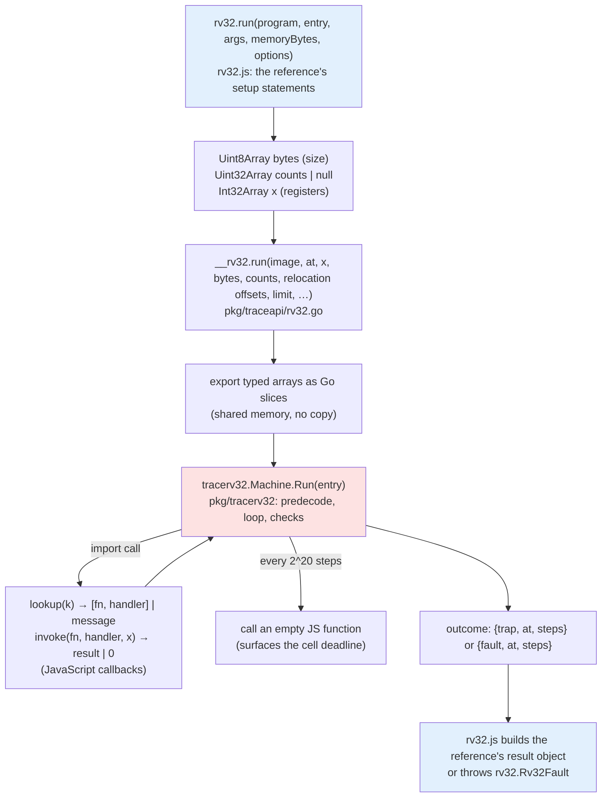

# A native RV32 interpreter and per-cell parameters for the compiler workbench

The trace REPL (`cmd/trace-repl`) is a local Go service that keeps goja JavaScript sessions alive between requests. Since PICOCALC-TRACE-WORKBENCH it can load the Typed compiler at any git revision, read repository files, run long work as background jobs and compare paired measurements. PICOCALC-RAY-PARITY then used it daily to optimize the RV32 backend of the Typed compiler, and recorded in its field notes what still pushed work out of the workbench. The two most serious items were the speed of the RV32 interpreter and the absence of a parameter channel. The interpreter, run by goja, needed about 12.6 seconds for one opening frame of the ray tracer, so a four-arm sweep took a minute. And because scripts received their parameters as globals, one script silently measured the parameters another script had left behind, and two measurements were wrong before anyone noticed.

PICOCALC-WORKBENCH-NATIVE fixed both, and three smaller items with them. This report explains how the native interpreter was made to agree exactly with the JavaScript reference interpreter, how that agreement was tested, what it costs and saves, and how per-cell parameters were made impossible to leak. The work is on the branch `worktree-agent-ac1fc97c8047752b6` of `/home/manuel/code/wesen/2026-10-20--ds-js-os`, in commits `849166a` to `1b3f4fe`, and has not been merged. It continues [[PROJECT REPORT - PicoCalc Compiler - From Trace REPL to Compiler Workbench - Seven Changes Tested Against a Real Compiler Study]], which describes the service, its packages and the first seven workbench changes.

> [!summary]
> - **`rv32` is the reference interpreter, run in Go.** `rv32.run(program, entry, args, memory, options)` returns the same result, trap flag, steps, guest bytes, registers, per-PC counts and fault messages as `picocalc-os/tools/rv32-interp.js`. The ray tracer's opening frame takes 53–92 ms natively and 23–46 s in goja under the same host load, a ratio of about 440–500.
> - **Agreement is tested, not assumed.** 4,000 seeded random programs, covering every trap and fault the reference can raise, agree field for field with the reference running in the same VM. The opening frame of the default and the stock compile agrees with digests recorded from the reference under Node. RAY-PARITY's own frame-profile script gives identical output on both interpreters.
> - **Parameters cannot leak.** Every cell and job sees a freshly parsed global `args`, set from `trace-repl eval --arg NAME=JSON` or `--args-file`, or `{}`. The binding is a non-configurable accessor, so the one declaration that could carry parameters into later cells, a top-level `let args`, is rejected by the engine.
> - **Three smaller changes.** `results.save` writes a record with the session, script digest, args, HEAD and compiler file digests; `stats.paired` returns per-block detail; `compiler.at(rev).world("files")` and `world("agenda")` work.

## Why this work was needed

### The interpreter was the bottleneck of every frame profile

A Typed compiler change in RAY-PARITY is judged first by the number of RV32 instructions the ray tracer executes for its opening frame, and by where they are executed. The tool that counts them is `picocalc-os/tools/rv32-interp.js`, a 213-line interpreter for the RV32IM subset that `typed-rv32.js` emits. It counts each executed word, checks the calling convention at every call and return, and faults on anything outside its subset. `picocalc-os/tools/typed-ray-bench.js` wraps it: `openingFrame(program)` builds the frame's guest memory, runs the function `typedRayFrame` with the opening pose, and checks that it returns 1.

In Node this takes 152 ms for the default compile (4,888,369 executed instructions at `2712684`) and 385 ms for the stock compile (15,532,634). In the workbench the same JavaScript runs in goja, a bytecode interpreter, and the field notes measured 12.6 s per frame. A frame profile with four compile arms is a minute of waiting, and it has to be a background job, which holds the session so that no other cell can run in the meantime. Tuning a planner heuristic in the workbench was therefore slower than in Node, which defeats the purpose of having the compiler and the measurement in one persistent session.

### Parameters passed as globals leaked between scripts

Workbench scripts are reusable: a frame profile takes its compile arms as input, a compile-cost sweep takes a board modes file and indices. Without a parameter channel, the invocation prepended `globalThis.ARMS = {...};` to the script on stdin. A session's globals persist across cells by design. In field-notes entry 5, a compile-cost script checked `globalThis.ARMS` before its own `MODES` input, found the single arm an earlier frame-profile cell had left, and measured only that arm, twice, before the mistake was found. The convention that followed, assigning one whole `globalThis.args` object per invocation, reduces the risk but cannot remove it: a script that forgets the assignment still reads the previous one.

## The reference interpreter and what "the same semantics" means

The Go interpreter had to be correct in one precise sense: indistinguishable from the reference on every program the reference accepts, and failing with the same message on every program it rejects. That rules out implementing RISC-V from the specification, because the reference differs from the specification on purpose. It accepts `jalr` only as `ret`, has no `mulhsu`, `divu` or `remu`, treats `ebreak` as a successful trap, and enforces an ABI. So the first step was a line-by-line reading of the reference, recorded in the ticket's design document. The points below are the ones a straightforward port gets wrong.

### Layout and setup

A program is the object `typedRv32.compile` returns: `image` (a `Uint8Array` of little-endian words), `entries` (function name to byte offset) and `relocations` (`[{offset, index}]`, import call sites). Before the loop the reference computes:

```js
const size = (memoryBytes.length + stackBytes + 15) & -16;   // a 32-bit AND
const bytes = new Uint8Array(size); bytes.set(memoryBytes);  // guest memory, stack above it
const counts = options.counts === false ? null : new Uint32Array(image.byteLength >>> 2);
const relocations = new Map(program.relocations.map(r => [r.offset, r.index]));  // later entries win
const x = new Int32Array(32);
for (const reg of CALLEE_SAVED) x[reg] = 0x12340000 + reg;   // sp gp tp s0-s11
x[2] = size; x[1] = -4;                                       // RETURN_TO_HOST
for (let i = 0; i < args.length; i++) x[10 + i] = args[i];   // ToInt32; more than 8 args overwrite s2…
```

The host frame records the callee-saved registers after the arguments are placed, so a program called with ten arguments must preserve the two that landed in `s2` and `s3`.

### The loop and the order of its checks

Each step does, in this order: increment the step counter and fault if it exceeds the limit; fault if the address is negative, beyond the image or misaligned; read the word; increment its count; and only then decode. The decoding order matters as much as the checks:

1. **A relocation is checked before the word is looked at.** At an import call site the word is never executed, whatever it is. An `ebreak` at a relocated offset is an import call, not a trap.
2. **`ebreak` is checked next** and ends the run with `{trap: true, at, steps}`. The faulting instruction is counted, and the `ebreak` is included in `steps`.
3. **The opcode switch** follows, with a fault for every form outside the subset.

At an import call the reference looks up `fn = imports[index]` and `handler = handlers[fn.name]`, faults if there is no handler, then faults if `sp` is not 16-byte aligned, and only then evaluates `fn.params.length` to slice the arguments. A missing handler is therefore reported before a misaligned stack, and an import without a `params` field fails with a `TypeError` only after the stack check.

### Arithmetic in JavaScript numbers

The reference computes in JavaScript numbers and stores into an `Int32Array`, which wraps by `ToInt32`. Most instructions wrap exactly as 32-bit two's-complement arithmetic does, but three cases do not:

- **Addresses are not wrapped.** A load computes `a + imm` as a number. With `a = 0x7fffffff` and `imm = 1`, the address is 2,147,483,648, not −2,147,483,648, and the bounds check reports that number. The port computes addresses in 64 bits.
- **A branch to −4 returns.** The loop condition is `at !== RETURN_TO_HOST`, evaluated before the address check. A branch or jump whose target is −4 ends the run as a normal return to the host.
- **Division goes through floating point.** `div` is `a / b` in double precision, truncated by the store. For 32-bit operands this equals truncating integer division. If the true quotient q = a/b is not an integer, its distance to the nearest integer is at least 1/|b|. The rounding error of the double quotient is at most |q|·2⁻⁵³ ≤ 2³¹·2⁻⁵³/|b| = 2⁻²²/|b|, which is smaller. Rounding can therefore never cross an integer, and truncation of the double equals truncation of the true quotient. Division by zero gives −1 for `div` and the dividend for `rem`; `MIN / −1` gives `MIN` and `MIN % −1` gives 0.

Two decoding details are easy to normalize away by mistake. Register shifts and `sub` are chosen by `f7 === 0x20`, so any other `f7` means `add` or `srl`, while the immediate `srai` is chosen by `f7 & 0x20`. And `slli` ignores `f7` altogether.

### The fault messages

Every fault is `throw new Rv32Fault(message + " at 0x" + (at >>> 0).toString(16))`, where `at` is the address of the executing instruction. The messages are fixed strings plus a decimal address, an import index, a register number or an opcode. A port that produced the same outcome but a different message would still break every script that matches on it, so the messages are part of the semantics.

## The design: split the interpreter at its loop

The interpreter has two parts of very different nature. The setup consists of JavaScript conversions: `ToInt32` of arbitrary argument values, `Uint8Array.set` from any array-like, a 32-bit `&` on the size, `??` defaults on the options. The loop consists of integer arithmetic on registers and bytes. The first is tedious and risky to reimplement in Go, and costs nothing. The second is where all the time goes.

So the interpreter is split at the loop. The session global `rv32` is a small JavaScript wrapper (`pkg/traceapi/rv32.js`) that executes the reference's setup statements unchanged, and then hands the typed arrays it built to Go:



Four properties follow from this split.

**The setup needs no Go implementation.** The conversions are performed by the engine that runs the reference, in the reference's order.

**No data is copied.** goja exports a `Uint8Array`, `Uint32Array` or `Int32Array` as a Go slice over the same buffer (`typedArrayObject.export` returns an `unsafe.Slice`). Go writes guest memory, counts and final registers directly into the arrays that the result object returns. `counts` is therefore a real `Uint32Array`, `bytes` a real `Uint8Array` view without the stack (so `bytes.buffer.byteLength === size`, as in the reference), and `registers` a real `Int32Array`. Scripts written for `typedRv32Interp`, including `typedRv32Interp.profile(program, result.counts)`, work unchanged.

**Imports keep the reference's expressions.** The wrapper passes two callbacks. `lookup(k)` evaluates `(options.imports ?? [])[index]` and `options.handlers?.[fn.name]` and returns `[fn, handler]` or the fault message `"no handler for import " + index`, with the index value exactly as the program gave it. `invoke(fn, handler, x)` evaluates `handler(...x.slice(10, 10 + fn.params.length)) | 0`. Go calls `lookup`, raises the missing-handler fault, checks `sp`, and then calls `invoke`, which is the reference's order. A handler that throws propagates its own exception unchanged.

**A long run still stops at the deadline.** A cell's deadline calls `vm.Interrupt`, which sets a flag that goja checks before every JavaScript instruction. A Go loop never looks at it, so `rv32.run(..., {limit: Infinity})` on a looping program would hold the session forever. goja's flag is private, but any call into JavaScript checks it. Every 2²⁰ steps the loop calls an empty JavaScript function. If an interrupt is pending, the call returns goja's `*InterruptedError`, the bridge re-panics it, and goja treats it as uncatchable, so the cell ends with the usual deadline message. The cost is one function call per million instructions.

A program at a revision is connected to the native interpreter through `compiler.at(rev).native`. Its `rayBench` is that revision's own `tools/typed-ray-bench.js`, evaluated with `new Function('globalThis', 'typedRv32Interp', text)` so that the bare name `typedRv32Interp` resolves to `rv32`. The revision's memory layout, arguments and result checks stay its own, and only the interpreter changes. `compiler.at(rev).rayBench` keeps the reference, so one cell can run both.

## The Go loop

`pkg/tracerv32` has no dependency on goja. Its central type is a machine over caller-provided memory:

```go
type Machine struct {
    Image       []byte        // read, and compared after each import call
    Memory      []byte        // guest memory; len is the reference's size
    Counts      []uint32      // or nil
    X           *[32]int32    // registers in and out
    Relocations map[int64]int // call-site offset -> index for Imports.Resolve
    Imports     Imports       // Resolve(index) -> (Call, missingMessage, error)
    Limit       int64         // a step with steps > Limit faults
    LimitText   string        // String(limit), for the message
    Poll        func() error  // every PollInterval steps
}
func (m *Machine) Run(entry int64) (Outcome, error) // *Fault, *RangeError, or a callback's error
```

**Predecoding.** Guest stores write guest memory, never the image, so the image is constant during a run and every word can be decoded once, before the loop, into an eight-byte record `{kind, rd, rs1, rs2, imm}`. Decoding follows the reference's order: a relocated offset becomes `kIMPORT` with its index, the `ebreak` word becomes `kEBREAK`, and every other word goes through the opcode switch. A word the reference would reject becomes `kFault` with the index of its message, and faults only when executed, which is when the reference faults. The single way the image can change during a run is an import handler writing `program.image`, and the reference would then execute the new words. After each import call the loop compares the image with its snapshot and re-decodes if they differ.

**The step.** In outline:

```go
for at != ReturnToHost {
    steps++
    if steps >= checkpoint {           // limit and poll share one comparison
        if steps > m.Limit { return fault("instruction limit " + m.LimitText + " reached") }
        if steps == pollAt { if err := m.Poll(); err != nil { return err }; pollAt += PollInterval }
        checkpoint = min(limitAt, pollAt)
    }
    if uint64(at) >= uint64(whole) || at&3 != 0 {   // slow branch only
        if at < 0 || at >= n || at&3 != 0 { return fault("instruction address outside program") }
        return &RangeError{Index: at}               // the partial trailing word
    }
    in := code[at>>2]
    if counts != nil { counts[at>>2]++ }
    a, b := x[in.rs1&31], x[in.rs2&31]
    next := at + 4
    switch in.kind { /* one case per operation; addresses in int64 */ }
    x[0] = 0
    at = next
}
```

**The partial trailing word.** The reference's address check admits any `at < image.byteLength`. For an image whose length is not a multiple of 4, the last one to three bytes pass the check, and the reference's `DataView.getUint32` then throws `RangeError: Index N is out of bounds` (goja's wording) before the word is counted. The design document had missed this. A predecoded loop that sizes `code` to whole words would index past it and panic, and goja does not turn a Go index panic into a JavaScript exception. The fix compares the address with the bytes covered by whole words, so the hot path keeps one comparison and only its slow branch tells an address fault from the `RangeError`.

**Two performance changes.** A benchmark loop of a load, a multiply, an add, a store and two branches ran at 96.2 million steps per second in the first version. Escape analysis (`go build -gcflags=-m`) reported `moved to heap: x`: the register file escaped because its address was passed to the import callback, so every register access went through the heap. Passing a copy to the callback keeps the file on the stack. And folding the limit test and the poll test into one `checkpoint` comparison removed one compare and branch per step. Together these raised the benchmark to 138.6 million steps per second. On the ray tracer, whose inner loop is heavier in multiplications and bounds checks, `rv32` runs at 50–115 million steps per second depending on host load.

## How agreement was tested

A passing unit test shows that the cases its author thought of behave as expected. Agreement with a reference needs a test in which the reference decides the expected values. The conformance gate therefore has three tiers, and in two of them the reference itself runs.

### Hand-written cases

`pkg/tracerv32/rv32_test.go` checks each documented edge with a small assembler: every decode fault raised only when executed, `MIN / −1`, division by zero, `mulh` of `MIN · MIN`, the `f7` selection of `sub` and `sra`, `slli` ignoring `f7`, an address of 2,147,483,648, a branch to −4, a relocated `ebreak`, the order of the missing-handler and misaligned-`sp` faults, a callee-saved register changed across a call, an import handler rewriting the image, and the partial trailing word.

### Random programs against the reference

`pkg/traceapi/testdata/rv32-differential.js` generates programs from a seed (mulberry32) shaped like compiler output: a prologue that saves `ra`, a body, an epilogue, one internal function and import call sites. The body mixes immediate and register ALU operations with random `f7` values, `lui`, loads and stores at offsets around a base register (sometimes out of range), forward and backward branches, `ebreak`, arbitrary 32-bit words, jumps out of the program, misaligned branch targets, calls, `sp` perturbations and writes to `x0`, `sp` and callee-saved registers. Memory length, arguments (up to twelve), stack size, step limit, counting, imports, handlers that throw and imports without `params` are drawn per case. Each case is run by the working tree's `rv32-interp.js` and by `rv32` in the same goja VM, and the outcomes are compared on every field: the thrown or returned state, the message, the error class, the result object's keys, `trap`, `result`, `at`, `steps`, and `counts`, `bytes` and `registers` element by element, including the length of `bytes.buffer`.

A differential test is only as strong as the outcomes it reaches, so the test also counts outcomes by category and fails if any category is missing. The 4,000-seed run produced 0 differences and these outcomes:

| Outcome | Cases |
|---|---|
| return | 183 |
| trap (`ebreak`) | 273 |
| instruction limit reached | 1,118 |
| memory access outside guest memory | 434 |
| instruction address outside program | 69 |
| callee-saved register changed across a call | 120 |
| return address does not match the call | 36 |
| unaligned `sp` at internal call / at import call | 19 / 9 |
| no handler for import | 174 |
| handler threw (`Error: boom`) | 121 |
| import without `params` (`TypeError`) | 17 |
| unknown entry | 95 |
| unsupported load / store / M / branch / jal / jalr / opcode | 362 / 271 / 338 / 186 / 116 / 1 / 58 |

The first version of this test did not finish in two minutes. Generated programs that looped and had no explicit limit ran the reference to its default of 50 million steps, which takes minutes in goja. The generator now records whether a program can loop (a backward branch, an arbitrary word or a perturbed epilogue) and always sets a small limit for those.

### The opening frame

The ray tracer at a pinned commit (`2712684`) was compiled with the default options and with `{policy: "stock"}`. The reference ran each frame under Node (`scripts/01-node-reference-frame.mjs`), and its digests are the test's fixture. `rv32` reproduces all of them:

| Compile | Image | Steps | SHA-256 of `bytes` | SHA-256 of `counts` | SHA-256 of `registers` |
|---|---|---|---|---|---|
| default | 11,964 B, `d9c25ef9…` | 4,888,369 | `430f0d50…2117625` | `b901ce56…` | `c431bb32…` |
| stock | 9,564 B, `813974db…` | 15,532,634 | `430f0d50…2117625` | `223167e5…` | `384e124d…` |

Both compiles render the same frame, so their `bytes` digests are equal; their counts differ because the programs do. `rv32.profile` and `rv32.classify` equal the reference's on every word of both images. A separate test, skipped under the race detector, also runs the reference in goja on the default frame and compares the arrays directly: they agree, at 23,199 ms against 53 ms.

## What the native interpreter saves

All measurements below ran on a host shared with other sessions, whose load average varied between 3 and 25 on eight cores. Absolute times vary by a factor of about two between runs; ratios measured inside one job are stable.

| Measurement | Reference in goja | `rv32` | Ratio |
|---|---|---|---|
| Default frame, one test (load ≈ 6.6) | 23,199 ms | 53 ms | 438 |
| Default frame, workbench job, native median of 5 (load 25 → 10) | 45,665 ms | 91.5 ms | 499 |
| Stock frame, same job | 112,401 ms | 228.4 ms | 492 |
| Node running the reference, for comparison | default 152 ms, stock 385 ms | | |

The most direct test of usefulness was RAY-PARITY's own frame-profile script. The unchanged script (`scripts/workbench/frame-profile.js`) ran as a job on the reference, and a port that differs only in choosing `c.native.rayBench` and `rv32.profile` ran as an ordinary cell. On three arms, the default, no loop versioning, and stock, the two outputs are identical in every field except the timings:

| Arm | Steps | Reference frame | Native frame |
|---|---|---|---|
| default | 4,888,369 | 18,092 ms | 86 ms |
| `{select: {version: false}}` | 7,814,225 | 27,927 ms | 104 ms |
| `{policy: "stock"}` | 15,532,634 | 64,035 ms | 163 ms |

The three-arm native profile took 0.67 s of wall time including the three compiles. That changes how the workbench can be used. A frame profile is now an interactive cell rather than a job that holds the session, and `rv32` is faster than Node running the reference, so there is no longer a reason to leave the workbench for frame-level measurements.

## Per-cell parameters

### The channel

`POST /sessions/{id}/eval` and `POST /sessions/{id}/jobs` accept an optional `args` field: one JSON object of at most 64 KiB. The CLI builds it from `--args-file PATH` and repeatable `--arg NAME=JSON` flags, where each `--arg` replaces the file's field of that name:

```sh
trace-repl eval --session "$sid" --arg rev='"2712684"' \
    --arg arms='{"default": {}, "stock": {"policy": "stock"}}' < frame-profile.js
```

Before every cell or job, the service parses the object with the session VM's own `JSON.parse` and makes it the global `args`. A cell sent without parameters sees a fresh `{}`. A job's view records the `args` it was submitted with, together with the SHA-256 and size of its source.

### Why resetting the global is not enough

Resetting a plain global property before each cell would still leave one leak. In a classic script, a top-level `let args = {...}` creates a binding in the global *lexical* environment, which shadows the global object's property for every later script in the realm. A cell that declared `let args` would therefore make every later cell read its value, whatever the service assigned to the property.

ECMAScript closes this case itself. During GlobalDeclarationInstantiation, a script's lexical declaration of a name fails if the global object has a non-configurable property of that name (`HasRestrictedGlobalProperty`), and a function declaration fails if the existing property cannot be redefined (`CanDeclareGlobalFunction`). So `args` is defined once per session as a **non-configurable accessor** on the global object: its getter returns the current cell's object and its setter replaces it until the cell ends. The accessor form matters a second time: a non-configurable data property can still be made read-only with `Object.defineProperty`, which would freeze one cell's parameters for all later cells, whereas no attribute of a non-configurable accessor can be changed.

The tests in `pkg/tracerepl/args_test.go` run each leak path and check that the next cell sees its own parameters:

| A cell does | Result |
|---|---|
| sends no `args` after a cell that sent some | sees `{}` |
| mutates its own `args` | the next cell with the same request gets a new parse |
| `globalThis.args = {legacy: true}` | works for that cell; the next sees `{}` |
| `var args = …` | works for that cell; the next sees `{}` |
| `let args`, `const args`, `class args {}`, `function args() {}` | rejected by the engine |
| `delete globalThis.args`, `Object.defineProperty(globalThis, 'args', …)` | `false` / `TypeError` |
| defines a closure that reads `args`, called by a later cell | reads the later cell's `args` |

### A defect found by using the channel

The first real use of `--arg` with a JSON value failed:

```text
invalid argument "rev=\"2712684\"" for "--arg" flag: parse error on line 1, column 5: bare " in non-quoted-field
```

Glazed registers its string-list fields as pflag `StringSlice` flags, and a `StringSlice` parses each value as CSV: it splits at commas and rejects quotes, which every JSON string and every JSON object with two fields contains. The unit tests had called the argument builder directly and never gone through flag parsing. `--arg` is now a cobra `StringArray` attached to the eval command after Glazed builds it, which keeps each value verbatim, and a regression test parses `arms={"a": 1, "b": "x,y"}` through cobra. The service's existing `--mount NAME=PATH` flag has the same latent problem for paths containing commas.

The client sends the `args` field only when there are parameters. Older services decode requests with `DisallowUnknownFields`, so a client that always sent `"args": null` would no longer work with them.

## The three smaller changes

**A result store (I5).** `results.save(name, value)` writes `NAME.json` in the directory given by `serve --results DIR`, by default the user cache directory's `picocalc-trace-repl/results`, so saving never writes into the repository. The record states what produced the value: the session, whether a cell or a job saved it and the job's ID, the SHA-256 and size of the source, the `args`, the repository root and the commit checked out at that moment, and every compiler revision the session loaded with its file digests (`compiler.loaded()`), so that a result computed from uncommitted compiler files still identifies them. The record is written to a temporary file and renamed. It is built in `tracerepl`, because only that package knows which cell is running, by a second runtime initializer that runs after the session's installer and shares its cell state. `GET /results/{name}` and `trace-repl results --name NAME` read it outside a session. The first record, from a compile-cost job, names `script.sha256 61b47471…`, which is the SHA-256 of the script file.

**Per-block detail from `stats.paired` (I6).** The field notes reported that `stats.paired` did not return the per-block values. It had returned them since W5, as `perPair`, but its help text did not name their fields and the scoring script dropped them. The change is therefore mostly documentation: `blocks: [{key, control, candidate, savedPct, outcome}]` under the names the notes asked for, and `spread`, the five-number summary of the blocks' savings, so a report can show how far the blocks disagree.

**Files and Agenda worlds (I2b).** `compiler.at(rev).world(name)` assembled only worlds with a `source.list`. Files and Agenda have none, so `world()` now uses built-in layouts taken from the firmware: `files_p4.c` compiles `files/files.typed` alone, and `agenda_p4.c` appends a newline and `agenda/entry.typed` to the reminder source. A port of RAY-PARITY's compile-cost script compiles all five worlds through `world()` in one 30-second job and saves its result with `results.save`.

## What using the workbench for this work showed

The measurements in this report were made through the workbench itself, on a service started for the ticket, with the CLI and `--arg`.

- **Good.** A frame profile became an interactive cell. The unchanged RAY-PARITY script ran against the new service with `--arg`, because its `args` convention and the new channel agree. Results carry their own provenance, and the client no longer has to redirect and unwrap output for saved values.
- **Bad.** A JSON string parameter needs shell quoting around JSON quoting (`--arg rev='"worktree"'`). The error message explains it, but a plain-string form would be easier.
- **Bad.** The CSV parsing of list flags was found only by using the CLI, not by its tests. CLI tests should go through flag parsing.
- **Unchanged.** A job still holds its session. With frame profiles now fast, this matters mainly for compile-cost sweeps.

## Open questions and next steps

- **The opcode table (I3b).** `tape.js` restates the compiler's operand-cell table. The design document proposes that `typed-rv32.js` export it as data (`typedRv32.tape.ops`, `{opcode: {name, cells}}`), read by its own decoder so that it cannot drift; the workbench then needs no change. Changing the compiler was outside this ticket.
- **Keeping `rv32.js` with the reference.** The wrapper's setup statements are copied from `rv32-interp.js`. The differential test reads the working tree's reference, so a change to the reference's setup will fail the test, but someone has to update the wrapper.
- **`--mount` and other list flags** should move to `StringArray`.
- **Overwriting results.** A save replaces a record of the same name. That suits re-running a sweep; two people sharing a service could overwrite each other.
- **Merging.** The branch has not been merged into `main`.

## Where things are

| Item | Location |
|---|---|
| Interpreter loop, decoder, profile | `pkg/tracerv32/{rv32,decode,profile}.go` |
| Session wrapper and bridge | `pkg/traceapi/rv32.{js,go}` |
| `compiler.at(rev).native`, `world`, `loaded` | `pkg/traceapi/compiler.js` |
| Conformance tests and generator | `pkg/traceapi/rv32_test.go`, `pkg/traceapi/testdata/rv32-differential.js`, `pkg/tracerv32/rv32_test.go` |
| Per-cell `args` | `pkg/tracerepl/service.go` (`InitRuntime`, `run`, `Cell`, `ValidateArgs`), `pkg/tracerepl/args_test.go` |
| `--arg`, `--args-file`, `--results`, `trace-repl results` | `cmd/trace-repl/main.go` |
| Result store | `pkg/traceresults/store.go`, `pkg/tracerepl/results.{go,js}` |
| User documentation | `cmd/trace-repl/README.md` |
| Design, as-built notes, diary, scripts, evidence | `ttmp/2026/11/21/PICOCALC-WORKBENCH-NATIVE--…/` |
| Requirements | PICOCALC-RAY-PARITY `reference/02-workbench-field-notes-the-trace-repl-as-the-center-of-compiler-optimization.md` |
