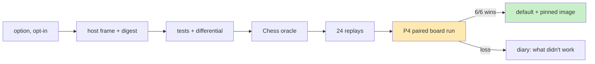
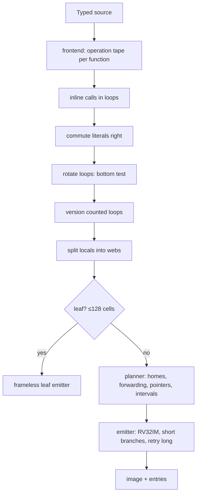

# Closing the Typed ray tracer's gap to C

The PicoCalc renders its ray-traced scene with a program written in Typed, a typed subset of JavaScript that the handheld itself compiles to RISC-V. One 160×160 frame took 45.1 ms on the ESP32-P4. The same algorithm written in C and compiled by GCC took 7.7 ms. This report follows the PICOCALC-RAY-PARITY ticket, which brought the Typed frame to 16.3 ms, 2.1× the C frame. It covers each change to the compiler, the measurement that admitted it, the mistakes made along the way, and where the remaining gap lies.

[[PROJECT REPORT - PicoCalc Compiler - The Typed Ray Tracer Odyssey - Why Three Days of Compiler Labs Moved the Frame So Little - A Technical Deep Dive]] explained why earlier compiler labs had moved the frame little. Each lab qualified one optimization on its own kernel, and none of them became the compiler's default. This ticket changed the method in three ways. Every option became cumulative: an option is first opt-in, then the default once the board confirms it. Every step was measured on the whole frame. And every step ended in a commit that pins the timed image.

> [!summary]
> - Fourteen code-generation options, each measured on the P4 against the previous default and then made the default. The frame went 45.14 → 16.26 ms and the shadow predicate 277.5 → 161.4 cycles, against 7.72 ms and 135.5 cycles for C.
> - The largest single steps were instruction selection (−20%), tape-level inlining with capacity homes (−23%) and versioned loops with live-range splitting (−16%). Versioning alone made the frame slower until locals in the two loop copies got separate live ranges.
> - Executed instructions now explain about 90% of the gap. Typed retires 2.0× GCC -O3's 2.45 M instructions per frame. Cycles per instruction differ by about 10%, and moving the buffer from PSRAM to internal RAM changes nothing.
> - The price is compile time. The ray tracer's cold compile on the device grew from 0.34 s to 1.45 s.

## Why this project exists

The user's goal for the ticket was "a super fast typed JS raytracer that is competitive with the C version". The PicoCalc compiles Typed programs on the device in a few hundred milliseconds. That on-device compile is the point of the platform, and it limits how much analysis the compiler can afford.

The ray tracer is a demanding test because its inner loops are dominated by three costs that GCC removes and a simple compiler does not:

- buffer reads with bounds checks
- small helper functions called once per pixel
- integer division by constants

## The measurement chain

Every change had to pass the same gates before it became the default. The gates exist because each catches a different kind of mistake.

| Gate | What it checks | Where |
|---|---|---|
| Host opening frame | executed RV32 instructions in the repository's interpreter, and a digest of the output image (`430f0d50…`) | `picocalc-os/tools/typed-ray-profile.mjs`, now `scripts/workbench/frame-profile.js` |
| Node tests | every pinned image; differential tests against the unoptimized `stock` policy at sizes that trap | `picocalc-os/tests/typed-rv32.test.mjs` (145 tests at the end) |
| 24 host replays | the Files, Editor, Agenda and Chess worlds end to end, on GCC-built reactors in `rv32emu` | `scripts/04-replays.sh` |
| Chess engine oracle | 6,981 result words of a Typed chess engine, and its executed instructions | `scripts/05-chess-engine-oracle.mjs` |
| P4 board run | paired timing in 6 blocks over 12 scenes; the C frame and predicate as references; the cold compile on the device, byte-checked against the host image | `scripts/10-stage-board.py`, `11-import-board.py`, scoring in the workbench |

A board run flashes a temporary diagnostic image, alternates the control and the candidate within each block, and then restores the playable firmware and checks that its eight worlds are healthy. An option became the default only when it won all 6 blocks on the frame.



## The progression

| Step | Change made default | P4 frame | × C | Predicate (cycles) | Ray cold compile |
|---|---|---:|---:|---:|---:|
| start | operand forwarding, capacity caching, leaf homes | 45.14 ms | 5.84 | 277.5 | — |
| 5 | saved homes, direct reads | 39.49 ms | 5.11 | 247.2 | +8% |
| 6 | instruction selection | 31.51 ms | 4.08 | 212.8 | 343 ms |
| 7 | inlining, capacity homes, nested weights, commutation | 24.18 ms | 3.13 | 200.1 | 605 ms |
| 8 | loop rotation, constant homes | 22.43 ms | 2.90 | 194.1 | +10.6% |
| 10 | shared homes, short forward branches | 20.20 ms | 2.61 | 181.7 | +15% |
| 11 | pointer homes | 19.31 ms | 2.50 | 171.9 | 888 ms |
| 13 | versioned loops, live-range splitting | **16.26 ms** | **2.11** | **161.4** | 1,455 ms |

The C frame stayed between 7.72 and 7.73 ms across every run, and the checked C predicate at 135.5–136.0 cycles. In host instructions the Typed frame went from 15.53 M (the `stock` policy) and 9.00 M (before instruction selection) to 4.89 M. GCC -O3 executes 2.45 M instructions for the same pixels.

## How the compiler is built

The Typed frontend (`picocalc-os/compiler/typed-wasm.js`) produces, for each function, an operation tape: a flat array of WebAssembly-like opcodes and their operands. A buffer read `work.charCodeAt(i)` becomes `local.set t; 0xf1 r t; i32.load16_u 1 4`. Here `0xf1` is a checked address: it compares t with the buffer's capacity header and traps when t is out of range.

The RV32 backend (`picocalc-os/compiler/typed-rv32.js`) lowers each tape in one pass. It keeps the operand stack in `t0`–`t4`. A plan computed before lowering says which locals live in registers ("homes"). Each function is emitted as soon as it is compiled, so code from one function cannot depend on functions compiled later.

Every optimization in this report is one of three kinds:

- **tape transforms**: inlining, commutation, rotation, versioning, splitting
- **planner decisions**: homes, forwarding, pointers
- **emitter choices**: instruction selection, branches



## The changes, in order

### Saved homes and direct reads (Step 5)

Before this ticket, only frameless leaf functions kept locals in registers. A function that called anything kept every local in its stack frame.

- **Saved homes** give the hottest locals callee-saved registers (`s1`–`s11`). The function pays a save and a restore per call, so a local needs a score above a margin to get one.
- **Direct reads** let `local.get` of a homed local push the home register itself instead of copying it to the operand stack. That copy is what made saved homes alone slower (13.18 M host instructions against a smaller baseline).

The score of a local is its reads weighted by 4 per enclosing loop, halved under each enclosing `if`.

### Instruction selection (Step 6)

Five small rules took 20% off the frame:

- I-type forms for literal right operands, and `x0` as the literal 0.
- Division and remainder by constants with magic numbers and `mulh`. `x / 255` becomes `mulh`, `add`, two shifts and a sign correction, following Hacker's Delight.
- A comparison feeding `if` or `br_if` fused into one conditional branch.
- A result that is stored straight into a homed local computed in the home.
- Frameless leaves reading their parameters in place.

### Inlining and capacity homes (Step 7)

After Step 6 the frame still made 77,131 calls. GCC inlines the C renderer's static helpers into the pixel loop. The Typed inliner works on tapes. At a call inside a loop, it copies the callee's tape, renumbers its locals and turns each `return` into a branch to the end of a value block.

An argument that is a plain local or a literal is substituted into the body, not copied. That matters for the next part. When a buffer argument stays the same local, the planner sees one unwritten buffer accessed many times and can give its capacity a register of its own (`operandLocations.capacities`). The capacity is then loaded once per call. This is sound because the host writes capacity headers, and a checked store at index i < capacity writes at 4 + 2i, so no store can reach a header.

The first inliner made the frame slower (9.47 M instructions against 9.00 M). It copied every argument, so the planner lost track of the buffer. And it inlined at every call site, which moved hot code into `typedRayFrame`, a function that makes calls and so could not use argument registers as homes. Substitution and inlining only inside loops (`maxLoopDepth: 2`) fixed both. Literal commutation (`c + e` → `e + c`) made the inlined code use I-type forms.

### Rotation, constant homes, shared homes and short branches (Steps 8 and 10)

- **Loop rotation** turns `block; loop; C; eqz; br_if 1; B; br 0` into a test before the loop and a bottom test, so each iteration ends with one backward branch.
- **Constant homes** keep literals that need a register, such as loop bounds compared by fused branches, in homes. The planner uses the emitter's own decision function (`constantForm`), so the two agree.
- **Shared homes** (`operandLocations.share`) let locals with disjoint live intervals use one register. An interval is the span from first to last tape occurrence, widened to a whole loop when the local also occurs before the loop. This works because Typed re-initializes every declaration inside a loop body on each iteration.
- **Short forward branches** emit a forward conditional branch as one instruction and patch it when the function is complete. If any target turns out to be beyond 4 KiB, the function is lowered again with long branches.

Together these cut the frame by 17%.

### Pointer homes (Step 11)

GCC addresses `work[1545 + x]` as one `lhu` from a pointer that it advances with the loop. The Typed backend recomputed `r + 2·index` (`slli`, `add`) for every access. For accesses `r[L + k]` and `r[L + M]` on an unwritten parameter, a pointer home holds

```
p = r + 4 + 2·(L + K0)          K0: the weighted median of the k values
```

The access after the bounds check then becomes `lhu 2(k − K0)(p)`. Every write of L updates p: one `addi p, p, 2c` for `L = L + c`, otherwise a recompute. Addresses are computed modulo 2^32 exactly as before, so accesses, stores and traps are unchanged.

### Versioned loops and live-range splitting (Step 13)

After pointer homes, 541,956 bounds checks per frame remained, and with their index arithmetic they cost about 975 k instructions. Removing them requires a proof that every access in a loop stays in range.

`select.version` handles rotated counted loops. The loop's counter k runs from k0 while k < N, and the only write of k is the final `k = k + s`. The transform collects every checked access whose index is one of:

- `a·k + b + c`, directly or through an affine local written once at the top of its region (`shadow = 4·sphere + 21`)
- `M + a·k + b`, with M unwritten in the loop
- a constant

The largest index over the whole loop is a·(N − 1) + b (+ M). One guard before the loop tests it against each buffer's capacity:

```text
block
  C; eqz; br_if 0                       ; the loop may not run at all
  block                                 ; guard: each failure leaves this block
    k < 0 ? → br_if 0                   ; omitted when `const c; set k` precedes
    N > 2^20 ? → br_if 0
    a·N + (b − a) ≥ cap(r) ? → br_if 0  ; per receiver and slope
    loop  B′ (accesses as 0xf3 r t j)  C  br_if 0  end
    br 1                                ; skip the checked copy
  end
  loop  B (unchanged, checked)  C  br_if 0  end
end
```

`0xf3 r t j` is a new unchecked address with the constant j folded into the displacement. If the guard holds, no access in the fast copy could trap in the original either. If it fails, the original runs, so traps keep their position and the stores before them.

On its own the transform made the frame 33% slower: 7.43 M instructions, with stack loads in `LitRow` going from 103 k to 613 k. The two copies used the same local ids, so every temporary's interval spanned both copies, and the shared-home test failed everywhere.

`operandLocations.split` repairs this. A web of a local starts at a write and contains every later occurrence inside the region of that write. In structured code, that write precedes the web's other occurrences on every path through the region. Each web after the first gets a fresh id, and a local read outside any open web is left alone. With splitting, the frame fell to 4.89 M instructions and 16.26 ms.

## What the measurements ruled out

- **Memory placement.** After Step 11 Typed was 1.75× C in instructions and 2.50× in time, which pointed at cycles per instruction. Typed's `work` buffer is in PSRAM, and the C renderer's tables are on the stack. A paired run that moved only that buffer to internal RAM changed the frame by 0.2%.
- **The wrong C reference.** The 1.75× figure used GCC -O2, the ESP-IDF performance setting. The board's C renderer is compiled inside `bench.c`, whose component adds `-O3`, and at -O3 it executes 2.45 M instructions. The real gap was 2.28× in instructions at the time, so instruction count, not cycles per instruction, explained most of it. The lesson was to read `compile_commands.json`, not the sdkconfig.

## Where the remaining gap is

At 16.26 ms the Typed frame executes 4.89 M instructions against C's 2.45 M. The hot listing of `LitRow` shows three remaining costs:

1. **Signed arithmetic on values that are never negative.** Each floor pixel spends 4 instructions on `x / 16` and on `y / 16`, 4 on `% 2`, and two sign corrections in each `/ 255` of `typedRayPack`, plus 4 on each `/ 8` and `/ 4`. GCC knows `x ≥ 0` because `x` counts up from 0, so it emits a shift, a mask and nothing for these. A non-negativity fact for loop counters and for products of non-negative values would remove most of them.
2. **The guard runs on every floor pixel.** The sphere loop's bound `count` is reloaded from `work` per pixel, so its 8-instruction guard runs 19,477 times per frame.
3. **Stack traffic for the inlined shadow test.** Its light vector still goes through stack slots on every floor pixel: about 105 k stack loads per frame.

Compile time is the other open problem. The ray tracer's cold compile is now 1.45 s on the device, and the doubled loops pass through every later phase.

## The workbench became part of the method

During the ticket, the trace REPL gained a compiler workbench. A separate subagent ticket, PICOCALC-TRACE-WORKBENCH, added `compiler.at(rev)`, `repo.read`, jobs and `stats`. The user then asked for it to become "the centerpiece of our compiler optimization workflow".

The ticket now keeps its measurement tools in `scripts/workbench/`:

- `frame-profile.js`
- `tape.js`, which uses a new `observeTape` hook in the compiler
- `hot-code.js`
- `compile-cost.js`
- the board scorer `15-score-board-workbench.js`

It also keeps a field-notes document on what works and what does not. Three findings from the notes shape the next workbench work:

- The RV32 interpreter takes 12.6 s per frame in goja, against 0.5 s in Node, so a native interpreter is the first improvement.
- Cells need a real parameter channel: a stale global from one script silently changed another script's arms twice.
- GCC, rv32emu and the board pipeline stay outside the workbench by design.

## Important project docs

- Ticket: `ttmp/2026/11/21/PICOCALC-RAY-PARITY--make-typed-compiler-optimizations-cumulative-and-close-the-ray-tracer-s-gap-to-c/`
  - `design-doc/01-how-the-typed-compiler-reaches-c-on-the-ray-tracer-an-intern-guide.md`: the phases and their status
  - `reference/01-investigation-diary.md`: Steps 1–13, with every board table and failure
  - `reference/02-workbench-field-notes-the-trace-repl-as-the-center-of-compiler-optimization.md`
  - `scripts/14-c-frame-instructions.mjs`: the C frame in instructions
- Compiler: `picocalc-os/compiler/typed-rv32.js`, in particular `inlineCalls`, `planLocations`, `planSavedHomes`, `versionLoops`, `splitLocals` and `checkedAddress`.

## Open questions

- Can a non-negativity fact be computed cheaply enough for an on-device compiler, or only inside versioned loops, where the guard already proves the counter's range?
- How much of versioning's compile cost is intrinsic? The doubled code passes through planning and emission, so it can only be reduced by versioning fewer loops or sharing analysis between the copies.
- Is the shared-home interval model good enough, or does the inlined code need a real live-variable analysis?

## Near-term next steps

- Non-negativity facts for division and remainder by constants.
- Rebuild the playable firmware with the new default and install it on the device. The board runs restored a firmware that predates this ticket.
- A survey and design for running a subset of the user's Candela path tracer on the P4. A subagent owns this, in its own ticket.

## Project working rule

An option is opt-in until a paired board run wins every block. Then it becomes the default, and the timed image is pinned in the tests. A result that cannot be traced to a committed file and digest is not a result.
