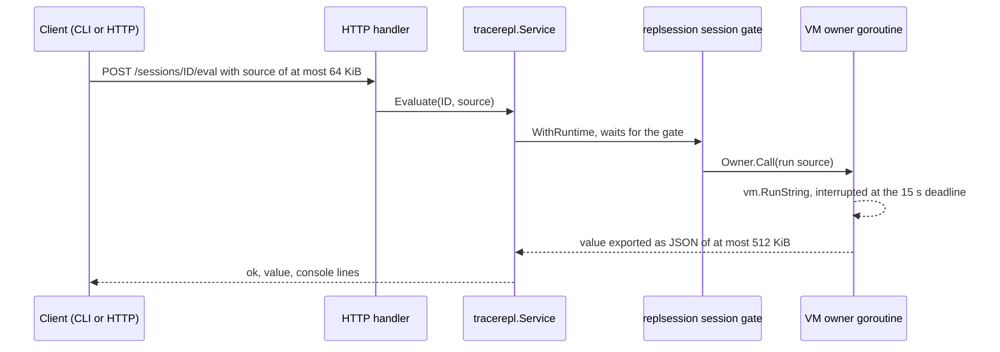
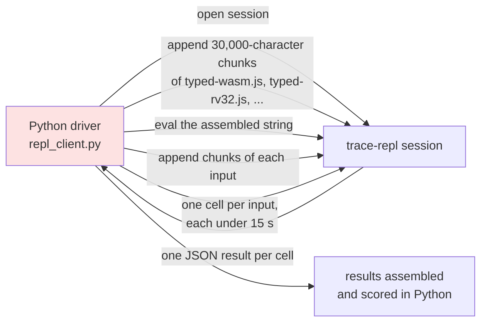
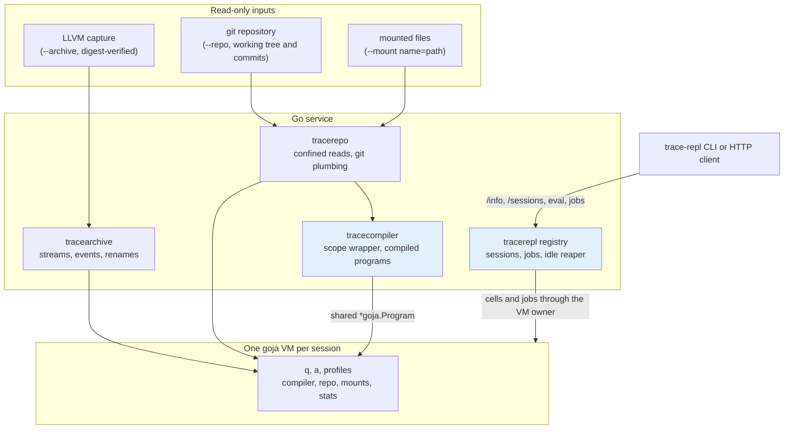
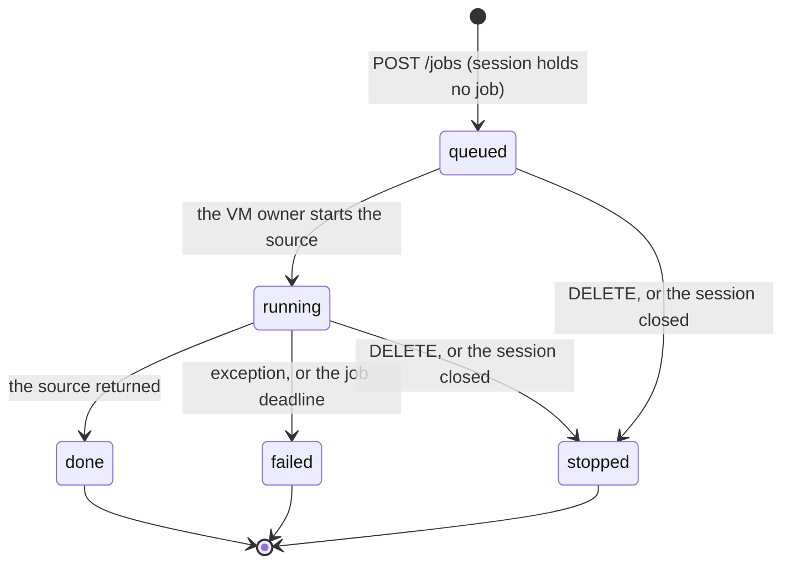
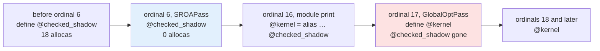

# From trace REPL to compiler workbench: seven changes tested against a real compiler study

The trace REPL is a local Go service that keeps JavaScript sessions alive between requests. It was built to answer questions about captured LLVM pass dumps of the PicoCalc ray tracer, and every answer carries a reference to verified bytes. On November 21, PICOCALC-RAY-PARITY used it as the main tool for a sequence of real changes to the Typed compiler and kept field notes while doing so. The notes showed that the REPL's most valuable use was not the query language. It was the persistent goja VM, which could hold the unmodified Typed compiler and compile with it repeatedly. That use was also the most awkward. The service had no way to load files except by evaluating them, it limited a cell's source to 64 KiB and its run time to 15 seconds, and so every compiler experiment was driven by a Python script that pushed source text into a session in 30,000-character chunks and then split the experiment into one cell per input.

PICOCALC-TRACE-WORKBENCH designed seven changes, W1 to W7, to remove those workarounds. This report describes how each was implemented and tested, and what the acceptance test showed. That test replaced RAY-PARITY's four Python drivers with REPL cells and background jobs, and it reproduced RAY-PARITY's recorded results exactly. The work is on the branch `worktree-agent-a2fb34f1ca31870f0`, in the worktree `/home/manuel/code/wesen/2026-10-20--ds-js-os/.claude/worktrees/agent-a2fb34f1ca31870f0`. It has not been merged. It continues [[PROJECT REPORT - PicoCalc Compiler - The Typed Ray Tracer Odyssey - Why Three Days of Compiler Labs Moved the Frame So Little - A Technical Deep Dive]]. That report's section "What the trace REPL contributed" assessed the REPL as an evidence tool and concluded that it made evidence more reliable without finding the compiler's problem. This report is about the REPL's second use, as the place where compiler candidates are compiled, compared and measured.

> [!summary]
> - **Several compiler revisions in one session.** `compiler.at("eaf0872")` and `compiler.at("3213028")` load the seven compiler and tool files of two revisions into one goja VM. A generated scope wrapper keeps them isolated. Go compiles the wrapper once, and every session runs the same compiled program.
> - **The other six changes.** Files and data now enter through `repo.read`, `repo.show` and `--mount` instead of `eval`. Long work runs as background jobs with their own deadline. A shared `stats` global replaces the median each study used to write for itself. `GET /info`, `GET /sessions` and idle reaping make a running service identifiable and keep its session count bounded. LLVM function timelines can follow a function across a rename.
> - **Acceptance.** RAY-PARITY's planner equivalence ran as one job: 836 compiles, 98 identical images, 168 identical errors and 0 mismatches, as recorded. Its board scores came out of one cell identical to the last floating-point digit. The whole set ran through the `trace-repl` CLI alone in 53 s.
> - **Two findings beyond the plan.** The planned rename detector, which matched function bodies by digest, fails on the case it was designed for, because GlobalOpt rewrites the body in the same pass that renames it. A goja estimate of compile cost agreed with the ESP32-P4 board only when the control and the candidate were interleaved inside one job.

## What the trace REPL was

### Captures, streams and references

The REPL serves one **capture**: a directory of LLVM `-print-after-all` dumps for one program. A capture holds several **variants** of the program. For example, `checked` is the ray row with bounds checks. Each variant has a **stream** for the middle end (`middle`) and one for the backend. A stream is a sequence of **prints**, one after each pass. Each print is an **event** numbered by its **ordinal** within the stream and labelled with the pass that produced it. A print shows either one function or the whole module. Its manifest records each stream's SHA-256. The service checks every stream against that digest before it answers any question about it.

A question is a **plan** built with the query builder `q` and evaluated with `q.run`. Each row of the result carries a reference of the form `{stream digest, ordinal, byte interval}`, so a reader can open the dump at exactly the bytes the row was computed from. A query for the passes that reduced the shadow kernel's alloca count looks like this. The W6 section shows what it returns, and why it first returned nothing:

```js
const kernel = a.variant("checked").function("kernel")
const allocas = q.ir.instructions().opcode("alloca").count()
q.run(kernel.timeline("middle").measure(allocas).changes()
  .where(c => c.status === "known" && c.delta < 0))
```

### The service and its guarantees

The service is `cmd/trace-repl`, built on go-go-goja's `replsession` package. The packages split the work as follows.

| Package | Responsibility |
|---|---|
| `pkg/tracearchive` | Opens a capture, verifies each stream's digest, and indexes its events by variant, phase, ordinal, pass and byte range. |
| `pkg/traceapi` | Installs the globals `q`, `a` and `profiles` into a goja VM. The query language is the embedded `query.js`. |
| `pkg/tracehardware`, `pkg/tracesimd` | Optional device timing and SIMD evidence, installed as `hardware` and `simd`. |
| `pkg/tracerepl` | Sessions, cell evaluation, limits and the HTTP handler. |
| `cmd/trace-repl` | The CLI: `serve`, `open`, `eval`, `close`. |

Five guarantees were part of the design from the beginning, and every change in this report had to keep them:

- The service listens only on loopback. It is a local research tool with no authentication, so it must not be reachable from another machine.
- Inputs are read-only and verified. Nothing a session does can change a capture, and a stream whose bytes do not match its digest is refused rather than queried.
- Every input a cell receives carries its digest. A result can always be traced back to the bytes it was computed from.
- Each VM is used by one goroutine. A `goja.Runtime` is not safe for concurrent use. `replsession` gives each session an owner goroutine, and the service runs cell code only through `rt.Owner.Call`.
- Sessions do not share JavaScript values. Data that originates in Go reaches a session as a fresh JS value built in that session's VM. An object created in one VM is never handed to another.

### What one cell does

A **cell** is one piece of JavaScript source sent to one session. The sequence below is the path of a cell before this work. The deadline of 15 seconds covers the wait for the session as well as the evaluation, because the session's gate admits one cell at a time.



The service limited a cell's source to 64 KiB, its result to 512 KiB and its time to 15 seconds, and it allowed 32 open sessions. The limits are reasonable for questions about a capture, whose answers are small and fast. They are the limits RAY-PARITY ran into.

### How it came to exist

The query language was designed in PICOCALC-TRACE-QUERY. PICOCALC-TRACE-REPL built the service and qualified its interface with blind agent personas, who were given tasks whose answers the supervisor already held. The compiler labs of November 21 then used it, and it now runs the original 26 compiler-evidence queries over LLVM dumps, emulator counts and ESP32-P4 timing captures. PICOCALC-RAY-PARITY was the first study that used it for a compiler change rather than for an analysis. This ticket is the result of that use.

## What a real compiler study needed: the field notes

RAY-PARITY's goal was to make the Typed compiler's opt-in improvements cumulative and then to reduce the ray tracer's gap to C. Its field notes, `analysis/01-using-the-trace-repl-for-compiler-work-field-notes-and-verdict.md`, are chronological observations with the exact errors. Notes N1 to N7 were written during the first phase of the work. N8 to N10 were added later and exist only on `main` (from `4e0dd35` on), which is why the workbench design cites seven notes and this report cites ten.

| Note | Observation | Consequence | Change |
|---|---|---|---|
| N1 | Five services ran on ports 3791–3795, started by earlier labs. No endpoint said what each had loaded. `GET /` returned 404. The help on port 3795 called its SHADOW-LLVM capture "the PicoCalc LLVM row archive". | Telling services apart needed `ps -eo args` and tmux session names. | W4 |
| N2 | The query language answered its questions with byte-exact references. `q.run(run.functions())` failed with `[notAPlan]`, with a correct suggested fix. | Known friction, no change needed. | none |
| N3 | SROA removed the shadow kernel's 18 allocas while the function was still `checked_shadow`. GlobalOpt renamed it `kernel` at middle ordinal 17. | `kernel`'s timeline shows no promotion at all. | W6 |
| N4 | A session can hold the Typed compiler. goja reproduced a cold-compile overhead that V8 hides: `operandLocations: {}` cost +24% of a ray compile. | The REPL's most useful role. The overhead led to the first compiler change of RAY-PARITY. | W1 |
| N5 | `typed-wasm.js` is 70,183 bytes, so evaluating it failed with `source exceeds 64 KiB`. The Editor source was rejected with HTTP 413. | `repl_client.py` appended 30,000-character chunks to a global string. | W1, W2 |
| N6 | 38 inputs × 7 option sets × 2 compilers stopped at `cell stopped at its evaluation deadline (at most 15s, including the wait for this session)`. | An external driver had to issue one cell per input. | W3 |
| N7 | Every study defined its own median and paired-block comparison. | Small inconsistencies, such as a median of paired percentages next to a percentage of medians. | W5 |
| N8 | Driver runs opened sessions and never closed them. After a day a service approached the limit of 32, with no list of idle sessions. | Services eventually refuse new sessions. | W7 |
| N9 | 167 KB of board rows were bound in six 30,000-character chunks and scored in the session. A follow-up Chess comparison was one more short cell against the same `rows`. | Keeping data in a session paid off. The chunked binding was the friction. | W2 |
| N10 | goja estimated the Phase 1 options at +2.2% of a ray compile (54.6 → 55.8 ms). QuickJS on the P4 measured +8.2% (307 → 332 ms). | goja can rank candidates. It does not replace the board's cold-compile row. | acceptance |

N4 deserves a closer look, because it explains why the workbench was worth building. On the PicoCalc, the Typed compiler runs on the ESP32-P4 under QuickJS, a bytecode interpreter. A developer machine normally runs the compiler under V8, which compiles hot JavaScript to machine code. A cost in the compiler's own code, such as building an empty planning structure for every function, is small under V8 and large under an interpreter. goja is also a bytecode interpreter, so it shows such costs in the same direction as QuickJS. In RAY-PARITY, a session showed that passing `operandLocations: {}`, which enables no policy, made a ray compile 24% slower. That located the cause in minutes. No other tool in the repository runs the unmodified compiler in an interpreter on the host with state that persists between questions.

N5 and N6 explain why that use was awkward. Before the workbench, a compiler experiment in the REPL had this shape:



The session held the compiler, but the experiment's control flow lived in Python. The REPL had become an RPC target.

## The design

The ticket's guide, `design-doc/01-turning-the-trace-repl-into-a-compiler-workbench-an-intern-guide.md`, turned RAY-PARITY's recommendations into seven changes. It also fixed what would not change. The query language would not grow features for compiler execution (decision D4). Compiling and running are plain JavaScript functions from the compiler's own files, and the query layer stays a language over archived evidence.

| Change | What it adds | Notes it removes |
|---|---|---|
| W1 | `compiler.at(rev)`: the Typed compiler at a git revision or the working tree, several side by side | N4, N5 |
| W2 | `repo.read`, `repo.show`, `repo.list`, and `--mount name=path` | N5, N9 |
| W3 | Background jobs with their own deadline | N6 |
| W4 | `GET /info` and help that names the loaded capture | N1 |
| W5 | A shared `stats` global | N7 |
| W6 | Function timelines that follow renames | N3 |
| W7 | Idle reaping and `GET /sessions` | N8 |

The changes were implemented in the order W4, W5, W2, W1, W3, W7, W6. W4 and W5 are small and independent, and each removes a field note immediately. W2 comes before W1 because the compiler provider reads its files through W2's repository object. W3 follows W1 because the work that needs jobs is a compiler sweep. W7 needs the session registry that W3 moved into the service. W6 was the lowest priority and went last.



Three further decisions were made during implementation and recorded in the guide:

- **D5: build on `replsession`, not `replapi`.** go-go-goja's `replapi.App` adds a durable store to `replsession`, with persistence, restore, history and a list of persisted sessions. A trace session's value is live VM state: compiled programs, module objects and large bound inputs. A store would hold nothing useful, and its session list would not show raw in-memory sessions. Sessions therefore stay in memory (`replsession.RawSessionOptions()`), and the session list and reaping live in `tracerepl`.
- **D6: the session registry belongs to the service.** The HTTP handler had kept a `live` map to enforce the 32-session limit. Jobs need per-session state, and reaping needs to know whether a session is busy. The service now owns one registry under one mutex. Cell admission, job submission, reaping and the session limit all read it, so they cannot disagree.
- **D7: detect renames from the alias declaration first.** This decision replaced the guide's first W6 mechanism. The W6 section explains why.

## W4: a service that says what it serves

N1 had two parts: nothing reported what a service had loaded, and the help text named the wrong capture. Both came from the same gap. The archive did not know its own name. `tracearchive.Archive` now records the capture's directory, a label read from the ticket's `index.md` (`{ticket, title, dir}`), the manifest's digest and a description of each stream. The query library reads the label through its bridge, and the first line of `q.help()` names the capture. On the SHADOW-LLVM capture that N1 complained about, it now reads:

```text
q — compiler-evidence queries over PICOCALC-SHADOW-LLVM (Following a checked floor shadow through LLVM
to executed RV32 instructions) (release 0.1.0). Globals: q, a (archive), profiles.
```

`GET /info` returns the inventory as JSON, and `trace-repl info` prints it. These are the top-level fields from the acceptance service:

```json
{
  "service": "trace-repl", "started": "…", "build": {…},
  "repo": {"root": "/home/manuel/code/wesen/2026-10-20--ds-js-os", "head": "…"},
  "mounts": [],
  "compiler": {"modules": [{"binding": "typedWasm", "path": "picocalc-os/compiler/typed-wasm.js", "required": true}, …],
               "cachedCommits": ["32130289737f…", "eaf087281dba…"]},
  "archive": {"label": {"ticket": "PICOCALC-ROW-IR", "title": "Trace the ray row through GCC and LLVM optimization passes", "dir": "…"},
              "manifestSHA256": "…", "streams": […]},
  "sessions": {"open": 3, "max": 32, "idleSeconds": 7200},
  "limits": {"sourceBytes": 65536, "resultBytes": 524288, "cellSeconds": 15, "jobSeconds": 1800}
}
```

`GET /` now lists the routes instead of answering 404. `tracerepl` stays independent of archives and studies: the inventory is a callback passed with `tracerepl.WithInventory`, and `cmd/trace-repl` assembles it.

The `build` field reports the binary's own revision when the Go toolchain stamped one. `go build` in a git checkout records `vcs.revision` and `vcs.modified`, and `go run` records nothing. A binary built inside a git worktree turned out to be stamped with the *main checkout's* HEAD (`4e0dd35`), not the worktree's (`c7a13e6`). A worktree's `.git` is a file rather than a directory, and the go command appears not to follow it. Worktree builds therefore use `-buildvcs=false`. `/info` always reports `repo.head` as well, which is the revision a researcher usually needs.

## W5: one statistics library

N7 found that each study had written its own median and its own paired comparison. Two studies could therefore report different numbers from the same rows. The difference between "the median of per-pair percentage savings" and "the percentage saved between the two medians" is enough to change a reported result. `pkg/traceapi/stats.js` is installed as the global `stats` in every session:

```js
stats.median(xs)                 // quantile type 7: the mean of the two middle values for an even count
stats.quantile(xs, p)
stats.summary(xs)                // {n, min, q1, median, q3, max, mean}
stats.percentSaved(control, candidate)   // 100 * (1 - candidate / control)
stats.paired(rows, {key, control, candidate, value, better})
// → {pairs, controlMedian, candidateMedian, medianPercentSaved, percentSavedOfMedians,
//    wins, losses, ties, better, method, perPair}
```

`stats.paired` takes rows of any shape. `key` names the field (or gives a function) that pairs a control row with a candidate row, typically the load block or round. `control` and `candidate` are predicates that select the two arms, and `better` says whether lower or higher values win. The function refuses data it cannot summarize honestly. It throws on a key that matches only one side (`unmatchedKey`), on two control rows with the same key (`duplicatePair`), on a row that both predicates select (`ambiguousRow`), and on a control value of zero (`zeroControl`). The earlier studies had checked these conditions by hand, when they checked them at all. The result reports `medianPercentSaved` and `percentSavedOfMedians` side by side, so a report cannot mix them up without the reader seeing both.

The percentage expression is `100 * (1 - candidate / control)`, the same one the board scripts used, and that choice matters more than it appears. `100 * (1 - 90 / 100)` evaluates to `9.999999999999998` in IEEE 754 doubles. A library that computed the same quantity as `100 * (control - candidate) / control` would return exactly `10`. Its results would then differ from every recorded study in the last digit, and an equality check against a recorded file would fail. The library's own test compares with a tolerance of 1e-9. The acceptance run compares with exact equality and passes.

## W2: files and data without eval

Before W2, the only way to get bytes into a session was to evaluate them as source, either as code or as a string literal. W2 adds a `repo` global and a `mounts` global. Both return the same file object:

```js
repo.read("picocalc-os/worlds/raytrace/raytrace.typed")          // the working tree now
repo.show("eaf0872", "picocalc-os/compiler/typed-rv32.js")        // committed content at a revision
repo.list("ttmp/2026/11/21")                                       // [{name, type, bytes}]
repo.resolve("HEAD")                                               // full commit SHA
mounts.board                                                       // a file named with --mount board=PATH
// each file: {path, revision, sha256, bytes, gzip, text} and a non-enumerable json()
```

`revision` is `"worktree"`, a full commit SHA or `"mount"`. A `.gz` file is inflated transparently. Its `sha256` names the file as stored, because that is the digest a reader can check against the file on disk.

The rules are what make this safe to add to a service whose inputs must be read-only and verified:

- A path is cleaned and must stay inside `--repo` after symlink resolution. A symlink inside the tree is followed. A symlink that leaves it is refused.
- A path with a `.git` component is refused. The interface is for repository content, and `repo.show` already reaches committed content.
- A revision name must match `^[A-Za-z0-9_][A-Za-z0-9._/@{}^~-]*$` and may not contain `..`. Git can therefore never parse it as an option or as a range.
- Git is accessed through read-only plumbing (`rev-parse --verify --quiet --end-of-options X^{commit}`, `cat-file -t/-s/blob`, `ls-tree -z -l`). Every call runs with `GIT_OPTIONAL_LOCKS=0`, so a read never writes the index, and has a 30-second deadline.
- A file is limited to 32 MiB and its inflated text to 64 MiB. Content at a commit is cached for all sessions, up to 256 MiB of text, and working-tree reads are never cached.

`--mount name=path` admits one file per flag, usually one outside the repository. The service reads and digests every mount once, at startup, so every session sees the same bytes and `/info` can report them. A session builds a mount's JS string only when a cell first reads `mounts.NAME`, so a session that never uses a large mount does not pay for it. Mount names must be JavaScript identifiers other than `list`, `help` and `toJSON`, which `mounts` uses for itself.

Why are files returned as JS objects built per session rather than as shared Go values? The fifth guarantee forbids sharing JavaScript values across sessions. The bridge builds each file object in the requesting VM with `vm.NewObject`. Go strings are immutable, so the text can be shared at the byte level without breaking the guarantee. Only the JS wrapper object is new for each session.

## W1: several compiler revisions in one session

W1 is the central change. It also needed the most care, because the Typed compiler's files were not written to be loaded twice.

### What has to be loaded

The compiler is five files in `picocalc-os/compiler/`, and RAY-PARITY's experiments used two tools from `picocalc-os/tools/` as well. They are classic scripts, not modules. Each wraps its body in an arrow function with `"use strict"`, publishes its module with an assignment to `globalThis`, and finds the other files in one of two ways:

| File | Publishes on `globalThis` | Reads |
|---|---|---|
| `typed-wasm.js` | `typedWasm`, `compileTyped` | `globalThis.typedAsync?.rewrite` (optional); `globalThis.__typedLexIndex`, a native lexer hook that only the P4 firmware provides |
| `typed-async.js` | `typedAsync` | bare `typedWasm` |
| `typed-world.js` | `typedWorld`, `compileTypedWorld`, `compileTypedWorldRv32` | bare `typedWasm` and `typedRv32`, only inside function bodies |
| `typed-rv32.js` | `typedRv32` | bare `typedWasm`; `globalThis.typedPieLoops` as a presence check, then bare `typedPieLoops.lower` |
| `typed-pie-loops.js` | `typedPieLoops` | bare `typedWasm` |
| `tools/rv32-interp.js` | `typedRv32Interp` | nothing |
| `tools/typed-ray-bench.js` | `typedRayBench` | bare `typedRv32Interp` |

### Why evaluating the files twice does not work

The obvious implementation evaluates revision A's files, then revision B's, and keeps references to both sets of module objects. That implementation produces wrong results without any error. A bare identifier such as `typedWasm` inside a classic script is looked up on the global object when the function runs, not when it is defined. After B is loaded, `globalThis.typedWasm` is B's. A's `typedRv32.compile` then calls B's front end. The comparison of A's image with B's would compare B's front end with itself, combined with two different backends. Nothing would fail.

A separate session per revision avoids the mixing but breaks the experiment differently. Sessions do not share values, so comparing two images would mean exporting both through the client as JSON. The equivalence check, `same(a.image, b.image)`, must run where both images exist.

### The scope wrapper

The service instead evaluates each revision inside a function scope that shadows `globalThis` and declares the bare names as `let` bindings. `pkg/tracecompiler/compiler.go` generates this wrapper:

```go
func wrap(texts []string, present []bool) (string, []int) {
	var b strings.Builder
	names := make([]string, len(Modules))
	for i, m := range Modules {
		names[i] = m.Binding
	}
	b.WriteString("(function () {\nconst globalThis = Object.create(null);\nlet " + strings.Join(names, ", ") + ";\n")
	line := 4
	var starts []int
	for i, m := range Modules {
		if !present[i] {
			continue
		}
		starts = append(starts, line)
		b.WriteString(texts[i])
		b.WriteString("\n;" + m.Binding + " = globalThis." + m.Binding + ";\n")
		line += strings.Count(texts[i], "\n") + 2
	}
	b.WriteString("return globalThis;\n})()\n")
	return b.String(), starts
}
```

The generated source for one revision has this form:

```js
(function () {
const globalThis = Object.create(null);
let typedWasm, typedAsync, typedWorld, typedRv32, typedPieLoops, typedRv32Interp, typedRayBench;
/* contents of picocalc-os/compiler/typed-wasm.js */
;typedWasm = globalThis.typedWasm;
/* contents of picocalc-os/compiler/typed-async.js */
;typedAsync = globalThis.typedAsync;
/* … the other five files … */
return globalThis;
})()
```

Inside the wrapper, `globalThis.typedRv32 = …` writes to the local shadow object, and a bare `typedWasm` resolves to the wrapper's `let` binding. Each revision therefore has its own set of bindings. Every detail of the wrapper is there for a reason:

- **The bindings are live.** `typed-world.js` loads before `typed-rv32.js` but names `typedRv32` only inside its functions. A `let` binding assigned after `typed-rv32.js` runs is visible to those functions when they are called later.
- **Each file is followed by a newline and a leading `;`.** A file can end in a `//` comment, which the newline terminates. Every file begins with `(`, so without the semicolon the next file's function expression would be parsed as a call on the previous file's result.
- **The shadow object has no prototype.** `Object.create(null)` means that a read of `globalThis.typedAsync` or `globalThis.__typedLexIndex` finds nothing, rather than a value that some user cell defined on the real global. A revision that predates `typed-async.js` cannot pick up another revision's copy.
- **The wrapper returns the whole shadow object.** `typed-wasm.js` and `typed-world.js` publish functions (`compileTyped`, `compileTypedWorldRv32`) that are not module objects, and the revision object exposes them as `globals`.
- **Missing optional files are skipped.** The two tools exist only from `eaf0872` on. At an older revision they are reported in `Missing`, and the revision still loads.

The wrapper was first checked in Node, before any Go was written (`scripts/01-w1-wrapper-check.mjs`). With `eaf0872` and `3213028` loaded into one realm, no global leaked and the module objects were distinct. The ray tracer compiled to byte-identical images under `{policy: "stock"}` (9,564 B) and the default (8,632 B), and to different images under the new `saved` and `direct` options (8,632 B against 8,048 B). The candidate's interpreter ran the default image's opening frame in 12,717,463 instructions, the figure RAY-PARITY had recorded.

### Compiled once, run per session

The Go side never touches a VM. `tracecompiler.Provider.At(rev)` reads the seven files through `tracerepo` and produces a bundle:

```go
type Bundle struct {
    Revision string        // full commit SHA, or "worktree"
    Files    []File        // {Path, SHA256, Bytes, Line}: Line is the wrapper line where the file starts
    Missing  []string      // optional files absent at this revision
    Key      string        // SHA-256 over the files' paths and digests
    Program  *goja.Program // the compiled wrapper
}
```

The wrapper is compiled with `goja.Compile`. A `*goja.Program` is not tied to a runtime, so every session that loads the same file set runs the same compiled program. Bundles at a commit are cached by commit. Programs are cached by `Key`, so reloading an unchanged working tree does not recompile either. Each cache holds at most 32 entries. The program's source never passes through a cell, so the 64 KiB limit does not apply to it.

In the session, `pkg/traceapi/compiler.go` binds a temporary `__compiler` bridge, runs the embedded `compiler.js` and deletes the bridge, the same pattern `traceapi.Install` uses for `__trace`. The bridge's `load` method runs the bundle's program with `vm.RunProgram` in the requesting VM and returns that VM's shadow object. Every session thus gets its own module objects from a shared compiled program, which keeps the guarantee that sessions share no JavaScript values. The JS side builds the revision object:

```js
const base = compiler.at("eaf0872"), work = compiler.at("3213028")
work.revision                         // "32130289737f9338dc56593d7803a54a69370b9a"
work.files                            // [{path, sha256, bytes, line}] for provenance
work.typedRv32.compile(source, imports, 96 * 1024, options)
work.globals.compileTypedWorldRv32    // every name the files published
work.interp, work.rayBench            // the two tools
work.ray                              // raytrace.typed at the same revision
work.world("editor")                  // {name, text, files} assembled from worlds/editor/source.list
work.read(path), work.typedSources()  // any file, and every worlds/**/*.typed, at the same revision
work.where(4127)                      // wrapper line → {path, line}, for stack traces
```

Everything that depends on a revision hangs off the revision object, so a base and a candidate cannot be mixed by accident. A commit's revision object is memoized for the session. `compiler.at("worktree")` re-reads the files on every call, because the working tree is the thing being edited.

## W3: background jobs

N6 was a deadline problem, but raising the cell deadline would have been the wrong fix. The 15-second deadline protects interactive use. A cell that waits for a busy session fails at its deadline instead of hanging the client. A job is a separate unit with its own deadline (default cap 10 minutes, set by `serve --max-job`), started by one request and collected by another.

| Request | Response |
|---|---|
| `POST /sessions/{id}/jobs` with `{"source": "…", "timeoutSeconds": 600}` | 202, `{"job": "job-…", "state": "queued", "timeoutSeconds": 600, …}` |
| `GET /sessions/{id}/jobs/{job}` | 200, the job with `state` and, once finished, `result` in the same form as a cell's |
| `GET /sessions/{id}/jobs` | 200, the session's jobs without results |
| `DELETE /sessions/{id}/jobs/{job}` | 200, the job after it stopped (waits up to 5 s) |



The implementation is in `pkg/tracerepl/jobs.go`:

```go
func (s *Service) Submit(id, source string, timeout time.Duration) (JobView, error) {
    // under s.mu: the session must be in the registry and hold no job
    ctx, cancel := context.WithCancelCause(s.lifetime)        // the service lifetime, not the HTTP request
    job := &Job{id: newID("job-"), state: JobQueued, timeout: min(timeout, s.maxJob), cancel: cancel, done: make(chan struct{})}
    entry.active = job                                         // from now on cells and jobs get 409
    go func() {
        runCtx, stop := context.WithTimeout(ctx, job.timeout)
        defer stop()
        result, err := s.run(runCtx, id, source, "job", job.timeout, markRunning)  // Evaluate's body
        // under s.mu: record done / failed / stopped, clear entry.active
    }()
}
```

Four choices in this code need explaining.

**A job's context derives from the service, not the request.** The client that submitted a job may disconnect, or may have used `eval --job --detach`, and the job keeps running. Closing the session or the service stops it.

**The old `Evaluate` body became `run`, with two parameters.** `what` names the unit ("cell" or "job") in interrupt messages. `started` is a callback that runs on the VM owner immediately before the source. The job is marked `running` exactly when its source starts on the VM, so a job waiting behind a cell is still reported as `queued`.

**A stop request is told apart from a deadline by the context's cause.** `DELETE` cancels with the cause `errJobStopped`. `stopReason` reads `context.Cause` and produces either "job stopped at its deadline (10m0s, including the wait for this session); bindings from earlier cells remain" or "job stopped by request; bindings from earlier cells remain".

**While a job runs, other work on that session is refused with 409.** The rejection names the job. The alternative was to queue the work, but then a cell submitted during a 10-minute job would wait and fail at its own 15-second deadline with a message about waiting, which hides the actual reason. Refusing immediately with `session is busy with job job-…; poll GET /sessions/{id}/jobs/job-…, or stop it with DELETE (trace-repl job --stop)` tells the client what holds the session. Other sessions are unaffected, because each has its own VM and owner goroutine.

On the CLI, `eval --job [--job-timeout N] [--detach]` submits a job and by default waits for it. Ctrl-C while waiting sends `DELETE`, so interrupting the client stops the work on the service. `trace-repl job --session S --job-id J [--stop]` collects or stops a job. A session keeps its last 16 finished jobs. The registry this needed, decision D6, is the per-session entry `{created, lastUsed, cells, jobCount, jobs, active, busy}` held by the service.

## W7: session lifetime

N8 found services that slowly filled up with sessions nobody would use again. W7 unloads a session after `--idle` (default 2 hours, `0` disables) without use. `GET /sessions` lists `{id, created, lastUsed, idleSeconds, cells, jobs, activeJob, busy}`, and `trace-repl sessions` prints the same list.

The rule for "idle" is the part that needs care. A session that is evaluating a cell, waiting for its gate, or running a job is never idle, however long that takes. Its idle time starts when the work ends. The reaper decides and unregisters under the same lock that `claim` (cell admission) and `Submit` take:

```go
func (s *Service) reapIdle(now time.Time) []string {
	var victims []string
	s.mu.Lock()
	for id, e := range s.live {
		if e.busy == 0 && e.active == nil && now.Sub(e.lastUsed) > s.idle {
			victims = append(victims, id)
			delete(s.live, id)
			s.expire(id, "expired after "+s.idle.String()+" idle")
		}
	}
	s.mu.Unlock()
	for _, id := range victims {
		_ = s.sessions.UnloadSession(context.Background(), id)
	}
	return victims
}
```

A cell that claims a session before the reaper looks keeps it, because `busy` is then nonzero. A cell that arrives after the reaper removed the session gets a 404 that explains itself: `session ID expired after 2h0m0s idle; its bindings are gone, open a new session (trace-repl open)`. The last 256 expired IDs keep that explanation. A session is unloaded outside the lock, after it has left the registry. In that interval `replsession` still holds the VM, but nothing can reach it, because every entry point checks the registry first.

`reapIdle` takes the clock as a parameter, so the tests check the rule by moving time forward instead of sleeping. One end-to-end test covers the reaper goroutine itself, with an idle time of 50 ms. Moving the session count from the handler into the registry also means a released or reaped session frees capacity immediately.

## W6: following a function across a rename

### The case

The SHADOW-LLVM capture compiles a checked floor-shadow kernel. The source defines `@kernel` as an alias of `@checked_shadow`. Early in the middle end, the function prints are of `checked_shadow`. At ordinal 6, SROA promotes its 18 allocas to SSA values. At ordinal 17, GlobalOpt resolves the alias: the function is renamed `kernel` and `checked_shadow` disappears. A query over `kernel`'s timeline starts at 17 and finds no alloca changes, because by then there are none left. That is field note N3.



### The planned rule, and why it failed

The guide proposed a rule based on body identity. During indexing, compute a digest of each function body in each print. When a name first appears in a module print with the same body digest as a name that disappears in that print, record a rename. The guide added that a rename which also changes the body cannot be detected this way.

The first probe of the capture, `scripts/09-find-renames.py`, found the event at ordinal 17 and no matching body. A diff of the last `checked_shadow` body, printed at ordinal 16, against `kernel` at 17 (`scripts/10-diff-renamed-body.py`) is 37 lines long. The definition line and every call changed in the same pass that renamed the function:

```llvm
; ordinal 16, CalledValuePropagationPass on [module]
define internal i32 @checked_shadow(ptr noundef %ctx, i32 noundef %x, i32 noundef %y) #0 {
  %call = call i32 @checked_read(ptr noundef %ctx, i32 noundef 17) #5, !range !4
; ordinal 17, GlobalOptPass on [module]
define dso_local i32 @kernel(ptr noundef %ctx, i32 noundef %x, i32 noundef %y) local_unnamed_addr #0 {
  %call = call fastcc i32 @checked_read(ptr noundef %ctx, i32 noundef 17) #4, !range !4
```

In the same pass that resolves the alias, GlobalOpt moves the internal callee `checked_read` to the `fastcc` calling convention, which changes every call site and the attribute group the calls refer to. The rename that motivated W6 is exactly the kind the guide's rule cannot see.

### The rule as built

The module print at ordinal 16 already states the identity: `@kernel = dso_local alias i32 (ptr, i32, i32), ptr @checked_shadow`. LLVM printed that the two names denote one function. `pkg/tracearchive/renames.go` therefore uses the alias declaration as the primary evidence and body identity as a secondary rule. It makes one pass over each verified stream. It keeps the latest body digest of every name, taken from function prints as well as module prints, and the definitions and aliases of the previous module print. At each module print, a newly defined name is a rename when one of two conditions holds:

```go
if from, ok := prevAliases[to]; ok && prevDefs[from] != "" && defs[from] == "" {
    r.From, r.Method, r.AliasOrdinal = from, "alias", &at   // declared alias, aliasee now gone
    out = append(out, r)
    continue
}
var candidates []string
for from := range prevDefs {
    if _, still := defs[from]; !still && latest[from] == defs[to] {
        candidates = append(candidates, from)                // vanished name with exactly this body
    }
}
if len(candidates) == 1 {
    r.From, r.Method, r.BodySHA256 = candidates[0], "body", defs[to]
    out = append(out, r)
}
```

The body rule compares the new body with the *latest* body of each vanished name, so a function pass that changed the old body between two module prints is accounted for. Two vanished names with the same body are ambiguous, and the rule records no edge rather than choosing one. A rename that changes the body and leaves no alias is still not detected. Detection runs in Go, at the bytes, because Go already holds every verified stream. Scanning every module print in JavaScript, in every session, would repeat that work.

### What the query language does with it

Three additions consume the rename edges:

- `run.renames()` lists them: `{phase, ordinal, pass, from, to, method, aliasOrdinal?, bodySHA256?, ref}`.
- `function(name).aliases()` returns the earlier names, newest first.
- `timeline(phase, {follow: true})` uses each earlier name for the ordinals before its rename.

The difficult part was making "the name at this ordinal" hold everywhere a function's body is selected from a print. The places are membership in the timeline, `measure()`, picked states (`.at(n).after` and `.before`) and argument references such as `kernel.argument(0)`. Missing one of them would make that operation report `absent` for the earlier ordinals, or throw `functionMismatch`. The query library's function snapshots are cached objects shared between plans. The followed path therefore passes a shallow copy carrying `aliasOf`, and `ArgumentRef.resolve` accepts a snapshot whose `aliasOf` is its own function. Measurement and change rows of a followed timeline carry `function` (the name in that print), `followedAs`, and at the rename `rename: {from, to, method}`. Following is opt-in, so no existing timeline or recorded result changes.

On the SHADOW-LLVM capture (`scripts/08-follow-renamed-kernel.js`, result in `various/06-follow-renamed-kernel.json`):

```js
run.renames()
// [{phase: "middle", ordinal: 17, pass: "GlobalOptPass", from: "checked_shadow", to: "kernel",
//   method: "alias", aliasOrdinal: 16}]
q.run(kernel.timeline("middle").measure(allocas).changes().where(c => c.status === "known" && c.delta < 0)).rows
// []
q.run(kernel.timeline("middle", {follow: true}).measure(allocas).changes().where(c => c.status === "known" && c.delta < 0)).rows
// [{ordinal: 6, pass: "SROAPass", before: 18, after: 0, delta: -18, function: "checked_shadow"}]
```

The rows at ordinals 15, 16, 17 and 18 name `checked_shadow`, `checked_shadow`, `kernel` (with the rename) and `kernel`. The ROW-IR capture has no renames.

## Tests

Every change has tests in the package it changes. The branch adds 28 test functions, and `go test ./...`, `go test -race ./...` and `go vet ./...` pass in all eight packages. `pkg/traceapi` takes 13 s normally and 90 s under the race detector.

| Change | Tests | What they establish |
|---|---|---|
| W4 | `TestLabelAndStreamsDescribeTheMountedCapture`, `TestInfoReportsInventorySessionsAndLimits`, `TestInfoNamesTheMountedCapture` | The archive knows its ticket and title. `/info` reports the inventory, sessions and limits. The CLI's `info` names the loaded capture. |
| W5 | `TestStatsFixtures`, `TestStatsPairedComparison`, `TestStatsRefusesWhatItCannotSummarize` | Quantiles on fixed fixtures. Pairing, wins and the two percentages. Every error code. |
| W2 | `TestReadIsConfinedToTheRepository`, `TestShowReadsCommittedContentAtARevision`, `TestListWorktreeAndRevision`, `TestMountsAreReadAndDigestedAtStartup`, `TestRepoAndMountsInASession`, `TestMountAndRepoFlagsAreChecked` | A generated two-commit repository with a symlink inside the tree, one leaving it, a gzip file and a sparse file over the cap. Revision grammar, `.git` refusal, mount names and lazy getters. |
| W1 | `TestWrapSeparatesFilesAndRecordsLines`, `TestCompilerRevisionsCoexistInOneSession`, `TestWorktreeCompilerReportsFileDigests` | `eaf0872`, `3213028` and `14c95b5` in one VM. Ray images stock 9564/9564/9564, default 8632/8632/8632, saved+direct 8632/8048/8048. No leaked globals and distinct module objects. `25cd108` loads with both tools missing. Worktree digests match the files on disk. |
| W3 | `TestJobRunsPastTheCellDeadlineAndHoldsTheSession`, `TestStoppingAJobInterruptsIt`, `TestJobDeadlineIsCappedByTheService`, `TestClosingTheSessionStopsItsJob`, `TestJobHTTPProtocol`, `TestEvalJobThroughTheClient` | A job outlives the cell deadline and returns 409 to cells meanwhile. Stop, the deadline cap and session close each produce the right state and message. The HTTP protocol and the CLI. |
| W7 | `TestIdleSessionIsUnloadedAndExplained`, `TestBusySessionsAreNotReaped`, `TestSessionListAndLimitCountTheRegistry`, `TestIdleZeroKeepsSessionsAndTombstonesAreBounded` | Reaping by the goroutine, 404 with the reason, busy sessions and job sessions kept, capacity freed, `--idle 0`, and the tombstone bound. |
| W6 | `TestRenamesFollowGlobalOptAliasResolution`, `TestRenamesByIdenticalBody`, `TestFollowedTimelineCrossesGlobalOptRename` | Exactly one alias rename on SHADOW-LLVM and none on ROW-IR. Body renames on a synthetic stream, including an ambiguous twin. Followed and unfollowed alloca history, argument references, picked states and a misspelled option. |

## Acceptance: RAY-PARITY's drivers as cells and jobs

The acceptance test was to repeat RAY-PARITY's REPL work without its workarounds and get the same numbers. The replacements are in the ticket's `scripts/`. `scripts/06-run-acceptance.sh ADDR` runs all of them through the `trace-repl` CLI and saves the results in `various/00`–`04`. It took 53 s. The service ran with `--repo` set to the main checkout, because RAY-PARITY's board inputs are untracked files there and not in git.

| Replaced driver | Replacement | Result |
|---|---|---|
| `01-open-compiler-session.py`, `repl_client.py` | `02-open-compiler-session.js`, one cell | Both revisions and 38 inputs (330,186 characters) bound in 0.44 s. |
| `02-planner-equivalence.{js,py}`, one cell per input | `03-planner-equivalence.js`, one job | 836 compiles in 32–39 s. RAY-PARITY's seven arms: 98 identical, 168 identical errors, 0 mismatches, equal to the recorded file. |
| `03-compile-cost.py`, one cell per compile | `04-compile-cost.js`, one job using `stats.paired` | Paired by round, previous default → candidate: ray +9.3% compile time, Chess +6.1%, Editor +1.8%. |
| `08-score-board.{js,py}`, rows bound in chunks | `05-score-board.js`, one cell using `repo.read` and `stats.paired` | `14-board-scores.json` reproduced exactly, including serialization. |

### The planner equivalence as one job

The equivalence job compiles every input with the backend at `eaf0872` (control) and at `3213028` (candidate) under eleven option sets, and compares image bytes, or error messages where both compilers refuse the input. Its core is short, because both compilers live in the same VM:

```js
const base = compiler.at('eaf0872'), work = compiler.at('3213028');
const compile = (c, src, imports, opts) => {
  try { return { ok: true, image: c.typedRv32.compile(src, imports, 96 * 1024, opts).image }; }
  catch (e) { return { ok: false, error: String(e.message) }; }
};
// for each input and arm:
const a = compile(base, src, imports, opts), b = compile(work, src, imports, opts);
if (a.ok && b.ok && same(a.image, b.image)) …            // identical image
else if (!a.ok && !b.ok && a.error === b.error) …         // identical refusal
else …                                                     // mismatch, with both sizes or errors
```

The first seven arms are RAY-PARITY's. A further arm names `{policy: "stock"}` explicitly, and the last three are the options that are new in `3213028` (`saved`, `direct`, `savedDirect`). `eaf0872` ignores option keys it does not know, so only those three arms may differ. The job reads RAY-PARITY's recorded result with `repo.read` and reports whether it agrees. A reproduction claim is therefore a field of the result, not a comparison done by hand afterwards. The seven arms agree. `stock` and `default` are identical on all 14 inputs that compile. All 41 mismatches are in the three new arms. For the ray, `saved` grows the image from 8,632 to 8,984 B, `direct` shrinks it to 8,280 B and the two together to 8,048 B. Under `savedDirect`, the Chess world shrinks from 45,348 to 42,120 B and Editor from 74,188 to 67,552 B.

### The board scores as one cell

`05-score-board.js` reads RAY-PARITY's 1,932 normalized board rows (`various/13-board/rows.json`, sha256 `c505fdae…`) with `repo.read`. It scores them with `stats.paired` by load block, then walks the result and RAY-PARITY's recorded `14-board-scores.json` side by side and lists every path where they differ. The list is empty, and `JSON.stringify` of both is identical, key order and floating-point digits included. For example, with the empty-packet exit (`pie-empty`) enabled in both arms, the frame drops from 46,011.5 µs under the previous default to 42,559 µs under the candidate, 7.5% saved with all 6 blocks won, and the scalar predicate saves 10.87%. The cell takes 57 ms. In RAY-PARITY, the same rows went into the session in six chunks.

### What compile cost in goja does and does not show

The compile-cost job interleaves the three arms round by round, so drift in host load affects them equally. Its medians, in ms, for stock, the previous default and the candidate:

| Program | Stock | Previous default | Candidate | Paired candidate overhead | Rounds won by candidate |
|---|---|---|---|---|---|
| ray | 20.4 | 21.4 | 23.5 | +9.3% | 0 of 9 |
| Chess | 348.1 | 349.7 | 371.7 | +6.1% | 0 of 5 |
| Editor | 886.4 | 900.2 | 911.7 | +1.8% | 1 of 3 |

The absolute times are about half of RAY-PARITY's medians for the same compiles (ray 21.4 against 54.6 ms, Chess 349.7 against 796.8 ms). One possible cause was the loading method: `repl_client.py` evaluated the compiler with indirect `eval`, while the workbench runs a precompiled program. `scripts/07-loading-method-cost.js` loaded the same `3213028` compiler both ways in one session. It compiled identical images in the same time (ray 22.3 against 22.1 ms, Chess 296.0 against 296.5 ms). The remaining explanation is host load: five services and several builds were running while RAY-PARITY measured. Absolute goja times therefore cannot be compared across sessions or days.

The relative numbers are more useful. The board measured the candidate's cold-compile overhead on the ESP32-P4 under QuickJS as +8.19% for the ray and +4.26% for Chess (`14-board-scores.json`). The paired job measured +9.3% and +6.1%. RAY-PARITY's medians of separately evaluated cells had given +2.2% and +1.2%, which is what N10 recorded as goja understating the P4. With n = 9 and n = 5 rounds this is one observation, not a calibration. It is consistent with a simple explanation: separate cells spread the arms over time, and drift between cells is as large as the effect being measured. Interleaving inside one job removes that drift, and jobs make interleaving practical, because an interleaved sweep cannot be split into one cell per input.

## What did not work

Several things failed during the work. Each is recorded in the ticket's diary with the exact diagnostic, and each is listed here because it bears on anyone extending the service.

- **The guide's rename rule.** The body-digest rule found the rename event but no matching body, as described in the W6 section. The alias rule replaced it as decision D7.
- **Building in a worktree.** The worktree was 228 commits behind `main` and was fast-forwarded. The repository's `go.mod` then failed with `replacement directory ../go-go-golems/go-go-goja does not exist`, because its relative `replace` assumes the main checkout's location. A `go.work` file in the scratchpad, with an absolute `replace`, fixed the build. The VCS stamp problem described under W4 appeared next.
- **The first Node check of the wrapper.** It called `compileTypedWorldRv32(chess, 0)` and failed with a `DataView` `TypeError`, a misuse of the function's arguments. The check was rewritten to use `typedRv32.compile(chess, typedWorld.imports, …)`, the call the acceptance scripts also use.
- **A median that was not 10.** `stats.paired` returned `9.999999999999998` for a fixture that a hand calculation gives as 10. The library kept the expression the recorded studies used, and the test compares with a tolerance.
- **Mount order.** `JSON.stringify(mounts)` listed mounts alphabetically, because the bridge marshalled a Go map. A struct (`MountInfo`) and an ordered list restored the order given on the command line.
- **`where()` reading the wrong files.** The first version mapped a wrapper line through the bridge. For a `"worktree"` revision this re-read the files, so after an edit it could map a stack trace against files other than the ones loaded. The mapping now uses the loaded bundle's line table, in JavaScript.
- **Timing tests under the race detector.** A test returning a 600 KB result exceeded a 200 ms cell cap, and a measured elapsed time of 0.3998 s failed a bound of 0.4 s. A W7 test wrote the service's idle setting while the reaper goroutine read it, and the race detector reported it. The tests were changed. The service code was not at fault in any of these cases.
- **A wrong synthetic fixture.** The first body-rename fixture claimed that two vanished functions had the same body. Only one did, and the detector correctly reported a rename the fixture called ambiguous. A second function with the same body now makes the ambiguous case real.
- **Board inputs outside git.** RAY-PARITY's board rows and recorded scores are untracked files in the main checkout, so the worktree did not have them. The acceptance service therefore ran with `--repo` pointing at the main checkout, read only through plumbing with `GIT_OPTIONAL_LOCKS=0`.

## Open problems

- **The branch is not merged.** `main` has moved since the branch was fast-forwarded, including concurrent work on `picocalc-os/compiler/typed-rv32.js`. The branch changes no file in `picocalc-os/compiler/` or `picocalc-os/tests/`, so a conflict is unlikely, but the merge has not been tried. The services on ports 3791–3795 run older builds and have none of these features until they are restarted from merged code.
- **The acceptance run depends on untracked files.** Once RAY-PARITY commits `various/13-board/` and `14-board-scores.json`, `06-run-acceptance.sh` should be rerun against a service with the default `--repo`.
- **goja against the board needs more than one comparison.** The paired job agreed with the board for one change and two programs. Before a goja estimate stands in for a board measurement, several changes should be measured both ways.
- **The compile-cost arms mix two costs.** The candidate ran on the `3213028` backend and the previous default on `eaf0872`. An arm running `3213028` with the previous options would separate the cost of the new options from the cost of the backend's other changes.
- **Rename detection is incomplete.** A rename that changes the body without an alias is not detected. Rename chains longer than one are handled by `aliasChain` but appear in no capture in the repository, so only a single rename is tested on real data. `follow` is opt-in. Making it the default for functions that have aliases would first need a check that no recorded workbook result changes.
- **Jobs and sessions live in memory.** A service restart loses both, by decision D5. A job's result is limited to 512 KiB, like a cell's. A session runs one job at a time, so parallel sweeps need several sessions. Each such session has to load the compiler again, which costs a VM run of the shared program and not a recompilation.
- **The source limit still applies to cells and jobs.** Compiler files and data no longer pass through source, so none of the acceptance scripts approaches 64 KiB. A very long hand-written driver would.

## Sources

The source tickets are listed in this note's frontmatter, under `/home/manuel/code/wesen/2026-10-20--ds-js-os/ttmp/`. In the workbench ticket, the guide (`design-doc/01-…-an-intern-guide.md`) records the design and, for each change, what was built. The investigation diary (`reference/01-investigation-diary.md`) records each step with commands, failures and commit hashes. RAY-PARITY's field notes are `analysis/01-using-the-trace-repl-for-compiler-work-field-notes-and-verdict.md`; N8–N10 are on `main` from `4e0dd35`. The guide was uploaded to reMarkable as `/ai/2026/11/21/PICOCALC-TRACE-WORKBENCH/PICOCALC-TRACE-WORKBENCH Intern Guide As Built`.

| Commit | Content |
|---|---|
| `14c95b5` | Ticket, guide draft and diary (the branch's base) |
| `c7a13e6` | Guide review against the code and the Node wrapper check |
| `c195e91` | W4: `GET /info` and help that names the capture |
| `0bee9f9` | W5: the `stats` global |
| `1607478` | W2: `repo` and `--mount` |
| `6076045` | W1: `compiler.at(rev)` |
| `601bb5e` | W3: background jobs |
| `6838a42` | Diary steps for W5, W2, W1 and W3 |
| `78c963c` | Acceptance: REPL-native replacements for the RAY-PARITY drivers |
| `99eb09e` | W7: idle reaping and `GET /sessions` |
| `7fed012` | W6: following a function across renames |
| `75b68be` | As-built guide, diary steps 8–10 and ticket overview |
| `1046e53` | README: every `GET /info` field in the protocol table |

The code locations cited are:

- `pkg/tracecompiler/compiler.go`: `Modules`, `wrap`, `Provider.At`, `Bundle.Where`.
- `pkg/traceapi/compiler.{go,js}`, `repo.{go,js}`, `stats.{go,js}`: the session globals.
- `pkg/traceapi/query.js`: `aliasChain`, `nameAt`, `measureEvent`, `changeRow`, `StatePlan._target`.
- `pkg/tracerepo/repo.go`: `Open`, `Read`, `Show`, `List`, `Resolve`, `Mount`.
- `pkg/tracerepl/jobs.go`, `sessions.go`, `service.go`, `http.go`: the registry, `claim`, `Submit`, `StopJob`, `reapIdle`, `run`, `stopReason`.
- `pkg/tracearchive/renames.go`: `printFunctions`, `findRenames`, `Archive.Renames`.
- `cmd/trace-repl/main.go` and `cmd/trace-repl/README.md`: flags, commands and the protocol.

Related vault notes:

- [[PROJECT REPORT - PicoCalc Compiler - The Typed Ray Tracer Odyssey - Why Three Days of Compiler Labs Moved the Frame So Little - A Technical Deep Dive]]
- [[ARTICLE - PicoCalc - Designing and Validating Compiler Optimizations with a Trace REPL]]
- [[ARTICLE - PicoCalc - Persistent Compiler Investigations in Goja]]
- [[ARTICLE - PicoCalc - Blind Compiler Engineers Evaluating a Research API]]
- [[ARTICLE - PicoCalc Shadows - Following a Checked Buffer Read from LLVM IR to the PicoCalc]]
