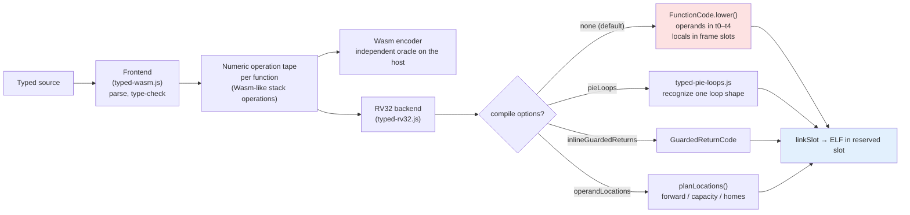
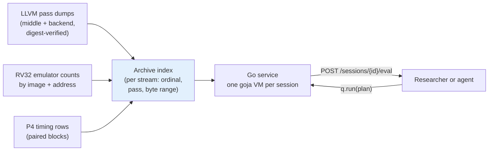

# The Typed ray tracer odyssey: why three days of compiler labs moved the frame so little

Between the evening of November 20 and the evening of November 21, ten compiler labs studied one program: a 160 × 160 ray tracer written in Typed, the project's JavaScript-like language. The Typed compiler, running on the ESP32-P4 inside the PicoCalc, compiles it to RISC-V. At the start the Typed frame took 57.7 ms and the same renderer in C took 9.5 ms. At the end, the best compiler-only configuration took 46.1 ms and the C control took 7.7 ms in the same firmware. The compile path with no options, which every lab used as its reference program, still produced the 57.7 ms frame. The fastest Typed frame of the whole investigation, 30.0 ms, came from rewriting the renderer's algorithm in Typed source. It came from no compiler change at all.

This report reviews that work together with the compiler lab of November 19 that preceded it. It explains what the measurements established about the compiler, what GCC and LLVM do differently with the same loops, what the trace REPL contributed, and why the results did not accumulate faster. The review was performed after the fact from the tickets, diaries, commission texts, git history and compiler source. It ran no new device measurement. Every number below is quoted from a ticket's recorded evidence, and the ticket is named where it first appears.

> [!summary]
> - The dominant cost in the Typed frame is **where values live**. Named locals occupy stack-frame slots, and every checked buffer read reloads its index, its buffer pointer and the buffer's length. GCC and LLVM keep the same values in registers and keep the bounds checks. The remaining 3.75× between the Typed and C shadow predicates splits into code generation (2.04×), bounds checks (1.54×) and data representation (1.20×), and each part has a known fix.
> - **SIMD addressed at most about 1% of the frame.** Only one subtraction per pixel could be packed; everything consuming the result stayed scalar. Even hand-written PIE in the C renderer saves only about 1.1 ms. Both GCC and LLVM declined to vectorize the loop.
> - **The fix existed before the ray tracer did.** On November 19 a register-homes patch for leaf and non-leaf functions cut Editor's search loop by 41% and Files' name comparison by 56%, at about 7% more compile time. It was deferred and never entered the default compile path. The ray labs rediscovered the problem and built a narrower leaf-only version 46 hours later.
> - **The process produced evidence faster than it produced compiler changes.** Since 23:00 on November 20 there were 172 commits. 123 touched only ticket documents and evidence, and 15 touched the compiler source. Ten ray and SIMD tickets hold about 166,000 words. The commission template asks for most of that volume.

## What "experimental" and "default" mean here

All of this work is experimental. There is no production compiler to ship to, so "shipping" is the wrong question to ask of it. The useful question is whether each improvement became part of the program the next experiment started from. Throughout this report, the **default compile path** means `typedRv32.compile(source, imports, maxLength)` called with no options. Firmware mode 0 of the ray tracer calls exactly that (`picocalc-os/port/esp32p4/main/typed_ray_p4.c:45`), and every lab's "stock" arm measured it.

An improvement can live in four places. Each one affects later experiments differently.

| Where the change lives | Example | Does the next lab's control include it? |
|---|---|---|
| Default compile path | Operand-stack registers `t0`–`t4` (November 19) | Always. |
| Opt-in compile option | `pieLoops: "pie-empty"`, `inlineGuardedReturns`, `operandLocations: {forward, capacity, homes}` | Only if that lab chooses to pass it. |
| A patch file in a ticket | `PICOCALC-REGISTER-LOCALS/scripts/02-register-locals.patch` | Never, unless someone ports it. |
| A generated compiler fork pinned to one function | `PICOCALC-SCALAR-BREAKDOWN/scripts/compiler/make-backends.mjs` | Never. It refuses any other input. |

From PIE-LOOPS onward the ray labs did chain their opt-in options. Each lab's control included the options the previous lab had qualified. The ladder in [the timeline](#the-timeline-one-number-at-a-time) is therefore a real cumulative improvement for the ray tracer. Two things stayed outside that chain: the November 19 register-homes patch, and the register-local results of the scalar factorial. Both were in the second and third rows of the table above.

## The system under study

### Typed and its checked buffers

Typed is a statically typed subset of JavaScript. A local declared `i32` holds a 32-bit integer. A `buffer` is a block of unsigned 16-bit cells preceded by a 4-byte header containing its capacity in cells. Reading `buf[i]` must check `i` against the capacity. An invalid index traps, and any writes performed before the trap remain visible. This last property constrains the compiler. It may not move a check ahead of a store, because a trap would then hide a write that the source program performed.

### The compiler pipeline

The compiler is written in JavaScript and runs inside QuickJS on the same ESP32-P4 that later executes the result. Cold compilation time is therefore part of the measured user experience, and every lab recorded it.



The frontend emits, for each function, a sequence of stack operations close to WebAssembly: `local.get`, `i32.add`, `local.set`, a checked buffer read, structured `block`/`loop`/`if`. The RV32 backend walks that sequence once and emits machine words. Since November 19 the default backend maps the first five operand-stack positions to the fixed registers `t0`–`t4` ([[PROJECT REPORT - PicoCalc Compiler - Operand Registers on RV32]]). A *local*, however, still has a permanent home in the stack frame. Every `local.get` emits a load from `sp` and every `local.set` emits a store.

### The ray tracer

The scene is orthographic. All rays are parallel to the depth axis, so a pixel at `(x, y)` intersects a sphere with center `(cx, cy, cz)` and radius `r` exactly when `d = r² − (x − cx)² − (y − cy)²` is nonnegative. The renderer precomputes the squared horizontal distances and an integer square-root table. For each row and sphere it computes `R = r² − (y − cy)²`, and for each pixel `d = R − squares[x]`. A hit reads the square-root table, compares the candidate depth with the nearest depth so far, and conditionally writes depth and object identity. A second stage tests each visible floor pixel for a shadow against every sphere's projected rectangle, then exactly. A third stage applies diffuse lighting and packs RGB565.

The instruction profile of the default frame in PICOCALC-TYPED-RAY decides where a compiler can win.

| Function | Executed instructions | Share of frame |
|---|---:|---:|
| Floor-shadow predicate and caller | 5,528,397 | 35.6% |
| Primary row (`typedRayComputeRow`) | 3,608,697 | 23.2% |
| RGB565 packing | 1,740,800 | 11.2% |
| Everything else | 4,654,730 | 30.0% |
| **Whole frame** | **15,532,624** | 100% |

The shadow predicate is the largest single target. The primary row, where all the SIMD work happened, is the second.

## A checked read, instruction by instruction

The most instructive artifact in the whole investigation is the disassembly of the shadow predicate in PICOCALC-SHADOW-LLVM (`various/native/typed-linked.asm` and `llvm-linked.asm`). Both functions read the same light parameters from cells 16 through 19 of the scene buffer. The default Typed backend emits this for the read of cell 17:

```asm
# Typed, default backend                      # what the instruction does
addi  t0,zero,17                              # materialize the constant index
sw    t0,12(sp)                               # store it to a local's frame slot
lw    t5,12(sp)                               # reload it immediately
lw    t6,0(sp)                                # reload the buffer pointer (spilled at entry)
lw    a0,0(t6)                                # load the buffer capacity
bltu  t5,a0,ok                                # index < capacity ?
ebreak                                        # trap
ok:
slli  t0,t5,1                                 # index * 2
add   t0,t6,t0
lhu   t0,4(t0)                                # the element, past the 4-byte header
addi  t1,zero,32
sub   t0,t0,t1                                # cell - 32
sw    t0,16(sp)                               # store the result to its local's slot
```

The same sequence repeats for cells 18, 19 and 16, each time with a new frame slot. At function entry the three parameters are also stored to `0(sp)`, `4(sp)` and `8(sp)`, so the buffer pointer has to be reloaded from memory before every access.

LLVM compiles the checked C model of the same predicate as follows:

```asm
# LLVM 18, checked C model
lw    t5,0(a0)          # capacity, loaded once
li    a3,17
bgeu  a3,t5,trap        # 17 < capacity ?
li    a3,18
beq   t5,a3,trap        # capacity > 17 is known, so 18 fails iff capacity == 18
li    a3,19
bgeu  a3,t5,trap
lhu   t1,36(a0)         # cell 16 (4 + 2*16), straight from the argument register
...
lhu   a6,38(a0)         # cell 17
lhu   a7,40(a0)         # cell 18
addi  a6,a6,-32
addi  a7,a7,-32
lhu   t0,42(a0)         # cell 19
```

Three observations explain most of the gap between the two compilers.

- LLVM keeps the buffer pointer in `a0` for the whole function. Typed reloads it from `0(sp)` before every read, because the default backend gives every parameter and local a frame slot.
- LLVM loads the capacity once and compares four constant indices against that one register. Typed loads the capacity again for each element.
- LLVM keeps all four bounds checks, in source order, so the first failing index still traps first. It may perform the checks before any of the reads because a read has no observable effect, and every failure reaches the same trap. Typed already has the information needed for the same reordering. Its backend does not use it.

Across all 19,477 shadow queries of the opening frame, these differences produce the following counts. They come from running the exact predicate bytes under QEMU, while the P4 timed the same coordinate stream.

| Over 19,477 shadow queries | GCC | LLVM | Typed (with guarded returns) |
|---|---:|---:|---:|
| Executed predicate instructions | 2,153,398 | 2,330,571 | 5,428,633 |
| Direct stack loads and stores | 233,724 | 311,632 | 1,935,968 |
| Capacity loads | 19,477 | 19,477 | 264,928 |
| Element loads | 264,928 | 264,928 | 264,928 |
| Bounds-check branches | 245,451 | 224,142 | 264,928 |
| **P4 cycles per query** | **136.66** | **144.31** | **382.25** |

Typed averages about 99 stack accesses per query, GCC 12 and LLVM 16. All 311,632 of LLVM's stack accesses are the saves and restores of eight callee-saved registers. Its hot loop touches the stack zero times. The excess stack traffic and excess capacity loads together account for 60.35% of the 3.1 million extra instructions Typed executes.

Bounds checks are not free in C either. In PICOCALC-SHADOW-CODEGEN, GCC compiled the same Typed data layout with and without explicit checks. The checked predicate took 135.74 cycles per query and the unchecked one 88.40. The checks therefore cost GCC about 54%. That is a smaller share of the gap than where values live: checked GCC is still 2.8 times faster than Typed was at the time. Both costs matter for matching C, and [the decomposition below](#the-goal-a-typed-ray-tracer-competitive-with-c) treats them separately.

The same pattern holds in the primary row. PICOCALC-ROW-IR wrote a C function mirroring the Typed row exactly: the same header, cell width, table offsets, traversal order and checks. Over the 160 rows of the opening scene:

| Same 160 row inputs | Guest instructions | Direct stack loads | Direct stack stores |
|---|---:|---:|---:|
| Default Typed | 3,608,697 | 936,328 | 353,778 |
| Typed, inferred PIE producer | 3,131,435 | 729,553 | 309,776 |
| Checked C row, GCC | 1,136,142 | 1,120 | 1,120 |
| Checked C row, LLVM | 1,233,611 | 320 | 320 |

A checked C row runs about a third of Typed's instructions and does essentially no stack traffic. The ROW-IR report draws the consequence directly: "the central question is how to obtain a good scalar loop from an ordinary program, with enough information left to select packed instructions where they pay."

## The timeline, one number at a time

The table follows the default-scene complete frame (pixels ready in memory) through every lab. Times are medians on the P4. Each lab paired its arms within its own firmware, so a change measured inside one lab is reliable. Absolute values from different firmware builds differ by a few tenths of a millisecond.

| When (ET) | Lab | Question | Result | Typed frame |
|---|---|---|---|---:|
| Nov 19 | COMPILER-LAB2 / REGISTER-LOCALS | Should locals get registers? | Editor search −41.3% cycles, Files compare −55.8%, cold compile +6.7–6.8% | (Editor, Files) |
| Nov 20 23:19 | RAYTRACE | Build a playable C/PIE ray tracer | C and hand-PIE C reference | — |
| Nov 20 23:51 | TYPED-RAY | Whole Typed ray tracer against C | default 57.674; C 9.521; PIE C 8.350 | **57.674** |
| Nov 21 00:26 | SCALAR-BREAKDOWN | Separate checks, register locals, row skipping | register locals −3.12 ms primary; forked compiler pinned to one function | 53.942 (fork) |
| Nov 21 07:16 | PIE-LOOPS | Infer an 8-lane subtraction in unchanged source | −2.80% vs default, **−0.43%** vs matched scalar; +70 ms compile | 56.069 |
| Nov 21 07:53 | ROW-IR | How do GCC and LLVM compile the row? | Checked C: ⅓ of instructions, almost no stack traffic; vectorizers decline | — |
| Nov 21 12:34 | TRACE-REPL | Persistent evidence REPL and persona study | tool built; one loop-scope bug found | — |
| Nov 21 16:33 | SIMD-LAB | Where should packed code return to scalar? | empty-packet exit **−0.90%**; full-packet unroll slower | 55.738 |
| Nov 21 17:29 | SHADOW-CODEGEN | Compile the shadow helper better | guarded returns −4.73% | 53.036 |
| Nov 21 18:23 | SHADOW-LLVM | Why is the shadow predicate 2.6× LLVM? | stack + header loads = 60% of gap; fast allocator +92% | — |
| Nov 21 18:44 | OPERAND-HOMES | Forward operands, cache capacity, leaf homes | **−13.17%**; cold compile +37% | **46.052** |

The best compiler-only ray configuration reached 46.05 ms. It combines `pie-empty`, guarded returns, and all three operand-location policies. That is about 20% below the original default, and Typed is still 5.96 times slower than the 7.72 ms C frame measured in the same firmware. The fastest Typed frame of the investigation remains PICOCALC-TYPED-RAY's source-level variant at 29.975 ms. That variant computes exact sphere spans per row and traverses shadows row by row, and it was never combined with any of the later compiler options.

### November 19: the previous lab already had the answer

The second compiler lab ([[PROJECT REPORT - PicoCalc Compiler - What a Compiler Can Afford on the PicoCalc]]) ran eight experiments on Files, Agenda and Editor. Study A7 ([[ARTICLE - PicoCalc Compiler - What Register Homes Save]]) gave frequently used locals a register for the whole function:

- A **leaf** function makes no calls. It keeps parameters in their incoming registers `a0`–`a7` and uses spare argument registers for other locals.
- A function that **does** call others uses the callee-saved registers `s1`–`s11`, saving each one it claims at entry and restoring it at every exit.
- A one-opcode lookahead protects an older pending read of a local from being overwritten.

The patch is 136 added lines. On two physical boots it reduced cycles by 55.8% in Files' name comparison, 12.8–16.0% in Agenda's weekday computation, and 41.3% in Editor's search match. Editor's static local loads fell from 5,367 to 486. Cold compilation took 6.7–6.8% longer. The lab's synthesis deferred the decision: "local register homes deserve a separate decision… Measure a complete keypress or search across representative documents before choosing a single production default." The patch remained in `ttmp/2026/11/19/PICOCALC-REGISTER-LOCALS--…/scripts/02-register-locals.patch`, written against a research copy of the backend. The current `picocalc-os/compiler/typed-rv32.js` contains no callee-saved local homes.

Every ray lab that followed measured a compiler without this patch.

### November 20, night: the ray tracer and the first diagnosis

PICOCALC-TYPED-RAY built the complete Typed renderer and timed it against C on the board: 57.674 ms against 9.521 ms. It tried four kinds of change, and their results already show the shape of the problem.

| Treatment | Kind | Frame | Change |
|---|---|---:|---:|
| Positive-literal divisor proof | compiler | 54.948 ms | −4.73% |
| Matched scalar row (hand schedule, row template) | compiler template | 46.918 ms | −18.65% |
| Explicit 8-lane row on that schedule | compiler template + SIMD | 46.535 ms | −19.31% |
| Exact spans + row-oriented shadows + divisor proof | source + compiler | **29.975 ms** | **−48.03%** |

The 8-lane row saved 0.38 ms over the identically scheduled scalar row. The schedule, which keeps values in registers and checks whole buffer intervals once, accounted for nearly all of the 19% improvement. The report's recommendation was explicit: "the largest measured opportunity is scalar register and bounds handling inside hot loops."

### November 21, 00:26: the scalar factorial

PICOCALC-SCALAR-BREAKDOWN separated three effects on the primary row. On the P4, register locals saved 3.12 ms of primary time with the checks retained. Hoisting checks saved 1.31 ms with stack locals. Doing both saved 3.77 ms. Executed stack accesses in the row fell from 1,290,106 to 370,265. A preregistered prediction of how many instructions bounds hoisting would remove from the shadow function, 412,994, matched the measurement exactly. Its recommendation: "I would investigate keeping frequently used loop locals in registers first."

The implementation, however, was not a compiler pass. `make-backends.mjs` string-patches a copy of `typed-rv32.js` and inserts a pre-lowered template for one function. It refuses to run when that function's IR differs from a recorded hash:

```js
if (sha(ir) !== 'ab7c7d8c0cd05beb8adb7e1a08368191cd044635da386677fed6d7156ad55477')
    throw Error('unknown row IR');
```

The measured savings are real, but they belong to that one row. Nothing in the default compiler changed.

### November 21, morning: inferred SIMD, then GCC and LLVM

PICOCALC-PIE-LOOPS took the opposite direction. It wrote a general recognizer for one loop shape in unchanged source: a counted loop, a contiguous unsigned halfword input, a subtraction from a loop invariant, and a nonnegative test guarding a continuation. The recognizer emits an aligned 16-byte load, an eight-lane signed saturating subtraction and a scratch store. The continuation then runs in scalar code, one lane at a time. The compiler contains no table of ray-tracer functions or source hashes. On the board, the clean frame went from 57.692 ms to 56.069 ms. A scalar control with the same grouping took 56.340 ms, so the packed instruction itself contributed 0.43%. The first version raised cold compilation from 454 ms to 658 ms, because it decoded every function's tape into JavaScript records. A prefilter brought the increase down to 70 ms. At about 1.6 ms saved per frame, that compile cost pays for itself after about 44 frames.

PICOCALC-ROW-IR then compiled the row with GCC 14.2 and LLVM 18.1.3, captured every pass dump, and produced the comparison in [the previous section](#a-checked-read-instruction-by-instruction). It also reported that GCC's vectorizer rejected the row on cost and LLVM's RV32 target left it scalar, and it recommended fixing scalar lowering first and reintroducing the packed producer afterwards.

### November 21, afternoon: the REPL and the SIMD lab

The afternoon went to two large efforts: the trace REPL, discussed [below](#what-the-trace-repl-contributed), and PICOCALC-SIMD-LAB. The SIMD lab added an empty-packet exit: when the unsigned minimum of eight squared distances exceeds `R`, all eight rays miss and the loop advances by eight. On the opening scene, 2,111 of 3,135 packets were empty. The exit removed exactly the 16,888 scratch loads predicted, and saved 0.509 ms, or 0.90% of the frame. A variant that also unrolled full packets executed fewer instructions, grew the row function from 1,712 to 4,064 bytes, and lost to the plain exit at every pose. A frozen cost model for choosing among scalar, grouped and packed plans picked the fastest plan in 12 of 15 held-out cells, exactly as often as the policy "always choose PIE".

The lab also measured what an expert scalar row could do. A hand-written row keeping hot state in registers used 313,477 cycles for the 160 opening rows. The compiler-generated `pie-empty` row used 3,731,049. The hand row also includes whole-row admission, so the 12-fold difference is not purely register allocation. It is nonetheless the largest gap the lab measured, and it lies in scalar code. The lab's final recommendation names it first: "teach the compiler to hoist a whole-row admission check and keep base addresses and loop invariants live, with the hand scalar row as its target."

### November 21, evening: the shadow sequence

The last three labs ran in about 90 minutes and produced most of the compiler improvement of the day. They also had the narrowest question.

1. **SHADOW-CODEGEN** recognized pure unary numeric helpers with guarded returns, such as the magnitude (absolute-value) helper used by the shadow predicate, and lowered them inline at selected call sites. The predicate fell from 435 to 382 cycles per call and the frame by 4.73%. The held-out advanced Chess evaluation improved by 10.2% on its opening position. Cold compilation rose 0.93%.
2. **SHADOW-LLVM** compiled the checked C predicate with LLVM under several backend configurations, timed each on the P4, and attributed 60% of the instruction gap to stack traffic and capacity reloads ([next section](#what-gcc-and-llvm-do-with-the-same-loop)).
3. **OPERAND-HOMES** made its first commit 16 minutes later and implemented three policies in `planLocations` (`typed-rv32.js:482`). *Forwarding* emits a checked index directly into its consumer instead of through a frame slot. *Capacity caching* holds the capacity of a buffer that a pure leaf never writes in a reserved register. *Fixed homes* give the highest-scoring locals of a leaf function the spare argument registers. The change is about 120 lines of `typed-rv32.js` plus tests. Together the policies cut the frame by 13.17% and the predicate to 276.98 cycles per call.

| OPERAND-HOMES policy | Shadow cycles/call | Frame | Paired saving | Cold ray compile |
|---|---:|---:|---:|---:|
| Control (pie-empty + guarded returns) | 382.21 | 53.034 ms | — | 298.3 ms |
| Forward | 323.75 | 48.572 ms | 8.41% | 404.3 ms |
| Cache capacity | 356.72 | 51.528 ms | 2.88% | 402.4 ms |
| Forward + cache | 301.08 | 47.428 ms | 10.57% | 404.4 ms |
| Forward + cache + homes | 276.98 | 46.052 ms | 13.17% | 409.7 ms |

The last column records a cost that the published article does not discuss. Each single policy raised cold compilation of the ray source by 104–106 ms, and all three together by 111 ms, or 37.4%. The cost appears even for capacity caching alone, so it most likely comes from the planner's analysis pass rather than from any one policy. The implementation diary lists "profile tape decoding and fact collection on the device" as the next step. The PIE-LOOPS recognizer showed the same cost profile before its prefilter.

## What GCC and LLVM do with the same loop

The comparisons with GCC and LLVM produced the most transferable knowledge of the investigation. They are worth stating as compiler engineering, independent of the PicoCalc.

### Locals become values: SROA and SSA

LLVM's first scalar replacement pass, SROA, examines each stack allocation created for a source local. When every use of an allocation is a direct load or store, the allocation can be replaced by SSA values. Its promotion phase calls `PromoteMemToReg`, which places a *phi* instruction at each control-flow join where different definitions of the local can arrive, then renames every load to the definition that reaches it. A definition reaches a use when it **dominates** the use, meaning every path from function entry to the use passes through the definition.

In the shadow predicate, SROA turned 18 stack allocations into zero and introduced nine phis. In the row, 16 allocations became zero and three phis appeared. From this point LLVM no longer has a notion of "the frame slot of `x`". It has values and the edges along which they flow. The Typed backend still operates in the representation LLVM has before SROA runs.

GCC's GIMPLE SSA form shows the same relationships. Its induction-variable pass then chooses which recurrences to keep. In the row it kept a step-two address and a step-one index, because one serves the halfword loads and the other the bounds checks and loop exit.

### Redundant loads: inlining, then EarlyCSE

The checked C model calls a small accessor for every element read. The accessor loads the capacity, compares, traps on failure and returns the element address. Before inlining, the twelve capacity loads in the shadow predicate are hidden inside twelve calls. After the inliner runs, they are twelve visible loads from the same pointer. EarlyCSE walks the dominator tree and keeps a table of available loads. When it reaches a load from a pointer whose value is already available, and no intervening instruction may have written that memory, it replaces the load with the earlier value. In the read-only shadow predicate, twelve capacity loads became one. In the row, which writes depth and identity cells between its reads, they fell from eleven to six. A later load can reuse an earlier value only when no intervening store may have changed the header.

That condition is the one OPERAND-HOMES implemented conservatively: cache the capacity only in a pure leaf that never writes the receiver. Generalizing it requires an effect summary for calls and stores, which a single streaming pass does not have yet.

### Register allocation decides most of the difference

SHADOW-LLVM compiled the same optimized IR through different backend configurations and timed each on the P4 in one firmware image, over six rotated blocks and twelve scenes.

| Configuration of the same IR | Cycles per opening query | Change vs normal LLVM |
|---|---:|---:|
| GCC (board harness) | 136.66 | −5.52% |
| LLVM, normal backend | 144.31 | baseline |
| LLVM, loop strength reduction off | 150.13 | +3.92% |
| LLVM, `-fwrapv` | 144.27 | −0.02% |
| LLVM, fast register allocator | 276.70 | **+91.64%** |
| Typed with guarded returns | 382.25 | +164.76% |
| Typed with forward + cache + homes (OPERAND-HOMES visit) | 276.98 | +91.9% |

The fast-allocator arm is the most informative experiment of the whole investigation. Both LLVM arms share the same optimized IR, so both load the capacity once and perform the same 264,928 element reads. The only difference is how values are assigned to registers. LLVM's fast allocator works within one basic block and spills live values at block boundaries. It executed 2,454,609 direct stack operations against 311,632 for the normal greedy allocator, and took 92% more cycles. The greedy allocator splits live ranges across blocks and keeps loop-carried values in registers through the loop.

After the OPERAND-HOMES change, the Typed predicate runs at 276.98 cycles. That is within 0.1% of LLVM with its block-local allocator. The two numbers come from different code, so their agreement does not imply that the two programs do the same work. It does give a concrete statement of where the compiler now stands. The remaining factor of 1.9 is roughly what LLVM's cross-block allocation buys over its block-local allocation on this predicate.

### Induction variables and strength reduction

Loop strength reduction replaces per-iteration address arithmetic such as `base + 2*i` with running pointers. Its effect was small and depended on the path taken. Disabling GCC's IV optimization on the checked row added 13.1% instructions, and disabling LLVM's LSR added 3.3%. On the shadow predicate, disabling LSR *reduced* stack operations from 311,632 to 194,770 but raised cycles by 3.9% on the natural workload, while making the X-rejection path faster (86.0 to 77.5 cycles). A compiler that minimizes stack traffic as its objective would choose the wrong configuration here. LSR should come after register allocation.

### Vectorization: legality, then profitability

A vectorizer answers two separate questions. Legality asks whether operations from adjacent iterations may execute together without changing the program's result. A store that changes a later iteration's input can prevent that. Profitability asks whether the vector plan, including setup, guards, masking, lane extraction and the scalar remainder, costs less than scalar code. GCC's vectorizer reported three obstacles on the firmware row: consecutive inner loops inside the sphere loop, unsupported control flow in the nearest-depth consumer, and a cost model that rejected the simple producer loop. LLVM's RV32 target produced scalar code. Both optimizing compilers that the Typed compiler was compared against declined to vectorize this loop.

### Constant division

The RGB565 stage divides by 255, 8 and 4. GCC replaces `/255` with a multiplication by a fixed reciprocal, taking the high half, followed by shifts and a signed correction, and emits no divide instruction. The Typed divisor proof removes the zero-divisor and overflow guards but keeps the divide. Six divides per pixel remain in the Typed frame. This optimization has not been attempted.

### The mechanisms in order of measured value

| Mechanism | GCC/LLVM | Typed today | Measured value on this workload |
|---|---|---|---|
| Locals as SSA values in registers across blocks | yes | leaf functions only, opt-in; non-leaf patch unmerged | Up to 92% of LLVM's cycles (fast vs greedy); 41–56% on Editor/Files (A7) |
| Redundant capacity loads removed | EarlyCSE | pure leaf only, opt-in | 2.9% of frame alone; 245,451 loads |
| Operands forwarded, no slot round trip | implicit in SSA | opt-in | 8.4% of frame alone |
| Pure helper inlined at call site | inliner | opt-in | 4.7% of frame |
| Division by constants via multiplication | yes | no | untested; six divides per pixel |
| Strength reduction / IV choice | yes | no | 3–13% of a loop, sign depends on path |
| Vectorization of the row | declined on cost | opt-in | 0.43–0.90% of frame |

## Why SIMD could not move the frame

The SIMD work was careful and correct. Its arithmetic proof for the narrowing from unsigned 16-bit to signed saturating lanes is exact: it holds for every `R` up to 32,766 and fails at 32,767, and the compiler falls back to scalar code at that boundary. The workload limited what it could achieve, and the bound was visible from the first evening.

1. **Only the producer is packed.** Each eight-pixel group performs one vector subtraction. A hit still needs a square-root lookup at a data-dependent address, a depth comparison and conditional writes. Those stay scalar, and they are emitted by the default backend with its frame-slot locals.
2. **The primary pass is a minority of the frame.** The row is 23.2% of executed instructions. The shadow stage, the largest stage, was never a SIMD target.
3. **Expert SIMD in C has the same ceiling.** The firmware C renderer with its hand-written PIE row takes 6.81 ms against 7.90 ms for scalar C, a saving of about 1.1 ms. An optimal Typed SIMD row cannot save much more than the corresponding work, and Typed reached about 0.5 ms.
4. **Packet costs depend on hit density.** Measured per packet, the unsigned-minimum test saved 27% on empty packets and cost 34% and 23% more on mixed and full packets. A cost model built from isolated class costs predicted the wrong sign for two of three whole rows.

The physics experiment in the same lab shows where SIMD does pay on this processor. A saturated 16-bit position update over planar arrays used 89.3% fewer cycles than its matched scalar control, because all work stays in vector registers from load to store. Contact resolution with gathers and scatters of body velocities was 43.9% *slower* packed than scalar on the same group order. The rule that follows is direct. Vectorize loops whose entire body, including its consumer, stays in lanes. A loop that produces a vector and consumes it lane by lane in scalar code will gain little.

## What the trace REPL contributed

### What it is

`cmd/trace-repl` is a Go service built on go-go-goja. It loads the captured LLVM pass dumps, emulator instruction counts and P4 timing rows once, verifies each dump stream against its recorded digest, and serves JavaScript sessions over local HTTP. Each session has its own VM, and its bindings persist between cells. Every value it returns carries a reference to verified bytes: stream digest, ordinal, and byte interval. An instruction address is joined to execution counts only when both refer to the same image hash.



A query that locates the pass removing capacity loads in the checked row looks like this:

```js
const row = a.variant("checked").function("row")
const middle = row.timeline("middle")
const capacity = q.ir.instructions()
  .opcode("load").resultType("i32").pointer(row.argument(0)).count()
const decreases = middle.measure(capacity).changes()
  .where(c => c.status === "known" && c.delta < 0)
q.run(decreases.first())
// ordinal 73 (SROA): 11 sites → ordinal 74 (EarlyCSE): 6 sites
```

### What it established

The REPL made pass-level questions cheap to answer and hard to answer wrongly. It answered which pass removed the capacity loads, at which ordinal register virtualization ended, and which instruction addresses belonged to a packet's scalar lane loads. Its identity checks caught real errors:

- The service classified loop-scoped LLVM prints as having no scope. A researcher persona asked for loop-scope events, received zero, and concluded falsely that the archive contained none. There were 42 in each checked stream and 437 in the firmware stream.
- Several participants passed already-evaluated descriptors where the API expected a plan, and received `[notAPlan]`. The error message suggested a fix that computed an unrelated quantity.
- The supervisor's own reconciliation script silently used the default limit of 200 rows and turned an intended census into a prefix.

### What it did not establish

Most of the TRACE-REPL ticket studied the REPL rather than the compiler. It has 31 commits and about 75,000 words. Blind DeepSeek and Opus personas received tasks whose answers the supervisor already held on scoring cards: "4,133 headers overall", "ordinal 74 is an EarlyCSEPass print". They were graded, the API was revised, and new personas were run on the revised build. The one persona asked to design an optimization proposed keeping two operand-stack temporaries in reserved registers and specified a reasonable experiment. Its estimated 3.9% frame gain was unsupported, and the candidate was never built.

The numbers that led to the OPERAND-HOMES change were 1.94 million stack operations against 312 thousand, and 264,928 capacity loads against 19,477. They came from QEMU and interpreter instruction counters run on extracted machine code. The REPL supplied the pass-by-pass account of why LLVM had fewer: SROA, then inlining, then EarlyCSE. That account explains the mechanism and helped choose the policies. A researcher reading two dump files side by side could have obtained it too. The REPL improved the reliability of evidence. It did not by itself find the compiler's problem.

## Why the results did not accumulate

The previous sections explain what the measurements showed. This section explains why three days of measurements produced a 20% compiler improvement for the ray tracer when the first evening's report had already named the mechanism worth 92% of LLVM's cycles.

### 1. The general fix was deferred, then rediscovered

The November 19 register-homes patch handled leaf and non-leaf functions, cost 6.7% compile time, and was measured physically on three applications. It was deferred pending a broader user-level measurement that never ran. The ray labs then measured the same deficiency four times: TYPED-RAY at 00:00, SCALAR-BREAKDOWN at 00:48, ROW-IR at 08:11 and SIMD-LAB at 17:15. Each recommended fixing it first. OPERAND-HOMES finally implemented a version restricted to leaf functions and spare argument registers. It costs 37% compile time instead of 6.7%. No diary or report in the ray tickets refers to the November 19 patch.

### 2. Improvements lived in options, forks and patches

The ray labs chained their opt-in options correctly from PIE-LOOPS onward. Everything outside that chain had to be redone. The scalar factorial's register-local and hoisting results lived in a hash-pinned fork. The November 19 patch lived in a ticket's `scripts/` directory. The compiler commits of this period added opt-in options, inspection support and language features for the Candela scenes. The stock arm measured 57.67–57.69 ms in TYPED-RAY, SCALAR-BREAKDOWN and PIE-LOOPS. Each lab's "stock" arm therefore measured the same code generation as the first, and every application other than the ray tracer still compiles with it.

### 3. The target was chosen before the bottleneck was confirmed

The SIMD lab was commissioned after ROW-IR reported that both GCC and LLVM declined to vectorize the row and that scalar lowering should come first. The packet work optimized the 23% stage of the frame. Within that stage it optimized only the part, the subtraction, that both C compilers and the hand-written PIE C renderer showed to be worth about a millisecond. The shadow stage, the largest single stage, received its first compiler change at 17:39 on November 21.

### 4. Evidence volume grew faster than compiler changes

Since 23:00 on November 20:

The commit categories are exclusive and assigned in this order: compiler source, then Go tooling, then documents only, then other code.

| Measure | Count |
|---|---:|
| Commits | 172 |
| Commits touching the compiler source | 15 |
| Commits touching the Go REPL tooling (and not the compiler) | 9 |
| Commits touching only ticket documents and evidence | 123 |
| Commits touching firmware, harnesses or apps | 25 |
| Words in the ten ray and SIMD tickets (excluding `sources/`) | ≈166,000 |
| Words in the TRACE-REPL ticket | ≈75,000 |
| PicoCalc articles published to this vault on November 21 | 26 |

The ratio shows in individual commits. `502113b`, which integrated the empty-packet exit worth 0.90%, added 7,165 lines, of which 33 changed lines were compiler source. `25f321e`, which delivered the 13.17% improvement, changed 118 lines of `typed-rv32.js` and 14 lines of tests.

Much of this volume is specified by the commissions themselves. The SIMD lab's commission asks for "the traditional researcher / reviewer / research lab agent structure", that "Everybody (you included): Keep a detailed diary", and that "Each researcher when done, and you once you have all the results: write a detailed project report for the obsidian vault as a deep dive technical analysis blog post." The shadow commission repeats this template word for word. The operand-homes request asks for an intern implementation guide uploaded to reMarkable, a detailed diary and a vault report. The operand-homes implementer recorded its reading of "then implement it": "I interpreted this as a research implementation with independently measurable opt-in controls and source-identical hardware trials." That reading is reasonable under the template. It also guarantees that each result arrives as an option rather than as a change to the default compile path. The commission for SHADOW-CODEGEN already contains the correcting instinct: "i think we only need one agent to do this no? isn't this basically sequential?"

### 5. The C reference moved

Each lab rebuilt its C control in a new firmware. Scalar C measured 9.521 ms in TYPED-RAY, 7.902 ms in SIMD-LAB and 7.722 ms in OPERAND-HOMES. The faster later figures came from different workspace placement and harness layout. The Typed-to-C ratio therefore reads 6.06×, then 7.05×, then 5.96×, while the Typed time fell by 20%. Within-lab pairing protected every individual comparison. Ratios from different labs cannot be compared with each other, and they made the overall direction harder to see.

## The goal: a Typed ray tracer competitive with C

The purpose of all this work is a Typed ray tracer whose frame time is competitive with the C renderer on the same processor. The measurements already decompose the remaining distance into independent parts. Each part has its own mechanism, its own fix, and an existing harness that can measure it.

### Decomposing the shadow predicate

The shadow predicate is the largest stage and has the most complete set of controls. Listed from fastest to slowest, in cycles per opening query on the P4:

| Implementation | Cycles/query | What separates it from the row above |
|---|---:|---|
| Firmware C predicate, native C data layout | 73.76 | — |
| GCC on Typed's 16-bit cell layout, unchecked | 88.40 | **Representation**: halfword cells instead of C's native fields (+20%) |
| GCC on Typed's layout, checked | 135.74 | **Checks**: Typed's bounds contract (+54%) |
| LLVM on Typed's layout, checked | 144.31 | a different optimizing compiler (+6%) |
| LLVM, block-local (fast) register allocator | 276.70 | **Allocation**: values spilled at block boundaries (+92%) |
| Typed, forward + capacity cache + leaf homes | 276.98 | — |
| Typed, guarded returns only | 382.25 | operand forwarding, capacity reuse, leaf homes |
| Typed, default compile path | 435.38 | inlined magnitude helper |

The numbers come from two measurement visits, SHADOW-CODEGEN and SHADOW-LLVM/OPERAND-HOMES, on the same harness. Their GCC checked controls agree within 1% (135.74 and 136.66). The current Typed predicate is 3.75 times the C predicate. That factor splits into three multiplicative parts.

```text
277 / 74  ≈  (277 / 136)   ×   (136 / 88)   ×   (88 / 74)
 3.75     ≈     2.04       ×      1.54      ×     1.20
          =  code generation   bounds checks   representation
```

- **Code generation (2.04×).** This part is mostly register allocation across blocks and calls, which is what separates LLVM's greedy allocator from its fast allocator. The November 19 non-leaf homes and an extended capacity cache address it. Target: checked GCC/LLVM, about 140 cycles.
- **Bounds checks (1.54×).** C does not check. Typed must, but it does not have to check every access. A whole-function or whole-loop admission test with an unchanged checked fallback preserves the trap contract and removes the per-access tests on the fast path. SCALAR-BREAKDOWN prototyped exactly this for the shadow function, and its preregistered instruction prediction matched to the instruction. Target: unchecked GCC on the same layout, about 90 cycles.
- **Representation (1.20×).** Every Typed buffer cell is an unsigned 16-bit value. C reads native fields of their natural width. TYPED-RAY concluded that signed 16-bit, unsigned 16-bit and 32-bit indexed arrays would let the compiler express element widths directly. This is a language change, not an optimization pass. Target: the firmware C predicate.

### The primary row and the rest of the frame

The primary row has the same structure with a larger allocation gap. SIMD-LAB's hand-written scalar row ran the 160 opening rows in 313,477 cycles, against 3,731,049 for the compiler's best output. The hand row also skips rows with no possible intersection, so the gap includes an algorithmic part. The RGB565 stage still performs six real divisions per pixel, and GCC replaces them with multiplications.

### Two meanings of "competitive"

The firmware C renderer (`picocalc-os/nucleus/raytrace_demo.c`, `trace_row`) visits all 160 pixels for every sphere on every row. It has no span limits and no empty-row rejection. TYPED-RAY's exact-span and row-oriented-shadow source took the Typed frame to 29.975 ms on the old compiler, against 9.521 ms for C in the same firmware. The goal therefore has two forms, and each needs its own benchmark.

1. **Same algorithm.** Typed and C implement the identical traversal. Competitiveness then depends on closing the three code factors above. This is the honest compiler benchmark.
2. **Best program.** The fastest correct Typed renderer against the existing C renderer. The algorithm then contributes directly. Porting the same span and shadow changes to C gives the fair upper reference. TYPED-RAY's `scripts/director/row-domain.c` already contains a C prototype of the span domain.

Report both, from the same firmware and the same paired harness.

## What to do next

The evidence supports a specific order. Each step has a measurable acceptance condition in the existing harnesses, and each step's result becomes the next step's control.

1. **Make the qualified options the default compile path.** Enable `inlineGuardedReturns`, `operandLocations: {forward, capacity, homes}` and `pieLoops: "pie-empty"` when no options are passed, and keep explicit options to turn each one off for controls. Accept the change when the 24 historical replays and the Wasm differential pass, and when Files, Agenda, Editor and Chess compile with matching outputs. From then on, every lab's stock arm starts at about 46 ms on the ray tracer.
2. **Fix the planner's compile cost before extending it.** The 104–111 ms increase appears with any single policy. Apply the PIE-LOOPS lesson: filter on raw tape cells before building records, or collect the facts during the frontend's existing pass. The target is the 6.7% compile cost of the November 19 patch.
3. **Port the November 19 non-leaf register homes.** Rebase `02-register-locals.patch` onto `planLocations`. It adds callee-saved homes `s1`–`s11`, with entry saves and exit restores, for functions that make calls. The shadow and row functions need exactly that. The target is the shadow predicate falling from 277 cycles toward LLVM's 144. Measure Editor search and Files comparison again in the same firmware, since those were the patch's original workloads.
4. **Extend capacity caching past pure leaves.** It requires an effect summary stating that a callee cannot write a buffer's header. This is the EarlyCSE condition expressed for Typed. If a Typed buffer's capacity cannot change after allocation, no effect analysis is needed at all.
5. **Admit whole loops or functions with one check and a checked fallback.** Generalize the SCALAR-BREAKDOWN shadow-region guard from a pinned function to any function whose accesses have provable maximum indices. The target is unchecked GCC on the same layout.
6. **Lower division by constants to multiplication.** GCC's `/255` sequence is already archived. Preserve truncation toward zero for negative dividends and accept on the RGB565 stage.
7. **Put the algorithm changes into the ray tracer source, and port them to C.** Exact spans and row-oriented shadows reached 29.975 ms on the old default compiler. Measure them on top of step 1. That combination has never been measured.
8. **Add typed views of other element widths.** Signed 16-bit and 32-bit indexed arrays close the representation factor and give the compiler the facts it needs for narrowing.
9. **Return to SIMD after the scalar row approaches LLVM.** Start with workloads whose whole body stays in lanes, such as the planar particle update, rather than the ray row.

For the process, one change per ticket with a short diary and a one-page result note is enough while the work is a sequence of compiler changes against one benchmark. Acceptance is the Wasm differential, the replay suite, and a paired frame and cold-compile measurement against the current default. A full vault article fits a milestone, such as the shadow predicate reaching checked GCC. Re-measure the C control only when the firmware layout changes.

## Open questions

- How much of the remaining gap between 277 and 144 cycles is cross-block allocation, and how much is the 40,786 extra bounds branches, strength reduction and instruction selection? A Typed arm with non-leaf homes and a capacity cache that survives calls would separate the first from the rest.
- Do the November 19 homes and the November 21 forwarding compose, or do they remove the same stack traffic? Their mechanisms overlap for locals that feed checked reads.
- What cold-compile budget is acceptable for an application that compiles at launch? At 7 ms saved per frame, the 111 ms planner cost repays itself after about 16 frames of the ray tracer. Editor and Files compile far more often relative to their runtime.
- Is a buffer's capacity immutable after allocation in Typed? If so, capacity caching would need no effect analysis at all.
- How large is the algorithmic advantage once the same span and shadow traversal is ported to C? That number fixes the "best program" benchmark.

## Sources

The source tickets are listed in this note's frontmatter, under `/home/manuel/code/wesen/2026-10-20--ds-js-os/ttmp/`. The code locations cited are:

- `picocalc-os/compiler/typed-rv32.js` — default backend, `planLocations` at line 482, option dispatch at lines 541–572.
- `picocalc-os/compiler/typed-pie-loops.js` — the packed-loop recognizer.
- `picocalc-os/port/esp32p4/main/typed_ray_p4.c:45` — the firmware's ray program table; mode 0 is the default compile path.
- `ttmp/2026/11/19/PICOCALC-REGISTER-LOCALS--…/scripts/02-register-locals.patch` — the unmerged non-leaf register homes.
- `ttmp/2026/11/21/PICOCALC-SHADOW-LLVM--…/various/native/{typed,llvm,gcc,fastreg}-linked.asm` — the predicate disassemblies quoted above.
- `ttmp/2026/11/21/PICOCALC-SCALAR-BREAKDOWN--…/scripts/compiler/make-backends.mjs` — the hash-pinned row fork.
- `cmd/trace-repl/README.md` — the REPL protocol.

Related vault notes:

- [[PROJECT REPORT - PicoCalc Compiler - What a Compiler Can Afford on the PicoCalc]]
- [[ARTICLE - PicoCalc Compiler - What Register Homes Save]]
- [[PROJECT REPORT - PicoCalc Compiler - Operand Registers on RV32]]
- [[ARTICLE - PicoCalc Typed Ray Tracer Lab - Which work survives compilation in a handheld ray tracer]]
- [[ARTICLE - PicoCalc Scalar Breakdown - Separating the costs of a scalar ray on the ESP32-P4]]
- [[ARTICLE - PicoCalc Compiler - Inferring eight-lane subtraction in a scalar ray tracer]]
- [[ARTICLE - PicoCalc Compiler - How a compiler makes a ray-tracing loop fast]]
- [[ARTICLE - PicoCalc SIMD Lab - Where an Eight-Lane Compiler Should Return to Scalar Code]]
- [[ARTICLE - PicoCalc Shadows - From a Floor Shadow Ray to an ESP32-P4 Instruction Budget]]
- [[ARTICLE - PicoCalc Shadows - Following a Checked Buffer Read from LLVM IR to the PicoCalc]]
- [[ARTICLE - PicoCalc Compiler - Forwarding Checked Operands in a Streaming RV32 Backend]]
- [[ARTICLE - PicoCalc - Designing and Validating Compiler Optimizations with a Trace REPL]]
- [[ARTICLE - PicoCalc - Blind Compiler Engineers Evaluating a Research API]]
