# LLM Inference from First Principles: Inkling 2 Mini on one DGX Spark — A Textbook

This note teaches how a large language model produces text on a single machine, and why the programs that run it, called *inference engines*, are as fast or as slow as they are. It assumes that you can program and that you know what a matrix is. It does not assume that you know anything about neural networks, GPUs or quantisation. Every idea is introduced before it is used or, where a later chapter treats it fully, comes with a pointer there; every claim about speed is tied to a measurement taken on one machine.

The machine is an NVIDIA DGX Spark, a desktop computer with a GPU. The model is Inkling 2 Mini, a language model released in November 2026 by Thinking Machines (its weights are published on Hugging Face as [`thinkingmachines/Inkling-2-Mini`](https://huggingface.co/thinkingmachines/Inkling-2-Mini), together with a *model card*, the publisher's description of the model and its recommended settings). The two engines are **[llama.cpp](https://github.com/ggml-org/llama.cpp)**, a C++ program whose server is called `llama-server` and whose benchmark tool is called `llama-bench`, and **[vLLM](https://github.com/vllm-project/vllm)**, a Python server built for handling many users at once. Chapter 8 explains both in detail.

The measurements come from the study recorded in [[PROJECT REPORT - Inkling 2 Mini on one DGX Spark - Every Inference Method Measured - Files, Runtimes, Speculation and Batching - A Technical Deep Dive]], written for a reader who already knows the field. This note covers the same results, starts from the beginning, and builds up every concept the results depend on. In two places (sections 2.5 and 7.4) it corrects that report.

### Five words used from the start

- A **model** is a fixed mathematical function with billions of numbers in it. The numbers are called **weights** or **parameters**. They were set by *training*: an earlier, separate process that adjusted them over large amounts of text until the model predicted that text well. They are stored in a file and do not change while the model is used.
- A **GPU** (graphics processing unit) is a processor with thousands of simple arithmetic units that work in parallel. It runs the model's arithmetic.
- **Memory bandwidth** is the rate at which memory can deliver bytes to the processor, measured in GB per second.
- An **inference engine** is the program that loads a model's weights and runs the model to generate text.
- A **token** is a piece of text, usually a word or part of a word. Models read and write tokens (chapter 1).

> [!summary]
> - **A language model writes one token at a time, and each token requires reading every weight that token uses from memory.** On the Spark, memory delivers about 273 GB per second, so the number of bytes read per token sets a hard limit on how fast an answer can stream.
> - **The measured time per token is that byte cost plus a roughly constant extra cost**, about 12 ms per token in llama.cpp and about 6 ms in vLLM. In llama.cpp the extra cost is mostly the GPU running thousands of tiny operations between the large ones, and partly the large ones reading memory below its peak rate. Almost every difference between the two engines, and between the five model files, follows from these two terms.
> - **Three techniques change the picture: storing weights in fewer bits, guessing several tokens and checking them together, and serving several users at once.** The first and third can be predicted from byte counts before measuring; the second depends on how often the guesses are right.
> - **For a model that reasons before it answers, the number of tokens it writes matters as much as the speed of each token.** On a hard question, changing one setting, the reasoning effort, cut the time to an answer from 126 s to 47 s.

## How to read this note

The note has three parts. Part I (chapters 1–6) builds the foundations: what a token is, what the model computes, attention and its cache, the mixture-of-experts design and Inkling's looped layers, how numbers are stored in memory, and how the Spark's GPU executes work. Part II (chapters 7–8) uses those foundations to explain where the time of one generated token goes, and why llama.cpp and vLLM spend it differently. Part III (chapters 9–13) covers the techniques that were measured: the choice of model file, batching several users together, speculative decoding, reasoning effort, and how to measure all of this without fooling yourself. Chapter 14 puts the results together. The appendices hold a glossary (A), the commands that reproduce every number (B), all measured results in one place (C) and the references (D).

Conventions:

- Each chapter opens with what it explains and closes with the points to remember. **Bold** numbers in a table mark the values the text discusses.
- When a number is the output of a calculation rather than a measurement, the text says so. The calculations are in `scripts/25-textbook-calcs.py`, in the study's working directory in the project repository (Appendix B), so you can check them.
- GB means 10⁹ bytes; GiB means 2³⁰ bytes, about 7 % more. Engines and tools report some sizes in one unit and some in the other, and this note keeps the unit each source used.
- Diagrams are written in Mermaid, a text format that Obsidian draws as a diagram.

The study measured twelve setups, each with a short label used throughout:

| Labels | What they are | Chapter |
|---|---|---|
| L1–L5 | five model files for llama.cpp, with different number formats per tensor; L1 is the original file, L5 the fastest (table in section 9.1) | 9 |
| V1 | vLLM with the official weights | 8 |
| C1, C2 | several users at once: llama.cpp (C1) and vLLM (C2) | 10 |
| S1, S2, S3 | speculative decoding: n-gram drafts in llama.cpp (S1), the model's own draft network in llama.cpp (S2, did not load) and in vLLM (S3) | 11 |
| E1 | reasoning effort at four settings | 12 |

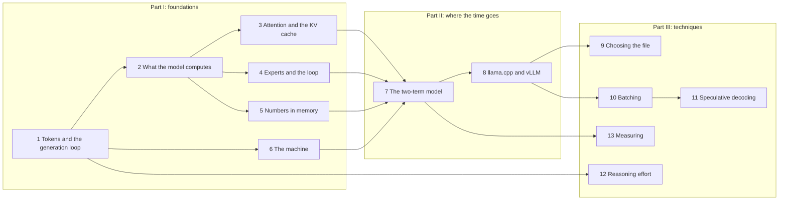

# Part I — Foundations

## 1. From a prompt to an answer

This chapter follows one request from the moment you press Send to the last character of the answer. By the end of it you should be able to say what a token is, what the model produces at each step, why the answer must be produced one token at a time, and why the prompt can be read much faster than the answer is written. Those four facts decide almost everything in the rest of this note.

### 1.1 Text becomes tokens

A language model does not read characters or words. It reads *tokens*: pieces of text drawn from a fixed list called the *vocabulary*. Each entry of the vocabulary has a number, its *token id*. A program called the *tokenizer* splits incoming text into vocabulary entries (Inkling's uses byte-pair encoding, [Sennrich et al. 2016](https://arxiv.org/abs/1508.07909)), and the model only ever sees the resulting list of ids. Inkling 2 Mini's vocabulary has 200,058 entries. Common words are single tokens, rare words are split into several pieces, and the space before a word is usually part of that word's token.

Here is a real sentence, tokenized by the server that runs the model on the Spark (the `/tokenize` endpoint of llama-server):

```text
"The DGX Spark has 128 GB of unified memory."

  id      piece
  371     'The'
  199039  ' DG'
  55      'X'
  175394  ' Spark'
  150008  ' has'
  220     ' '
  71184   '128'
  198517  ' GB'
  149879  ' of'
  149892  ' un'
  70849   'ified'
  152106  ' memory'
  13      '.'
```

Thirteen tokens for 43 characters. " Spark" is one token but " DGX" is two (" DG" and "X"), and " unified" was split into " un" and "ified". Numbers are an exception to the space rule: this tokenizer splits the space off ("` `" is token 220) and keeps the digits "128" as their own token. A useful rule of thumb for English is three to four characters per token. Every speed in this note is measured in tokens per second, so it helps to know that 37 tokens per second is roughly 25 to 30 words per second.

### 1.2 The model predicts a probability for every possible next token

Given a list of token ids, the model computes one number for each vocabulary entry. (It actually computes 201,024 numbers: the vocabulary is padded with 966 unused entries for reasons explained in section 2.1, and those are never chosen.) These numbers are called *logits*. A logit is a raw score: larger means "more likely to come next". A function called *softmax* turns the logits into probabilities that are positive and sum to one:

```text
p(token i)  =  exp(logit_i) / Σ_j exp(logit_j)
```

That list of probabilities is the model's entire output for one step. Here is what Inkling 2 Mini predicts after the prompt "The DGX Spark has 128 GB of unified", with the five most probable candidates at each of four steps (the server's `/completion` endpoint with `n_probs: 5`):

```text
step 1  ' memory' 0.908   ' LP' 0.044      ' system' 0.009   ' RAM' 0.008   ' CPU' 0.005
step 2  ','       0.305   '.'   0.187      ' and'    0.160   ' that' 0.056  ' (' 0.042
step 3  ' but'    0.241   ' which' 0.175   ' and'    0.107   ' '    0.063   ' so' 0.058
step 4  ' only'   0.159   ' the' 0.139     ' it'     0.091   ' that' 0.037  ' I' 0.036
```

At step 1 the model is nearly certain: 91 % for " memory" (the second candidate, " LP", is the start of "LPDDR", the memory type). At steps 3 and 4 the probability is spread over many candidates. This difference between confident and uncertain steps returns in chapter 11, where it decides whether guessing ahead pays off.

### 1.3 Sampling: choosing one token

The model gives probabilities; something must choose one token. That choice is called *sampling*, and it is done by the inference engine, not by the model.

- **Greedy decoding** always takes the most probable token. It is selected by setting the *temperature* to 0. The four steps above were run this way, so the continuation was " memory, but only".
- **Sampling at temperature T** divides every logit by T before the softmax and then draws a token at random according to the resulting probabilities. At T = 1 the model's probabilities are used as they are; T below 1 sharpens them towards the top candidate; T above 1 flattens them. Inkling's model card recommends T = 1.0, and that is the setting used for all measurements unless stated otherwise.
- **Truncation settings** remove unlikely candidates before the draw: `top_k` keeps only the k most probable tokens and `top_p` keeps the smallest set whose probabilities sum to p ([Holtzman et al. 2019](https://arxiv.org/abs/1904.09751)). The model card recommends no truncation. In llama-server, `top_k = 0` means that the setting is switched off (not "keep zero tokens"), and `top_p = 1.0` keeps everything, so these are the values used.

The temperature matters for speed only indirectly: chapter 11 shows that one of the guessing techniques works much better at T = 0, because the output becomes more repetitive.

### 1.4 The generation loop

The chosen token is appended to the input, and the model is run again on the longer list to predict the next one. This repeats until the model produces a special *end* token or a length limit is reached. The process is called *autoregressive generation*, and one run of the model is called a *forward pass*.

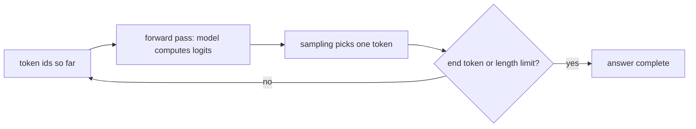

The crucial property of this loop is that step n+1 cannot start before step n has finished, because its input contains the token chosen at step n. An answer of 500 tokens therefore needs 500 forward passes one after another. Whatever a forward pass costs, an answer costs that many times over. Chapters 7 and 8 are about what one forward pass costs; chapters 10 and 11 are about two ways of getting more than one token out of each pass.

### 1.5 The prompt is read in one go

The loop above applies to the answer. The prompt is different: all of its tokens are known before the model starts, so the model can process them together in a single forward pass (or a few large ones). Processing the prompt is called *prefill*, because it fills the engine's cache of information about every earlier token (chapter 3 explains this cache). Producing answer tokens is called *decode*. The two phases have completely different speed limits, which chapter 6 explains. For now, here is how large the difference is, from the server's own timings for the short chat request in the next section:

```text
prompt:  25 tokens in  222 ms   ->   about 113 tokens/s   (prefill)
answer:  44 tokens in 1154 ms   ->   about  38 tokens/s   (decode)
```

On a 25-token prompt the prefill rate is only three times the decode rate, because such a short prompt does not give the GPU enough work. On long prompts the gap grows. For the longest prompt in this study (38,409 tokens), vLLM's prefill rate was 75 times its decode rate on a short prompt, and llama.cpp's about 8 times (chapter 8).

### 1.6 A chat request, end to end

A chat program does not send your message as plain text. It first wraps the conversation in a fixed format defined by the model's *chat template*. The template is a short program in a templating language ([Jinja](https://jinja.palletsprojects.com/)), stored in the model file, that the server runs to turn a list of messages into one prompt string. Inkling's template marks each message with special tokens and adds a system message stating how hard the model should think. Here is the rendered prompt for the question "What is 17*23?" with the *reasoning effort* set to `low` (the template turns `low` into the number 0.2; chapter 12 explains the scale):

```text
<|message_system|><|content_text|>Thinking effort level: 0.2<|end_message|><|message_user|><|content_text|>What is 17*23?<|end_message|>
```

The tokens between `<|` and `|>` are single vocabulary entries reserved for this purpose. When generation starts, the server appends the token that opens the model's own message, and everything the model writes after it is the reply. Inkling 2 Mini is a *reasoning model*: before its answer, it writes a section of private reasoning, marked by its own special token. The server separates the two parts and returns them in different fields. For this request:

```text
reasoning: "The user asks 17*23. Compute: 17*20=340, 17*3=51, total 391. Need answer briefly. Final concise."
answer:    "391"
usage:     25 prompt tokens, 44 completion tokens
```

Forty-four tokens were generated, and nearly all of them are reasoning; the answer the user sees is three characters long. The user waits for the reasoning tokens all the same. This is why chapter 12 treats the reasoning effort as a speed setting.

### 1.7 Three speeds, not one

The pieces above give three different meanings of "fast" for one user:

- **Decode speed** is the rate at which the answer streams, in tokens per second. It is set by the cost of one forward pass.
- **Prefill speed** is the rate at which the prompt is read. Together with the prompt length, it decides the *time to first token*: how long you wait before anything appears.
- **Time to answer** is the total: prefill time, plus the number of generated tokens (reasoning and answer) divided by the decode speed.

```text
time to answer  =  prompt tokens / prefill speed  +  (reasoning tokens + answer tokens) / decode speed
```

A technique can improve one of these and worsen another. When several users share the machine, a fourth measure appears: **total throughput**, the tokens per second summed over all users (chapter 10). The chapters of Part III state which of these each technique changes.

The measured speeds in the following chapters come from two tools, described fully in chapter 13. `llama-bench`, llama.cpp's benchmark tool, runs the model without a server: its `tg128` test generates 128 tokens and reports decode speed, its `pp512` test processes a 512-token prompt and reports prefill speed. A *serving benchmark* written for this study sends real chat requests to either engine's server and times them; it uses four fixed prompts, called `prose` (an explanation of about 300 words), `code` (a new function with tests), `edit` (return a 60-line file with one variable renamed) and `long` (a 38,409-token document to summarise). Appendix C collects all the results in one place.

**Points to remember**

- The model reads and writes tokens, pieces of text from a 200,058-entry vocabulary; English averages three to four characters per token.
- Each forward pass outputs one probability per vocabulary entry; the engine samples one token from them, greedily at temperature 0 or at random at temperature 1.
- Answer tokens are produced one forward pass at a time, in strict sequence; prompt tokens are processed together, which is why prefill is much faster than decode.
- For a reasoning model, most generated tokens can be reasoning that the user waits for but does not read.

## 2. What the model computes

Chapter 1 treated the model as a box that turns token ids into probabilities. This chapter opens the box. The goal is not to explain why neural networks work, but to show what arithmetic a forward pass performs and on which data, because the speed of inference depends only on that arithmetic and that data. The single most important fact in this chapter is in section 2.2: multiplying a matrix by a vector requires reading every element of the matrix exactly once.

### 2.1 Each token is a vector of 2304 numbers

Inkling 2 Mini, like nearly every current language model, is a *transformer* ([Vaswani et al. 2017](https://arxiv.org/abs/1706.03762)): a network built from a stack of identical-looking *layers*, each of which updates a vector of numbers for every token. This section and the next three describe what those layers compute.

Inside the model, a token is not an id but a *vector*: a list of 2304 numbers. The number 2304 is the model's *hidden size*. The first operation of a forward pass converts each token id into its vector by looking it up in a table, the *embedding table*, which has one row of 2304 numbers for each of the 201,024 vocabulary slots. The vocabulary has 200,058 real entries; the table is padded to 201,024 rows because 201,024 is a multiple of 64, and GPU programs process tables most efficiently in blocks of such sizes. Looking up one row reads 2304 numbers and nothing else, so the embedding table, although large, costs almost nothing per token.

From then on, the model repeatedly transforms these vectors. The vector of a token at a given point in the computation is called its *hidden state*. A model with L layers applies L transformations in sequence; each layer reads the hidden states and adds a correction to them. The running sum that flows from layer to layer is called the *residual stream*:

```text
h0 = embedding[token_id]          # 2304 numbers
h1 = h0 + layer_1(h0)
h2 = h1 + layer_2(h1)
...
hL = hL-1 + layer_L(hL-1)
logits = output_matrix · norm(hL) # 201,024 numbers; norm is defined in section 2.3
```

This is the plain case, one pass per stored layer; in Inkling some layers run three times (chapter 4), so for Inkling read "layer pass" where the formula says layer. Adding each layer's output to its input, instead of replacing the input, is a design choice made for training (it is called a *residual connection*, [He et al. 2015](https://arxiv.org/abs/1512.03385)). For inference it only means that every layer ends with one addition of two vectors of 2304 numbers.

### 2.2 The matrix-vector product, and why it decides everything

Almost all of the arithmetic in a layer is of one kind: multiplying a matrix of weights by a hidden-state vector. A matrix W with m rows and n columns, multiplied by a vector x of n numbers, gives a vector y of m numbers:

```text
y[i] = Σ_j  W[i][j] · x[j]        for i = 0 .. m-1
```

Count what this costs. Each output number needs n multiplications and n additions, so the whole product is m·n *multiply-adds*, which is 2·m·n *floating-point operations* (FLOPs). And each of the m·n weights is used exactly once. There is no way to compute y without reading all of W.

A concrete instance from Inkling 2 Mini is the *output matrix* at the end of the forward pass, which turns the final hidden state (2304 numbers) into the logits (201,024 numbers). It has 201,024 × 2304 = 463,159,296 weights. One forward pass therefore performs 463 million multiply-adds for this matrix alone, and reads 463 million weights. If each weight is stored in two bytes, that is 0.93 GB read from memory to produce the logits of one token.

The reading is the expensive part. Chapter 6 shows that the Spark's GPU can perform tens of trillions of operations per second, but its memory can deliver only about 273 billion bytes per second. A matrix-vector product does two operations per weight read, so for one token the GPU spends almost all of its time waiting for weights to arrive from memory. This is the central fact of single-user inference, and the reason the next several chapters count bytes rather than operations.

### 2.3 Inside one layer

A layer of Inkling 2 Mini, like a layer of most transformers, has two halves, each preceded by a normalisation and followed by an addition to the residual stream:

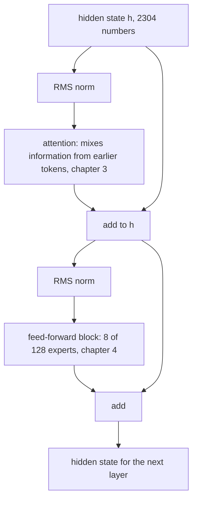

- **RMS normalisation** (`RMSNorm`, [Zhang and Sennrich 2019](https://arxiv.org/abs/1910.07467)) rescales the vector so that the root of the mean of its squared entries is one, then multiplies each entry by a learned weight: `y = x / sqrt(mean(x²) + ε) · w`, where ε is a tiny constant (10⁻⁶ here) that prevents division by zero. It reads 2304 numbers and 2304 weights. It is cheap in bytes, but it is a separate step, and chapter 7 shows that many cheap separate steps add up.
- **Attention** is the only place where a token's vector is combined with the vectors of earlier tokens. Without it, each token would be processed in isolation. Chapter 3 is devoted to it.
- **The feed-forward block** processes each token's vector on its own, with large matrix-vector products and a non-linear function between them. In Inkling it is a *mixture of experts*, the subject of chapter 4.

Inkling's layers contain some further operations, listed in section 3.6. They are small in bytes and do not change the structure above.

### 2.4 The end of the forward pass

After the last layer, the final hidden state is normalised once more and multiplied by the output matrix, giving the 201,024 logits. Inkling then applies *logit soft-capping*: each logit is replaced by `30 · tanh(logit / 30)`, a choice made by the model's designers to keep logits in a bounded range. The function tanh rises smoothly from −1 to 1, so this leaves small logits almost unchanged and limits large ones to between −30 and 30. Softmax and sampling follow, as in chapter 1.

### 2.5 Counting the weights one token uses

Inkling 2 Mini stores 24 layers, but a token passes through some of them three times, for a total of 48 *layer passes* per token. Chapter 4 explains why; for counting, it is enough to know that every layer pass reads the weights of the layer it executes. The weights a single forward pass reads are then:

| Part | Shape | Weights | Read per token |
|---|---|---|---|
| Embedding lookup | one row of 2304 | 2,304 | once (negligible) |
| Dense weights of one layer (attention matrices, router, loop controllers) | several matrices, the largest 2304 × 3072 | 27.2–29.7 million, 29.0 million averaged over the 48 passes | once per layer pass (48 layer passes per token) |
| One expert | 2304 × 2304 plus 2304 × 1152 | 7.96 million | 8 experts per layer pass |
| Output matrix | 201,024 × 2304 | 463 million | once |

The *dense weights* of a layer are the ones every token uses. The largest of them are the attention matrices, explained in chapter 3: the query matrix and a gate matrix (each 2304 × 3072), the attention output matrix (3072 × 2304), and the key and value matrices (each 2304 × 1024). With a small *router* (2304 × 128, chapter 4) these come to 26.2 million weights; the matrix for the position bias of section 3.6 (0.9 million) and a few tiny ones bring a layer to 27.2 million. The layers that run three times carry 2.4 million more for their four *loop controllers* (chapter 4). The experts are the feed-forward weights, of which a token uses only 8 of 128 per layer pass.

Multiplying it out:

```text
48 passes × (29.0 M dense + 8 × 7.96 M experts)  +  463 M output  ≈  4.9 billion weights read per token
```

Each weight read is one multiply-add, so one token costs about 4.9 billion multiply-adds, roughly 10 GFLOP. That number is used once more, in chapter 6, to show how little of the GPU's arithmetic a single user needs.

A note on the numbers used later. The byte calculations of chapter 7 were made at the start of the study with 30.0 million dense weights per layer pass, a value from an earlier estimate; counting the tensors in the model file gives 29.0 million. The difference makes the calculated dense bytes about 3 % too high. Chapter 7 compares the calculation with a hardware measurement, and the two agree within that margin, so the later chapters keep the original numbers.

**Points to remember**

- A token is a vector of 2304 numbers inside the model; each layer adds a correction to it.
- Nearly all of the work is matrix-vector products, and a matrix-vector product reads every weight of its matrix once and does only two operations per weight.
- A layer is: normalise, attention, add; normalise, feed-forward, add. The output matrix (463 million weights) turns the last hidden state into 201,024 logits.
- One token of Inkling 2 Mini reads about 4.9 billion weights, and the bytes needed to fetch them, not the arithmetic, set its cost.

## 3. Attention and the KV cache

Attention is the step where a token takes information from the tokens before it. This chapter explains what attention computes, why engines keep a *KV cache* of earlier tokens, how large that cache is for Inkling 2 Mini, and what reading it costs. The cache is the second large thing in memory after the weights, and it is the reason a long conversation becomes slower and more expensive than a short one.

### 3.1 Queries, keys and values

For each token, attention computes three vectors from its hidden state, each by a matrix-vector product:

- the **query** q: what this token is looking for;
- the **key** k: what this token offers to tokens that come later;
- the **value** v: the information this token passes on if it is selected.

The new token compares its query with the key of every earlier token (and its own) by a dot product, which gives one score per earlier token. A softmax turns the scores into weights that sum to one, and the output is the weighted sum of the values:

```text
score_t   = (q · k_t) / sqrt(d)          for every earlier position t   (d = 128, the head size)
weight_t  = softmax over t of score_t
output    = Σ_t weight_t · v_t
```

The division by `sqrt(d)` keeps the scores in a range where the softmax behaves well. A token can only look at earlier positions, never later ones, because later tokens do not exist yet when it is generated; this restriction is called *causal* attention.

### 3.2 Heads, and sharing keys between them

Attention is not done once per token but several times in parallel, with different query, key and value matrices. Each parallel copy is a *head*. Inkling 2 Mini has 24 query heads of 128 numbers each, which is why its query matrix has 24 × 128 = 3072 outputs. It has only 8 key heads and 8 value heads, so each key and value head is shared by three query heads. This arrangement is called *grouped-query attention* ([Ainslie et al. 2023](https://arxiv.org/abs/2305.13245)). It makes the keys and values three times smaller than they would be with 24 of each, and keys and values are exactly what the next section stores.

### 3.3 Why engines cache keys and values

Consider the generation loop of chapter 1. At step 500, the new token needs the keys and values of the 499 tokens before it. Those keys and values were already computed at earlier steps, and they do not change: a token's key depends only on that token and on the tokens before it, which are fixed. Recomputing them at every step would make step n cost work proportional to n, and the whole answer cost work proportional to n². Instead, every engine stores each token's keys and values the first time it computes them. This store is the **KV cache**.

With the cache, a decode step computes the query, key and value of the one new token, appends the new key and value to the cache, and reads the cached keys and values of all earlier tokens to compute the attention output. Prefill fills the cache with the keys and values of every prompt token, which is where its name comes from.

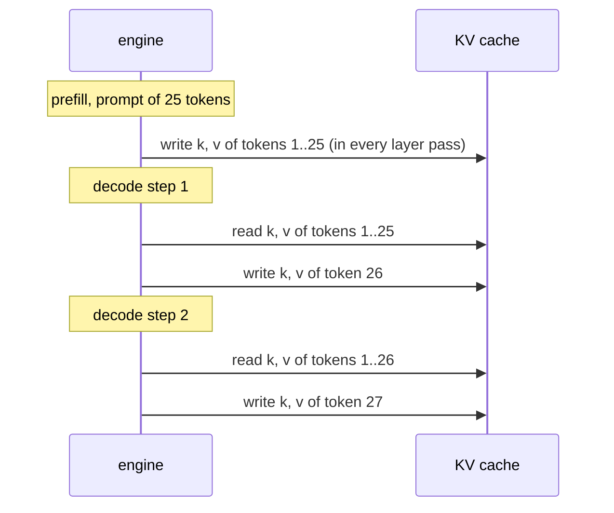

### 3.4 How big the cache is

For one token in one layer, the cache holds 8 key heads and 8 value heads of 128 numbers each: 2 × 8 × 128 = 2048 numbers. llama.cpp stores them as 16-bit floating-point numbers by default, so that is 4096 bytes, 4 KiB, per token per layer.

In most models there is one cache per layer. Inkling 2 Mini needs 48 for its 24 stored layers, because 12 of its layers run three times per token, and each run computes different keys and values (chapter 4 explains why), so each run must keep its own. This note calls each of these 48 caches a **KV cache slot**. Both engines' code shows the 48: llama.cpp's `src/models/inkling2-loop.cpp` allocates 24 + 2 × 12 = 48 cache slots, and vLLM's start-up log lists 48 attention caches.

If every slot kept every token, the cache would grow by 48 × 4 KiB = 192 KiB per token, and a 65,536-token conversation would need 12 GiB. Inkling avoids most of that with a second design choice.

### 3.5 Sliding-window and global attention

In five of every six layers, Inkling's attention is restricted to a *sliding window*: a token may only attend to the 1024 tokens immediately before it ([Beltagy et al. 2020](https://arxiv.org/abs/2004.05150) describe the idea). Only every sixth layer attends *globally*, to the whole context: layers 5, 11, 17 and 23 (counting from 0). A sliding-window slot never needs more than 1024 tokens of cache, however long the conversation grows.

Counting slots takes the loop into account. The looped layers are 6 to 17 (chapter 4), so the global layers 11 and 17 run three times each and layers 5 and 23 once each: 1 + 3 + 3 + 1 = 8 global slots, and 48 − 8 = 40 sliding-window slots. The cache sizes that follow (calculated, at 16 bits per number) are:

| Context length | Global slots (8 × 4 KiB per token) | Sliding-window slots (40 × 4 KiB × at most 1024 tokens) |
|---|---|---|
| 1,024 tokens | 0.03 GiB | 160 MiB |
| 16,384 tokens | 0.50 GiB | 160 MiB |
| 65,536 tokens | 2.00 GiB | 160 MiB |
| 1,048,576 tokens (the maximum) | 32.00 GiB | 160 MiB |

This is why the model can advertise a context of a million tokens: with every slot global, that context would need 192 GiB of cache, more than the machine has. With the sliding window it needs 32 GiB.

### 3.6 Inkling's additional operations

Inkling's attention has several refinements that most descriptions of attention do not mention. They change little in the byte count, but each is a separate small computation, and section 7.4 shows that small computations are where a large part of the time goes. The names in parentheses are the tensor names in the model file.

- **Position by a learned bias.** Attention needs to know how far apart two tokens are. Many models encode this by rotating queries and keys by a position-dependent angle (*rotary position encoding*, [Su et al. 2021](https://arxiv.org/abs/2104.09864)). Inkling instead adds a learned number to each attention score that depends on the distance between the two tokens (`attn_rel`, `attn_rel_bias`).
- **Short convolutions.** Keys, values, the attention output and the feed-forward output are each replaced by a learned weighted sum of the same quantity at the current token and the three tokens before it, with four weights per entry of the vector (`attn_k_conv`, `attn_v_conv`, `attn_post_conv`, `ffn_post_conv`). Such a weighted sum over neighbouring positions is called a *convolution*. The engine keeps the last three tokens' values of each as a small extra state.
- **Clipping, gating and sinks.** Queries and keys are limited in size (`attn_q_clip`); the attention output is multiplied, entry by entry, by a learned *gate* computed from the input (`attn_gate`, one of the largest dense matrices); and a learned *sink* term lets a head give part of its weight to no token at all. Without a sink, the softmax forces a head's weights over the earlier tokens to sum to one, so the head must attend to something even when nothing is relevant; the sink acts as one extra, empty position that can absorb that weight.
- **Mixing earlier layers.** Some layers take their input not from the previous layer alone but from a learned mix of several earlier hidden states (`attn_res_query`, `ffn_res_query`).

### 3.7 What reading the cache costs during decode

At every decode step, every KV cache slot reads its cached keys and values. With an empty context this is negligible. With 16,384 tokens of earlier context, the reads add up to (calculated) 0.50 GiB for the global slots plus 160 MiB for the windows, about 0.70 GB per generated token. At 273 GB/s that is 2.6 ms extra per token.

The measurement is of the same size. llama.cpp's benchmark tool, `llama-bench` (section 13.1), measured the fastest model file of this study (called L5, chapter 9) at 25.5 ms per generated token with an empty context and 29.1 ms with 16,384 tokens of context: 3.6 ms more, of which the cache reads account for 2.6 ms. The rest is presumably the arithmetic of attention over the longer context; it was not measured separately. At 38,409 tokens of context the same calculation gives about 5.2 ms of cache reads per token. The measured decode of L5 after a 38,409-token prompt took 33.0 ms per token (30.3 tokens/s), against 26.5 ms (37.8 tokens/s) with a short prompt: 6.5 ms more, of which the cache reads account for 5.2 ms.

Prefill is affected far more by context length than decode is. During prefill, every new prompt token attends to every earlier one in the global layers, so the work grows with the square of the prompt length. llama.cpp processed a 512-token prompt at about 840 tokens/s with an empty context, and at about 320 tokens/s when 16,384 tokens were already in the cache, while generation slowed by only 12 % (39.2 to 34.4 tokens/s; 14 % more time per token).

**Points to remember**

- Attention compares the new token's query with the keys of earlier tokens and returns a weighted sum of their values.
- Engines keep the keys and values of every earlier token in the KV cache, so a decode step computes only the new token's and reads the rest.
- Inkling 2 Mini has 48 KV cache slots per token, 8 global and 40 limited to a 1024-token window; a 65,536-token context costs about 2.2 GiB of cache.
- Reading the cache adds to every decode step: about 2.6 ms per token at 16,384 tokens of context, against about 25 ms for the token itself.

## 4. Mixture of experts, and Inkling's loop

Inkling 2 Mini departs from a plain transformer in two ways that both matter for speed. Its feed-forward blocks are *mixtures of experts*, which means that each token uses only a small part of the weights. And twelve of its layers are run three times per token, which means that those layers' weights are read three times. This chapter explains both and ends with the number that the rest of the note builds on: 48 layer passes per token.

### 4.1 The feed-forward block, and what an expert is

In a plain transformer, the feed-forward block of a layer is two or three large matrices applied to every token. In a *mixture-of-experts* (MoE) model ([Shazeer et al. 2017](https://arxiv.org/abs/1701.06538); [Fedus et al. 2021](https://arxiv.org/abs/2101.03961)), that block is replaced by many smaller feed-forward networks, the *experts*, of which each token uses only a few. In Inkling 2 Mini each layer has 128 experts, and each expert computes:

```text
gate, up = split( W_gate_up · x )     # W_gate_up: 2304 rows x 2304 columns, output split into two vectors of 1152
hidden   = act(gate) * up            # a non-linear function of one half, times the other half, entry by entry
out      = W_down · hidden           # W_down: 2304 rows x 1152 columns, back to 2304 numbers
```

That is 2304 × 2304 + 2304 × 1152 = 7.96 million weights per expert. The 128 experts of a layer are stored together as two *tensors* (a tensor is an array with any number of dimensions; a matrix is a tensor with two): one holds the 128 `W_gate_up` matrices, the other the 128 `W_down` matrices.

### 4.2 The router chooses eight

Which experts does a token use? A small matrix called the *router* (2304 columns, 128 rows) multiplies the token's hidden state and produces one score per expert. The eight experts with the highest scores are selected; their outputs are multiplied by weights derived from the scores (Inkling uses a sigmoid function, `1 / (1 + exp(−s))`, for this) and added together. The other 120 experts are not computed at all, and their weights are not read.

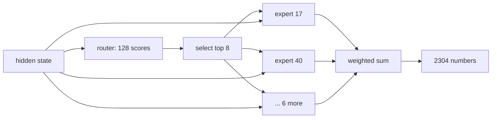

The selection differs from token to token and from layer to layer. That matters in chapter 10: when several users are served at once, their tokens pick different experts, and the engine must read all of the experts that any of them picked.

### 4.3 Total parameters and active parameters

The mixture-of-experts design separates two numbers that are equal in a dense model (a model without experts, where every token uses every weight):

- **Total parameters** is the size of the model. All of them must be in memory, because any token may select any expert. The model card gives 26.4 billion; the tensors in the model file used here add up to 26.1 billion.
- **Active parameters** is the number of distinct parameters one token uses. The model card gives 3.4 billion. Counting from the model file, one token uses 2.67 billion distinct weights: 24 layers' dense weights (24 × 27.2 million, plus 12 × 2.4 million for the controllers of the looped layers, 0.68 billion), 8 experts per layer (24 × 63.7 million, 1.53 billion) and the output matrix (0.46 billion; the embedding table contributes only the one row it looks up). Counting the whole embedding table as "active", as some model cards do, would give 3.14 billion. The card does not say what its 3.4 billion includes; the remaining difference may be parts of the model not counted here, such as the image encoder (section 8.2). This note uses the counts from the file.

For decode speed, what matters is how many weights a token reads, counting repeats, and section 2.5 gave that number: about 4.9 billion, because the loop of the next section reads some layers three times. A dense model of 26 billion parameters would read 26 billion weights per token, about five times as many. The price of the mixture-of-experts design is memory: all 26 billion must be stored even though a token reads only a fraction of them.

### 4.4 The loop: layers 6 to 17 run three times

Inkling 2 Mini stores 24 layers, numbered 0 to 23. Layers 6 to 17 form a *loop core* that runs three times per token, with the same weights each time. A token's path through the model is:

```text
layers 0..5          once     ->   6 layer passes      (the "prelude")
layers 6..17         3 times  ->  36 layer passes      (the loop core, same weights each pass)
layers 18..23        once     ->   6 layer passes
                                  ----
                                  48 layer passes per token
```

A *layer pass* is one execution of one stored layer. In an ordinary model, passes and layers are the same thing; here there are 48 passes for 24 layers. The model card counts this loop in its own figure of 5.4 billion "weight activations" per token: the looped weights are used three times. The corresponding count from the file is the 4.9 billion of section 2.5; the card's figure is about 0.5 billion higher, about the same gap as for the active count, so it probably includes the same extra parts.

The three passes through the core are not identical copies of each other. According to the model's implementation in llama.cpp (`src/models/inkling2-loop.cpp` and `inkling2.cpp`), the computation runs as follows:

1. **Pass 1** runs layers 6 to 17 on the output of the prelude (the hidden state after layer 5), like any other layers.
2. **Pass 2** starts again from the same prelude output, not from the output of pass 1. But each of its layers also receives a *message*: a vector of 2304 numbers computed as a learned weighted mix of hidden states that pass 1 produced. Each looped layer computes four messages, one each for its query, key, value and feed-forward inputs.
3. In each looped layer, four small *loop controllers* (for the query, key, value and feed-forward inputs) decide how to combine the normal input with the message. Each controller takes both vectors (2 × 2304 = 4608 numbers), multiplies them by a matrix that compresses them to 64 numbers, and from those 64 computes two vectors of 2304 numbers, a *gain* and a *forget*. The layer's new input is `(1 − forget) × input + gain × message`, entry by entry. For one entry with input 0.8, message 0.3, forget 0.25 and gain 0.5, the new value is 0.75 × 0.8 + 0.5 × 0.3 = 0.75. Where the forget value is near 0 and the gain near 0, the layer ignores the message; where the gain is large, the message dominates. Compressing to 64 numbers keeps each controller small (about 0.6 million weights, so 2.4 million for the four in a layer); the 64 is called the controller's *rank*.
4. **Pass 3** repeats step 2, with messages computed from the hidden states of pass 2.
5. The output of pass 3 goes to layers 18 to 23.

Why would a model be built this way? The publisher does not explain the design. What the mechanism allows is this: the same twelve layers are applied three times, so the model gets the depth of 36 layers for the weights of 12, and each pass can refine what the previous pass computed. The gain and forget vectors are learned, so in training the model decides, entry by entry and layer by layer, how much of the previous pass to take in.

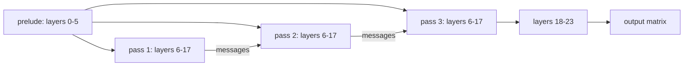

The consequence for the cache follows directly. Because each pass sees different inputs, the same layer computes different keys and values for the same token in each pass, so each pass must keep its own: 24 cache slots for the stored layers plus 2 × 12 for the second and third passes through the core, 48 in all (section 3.4). And because pass 2 needs pass 1's results, and pass 3 needs pass 2's, the three passes cannot run at the same time; they add to the length of the forward pass like any other layers.

### 4.5 What the loop means for speed

Each layer pass reads its layer's weights. The dense weights of layers 0–5 and 18–23 are read once per token, and those of layers 6–17 three times per token, so the 48 layer passes read 48 layers' worth of dense weights. The GPU's on-chip cache (24 MB, chapter 6) is far too small to keep a layer's weights from one pass to its next: between two passes through layer 6, the eleven other layers of the core run, and their weights alone are several hundred megabytes.

This turned out to be the most important fact about the files of chapter 9. In the original llama.cpp file the dense weights are stored at 16 bits (2 bytes) each, the experts of layers 0–19 at about 4.5 bits (0.56 bytes, chapter 5), and the experts of layers 20–23 at 16 bits (the file widened them from the release's 8-bit format, chapter 9). Per token:

```text
dense:    48 passes × 30.0 M weights × 2 bytes            =  2.88 GB
experts:  44 passes × 8 × 7.96 M weights × 0.5625 bytes   =  1.58 GB   (layers 0–19)
          4 passes × 8 × 7.96 M weights × 2 bytes          =  0.51 GB   (layers 20–23)
```

The dense part is only about 3 % of the model's weights (30 million per layer against 1,019 million of experts), but every token reads all of it in every layer pass and only 8 of 128 experts, so the dense weights end up costing more bytes per token than the experts.

**Points to remember**

- Each layer has 128 experts of 7.96 million weights; a router selects 8 of them per token, and the other 120 are neither computed nor read.
- Total parameters (about 26 billion) decide how much memory the model needs; the weights read per token (about 4.9 billion, counting repeats) decide how many bytes a token reads.
- Layers 6 to 17 run three times; passes 2 and 3 restart from the prelude output and receive messages from the previous pass through small loop controllers. A token makes 48 layer passes over 24 stored layers.
- Each pass through a looped layer computes its own keys and values, which gives 48 KV cache slots.

## 5. Numbers in memory: precision and quantisation

Chapter 2 established that decode speed depends on the bytes read per token. The number of weights is fixed by the model; the number of bytes per weight is not. This chapter explains how a weight can be stored in 16, 8 or about 4 bits, what is lost, how the loss is measured, and how a model file records which format each tensor uses. It introduces the format names (BF16, Q8_0, NVFP4 and others) that chapter 9 compares.

### 5.1 Floating-point numbers

A *floating-point* number stores a sign, an *exponent* that sets the number's scale (a power of two), and a *mantissa* (also called the significand) that gives its digits within that scale: value = ± mantissa × 2^exponent. More exponent bits give a wider range; more mantissa bits give finer steps. Short formats are named by their bit counts: E4M3 means 4 exponent bits and 3 mantissa bits.

| Format | Bits | Sign / exponent / mantissa | Notes |
|---|---|---|---|
| FP32 | 32 | 1 / 8 / 23 | the standard "float"; used here for small tensors such as norm weights |
| FP16 | 16 | 1 / 5 / 10 | finer steps, narrow range (largest value 65,504) |
| BF16 ("brain float") | 16 | 1 / 8 / 7 | the range of FP32 with coarse steps; the usual format for training and for released weights ([Kalamkar et al. 2019](https://arxiv.org/abs/1905.12322)) |
| FP8 E4M3 | 8 | 1 / 4 / 3 | largest value 448 ([Micikevicius et al. 2022](https://arxiv.org/abs/2209.05433)) |
| FP4 E2M1 | 4 | 1 / 2 / 1 | only the values 0, 0.5, 1, 1.5, 2, 3, 4, 6 and their negatives |

Inkling 2 Mini was released with its dense weights in BF16, two bytes per weight.

### 5.2 Block quantisation: many small numbers, one shared scale

*Quantisation* means storing numbers with fewer bits than they were trained with. Simply rounding every weight to an 8-bit or 4-bit float fails, because weights in different parts of a matrix have very different sizes, and a small format cannot cover all of them. The formats used for language models solve this by splitting each row of weights into short *blocks* and storing, for each block, one *scale* plus a small integer or tiny float per weight. Each weight is reconstructed as `scale × code`.

Here is llama.cpp's 8-bit format Q8_0 (blocks of 32 weights, one 16-bit scale per block), on a block shortened to four numbers so that the arithmetic is visible. The error row is the reconstructed value minus the original:

```text
weights        0.12     -0.50     0.03     0.31
scale = max |w| / 127 = 0.50 / 127 = 0.003937
codes = round(w / scale)
               30       -127      8        79           (8-bit signed integers)
reconstructed  0.1181   -0.5000   0.0315   0.3110       (code × scale)
error          -0.0019   0.0000   +0.0015  +0.0010
```

The errors are below 0.002, about 0.4 % of the largest weight in the block. Storage is 32 one-byte codes plus a two-byte scale, 34 bytes for 32 weights, which is 8.5 bits per weight. The scale's overhead is why the format counts as 8.5 rather than 8 bits.

The 4-bit format NVFP4, which Inkling's publisher used for most of the experts, works the same way with coarser codes ([NVIDIA, "Introducing NVFP4"](https://developer.nvidia.com/blog/introducing-nvfp4-for-efficient-and-accurate-low-precision-inference/)). Each block of 16 weights shares one FP8 E4M3 scale, and each weight is stored as an FP4 E2M1 value. The scale is chosen so that the block's largest magnitude maps to about 6, the largest FP4 value, and is itself rounded to the nearest FP8 value. Here are eight of a block's sixteen numbers, with the scale computed as if these were all of them:

```text
weights          0.9   -2.4   0.1   1.3   -0.6   3.1   0.0   -1.7
scale = 3.1 / 6 = 0.517, rounded to FP8: 0.5
w / scale        1.8   -4.8   0.2   2.6   -1.2   6.2   0.0   -3.4
nearest FP4      2     -4     0     3     -1     6     0     -3      (6.2 is clipped to 6)
reconstructed    1.0   -2.0   0.0   1.5   -0.5   3.0   0.0   -1.5
error           +0.1   +0.4  -0.1  +0.2  +0.1   -0.1   0.0   +0.2
```

The errors are now up to about 13 % of the largest weight. Storage is 16 × 4 bits plus an 8-bit scale per block, 4.5 bits per weight. In addition, each expert has one 32-bit scale that applies to all of its blocks (stored in the model file as the `ffn_gate_up_exps.scale` and `ffn_down_exps.scale` tensors, 128 values each, one per expert).

Whether errors of this size are acceptable cannot be decided from the arithmetic; it is decided by testing the quantised model. Inkling's publisher released the experts of layers 0–19 only in NVFP4 (and those of layers 20–23 in the 8-bit MXFP8 format of section 5.3), so NVFP4 is the reference version of those experts. Every file in this study except two (L2 and L3, chapter 9) keeps the NVFP4 experts unchanged.

### 5.3 The formats in this study

| Format | Bits per weight | Structure | Where it appears |
|---|---|---|---|
| BF16 | 16 | plain 16-bit float | dense weights of the official release and of the original llama.cpp file |
| Q8_0 | 8.5 | 32 × int8 + FP16 scale | llama.cpp's simple 8-bit format |
| MXFP8 | 8.25 | 32 × FP8 E4M3 + 8-bit power-of-two scale ([OCP MX specification](https://opencompute.org/documents/ocp-microscaling-formats-mx-v1-0-spec-final-pdf)) | experts of layers 20–23 in the official release |
| NVFP4 | 4.5 | 16 × FP4 E2M1 + FP8 scale, plus a per-expert scale | experts of layers 0–19 in the official release |
| IQ4_NL | 4.5 | 32 × 4-bit index into a fixed table of 16 non-uniformly spaced values + FP16 scale | llama.cpp format, used in one file of chapter 9 |
| Q4_K | about 4.5 | 256-weight super-blocks of 8 sub-blocks, each with its own 6-bit scale and minimum | llama.cpp format; none of the measured files actually contains it |

Going from 16 to 8.5 bits halves the bytes of a tensor; going from 8.5 to 4.5 bits almost halves them again. Chapter 9 shows what that is worth when applied to the dense weights that every layer pass reads.

### 5.4 Weights and activations

So far only the weights have been quantised. The other operand of a matrix-vector product, the hidden-state vector, is called the *activation*. It is small (2304 numbers) and changes every step, so storing it in fewer bits saves almost no memory traffic. Engines still often quantise it, because GPUs have instructions that multiply two low-precision operands faster than mixed ones. llama.cpp converts each activation vector to an 8-bit format (`q8_1`) before every quantised matrix-vector product, so that it can use integer dot-product instructions; this conversion is its own small GPU program and appears in the profiles of chapter 7. The official Inkling checkpoint goes further for its NVFP4 experts: it specifies that activations entering them are also quantised to NVFP4, so the expert computation multiplies 4-bit weights by 4-bit activations. This is written *W4A4* (weights 4 bits, activations 4 bits), and it is what vLLM executes.

### 5.5 Measuring the damage: perplexity

How do you know whether a quantised file is worse than the original? The standard first check is *perplexity*. Take a fixed text the model did not write (here, the test set of the wikitext-2 corpus, [Merity et al. 2016](https://arxiv.org/abs/1609.07843), cut into 64 chunks of 512 tokens). At every position, ask the model for its probability of the token that actually comes next. Perplexity is the exponential of the average negative logarithm of those probabilities:

```text
perplexity = exp( -(1/N) · Σ_i log p(actual token i | tokens before i) )
```

A perplexity of 6.92 means that the *geometric mean* (the N-th root of the product of the N probabilities) of the model's probability for the correct next token is 1/6.92, about 14.5 %. Lower is better. If quantisation damages the model, the probabilities of correct tokens fall and the perplexity rises.

llama.cpp's `llama-perplexity` tool reports each value with a *standard error*, `± 0.133` here: an estimate, from how much the per-token log-probabilities vary over the text, of how much the result would change on a different sample of text. The five files of chapter 9 measured between 6.896 and 6.930. Their largest difference, 0.034, is a quarter of that standard error, so no file stands out. Much of the ± 0.133 comes from the text itself (some passages are hard for every file), and all files were scored on the same text, so the uncertainty of a difference between two files is smaller than ± 0.133; comparing against the full ± 0.133 is therefore conservative. Either way, no file was measurably worse. Perplexity does not capture every kind of damage (a model can keep its perplexity and still lose some reasoning ability), but large damage shows up there first. A more sensitive check, comparing the original and the quantised model's full probability lists token by token, was not run in this study.

### 5.6 The model file: GGUF

llama.cpp reads models from a single file in the GGUF format ([specification](https://github.com/ggml-org/ggml/blob/master/docs/gguf.md)). A GGUF file contains a header, a list of metadata entries, a table of tensors and the tensor data. The metadata describes the architecture; here are some entries from the file used in this study:

```text
general.architecture                     'inkling2_loop'
inkling2_loop.block_count                24
inkling2_loop.embedding_length           2304
inkling2_loop.expert_count               128
inkling2_loop.expert_used_count          8
inkling2_loop.loop.start                 6
inkling2_loop.loop.end                   18        (exclusive: layers 6..17)
inkling2_loop.loop.count                 3
inkling2_loop.attention.sliding_window   1024
inkling2_loop.vocab_size                 201024
inkling2_loop.vocab_size_unpadded        200058
```

The tensor table lists every tensor's name, shape and storage format, and each tensor can have a different format. That is how one file can hold NVFP4 experts next to Q8_0 attention weights next to FP32 norm weights. GGUF lists the input dimension first, so `[2304, 3072]` is the matrix with 2304 columns (inputs) and 3072 rows (outputs), and the expert tensors have the expert number as their last dimension:

```text
blk.5.attn_q.weight              [2304, 3072]          Q8_0     (the query matrix of layer 5)
blk.5.ffn_gate_inp.weight        [2304, 128]           F32      (the router)
blk.5.ffn_gate_up_exps.weight    [2304, 2304, 128]     NVFP4    (128 experts' W_gate_up)
blk.5.ffn_down_exps.weight       [1152, 2304, 128]     NVFP4    (128 experts' W_down)
blk.5.ffn_norm.weight            [2304]                F32
```

File names often contain a format name, such as `UD-Q8_K_XL` or `Q4_K_XL`, but these are labels chosen by whoever made the file and describe a recipe rather than the content. Chapter 9 shows two files whose names contradict their tensor tables. The tensor table is the only reliable description, and it can be read with the `gguf-py` package shipped inside the llama.cpp source tree.

**Points to remember**

- Block quantisation stores each short block of weights as small codes plus one shared scale; Q8_0 costs 8.5 bits per weight and NVFP4 4.5 bits.
- In the official release, most experts are NVFP4, those of layers 20–23 are MXFP8, and the dense weights are BF16 (16 bits).
- Perplexity is the exponential of the average negative log-probability of the true next token; the five files in this study are indistinguishable by it.
- A GGUF file gives each tensor its own format; read the tensor table, not the file name, to know what a file contains.

## 6. The machine: how the Spark executes a forward pass

The previous chapters described what is computed. This chapter describes where: the DGX Spark, its GPU, and its memory. It introduces the vocabulary of GPU execution (kernels, thread blocks, streaming multiprocessors) and the distinction between *memory-bound* and *compute-bound* work, which explains why decode and prefill have such different speeds.

### 6.1 The DGX Spark

The DGX Spark is a small desktop computer built around one chip, the NVIDIA GB10. The chip contains both the CPU and the GPU, and both use the same memory.

| Component | Value on this machine |
|---|---|
| CPU | 20 ARM cores (10 Cortex-X925, 10 Cortex-A725) |
| GPU | Blackwell generation, 48 streaming multiprocessors, compute capability 12.1 (NVIDIA's version number for the GPU's instruction set) |
| GPU L2 cache | 24 MB |
| Memory | 128 GiB LPDDR5x (NVIDIA sells it as "128 GB"), shared by CPU and GPU; the operating system and the GPU see 121.7 GiB, the rest is not available to the operating system |
| Memory bandwidth | about 273 GB/s |
| GPU power during decode (measured) | 22–35 W |

Most GPUs have their own memory, separate from the computer's main memory, and data must be copied across a bus before the GPU can use it. On the Spark there is one pool of memory, called *unified memory*. A model loaded into memory is directly usable by the GPU. Two consequences follow. First, the GPU can hold a model far larger than a typical desktop graphics card allows: the 26-billion-parameter model and its cache fit comfortably. Second, the GPU's memory bandwidth is that of the shared memory, about 273 GB/s, several times lower than the dedicated memory of a data-centre GPU. The Spark is a machine with plenty of memory and modest bandwidth, and chapter 7 shows that bandwidth is what sets its decode speed.

### 6.2 How a GPU runs work

Programs for NVIDIA GPUs are written with **CUDA**, NVIDIA's programming platform: a C++ dialect for writing GPU functions plus a library for launching them ([CUDA programming guide](https://docs.nvidia.com/cuda/cuda-c-programming-guide/)). A GPU function is called a *kernel*. The CPU asks the GPU to run a kernel with a given number of parallel threads. The threads are grouped into *thread blocks*, and the GPU distributes the blocks over its *streaming multiprocessors* (SMs), the 48 independent processing units of GB10. Each SM runs several blocks at a time; when a block finishes, another one takes its place.

A matrix-vector product is one kernel. A typical implementation gives each thread block a few rows of the matrix: the block reads its rows and the input vector, computes the dot products, and writes its few output numbers. With enough rows, all 48 SMs are busy and the kernel reads the matrix as fast as its access pattern allows.

Every kernel has a minimum duration, whatever work it does, of roughly one to a few microseconds. Starting it, distributing its first blocks, waiting for its first reads to arrive from memory (a memory read takes on the order of a microsecond to return, although many can be in flight at once), and confirming that every block has finished before dependent work starts, together take that long. For a kernel that reads 50 MB of weights this floor is irrelevant. For a kernel that normalises one vector of 2304 numbers, the floor *is* the duration. Chapter 7 shows that one token of Inkling 2 Mini runs about 7,400 kernels, most of them of this second kind.

Kernels are submitted in order, and a kernel that uses the output of an earlier one must wait for it. Within one forward pass almost every kernel depends on the one before, so they run largely one after another. Where two operations do not depend on each other, the GPU may run them at the same time; chapter 7 shows that this happens for some of the small kernels.

### 6.3 Memory-bound and compute-bound

Whether a kernel is limited by memory or by arithmetic depends on its *arithmetic intensity*: the number of floating-point operations it performs per byte it reads from memory.

- A matrix-vector product performs 2 operations per weight. With weights of 4.5 bits (0.56 bytes) that is about 3.6 operations per byte; with 16-bit weights, 1 operation per byte.
- One whole decode token of the fastest file performs about 10 GFLOP (chapter 2) while reading 3.87 GB (chapter 7), an intensity of about 2.6 operations per byte.

To judge whether 2.6 is low, compare it with what the GPU can do. The highest arithmetic rate measured in this study is vLLM's prefill of a long prompt: 2,832 tokens per second at about 10 GFLOP each is 28 TFLOP/s (trillion operations per second), counting only the matrix products. The memory delivers 273 GB/s. To keep the arithmetic units as busy as in that prefill, a computation must perform about 28 × 10¹² / 273 × 10⁹ ≈ 100 operations per byte. (The GPU's true capability is higher than this measured rate, so the true threshold is higher still.) This threshold, the ratio of a machine's arithmetic rate to its memory bandwidth, is called its *machine balance*; plotting a kernel's speed against its intensity relative to it is the *roofline model* ([Williams, Waterman and Patterson 2009](https://doi.org/10.1145/1498765.1498785)). Decode offers 2.6 operations per byte, far below 100. The arithmetic units are therefore idle most of the time during decode, and the speed is set by how fast bytes arrive. Decode is *memory-bound*.

Prefill is different, because all prompt tokens are known at once. Instead of multiplying a matrix by one vector, the engine multiplies it by a matrix of N token vectors: a *matrix-matrix product*. Each weight is read once and used N times, so the intensity grows by a factor of N. With 512 prompt tokens it is in the hundreds or thousands of operations per byte, and the speed is set by arithmetic: prefill is *compute-bound*.

| Workload (measured rate) | Rate | Arithmetic performed (calculated, matrix products only) |
|---|---|---|
| Decode, fastest llama.cpp file (L5), through the server | 37.8 tokens/s | 0.37 TFLOP/s |
| Prefill, llama.cpp, 512-token prompt (llama-bench) | 843 tokens/s | 8.4 TFLOP/s |
| Prefill, llama.cpp, 38,409-token prompt | 294 tokens/s | 2.9 TFLOP/s |
| Prefill, vLLM, 38,409-token prompt | 2,832 tokens/s | 28.1 TFLOP/s |

The table explains the observation of section 1.5. Decode uses about 1 % of the arithmetic that the same GPU delivers in vLLM's prefill. Prefill speed is a question of how well an engine's kernels use the arithmetic units; decode speed is a question of bytes.

### 6.4 Why the cache memory does not help

GPUs have fast on-chip caches that keep recently read data. GB10's L2 cache holds 24 MB. One decode token reads several gigabytes of weights, each byte once, and the next read of the same byte comes one full token later, after gigabytes of other data have passed through the cache. Nothing survives that long, so for weight reads the cache is of no use, and every token pays the full cost of memory.

### 6.5 Tensor cores

Modern NVIDIA GPUs contain *tensor cores*: units that multiply small tiles of two matrices in one instruction, much faster than ordinary arithmetic. Blackwell's tensor cores accept FP4 operands, which is probably one reason the publisher chose NVFP4 for the experts. llama.cpp must be compiled with the architecture flag `121a` (the `a` enables architecture-specific instructions) to use them on GB10.

Tensor cores matter for prefill and much less for decode. Their instructions operate on tiles with many columns, and a matrix-vector product has one column, so most of each tile would be wasted; in any case decode is waiting for memory, not for arithmetic. In prefill, how well an engine's batched kernels use the arithmetic units, tensor cores included, decides its speed, and chapter 8 shows a tenfold difference between the two engines.

### 6.6 Power and heat

The GPU drew 22 to 35 W during single-user decode in every measurement, held its clock at 2,400–2,411 MHz in both engines, and never reached its power limit (the driver's counter of power-limited time, `clocks_event_reasons_counters.sw_power_cap`, did not advance during any benchmark). This is consistent with a memory-bound workload: the arithmetic units wait most of the time and draw little power. Decode on the Spark is limited by memory traffic and by kernel durations, not by power or temperature.

**Points to remember**

- The Spark's CPU and GPU share 128 GiB of memory at about 273 GB/s: much memory, modest bandwidth.
- The GPU runs work as kernels, written in CUDA; each kernel has a minimum duration of a few microseconds, however little it does.
- Decode performs about 2.6 operations per byte read, far below the roughly 100 that would keep the arithmetic units busy, so decode is memory-bound.
- Prefill reuses each weight for every prompt token, which makes it compute-bound; its speed depends on how well an engine's kernels use the arithmetic units.

# Part II — Where the time of one token goes

## 7. Bytes plus a fixed cost: the two-term model

This chapter builds a model of decode time that accounts for the speed of every file in this study to within a few percent, checks its byte count with a hardware profiler, and then takes one token apart kernel by kernel to see what the second term consists of. The model is one line long, and the rest of the note uses it to explain each result:

```text
time per token  ≈  bytes read per token / 273 GB/s  +  fixed time per token
```

The files compared here are called L1 to L5 (chapter 9 describes them in full). For this chapter it is enough to know that L1 is the original llama.cpp file, with 16-bit dense weights, and L5 is the fastest file, with 8.5-bit dense weights; both keep the publisher's 4.5-bit NVFP4 experts of layers 0–19.

### 7.1 The first term: bytes per token

Chapter 6 established that decode waits for memory, so the first estimate of a token's time is the bytes it reads divided by the bandwidth. Chapters 2 to 4 provide the bytes. Per token, the model reads:

- the dense weights of every layer pass: 48 × 30.0 million weights (section 2.5 explains why this slightly overstates the true 29.0 million);
- eight experts per layer pass: 44 passes through layers 0–19 and 4 passes through layers 20–23, each pass 8 × 7.96 = 63.7 million weights;
- the output matrix once: 463 million weights.

Multiplying each count by the bytes per weight of its format gives:

| Component | Count per token | Weights | at BF16 (16 bits) | at Q8_0 (8.5 bits) | at NVFP4 or IQ4_NL (4.5 bits) |
|---|---|---|---|---|---|
| Dense part of a layer pass | 48 | 30.0 M | 2.88 GB | 1.53 GB | 0.81 GB |
| 8 experts, layers 0–19 | 44 | 63.7 M | 5.61 GB | 2.98 GB | 1.58 GB |
| 8 experts, layers 20–23 | 4 | 63.7 M | 0.51 GB | 0.27 GB | 0.14 GB |
| Output matrix | 1 | 463 M | 0.93 GB | 0.49 GB | 0.26 GB |

A file's bytes per token is the sum of one entry per row, chosen by the format that file uses for that component. L1 stores the experts of layers 0–19 in NVFP4 and everything else in BF16:

```text
L1:  1.58 (NVFP4 experts) + 0.51 (BF16 experts 20–23) + 2.88 (BF16 dense) + 0.93 (BF16 output)  =  5.90 GB
```

At 273 GB/s, 5.90 GB takes 21.6 ms, so L1 cannot decode faster than 46 tokens/s. The same sum for the other files, and for the official weights that vLLM loads (where the experts of layers 20–23 are MXFP8, 0.26 GB):

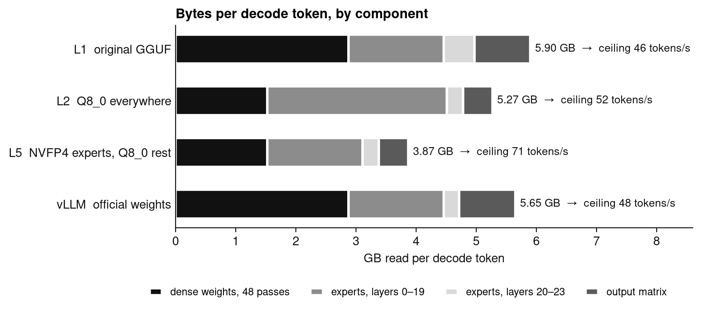

The first bar shows the observation that started the study: in L1 the 16-bit dense weights (2.88 GB) cost more than the 4.5-bit experts (1.58 GB), because every one of the 48 layer passes reads its layer's dense weights.

### 7.2 Checking the byte count with a profiler

A count derived from a parameter table can be wrong. It leaves out the KV cache, the activations and anything an engine reads that the table does not list. NVIDIA's *Nsight Compute* profiler (`ncu`, [documentation](https://docs.nvidia.com/nsight-compute/)) can measure the actual traffic: it runs each kernel in isolation and reads the GPU's hardware counters. The counter that measures memory traffic on GB10 is `lts__d_sectors_fill_sysmem`. It counts the 32-byte blocks ("sectors") that the L2 cache had to fetch ("fill") from main memory ("sysmem"). Every byte read from memory passes through the L2 cache, so this counts the bytes read. Summed over every kernel of one decode token:

| File | Kernels in one token | Bytes from memory (measured) | Bytes from the table | Ratio |
|---|---|---|---|---|
| L1 | 7,131 | 6.03 GB | 5.90 GB | 1.02 |
| L2 | 7,396 | 5.66 GB | 5.27 GB | 1.07 |
| L5 | 7,484 | 4.14 GB | 3.87 GB | 1.07 |

The measured traffic is 2–7 % above the table. Part of the excess is real traffic the table leaves out (the KV cache and the activations). Part is an artefact: the profiler empties the caches before each kernel, so data that would normally still be in the cache is counted as a fresh memory read. The measurements are therefore upper bounds on the real traffic, and the table accounts for at least 93 % of them. That is close enough for the purpose here, which is to predict speed.

### 7.3 The second term: a fixed cost per token

If bytes were the only cost, L1 would decode at 46 tokens/s. llama-bench measures 30.3. Comparing all five files gives the second term. For each file, subtract the bandwidth time from the measured time per token (llama-bench's 128-token generation test, which runs the engine without its server):

| File | Bytes per token | Bandwidth time | Measured time per token | Remainder |
|---|---|---|---|---|
| L1 | 5.90 GB | 21.6 ms | 33.0 ms (30.3 tokens/s) | 11.4 ms |
| L2 | 5.27 GB | 19.3 ms | 31.7 ms (31.6 tokens/s) | 12.4 ms |
| L3 | 3.87 GB | 14.2 ms | 26.1 ms (38.3 tokens/s) | 11.9 ms |
| L4 | 3.87 GB | 14.2 ms | 25.7 ms (39.0 tokens/s) | 11.5 ms |
| L5 | 3.87 GB | 14.2 ms | 25.5 ms (39.2 tokens/s) | 11.3 ms |

The remainder is nearly the same in every file, 11–12 ms, although the bytes differ by a third. The difference between L1 and L5 in measured time, 7.5 ms, is almost exactly the time their 2.03 GB difference in bytes takes at full bandwidth, 7.4 ms. So the bandwidth term behaves as predicted, and on top of it sits a cost of about 11–12 ms per token that does not depend on the file. It is 34–46 % of the time per token. Measured through the server rather than llama-bench, the fixed cost is about 12.8 ms, because the server adds sampling, streaming and HTTP work to each token. (12.8 ms is the intercept of a straight line, with slope fixed at 1 / 273 GB/s, fitted through all five files' serving measurements; L5 alone gives 12.3 ms.)

Here is how the model was used as a prediction, in the order the work happened. L1, L4 and L5 were measured first, and the fixed cost was taken from them (11.4 ms from L1). Then, before L2 and L3 were measured, their predictions were written into the study's diary: L2, 1 / (19.3 ms + 11.4 ms) = 32.6 tokens/s, measured 31.6 (3 % lower); L3, about 39 tokens/s, measured 38.3 (2 % lower). So two of the five files are true out-of-sample tests, and both landed within 3 %. The other three are the data the fixed cost was taken from.

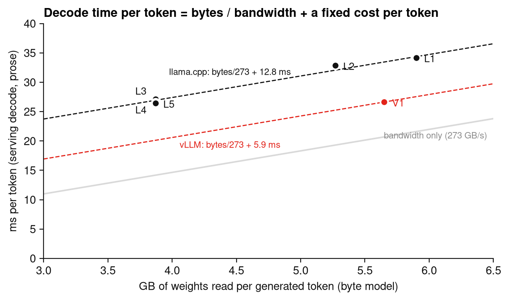

The figure places every file and vLLM on the axes of the model: bytes per token horizontally, time per token vertically. Unlike the table above, it uses the serving benchmark's measurements for every point, so that vLLM (which has no llama-bench) is measured the same way; the llama.cpp points therefore sit about 1 ms higher than the table's values. The llama.cpp files lie on a line whose slope is 1 / (273 GB/s), that is 3.66 ms per GB, and which meets the vertical axis at the fixed cost. L3, L4 and L5 read the same bytes and overlap. vLLM, discussed in chapter 8, lies on a parallel line with half the fixed cost.

### 7.4 What the fixed cost is

A common explanation for a fixed per-token cost is *launch overhead*: the CPU asks the GPU to start each kernel, each request takes the CPU several microseconds, and with thousands of kernels the GPU spends much of its time waiting for the next request. That explanation does not fit here, for two reasons.

The first reason is that llama.cpp uses *CUDA graphs* during decode ([CUDA programming guide, "CUDA Graphs"](https://docs.nvidia.com/cuda/cuda-c-programming-guide/#cuda-graphs)). A CUDA graph is a recorded sequence of kernel launches with their arguments and dependencies. The engine records the sequence of one decode step once, and afterwards submits the whole recording with a single call; the GPU then starts each kernel itself as soon as the kernels it depends on have finished. The CPU is no longer involved per kernel. llama.cpp's debug output confirms that it replays one recorded graph per token (`CUDA Graph id 24 reused`).

The second reason is direct observation. NVIDIA's *Nsight Systems* profiler (`nsys`, [documentation](https://docs.nvidia.com/nsight-systems/)) records the start and end time of every kernel on the GPU. It was used to trace 32 decode tokens of each of three files, and the trace was divided into tokens; the first token, which includes start-up work, is dropped, leaving 31. (The kernel counts differ slightly from the Nsight Compute table above, because the two tools ran separately and mark a token's boundaries slightly differently.) Per token:

| File | Wall time | Kernels | GPU idle | Kernels shorter than 5 µs | Their summed duration |
|---|---|---|---|---|---|
| L1 | 33.9 ms | 7,037 | 0.8 ms | 6,404 | 11.4 ms |
| L2 | 33.1 ms | 7,348 | 0.8 ms | 6,628 | 11.3 ms |
| L5 | 27.1 ms | 7,390 | 0.8 ms | 6,771 | 11.7 ms |

The GPU is idle for only 0.8 ms of each token, about 3 %. The fixed cost is therefore not the GPU waiting for the CPU; it is time spent executing kernels. About 6,500 kernels per token run for less than 5 µs each. They are the RMS normalisations, scalings, vector additions and multiplications, concatenations, the short convolutions and gates of section 3.6, and the step that converts each activation vector to 8 bits before a quantised matrix product (section 5.4). Each touches a vector of 2304 numbers, and its duration is close to the minimum duration of a kernel (section 6.2), on average about 1.8 µs. That is about 135 such kernels per layer pass.

Summing kernel durations overstates their share, however. A CUDA graph lets kernels that do not depend on each other run at the same time, so some of their time intervals overlap; summed over all kernels, L5's token contains 30.8 ms of kernel time in 27.1 ms of wall time. A correct split must count each moment of the token once. Dividing the wall time into three disjoint parts (time during which a weight-reading matrix-vector kernel runs; time during which only other kernels run; idle time) gives:

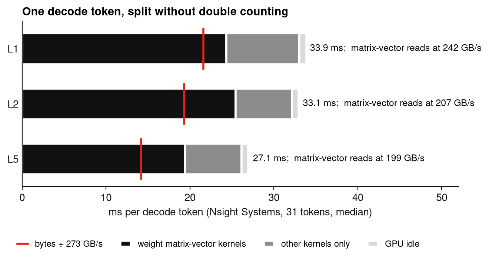

| File | Wall time | Weight matrix-vector kernels | Other kernels only | Idle | Rate of the weight reads (table bytes) |
|---|---|---|---|---|---|
| L1 | 33.9 ms | 24.4 ms | 8.7 ms | 0.8 ms | 242 GB/s (89 % of 273) |
| L2 | 33.1 ms | 25.5 ms | 6.7 ms | 0.8 ms | 207 GB/s (76 %) |
| L5 | 27.1 ms | 19.4 ms | 6.7 ms | 0.8 ms | 199 GB/s (73 %) |

A kernel counts as weight-reading here if its name starts with `mul_mat_vec`, llama.cpp's matrix-vector kernels; there are about 925 per token, more than one per weight matrix, because the router, the loop controllers and some expert products are separate launches. The rates in the last column divide the table's byte count (section 7.1) by this time. The weight-reading kernels do not overlap each other, and they read each file's bytes at 73–89 % of the memory's peak rate. The small kernels overlap each other but rarely the weight reads, and they occupy 6.7–8.7 ms of the token on their own. So the fixed cost of the two-term model has three parts. For L5, traced under the profiler:

```text
bandwidth time at 273 GB/s                                   14.2 ms
+ weight reads running below peak (19.4 − 14.2)              5.2 ms
+ small kernels running while no weight read runs            6.7 ms
+ idle                                                        0.8 ms
= 26.9 ms   (measured 27.1 ms with the profiler attached, 25.5 ms without)
```

For L1, the weight reads run closer to peak (2.8 ms above the bandwidth time) and the small kernels take longer on their own (8.7 ms). The parts differ between files but add up to about the same total, which is why the second term of the model looks constant. The model's "fixed cost" is a useful summary, not a single mechanism. (This corrects the earlier report on this study, which attributed the whole fixed cost to the small kernels' summed duration.)

The table also shows that the Q8_0 matrix-vector kernels of L2 and L5 read memory less efficiently (73–76 % of peak) than L1's mix of BF16 and NVFP4 kernels (89 %). A faster Q8_0 kernel would make L5 faster without changing the file.

### 7.5 What can reduce the fixed cost

Two of the three parts can be attacked. The time of the small kernels can only be reduced by having fewer of them, which means *kernel fusion*: writing one kernel that performs several consecutive operations, for example normalising a vector and converting it to 8 bits in the same pass, instead of one kernel for each. A fused kernel pays the minimum duration once, and the intermediate vector never has to be written to memory and read back. CUDA graphs remove the CPU's work per kernel, but not the kernels. The other part, weight reads below peak, is reduced by better matrix-vector kernels. Chapter 8 shows that vLLM's fixed cost is half of llama.cpp's. vLLM fuses operations, but no profile of vLLM was taken, so how its saving divides between the two parts is not known.

**Points to remember**

- Time per token ≈ bytes per token / 273 GB/s + a fixed cost; the byte count can be computed from the parameter table and agrees with the profiler to within 7 %.
- In llama.cpp the fixed cost is 11–13 ms per token and nearly independent of the file: 34–46 % of the time per token. Taken from three files, it predicted the other two within 3 %.
- The fixed cost is GPU time, not CPU launch overhead (the GPU is idle for 3 % of a token). For L5 it consists of 6.7 ms of small kernels running alone, 5.2 ms of weight reads running below peak bandwidth, and 0.8 ms idle.
- CUDA graphs remove the CPU's work per kernel; kernel fusion removes kernels, and better matrix-vector kernels bring the weight reads closer to peak.

## 8. The engines: llama.cpp and vLLM

An *inference engine* is the program that loads a model's weights, runs its forward passes, samples tokens, manages the KV cache, and answers requests from clients. This study compared two: [llama.cpp](https://github.com/ggml-org/llama.cpp) and [vLLM](https://github.com/vllm-project/vllm). With the same model on the same machine, they decode at the same speed, but differ by a factor of ten in prefill, by a factor of almost three in memory use, and by a factor of ten in start-up time. This chapter explains each difference from the way each engine is built.

### 8.1 What every engine does

Every engine performs the same five jobs, in its own way:

1. **Load** the weights into memory, in whatever formats the engine supports.
2. **Execute** forward passes, by running a sequence of GPU kernels for the model's architecture.
3. **Manage the KV cache**: reserve memory for it, assign parts of it to requests, free them when a request ends.
4. **Schedule** requests: decide which requests' tokens go into the next forward pass, and whether a pass does prefill, decode, or both.
5. **Serve** an API, in both cases an HTTP interface compatible with OpenAI's (`/v1/chat/completions`), including the chat template and streaming of tokens as they are produced.

Both engines support Inkling 2 Mini, through code written for this specific architecture in each project: llama.cpp in C++ (`src/models/inkling2.cpp` and `inkling2-loop.cpp`), vLLM in Python with its own GPU kernels. A model with an unusual architecture runs only in engines whose developers have written that code.

### 8.2 llama.cpp

llama.cpp is a C++ program built on a small tensor library called *ggml*. A model is described as a *computation graph*: a list of tensor operations (matrix product, normalisation, addition, attention, and so on), each consuming the outputs of earlier ones. For each operation, ggml's CUDA backend has one or more kernels, and running the graph means running about one kernel per operation, in order. Each quantisation format has its own kernels, which is how llama.cpp supports dozens of formats, NVFP4 among them.

For decode, the important kernels are matrix-vector products that read quantised weights directly (`mul_mat_vec_q` in the profiles of chapter 7), each preceded by the conversion of the activation to 8 bits (`quantize_q8_1`). For prefill, ggml uses matrix-matrix kernels, some written for quantised formats and some from NVIDIA's libraries. The engine records each decode step as a CUDA graph and replays it (section 7.4).

The server, `llama-server`, reserves the KV cache for the configured context length when it starts (65,536 tokens in this project). It divides the cache among a fixed number of request *slots* (llama.cpp's term; not the KV cache slots of chapter 3), one per request it can serve at the same time (`--parallel`). Each slot keeps the tokens of its last prompt, so that a follow-up message in the same conversation does not have to be prefilled again.

What follows from this design:

- **Fast start, small footprint.** The server loads the 16.4 GiB L5 file and starts in about 20 seconds. This project's server also loads an *image encoder* (a 0.64 GB network that turns an image into tokens the model can read; image input was not measured in this study). With a 65,536-token context and the image encoder, the machine's memory use was 32 GB, measured as the drop in available memory reported by the operating system (`/proc/meminfo`), because the GPU does not report memory use on GB10.
- **Any format, any file.** The same build runs every file of chapter 9, and a new mixture of formats is made in nine seconds with the bundled `llama-quantize` tool.
- **A large fixed cost per token.** About one kernel per graph operation gives about 7,400 kernels per token for this model; chapter 7 showed what they cost, 11–13 ms per token.
- **Slow prefill on this model.** The 38,409-token prompt was processed at 294 tokens/s, 2.9 TFLOP/s by the calculation of chapter 6. llama.cpp's support for this model was merged in the days before the study, with a correctness fix on the day it began, and its batched kernels for these experts are new. Why they reach a tenth of vLLM's rate was not profiled.

### 8.3 vLLM

vLLM ([Kwon et al. 2023](https://arxiv.org/abs/2309.06180)) is a Python engine built on [PyTorch](https://pytorch.org/), the most widely used library for neural-network computation, and designed for servers that handle many requests at once. A model is a Python class that calls PyTorch operations and vLLM's own kernels. Three mechanisms matter here.

**Compilation and fusion.** At start-up, vLLM compiles the model's forward pass with PyTorch's compiler (`torch.compile`) and applies its own fusion passes, which merge consecutive small operations into single kernels. Its log lists the fusions it enabled for this model: `norm_quant` (normalise a vector and quantise it for the next matrix product, in one kernel) and `act_quant` (apply the activation function and quantise, in one kernel). Many of the kernels for Inkling's specific operations are written in [Triton](https://triton-lang.org/), a Python-like language for GPU kernels ([Tillet et al. 2019](https://doi.org/10.1145/3315508.3329973)). Triton compiles a kernel into GPU code the first time it is used with a given shape of input, a step called *just-in-time* (JIT) compilation. The log shows kernels such as `_route_tokens_kernel`, `_expert_gemm`, `_mxfp8_gemm`, `_sconv_kernel` (the short convolutions) and `_rel_attention_kernel`. Some library kernels are chosen at start-up by an *autotuner*, which times several variants and keeps the fastest. vLLM then records CUDA graphs for a set of batch sizes, like llama.cpp.

**PagedAttention.** vLLM does not reserve a fixed cache per request. At start-up it reserves a fraction of the GPU's memory (`--gpu-memory-utilization 0.7` here, a target of 85 GiB of the 121.7 GiB) and, after the weights and working memory, turns the rest into a pool of fixed-size *blocks* of KV cache. Each request receives blocks as its context grows and returns them when it ends, much as an operating system assigns memory pages to processes. This lets many requests of different lengths share one pool without each reserving its maximum. On this machine the pool held 241,313 tokens, which the log reports as room for 3.68 simultaneous requests of the full 65,536 tokens.

**Continuous batching.** The scheduler forms every forward pass from whatever requests are active: new requests join the next pass as soon as they arrive, and finished ones leave, without waiting for the others ([Yu et al. 2022](https://www.usenix.org/conference/osdi22/presentation/yu)). Long prompts are split into pieces of at most 8,192 tokens (*chunked prefill*), so that a long prefill does not stall the decode of other requests for many seconds. Chapter 10 measures what this gives with up to eight streams.

What follows from this design:

- **A small fixed cost per token.** With fused kernels and CUDA graphs, vLLM's fixed cost is about 5.9 ms per token, half of llama.cpp's.
- **The same decode speed, from more bytes.** vLLM loads the official weights, whose dense part is BF16; it reads 5.65 GB per token against 3.87 GB for the fastest llama.cpp file. Its smaller fixed cost almost exactly compensates: 26.7 ms per token against 26.5 ms (both measured through the server, on the prose prompt).
- **Ten times the prefill.** 2,832 tokens/s on the 38,409-token prompt (13.6 s to the first token, against 130.6 s), 28 TFLOP/s. vLLM runs the experts as the checkpoint specifies, with 4-bit weights and 4-bit activations, through batched kernels written for this model and kernels selected by the autotuner. Which of its kernels account for the gap was not profiled.
- **Large footprint, slow start.** System memory in use while vLLM ran was 87 GB (measured, like llama.cpp's, from `/proc/meminfo`; vLLM's own reservation target was 85 GiB, about 91 GB). Start-up took 208–228 s: 103 s to load the 18 GiB checkpoint, and most of the rest to compile, tune kernels and record graphs.
- **Occasional pauses on first use.** A Triton kernel used for the first time with a new shape is compiled at that moment. The log warns `Triton kernel JIT compilation during inference: _rel_attention_kernel. This causes a latency spike`, and some first requests waited 1.7–7.7 s for their first token.

### 8.4 The two engines side by side

| | llama.cpp, fastest file (L5) | vLLM, official weights (V1) |
|---|---|---|
| Weights read per token | 3.87 GB | 5.65 GB |
| Fixed cost per token (server) | 12.8 ms | 5.9 ms |
| Decode, prose / code / edit prompts (tokens/s; prompts in section 13.2) | 37.8 / 37.7 / 36.3 | 37.5 / 37.7 / 36.7 |
| Time to first token, 38,409-token prompt | 130.6 s | 13.6 s |
| Decode after that prompt (longer KV cache, section 3.7) | 30.3 tokens/s | 31.1 tokens/s |
| GPU power while decoding | 30.8 W | 22.5–24.8 W |
| GPU energy per token | 0.80 J | 0.60–0.66 J |
| GPU clock while decoding | 2,411 MHz | 2,411 MHz |
| System memory in use | 32 GB | 87 GB |
| Start-up | about 20 s | 208–228 s |

Energy per token is the GPU's power during decode (in watts, joules per second) divided by the tokens per second, which gives joules per token. Two entries deserve comment. vLLM uses about 18–25 % less GPU energy per token (and draws correspondingly less power) at the same clock frequency. The telemetry cannot say why. A plausible cause is the thousands of small kernels in llama.cpp, each of which keeps the GPU active without moving much data, but no profile of vLLM was taken to confirm it. And the two-term model points at a configuration that neither engine offers: the 3.87 GB of the L5 file with vLLM's 5.9 ms of fixed cost would take about 20 ms per token, about 50 tokens/s. Getting there requires either vLLM loading 8-bit dense weights for this model or llama.cpp reducing its fixed cost.

### 8.5 Other engines

[SGLang](https://github.com/sgl-project/sglang), another Python serving engine designed like vLLM for many concurrent requests, supported the model on its release day according to the project's first report on this machine, but its kernels targeted a different Blackwell chip (compute capability 10.3, the data-centre GB300) and did not run on GB10. Engine support for a new architecture is specific to both the model and the GPU. On the day this study began, llama.cpp was the only engine that ran Inkling 2 Mini on the Spark out of the box, and vLLM required a dedicated container image built for this model.

**Points to remember**

- llama.cpp runs about one kernel per graph operation, supports every quantisation format, starts in seconds and uses little memory; its fixed cost per token is about 12–13 ms on this model.
- vLLM fuses operations and has half the fixed cost; it decodes the heavier official weights at the same speed as llama.cpp decodes the lightest file.
- vLLM's prefill is ten times faster on this model, from batched kernels written and tuned for it; it pays with 87 GB of memory and almost four minutes of start-up.
- vLLM's paged KV cache and continuous batching are designed for many simultaneous requests, which chapter 10 measures.

# Part III — Techniques, and what each one changes

## 9. Choosing the file

The first lever is the cheapest: which model file llama.cpp loads. Five files were measured. They contain the same model with different formats for different tensors, and so read different numbers of bytes per token. This chapter shows that their decode speeds follow the byte counts of chapter 7, that none of them is measurably worse in quality, and how the fastest one was made in nine seconds. The file changes decode speed; it barely changes prefill speed.

### 9.1 The five files

Files from two publishers and one made locally were compared: [Unsloth](https://huggingface.co/unsloth/Inkling-2-Mini-GGUF), a company that converts and quantises models for llama.cpp (its files for mainline llama.cpp are in a folder named `Mainline_Support`, and "UD" is its name for its own quantisation recipes); ggml-org, the organisation behind llama.cpp; and a file made locally.

| ID | File | Experts, layers 0–19 | Experts, layers 20–23 | Dense weights and output | Bytes per token |
|---|---|---|---|---|---|
| L1 | Unsloth `Mainline_Support/UD-Q8_K_XL`, the original setup | NVFP4 | BF16 | BF16 | 5.90 GB |
| L2 | ggml-org `Q8_0` | Q8_0 | Q8_0 | Q8_0 | 5.27 GB |
| L3 | ggml-org `IQ4_NL` | IQ4_NL | Q8_0 | Q8_0 | 3.87 GB |
| L4 | Unsloth `Mainline_Support/UD-Q4_K_XL` | NVFP4 | Q8_0 | Q8_0 | 3.87 GB |
| L5 | L1 re-quantised locally | NVFP4 (copied unchanged) | Q8_0 | Q8_0 | 3.87 GB |

The formats in each row were read from the files' tensor tables (section 5.6), not from their names, and two names turned out to be misleading.

- **L1**, called "Q8_K_XL", contains no 8-bit weights. It is the official release with the publisher's NVFP4 experts kept and every other tensor stored in BF16. That includes the experts of layers 20–23, which the official release stores in MXFP8 (8.25 bits) and L1 widens to 16 bits. So L1 is not the official release byte for byte, but it loses nothing relative to it.
- **L4**, called "Q4_K_XL", contains no Q4_K tensors. It is NVFP4 experts with Q8_0 everywhere else, which is exactly the recipe of L5, made independently by its publisher. L4 and L5 therefore measure the same configuration twice, from two separate conversions. (The figures below keep the publishers' file names, so read them with this in mind.)

Compared with L1, L5 changes two groups of tensors from BF16 to Q8_0: the dense weights and output matrix (3.81 GB per token becomes 2.02 GB) and the experts of layers 20–23 (0.51 GB becomes 0.27 GB). Together that saves 2.03 GB: 3.87 GB per token against 5.90.

### 9.2 Predictions before measurement

The byte model of chapter 7 says what to expect before any file is run:

- **L2 is the largest file but should be only slightly faster than L1.** Widening the experts of layers 0–19 from NVFP4 (4.5 bits) to Q8_0 (8.5 bits) adds bytes; narrowing the dense weights from BF16 (16 bits) to Q8_0 removes more, because every layer pass reads its dense weights. Net: 5.27 GB against 5.90 GB.
- **L3, L4 and L5 should be equally fast and much faster than L1**, because they read 3.87 GB, a third less.
- **The quality question is the narrowed tensors.** The publisher left the dense weights in BF16, possibly for a reason. L5 narrows those, the output matrix and the experts of layers 20–23, and nothing else; if L5's perplexity matches L1's, narrowing them was harmless.

### 9.3 Results

| File | Size | Prefill, 512 tokens | Prefill, 4096 tokens | Decode, 128 tokens | Decode at 16k context | Perplexity | Decode through the server | Time to first token, 38k prompt |
|---|---|---|---|---|---|---|---|---|
| L1 | 21.3 GiB | 814 | 566 | 30.3 | 27.2 | 6.930 | 29.2 | 135 s |
| L2 | 25.9 GiB | 726 | 525 | 31.6 | 28.2 | 6.896 | 30.4 | 146 s |
| L3 | 16.4 GiB | 827 | 568 | 38.3 | 33.7 | 6.921 | 36.9 | 133 s |
| L4 | 16.4 GiB | 848 | 586 | 39.0 | 34.1 | 6.915 | 37.6 | 131 s |
| **L5** | 16.4 GiB | 843 | 583 | **39.2** | **34.4** | 6.921 | **37.8** | 131 s |

Speeds are tokens per second. The four prefill and decode columns come from `llama-bench` (section 13.1), which runs the engine without its server. Perplexity comes from `llama-perplexity` (section 5.5). The last two columns come from the serving benchmark (section 13.1), with the prose prompt at temperature 1.0 and the 38,409-token prompt.

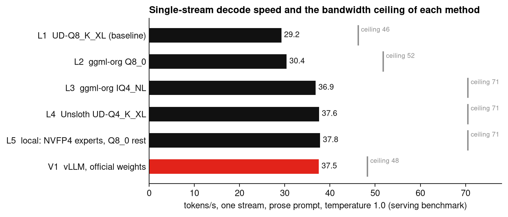

Each prediction held:

- L2 decodes at 31.6 tokens/s; its prediction was 32.6.
- L3, L4 and L5 decode within 2.4 % of each other. L3's IQ4_NL experts appear about 2 % slower than NVFP4 in llama.cpp's kernels, at the same bytes. A background process running during most of these measurements (section 13.4) cost 1–3 % of decode speed, so differences of 2 % between files are at the limit of what this study can resolve; the large differences (L1 against L5, 29 %) are not affected.
- All five perplexities lie within 0.034 of each other, against an uncertainty of ± 0.133 on each. Narrowing the dense weights and the layer 20–23 experts to Q8_0 did not measurably change the model.
- Prefill depends much less on the file than decode does: prefill at 512 tokens varies by 17 % across the files (726–848 tokens/s) while decode varies by 29 %, and the prefill differences do not follow the bytes (L2 is the slowest in prefill, L1 is not). Prefill is limited by arithmetic, not by bytes (chapter 6).

L5 decodes 29 % faster than L1 through the server (37.8 against 29.2 tokens/s), and its file is 4.9 GiB smaller. It became the file this project serves.

### 9.4 How L5 was made

L5 was produced from L1 with `llama-quantize`, the conversion tool that ships with llama.cpp:

```bash
llama-quantize --tensor-type 'blk\.([0-9]|1[0-9])\.ffn_(gate_up|down)_exps=nvfp4' \
    Inkling-2-Mini-UD-Q8_K_XL.gguf Inkling-2-Mini-L5-NVFP4exp-Q8_0.gguf Q8_0 $(nproc)
```

The arguments after the two file names say: convert every tensor to Q8_0, using all CPU cores. The `--tensor-type` option overrides that target for tensors whose name matches a regular expression; here, the expert tensors of layers 0 to 19 are given the target NVFP4. Those tensors already are NVFP4, so the tool copies them unchanged. This behaviour is visible in its source, `src/llama-quant.cpp`, where a tensor is converted only if its target differs from its current format (`bool quantize = cur_type != new_type;`). Everything else, including the BF16 experts of layers 20–23, becomes Q8_0. Without the override, the experts of layers 0–19 would also be converted to Q8_0, and the result would have L2's recipe. The conversion takes nine seconds.

### 9.5 Why the file is the first thing to check

The file decides the first term of the two-term model and nothing else. Changing files cannot touch the 11–13 ms of fixed cost, so the largest possible gain from the file alone is bounded: even a file of zero bytes would run at 1 / 12.8 ms = 78 tokens/s through the server. L5 has already removed 7.4 ms of L1's 21.6 ms of bandwidth time. What remains is 14.2 ms, and shrinking it further means going below the publisher's own precision somewhere: the dense weights below 8.5 bits, the experts of layers 20–23 below their original 8.25 bits (to NVFP4 they would save 0.13 GB, about 0.5 ms), or the other experts below 4.5 bits. Each of those would need its own quality check.

**Points to remember**

- Decode speed sorted the five files by bytes per token, as predicted: 5.90 GB → 30 tokens/s, 3.87 GB → 39 tokens/s.
- The winning recipe keeps the publisher's NVFP4 experts and stores everything else in Q8_0; perplexity did not change measurably.
- File names describe recipes loosely or wrongly; read the tensor table.
- The file changes only the byte term; the fixed cost limits what any file can achieve.

## 10. Batching: several users in one forward pass

Chapter 6 showed that decode leaves the GPU's arithmetic almost idle while it waits for weights. If several users are being served, the engine can put one token from each of them into the same forward pass: the weights are read once and used for every user. This is *batching*. This chapter explains what it gains, why the gain is smaller for a mixture-of-experts model than for a dense one, and builds a small model that predicts vLLM's measured throughput to within 9 %, and within 1 % at eight streams. Batching changes total throughput and each user's decode speed; it does not help a single user.

### 10.1 One forward pass for B streams

A *stream* is one request being answered. With B streams active, a batched decode step takes the newest token of each stream, stacks their B hidden-state vectors into a matrix, and runs the forward pass once. Every matrix-vector product becomes a matrix product with B columns. The weights are read once for all B columns, so the bytes per step barely grow while the tokens per step grow B-fold. Attention is the exception: each stream has its own KV cache and reads it separately.

For a dense model, this would make B streams almost as cheap as one, until B is large enough that arithmetic, not memory, becomes the limit. Two quantities describe the result:

- **Total throughput**: tokens per second summed over all streams. It rises with B.
- **Per-stream speed**: the decode speed each user sees. It falls with B, because each step takes longer than a single-stream step.

### 10.2 Why experts make batching less effective

In a mixture-of-experts model, each stream's token chooses its own 8 experts in each layer pass. The step must read the union of all experts chosen by any stream. With B = 2 the two tokens may share some experts, but they usually choose mostly different ones, and the expert bytes nearly double.

A simple model makes this quantitative. Assume that each token chooses its 8 of 128 experts uniformly at random and independently of the other streams. This is an assumption made for the calculation: real routing is neither uniform nor independent, and the actual choices were not recorded. The chance that a given expert is chosen by none of the B tokens is (1 − 8/128)^B, so the expected number of distinct experts per layer pass is:

```text
distinct experts  =  128 · (1 − (1 − 8/128)^B)

B = 1:   8.0        B = 2:  15.5        B = 4:  29.1        B = 8:  51.6
```

Eight streams read 51.6 experts per layer pass instead of 8, 6.4 times the expert bytes of one stream. The dense weights and the output matrix are still read once per step. So the bytes per step of a batched decode are:

```text
bytes per step  =  dense + output bytes  +  (expert bytes per token) · (distinct experts / 8)
```

### 10.3 The model against the measurements

The batching runs sent B requests at the same moment, all with the prose prompt of chapter 13, each beginning with its own random first line, and sampled at temperature 1.0, so the answers diverge from the first generated token. Two quantities were recorded:

- **Total throughput** is all streams' generated tokens divided by the wall time from sending the requests to the last one finishing. It includes each request's prefill and the end of the run, when some streams have finished and others are still generating.
- **Per-stream speed** is each request's own decode speed, measured over its own decode window (section 13.1), median over the streams. Because it excludes prefill and the ragged end, B × per-stream speed is higher than the total throughput, by 13 % at eight streams.

Plugging each engine's byte counts (chapter 7) into the formula above, and adding each engine's fixed cost, gives a predicted time per step and so a predicted total throughput. The formula leaves out the KV cache reads, which are small at these short contexts (section 3.7). It also describes steady decode only, while the measured total includes each request's prefill and the ragged end of the run. Prefill of an 80-token prompt takes a fraction of a second out of about 14 seconds per request, so the measured totals should fall a few percent below a decode-only prediction:

| Streams | Distinct experts (model) | vLLM bytes per step | vLLM predicted | vLLM measured | llama.cpp predicted | llama.cpp measured |
|---|---|---|---|---|---|---|
| 1 | 8.0 | 5.65 GB | 37.6 | 37.2 | 37.1 | 36.4 |
| 2 | 15.5 | 7.38 GB | 60.8 | 56.0 | 60.0 | 53.4 |
| 4 | 29.1 | 10.51 GB | 90.1 | 84.8 | 89.1 | 73.2 |
| 8 | 51.6 | 15.68 GB | 126.3 | **127.6** | — | — |

Throughputs are total tokens per second. vLLM was configured for at most 8 streams (`--max-num-seqs 8`) and llama.cpp for 4 request slots (`--parallel 4`). The llama.cpp server for these runs was a separate configuration (a 131,072-token context divided among its four slots) measured in a separate run; its single-stream figure (36.4 total, 37.1 per stream) is a little lower than the 37.8 of chapter 9, and the study did not determine why.

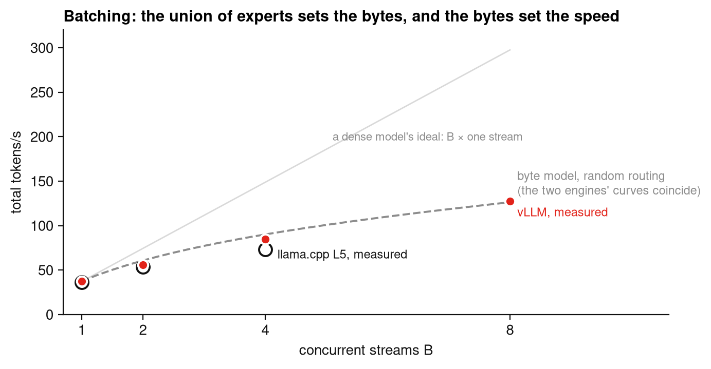

The two engines' model curves lie within 1.5 % of each other, so the figure draws one. For vLLM, the model is within 9 % at every batch size and within 1 % at eight streams. Each engine's fixed cost was taken from single-stream runs (chapter 7), and nothing was fitted to the batched runs. That a model with one stated assumption and no parameters fitted to these runs comes this close is good evidence that batched decode of this model is still governed mainly by bytes: the union of experts grows, the bytes grow with it, and the time follows at 273 GB/s. (The random-routing assumption probably overstates the union, since real routing is correlated; that would make the model's prediction too slow, and other costs that grow with the batch would make it too fast. The agreement does not separate the two.)

For llama.cpp, the model fits at one stream and then increasingly overestimates: at four streams llama.cpp reaches 73 tokens/s where the model predicts 89, 18 % less. The measured step takes 54.6 ms against a predicted 44.9 ms. The extra 10 ms is not explained by bytes. It suggests that llama.cpp's fixed cost itself grows with the batch, but that was not profiled.

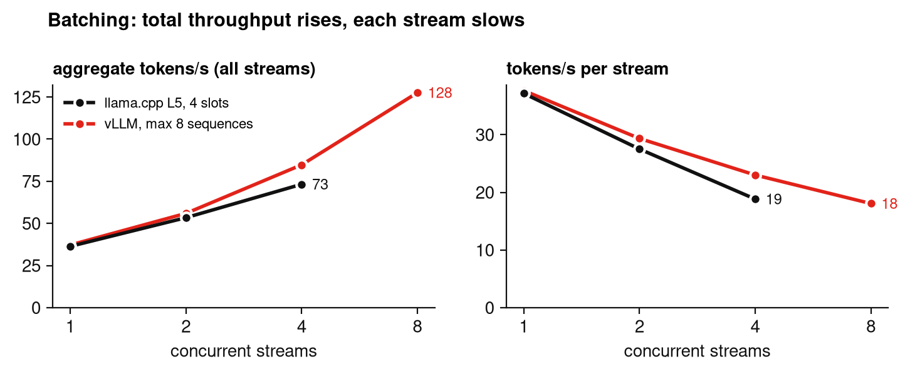

### 10.4 What batching gives, and to whom

| Streams | llama.cpp total / per stream | vLLM total / per stream | vLLM GPU energy per token |
|---|---|---|---|
| 1 | 36.4 / 37.1 | 37.2 / 37.6 | 0.65 J |
| 2 | 53.4 / 27.5 | 56.0 / 29.3 | 0.42 J |
| 4 | 73.2 / 18.8 | 84.8 / 23.0 | 0.28 J |
| 8 | — | 127.6 / 18.1 | 0.18 J |

Four streams give 2.0 times (llama.cpp) and 2.3 times (vLLM) the single-stream throughput; eight streams give vLLM 3.4 times. Each user's speed falls by half at four streams in llama.cpp and by 39 % in vLLM. GPU power hardly changes with the batch (24.7 W at one stream, 25.9 W at eight in vLLM), because the work is still memory-bound, so energy per token falls as throughput rises. The energy column divides the power during the decode windows by the token rate during those windows (8 × 18.1 ≈ 145 tokens/s at eight streams), which is why it is slightly lower than the power divided by the total throughput.

For one person chatting, batching changes nothing: there is only one stream. For several users or several automated agents sharing the Spark, batching is the largest throughput lever in this study, and vLLM's continuous batching and paged cache (chapter 8) are designed for it.

**Points to remember**

- Batching puts one token from each of B streams into one forward pass, so the weights are read once for all of them; total throughput rises and per-stream speed falls.
- In a mixture-of-experts model each stream chooses its own experts, and the step must read the union: with 8 streams, about 52 experts per layer pass instead of 8.
- A byte model with random routing predicts vLLM's batched throughput within 9 % (1 % at eight streams); llama.cpp falls short of the same model by up to 18 %.
- Power stays nearly constant, so energy per token falls as throughput rises: 0.65 J at one stream to 0.18 J at eight in vLLM.

## 11. Speculative decoding: guess several tokens, check them together

Batching gets more tokens out of a forward pass by serving several users. Speculative decoding gets more tokens out of a forward pass for a single user, by guessing what the user's own answer will say next and checking the guesses in one pass. When the guesses are right it can double the decode speed; when they are wrong it costs time. This chapter explains how the check works, why it does not change what the model writes, what a check costs for a mixture-of-experts model, and why the two kinds of guesses measured here help with different kinds of text. Speculative decoding changes decode speed only.

### 11.1 The idea

Chapter 1 established that decode must run one forward pass per token, because each token depends on the one before. But checking whether a *given* sequence of tokens is what the model would have written does not have that restriction. If someone proposes the next k tokens, the model can process all of them in one forward pass, exactly as it processes a prompt in prefill, and obtain its own probabilities at each of the k positions.

The method ([Leviathan, Kalman and Matias 2023](https://arxiv.org/abs/2211.17192); [Chen et al. 2023](https://arxiv.org/abs/2302.01318)) has two parts:

1. A cheap **draft** proposes the next k tokens d₁ … d_k.
2. The full model, called the **target** in this context, runs one forward pass over those k tokens (plus the last accepted one) and decides, position by position, which drafted tokens to keep.

The first time a drafted token is rejected, the target's own choice at that position replaces it, and everything after it is discarded. If all k are accepted, the target's prediction at the last position gives one extra token. A verification step therefore yields between 1 and k + 1 tokens, never fewer than an ordinary step. The **acceptance rate** is the fraction of drafted tokens that are accepted.

### 11.2 Why the output is unchanged

The rule for accepting a drafted token is chosen so that the accepted text follows exactly the probabilities the target model would have used on its own. Write p for the target's probabilities at a position and q for the draft's.

- **At temperature 0**, the target would always have chosen its most probable token. A drafted token is accepted if and only if it is that token, so in exact arithmetic the output is identical, token for token, to decoding without speculation. (On a GPU, a verification pass over several positions uses different kernels from a one-token step, and rounding differences can occasionally change which of two nearly equal candidates is largest. This study did not compare outputs token by token.)
- **At temperature 1 with a draft that proposes tokens without probabilities** (as n-gram drafting does, section 11.4), the engine samples a token from p at the position and accepts the draft only if the sample equals it. The sampled token is used either way, so the output follows p exactly; the draft is accepted with probability p(d).
- **At temperature 1 with a draft model that has its own probabilities q**, the drafted token d is accepted with probability min(1, p(d) / q(d)). On rejection, a replacement is sampled from the distribution proportional to max(0, p(x) − q(x)) over all tokens x. The two cases together produce each token x with probability exactly p(x); the papers cited above give the proof. The idea behind it: where the draft proposes a token more often than the target would choose it (q(x) > p(x)), the rule accepts it only part of the time, which removes the excess; where the draft proposes it less often (q(x) < p(x)), it is always accepted when proposed, and the shortfall is made up by the resampling step, which draws only from tokens the draft under-proposes.

The consequence for this study is that speculative decoding changes speed and nothing else. It cannot make answers worse, and its benefit can be measured on speed alone.

### 11.3 What a verification step costs

For a dense model, verifying k drafted tokens costs little more than generating one: the k positions form a small matrix, the weights are read once, and decode is memory-bound. For a mixture-of-experts model this is not true, for the reason of chapter 10. Each of the k positions chooses its own experts, and the verification pass must read the union. As far as the experts are concerned, verifying 8 positions is the same as a batch of 8 streams, and the model of section 10.2 predicts about 52 distinct experts per layer pass instead of 8.

The measurements bear this out. For vLLM with the DSpark draft (section 11.4), each step proposes 7 tokens, so it yields on average 1 + 7 × (acceptance rate) tokens. Dividing by the measured decode rate gives the duration of one draft-and-verify step (calculated from the measurements):

| Prompt, temperature | Acceptance rate | Tokens per step | Decode rate | Step duration |
|---|---|---|---|---|
| prose, T = 1 | 15 % | 2.05 | 34.7 tokens/s | 59 ms |
| code, T = 1 | 36 % | 3.48 | 54.2 tokens/s | 64 ms |
| edit, T = 1 | 56 % | 4.88 | 81.0 tokens/s | 60 ms |
| prose, T = 0 | 14 % | 1.95 | 33.2 tokens/s | 59 ms |
| code, T = 0 | 36 % | 3.49 | 55.5 tokens/s | 63 ms |
| edit, T = 0 | 58 % | 5.03 | 80.8 tokens/s | 62 ms |

Whatever the prompt, a step takes 59–64 ms, against 26.7 ms for an ordinary vLLM decode step, and against 63.3 ms that the batching model of section 10.3 predicts for 8 streams. A speculative step costs about 2.3 ordinary steps, so it pays only if it yields more than 2.3 tokens: 1 + 7a > 2.3 requires an acceptance rate a above about 19 %. Prose, at 14–15 %, is below that line, and DSpark makes prose 8 % slower at T = 1 and 12 % slower at T = 0.

For llama.cpp's n-gram drafting the same accounting can be estimated from one run's totals: the edit prompt at T = 1, which generated 1,102 tokens at 77.3 tokens/s. Its drafts are up to 64 tokens long; the run made 14 drafts, of which 719 tokens were accepted. Counting the extra token each verification yields, 733 of the 1,102 tokens came from 14 verification steps and the other 369 from ordinary steps. Assuming the ordinary steps took 27.3 ms each (the per-token time llama-server reported for S1's prose requests, where almost no drafts were accepted), each verification of 65 positions took about 0.30 s, as long as 11 ordinary steps. That is unsurprising: 65 positions with random routing would touch 126 of the 128 experts in every layer pass. But each verification yielded about 52 tokens, 0.30 s for 52 tokens against 1.4 s for 52 ordinary steps, so speculation still doubled the speed.

### 11.4 Two kinds of draft

The two drafts measured here guess from different information, and that decides where each one helps.

**n-gram drafting (S1, llama.cpp `--spec-type ngram-mod`)** needs no model at all. It looks up the last few tokens of the text in a table of everything already in the context, the prompt included, and if that sequence occurred before, proposes the tokens that followed it then. (An *n-gram* is a sequence of n consecutive tokens.) It costs almost nothing to compute. It helps exactly when the answer repeats text that is already in the context: editing a file, quoting, reformatting. It cannot predict new text.

**The DSpark draft (S3, vLLM)** is a small neural network that Inkling's publisher ships with the model. DSpark is the name of its design, under which both engines select it (vLLM's `"method": "dspark"`, llama.cpp's `draft-dspark`); its weights are in a file named `mtp.safetensors` (*MTP* stands for multi-token prediction, the general technique; *safetensors* is a common file format for weights). It is a three-layer transformer with the same hidden size of 2304. Instead of reading tokens, it reads the target's hidden states at four points of the forward pass, which the model's configuration lists as layer passes 5, 23, 41 and 48 (one point in the prelude, one in each of the second and third loop passes, and the last pass). From them it proposes a block of tokens. Because it reads the target's internal state, it can predict new text, but it costs a forward pass of its own, and in the configuration measured it proposes at most 7 tokens per step (`num_speculative_tokens: 7`).

### 11.5 Results

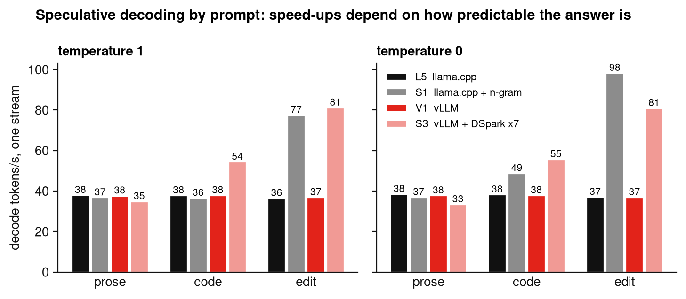

| Setup | Prompt | T = 1: tokens/s | acceptance rate | T = 0: tokens/s | acceptance rate |
|---|---|---|---|---|---|
| llama.cpp L5, no speculation | prose / code / edit | 37.8 / 37.7 / 36.3 | — | 38.3 / 38.1 / 36.9 | — |
| S1 llama.cpp + n-gram | prose | 36.6 | 4 % | 36.8 | 21 % |
| | code | 36.4 | 6 % | 48.6 | 53 % |
| | edit | **77.3** | 80 % | **98.2** | 80 % |
| vLLM, no speculation | prose / code / edit | 37.5 / 37.7 / 36.7 | — | 37.6 / 37.7 / 36.7 | — |
| S3 vLLM + DSpark × 7 | prose | 34.7 | 15 % | 33.2 | 14 % |
| | code | **54.2** | 36 % | **55.5** | 36 % |
| | edit | 81.0 | 56 % | 80.8 | 58 % |

The three prompts are described in section 13.2: `prose` is an explanation in about 300 words, `code` asks for a new function with tests, and `edit` gives the model 60 lines of code and asks for the same file with one variable renamed.

Each result follows from sections 11.3 and 11.4:

- **Edit** is the case n-gram drafting was made for. Almost the whole answer is a copy of the prompt, 80 % of the drafted tokens are accepted, and the decode speed doubles to nearly triples (77 tokens/s at T = 1 against 36.3 without speculation; 98 at T = 0 against 36.9). DSpark also helps (81 tokens/s at either temperature). It is faster than n-gram at T = 1 but slower at T = 0, where n-gram's 64-token drafts outrun DSpark's limit of 7 tokens per step.
- **Fresh code** cannot be copied from the prompt, so n-gram drafting finds almost nothing at T = 1. At T = 0 the model's code becomes repetitive enough (the tests repeat the function's name and structure) that n-gram drafting reaches 53 % acceptance and 48.6 tokens/s. DSpark predicts code from the model's hidden states, is accepted 36 % of the time at either temperature, and reaches 54 tokens/s, 44 % above plain vLLM. It is the only setup in this study that speeds up new, non-repetitive text. Temperature helps n-gram drafting because a greedy model repeats itself more; it does not change DSpark's acceptance here.
- **Prose** has no long repeats and is less predictable than code (recall the spread-out probabilities of section 1.2). n-gram drafting rarely proposes anything and costs 3 %; DSpark proposes every step, is accepted 14–15 % of the time, below its break-even of about 19 %, and costs 8–12 %.

### 11.6 A draft that did not load: S2

The DSpark draft also exists as a GGUF file for llama.cpp (Unsloth's `dspark-Inkling-2-Mini-Q8_0.gguf`), which would combine DSpark's predictions with llama.cpp's small footprint. It does not load. llama.cpp stops with:

```text
E llama_model_load: error loading model: check_tensor_dims: tensor 'markov_w1.weight' has wrong shape;
  expected 256, 200058, got 256, 201024, 1, 1
```

The tensor `markov_w1` belongs to the draft's last stage, which turns its internal state into scores over the vocabulary (the converter calls this stage the "Markov head"; the name refers to the draft's own design and needs no further meaning here). It was converted at the padded vocabulary size of 201,024 entries, while llama.cpp sizes it from the real vocabulary of 200,058 entries (`vocab_size_unpadded`, section 5.6). Either the converter could drop the 966 padding entries, or the loader could accept the padded size. The study recorded the failure and did not patch either side. No other conclusion depends on S2.

**Points to remember**

- Speculative decoding drafts k tokens cheaply and verifies them in one forward pass of the full model; each verification yields 1 to k + 1 tokens.
- The acceptance rule makes the output follow exactly the target model's probabilities, so speculation changes speed, not answers.
- For a mixture-of-experts model a verification pass reads the union of the experts chosen at every position; a 7-token DSpark step costs about 2.3 ordinary steps and pays off only above about 19 % acceptance.
- n-gram drafting doubles the speed when the answer copies the context (edits); the DSpark draft is the only method here that speeds up new code. On prose, n-gram costs about 3 % and DSpark 8–12 %.

## 12. Reasoning effort: fewer tokens instead of faster tokens

Every technique so far changes how fast tokens are produced. This chapter is about a setting that changes how many tokens are produced. A reasoning model writes a private chain of reasoning before its answer (section 1.6), and the user waits for every token of it. Inkling 2 Mini lets the client ask for more or less reasoning. On a hard question, that setting changed the time to an answer by a larger factor than any other setting measured in this study. Reasoning effort changes time to answer, not decode speed.

### 12.1 How the effort reaches the model

The effort is not a mechanism inside the engine. It is text. The chat template (section 1.6) maps the requested effort name to a number and writes that number into a system message at the start of the prompt:

| `reasoning_effort` | none | minimal | low | medium | high | xhigh, max |
|---|---|---|---|---|---|---|
| level written into the prompt | 0.0 | 0.1 | 0.2 | 0.7 | 0.9 | 0.99 |

The names and numbers are those of the publisher's template; neither the template nor the model card explains why the scale is spaced this way. The client sends the setting with each request, in llama-server as `chat_template_kwargs: {"reasoning_effort": "low"}`. Without it, the template uses 0.9, which corresponds to `high`. The model is meant to write longer or shorter reasoning depending on this line, but nothing in the engine forces it to: effort is an instruction the model follows more or less closely, not a limit. A server log with full prompts confirmed that the setting reached the prompt as `Thinking effort level: 0.2`.

Effort does not change the decode rate. It changes the number of reasoning tokens, and through the formula of section 1.7, the time to answer.

### 12.2 The experiment

Two questions with automatically checkable answers were asked through llama-server with the L5 file, three times at each of four efforts (none, low, medium, high), at temperature 1.0. The model was asked to end its reply with `ANSWER: <number>`, and a regular expression extracted the number.

- **Question 1** asks how many n ≤ 1000 make n² + n + 1 divisible by 7 (answer 286). It needs one observation about remainders modulo 7: n² + n + 1 is divisible by 7 exactly when n leaves a remainder of 2 or 4 on division by 7, and 143 numbers up to 1000 do each.
- **Question 2** asks how many six-digit numbers have digit sum 27 and are divisible by 11 (answer 3645). It needs an argument. A number is divisible by 11 when the sum of its digits in odd positions minus the sum in even positions is a multiple of 11. Each group has three digits, so each sum is between 0 and 27, and their difference lies between −27 and 27. The two sums add up to 27, an odd number, so their difference is odd; the only odd multiples of 11 in that range are 11 and −11. So the sums are 19 and 8, or 8 and 19. Three digits from 0 to 9 can sum to 8 in 45 ways (choosing how to split 8 among three digits: C(10, 2) = 45) and to 19 also in 45 ways. The group in odd positions contains the leading digit, which may not be 0: if that group sums to 8, the 9 splits with a leading 0 are excluded, leaving 36; if it sums to 19, no split has a leading 0, so all 45 remain. Together: 36 × 45 (odd group 8, even group 19) + 45 × 45 (odd group 19, even group 8) = 1,620 + 2,025 = 3,645.

### 12.3 Results

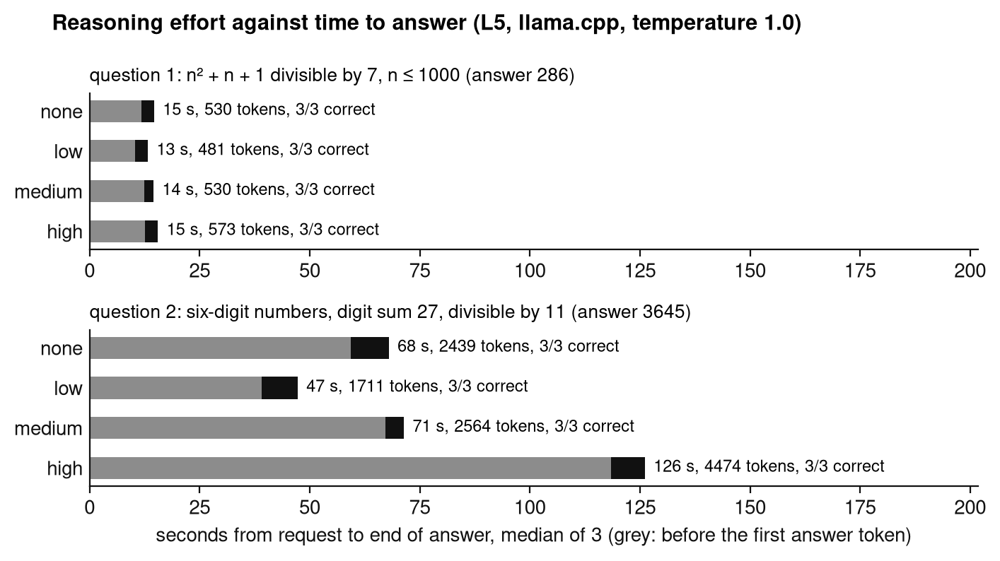

In the figure, each bar is the median time to answer, split into the time before the first answer token (grey: prompt processing plus reasoning) and the time writing the answer (black).

| Effort | Question 1: median time / tokens / correct | Question 2: median time / tokens / correct | Question 2: tokens in each of the three runs |
|---|---|---|---|
| none | 14.6 s / 530 / 3 of 3 | 67.9 s / 2,439 / 3 of 3 | 2,439, 2,021, 3,489 |
| low | 13.2 s / 481 / 3 of 3 | **47.2 s / 1,711** / 3 of 3 | 1,855, 1,479, 1,711 |
| medium | 14.5 s / 530 / 3 of 3 | 71.4 s / 2,564 / 3 of 3 | 2,564, 3,021, 2,477 |
| high | 15.5 s / 573 / 3 of 3 | 126.1 s / 4,474 / 3 of 3 | 5,646, 4,474, 3,596 |

Question 1 is easy enough that the model reasons about 500 tokens at every effort, and the differences between efforts are smaller than the differences between runs at the same effort (439–574 tokens across the three runs at effort low, 474–866 at effort high). Question 2 separates the efforts. At effort high the model wrote 4,474 tokens and took 126 s; at effort low, 1,711 tokens (2.6 times fewer) and 47 s (2.7 times less time). Decode ran at about 35.5–38 tokens/s throughout, slightly slower on the longest answers because the KV cache grows (section 3.7), so the time is essentially the token count divided by that rate.

Three further observations:

- **All 24 answers were correct.** This small sample shows no quality cost at low effort, and it cannot show a quality gain at high effort either. Harder questions, or more runs, might.
- **The order is not monotonic.** Effort none reasoned longer than effort low on question 2. The level is an instruction, and the model's response to it is not a simple dial.
- **Even effort none reasons.** At effort none, the model spent a median of 59 s on question 2 before the first token of its answer, as the model card warns: the minimum effort does not switch reasoning off.

### 12.4 Comparing the lever with the others

On question 2, moving from the default effort (high) to low saved 79 seconds, a factor of 2.7 in time to answer. The decoding techniques of chapter 11 were not run on these questions. On prose, the measured prompt closest to free-form reasoning text, they changed decode speed by −3 % (n-gram) and −8 % (DSpark). Switching the file from L1 to L5 made decode 29 % faster. With the caveat that these numbers come from different prompts and one hard question, for a single user asking a question that needs real reasoning, the effort setting was the largest lever among those measured in this study.

**Points to remember**

- The reasoning effort is a number written into the prompt by the chat template; the default is 0.9 (high).
- Effort changes the number of reasoning tokens, not their rate; time to answer is tokens divided by the decode rate.
- On a hard question, effort low took 47 s and high 126 s, with the same correctness in a small sample.
- The effect is not monotonic and does not reach zero: the model reasons even at effort none.

## 13. Measuring inference without fooling yourself

Informal speed figures for the same model on the same machine, posted in the days after its release, differed by a quarter to a third when this study began: llama.cpp users reported about 30 tokens/s, vLLM users 39–43 tokens/s ([a vLLM recipe for one Spark](https://github.com/outsmartchad/inkling-2-mini-single-dgx-spark-vllm); [Classmethod's first measurements](https://dev.classmethod.jp/en/articles/dgx-spark-inkling-2-mini-first-touch/); [the NVIDIA forum thread](https://forums.developer.nvidia.com/t/inkling-2-mini/389745)). The figures came from different prompts, temperatures, answer lengths and definitions of "tokens per second", so they could not be compared. This chapter describes how every number in this note was measured, and the specific traps that make inference benchmarks disagree.

### 13.1 Two levels of measurement

**The engine alone.** llama.cpp ships `llama-bench`, which runs the model without a server:

```bash
llama-bench -ngl 999 -fa 1 -p 512,4096 -n 128 -d 0,16384 -r 3
```

The options mean: put every layer on the GPU (`-ngl 999`), use the fused attention kernel (`-fa 1`, an implementation of FlashAttention, [Dao et al. 2022](https://arxiv.org/abs/2205.14135), which computes attention in one kernel without writing the full score matrix to memory), measure prefill of 512 and 4,096 tokens (reported as `pp512` and `pp4096`, "prompt processing") and generation of 128 tokens (`tg128`, "text generation"), each with an empty context and with 16,384 tokens already in the cache (`-d`, depth), three repetitions each (`-r 3`). It isolates the engine's kernels and is directly comparable with other llama-bench results.

**Through the server.** Speculative decoding and batching exist only in the servers, and vLLM has no llama-bench, so every setup was also measured through its HTTP endpoint, with one Python script for both engines (`scripts/10-bench-serve.py`). It streams each request and records three timestamps: when the request was sent, when the first token arrived (reasoning included), and when the last one arrived. The decode rate is:

```python
decode_tps = (completion_tokens - 1) / (t_last_chunk - t_first_chunk)
```

The interval starts when the first token arrives, so it contains the generation of all tokens but the first; hence the − 1. The token count comes from the server's `usage` field, not from counting streamed messages. With speculative decoding, one streamed message can carry several tokens, and counting messages would understate the speed.

### 13.2 The prompts

| Prompt | Content | Answer limit |
|---|---|---|
| prose | explain how a mixture-of-experts router chooses experts, about 300 words | 512 tokens |
| code | write a function `merge_intervals` with five pytest tests | 512 tokens |
| edit | 60 lines of this project's `chat/server.py`; return the file with one variable renamed | 2,048 tokens |
| long | about 38,400 tokens of llama.cpp documentation; summarise in one sentence (38,409 prompt tokens as counted by the server) | 64 tokens |

Each prompt was sent three times after one warm-up request, and the tables report medians. Reasoning effort was `low` (so that reasoning is short and comparable between setups), temperature 1.0 as the model card recommends, and temperature 0 as a second setting for speculation.

### 13.3 Why the same file has several decode speeds

A reader of this note meets several decode speeds for the same file, L5. They are all correct; they measure different things.

| Number | Where | What it measures |
|---|---|---|
| 39.2 tokens/s | llama-bench `tg128` (chapters 7, 9) | the engine alone, 128 tokens, empty context |
| 37.8 tokens/s | serving benchmark, prose, T = 1 (chapters 6, 8, 9) | the server, including sampling and streaming, 512 tokens |
| about 38 tokens/s | the single chat request of section 1.5 | one short request (44 tokens) |
| 37.1 / 36.4 tokens/s | batching runs, one stream (chapter 10) | per-stream / total, with a 131,072-token context split over four slots |
| 34.4 tokens/s | llama-bench at 16,384 tokens of context | a longer KV cache to read (section 3.7) |
| 30.3 tokens/s | after the 38,409-token prompt (chapter 8) | an even longer KV cache |
| 35.5–38 tokens/s | the effort runs (chapter 12) | answers of up to 5,600 tokens, so a growing cache |

### 13.4 Traps

- **Prompt caching.** Both servers keep the cache of a previous prompt and reuse any common beginning. A repeated `long` request would then measure the cache lookup, not prefill. Every request therefore begins with a random line, `[run <uuid>]`, so no two requests share a prefix.
- **Warm-up.** The first request after start-up can be slow for reasons unrelated to steady-state speed. In vLLM, a kernel used for the first time with a new shape is compiled on the spot (chapter 8), and some first requests waited several seconds. One warm-up request per prompt absorbs this.
- **Chunks are not tokens.** As above: count tokens from `usage`.
- **Answer length and context length.** Decode slows as the context grows (section 3.7), so a benchmark with short answers reports a higher speed than one with long answers. Fix the answer limit and report it.
- **Sampling settings.** Temperature changes speculative acceptance by large factors (chapter 11). Report it.
- **Other work on the machine.** A background process that used about one CPU core ran during most of the file measurements (L1, L2, L4, L5 and most of L3) and was stopped before the rest. Its measured effect on decode was 1–3 %. The study recorded this instead of repeating the runs.
- **Profilers change what they measure.** Nsight Systems, recording every kernel, slowed decode by about 7 %; Nsight Compute empties the caches before each kernel, which inflates byte counts. Profiles were used for ratios, splits and upper bounds, not for absolute speeds.

### 13.5 Telemetry

A sampler (`scripts/15-telemetry.py`) queried the GPU with `nvidia-smi` four times per second for the whole study, 101,281 samples in all: utilisation, clock frequency, power, temperature, and the driver's counters of why the clock was limited. Each benchmark request was time-stamped, and the samples inside each request's decode window were averaged per setup. On GB10, `nvidia-smi` reports no memory bandwidth and no memory use, so memory use was measured from the operating system's `/proc/meminfo`, and the GPU's power reading covers the GPU only. The energies in this note are therefore GPU energies, not the whole machine's.

### 13.6 Predict, then measure

Once the fixed cost had been taken from the first files measured, the two files measured afterwards (L2 and L3) had their speeds predicted from their byte counts and written down before they ran; both predictions were within 3 % (section 7.3). This is the working method the study recommends: compute what the bytes allow, measure, and treat a disagreement as the finding. When a measurement disagrees with the prediction, the next tool is a profiler, not another benchmark. It was the profiler that showed the fixed cost to be GPU execution rather than CPU launch overhead, and that it has more than one part (chapter 7).

**Points to remember**

- Measure the engine alone (llama-bench) and through the server (one harness for every engine), and keep the two separate.
- Count tokens from the server's `usage` field; randomise prompt prefixes to defeat the prompt cache; warm up; fix and report answer length and sampling settings.
- The same file has several correct decode speeds, depending on what is included and how long the context is; say which one you mean.
- Record GPU telemetry alongside every run, and say what it covers: here, the GPU rail only.

## 14. Putting it together

The study measured the twelve setups listed at the start of this note, and each result can now be traced to one of a few causes: the bytes a token reads, the engine's fixed cost per token, the union of experts that several positions require, and the number of tokens the model decides to write. This chapter collects the results into a decision, and lists what remains open.

### 14.1 Every result in one line

| Result | Cause | Chapter |
|---|---|---|
| L5 decodes 29 % faster than L1 at the same perplexity | the 16-bit dense weights (read in every layer pass) and the layer 20–23 experts narrowed to 8.5 bits | 7, 9 |
| No file can exceed about 78 tokens/s in llama.cpp | the fixed cost of 12.8 ms per token | 7 |
| vLLM decodes as fast as L5 while reading 46 % more bytes | its fixed cost is half of llama.cpp's | 7, 8 |
| vLLM prefills ten times faster | its batched kernels for this model reach 28 TFLOP/s, llama.cpp's 2.9 (which kernels make the difference was not profiled) | 6, 8 |
| Batching gives 3.4× total throughput at 8 streams, not 8× | the step reads the union of the experts chosen by all streams | 10 |
| n-gram drafting doubles the speed of code edits | the answer copies the prompt, and 80 % of drafted tokens are accepted | 11 |
| DSpark speeds up new code but slows prose | a draft-and-verify step costs 2.3 ordinary steps; prose acceptance is below the 19 % break-even | 11 |
| Effort low answers a hard question 2.7× sooner than high | 2.6× fewer reasoning tokens at the same rate | 12 |

### 14.2 Which setup to run

| Use | Setup | Why |
|---|---|---|
| One person chatting | llama.cpp, L5 file, `--spec-type ngram-mod` | 37.8 tokens/s, 32 GB, starts in 20 s, perplexity unchanged; n-gram drafting doubles code edits and costs about 3 % on prose; vLLM decodes no faster and needs 87 GB and four minutes to start |
| Long documents and long conversations | vLLM | ten times faster prefill, same decode. Images also become prompt tokens, so they should benefit in the same way, but image input was not measured |
| Writing new code | vLLM with the DSpark draft, 7 tokens | 54 tokens/s, the only method that speeds up new text |
| Several users or agents | vLLM, up to 8 streams | 128 tokens/s in total, 0.18 J per token |
| Reasoning-heavy questions where latency matters | reasoning effort `low` | 2.6× fewer tokens than the default on the hard test question, same correctness in a small sample |

This project's chat interface now serves the L5 file with n-gram drafting (`scripts/02-serve-model.sh` in the project repository).

### 14.3 Open questions

- **Combine the two halves.** The two-term model predicts about 50 tokens/s for L5's 3.87 GB with vLLM's 5.9 ms of fixed cost. That needs vLLM to load 8-bit dense weights for this model, or llama.cpp to reduce its fixed cost.
- **Which part of llama.cpp's fixed cost is easiest to remove?** Section 7.4 found 6.7 ms of small kernels running alone and 5.2 ms of Q8_0 weight reads running below peak bandwidth in L5. Fusing normalisation with activation quantisation, and a faster Q8_0 matrix-vector kernel, are the obvious candidates.
- **Why does llama.cpp's batching fall short of the byte model?** At four streams it takes 10 ms per step more than the model predicts; a profile of a batched step would show where.
- **What does vLLM spend its 5.9 ms on?** No vLLM profile was taken.
- **Do the drafts combine?** n-gram drafting in vLLM, or n-gram and DSpark together, might keep the edit-prompt gains and the fresh-code gains at once.
- **Does the DSpark draft run in llama.cpp** once its last stage is trimmed to 200,058 entries?
- **Does effort change quality on harder questions?** The 24 answers measured here were all correct.

### 14.4 The working rule

Count the bytes before measuring. On a memory-bound machine, a token costs its bytes divided by the bandwidth plus a fixed cost, and that one line, with one constant taken from each engine's first measurements, predicted the remaining files' speeds within 3 % and vLLM's batched throughput within 9 %. When a measurement disagrees with the count, the disagreement is the interesting result, and the profiler is the tool that explains it.

## Appendix A. Glossary

| Term | Meaning | Section |
|---|---|---|
| acceptance rate | in speculative decoding, the fraction of drafted tokens the target model accepts | 11.1 |
| activation | the hidden-state vector that a weight matrix multiplies | 5.4 |
| active parameters | the distinct weights one token uses (3.4 billion by the model card; 2.67 billion counted from the file) | 4.3 |
| arithmetic intensity | floating-point operations per byte read from memory | 6.3 |
| attention | the step in which a token combines information from earlier tokens, through queries, keys and values | 3.1 |
| autoregressive generation | producing one token per forward pass, each depending on the previous | 1.4 |
| batching | putting tokens of several streams into one forward pass | 10.1 |
| BF16 | 16-bit floating-point format with 8 exponent and 7 mantissa bits | 5.1 |
| block quantisation | storing a short block of weights as small codes plus one shared scale | 5.2 |
| chat template | the template program, stored with the model, that formats a conversation into a prompt | 1.6 |
| chunked prefill | splitting a long prompt into pieces so that other requests keep decoding | 8.3 |
| compute-bound | limited by arithmetic rather than by memory | 6.3 |
| continuous batching | forming each forward pass from whatever requests are active | 8.3 |
| CUDA | NVIDIA's programming platform for GPU kernels | 6.2 |
| CUDA graph | a recorded sequence of kernel launches replayed with one call | 7.4 |
| decode | producing answer tokens, one forward pass each | 1.5 |
| dense weights | the weights of a layer that every token uses (attention, router, controllers) | 2.5 |
| draft | the cheap guesser in speculative decoding | 11.1 |
| DSpark | the small draft network shipped with Inkling 2 Mini (`mtp.safetensors`) | 11.4 |
| embedding table | the table of one vector per vocabulary entry | 2.1 |
| expert | one of 128 small feed-forward networks in a layer | 4.1 |
| exponent, mantissa | the scale and the digits of a floating-point number | 5.1 |
| fixed cost | the part of the time per token that does not depend on the bytes read | 7.3 |
| FLOP | one floating-point operation; a multiply-add counts as two | 2.2 |
| forward pass | one run of the model over its input | 1.4 |
| GB, GiB | 10⁹ bytes and 2³⁰ bytes | introduction |
| GGUF | llama.cpp's model file format | 5.6 |
| global attention | attention over the whole context (layers 5, 11, 17, 23) | 3.5 |
| GPU | a processor with thousands of parallel arithmetic units | introduction, 6.2 |
| greedy decoding | always choosing the most probable token (temperature 0) | 1.3 |
| grouped-query attention | several query heads sharing one key and value head | 3.2 |
| head | one of several parallel attention computations | 3.2 |
| hidden size, hidden state | the length (2304) and the content of a token's vector inside the model | 2.1 |
| IQ4_NL | llama.cpp 4.5-bit format with a non-uniform table of 16 values | 5.3 |
| kernel | a function run on the GPU | 6.2 |
| kernel fusion | combining several operations into one kernel | 7.5 |
| KV cache, KV cache slot | the stored keys and values of earlier tokens; one cache per layer pass, 48 here | 3.3, 3.4 |
| L1–L5, V1, C1–C2, S1–S3, E1 | the labels of the twelve setups | introduction |
| layer pass | one execution of one stored layer; 48 per token here | 4.4 |
| llama.cpp, llama-server, llama-bench, llama-perplexity | the C++ engine, its HTTP server, its benchmark tool and its perplexity tool | introduction, 8.2, 13.1, 5.5 |
| logit | the raw score of one vocabulary entry | 1.2 |
| loop core, loop controller, message | layers 6–17, which run three times; the small network that mixes the previous pass's message into a looped layer's input | 4.4 |
| machine balance, roofline | the arithmetic rate divided by the bandwidth; the plot of speed against arithmetic intensity | 6.3 |
| memory bandwidth | bytes per second memory can deliver; about 273 GB/s here | introduction, 6.1 |
| memory-bound | limited by memory bandwidth rather than arithmetic | 6.3 |
| mixture of experts (MoE) | a feed-forward block made of many experts, of which a router selects a few | 4.1 |
| model card | the publisher's description of the model and its recommended settings | introduction |
| MXFP8 | 8-bit float values with one power-of-two scale per 32, 8.25 bits per weight | 5.3 |
| n-gram drafting | proposing tokens that followed the same sequence earlier in the context | 11.4 |
| Nsight Compute, Nsight Systems | NVIDIA's per-kernel counter profiler and its timeline profiler | 7.2, 7.4 |
| NVFP4 | 4-bit float values with one 8-bit scale per 16, 4.5 bits per weight | 5.2 |
| PagedAttention | vLLM's KV cache made of fixed-size blocks assigned on demand | 8.3 |
| perplexity | exp of the mean negative log-probability of the true next token | 5.5 |
| prefill | processing the prompt, all tokens together | 1.5 |
| PyTorch, Triton | the Python library vLLM is built on; the language many of its kernels are written in | 8.3 |
| Q4_K | llama.cpp 4.5-bit format with 256-weight super-blocks | 5.3 |
| Q8_0 | llama.cpp 8-bit format, 32 integers and one 16-bit scale, 8.5 bits per weight | 5.2 |
| quantisation | storing numbers with fewer bits than they were trained with | 5.2 |
| reasoning effort | the setting that asks the model for more or less reasoning | 12.1 |
| reasoning model | a model that writes private reasoning before its answer | 1.6 |
| request slot | in llama-server, one request that can be served at the same time | 8.2 |
| residual stream | the running hidden state to which each layer adds its output | 2.1 |
| RMS normalisation | rescaling a vector to unit root-mean-square, times learned weights | 2.3 |
| router | the small matrix that scores experts for a token | 4.2 |
| sampling, temperature, top_k, top_p | choosing one token from the probabilities; the divisor of the logits; the two truncation settings | 1.3 |
| sliding window | attention restricted to the previous 1024 tokens | 3.5 |
| softmax | turning scores into probabilities: exp of each, divided by their sum | 1.2 |
| speculative decoding | drafting several tokens and verifying them in one forward pass | 11.1 |
| stream | one request being answered | 10.1 |
| streaming multiprocessor (SM) | one of the GPU's 48 processing units | 6.2 |
| target model | the full model, in speculative decoding | 11.1 |
| tensor | an array with any number of dimensions | 4.1 |
| tensor core | GPU unit that multiplies small matrix tiles in one instruction | 6.5 |
| time to first token | the wait before the first output token, mostly prefill | 1.7 |
| token, tokenizer, vocabulary | a piece of text; the program that splits text into tokens; the list of all tokens | 1.1 |
| total throughput | tokens per second summed over all streams | 1.7, 10.3 |
| transformer | the network design of nearly all current language models: a stack of layers with attention and feed-forward blocks | 2.1 |
| two-term model | time per token ≈ bytes / 273 GB/s + fixed cost | 7 |
| unified memory | one memory pool shared by CPU and GPU | 6.1 |
| W4A4 | 4-bit weights multiplied with 4-bit activations | 5.4 |

## Appendix B. Reproducing the numbers

The project repository is `/home/manuel/code/wesen/2026-11-21--inkling-small` on the Spark. The study's working directory inside it (a *ticket* in the repository's documentation system, holding the study's scripts, diary and results document) is `ttmp/2026/11/21/INK-001--inkling-2-mini-inference-methods-on-one-dgx-spark-survey-reproduce-and-benchmark/`. Raw results are outside the repository, in `~/data/inkling/bench/<setup>/`, profiles in `~/data/inkling/profile/<file>/`, telemetry in `~/data/inkling/telemetry/ink001.csv`. These paths are on the Spark, so the commands below run only there; they are given so that the source of every number is recorded.

In the commands, `<model.gguf>` stands for the path of the file to profile and `<dir>` for any output directory; `uv run --with matplotlib` runs a script with the plotting library installed on the fly.

```bash
cd /home/manuel/code/wesen/2026-11-21--inkling-small/ttmp/2026/11/21/INK-001--inkling-2-mini-inference-methods-on-one-dgx-spark-survey-reproduce-and-benchmark/scripts
bash 13-make-l5-requant.sh                                     # the L5 file, 9 s
METHOD=L5 MODEL=~/data/inkling/models/local/Inkling-2-Mini-L5-NVFP4exp-Q8_0.gguf bash 11-run-llama-method.sh
METHOD=V1 bash 12-run-vllm-method.sh                           # vLLM, official weights
METHOD=S3 SPEC=dspark7 bash 12-run-vllm-method.sh              # vLLM + DSpark
TAG=L5 MODEL=<model.gguf> bash 17-profile-decode.sh            # Nsight Systems and Nsight Compute, one decode token
python3 20-nsys-token-breakdown.py ~/data/inkling/profile/L5/trace_cuda_gpu_trace.csv
python3 27-nsys-kernel-classes.py ~/data/inkling/profile/L5/trace_cuda_gpu_trace.csv   # the split of section 7.4
python3 16-telemetry-report.py --telemetry ~/data/inkling/telemetry/ink001.csv --bench ~/data/inkling/bench
python3 25-textbook-calcs.py                                   # every calculated number in this note
uv run --with matplotlib python 22-make-figures.py --out <dir>       # the measurement figures
uv run --with matplotlib python 26-textbook-figures.py --out <dir>   # the figures added for this note
```

## Appendix C. Measured results

This appendix collects every measurement of the study in one place, as reference tables. The chapters explain them; here they are only listed, with their units and conditions. All runs were on one DGX Spark between 2026-11-21 and 2026-11-22, with llama.cpp at commit `afe77e1` and vLLM from the container image `vllm/vllm-openai:inkling-2-mini` (build `0.1.dev25855`). Raw data: `~/data/inkling/bench/<setup>/` on the Spark (Appendix B).

### C.1 Engine benchmark: llama-bench, five files

`llama-bench -ngl 999 -fa 1 -p 512,4096 -n 128 -d 0,16384 -r 3`; tokens per second, mean ± standard deviation over three repetitions. "@ 16k" means with 16,384 tokens already in the KV cache.

| File | Size | Bytes per token (calculated) | pp512 | pp4096 | tg128 | pp512 @ 16k | pp4096 @ 16k | tg128 @ 16k |
|---|---|---|---|---|---|---|---|---|
| L1 UD-Q8_K_XL | 21.3 GiB | 5.90 GB | 814.0 ± 6.0 | 566.1 ± 1.0 | 30.34 ± 0.09 | 317.2 ± 1.4 | 300.9 ± 2.0 | 27.15 ± 0.05 |
| L2 Q8_0 | 25.9 GiB | 5.27 GB | 725.9 ± 7.2 | 524.8 ± 1.1 | 31.58 ± 0.02 | 303.8 ± 0.7 | 293.4 ± 0.4 | 28.23 ± 0.08 |
| L3 IQ4_NL | 16.4 GiB | 3.87 GB | 826.9 ± 5.8 | 568.0 ± 3.0 | 38.28 ± 0.27 | 318.3 ± 1.3 | 303.0 ± 0.8 | 33.68 ± 0.27 |
| L4 UD-Q4_K_XL | 16.4 GiB | 3.87 GB | 848.2 ± 3.0 | 585.7 ± 0.9 | 38.95 ± 0.05 | 318.8 ± 2.7 | 311.2 ± 0.3 | 34.13 ± 0.17 |
| L5 NVFP4 + Q8_0 | 16.4 GiB | 3.87 GB | 843.2 ± 9.7 | 582.6 ± 0.3 | **39.19 ± 0.13** | 323.4 ± 1.5 | 310.7 ± 0.1 | **34.39 ± 0.13** |

### C.2 Quality and memory, five files

| File | Perplexity, wikitext-2 test, 64 × 512 tokens (± standard error) | System memory in use while serving (65,536-token context, image encoder loaded) |
|---|---|---|
| L1 | 6.9295 ± 0.133 | 36.0 GB |
| L2 | 6.8958 ± 0.133 | 43.7 GB |
| L3 | 6.9206 ± 0.133 | 32.6 GB |
| L4 | 6.9148 ± 0.133 | 32.3 GB |
| L5 | 6.9214 ± 0.133 | 32.3 GB |

### C.3 Serving benchmark, one stream

Measured through each engine's HTTP server with `scripts/10-bench-serve.py`: medians of three requests after one warm-up; reasoning effort `low`. Decode in tokens per second (section 13.1); time to first token (TTFT) in seconds, reasoning included. Prompts as in section 13.2; prose and code produce 512 tokens, edit about 1,050–1,150.

| Setup | T | prose decode / TTFT | code decode / TTFT | edit decode / TTFT |
|---|---|---|---|---|
| L1 llama.cpp | 1.0 | 29.2 / 0.36 | 29.3 / 0.36 | 28.3 / 1.47 |
| L2 llama.cpp | 1.0 | 30.4 / 0.41 | 30.3 / 0.41 | 29.3 / 1.70 |
| L3 llama.cpp | 1.0 | 36.9 / 0.31 | 36.8 / 0.32 | 35.4 / 1.42 |
| L4 llama.cpp | 1.0 | 37.6 / 0.32 | 37.4 / 0.32 | 36.1 / 1.38 |
| L5 llama.cpp | 1.0 | 37.8 / 0.31 | 37.7 / 0.32 | 36.3 / 1.38 |
| L5 llama.cpp | 0 | 38.3 / 0.32 | 38.1 / 0.32 | 36.9 / 1.39 |
| V1 vLLM | 1.0 | 37.5 / 1.78 ¹ | 37.7 / 0.22 | 36.7 / 0.39 |
| V1 vLLM | 0 | 37.6 / 0.18 | 37.7 / 0.19 | 36.7 / 0.38 |
| S1 llama.cpp L5 + n-gram | 1.0 | 36.6 / 0.50 | 36.4 / 0.50 | **77.3** / 1.60 |
| S1 llama.cpp L5 + n-gram | 0 | 36.8 / 0.44 | 48.6 / 0.62 | **98.2** / 1.53 |
| S3 vLLM + DSpark × 7 | 1.0 | 34.7 / 0.23 | **54.2** / 0.19 | 81.0 / 0.42 |
| S3 vLLM + DSpark × 7 | 0 | 33.2 / 0.23 | **55.5** / 0.23 | 80.8 / 0.43 |

¹ includes a one-time kernel compilation on the first measured request (section 8.3).

### C.4 Speculative decoding: acceptance rates

Fraction of drafted tokens accepted (llama-server's per-request counters for S1; vLLM's Prometheus counters, read before and after each request, for S3).

| Setup | T | prose | code | edit |
|---|---|---|---|---|
| S1 n-gram, drafts up to 64 tokens | 1.0 | 3.6 % | 6.3 % | 80.1 % |
| S1 n-gram | 0 | 20.8 % | 52.7 % | 80.1 % |
| S3 DSpark, 7 tokens per step | 1.0 | 15.0 % | 35.5 % | 55.5 % |
| S3 DSpark | 0 | 13.5 % | 35.6 % | 57.6 % |

S2 (DSpark draft in llama.cpp) did not load: `tensor 'markov_w1.weight' has wrong shape; expected 256, 200058, got 256, 201024` (section 11.6).

### C.5 Long prompt (38,409 tokens)

| Setup | Time to first token | Prefill rate | Decode afterwards |
|---|---|---|---|
| L1 | 135.2 s | 284 tokens/s | 24.7 tokens/s |
| L2 | 145.7 s | 264 tokens/s | 25.2 tokens/s |
| L3 | 133.4 s | 288 tokens/s | 29.8 tokens/s |
| L4 | 130.9 s | 293 tokens/s | 30.3 tokens/s |
| L5 | 130.6 s | 294 tokens/s | 30.3 tokens/s |
| V1 vLLM | **13.6 s** | **2,832 tokens/s** | 31.1 tokens/s |

### C.6 Several streams at once

Prose prompt, T = 1.0; B requests sent together. Total: all generated tokens over the wall time of the batch. Per stream: median of each request's own decode rate. TTFT: median time to first token.

| Streams | C1 llama.cpp L5 (`--parallel 4`): total / per stream / TTFT | C2 vLLM (`--max-num-seqs 8`): total / per stream / TTFT |
|---|---|---|
| 1 | 36.4 / 37.1 / 0.32 s | 37.2 / 37.6 / 0.19 s |
| 2 | 53.4 / 27.5 / 0.57 s | 56.0 / 29.3 / 0.89 s |
| 4 | 73.2 / 18.8 / 0.80 s | 84.8 / 23.0 / 2.05 s |
| 8 | — | **127.6** / 18.1 / 3.76 s |

### C.7 Reasoning effort (E1)

L5 with llama.cpp, T = 1.0, three runs per effort; medians. Time is the time to the end of the answer; "first answer token" is when the answer started after the reasoning.

| Effort (level) | Q1 (answer 286): time / first answer token / tokens / correct | Q2 (answer 3645): time / first answer token / tokens / correct | Q2 tokens per run |
|---|---|---|---|
| none (0.0) | 14.6 s / 11.8 s / 530 / 3 of 3 | 67.9 s / 59.4 s / 2,439 / 3 of 3 | 2,439, 2,021, 3,489 |
| low (0.2) | 13.2 s / 10.3 s / 481 / 3 of 3 | **47.2 s / 39.1 s / 1,711** / 3 of 3 | 1,855, 1,479, 1,711 |
| medium (0.7) | 14.5 s / 12.4 s / 530 / 3 of 3 | 71.4 s / 67.1 s / 2,564 / 3 of 3 | 2,564, 3,021, 2,477 |
| high (0.9) | 15.5 s / 12.7 s / 573 / 3 of 3 | 126.1 s / 118.4 s / 4,474 / 3 of 3 | 5,646, 4,474, 3,596 |

### C.8 One decode token under the profilers

| File | Nsight Compute: kernels / bytes from memory / table bytes | Nsight Systems: wall / weight mat-vec kernels / other kernels only / idle | Kernels under 5 µs: count / summed duration |
|---|---|---|---|
| L1 | 7,131 / 6.03 GB / 5.90 GB | 33.9 / 24.4 / 8.7 / 0.8 ms | 6,404 / 11.4 ms |
| L2 | 7,396 / 5.66 GB / 5.27 GB | 33.1 / 25.5 / 6.7 / 0.8 ms | 6,628 / 11.3 ms |
| L5 | 7,484 / 4.14 GB / 3.87 GB | 27.1 / 19.4 / 6.7 / 0.8 ms | 6,771 / 11.7 ms |

### C.9 GPU power and energy

`nvidia-smi` at 4 Hz, averaged over each request's decode window; GPU rail only. SM clock 2,400–2,411 MHz throughout; power-limit counter (`clocks_event_reasons_counters.sw_power_cap`) never advanced; GPU 48–66 °C.

| Setup | Prompt | Decode (tokens/s) | GPU power | GPU energy per token |
|---|---|---|---|---|
| L2 | prose | 30.4 | 31.3 W | 1.03 J |
| L3 | prose | 36.8 | 33.0 W | 0.90 J |
| L5 (T = 0) | prose | 38.3 | 30.8 W | 0.80 J |
| S1 n-gram | edit | 77.3 | 29.1 W | 0.38 J |
| V1 vLLM | prose | 37.5 | 22.5 W | 0.60 J |
| S3 DSpark | edit | 81.0 | 26.7 W | 0.33 J |
| C2 vLLM, 1 / 2 / 4 / 8 streams | prose | 37.6 / 29.3 / 23.0 / 18.0 per stream | 24.7 / 24.7 / 25.3 / 25.9 W | 0.65 / 0.42 / 0.28 / 0.18 J |

## Appendix D. References

Papers and specifications, grouped roughly by where the note first uses them:

- Sennrich, Haddow and Birch (2016). *Neural Machine Translation of Rare Words with Subword Units* (byte-pair encoding). [arXiv:1508.07909](https://arxiv.org/abs/1508.07909)
- Holtzman et al. (2019). *The Curious Case of Neural Text Degeneration* (top-p sampling). [arXiv:1904.09751](https://arxiv.org/abs/1904.09751)
- Vaswani et al. (2017). *Attention Is All You Need* (the transformer). [arXiv:1706.03762](https://arxiv.org/abs/1706.03762)
- He et al. (2015). *Deep Residual Learning for Image Recognition* (residual connections). [arXiv:1512.03385](https://arxiv.org/abs/1512.03385)
- Zhang and Sennrich (2019). *Root Mean Square Layer Normalization*. [arXiv:1910.07467](https://arxiv.org/abs/1910.07467)
- Ainslie et al. (2023). *GQA: Training Generalized Multi-Query Transformer Models from Multi-Head Checkpoints*. [arXiv:2305.13245](https://arxiv.org/abs/2305.13245)
- Beltagy, Peters and Cohan (2020). *Longformer: The Long-Document Transformer* (sliding-window attention). [arXiv:2004.05150](https://arxiv.org/abs/2004.05150)
- Su et al. (2021). *RoFormer: Enhanced Transformer with Rotary Position Embedding*. [arXiv:2104.09864](https://arxiv.org/abs/2104.09864)
- Shazeer et al. (2017). *Outrageously Large Neural Networks: The Sparsely-Gated Mixture-of-Experts Layer*. [arXiv:1701.06538](https://arxiv.org/abs/1701.06538)
- Fedus, Zoph and Shazeer (2021). *Switch Transformers*. [arXiv:2101.03961](https://arxiv.org/abs/2101.03961)
- Kalamkar et al. (2019). *A Study of BFLOAT16 for Deep Learning Training*. [arXiv:1905.12322](https://arxiv.org/abs/1905.12322)
- Micikevicius et al. (2022). *FP8 Formats for Deep Learning*. [arXiv:2209.05433](https://arxiv.org/abs/2209.05433)
- Open Compute Project (2023). *OCP Microscaling Formats (MX) Specification v1.0* (MXFP8 and related formats). [PDF](https://opencompute.org/documents/ocp-microscaling-formats-mx-v1-0-spec-final-pdf)
- NVIDIA (2025). *Introducing NVFP4 for Efficient and Accurate Low-Precision Inference*. [NVIDIA Technical Blog](https://developer.nvidia.com/blog/introducing-nvfp4-for-efficient-and-accurate-low-precision-inference/)
- Merity et al. (2016). *Pointer Sentinel Mixture Models* (the wikitext corpus). [arXiv:1609.07843](https://arxiv.org/abs/1609.07843)
- Williams, Waterman and Patterson (2009). *Roofline: An Insightful Visual Performance Model for Multicore Architectures*. Communications of the ACM 52(4). [doi:10.1145/1498765.1498785](https://doi.org/10.1145/1498765.1498785)
- Kwon et al. (2023). *Efficient Memory Management for Large Language Model Serving with PagedAttention* (vLLM). [arXiv:2309.06180](https://arxiv.org/abs/2309.06180)
- Yu et al. (2022). *Orca: A Distributed Serving System for Transformer-Based Generative Models* (continuous batching). [OSDI 2022](https://www.usenix.org/conference/osdi22/presentation/yu)
- Tillet, Kung and Cox (2019). *Triton: An Intermediate Language and Compiler for Tiled Neural Network Computations*. [doi:10.1145/3315508.3329973](https://doi.org/10.1145/3315508.3329973)
- Leviathan, Kalman and Matias (2023). *Fast Inference from Transformers via Speculative Decoding*. [arXiv:2211.17192](https://arxiv.org/abs/2211.17192)
- Chen et al. (2023). *Accelerating Large Language Model Decoding with Speculative Sampling*. [arXiv:2302.01318](https://arxiv.org/abs/2302.01318)
- Dao et al. (2022). *FlashAttention: Fast and Memory-Efficient Exact Attention with IO-Awareness*. [arXiv:2205.14135](https://arxiv.org/abs/2205.14135)

Software, models and documentation:

- Inkling 2 Mini, weights and model card: [huggingface.co/thinkingmachines/Inkling-2-Mini](https://huggingface.co/thinkingmachines/Inkling-2-Mini)
- Unsloth's GGUF conversions (L1, L4, the DSpark GGUF of S2): [huggingface.co/unsloth/Inkling-2-Mini-GGUF](https://huggingface.co/unsloth/Inkling-2-Mini-GGUF)
- llama.cpp: [github.com/ggml-org/llama.cpp](https://github.com/ggml-org/llama.cpp); GGUF format: [ggml/docs/gguf.md](https://github.com/ggml-org/ggml/blob/master/docs/gguf.md)
- vLLM: [github.com/vllm-project/vllm](https://github.com/vllm-project/vllm), [documentation](https://docs.vllm.ai/)
- SGLang: [github.com/sgl-project/sglang](https://github.com/sgl-project/sglang)
- PyTorch: [pytorch.org](https://pytorch.org/); Triton: [triton-lang.org](https://triton-lang.org/); Jinja: [jinja.palletsprojects.com](https://jinja.palletsprojects.com/)
- CUDA programming guide (kernels, CUDA graphs): [docs.nvidia.com/cuda/cuda-c-programming-guide](https://docs.nvidia.com/cuda/cuda-c-programming-guide/)
- Nsight Compute: [docs.nvidia.com/nsight-compute](https://docs.nvidia.com/nsight-compute/); Nsight Systems: [docs.nvidia.com/nsight-systems](https://docs.nvidia.com/nsight-systems/)
- Community measurements before this study: [vLLM recipe for one Spark](https://github.com/outsmartchad/inkling-2-mini-single-dgx-spark-vllm), [Classmethod first touch](https://dev.classmethod.jp/en/articles/dgx-spark-inkling-2-mini-first-touch/), [NVIDIA developer forum thread](https://forums.developer.nvidia.com/t/inkling-2-mini/389745)

## Related notes

- [[PROJECT REPORT - Inkling 2 Mini on one DGX Spark - Every Inference Method Measured - Files, Runtimes, Speculation and Batching - A Technical Deep Dive]]: the same study written for a specialist reader.
- [[PROJECT REPORT - Inkling 2 Mini on one DGX Spark - llama.cpp, NVFP4 Experts and a Swiss Chat Interface - A Technical Deep Dive]]: the first setup, the chat interface, and the byte count that motivated the study.
- Web version of this note (claude.ai artifact, private to its owner unless shared): https://claude.ai/artifact/9vYYmSPsHti9wjejE89rfy
