# Candela on NVIDIA: From a Browser Path Tracer to OptiX, NVENC and a Live Workbench on the DGX Spark — A Technical Deep Dive

Candela is a physically based path tracer whose scenes are JavaScript programs. When this project began, Candela was a workspace archive that ran in a web browser on WebGPU or WebGL2, and in the environment it came from, on SwiftShader, a CPU implementation of the GPU interfaces. This report follows Candela from that archive to an NVIDIA DGX Spark, where it now runs in four ways:

- in the browser on the Spark's GPU;
- as CUDA compiled at run time from the browser's own shader program;
- as an OptiX program that traces rays on the GPU's ray-tracing cores, with motion blur and hardware video encoding;
- as a server that streams progressive frames into the browser workbench.

The report concentrates on the NVIDIA side of the work. It explains how the GPU executes this kind of program, what each NVIDIA component (CUDA, NVRTC, OptiX, NVENC, nvJPEG) contributes, and which measurements decided each step. It assumes a reader who programs but is new to GPUs, ray tracing and this codebase. Every number comes from a measurement on the machine.

Two earlier notes cover parts of the same work in more detail. [[PROJECT REPORT - Candela on the DGX Spark - From a JavaScript Scene API to OptiX Ray Tracing - A Technical Deep Dive]] covers the first measurements and the OptiX spike. [[PROJECT REPORT - Candela Render Runtime - Running Candela Scenes in Embedded V8 - A Technical Deep Dive]] covers the embedded JavaScript engine and the translation to CUDA. This report is the account of the whole path.

> [!summary]
> - **The browser on the GPU.** Headless Chromium reaches the Spark's GB10 only through its headless-shell binary with ANGLE on Vulkan. There, Candela's unchanged WebGPU renderer is 18–51× faster than SwiftShader. One 1080p stitch of the lockstitch animation at 64 samples per pixel takes about 226 s.
> - **The headroom.** Candela finds ray hits in shader code, so the GPU's RT cores sat idle. An OptiX spike on Candela's own scene data traced ambient occlusion 16.4× faster than the WebGPU kernel.
> - **A compiler with backends.** Candela's engine runs unchanged in V8 embedded in a C++ program, `candela-rt`. Its generated WGSL program is translated to CUDA and compiled with NVRTC at run time. On the same GPU, the CUDA program is 1.9–7.3× faster than WebGPU running the same algorithm.
> - **OptiX on the RT cores.** One function of the translated program, the scene traversal, becomes `optixTrace`. 104 of 105 example scenes look the same as in the browser. The decisive setting was the register limit: OptiX's default of 128 registers made the program 3.9× slower than at 255.
> - **Production output.** Moving meshes blur through SRT motion transforms. The browser's own display program is compiled to CUDA too, and frames go to NVENC. The lockstitch reel renders 5× faster than in the browser.
> - **A live workbench.** `candela-rt serve` builds the browser's scene in its own V8, renders it with OptiX, encodes JPEG frames with nvJPEG and streams them into the workbench. The lockstitch scene plays at 33 frames per second at 960×540.

## Why this project exists

Candela's most demanding scene is a sewing-machine head converted from CAD data. Preset K-09 has 34 meshes and 23,701 triangles, and a kinematic rig animates it. The original workspace rendered its seven explanatory scenes to video through a headless browser on SwiftShader. On this machine that path managed 1.8 samples per second on a smaller mesh scene at 640×360. A one-minute reel at 1080p was out of reach.

The DGX Spark has an NVIDIA GB10 GPU with dedicated ray-tracing hardware, a hardware video encoder, and 128 GB of memory shared between CPU and GPU. The project's question was how much of that hardware Candela could use, and in what order to do the work. A plan written before anyone had access to the machine proposed three steps:

1. Run the browser renderer on the real GPU.
2. Run the WebGPU code natively in Node, without a browser.
3. Write an OptiX backend.

The work checked that plan against measurements. It completed step 1, replaced step 2 with something more useful, and turned step 3 into a compiler target, a render-job runner and a live server.

## Current project status

- Repository: `/home/manuel/code/wesen/2026-11-21--pbr-spark`, branch `candela-rt`, GitHub PR #1 (one Codex review, five findings, all fixed).
- Tickets: `CANDELA-001` (TypeScript port of the workspace) and `CANDELA-002` (the GPU work: intern guide, design document 02, diary steps 1–19).
- Implemented and measured:
  - the browser on the GPU;
  - the OptiX spike;
  - `candela-rt` with embedded V8;
  - the CUDA target;
  - the OptiX target;
  - render jobs (sequences, PNG, EXR, NVENC video, motion blur);
  - the live server and the workbench's OptiX mode.
- Next: the OptiX AI denoiser, shader execution reordering and built-in sphere primitives (phase 6 of design document 02).

## Part 1. Foundations

### How a path tracer computes an image

A path tracer estimates, for every pixel, how much light arrives at the camera through that pixel. It does so by random sampling. For one *sample* it sends a ray from the camera through a random point in the pixel and finds the nearest surface the ray hits. At that surface it evaluates the material, picks a random direction according to how the material scatters light, and continues the path. At each hit it also asks whether a light is visible: it sends a *shadow ray* toward a point on a light and checks whether anything blocks it.

The average of many samples converges to the correct image. The error of the average shrinks with the square root of the number of samples, so halving the visible noise costs four times as many samples. That is why speed matters: a converged 1080p frame needs hundreds of samples per pixel, and an animation needs thousands of frames.

Two operations dominate the cost:

- **Traversal** finds the nearest hit along a ray. A scene with 23,701 triangles cannot be tested triangle by triangle. Renderers organise geometry in a *bounding volume hierarchy* (BVH), a tree of nested boxes, and descend only into boxes the ray enters.
- **Shading** evaluates materials, samples lights, and walks volumes and procedural textures at every hit.

### How a GPU executes this kind of program

A GPU runs one program over many threads at once. NVIDIA GPUs execute threads in groups of 32 called *warps*. All threads of a warp execute the same instruction at the same time on different data. When threads of one warp take different branches, the warp executes both branches one after the other, with part of the threads idle on each. A path tracer diverges constantly, because neighbouring pixels hit different materials and their paths go different ways.

Each thread keeps its working variables in *registers*, the fastest storage on the chip. The register file is large but shared: the more registers each thread uses, the fewer threads fit on a streaming multiprocessor at once. A thread can use at most 255 registers. When a program needs more live values than the compiler is allowed to keep in registers, the compiler *spills* them to local memory, which is ordinary device memory reached through the caches. A spilled value costs a memory access every time it is used. Part 7 shows that this single trade-off decided whether OptiX was slower or faster than plain CUDA.

### Ray-tracing hardware and OptiX

Since the Turing generation, NVIDIA GPUs contain *RT cores*: fixed-function units that traverse a BVH and intersect rays with triangles without running shader instructions. Software reaches them through OptiX (or through the ray-tracing extensions of Vulkan and DirectX). OptiX structures a ray tracer as a set of programs with fixed roles:

| Program | Runs when | Typical work |
| --- | --- | --- |
| Ray generation (raygen) | once per launch index (pixel) | create camera rays, call `optixTrace`, accumulate |
| Intersection | a ray enters the box of a custom primitive | test the ray against the primitive, report a hit |
| Closest hit | traversal found the nearest hit | read hit data, return it to the caller |
| Miss | the ray hit nothing | return a background value |

Geometry lives in *acceleration structures*. A geometry acceleration structure (GAS) holds triangles or custom primitives in one object's space. An instance acceleration structure (IAS) holds instances, each with a transform and a reference to a GAS or to a transform node. The programs exchange values through up to 32 32-bit *payload* registers that `optixTrace` carries in and out.

### The machine

The GB10 is a Blackwell-generation GPU with compute capability 12.1, so CUDA code targets `sm_121`. Its memory is 128 GB of LPDDR5x shared with the 20-core ARM CPU. The system has CUDA 13.0 and driver 580.178.04. The driver contains the OptiX runtime. The OptiX SDK, which contains only headers and samples, is a separate download.

That separation cost the first OptiX iteration. The driver's OptiX runtime implements ABI (interface) version 110. The newest SDK, 9.1.0, compiles for ABI 118, and its samples build but stop at `optixInit()` with `OPTIX_ERROR_UNSUPPORTED_ABI_VERSION`. SDK 9.0.0 (ABI 105) runs, and its `optixTriangle` sample was the first OptiX program to run on this machine.

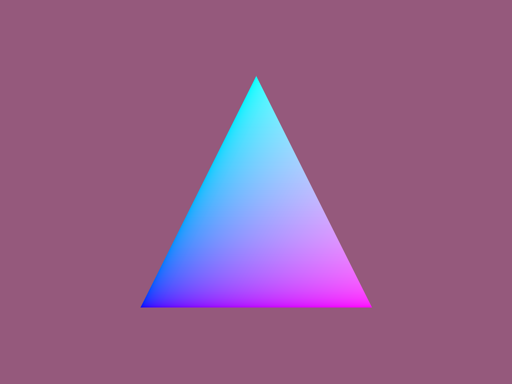

*The OptiX SDK 9.0.0 `optixTriangle` sample on the GB10.*

## Part 2. Candela as it arrived

### From a scene file to pixels

A Candela scene is a JavaScript module. It builds shapes, materials, lights and a camera with a builder API and may export functions that run later: `animation(t)` returns poses for a time, behaviours step simulated state each frame, and parameters drive sliders in the workbench. Candela processes a scene in the stages of a compiler:

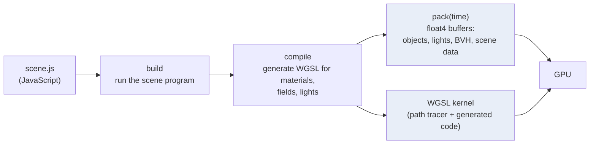

The *front end* (build) runs user code. The *back end* (compile, pack) produces two things: one WGSL program, `compiled.shared`, which contains the whole path tracer plus code generated for the scene's materials and procedural fields; and a set of storage buffers of `vec4` rows holding object records, light records, the top-level BVH, and a large *scene data* buffer with triangle records, texture data and animation poses. The browser runs the program as a WebGPU compute shader, or as a GLSL fragment shader on WebGL2, and accumulates samples into a floating-point image.

### The one function that traverses

Inside the WGSL program, one function answers the scene query: `traceAll(ro, rd, tmax, shadow)` returns the nearest object hit along a ray. It walks Candela's own BVH over objects and calls `hitObj` for each candidate. `hitObj` intersects analytic shapes (spheres, boxes, discs, signed-distance shapes) and, for meshes, walks a second, per-mesh BVH over triangles. Everything is ordinary shader code on the general-purpose cores. The RT cores do nothing.

That function is the boundary the whole project exploits. Replacing `traceAll` with hardware traversal while keeping its inputs and outputs leaves every other line of the renderer unchanged.

### The port

The workspace arrived as a JavaScript archive. `CANDELA-001` moved it into a Vite and TypeScript layout without changing behaviour. Codemods and hand typing took `tsc` from 2,425 errors to a clean check, a typing ratchet was added, and all 105 example presets ("presets") were verified to produce the same output as the original. That port is the codebase everything below builds on.

## Part 3. The browser on the GPU

### Getting a GPU into headless Chromium

The first plan step sounded like a matter of flags. It took two discoveries:

- Playwright's default "new headless" mode runs the full Chromium binary, which reports no GPU adapter on this machine. The separate *headless shell* binary does, when launched with `--use-angle=vulkan --enable-features=Vulkan --enable-unsafe-webgpu --ignore-gpu-blocklist`. ANGLE is Chromium's translation layer for graphics APIs; here it runs WebGL2 on Vulkan, and Dawn, Chromium's WebGPU implementation, also runs on Vulkan.
- WebGPU exists only in *secure contexts*: pages served over HTTPS or from `localhost`. A test page opened as `about:blank` has no `navigator.gpu`. The render scripts therefore serve the built workbench on localhost.

With both, the WebGL2 renderer string and the WebGPU adapter report the NVIDIA GB10.

### The unmodified renderer on the GB10

| Scene | Size | WebGPU | WebGL2 | SwiftShader (CPU) |
| --- | --- | --- | --- | --- |
| B-01 sphere | 640×360 | 190 | 386 | 3.7 |
| K-01 gears, 12,024 triangles | 640×360 | 32.2 | 21.4 | 1.8 |
| K-09 lockstitch, 23,701 triangles | 1920×1080 | 12.4 | – | – |

*Full-frame samples per second.*

The GPU is 18–51× faster than SwiftShader. At small sizes the simple scene is limited by per-sample overhead: the browser's render loop dispatches one sample and waits for the GPU to go idle before the next. With meshes the limit is traversal in shader code.

`scripts/render-preset.ts` turned this into a tool. It loads a preset in the headless shell, applies parameters, and submits the job to the workbench's own render queue, so seeding, exposure locking and the output writers are the ones the interface uses. Rendering one stitch of the whole lockstitch head took 230.5 s at 1080p, 64 samples per pixel and 48 frames; a later measurement in the same session as candela-rt gave 225.9 s. Two limits of the browser path showed up immediately:

- **Video.** WebCodecs offered only software H.264 and VP9 encoders. NVENC, the GPU's video encoder, is not exposed to pages. Ubuntu's arm64 `ffmpeg` includes `h264_nvenc`, `hevc_nvenc` and `av1_nvenc`, and the GB10 encodes 96 frames of 4K HEVC Main 10 in 2.2–3.5 s.
- **Memory.** WebGPU's binding limits cap one storage buffer at 1 GiB in Candela's renderer, so a scene's triangles must fit in about 9 million records. CUDA addresses the whole unified memory through plain pointers.

## Part 4. The headroom: an OptiX spike on Candela's own data

A full OptiX renderer is a large piece of work, so the project first measured what hardware traversal would buy, on a workload that isolates traversal. Candela's kernel contains an ambient-occlusion (AO) mode: one camera ray per sample and, where it hits, one random ray within a radius; the pixel value is the fraction of rays that escape. AO does almost no shading.

The spike exported K-09 from Candela's own pipeline (packed object records, inverted to instance transforms, the kernel's camera rows) into a scene package, then traced it with a small OptiX program:

- one compacted GAS per mesh, built with `PREFER_FAST_TRACE`;
- an IAS over 36 instances;
- occlusion rays flagged `TERMINATE_ON_FIRST_HIT | DISABLE_CLOSESTHIT | DISABLE_ANYHIT`, so a blocked ray runs no program at all, only traversal hardware.

| Renderer, K-09 AO at 1920×1080 | Full-frame samples/s | Ratio |
| --- | --- | --- |
| WebGPU kernel | 105 | 1× |
| OptiX on RT cores | 1,721 | 16.4× |

The two images agreed to 0.10 grey levels on average.

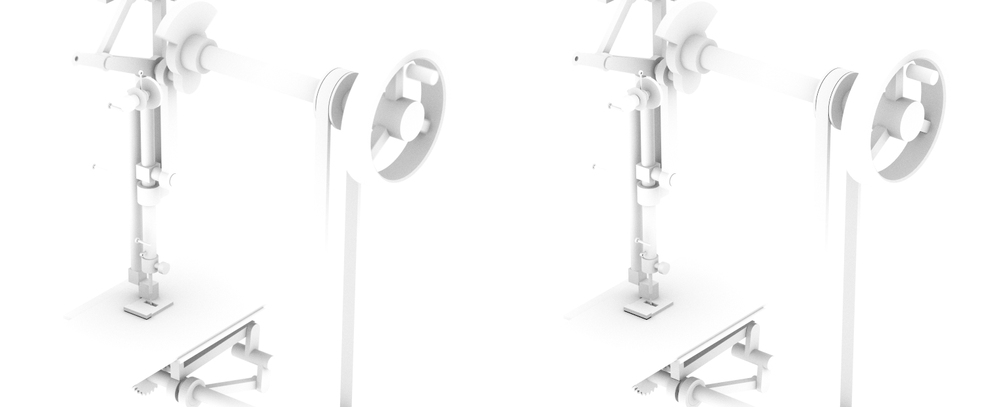

*K-09 ambient occlusion: WebGPU kernel (left), OptiX spike (right), 1024 samples per pixel each.*

The spike bounded expectations in two ways. AO is the most favourable case for RT cores, and a full path tracer also shades at every hit, which hardware traversal does not speed up. And building all mesh acceleration structures took 23 ms, so rebuilding the instance tree every animation frame is negligible.

## Part 5. The architecture: a compiler with backends

### Why not export the scene

The obvious design would export each scene to a file and write a separate C++ renderer for it. Candela's scenes defeat that design. Parts of a scene keep running after it is built: `animation(t)` evaluates poses every frame, behaviours step simulated state, derived parameters recompute values from sliders, and procedural fields are written as JavaScript functions that the compiler turns into shader code. A native renderer either reimplements Candela's front end, or runs it.

Design document 02 chose to run it. Candela is already structured as a compiler; the plan adds targets to it:

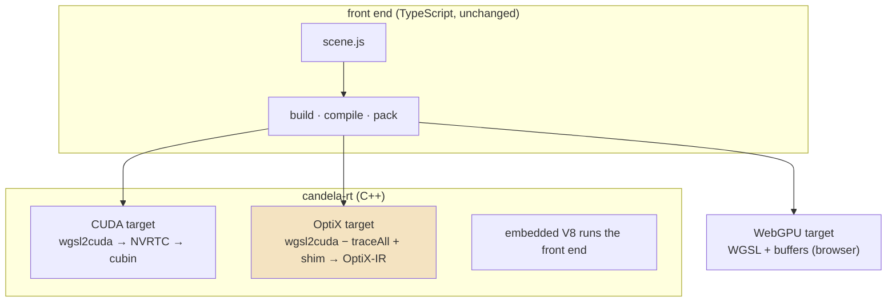

### V8 inside candela-rt

`candela-rt` embeds Google's V8 10.2 from Ubuntu's `libnode` package and loads Candela's engine as one bundled script (`dist-core/candela-core.js`, about 370 KiB). It provides the few host functions the engine needs (`console`, `performance.now`, `atob`/`btoa`, and later UTF-8 `TextEncoder`/`TextDecoder`). Three results made the embedded engine trustworthy before any GPU work depended on it:

- **Identical output.** For every preset, the generated program and every buffer written at three moments in time hash identically in embedded V8 and in Node: 105 of 105.
- **Deterministic builds.** One preset differed on every build in any engine because scene code called `Math.random`. Scene code now sees a seeded generator.
- **Callbacks in the native process.** The clock, behaviours and animation poses moved from the browser application into an engine class, `SceneSession`, so `candela-rt` steps animated presets frame by frame and gets the same buffers as the browser.

A golden test records the hashes of all presets; every later change to the engine had to leave them unchanged (105/105 throughout).

## Part 6. CUDA from the browser's own shader program

### Translating WGSL

`src/engine/wgsl2cuda.ts` translates the whole `compiled.shared` program to CUDA C++. The two languages are close enough that most of the work is notation:

| WGSL | CUDA after translation |
| --- | --- |
| module `const` | `constexpr` |
| `var<private>` (per-thread globals) | members of a per-thread `struct Kernel` |
| functions | member functions of `Kernel` |
| `let x: T = e;` / `var x: T;` | `const T x = e;` / `T x{}` (WGSL zero-initialises) |
| `1.0`, `v.xyz`, `select(a, b, c)` | `1.0f`, `v.xyz()`, `c ? b : a` |
| never-written private arrays | `__constant__` arrays |

A header, `candela_wgsl.h`, supplies WGSL's vector types and built-ins. Target-specific headers supply the launch parameters (eight device pointers in constant memory, one per WebGPU binding) and the entry point, which has the same 8×8 thread blocks and the same accumulation rule as the WebGPU compute shader. NVRTC, NVIDIA's run-time compiler library, compiles the result for `sm_121` inside `candela-rt`, and an on-disk cache keys each cubin by source hash, header hash, architecture and compiler options.

### Two bugs that only appear when two compilers run the same program

The first comparison with WebGPU matched on 27 % of pixels. The cause was evaluation order. WGSL evaluates function arguments left to right; C++ leaves the order unspecified. Calls such as `sampleLobe(L, woL, rnd2(), rnd())` consume random numbers, so the two compilers drew them in different orders and paths diverged. The translator now finds every function with side effects by a fixpoint over the call graph: functions that write a per-thread global, or call one that does. It hoists such calls into temporaries in WGSL order wherever a statement contains two of them, or one inside a `select`. After that change, 100 % of pixels matched at one sample.

The second came from noise functions. Candela hashes cell coordinates with `fract(sin(x) · 43758.5453)`. That expression amplifies the last bits of `sin`, and NVIDIA's Vulkan driver evaluates `sin` with the hardware's fast approximation. NVRTC with IEEE `sinf` therefore produced different noise; one terrain preset was 17.5 % darker. Compiling with `--use_fast_math` reproduces the driver's arithmetic, and also cut NVRTC time from a mean of 11.7 s to 4.5 s per preset.

### Parity and speed

At one sample per pixel, with the same random numbers per pixel, 101 of 105 presets agree with WebGPU on at least 99 % of pixels to within 0.1 %. The remaining four are noise presets whose hash still differs in a few cells.

| Preset, 960×540, 256 spp | WebGPU (Dawn) | CUDA (NVRTC) | Ratio |
| --- | --- | --- | --- |
| B-01, one sphere | 510 ms | 136 ms | 3.8× |
| K-09, lockstitch head | 5,496 ms | 1,014 ms | 5.4× |
| X-02, 10,000 spheres | 14,709 ms | 2,005 ms | 7.3× |
| V-04, volumetric cloud | 8,767 ms | 4,675 ms | 1.9× |

The algorithm, the BVH and the image are the same, so the difference is the cost of the path through WebGPU: one dispatch per sample with a wait for idle, and Dawn's compilation of WGSL through SPIR-V to the driver. The CUDA kernel compiles to 152–232 registers per thread with at most 1,152 bytes of local memory.

One measurement trap is worth recording. The CUDA driver keeps its own compute cache in `~/.nv/ComputeCache`, 769 MB by then, and it caches NVRTC output too, so repeated compiles reported 40–400 ms. Honest compile times need `CUDA_CACHE_DISABLE=1`.

## Part 7. Tracing rays on the RT cores

### The traversal shim

The OptiX target translates the same program but leaves out `traceAll`. In its place it includes a twenty-line shim, a member function of `Kernel` with the same signature, which calls `optixTrace`. The rest of the path tracer runs inside the raygen program unchanged. The packed scene becomes OptiX inputs (`src/engine/targets/optix.ts`):

| Candela object | OptiX structure | Hit reported as |
| --- | --- | --- |
| Mesh definition | one GAS, triangles in the order of Candela's triangle records | primitive index *k* → `gTri = triBase + 7k`, barycentrics → `gBary` |
| Mesh object | IAS instance, transform at the frame time, instance id = object index | instance id |
| Analytic shape | custom primitive in one shared GAS, AABB from `pack`'s world box | intersection program runs the translated `hitObj` |
| Infinite plane | none (no box) | tested in a loop in the shim, as before |

```cpp
// candela_traversal.inc (abridged): traceAll on the OptiX target
unsigned p0 = __float_as_uint(r.t), p1 = ~0u, p2 = ~0u, p3 = 0, p4 = 0,
         p5 = __float_as_uint(gTau), p6 = __float_as_uint(gTime), p7 = shadow;
optixTrace(params.ias, ro, rd, EPS, r.t, /*ray time*/ clamp(gTau, 0, 1),
           shadow ? MASK_SHADOW : MASK_ALL,
           shadow ? OPTIX_RAY_FLAG_TERMINATE_ON_FIRST_HIT : OPTIX_RAY_FLAG_NONE, 0, 1, 0, p0, p1, p2, p3, p4, p5, p6, p7);
if (p1 != ~0u) { r.t = __uint_as_float(p0); r.obj = p1;
                 if (p2 != ~0u) { gTri = triBase(r.obj) + 7 * p2; gBary = vec2f(p3, p4); } }
```

Three details carry the correctness of the shim:

- **The triangle record.** After a mesh hit, the WGSL code reads normals, texture coordinates and the CAD face of the hit triangle from its record (`gTri`) using the barycentric coordinates (`gBary`). Building each GAS in record order makes OptiX's primitive index address the same record.
- **The minimum distance.** The ray's minimum distance is the kernel's `EPS`, because the WGSL triangle test ignores hits closer than that. With the same bound, OptiX applies the same rule.
- **State the intersection program needs.** The intersection program runs outside the raygen program's `Kernel` object. The translated `hitObj` needs two per-thread values: the shutter time `gTau`, for moving objects, and the scene time `gTime`, for animated fields. They travel in payload registers 5 and 6.

Visibility masks let shadow rays skip glowing objects, as the WGSL code does. Shadow rays terminate on the first hit. Acceleration structures are compacted.

### What "the same image" means across compilers

The first OptiX renders matched WebGPU on 100 % of pixels for B-01 and 99.9 % for K-09, which confirmed the triangle-record mapping. X-02, with 10,000 small spheres, matched on 91.6 %. OptiX compiles the intersection program itself, from OptiX-IR, so its floating-point results are not bit-identical to the CUDA cubin's, and secondary rays that graze a sphere's edge go different ways.

The project owner then set the criterion explicitly: the WebGPU workbench is a first prototype, and candela-rt may diverge to use OptiX's capabilities, as long as images do not look different. Parity is therefore measured on displayed values. Both images are tone-mapped at the same exposure, averaged in 8×8-pixel blocks, and compared; a preset *looks the same* when the blocks agree to 2 % of white. Linear metrics misled here, because a few bright outlier pixels dominate them: X-03's sun glint gave a linear difference of 584 % for two images that look identical, and a displayed difference of 0.34 %. By the displayed criterion, 104 of 105 presets look the same on OptiX. The exception, F-03, colours its Voronoi cells with the sine hash.

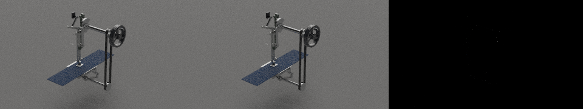

*K-09 at 64 samples per pixel: WebGPU (left), OptiX (middle), difference × 10 (right).*

### The register limit

The first OptiX timings were worse than plain CUDA on every scene except X-02. K-09 took 2.9 s where the CUDA kernel took 1.0 s, although the OptiX version traverses in hardware.

The cause was the trade-off from Part 1. OptiX compiles each module with a register limit, 128 by default. Here the raygen program holds the entire path tracer, and its live state (path throughput, the current hit, the random-number state, the material being evaluated) must survive every `optixTrace` call. At 128 registers that state spills to local memory around every trace. A sweep of `OptixModuleCompileOptions::maxRegisterCount` on K-09 (960×540, 256 samples per pixel) shows the effect:

| maxRegisterCount | 128 (default) | 168 | 200 | 255 |
| --- | --- | --- | --- | --- |
| K-09 render time | 2,821–2,907 ms | 1,474 ms | 831 ms | 749 ms |

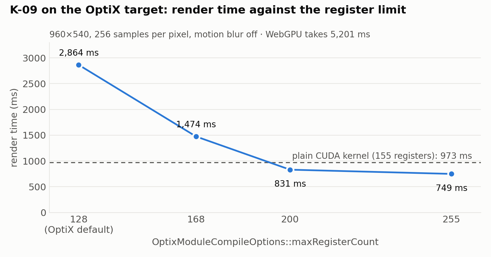

*The same sweep as a chart. The first 40 extra registers halve the time; past 200 the gains are small.*

At 255 registers OptiX is faster than plain CUDA (973 ms; the CUDA kernel uses 155 registers) and seven times faster than WebGPU. The volume preset V-04 did not change with the limit, because its time goes to procedural noise in shading, not to state around traces. The price of 255 registers is compile time: OptiX turns the OptiX-IR into machine code in 8–17 s on first use. Its disk cache serves later uses in about 12 ms.

### Choosing a backend per scene

Hardware traversal is not free in this structure. Each `optixTrace` saves and restores the raygen program's live state, and each analytic object costs an intersection-program call. The measurements say where the RT cores pay off:

| Preset, 960×540, 256 spp | WebGPU | CUDA | OptiX (255 regs) | `--backend auto` |
| --- | --- | --- | --- | --- |
| B-01, one sphere and a plane | 516 ms | 141 ms | 422 ms | 136 ms (CUDA) |
| K-09, 34 meshes | 5,201 ms | 973 ms | 741 ms | 747 ms (OptiX) |
| X-02, 10,000 spheres | 14,829 ms | 2,001 ms | 1,144 ms | 1,146 ms (OptiX) |
| V-04, volumetric cloud | 8,110 ms | 4,671 ms | 8,295 ms | 4,668 ms (CUDA) |

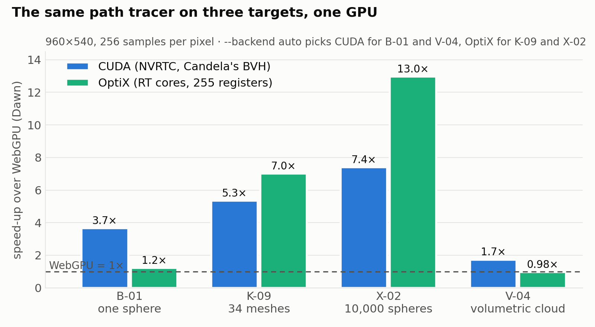

*Speed-up over WebGPU for the CUDA and OptiX targets. The RT cores win where traversal dominates (meshes, thousands of objects) and lose where shading dominates (the volume) or where the scene is tiny.*

`--backend auto`, the default, chooses OptiX when a scene has meshes or more than 64 analytic objects, and plain CUDA otherwise. An alternative was tried and reverted: keeping Candela's BVH walk inside the OptiX program for small scenes. It made the raygen program larger and slowed K-09 by 25 %.

## Part 8. Motion blur on the RT cores

A moving object blurs because the camera's shutter stays open for a while. Candela samples a time τ ∈ [0, 1] inside the shutter for each sample. An object's world transform at τ is P(τ)·M_c, where M_c is its matrix at the frame time and P is a rigid motion with uniform scale. P is stored as K keys, each a quaternion, translation and scale, and interpolated component-wise with the quaternion normalised. For analytic shapes the intersection program already handles this, because it runs the translated `hitObj` with τ from the payload. Meshes on the RT cores needed OptiX's own motion support.

OptiX's *SRT motion transform* interpolates scale, rotation and translation keys spaced evenly in time, linearly, with the quaternion normalised. This is Candela's interpolation exactly. The motion acts *outside* M_c, however, and an SRT cannot represent a general affine M_c: its scale part is limited to an upper-triangular matrix with a pivot. A moving mesh therefore reaches its triangles through two transforms:

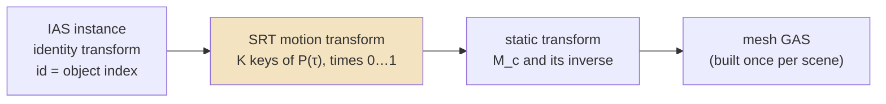

Four further changes complete the mechanism:

- **Ray time.** The ray time passed to `optixTrace` is the kernel's `gTau`. The RT cores, the shading code and the intersection program then agree on where every object was for that sample.
- **Quaternion signs.** The host aligns the signs of consecutive quaternion keys, so OptiX's interpolation takes the short way between keys, as the kernel does when it negates a key.
- **Pipeline variant.** The pipeline needs motion support: `usesMotionBlur`, a traversal graph of any shape, and a traversable depth of 4. candela-rt compiles that variant only for scenes with animation or behaviours and at least two shutter samples.
- **Rebuild cost.** Mesh GASes are built once per scene; instances, transforms and the analytic GAS are rebuilt every frame, in about 0.9 ms. Mesh numbering had to come from a table that does not change between frames. The first version numbered meshes in BVH order, which changes whenever objects move.

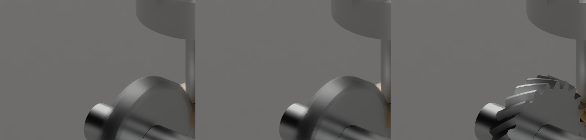

*K-09's rotary hook at 0.5 s per stitch. Left: OptiX with SRT motion transforms. Middle: plain CUDA, which interpolates poses in software like WebGPU. Right: without motion blur.*

## Part 9. Render jobs: the display program, NVENC and EXR

A render job produces images people watch, not linear radiance. In the workbench, a WGSL *display program* turns the accumulated radiance into the displayed image: it meters an exposure, optionally denoises, applies bloom and user-defined post passes, tone-maps (AgX by default) and encodes sRGB. candela-rt compiles that program with the same translator. Only its bindings differ: launch parameters with seven pointers, accessors that reproduce the WGSL prelude, and entry points for an à-trous denoise step and the display pass. Reimplementing tone mapping in C++ would have created a second definition of what the workbench shows; the translated program costs one NVRTC compile of about 120 ms per scene, cached.

The functions around it moved into a shared module, `src/engine/display.ts`, which the browser and candela-rt both call: post settings, display uniforms, the exposure meter, and the pass read-out for EXR files.

The job loop follows the workbench's render queue:

```text
for each frame f:
    seek(start + f/fps, 1/fps, seed + f)       behaviours step by exactly one frame; repack
    upload; OptiX: rebuild instances and motion transforms
    accumulate spp samples
    frame 0: meter the exposure, hold it for the sequence
    PNG / MP4: display program → RGBA8 → file, or → ffmpeg (h264_nvenc | hevc_nvenc | av1_nvenc)
    EXR: beauty × exposure, albedo, normal, depth, id pass → passesToEXR in V8
```

Video frames go to ffmpeg as raw RGBA on a pipe and are encoded by NVENC. The video encoder is a separate unit on the GPU, so encoding runs alongside the path tracer. OpenEXR files are written by the workbench's own `passesToEXR`, running inside candela-rt's V8. One small gap appeared there: `TextEncoder` is a Web API, not part of ECMAScript, so V8 alone lacks it, and the EXR writer failed with `ReferenceError: TextEncoder is not defined` until candela-rt installed a UTF-8 implementation.

PNG stills from candela-rt and from the browser's render queue agree to 0.01 % of white (B-02), 0.25 % (S-02) and 1.39 % (K-09), as displayed 8×8-block RMSE.

### The lockstitch reel

| S-07, one stitch: 48 frames, 1920×1080, 64 spp, MP4 | Wall time | Per frame |
| --- | --- | --- |
| Browser render queue (headless Chromium, WebGPU) | 225.9 s | 4.7 s |
| candela-rt (OptiX, motion transforms, NVENC) | 44.9 s | 0.89 s |

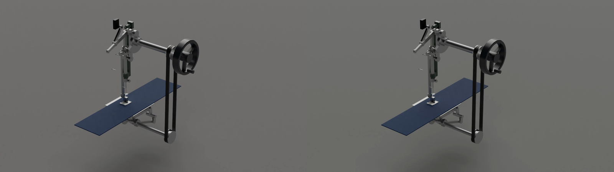

*Frame 24 of S-07: candela-rt (left), browser (right). Displayed difference 0.39 % of white.*

The whole reel is seven scenes, with the zigzag at two stitches and the whole head at four stitches under an orbiting camera: 528 frames. It rendered in 462 s including each scene's first-time compiles. At the browser's rate the same reel takes about 41 minutes.

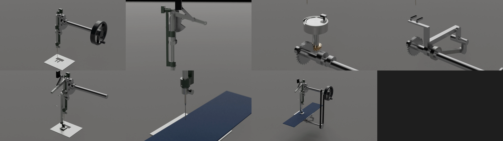

*One frame of each scene of the reel, rendered by candela-rt.*

## Part 10. The live workbench

### Same inputs, two builds

The workbench keeps building every scene itself, because the editor needs diagnostics, the agent edits files and picking needs the scene. An "OptiX" toggle in the viewport toolbar sends the same inputs to `candela-rt serve` on the Spark: the scene's files, the parameter values, the camera and the clock. The server builds the scene in its own V8 and streams frames back. Both sides hash their scene program; equal hashes mean both built the same program, and the viewport warns when they differ.

### One thread for V8 and the GPU

A V8 isolate must be entered from one thread at a time, and a session's GPU work must run in order. The server therefore has a single session thread. That thread owns the isolate, the CUDA context, the renderer, the display program and an nvJPEG encoder. The WebSocket library's own threads (IXWebSocket) only queue incoming messages. The session thread alternates between handling messages and rendering:

```text
loop:
    handle queued messages (parsed with V8's JSON.parse; scene logic stays in the JS session object)
    playing: advance the scene time by real elapsed time; seek (behaviours step on the server)
    upload if the session's version changed
    launch a batch of samples sized to about 20 ms (the batch size adapts)
    meter exposure at 1, 8 and 32 samples after a scene, parameter or view change
    every 100 ms (every batch while playing): display program → packed RGB → nvJPEG → one binary message
```

nvJPEG encodes on the GPU from the display program's output, so the image is never copied to the host before compression. It takes runtime-API streams; the default stream is the same legacy stream the driver-API launches use, so encoding is ordered after the display kernel without explicit synchronisation. The runtime API attaches to the device's primary context, which is the context candela-rt already uses.

| Measurement | Result |
| --- | --- |
| B-02, first frame after the build message | 26 ms |
| B-02, 960×540, to 2048 samples per pixel | about 1.5 s |
| K-09 playing, OptiX + motion blur, 960×540 at 8 spp per frame | 33 frames per second |
| Scene program hash, browser and server | equal for B-02 and K-09 |

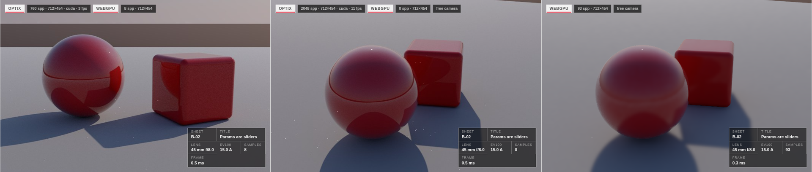

*The workbench in OptiX mode: server frames (left), after an orbit (middle), back on the local WebGPU renderer at the same camera (right).*

### What the first users found

Opening the workbench from another machine as `http://bling.local:5173` exposed a browser rule from Part 3 again. A plain-HTTP host name is not a secure context, so that browser had no WebGPU and fell back to WebGL2. The WebGL2 path linked its shader program synchronously: it read `LINK_STATUS` immediately after `linkProgram`, which blocks the page until the driver has compiled the whole path tracer. On a slow driver that froze the interface on every preset switch. The program link now uses `KHR_parallel_shader_compile` and polls `COMPLETION_STATUS_KHR` between frames, and the scene goes to the server before the local compile starts. The second problem was the server's session model: the last client to speak owns the session. A test client took over the session from a real browser, whose view then stopped updating. A displaced browser is now told, and returns to its local renderer.

## Measurements

| What | Result |
| --- | --- |
| SwiftShader → WebGPU on the GB10 (unchanged renderer) | 18–51× |
| AO traversal: WebGPU kernel → OptiX | 105 → 1,721 full-frame samples/s at 1080p (16.4×) |
| NVRTC per preset (fast math; OptiX-IR) | mean 4.5 s; 2.0 s |
| OptiX module compile at 255 registers | 8–17 s first use, ~12 ms from OptiX's cache |
| Translated program | 1,442–2,059 lines, 152–232 registers, ≤ 1,152 B local |
| Parity, CUDA vs WebGPU, 1 spp, per pixel within 0.1 % | 101/105 presets |
| Parity, OptiX vs WebGPU, displayed 8×8 blocks within 2 % | 104/105 presets |
| K-09 960×540 256 spp: WebGPU / CUDA / OptiX | 5,201 / 973 / 741 ms |
| X-02 960×540 256 spp: WebGPU / CUDA / OptiX | 14,829 / 2,001 / 1,144 ms |
| Lockstitch stitch at 1080p 64 spp: browser / candela-rt | 225.9 / 44.9 s |
| Lockstitch reel, 528 frames at 1080p 64 spp | 462 s |
| Live K-09 playback at 960×540, 8 spp per frame | 33 fps |

## Failure modes encountered

- **OptiX SDK newer than the driver.** SDK 9.1.0 targets ABI 118 and the driver's runtime implements 110, so `optixInit()` failed with `OPTIX_ERROR_UNSUPPORTED_ABI_VERSION`. SDK 9.0.0 matches.
- **No GPU in headless Chromium.** The full binary in new-headless mode had no adapter; the headless shell with ANGLE on Vulkan has one.
- **No WebGPU without a secure context.** `about:blank`, and later a plain-HTTP LAN host name, have no `navigator.gpu`.
- **Evaluation order.** Random-number calls among function arguments ran in a different order in C++; 27 % pixel agreement until the translator sequenced impure calls.
- **`sin` precision.** A noise hash amplified the difference between IEEE `sinf` and the hardware approximation; fixed by compiling with `--use_fast_math`.
- **Misleading compile times.** The CUDA driver's compute cache served NVRTC results; measured with `CUDA_CACHE_DISABLE=1`.
- **Register spills.** OptiX's default limit of 128 registers made the OptiX target slower than plain CUDA; 255 made it faster.
- **NVRTC option spelling.** `--gpu-arch=sm_121` is rejected; NVRTC wants `--gpu-architecture=`.
- **Unstable mesh numbering.** Indexing meshes by BVH order broke per-frame instance rebuilds once objects moved.
- **Missing Web APIs in V8.** `TextEncoder` had to be supplied by the host.
- **Synchronous WebGL2 link.** Reading `LINK_STATUS` right after `linkProgram` froze the page during compiles; fixed with parallel compile.

## Open questions

- How much of the live view's noise the OptiX AI denoiser removes at 8–32 samples per pixel, and what it costs per frame at 960×540 and 1080p.
- Whether shader execution reordering (`optixReorder`) helps scenes with many materials, given that the whole path tracer lives in the raygen program.
- Whether built-in sphere primitives beat the generic intersection program on X-02.
- How to bring OptiX's first-use compile of 8–17 s down for live structural edits, for example by compiling a lower-register variant first.
- Whether the browser should prefer WebGPU through a secure origin (HTTPS on the LAN, or an SSH tunnel to localhost) when used from another machine.

## Near-term next steps

- The OptiX AI denoiser (AOV model with albedo and world-space normal guides) for renders and the live view. The kernel already accumulates both guide layers.
- Shader execution reordering and built-in spheres, each kept only where measured faster.
- Render jobs from the workbench's Render dialog over the live connection, and dropped HDR environments sent to the server.

## Important project docs and code

- Tickets: `ttmp/2026/11/21/CANDELA-001--…` (port), `ttmp/2026/11/21/CANDELA-002--…` (GPU work). Design document 02 (`design-doc/02-candela-as-a-compiler-with-backends-the-v8-and-optix-render-runtime.md`) and the diary (`log/01-diary.md`, steps 1–19), evidence in `various/`.
- Browser on the GPU: `scripts/render-preset.ts`, `tools/lockstitch/render.ts`.
- OptiX spike: `native/optix/`, `scripts/scene-package.ts`.
- Engine: `src/engine/session.ts`, `src/engine/headless.ts`, `src/engine/display.ts`, `src/engine/wgsl2cuda.ts`, `src/engine/targets/{cuda,optix}.ts`.
- candela-rt: `native/rt/src/{main,js_runtime,cuda_runner,optix_renderer,post,image_io,jpeg,serve}.cpp`, device code in `native/rt/kernels/` (`candela_wgsl.h`, `candela_traversal.inc`, `candela_optix_programs.cuh`, `candela_post*.h/.inc/.cuh`).
- Browser live mode: `src/app/remote.ts`, `src/app/host.ts`, `src/app/ui/viewport.tsx`.
- Checks: `scripts/parity-sweep.ts`, `scripts/compare-pfm.ts`, `scripts/parity-gallery.ts`, `scripts/live-client.ts`, `scripts/live-browser-check.ts`, `tests/golden-pack.test.ts`, `tests/session.test.ts`.

```sh
npx tsx scripts/bundle-core.ts && cmake -S native/rt -B build/rt -G Ninja && ninja -C build/rt
./build/rt/candela-rt render K-09 --size 960x540 --spp 256                       # --backend auto: OptiX
./build/rt/candela-rt render K-09 --param "scene=S-03 Rotary hook" --sequence --start 0 --end 1.9583 \
    --spp 64 --size 1920x1080 --format mp4,png                                    # NVENC video
./build/rt/candela-rt serve                                                       # workbench → OptiX
```

## Related notes

- [[PROJECT REPORT - Candela on the DGX Spark - From a JavaScript Scene API to OptiX Ray Tracing - A Technical Deep Dive]]
- [[PROJECT REPORT - Candela Render Runtime - Running Candela Scenes in Embedded V8 - A Technical Deep Dive]]
- [[PROJECT REPORT - PicoCalc Candela - What a Physically Based Path Tracer Costs on a 360 MHz Handheld - A Technical Deep Dive]]

## Project working rule

Measure on the machine before deciding. Keep one definition of each piece of logic (the scene program, the display program, the job loop) and compile it to every target, rather than reimplementing it per target. Judge targets against each other by what is displayed, with a stated threshold.
