# Candela on OptiX: The Whole Path Tracer in One Raygen Program — A Technical Deep Dive

Candela is a physically based path tracer whose scenes are JavaScript programs. Until this project it ran only in a web browser, on WebGPU or WebGL2. Over two days on an NVIDIA DGX Spark it gained a native runtime, `candela-rt`, with a CUDA target and an OptiX target. The OptiX target traces rays on the GPU's ray-tracing cores, blurs moving meshes with OptiX motion transforms, removes noise with the OptiX AI denoiser, regroups threads with shader execution reordering, and hands simple spheres to OptiX's built-in sphere intersector.

This report covers only the OptiX side, from the first measurement to the last optimisation. It explains:

- how OptiX organises a ray tracer;
- why Candela's OptiX target runs the entire path tracer inside one OptiX program, and what that decision costs and buys;
- how each OptiX feature was added, measured, and kept or limited.

A companion note, [[PROJECT REPORT - Candela on NVIDIA - From a Browser Path Tracer to OptiX, NVENC and a Live Workbench on the DGX Spark - A Technical Deep Dive]], covers the whole project. That includes the browser on the GPU, the embedded V8 engine, the WGSL-to-CUDA translator and the live workbench. This report repeats from it only what the OptiX story needs.

> [!summary]
> - The OptiX target leaves Candela's shading code untouched and replaces one function, the scene traversal, with `optixTrace`. Everything else (materials, lights, volumes, the path loop) runs inside the raygen program, translated from the browser's own WGSL.
> - That structure decides every performance result. It needs a register limit of 255 instead of OptiX's default of 128, which takes K-09 from 2.9 s to 0.75 s. It makes the RT cores pay off only where traversal dominates. And it makes shader execution reordering expensive, because each reorder moves a large amount of live state.
> - Phase 6 added three OptiX features. Each is kept only where it measured better:
>   - **AI denoiser:** 4 samples per pixel with the denoiser have lower error than 64 without it.
>   - **SER:** 12–21 % faster on scenes of many analytic objects, 24–39 % slower on mesh scenes.
>   - **Built-in spheres:** X-02 is 27 % faster. Spheres that a path can enter, such as glass or subsurface materials, are excluded, because the built-in intersector does not report hits from inside.
> - End results on one GB10: K-09, the 34-mesh lockstitch head, renders 7× faster than WebGPU, and X-02, with 10,000 spheres, 17.5× faster. One 1080p stitch of the lockstitch animation takes 13.9 s instead of 225.9 s.

## Why this project exists

Candela's most demanding scene is a sewing-machine head converted from CAD data: preset K-09, 34 meshes and 23,701 triangles, animated by a kinematic rig. Explanatory videos of its mechanism were rendered through a headless browser. On the DGX Spark's GPU that browser path takes 4.7 s per 1080p frame at 64 samples per pixel. A one-minute reel takes most of an hour, and every change to a scene means rendering it again.

The GB10 in the DGX Spark has RT cores: fixed-function units that traverse bounding volume hierarchies and intersect rays with triangles. A browser cannot reach them, because WebGPU exposes no ray-tracing interface. On NVIDIA hardware, the way to reach them from a custom renderer is OptiX. The question this work answers is how much of the RT hardware, and of OptiX's other features, a path tracer can use when it was written for WebGPU compute shaders. The constraint is that Candela's scenes, materials and look must not have to be written twice.

## Current project status

- Repository: `/home/manuel/code/wesen/2026-11-21--pbr-spark`, branch `main`.
  - PR #1 (phases 0–5, the AI denoiser and build instructions) and PR #2 (SER and built-in spheres) are merged. Both feature branches have been deleted.
- Ticket: `CANDELA-002` in `ttmp/2026/11/21/`.
  - Design document 02 describes the compiler-with-backends architecture.
  - The diary, steps 1–24, records every measurement quoted here; the evidence is in `various/`.
- The OptiX target is the default for scenes with meshes or more than 64 analytic objects (`--backend auto`). It is used by:
  - `candela-rt render`: stills, sequences, PNG, EXR and NVENC video;
  - `candela-rt serve`: the workbench's live "OptiX" mode.
- Toolchain:
  - CUDA 13.0 and driver 580.178.04;
  - OptiX SDK 9.0.0 headers in `~/opt` (9.1.0 does not run on this driver; see Part 1);
  - NVRTC for run-time compilation.

## Part 1. What OptiX is

### Programs with fixed roles

OptiX is NVIDIA's ray-tracing framework for CUDA GPUs. It does not provide a renderer. It provides traversal and a fixed way to plug user code into it. A ray tracer written for OptiX is a set of *programs*, CUDA functions with special name prefixes, and each program has a fixed role:

| Program | Prefix | Runs when | Candela's version |
| --- | --- | --- | --- |
| Ray generation | `__raygen__` | once per launch index | the entire path tracer for one pixel and one sample |
| Intersection | `__intersection__` | a ray enters the box of a custom primitive | the translated `hitObj`, Candela's analytic-shape test |
| Closest hit | `__closesthit__` | traversal has found the nearest hit | copies hit data into the payload |
| Miss | `__miss__` | the ray hit nothing | empty |
| Any hit | `__anyhit__` | every candidate hit, for transparency tests | not used (all geometry is opaque) |

The raygen program calls `optixTrace(handle, origin, direction, tmin, tmax, time, mask, flags, …, payload…)`. Traversal then runs on the RT cores. For triangles and built-in primitives, the hardware itself computes intersections. For custom primitives, it calls the intersection program, which runs on the general-purpose cores. When traversal finishes, the closest-hit or miss program runs, and control returns to the raygen program. Values travel between these programs in up to 32 32-bit *payload* registers, which `optixTrace` carries in and out.

### Acceleration structures

Geometry lives in *acceleration structures*, bounding volume hierarchies built by OptiX on the GPU:

- A **geometry acceleration structure (GAS)** holds primitives of one kind, in one coordinate space: triangles, custom primitives given by axis-aligned boxes, or built-in primitives such as spheres and curves.
- An **instance acceleration structure (IAS)** holds instances. Each instance carries a 3×4 transform, a 32-bit id, an 8-bit visibility mask, an offset into the shader binding table, and a handle to a GAS or to a transform node.
- **Transform nodes** sit between an instance and its GAS. A *static transform* holds a matrix and its inverse. An *SRT motion transform* holds keys of scale, rotation and translation spaced evenly in time. OptiX interpolates the keys at the ray's time.

A build can be *compacted* afterwards: OptiX reports the size the structure actually needs, and a copy into a smaller buffer frees the rest.

### The shader binding table and the pipeline

When a ray hits geometry, OptiX has to choose which programs to run. It finds them in the *shader binding table* (SBT), an array of records in device memory. Each record names a *program group*: a closest-hit program, optionally an intersection program, and optionally an any-hit program, together called a hit group. The record index is computed from the instance's SBT offset and the geometry's SBT index. Candela's records carry no data of their own. Everything the programs read comes from the launch parameters.

The programs are compiled into a *module*, the modules into *program groups*, and the groups are linked into a *pipeline*. Compile options fix several properties per module or pipeline:

- the register limit;
- the number of payload and attribute registers;
- whether motion blur is used;
- which primitive types occur;
- the maximum depth of the traversal graph.

These choices matter more than anything else in this report, and Part 4 returns to them.

### SDK and driver versions

The OptiX runtime ships inside the NVIDIA driver. The OptiX SDK is a separate download that contains only headers and samples. Each SDK targets an ABI version, and the driver accepts only the ABI versions it implements:

- Driver 580.178.04 implements ABI 110.
- SDK 9.1.0 compiles for ABI 118. Its samples build, then stop at `optixInit()` with `OPTIX_ERROR_UNSUPPORTED_ABI_VERSION`.
- SDK 9.0.0 targets ABI 105, which this driver accepts.

candela-rt therefore builds against SDK 9.0.0 in `~/opt`, and its README states the version requirement.

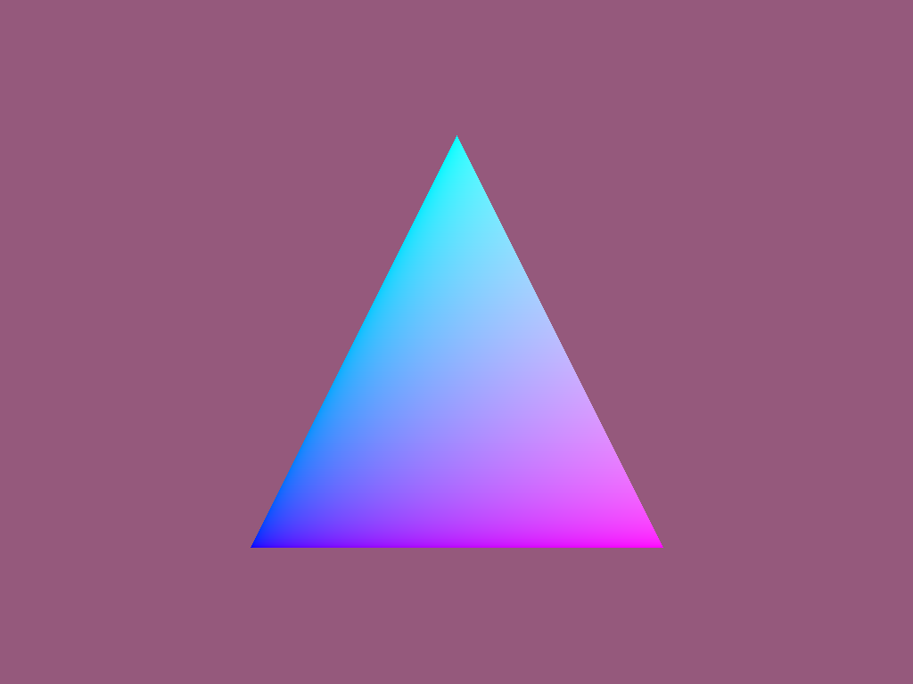

*The OptiX SDK 9.0.0 `optixTriangle` sample, the first OptiX program to run on this GB10.*

## Part 2. The measurement that justified the work

An OptiX renderer is a large investment, so the first step measured what the RT cores would buy on Candela's own data before any renderer existed. The workload isolated traversal: ambient occlusion (AO). For each sample, one camera ray finds a surface, and one random ray from that surface asks whether anything lies within a radius. AO does almost no shading, so its cost is nearly all traversal.

The spike exported K-09 from Candela's pipeline: packed object records turned into instance transforms, and the kernel's camera rows. A small standalone OptiX program (`native/optix/`) then traced it:

- one compacted GAS per mesh, built with `PREFER_FAST_TRACE`;
- an IAS over 36 instances;
- occlusion rays with `TERMINATE_ON_FIRST_HIT | DISABLE_CLOSESTHIT | DISABLE_ANYHIT`, so a blocked ray runs no program at all.

| K-09 ambient occlusion at 1920×1080 | Full-frame samples per second | Ratio |
| --- | --- | --- |
| Candela's WebGPU kernel | 105 | 1× |
| OptiX on the RT cores | 1,721 | 16.4× |

The two images agreed to 0.10 grey levels on average.

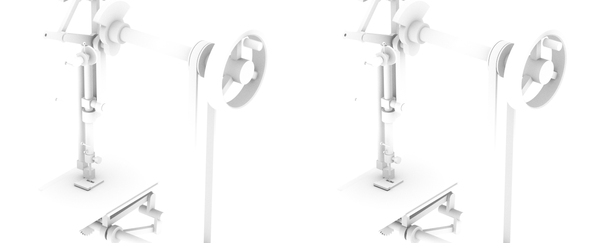

*K-09 ambient occlusion at 1024 samples per pixel: WebGPU kernel (left), OptiX spike (right).*

The spike set an upper bound, not an expectation. AO is the most favourable workload for RT cores. A full path tracer also evaluates materials, samples lights and marches volumes at every hit, and hardware traversal does not speed any of that up. The spike also showed that building all 34 mesh GASes takes 23 ms. Rebuilding instance structures every animation frame would therefore be cheap.

## Part 3. The design: replace one function, keep everything else

### Why not write an OptiX renderer

A conventional OptiX renderer writes its materials as closest-hit programs and its camera as a raygen program. It reads the scene from a file. Candela's scenes defeat that design, because a scene is a running program, not a file:

- `animation(t)` evaluates poses every frame;
- behaviours step simulated state;
- parameters recompute derived values;
- procedural fields and materials are JavaScript functions that Candela's compiler turns into shader code.

The browser renderer is one WGSL program, `compiled.shared`, generated per scene. A separate OptiX renderer would have to reproduce every material, light and volume of that program in a second language. It would then drift from the browser every time either side changed.

candela-rt instead embeds V8, runs Candela's unchanged front end, and translates the generated WGSL to CUDA with `src/engine/wgsl2cuda.ts`. The plain-CUDA target compiles the whole translation as a compute kernel. The OptiX target compiles the same translation with one function left out.

### The boundary: `traceAll`

Inside the WGSL program, one function answers every scene query. `traceAll(ro, rd, tmax, shadow)` returns the nearest object hit along a ray. In WGSL it walks Candela's own BVH over objects and calls `hitObj` for each candidate. `hitObj` intersects analytic shapes (spheres, boxes, discs, signed-distance shapes) and, for meshes, walks a second BVH over triangles. A mesh hit also records two per-thread values: `gTri`, the scene-data row of the hit triangle's 7-row record, and `gBary`, its barycentric coordinates. `finishHit` later reads normals, texture coordinates and the CAD face from that record.

Everything outside `traceAll` stays the same on every target: camera rays, materials, light sampling, volumes, the path loop and accumulation. The OptiX target therefore has one job. It must provide a `traceAll` with the same signature and the same results, using `optixTrace`.

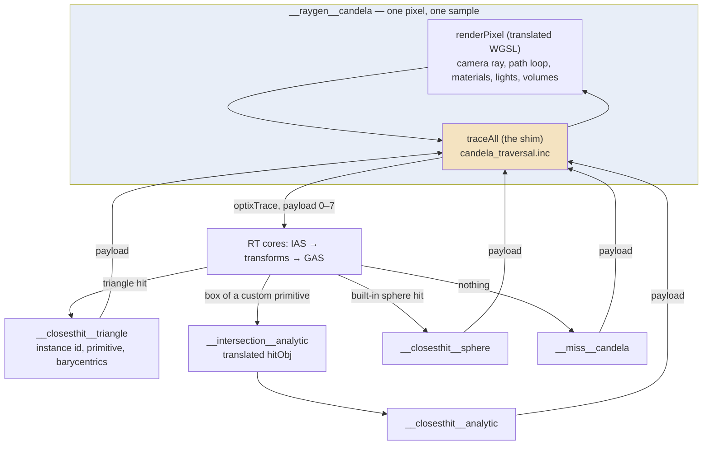

### The shim

The translated program is a C++ `struct Kernel`. WGSL's per-thread globals become its members, and WGSL functions become its member functions. `wgsl2cuda` omits `traceAll` on the OptiX target and includes `native/rt/kernels/candela_traversal.inc` in its place:

```cpp
// candela_traversal.inc (abridged): traceAll on the OptiX target
__device__ TraceR traceAll(vec3f ro, vec3f rd, f32 tmax, bool shadow) {
  TraceR r{}; r.t = tmax; r.obj = -1;
  for (i32 i = nB; i < nObj; i++) {                    // unbounded objects (infinite planes): no box, so a loop
    if (shadow && (i32(oRow(i, 0).w) & 1) != 0) continue;
    const f32 t = hitObj(i, ro, rd, r.t);
    if (t < r.t) { r.t = t; r.obj = i; }
  }
  if (nB == 0 || (shadow && r.obj >= 0)) return r;   // a shadow ray only asks whether anything is hit
  unsigned p0 = __float_as_uint(r.t), p1 = ~0u, p2 = ~0u, p3 = 0u, p4 = 0u;
  unsigned p5 = __float_as_uint(gTau), p6 = __float_as_uint(gTime), p7 = shadow ? 1u : 0u;
  optixTrace(params.ias, ro, rd,
             EPS, r.t,                                // tmin = EPS: hitMesh ignores hits closer than EPS
             clamp(gTau, 0, 1),                       // ray time = the sample's shutter time
             shadow ? MASK_SHADOW : MASK_CAMERA | MASK_SHADOW,
             shadow ? OPTIX_RAY_FLAG_TERMINATE_ON_FIRST_HIT : OPTIX_RAY_FLAG_NONE,
             0, 1, 0, p0, p1, p2, p3, p4, p5, p6, p7);
  if (p1 != ~0u) {
    r.t = __uint_as_float(p0); r.obj = (i32)p1;
    if (p2 != ~0u) { gTri = triBase(r.obj) + 7 * p2; gBary = vec2f(p3, p4); }
  }
  return r;
}
```

The eight payload registers carry everything that crosses the boundary in either direction:

| Payload | Into traversal | Out of traversal |
| --- | --- | --- |
| 0 | current maximum distance | distance of the hit |
| 1 | — | object index in Candela's object table (`~0u`: no hit) |
| 2 | — | triangle index within the mesh (`~0u`: not a triangle) |
| 3, 4 | — | barycentric coordinates |
| 5 | `gTau`, the sample's shutter time | — |
| 6 | `gTime`, the scene time | — |
| 7 | shadow-ray flag | — |

Payloads 5–7 exist because the intersection program does not run inside the raygen program's `Kernel` object. `hitObj` needs `gTau` to place moving objects, and `gTime` for animated fields. The intersection program constructs a fresh `Kernel`, copies the two values in from the payload, and runs the translated `hitObj` on the world-space ray:

```cpp
extern "C" __global__ void __intersection__analytic() {
  const i32 obj = params.aabbObjects[optixGetPrimitiveIndex()];
  Kernel k;
  k.gTau = __uint_as_float(optixGetPayload_5());
  k.gTime = __uint_as_float(optixGetPayload_6());
  if (optixGetPayload_7() != 0u && (i32(k.oRow(obj, 0).w) & 1) != 0) return;   // shadow rays skip glowing objects
  const float3 o = optixGetWorldRayOrigin(), d = optixGetWorldRayDirection();
  const f32 t = k.hitObj(obj, vec3f(o.x, o.y, o.z), vec3f(d.x, d.y, d.z), optixGetRayTmax());
  if (t >= optixGetRayTmin() && t < optixGetRayTmax()) optixReportIntersection(t, 0, (unsigned)obj);
}
```

### Candela's scene as OptiX structures

`src/engine/targets/optix.ts` turns the packed scene into OptiX build inputs each frame. The packed scene is the same object table and scene data the browser uploads.

| Candela object | OptiX structure | Hit reported to `traceAll` as |
| --- | --- | --- |
| Mesh definition | one GAS of triangles, in the order of Candela's triangle records, built once per scene | primitive index *k* → `gTri = triBase + 7k`; barycentrics → `gBary` |
| Static mesh object | IAS instance, transform at the frame time, instance id = object index | instance id |
| Moving mesh object | IAS instance → SRT motion transform → static transform → mesh GAS | instance id |
| Analytic shape | custom primitive in one shared GAS, box from the packer's world bounds | the translated `hitObj`, object index as attribute |
| Opaque static sphere (phase 6) | built-in sphere in one of two sphere GASes | `sphereObjects[primitive index]` |
| Infinite plane | none (it has no box) | tested in the shim's loop |

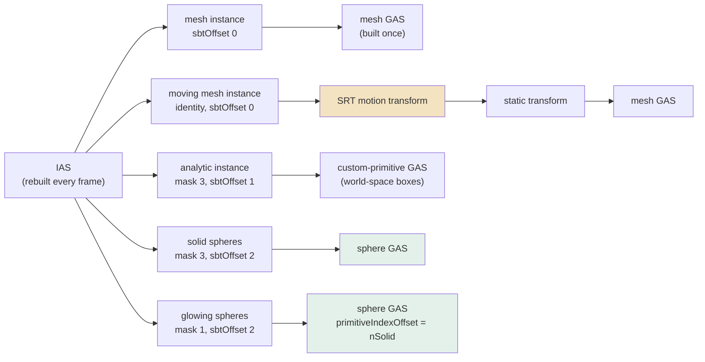

The hit-group records follow the instances' SBT offsets:

| SBT offset | Hit group | Used by |
| --- | --- | --- |
| 0 | `__closesthit__triangle` | mesh instances |
| 1 | `__intersection__analytic` + `__closesthit__analytic` | the custom-primitive instance |
| 2 | OptiX's built-in sphere intersector + `__closesthit__sphere` | the sphere instances (only when the pipeline has spheres) |

### Four details that carry correctness

- **Triangle order.** Each mesh GAS lists its triangles in the order of Candela's triangle records. OptiX's primitive index then addresses the same record the WGSL code would have found, so `finishHit` reads the right normals and face ids.
- **The minimum distance.** The WGSL triangle test ignores hits closer than `EPS`. Passing `EPS` as the ray's `tmin` gives OptiX the same rule. Without it, secondary rays hit the surface they start on.
- **Visibility masks.** Shadow rays in Candela skip glowing objects, so that a light's own geometry does not block it. Instances of glowing objects get mask 1 (camera rays only). Everything else gets mask 3, and shadow rays trace with mask 2. The shared custom-primitive GAS holds glowing and non-glowing shapes together, so its intersection program applies the same rule through payload 7.
- **Box padding.** The packer computes object boxes in double precision, and `hitObj` intersects in single precision. Each box is padded by 10⁻⁴ of its largest coordinate, so a hit on a box face is not lost to rounding.

### One launch per sample

The raygen program is the WebGPU compute shader's entry point, translated:

```cpp
extern "C" __global__ void __raygen__candela() {
  const uint3 ix = optixGetLaunchIndex();
  Kernel k;
  const PixOut o = k.renderPixel(vec2f(ix.x, ix.y), u32(k.U(0).z));   // U(0).z = sample index
  const u32 i = ix.y * u32(k.U(0).x) + ix.x;
  if (k.U(0).z < 0.5f) { params.accum[i] = o.c; params.aovA[i] = o.alb; params.aovN[i] = o.nrm; }      // first sample
  else                 { params.accum[i] += o.c; params.aovA[i] += o.alb; params.aovN[i] += o.nrm; }  // later samples
}
```

Each `optixLaunch` adds one sample to every pixel. The accumulation buffer holds the radiance sum, and two further buffers hold the albedo and normal sums. These two later became the AI denoiser's guide layers at no extra cost.

## Part 4. Compiling for OptiX

### From WGSL to a pipeline

The OptiX target's program goes through four compilers:

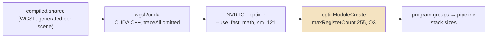

1. `wgsl2cuda` translates the program and appends the OptiX headers: the launch parameters, the shim and the programs.
2. NVRTC, NVIDIA's run-time compiler library, compiles the result to OptiX-IR, an intermediate form that OptiX compiles further. All 105 presets compile, with a mean of 2.0 s and a maximum of 3.4 s.
3. `optixModuleCreate` compiles the OptiX-IR to machine code for the GB10. This is the expensive step: 8–17 s on first use at 255 registers. OptiX keeps its own disk cache, and later uses take about 12 ms.
4. Program groups and the pipeline are created, and the stack sizes are computed from the program groups with `optixUtilComputeStackSizes`.

`--use_fast_math` is not an optimisation choice. Candela's procedural noise hashes cell coordinates with `fract(sin(x) · 43758.5453)`, which amplifies the last bits of `sin`. The browser's Vulkan driver evaluates `sin` with the hardware approximation, so the CUDA targets must too, or terrain and marble materials come out with different noise.

### The compile options

```cpp
OptixModuleCompileOptions mco = {};
mco.maxRegisterCount = 255;                       // Part 5
mco.optLevel = OPTIX_COMPILE_OPTIMIZATION_LEVEL_3;
OptixPipelineCompileOptions pco = {};
pco.usesMotionBlur = motion ? 1 : 0;              // Part 7
pco.traversableGraphFlags = motion ? OPTIX_TRAVERSABLE_GRAPH_FLAG_ALLOW_ANY
                                   : OPTIX_TRAVERSABLE_GRAPH_FLAG_ALLOW_SINGLE_LEVEL_INSTANCING;
pco.numPayloadValues = 8;
pco.numAttributeValues = 2;
pco.pipelineLaunchParamsVariableName = "params";
pco.usesPrimitiveTypeFlags = TRIANGLE | CUSTOM | (spheres ? SPHERE : 0);   // Part 10
OptixPipelineLinkOptions plo = {}; plo.maxTraceDepth = 1;                   // closest-hit programs never trace
optixPipelineSetStackSize(pipe, dcT, dcS, css, motion ? 4 : 2);             // traversable graph depth
```

Three of these options produce pipeline *variants*:

- motion blur on or off;
- spheres on or off;
- SER on or off, which is a preprocessor definition and so changes the module itself.

Each variant is a separate OptiX compile with its own cache entry. candela-rt compiles only the variant a scene needs: motion only for scenes with animation or behaviours and at least two shutter samples, and spheres only when the scene has a qualifying sphere. The live server rebuilds its renderer when a scene change switches the variant.

## Part 5. The register limit

The first OptiX renders were correct and slow. K-09 took 2.9 s at 960×540 and 256 samples per pixel. The plain-CUDA target, which walks Candela's BVH in software, took 1.0 s. Hardware traversal had made the renderer three times slower.

The cause follows from the design in Part 3. A GPU thread keeps its working values in registers. The register file is shared by every thread on a streaming multiprocessor, and a thread can use at most 255 registers. When a program needs more live values than its register limit allows, the compiler *spills* them to local memory, which is ordinary device memory reached through the caches. OptiX compiles modules with a limit of 128 registers by default. In Candela's raygen program, the state of a path is live across every `optixTrace` call:

- the throughput;
- the current hit and its material;
- the random-number state;
- the accumulated radiance.

At 128 registers that state is spilled and reloaded around each trace. A sweep of `maxRegisterCount` measures the effect:

| maxRegisterCount | 128 (default) | 168 | 200 | 255 |
| --- | --- | --- | --- | --- |
| K-09, 960×540, 256 spp | 2,821–2,907 ms | 1,474 ms | 831 ms | 749 ms |

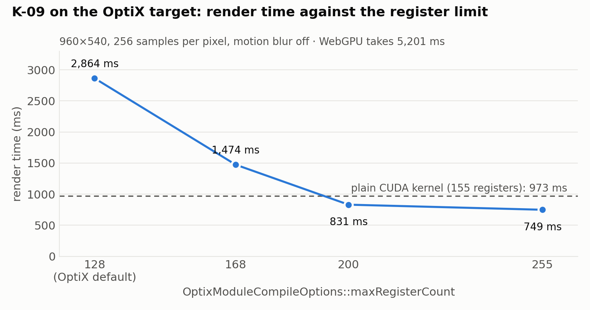

*Render time against the register limit. The first 40 extra registers halve the time; beyond 200 the gains are small.*

At 255 registers, OptiX beats plain CUDA on K-09: 741–749 ms against 973 ms. The plain-CUDA kernel compiles to 155 registers and has no traces to save state around. The volume preset V-04 did not respond to the limit, because its time goes into procedural noise inside the shading code, not into state saved around traces.

The price is compile time. The OptiX module compile takes 8–17 s on first use at 255 registers. That does not matter for render jobs. It is the main delay when a live user changes a scene's structure, because the program changes and the cache misses.

## Part 6. What "the same image" means

The OptiX target compiles its own machine code from OptiX-IR, so its floating-point results differ from the plain-CUDA cubin in the last bits. At one sample per pixel with identical random numbers:

- B-01 matched WebGPU on 100 % of pixels;
- K-09 matched on 99.9 %, which confirmed the triangle-record mapping;
- X-02, with 10,000 small spheres, matched on 91.6 %. Secondary rays that graze a sphere's silhouette fall on different sides of it, and those paths diverge from there.

Per-pixel identity is the wrong test between two compilers. The project owner set the criterion: the WebGPU workbench is a first prototype, and candela-rt may diverge to use OptiX's capabilities, as long as the images do not look different. Parity is therefore measured on displayed values:

1. Both images are tone-mapped at the same exposure.
2. Each image is averaged in 8×8-pixel blocks.
3. The blocks are compared; a preset looks the same when they agree within 2 % of white.

Linear metrics mislead here, because a few bright pixels dominate them. X-03's sun glint on water gave a linear difference of 584 % between two images that look identical, and a displayed difference of 0.34 %.

By the displayed criterion, 104 of 105 presets look the same on OptiX as in the browser. The exception, F-03, colours Voronoi cells with the sine hash, and a few cells take a different colour.

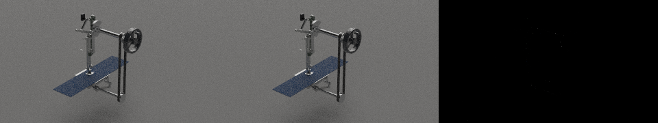

*K-09 at 64 samples per pixel: WebGPU (left), OptiX (middle), difference × 10 (right).*

The same displayed metric judges every later OptiX change: motion transforms, SER and built-in spheres. The denoiser in Part 8 is the exception. Block averages hide noise by construction, so the denoiser is judged per pixel.

## Part 7. Where the RT cores pay off

Hardware traversal has a cost in this design. Every `optixTrace` saves and restores the raygen program's live state, and every analytic object the ray's box test admits costs a call to the intersection program. The measurements show where the trade favours OptiX:

| Preset, 960×540, 256 spp | WebGPU | CUDA target | OptiX target | `--backend auto` picks |
| --- | --- | --- | --- | --- |
| B-01, one sphere and a plane | 516 ms | 141 ms | 422 ms | CUDA |
| K-09, 34 meshes | 5,201 ms | 973 ms | 741 ms | OptiX |
| X-02, 10,000 spheres | 14,829 ms | 2,001 ms | 1,144 ms | OptiX |
| V-04, volumetric cloud | 8,110 ms | 4,671 ms | 8,295 ms | CUDA |

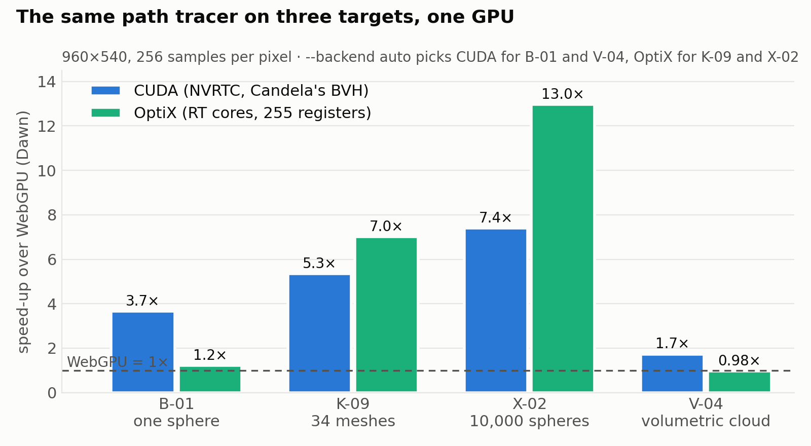

*Speed-up over WebGPU. The RT cores win where traversal dominates (meshes, thousands of objects). They lose where shading dominates (the volume) or where the scene is tiny.*

The default rule chooses OptiX when a scene has meshes or more than 64 analytic objects, and plain CUDA otherwise. An alternative was tried and reverted: keeping Candela's own BVH walk inside the OptiX program for small scenes. The larger raygen program slowed K-09 by 25 %, so the choice moved up a level, to choosing the target per scene.

## Part 8. Motion blur on the RT cores

### Candela's motion model

A moving object blurs because the camera's shutter stays open while it moves. Each sample of a Candela pixel picks a shutter time τ ∈ [0, 1], `gTau`. An object's world transform at τ is P(τ)·M_c:

- M_c is its matrix at the frame time.
- P is a rigid motion with uniform scale, stored as K keys of a quaternion, a translation and a scale.
- Between keys, P is interpolated component-wise, with the quaternion normalised.

For analytic shapes the intersection program already handles motion, because it runs the translated `hitObj` with τ from payload 5. Moving meshes were the gap: before phase 4 they rendered unblurred on OptiX.

### SRT motion transforms

An OptiX SRT motion transform holds keys of scale, rotation (a quaternion) and translation, spaced evenly between a begin and an end time. OptiX interpolates them linearly and normalises the quaternion, which is Candela's interpolation exactly. Its scale part, however, cannot hold a general affine matrix: it is limited to an upper-triangular form. M_c is general. Because the motion acts outside M_c, a moving mesh reaches its triangles through two transform nodes:

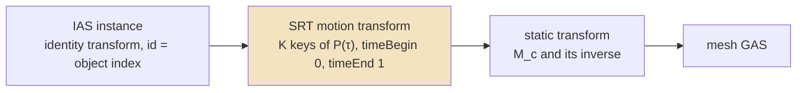

The engine sends M_c as Candela stores it, a world-to-object 3×4 matrix. The renderer inverts it in double precision, because a static transform needs both directions:

```cpp
auto* st = reinterpret_cast<OptixStaticTransform*>(&blob[i * pair]);
st->child = gas_[mesh];
std::memcpy(st->transform, inv, sizeof inv);              // object → world at the frame time
std::memcpy(st->invTransform, m, 12 * sizeof(float));     // world → object, as packed
auto* mt = reinterpret_cast<OptixSRTMotionTransform*>(&blob[i * pair + stBytes]);
mt->child = stHandle;
mt->motionOptions.numKeys = (unsigned short)keys;
mt->motionOptions.flags = OPTIX_MOTION_FLAG_NONE;
mt->motionOptions.timeBegin = 0.0f;                        // the shutter parameter τ: the ray time is gTau
mt->motionOptions.timeEnd = 1.0f;
std::memcpy(mt->srtData, keysFromEngine, keys * sizeof(OptixSRTData));
```

Four further details complete the mechanism:

- **The ray time is `gTau`.** The RT cores, the shading code and the intersection program then agree on where every object was for that sample.
- **Quaternion signs are aligned on the host.** q and −q are the same rotation, but linear interpolation between q₁ and −q₂ takes the long way round. The kernel negates a key when the dot product is negative. The host does the same to the keys it gives OptiX.
- **The pipeline variant.** Motion needs `usesMotionBlur`, a traversal graph of any shape, and a traversable depth of 4 (IAS, motion transform, static transform, GAS). Static scenes keep single-level instancing and a depth of 2.
- **Per-frame builds.** Mesh GASes are built once per scene. Instances, transforms, the custom-primitive GAS and the sphere GASes are rebuilt every frame, in about 0.9 ms. Mesh numbering comes from a table that does not change between frames. The first version numbered meshes in BVH order, which changes whenever objects move.

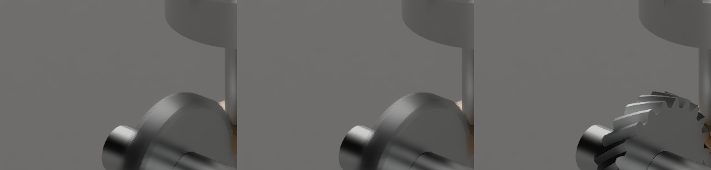

*K-09's rotary hook at 0.5 s per stitch. Left: OptiX with SRT motion transforms. Middle: the plain-CUDA target, which interpolates poses in software as WebGPU does. Right: without motion blur.*

With motion in place, OptiX renders the lockstitch animations. One stitch of scene S-07, 48 frames at 1920×1080 and 64 samples per pixel, took 44.9 s including NVENC encoding, against 225.9 s in the browser's render queue. The full seven-scene reel, 528 frames, took 462 s including every first-time compile.

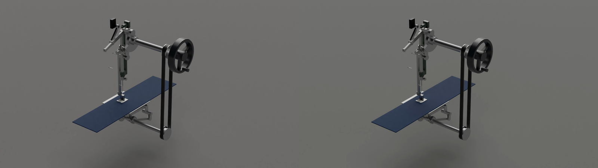

*Frame 24 of S-07: candela-rt with OptiX (left), the browser (right). Displayed difference: 0.39 % of white.*

## Part 9. The OptiX AI denoiser

### What it does

A path-traced image at a few samples per pixel is noisy, because each pixel is the average of a few random estimates. The error of that average shrinks with the square root of the sample count, so halving the noise costs four times the samples. A denoiser removes noise by a different route: it estimates the converged image from the noisy one. The OptiX AI denoiser is a neural network trained on path-traced images; its weights ship with the driver.

The denoiser accepts optional *guide layers*: images that are cheap to compute and nearly noise-free, which tell it where edges and textures are. Candela's kernel already accumulates two:

- **Albedo:** the surface colour at the first hit, without lighting.
- **Normal:** the surface orientation at the first hit, in world space.

The *AOV model* (`OPTIX_DENOISER_MODEL_KIND_AOV`) takes both guides and works on linear HDR radiance. Its normal guide must be in world space; only the deprecated LDR and HDR model kinds expect camera space. Candela's normal buffer is already in world space, so it is used as is.

### Where it runs

The workbench's display program meters exposure, tone-maps with AgX, applies bloom and user passes, and encodes sRGB. The denoiser runs before it, on linear radiance:

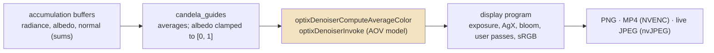

That placement keeps the denoiser independent of the workbench's look. It sees physical radiance, and everything that makes an image look like Candela happens after it. When the AI denoiser is on, the display program skips its own à-trous denoise steps and reads the denoised radiance instead of the accumulation buffer.

The implementation, `native/rt/src/denoiser.cpp`, is about 90 lines:

```cpp
AiDenoiser::AiDenoiser(CUcontext cuctx, int width, int height) {
  optixInit();
  optixDeviceContextCreate(cuctx, &options, &ctx_);          // its own context: the plain-CUDA target can use it too
  OptixDenoiserOptions o = {};
  o.guideAlbedo = 1; o.guideNormal = 1; o.denoiseAlpha = OPTIX_DENOISER_ALPHA_MODE_COPY;
  optixDenoiserCreate(ctx_, OPTIX_DENOISER_MODEL_KIND_AOV, &o, &den_);
  // allocate beauty/albedo/normal/output (float4), state and scratch; optixDenoiserSetup
}
double AiDenoiser::run() {
  optixDenoiserComputeAverageColor(den_, nullptr, &beauty, avgColor_, scratch_, scratchBytes_);
  OptixDenoiserParams p = {}; p.hdrAverageColor = avgColor_; p.blendFactor = 0.0f;
  OptixDenoiserGuideLayer g = {}; g.albedo = albedo; g.normal = normal;
  OptixDenoiserLayer l = {}; l.input = beauty; l.output = out; l.type = OPTIX_DENOISER_AOV_TYPE_BEAUTY;
  optixDenoiserInvoke(den_, nullptr, &p, state_, stateBytes_, &g, &l, 1, 0, 0, scratch_, scratchBytes_);
}
```

The average colour is computed from each frame itself. The AOV model normalises its input by that average. A sequence holds the exposure fixed from frame 0, and per-frame normalisation still lets each frame be denoised in its own range.

### Measurements

Quality was measured per pixel on the displayed image against a 4,096-sample reference: K-09 scene S-07 at t = 0.6, 960×540.

| Samples per pixel | Without denoiser | With AI denoiser |
| --- | --- | --- |
| 4 | 6.52 % | 1.19 % |
| 16 | 3.42 % | 0.84 % |
| 64 | 1.71 % | 0.63 % |

*Per-pixel RMSE of displayed values, in percent of white.*

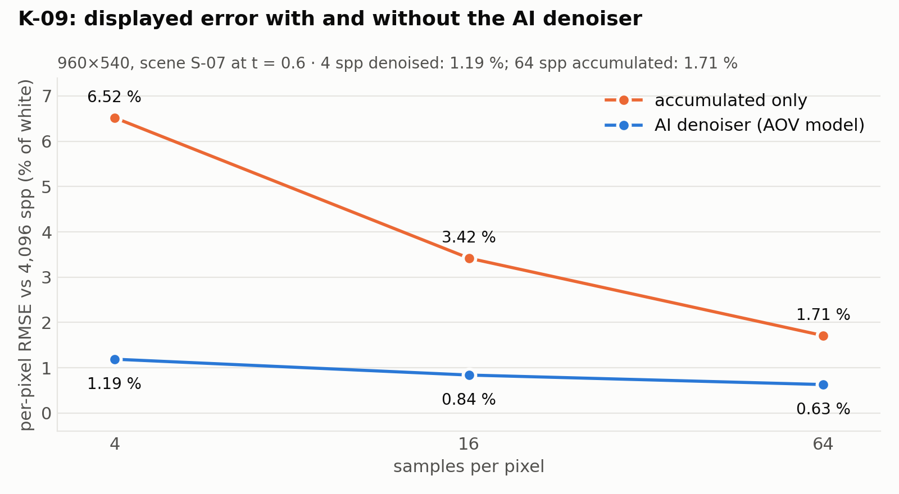

*Four samples per pixel with the denoiser have a lower error than 64 without it.*

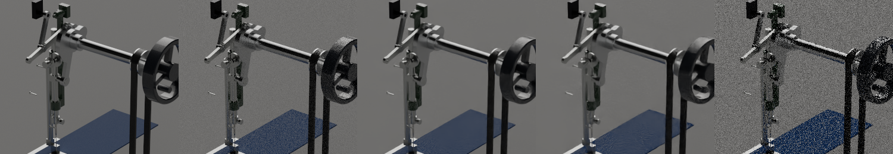

*Crops of K-09, left to right: 4,096 spp reference, 64 spp accumulated, 16 spp + AI, 4 spp + AI, 4 spp accumulated. At 16 spp the noise is gone. At 4 spp fine texture is slightly smoothed.*

The denoiser costs:

- 7–20 ms of setup when the image size changes;
- 5.7–8.8 ms per frame at 960×540;
- 18.3 ms per frame at 1920×1080.

For render jobs the consequence is a different sample budget. One 1080p stitch of S-07 at 16 samples per pixel plus the denoiser took 13.9 s. At its measured frame, its error against a 1,024-sample reference is 0.81 %, against 1.67 % for the 64-sample render that took 44.9 s.

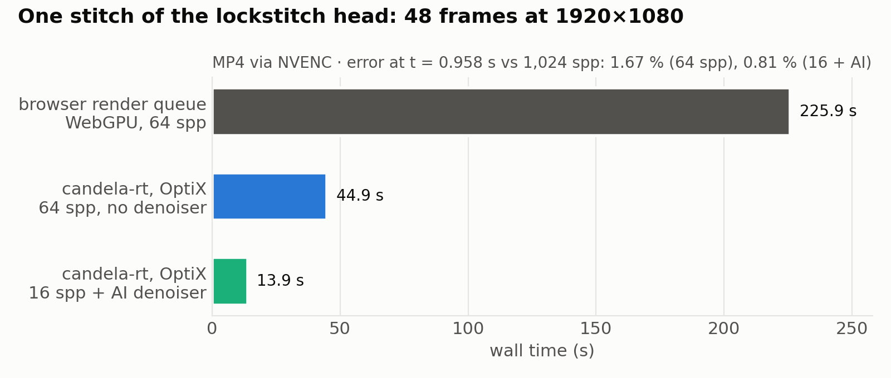

*One stitch of the lockstitch head, 48 frames at 1080p.*

In the live server, the denoiser is on by default. Playing K-09 with motion blur, the server streams 24 frames per second at 4 samples plus denoising per frame, against 33 frames per second at 8 samples without. The frame header reports the denoiser and its time, and the workbench's status chip shows "AI denoised".

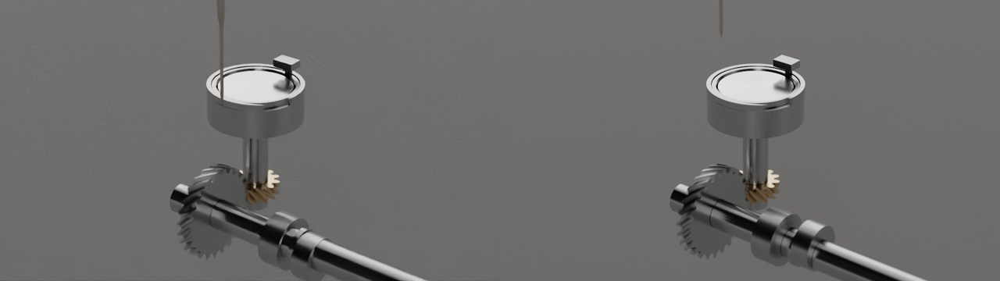

*The live view while K-09 plays, 4 spp + AI per frame (left), and the same view converged after stopping (right).*

Frames are denoised independently. OptiX also offers a temporal AOV model, which uses motion vectors and the previous frame's output to keep denoised animation stable. It is not used yet, so low-sample sequences may flicker slightly in flat regions.

## Part 10. Shader execution reordering

### Divergence after the hit

A GPU executes threads in groups of 32 called warps. All threads of a warp execute the same instruction at the same time. When they take different branches, the warp runs each branch in turn with the other threads idle. After `optixTrace` returns, neighbouring pixels have often hit different objects with different materials. The shading code that follows diverges, and part of each warp waits.

Shader execution reordering (SER) lets the hardware regroup threads between finding a hit and processing it. OptiX splits `optixTrace` into three calls:

1. `optixTraverse` finds the hit and stores it in a *hit object*, without running a closest-hit or miss program.
2. `optixReorder` lets the hardware permute threads across warps so that threads with similar hits end up together. It optionally takes a user-supplied coherence hint.
3. `optixInvoke` runs the closest-hit or miss program for the stored hit and fills the payload.

The shim gained an alternative path under a preprocessor definition:

```cpp
#ifdef CANDELA_SER
  if (!shadow) {
    optixTraverse(params.ias, ro, rd, EPS, r.t, clamp(gTau, 0, 1), MASK_CAMERA | MASK_SHADOW,
                  OPTIX_RAY_FLAG_NONE, 0, 1, 0, p0, p1, p2, p3, p4, p5, p6, p7);
    optixReorder();
    optixInvoke(p0, p1, p2, p3, p4, p5, p6, p7);
  } else
#endif
  optixTrace(/* as before */);
```

Shadow rays keep `optixTrace`. They only ask whether anything blocks the light and run no shading afterwards, so there is nothing for a reorder to improve.

### What it costs in this design

A reorder moves threads, and a thread's state moves with it. In a conventional OptiX renderer, the raygen program holds little state and the shading runs in closest-hit programs after the reorder. In Candela, the raygen program holds the whole path tracer's state, up to 255 registers per thread, and every non-shadow trace reorders it.

The measurements show that this cost decides the result:

| Preset, 960×540, 256 spp | Without SER | With SER | Change |
| --- | --- | --- | --- |
| K-01, 7 meshes | 1,174 ms | 1,617–1,643 ms | +39 % |
| K-09, 34 meshes | 911 ms | 1,130–1,148 ms | +24 % |
| G-04, 901 objects | 741 ms | 721 ms | −3 % |
| F-08, 401 objects | 818 ms | 722 ms | −12 % |
| M-07, no meshes | 710 ms | 627 ms | −12 % |
| G-05, 441 objects | 2,250 ms | 1,767 ms | −21 % |
| X-02, 10,001 objects | 1,155 ms | 912 ms | −21 % |

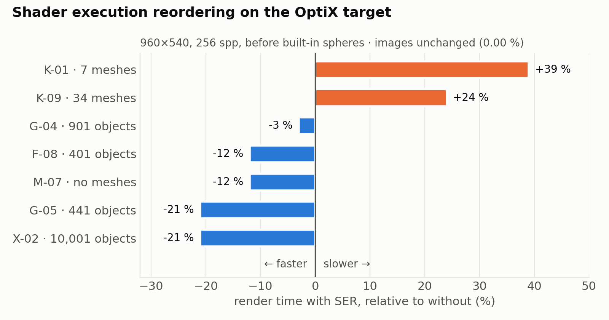

*SER helps scenes of many analytic objects and hurts mesh scenes. The images do not change: the displayed difference is 0.00 % on all four presets checked.*

On mesh scenes the RT cores handle intersection in hardware, and a reorder adds the cost of moving state without a matching gain in coherence. On scenes of many analytic objects, every candidate costs an intersection-program call, and grouping threads by what they hit pays.

A coherence hint was also tried: the material index of the hit object, as `optixReorder(hint, 4)`. It changed nothing measurable on any preset and was removed.

SER is therefore enabled by a rule. `--ser auto`, the default, defines `CANDELA_SER` only for OptiX scenes without meshes. After Part 11 the rule also requires more than 64 custom primitives. `--ser on` and `--ser off` force the choice for experiments.

## Part 11. Built-in spheres

### Why spheres

X-02 consists of 10,000 spheres. Each is a custom primitive, so each candidate a ray meets costs a call to the intersection program. That call constructs a `Kernel` and runs the translated `hitObj`, a general function that handles every Candela shape, transform and motion. OptiX 9 has a built-in sphere primitive with its own intersector, which runs without leaving the traversal path until the closest hit. The question was how many of Candela's spheres it can take over.

### Which spheres qualify

Candela packs every object with its world-to-object matrix. A sphere is a unit-radius shape in object space, scaled by a radius r. A built-in sphere is a centre and a radius in world space. A packed sphere can become one only if its transform maps it to a sphere in world space: a rotation, uniform scale and translation, with no shear and no non-uniform scale.

Let the packed world-to-object transform be x_obj = A·x + b. The sphere is the set |x_obj| = r. If A·Aᵀ = c·I for some c > 0, then A = √c·R with R orthonormal, and A⁻¹ = Aᵀ/c. The centre x₀ satisfies A·x₀ + b = 0, so x₀ = −(1/c)·Aᵀ·b. A point x lies on the sphere when |A·(x − x₀)| = √c·|x − x₀| = r. The world radius is therefore r/√c. `worldSphere` in `targets/optix.ts` applies exactly this test and derivation:

```ts
// abridged: A, t and the double loop over i, j are written out in the source
function worldSphere(O: Float32Array, k: number, materials: any[]): number[] | null {
  const b = k * 24;
  if (O[b] !== 0 || O[b + 22] > 0) return null;          // not a sphere, or moving during the shutter
  const m = materials[O[b + 1]];
  if (!m || m.enterable !== false) return null;          // a path can enter it: keep the custom program
  // A = the 3×3 part of the world→object matrix, t = its translation
  const row = (i, j) => A[i*3]*A[j*3] + A[i*3+1]*A[j*3+1] + A[i*3+2]*A[j*3+2];
  const c = row(0, 0);
  for (i, j) if (Math.abs(row(i, j) - (i === j ? c : 0)) > 1e-5 * c) return null;   // A·Aᵀ = c·I
  const s2 = 1 / c;
  return [-s2 * (Aᵀ·t).x, -s2 * (Aᵀ·t).y, -s2 * (Aᵀ·t).z, O[b + 16] * Math.sqrt(s2)];  // centre, radius
}
```

Moving spheres stay custom primitives. Built-in spheres support motion only as vertex motion, which would need its own build and pipeline flags, and the intersection program already handles Candela's motion model.

### The pipeline additions

Built-in primitives need four additions to the pipeline:

- **Primitive types.** `usesPrimitiveTypeFlags` includes `OPTIX_PRIMITIVE_TYPE_FLAGS_SPHERE`.
- **The intersector module.** OptiX provides the built-in intersector as a module from `optixBuiltinISModuleGet`. That call takes the same compile options as the main module, plus the sphere build flags. Those flags must match the flags the sphere GAS is built with, here `PREFER_FAST_TRACE | ALLOW_COMPACTION`.
- **A third hit group.** It pairs the built-in intersector with `__closesthit__sphere`, which maps the primitive index back to Candela's object index:

  ```cpp
  extern "C" __global__ void __closesthit__sphere() {
    optixSetPayload_0(__float_as_uint(optixGetRayTmax()));
    optixSetPayload_1((unsigned)params.sphereObjects[optixGetPrimitiveIndex()]);
    optixSetPayload_2(~0u);   // not a triangle
  }
  ```

- **Two sphere GASes per frame,** because visibility masks are per instance. Solid spheres get mask 3, so camera and shadow rays see them. Glowing spheres get mask 1, so shadow rays pass through them. Both GASes index one table, `sphereObjects`, solid spheres first. The glowing GAS sets `primitiveIndexOffset` to the number of solid spheres, so `optixGetPrimitiveIndex()` continues the numbering and the closest-hit program needs no case distinction.

### Rays that start inside

The first version moved every sphere with a similarity transform and no motion. The parity sweep against custom primitives found large differences on nine presets:

| Preset | Displayed difference | Preset title and the spheres in it |
| --- | --- | --- |
| R-03 | 19.4 % | *Still life by a window*: subsurface fruit |
| S-01 | 13.8 % | *Dispersion*: a glass ball |
| M-11 | 12.1 % | *Wax, jade, skin*: subsurface spheres |
| M-04 | 5.7 % | *Glass, water, diamond*: glass spheres |
| S-03 | 2.7 % | *Soap bubbles*: thin-film shells |
| E-01, E-05, E-07 | 1.6–2.3 % | integrator, clamp and engine demos, each with a glass object |
| M-10 | 1.8 % | *Thin-film interference*: coated spheres |

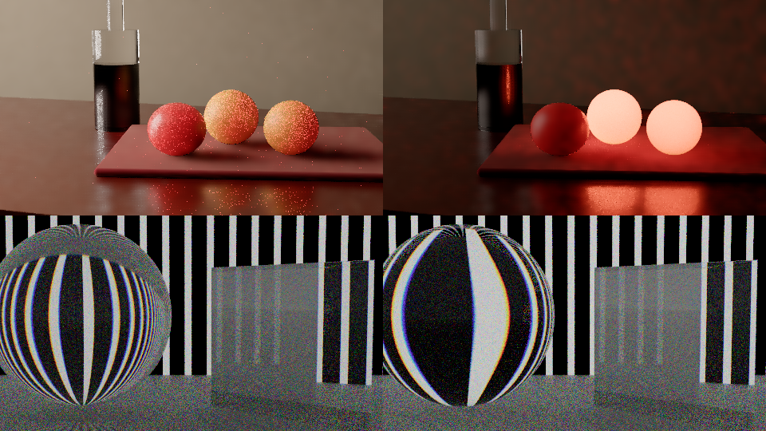

*Custom primitives (left) and the first built-in-sphere version (right). Top: R-03's subsurface spheres render as glowing balls. Bottom: S-01's glass ball refracts once and never lets the ray out.*

The built-in sphere intersector does not report a hit for a ray whose origin lies inside the sphere. Candela's `hitObj` does. Several material models depend on that:

- A refracted ray enters a glass ball and must find the far side to leave.
- A subsurface random walk starts inside an object and must find the boundary to exit.
- A medium boundary must be found from inside to end the medium.

With the built-in intersector, those rays found no exit. Refracted rays stayed inside the glass. Subsurface walks ran to their step limit and returned whatever light they had gathered, which looks like a glowing ball.

The fix is to keep such spheres on the custom program. That needs to know, from the compiled scene, whether a material can let a path in. Candela's compiler generates one WGSL function per material, which sets the fields of a lobe description `L`. `enterableMaterial` in `src/engine/compile.ts` reads that generated code:

```ts
export function enterableMaterial(code: string): boolean {
  if (/L\.kind = (5|6)\b/.test(code) || /L\.med = (?!-1;)/.test(code)) return true;   // thin, medium bounds, interior medium
  return code.split('\n').some(line => /L\.kind = 3;/.test(line) && !/L\.flags = 2;/.test(line));   // dielectric unless reflect-only
}
```

| Lobe | Meaning | Enterable |
| --- | --- | --- |
| kind 3 | dielectric (glass, water, subsurface) | yes, unless `flags = 2` (reflect-only) |
| kind 5 | thin dielectric (a shell) | yes |
| kind 6 | medium boundary | yes |
| `med` ≠ −1 | an interior medium is attached | yes |
| anything else | opaque surfaces | no |

The first version of this test had its own bug. Every material's code contains `L.med = -1;` as a default. The pattern `L\.med = ` therefore matched every material and moved no sphere at all. The negative lookahead `(?!-1;)` restricts it to materials that set a real medium.

After the fix, every preset that uses built-in spheres agrees with custom primitives within 0.29 % displayed difference. The largest remaining value is K-05, at 0.29 %.

### Measurements, and an interaction with SER

| X-02, 960×540, 256 spp | Render time |
| --- | --- |
| custom primitives, SER off | 1,161 ms |
| custom primitives, SER on | 906 ms |
| built-in spheres, SER on | 855–863 ms |
| built-in spheres, SER off | 845–859 ms |

Built-in spheres make X-02 27 % faster than custom primitives without SER, and 7 % faster than custom primitives with SER. Once the spheres are built-in, SER no longer helps. The measurements are consistent with SER's gain on X-02 having come from coherence among intersection-program calls: once those calls disappear, so does the gain. The `--ser auto` rule was changed accordingly. It now requires a scene without meshes *and* more than 64 custom primitives. X-02 has one custom primitive left and runs without SER. G-05 and F-08 have at most one qualifying sphere each, so their custom primitive counts stay high and they keep SER.

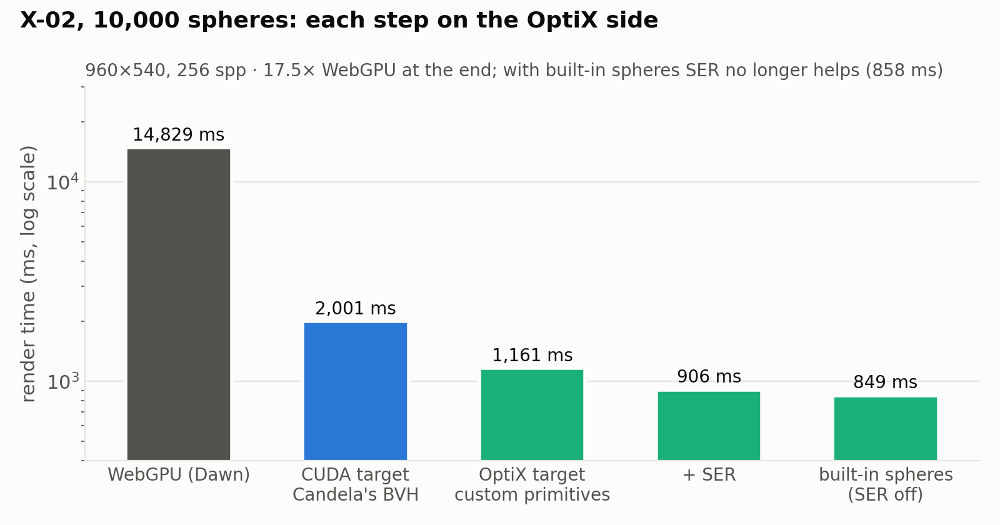

*X-02 from WebGPU to the final OptiX configuration: 14,829 ms to 849 ms, 17.5×.*

One more interaction had to be handled. `--backend auto` counted custom primitives to decide between CUDA and OptiX. Moving spheres out of the custom-primitive list would have dropped X-02 below the threshold and switched it to the plain-CUDA target. The rule now counts custom primitives and built-in spheres together.

## Part 12. OptiX in the live workbench

`candela-rt serve` uses the same OptiX renderer for the workbench's live mode. A single session thread owns:

- the V8 isolate;
- the CUDA context;
- the OptiX renderer and the AI denoiser;
- the display program;
- an nvJPEG encoder.

The thread alternates between handling queued WebSocket messages and launching batches of samples sized to about 25 ms. Several times a second it runs the denoiser and the display program, encodes a JPEG on the GPU, and sends it.

OptiX shapes three parts of the live behaviour:

- **First-frame latency after a structural change.** A new scene program means a new OptiX module, 8–17 s at 255 registers on a cache miss. Parameter changes, camera moves and animation do not change the program; they reach the screen within tens of milliseconds. B-02's first frame arrives 26 ms after its build message. X-02's first frame arrives 42 ms after the build, and the view reaches 1,599 samples per pixel in 6 s.
- **Pipeline variants.** A scene change can switch motion, sphere or SER needs. The server compares the new scene's variant with the current renderer's and rebuilds the renderer when they differ.
- **Per-frame builds while playing.** Each animation tick reruns behaviours in V8, repacks, rebuilds instances, transforms and the custom-primitive and sphere GASes (about 1 ms), and launches. K-09 plays at 24 frames per second with 4 samples plus denoising per frame.

## What the OptiX target uses, and what it does not

| OptiX feature | Used | Where |
| --- | --- | --- |
| Triangle GAS on RT cores, compaction | yes | every mesh |
| Custom primitives with an intersection program | yes | analytic shapes (translated `hitObj`) |
| IAS with visibility masks | yes | camera/shadow masks, glowing objects |
| Static and SRT motion transforms | yes | moving meshes, motion pipeline variant |
| Built-in spheres | yes | opaque static spheres with a similarity transform |
| Shader execution reordering | yes, by rule | OptiX scenes with no meshes and > 64 custom primitives |
| AI denoiser, AOV model with albedo and normal guides | yes | render jobs (`--denoise ai`), live view (default) |
| Any-hit programs | no | all geometry is opaque |
| Callable programs | no | shading stays in raygen (see open questions) |
| Curves, micromaps | no | Candela has no such geometry |
| Temporal and upscaling denoiser models | no | candidates for sequences and the live view |

## Measurements

| What | Result |
| --- | --- |
| AO traversal, K-09 at 1080p: WebGPU → OptiX spike | 105 → 1,721 full-frame samples/s (16.4×) |
| NVRTC to OptiX-IR, 105 presets | 105/105 compile; mean 2.0 s, max 3.4 s |
| OptiX module compile at 255 registers | 8–17 s first use; about 12 ms from OptiX's cache |
| K-09 against the register limit (128 / 168 / 200 / 255) | 2.9 s / 1.47 s / 0.83 s / 0.75 s |
| Parity, OptiX vs WebGPU, displayed 8×8 blocks within 2 % | 104/105 presets |
| K-09, 960×540, 256 spp: WebGPU / CUDA / OptiX | 5,201 / 973 / 741 ms |
| X-02, 960×540, 256 spp: WebGPU / CUDA / OptiX / final | 14,829 / 2,001 / 1,161 / 849 ms |
| Per-frame instance, transform and analytic rebuild | about 0.9 ms |
| AI denoiser per frame, 960×540 / 1080p | 5.7–8.8 ms / 18.3 ms |
| K-09 error vs 4,096 spp: 4 spp + AI / 64 spp | 1.19 % / 1.71 % per pixel |
| One 1080p stitch: browser / OptiX 64 spp / OptiX 16 spp + AI | 225.9 / 44.9 / 13.9 s |
| Lockstitch reel, 528 frames at 1080p, 64 spp | 462 s |
| SER, no-mesh scenes / mesh scenes | −3 % to −21 % / +24 % to +39 % |
| Built-in spheres, X-02 | 1,161 → 849 ms (−27 %) |
| Built-in spheres vs custom, all affected presets | within 0.29 % displayed |
| Live K-09 playback, 960×540: 8 spp raw / 4 spp + AI | 33 / 24 frames per second |

## Failure modes encountered

- **SDK newer than the driver.** SDK 9.1.0 targets ABI 118 and the driver implements 110, so `optixInit()` failed with `OPTIX_ERROR_UNSUPPORTED_ABI_VERSION`. SDK 9.0.0 works.
- **Default register limit.** At 128 registers the raygen program's state spilled around every trace, and OptiX was three times slower than software traversal. 255 made it faster.
- **Per-pixel parity across compilers.** OptiX compiles its own code from OptiX-IR, so grazing rays diverge (X-02: 91.6 % of pixels identical). Displayed 8×8-block agreement is the criterion.
- **Linear error metrics.** Fireflies dominate linear differences (X-03: 584 % linear, 0.34 % displayed).
- **Unstable mesh numbering under motion.** Numbering meshes in BVH order broke per-frame instance rebuilds once objects moved.
- **Affine matrices in SRT transforms.** An SRT cannot hold a general affine matrix, so moving meshes need a static transform under the motion transform.
- **SER with a heavy raygen program.** Reordering moved too much live state on mesh scenes; restricted by rule. The material coherence hint had no effect.
- **Built-in spheres and rays from inside.** The built-in intersector reports no hit for rays starting inside a sphere; glass, subsurface and medium spheres broke. Restricted to materials a path cannot enter.
- **A default value in generated code.** `L.med = -1` appears in every material, so the first enterability test matched everything.
- **Optimisations that interact.** Built-in spheres removed SER's gain on X-02 and would have changed X-02's backend choice. Both rules were updated.

## Open questions

- Would a different program structure change the trade-offs? Shading would move into callable or closest-hit programs, and the raygen program would keep only a small path state. That would make SER and lower register limits viable, but it is a different renderer from the translated WGSL program, and keeping one definition of the shading code was the reason for the current design.
- Can the 8–17 s first-use module compile be hidden for live structural edits? One option is to compile a 128-register variant first and swap in the 255-register module when it is ready. Another is to render on the plain-CUDA target meanwhile.
- How much does the temporal AOV denoiser stabilise low-sample sequences, and what does it cost? It needs motion vectors, which the kernel does not compute yet.
- Is the SER rule right for scenes that mix a few meshes with many analytic objects? None of the 105 presets tests that mix well.
- Should `enterableMaterial` become a flag the compiler sets when it generates a material, instead of a test on the generated text? A new transmitting lobe kind would otherwise have to be added to the pattern by hand.

## Near-term next steps

- Temporal denoising for sequences, with motion vectors from the kernel.
- Render jobs from the workbench's Render dialog over the live connection, so a browser user gets OptiX renders without a shell.
- Forward HDR environments and engine overrides to the server.

## Important project docs and code

- Ticket `CANDELA-002`: `ttmp/2026/11/21/CANDELA-002--fast-candela-rendering-on-the-dgx-spark-gpu-browser-native-webgpu-runner-optix-backend/`.
  - Design document 02, `design-doc/02-candela-as-a-compiler-with-backends-the-v8-and-optix-render-runtime.md`.
  - Diary `log/01-diary.md`: steps 16 (OptiX target), 18 (motion), 21 (denoiser), 22 (SER), 23 (built-in spheres).
  - Evidence: `various/16-*`, `18-*`, `21-*`, `22-*`, `23-*`.
  - Chart scripts: `scripts/20-report-charts.py`, `scripts/24-optix-report-charts.py`.
- Engine side:
  - `src/engine/targets/optix.ts`: scene → GAS/IAS inputs, motion keys, `worldSphere`.
  - `src/engine/targets/cuda.ts`: `cudaProgram`, the SER definition.
  - `src/engine/headless.ts`: backend and SER rules.
  - `src/engine/compile.ts`: `enterableMaterial`.
  - `src/engine/wgsl2cuda.ts`: the translator.
- Native side:
  - `native/rt/src/optix_renderer.cpp`: module, pipeline, SBT, per-frame builds.
  - `native/rt/src/denoiser.cpp` and `native/rt/src/post.cpp`.
  - `native/rt/src/main.cpp` (render) and `native/rt/src/serve.cpp` (live).
- Device code:
  - `native/rt/kernels/candela_traversal.inc`: the shim.
  - `native/rt/kernels/candela_optix_programs.cuh`: the programs.
  - `native/rt/kernels/candela_optix_params.h` and `native/rt/kernels/candela_post.cuh` (guides).
- The OptiX spike: `native/optix/`, `scripts/scene-package.ts`.

```sh
npx tsx scripts/bundle-core.ts && cmake -S native/rt -B build/rt -G Ninja && ninja -C build/rt
./build/rt/candela-rt render X-02 --size 960x540 --spp 256                  # auto: OptiX, built-in spheres
./build/rt/candela-rt render X-02 --size 960x540 --spp 256 --spheres custom --ser on
./build/rt/candela-rt render K-09 --spp 16 --denoise ai --format png --size 1920x1080
./build/rt/candela-rt serve --bind 0.0.0.0                                    # the workbench's OptiX mode
```

## Related notes

- [[PROJECT REPORT - Candela on NVIDIA - From a Browser Path Tracer to OptiX, NVENC and a Live Workbench on the DGX Spark - A Technical Deep Dive]]
- [[PROJECT REPORT - Candela on the DGX Spark - From a JavaScript Scene API to OptiX Ray Tracing - A Technical Deep Dive]]
- [[PROJECT REPORT - Candela Render Runtime - Running Candela Scenes in Embedded V8 - A Technical Deep Dive]]

## Project working rule

Replace the smallest piece of the renderer that gives the hardware its job: here, one traversal function. Keep one definition of the shading code. Turn on each OptiX feature by a measured rule, not globally. Re-measure the rules when a later optimisation changes what an earlier one was compensating for.
