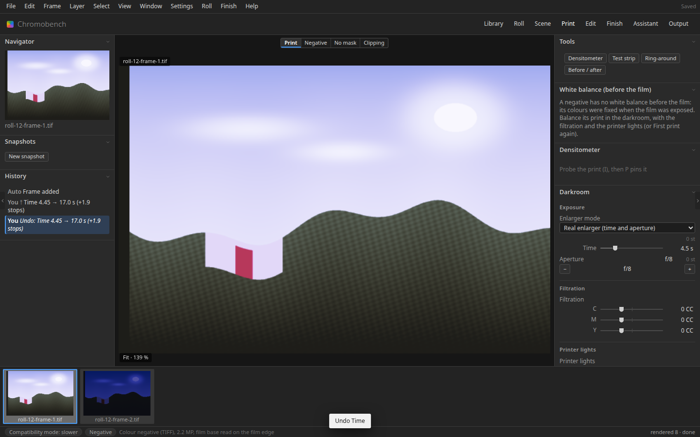
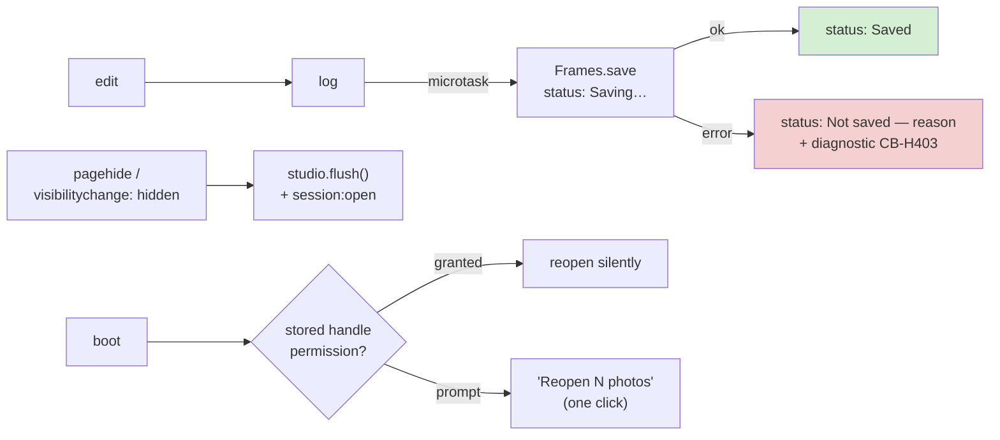
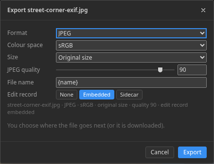
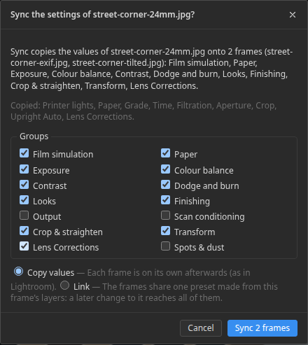
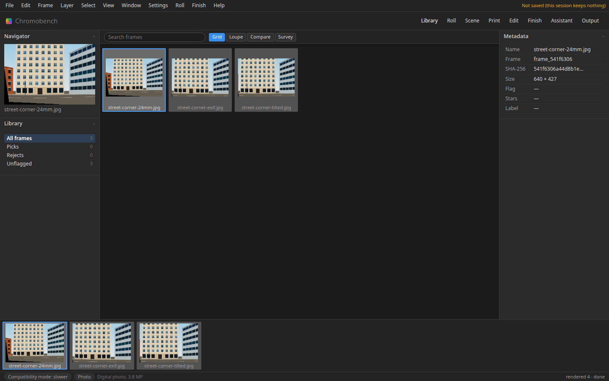
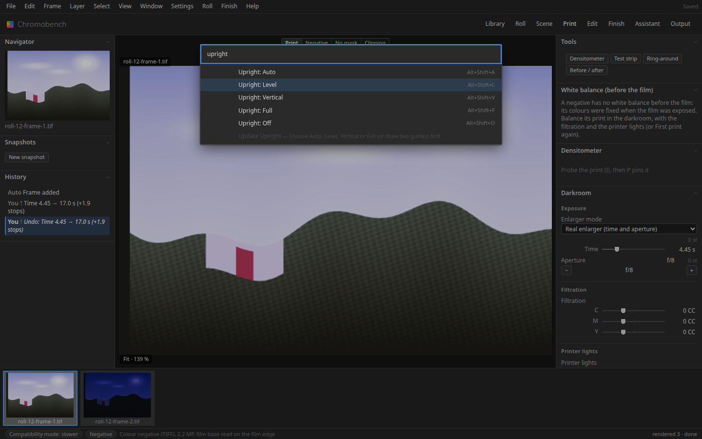
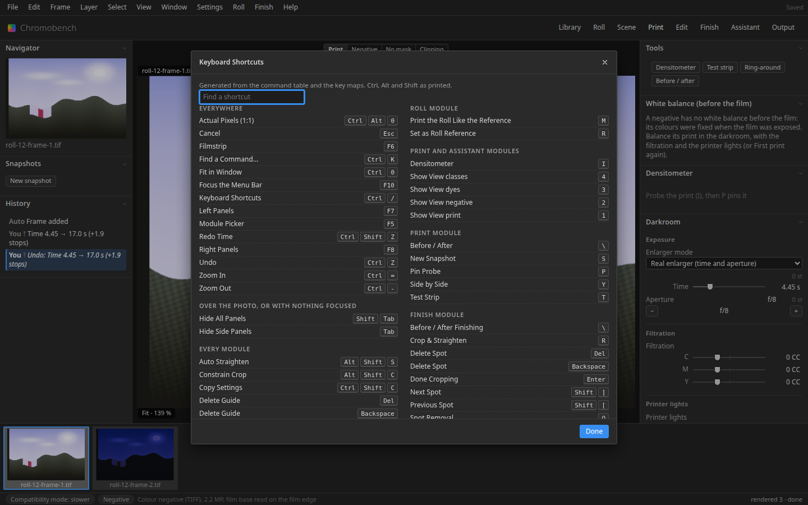
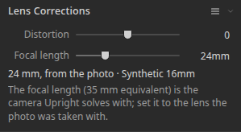
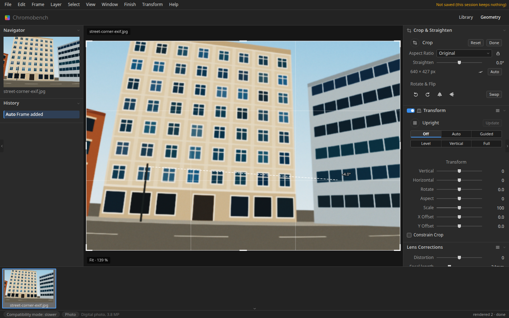
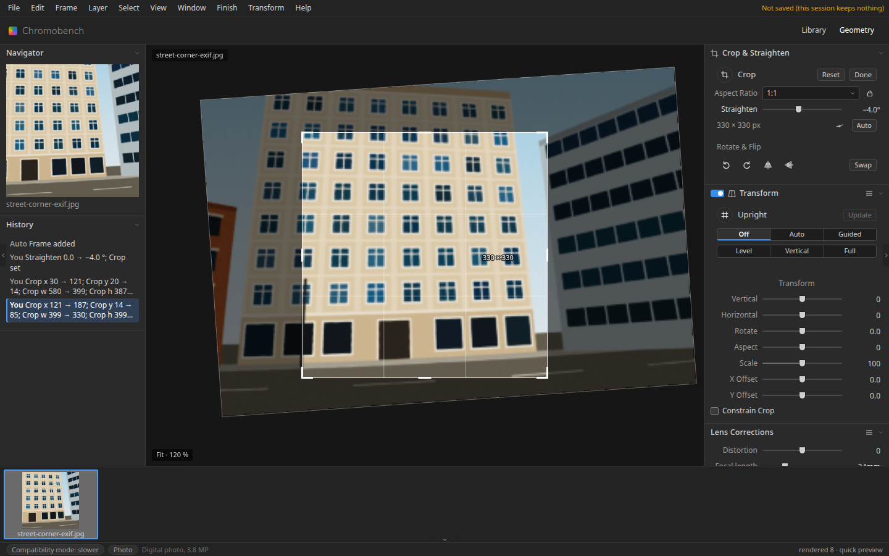

# Chromobench: A Workhorse — Edits that Survive a Reload, Undo per Photo, Batch Geometry, EXIF Lenses and a Stricter UI DSL

Chromobench is a browser darkroom. It prints colour-negative scans and camera RAW files through a physical model of film and paper, and offers Lightroom's digital tools around that model: crop and straighten, perspective correction, masks, looks, rolls. By the end of ticket CHB-052 it could do every edit a photographer needs on one photo in one sitting. Ticket CHB-053 was about what happens after that sitting. Does the edit survive a reload? Can one correction go to forty photos? Does Ctrl+Z stay on the photo you are looking at? Does the exported file say what was done to it?

This report explains the nine changes the ticket made and why each took the form it did. It also covers how six agents built them in parallel from one design guide, and the three bugs a browser check found at the seams between their work after the merge.

> [!summary]
> - **Persistence already existed; everything around it failed.** Every edit was written to IndexedDB, keyed by the file's SHA-256. Reloads still lost work for six separate reasons: frames were not reopened, no flush ran when the page was hidden, write errors were swallowed, "Saved" described a different store, a mode was part of the key, and a failed replay overwrote its record. The fix closes each gap; it does not add a store.
> - **Undo per photo is a new step, not a second cursor.** The log keeps one history for all photos. Ctrl+Z now undoes the newest step that touched the photo on screen. When that step is not the log's newest, the undo is committed as a new *revert* step holding the inverse mutations on that one document. Inverses that skip later steps are safe because documents are independent, and the step chosen is the newest on its document.
> - **A pasted correction is adapted, not copied.** A crop travels as fractions of the frame. Automatic Upright modes are solved again on each target from its own lines. A focal length read from a photo's EXIF stays with that photo. The same pixels solve to a pitch of 12.82° at the recorded 24 mm and 14.88° at the assumed 28 mm.
> - **The UI DSL now refuses what it does not use.** `ck.product` rejects unknown fields with a did-you-mean suggestion, and rejects `keys` with an instruction. An unbound `keys` field in a product had silently caused a broken Delete key in an earlier ticket.
> - **Parallel agents, then one integrated look.** Six agents built the work in separate worktrees, each with its own diary. Every branch's tests passed. A browser pass over the merged studio still found three bugs, each one where two workstreams met.

## 1. Why this ticket exists

The previous tickets were judged by what a single edit could do. CHB-051 added Upright perspective correction, solving a camera's tilt from the vanishing directions of the picture's lines. CHB-052 rebuilt the crop tool so the picture turns under an upright crop frame, as in Lightroom. Both were checked by persona sessions: agents playing a working photographer, a scanner of family negatives, a reproducibility-minded archivist and similar roles. Those sessions kept reporting the same class of complaint, and it was never about a single edit:

- a reload emptied the studio, while the status bar said "Saved";
- Paste Settings carried the print stack but not the crop or the perspective correction;
- Ctrl+Z undid an edit on another photo and switched the selection to it;
- Tab hid the panels instead of moving focus;
- Upright used a default 28 mm focal length, which on the test photo put the pitch 1.8° off.

The owner asked what was left "to make this a real workhorse". The answer was a list of ten items. CHB-053 took nine of them. The tenth, proof on a real GPU, needs hardware and was left for its own ticket.

| Item | Problem | Section |
|---|---|---|
| 1 | Edits are lost on reload | §4 |
| 2 | One correction cannot go to many photos | §6 |
| 4 | Exports are not traceable; saved documents cannot be reopened | §5 |
| 5 | Undo crosses photos; History is unreadable | §3 |
| 6 | Tab, the menubar, the palette and dialogs ignore the keyboard | §7 |
| 7 | The lens is assumed, not read | §8 |
| 8 | The crop tool's remaining details | §9 |
| 9 | The UI DSL accepts declarations it never uses | §10 |
| 10 | Layouts cannot reuse kit building blocks | §10 |

## 2. The parts of the system the ticket touches

Four structures underlie every item. They are worth defining before the changes, because most of the bugs in this ticket lived in the gaps between them.

**A frame and its document.** A frame is one opened photo. Its document is a JSON value of type `Document` (`packages/contract/src/document.ts`). It holds:

- the source, with the file's SHA-256 and, since this ticket, its lens;
- the stages: scan, film and print, each a stack of layers with parameters;
- the masks;
- the geometry `{ orientation, angle_deg, crop, transform?, lens? }`.

**The log.** Every edit is a transaction: a list of mutations (`set`, `insert`, `remove`) on one or more documents. The log (`packages/values/src/log.ts`) keeps every transaction of the session in a single list of *steps*. `steps[0, cursor)` are in effect; the steps after the cursor can be redone. A step can span several documents. A *batch*, such as pasting settings onto ten photos, is one step with ten entries. Each entry carries the transaction's inverse mutations, computed when it was applied, and plain undo applies them in reverse.

```
steps:  [ Time on A ] [ Paste on A,B,C ] [ Crop on B ] [ Time on A ]
                                                        ^ cursor = 4
undo  → applies the inverses of step 4, cursor = 3
```

**Storage.** The host opens an IndexedDB database, `chromobench-studio`, as a key–value store with four stores. Only the first matters for edits.

| Store | Key | Value |
|---|---|---|
| `logs` | `${sha}:${photo|negative}` | `FrameSave { initial, applied[], pending[] }`: the document as it was opened, plus the transactions in effect |
| `workspace` | `app:version:doc|view` | the layout state, without the frame documents |
| `frames` | `thumb:<id>` | library thumbnails |
| `handles` | `file:<sha>` | File System Access handles for reopening files |

**The UI DSL.** A layout is a JavaScript function of `ck` (the toolkit) and `cb` (the studio's vocabulary) that returns a studio. Panels, sliders, commands, keys and tools are builder calls that produce an intermediate representation. Build passes check that representation, and an agent can read it as text. A *kit* (`ck.kit(name)`) declares state, commands, tools and keys. A *product* (`ck.product(kit, parts)`) bundles a kit with the builder functions layouts use: `panels.*`, `modules.*`, `menus.*`, `lib`. Keys are bound in scopes (`global`, `module:<id>`, `tool:<id>`, `panel:<id>`, `canvas`, `text`, `dialog`). The key router (`packages/shell/src/core/keys.ts`) walks those scopes from innermost to outermost and runs the first binding that is enabled.

## 3. Undo per photo

### 3.1 What went wrong

The log's single cursor is deliberate. It guarantees that every inverse applies to exactly the state it was computed against, because undo only ever reverts the newest step. The price was that Ctrl+Z on photo A, after an edit on photo B, undid B's edit. The studio then switched the selection to B, so the user could see what had changed (`Studio.showChanged`). For a photographer working through a roll this is the wrong behaviour. Their attention is on one photo, and the undo should stay there.

Two designs were possible. One gives each document its own cursor. That breaks the log's invariant: a batch step spans documents, and its entries would have to be undone separately. The design chosen keeps one cursor and records the undo itself as a step.

### 3.2 Revert steps

The rule: **Ctrl+Z undoes the newest step that touched the photo on screen.**

```
undoIn(f):
  s = newest step in effect whose entries touch f      (pairing earlier undos with their edits)
  if s is the log's newest step:   plain undo            (cursor − 1, redo works as before)
  else:                            commit revert(s, f)   ("Undo: <label>", a new step, touches f only)
```

`revert(s, f)` is a new step. Its mutations are the inverses of `s`'s entries on document `f`, in reverse order. Applying them is valid even though later steps exist:

- by the choice of `s`, no later step in effect touched `f`, so `f` is in exactly the state `s` left it in;
- documents are independent, so the later steps on other documents cannot have changed `f`.

The inverses therefore apply to exactly the state they were computed against, which is the same property plain undo relies on. `Log.revert` checks this precondition and refuses with `E_STALE` if it does not hold.

A revert step carries metadata saying what it reverts: `revert: { kind: 'undo' | 'redo', docs, of, label }`. A second Ctrl+Z needs this. Without it, the newest step on `f` would be the revert itself, and undoing it would bring the edit back. `Log.stackOf(doc)` uses the metadata to pair each revert with the step it reverts. Repeated undo therefore walks back through the photo's edits, and redo walks forward again:

```
A: Time 17     B: Time 23     Undo: Time (A)     ← Ctrl+Z on A, B is newer
stackOf(A): live = [],  undone = [Time 17]       → redo on A brings 17 back as "Redo: Time"
```

There is one more subtlety. A commit normally drops the redo tail. To keep the redos on this photo, `undoIn` first replays any pending redo steps that touch only this photo, then reverts them at once. That leaves them in the log as edit-and-undo pairs, which redo can bring back.

### 3.3 Two exceptions the old tests found

The agent that built this found that the rule, as the guide stated it, broke two existing tests. Both failures described real situations:

1. **Apply Print Settings to Selection copies from the primary photo onto the others, and the primary is not part of the batch.** Under the strict rule, Ctrl+Z right after the paste reverted the primary's own previous edit and left the paste in place. The rule now has a first clause: when the log's newest step is a batch, plain undo takes it back on every photo, whichever photo is on screen.
2. **Ratings, rolls, looks and snapshots live in a shared main document.** A roll-stock change buried under later frame edits could never be undone from a frame. The main document now counts as part of every photo: undo on a frame considers the newest step on the frame or on main.

The log passed a property test of random edits, undos and redos on 1500 random seeds against these rules.

### 3.4 The History panel



The History panel lists the current photo's steps. Three changes make it readable:

- rows wrap to two lines instead of being cut by an ellipsis, with the full text in the tooltip;
- undone steps are struck through;
- revert steps read "Undo: Time 4.45 → 17.0 s", in italics.

The list is also a keyboard listbox: one row is in the tab order at a time, the arrows move, and Enter jumps there.

## 4. Edits that survive a reload

### 4.1 Six gaps around one store

A research pass over the code found the premise of item 1 to be wrong. "A reload loses everything" did not mean edits were never stored. Every log change already wrote the frame's `FrameSave` into the `logs` store, keyed by the SHA-256 of the file. Opening the same file again replayed it. The work was lost in the paths around that store:

1. **Frames were not reopened at boot.** After a reload the library listed them as offline, and reopening needed a click per file or a "Locate…" dialog.
2. **Nothing flushed before the page went away.** Saves ran in a promise chain, and nothing waited for it on `pagehide`.
3. **Write errors were swallowed** (`.catch(() => undefined)`).
4. **"Saved" meant the workspace.** The status bar's "Saved" fired after the layout state was written, and that state excludes the frame documents. It even said "Saved" under `?fresh`, which keeps nothing.
5. **The mode was part of the key.** A file edited as a negative and then auto-detected as a photo missed its record.
6. **A failed replay started fresh and then overwrote the record** with the fresh document.

### 4.2 The design



Each gap gets a specific fix:

- **A save status that covers the edits.** A new module (`bridge/save-status.ts`) tracks frame saves and the workspace save together. It reports "Saving…", "Saved" or "Not saved: <reason>". Under `?fresh`, or after a silent fallback from IndexedDB to memory, it says "Not saved (this session keeps nothing)", and the fallback also logs a diagnostic.
- **A flush when the page is hidden.** `pagehide` and `visibilitychange` to hidden call `studio.flush()` and write the list of open photos as `session:open`.
- **Reopening at boot.** For each photo in `session:open`, the host asks the stored file handle for its permission with `queryPermission`. Photos with permission `granted` reopen without a click. The rest go behind a "Reopen N photos" button. Its click handler calls every `requestPermission` before its first `await`, because browsers only honour that call within the click.
- **The mode does not hide a record.** An `auto` open of an unknown file checks the records for both modes first, and opens in the mode that has one, with a toast saying so.
- **A failed replay keeps its record.** The record is copied to `logs-failed:<key>` on the same write queue, so the copy lands before the new print's first save. The problem report includes it.


### 4.3 An undo after a reload

The browser check found the first seam bug here. After a reload, the "Undo: Time" row read as a plain "Time 17.0 → 4.45" edit. Undo and redo on that photo also no longer paired it with its edit.

The cause sits between §3 and §4. A revert names the entries it reverts by their *sequence numbers* (`of: [1]`). A save stores the transactions, and replaying them assigns new sequence numbers. The replay committed each saved transaction as a plain step, so the `revert` metadata was lost.

The fix keeps a stable name across the reload. Each transaction has an id, and the id is saved. When a revert is saved, its source now also lists the ids of the transactions it reverts (`source.ofTx`). The replay keeps a map from saved id to replayed step. For a saved revert it calls `Log.revert` on the step that id maps to, which recomputes the same inverses and restores the metadata:

```ts
for (const t of saved.applied) {
  const target = (t.source.ofTx ?? []).map((id) => stepOf.get(id)).find(Boolean);
  let replayed = null;
  if (target) try { replayed = log.revert(target, f, { by: t.by }); } catch { /* E_STALE: keep it plain */ }
  log = replayed ?? log.commit({ doc: f, tx: txOf(t) });
  stepOf.set(t.id, log.steps[log.cursor - 1]);
}
```

On replay only this frame's steps are committed, in their saved order. The revert's precondition, that its target is the newest step in effect on the frame, therefore holds as it did when the undo was made. If it ever fails, the transaction is committed plainly, which is the old behaviour. A test saves a log with an out-of-order undo, replays it into a fresh log, and checks the label, the pairing, and that redo brings the edit back. It fails on the old code.

## 5. Traceable export and reopenable documents

File ▸ Save Document already wrote the document as `<name>.chromobench.json`, but nothing read that format back. Export wrote only the document's SHA-256 into the image's metadata. The host hard-coded `document: 'none'`, although the export code could already embed the document or write a sidecar file.

The ticket added a reader and a preference:

- **File ▸ Open Document…** and a dropped `.json` read the document and validate it against the contract. Then it lands in one of three places:
  - if its photo is open, the document becomes one undoable "Open Document" step;
  - otherwise it is saved as that photo's record, and the photo opens through its stored handle;
  - failing that, the user is asked to locate the photo, with its name and SHA-256 shown.

  When the photo already has a saved edit, that history stays and the document is appended as one step. The step's mutations come from a structural diff between the two documents.
- **Export ▸ Edit record** offers None, Embedded and Sidecar.

The workstream shipped with None as the default, to keep exports as they were. That left one question open: a record embedded in the image was write-only, because nothing read it back. The decision taken after the check was **Embedded by default**, with a reader for it. Embedding keeps the edit inside the image without a second file per export. `embeddedDocument(bytes)` in `@chromobench/output` reads what each encoder writes:

| Format | Where the record is | Detail |
|---|---|---|
| JPEG | `COM` segments before the scan | A comment longer than 65,533 bytes is split over several segments; the reader joins them and parses the last `{"chromobench":{"document":…}}` |
| PNG | the `iTXt` entry `chromobench:document` | uncompressed UTF-8 |
| TIFF | `ImageDescription` (tag 270) in the first IFD | `{"chromobench":{"document":…}}` |

Open Document now accepts JPEG, PNG and TIFF as well as `.json`, and passes the extracted text to the same validation path. A unit test exports in four formats, reads each record back, and validates it; an export with None yields `null`.



One smaller fix belongs here too. `scaleDocument`, used when exporting at another size, scaled crops and masks but not the Upright guides, which are in captured pixels. It now scales them as well.

## 6. One correction for many photos

### 6.1 What a copy is

Copy, Paste and Sync live in the looks kit. A copy holds document paths filtered by *sync groups*. A sync group is a named set of path patterns, and checking it in the Sync groups panel includes its paths. Geometry belonged to one group, "Crop and dust", which also covered dust spots and was off by default. Turning it on still failed in three ways:

- `pasteMutations` set a path only when the target already had it, so a photo without a `geometry.transform` object never received a pasted transform;
- values were copied literally, so a crop in the source's pixels landed in the wrong place on a photo of another size;
- Upright's solved angles describe the source camera's tilt, not the target's.

### 6.2 Adapting geometry per target

The group was split into four: Crop & straighten, Transform, Lens Corrections, and Spots & dust. Geometry is no longer pasted path by path. The copy keeps the source's geometry for each chosen group. The paste then writes one adapted geometry per target, through a pure function `adaptGeometry(copy, target, W, H)`:

- **Crop.** The centre and size are kept as fractions of the frame. Across different aspect ratios the size scales by the square root of the area ratio, so the crop keeps its own aspect and its share of the picture. The box is then fitted inside the target's frame, and inside the corrected picture when the target has a transform.
- **Transform.** An absent object is created whole. A source without a transform removes the target's, because the copy says "this geometry", and keeping a stale transform would contradict it. Guided Upright's angles come from guides drawn on the source, so they are copied only to photos of the same size; elsewhere Upright drops to Off with a toast.
- **Automatic Upright modes** (Auto, Level, Vertical, Full) are solved again on each target. Solving needs each photo's line segments, which are computed asynchronously. The paste therefore commits all targets as one step, which one undo reverts, and then runs a new command, `transform.solveOn(f)`, per target. Each re-solve is its own step, labelled "Upright solved on <name>".
- **Lens.** The distortion is copied. The focal length stays the target's when the target's photo records one (§8).

The Sync dialog gained the group checkboxes, bound to the same state as the Sync groups panel.



### 6.3 The lens rule, as found

The second seam bug was in the lens rule. The workstream's first version kept the target's focal length only when *both* photos had EXIF. In the browser check, a sync from a photo without EXIF onto one with a recorded 24 mm removed the target's lens object. The target fell back to the assumed 28 mm, and its Upright was solved with the wrong focal length. A focal length is a fact about each photo, not a setting to copy. The rule is now that a target whose photo records a focal length keeps it, whatever the source's came from.

The check's result shows why the rule matters. Two of the three test photos have the same pixels; one carries an EXIF block saying 24 mm and the other carries none. Each was solved on its own lines after the sync:

```
street-corner-24mm.jpg   (source)        upright=auto  pitch 16.96°  yaw 8.29°  roll −0.41°
street-corner-exif.jpg   (EXIF 24 mm)    upright=auto  pitch 12.82°  yaw 8.76°  roll −3.46°  lens 24
street-corner-tilted.jpg (no EXIF, 28)   upright=auto  pitch 14.88°  yaw 9.22°  roll −3.87°
log: Upright: Auto · Crop Aspect 3:2 · Paste settings of street-corner-24mm.jpg ·
     Upright solved on street-corner-exif.jpg · Upright solved on street-corner-tilted.jpg
```



## 7. A keyboard model

Four separate mechanisms made the studio hostile to the keyboard:

- `Tab` and `Shift+Tab` were global bindings that hid the side panels, and the router called `preventDefault` on every key it handled, so focus never moved;
- the menubar's titles had pointer handlers only;
- the command palette's highlighted row was a CSS class that screen readers could not see;
- closing a dialog dropped focus to `BODY`.

The fix adds a scope rather than special cases. The runtime pushes a new scope, `idle`, onto the scope chain only when focus is on `BODY` or a viewport. `Tab` and `Shift+Tab` moved there. Inside a panel the router has no binding for Tab, so the browser moves focus. Over the photo, or with nothing focused, Tab still hides the panels. The rest:

- **Menubar.** One title at a time is in the tab order (a roving `tabindex`). Enter, Space and ↓ open a menu with its first row focused. ← and → move between titles. Escape returns focus to the title, and F10 focuses the menubar.
- **Palette.** The input is a `combobox` with `aria-expanded` and `aria-controls`. Each option has an id, and `aria-activedescendant` follows the highlighted row.
- **Dialogs** restore the element that had focus when they opened. Escape is handled in the capture phase, so it closes the Export dialog too, whose form stops key events.
- **Shortcuts.** Alt+Shift+A, L, V, F and O choose the Upright modes, Alt+Shift+C toggles Constrain Crop, and Alt+Shift+S runs Auto Straighten.
- **The shortcut sheet** lists a binding found in several module scopes once, under a heading such as "Scene, Edit and Finish modules". Before, the Upright tool's Shift+T appeared three times.



### 7.1 The value box

The third seam bug appeared only after this change. In the check, Tab from the Time slider into its value box and out again changed the exposure from 4.454 s to 4.45 s, and added a History step. The value box showed a rounded text, and on blur it applied whatever text it held. While Tab hid the panels, nobody tabbed through value boxes, so the bug was unreachable. Once Tab moved focus, every pass through a panel rounded its values.

The box and the numeric field now remember the text they showed when they took focus, and blur applies only a changed text. Typing the same text intentionally is a no-op, which is the correct reading. The regression test sets a value of 123.4 that displays rounded, focuses and blurs the box, and checks that the value is still 123.4 and no step was added. It fails on the old code.



## 8. The lens from the photo

Upright models the camera as a pinhole with focal length `f` (in 35 mm-equivalent millimetres), and the homography it solves depends on `f`. Every document started with a neutral lens of 28 mm. On the CHB-051 test photo, taken at 24 mm, that assumption put the solved pitch 1.8° off.

The only EXIF tag the decoders read was Orientation. The TIFF/DNG decoder walked IFD0 and the SubIFDs but not the EXIF IFD (tag 34665). LibRaw exposed the focal lengths, but the adapter did not read them. A new module, `ingest/src/decode/exif.ts`, reads three tags from the EXIF IFD of TIFF, DNG and JPEG files (in JPEGs, from the APP1 `Exif` segment):

| Tag | Name | Use |
|---|---|---|
| 0xA405 | FocalLengthIn35mmFilm | the value Upright needs |
| 0x920A | FocalLength | kept, for display |
| 0xA434 | LensModel | kept, for display |

A damaged EXIF block means "no lens", never an error. The values are stored as `SourceInfo.lens` and copied into `document.source.lens`. `newDocument` seeds `geometry.lens = { focal35, distortion: 0 }` from them.

Two limits were chosen deliberately. Seeding applies to camera files only: a scanned negative's EXIF names the camera that photographed the negative, not the one that took the picture. And values outside the slider's 8–400 mm range count as not recorded rather than being clamped.

The Lens Corrections panel says where the value came from:



The other two wordings are "28 mm, assumed (the photo does not say)" and "35 mm, set by hand (the photo says 24 mm)". Reset returns to the photo's value.

## 9. The crop tool's details

CHB-052 left five details of the crop tool:

1. **Draw a line to level.** Holding Ctrl (Cmd on a Mac) and dragging in the crop tool draws a dashed line with an angle readout. On release, the straighten angle changes so the line becomes level or plumb, whichever is nearer, and the crop is constrained inside the turned picture. A level icon in the panel arms the same gesture for one line. In the check, a line drawn 4° below level on screen set the angle to −4°.

   

2. **The picture moves under a fixed frame.** CHB-052's canvas was the whole frame turned by the angle, with the crop as a rectangle inside it. Moving the crop moved the rectangle. The canvas is now centred on the crop (`canvasBox(g, W, H, centre)`), so the crop frame stays put on screen and a drag moves the picture under it, as in Lightroom. The crop moves the opposite way in frame pixels. Because the canvas recentres as the crop moves, the drag reads the pointer's travel in screen pixels, not its position on the canvas.

   

   A centred canvas at angle 0 is off the frame's origin, and the engines' fast path for an angle of exactly 0 reads the frame from its origin. Rather than change three engines, the canvas is given a turn of 1e-7°, which sends it through the general resampling path.
3. **The zoom holds during a gesture.** A new optional `ToolSpec.holdView` field (`'centre'` or `'pointer'`) keeps the viewport's scale and an anchor point fixed while a gesture is active, even when the picture's natural size changes. The crop tool and Guided Upright declare it.
4. **Shift for a fine drag on every slider track**, at a tenth of the speed. Pressing or releasing Shift mid-drag continues from the current value.
5. **Label alignment.** The Aspect Ratio label now uses the slider's 76 px right-aligned column.

The check also produced a near-miss worth recording. At −4°, a 1:1 crop of full height moved 1 px for an 80 px drag. That is correct: any sideways shift tilts a corner out of the picture, and the move stops at the edge. A smaller crop moved 65 px.

## 10. A UI DSL that refuses unused declarations

### 10.1 The bug that motivated it

In CHB-051 the transform kit declared a Delete key for removing guides as a `keys` field in its product: `ck.product(kit, { keys: { Delete: … } })`. Products never bound keys. Layouts bind a module's keys with `.keys(map)`, and kits bind theirs with `kit.keys()`. The declaration was silently ignored, and Delete did nothing until a persona session reported it.

`ck.product` accepted any field (`Partial<…> & Record<string, unknown>`), and it overwrote `tools` with the kit's own list. So a product's `tools` field was also silently replaced.

### 10.2 The check

`ck.product` now knows its fields: `panels`, `views`, `modules`, `menus`, `sel`, `lib`, `overlays` and `whenAbsent`. A call can declare more with a third argument, `ck.product(kit, parts, { extra: ['cover', 'editors'] })`. Three diagnostics are raised at the call site, in the same format as the DSL's other build errors:

| Code | Field | Message and fix |
|---|---|---|
| CK-K140 | an unknown field | "Did you mean …?" (from `suggest`), or how to declare it as an extra |
| CK-K141 | `keys` | "Product keys are not bound; declare them with kit.keys({ … }) (scope kit:<name>) or on a module with .keys({ … })" |
| CK-K142 | `tools` | the product's tools are always the kit's tool ids; the facts list them |

`keys`, `tools`, `kit`, `commands` and `docs` are also refused when listed as extras, and the product type makes them type errors. Some kits exposed module key maps for layouts to place themselves, under `keys`. These are now called `keymaps` and declared as an extra. A different name says that they are data a layout binds, not bindings.

### 10.3 Building blocks for layouts

Layouts receive `ck` and `cb` and import nothing, so a layout can reuse only what a product exposes. The finish kit's `lib` gained the crop's building blocks:

- `straightenSpec`, the Straighten slider's value adapter, which keeps its starting crop through a drag;
- `canvasBox`, `cropInCanvas` and `levelAngle`, from the crop geometry.

A new layout, `layouts/geometry.js`, uses them. It shows the Library and a Geometry module containing the finish viewer, Crop, Transform and Lens Corrections, and it is covered by the layouts snapshot test. Its module key is Mod+Alt+G, because G belongs to the Library; the build reported that clash as CK-K204.

## 11. How the work was built

The ticket was built in five phases:

1. **Research.** Three read-only agents mapped the subsystems: persistence and export; history, undo and keyboard; sync, EXIF and the DSL. Their reports corrected two premises: persistence existed, and geometry was already copyable but in a group that was off.
2. **A guide.** From those reports the main thread wrote a design guide for a newcomer. It has one section per item: what happens today, with file and line, and the design. It ends with a plan of six workstreams, their files, a merge order and the known overlaps.
3. **Six implementation agents**, one per workstream, each in its own git worktree and branch. Each had a shared brief: run the unit suite before commits, run only the browser spec covering its screen, keep a diary in a fixed format, hand back a report.
4. **Merges** in dependency order. The lens-dependent sync merged after the EXIF work. The DSL check merged last, because it edits every kit's product call.
5. **A browser check** of the merged studio.

| Workstream | Items | Main files |
|---|---|---|
| A persistence | 1, 4 | `apps/studio/src/main.ts`, `host/session.ts`, `bridge/{frames,saved,save-status}.ts`, `output/src/export/run.ts` |
| B batch geometry | 2 | `kits/looks/src/engine/geometry.ts`, `kits/transform/src/commands.ts` |
| C undo | 5 | `values/src/log.ts`, `shell/src/core/store.ts`, `model/history.ts`, `dom/panels.ts` |
| D keyboard | 6 | `shell/src/app/{assemble,runtime,builtins}.ts`, `shell/src/dom/chrome.ts` |
| E lens and crop | 7, 8 | `ingest/src/decode/exif.ts`, `kits/finish/src/{tools,geometry}.ts`, `shell` viewport |
| F DSL | 9, 10 | `shell/src/build/kits.ts`, every kit's product call, `layouts/geometry.js` |

The partitioning held: no source file conflicted in any merge. The only conflicts were in the generated layouts snapshot, which was regenerated after each merge. Each time, the diff was read to confirm it held only the incoming branch's lines, such as eight lines of `file.openDocument "Open Document…"`, one per layout.

Two lessons came out of the process.

**Parallel test runs interfere.** With six agents each running a 3800-test suite at once, the machine's load average reached 20–42 on 8 cores. Every agent saw timeouts in unrelated golden-image and large-file tests. Each failing file passed when re-run alone, and the suite after the merges, on a quiet machine, was clean. The agents reported this correctly, as load and not regressions, and named the files.

**The integration pass is not optional.** All six branches were green. The merged studio passed its unit suite and the six-test walkthrough spec. The browser check still found three bugs, and each sat exactly where two workstreams met:

| Bug | Workstreams |
|---|---|
| Tabbing through a value box rounded the value | the keyboard change (D) made an old blur behaviour reachable |
| An undo became a plain edit after a reload | per-photo undo (C) met persistence (A) |
| A sync replaced a recorded focal length with the assumed one | batch geometry (B) met EXIF seeding (E) |

No workstream could have found these alone, because each lived in code the other branch owned. They were found by driving the merged screen, reading its numbers, and checking the screenshots. Each fix came with a test that fails without it.

## 12. Testing

- **Unit tests:** 3808 pass after the fixes, across 182 files. The new ones cover:
  - log reverts (one document out of order, a batch partly reverted, redo of a revert, the shared main document, plus the property test);
  - `undoIn` and `redoIn`;
  - History rows for reverts;
  - the save status, the session list and reopening, with fake KV and fake handles;
  - Open Document;
  - embedded records in four formats;
  - `adaptGeometry`, and the re-solve per target on the mock engine;
  - crafted TIFF and JPEG buffers with EXIF;
  - the canvas centred on the crop, and line-to-level in all eight orientations;
  - `holdView`, and the Shift fine drag;
  - the keyboard model in happy-dom;
  - the three `ck.product` diagnostics.
- **Browser:** each workstream ran only the spec covering its screen. After the merges the walkthrough passed 6 of 6. The check scripts and their 19 screenshots are in the ticket (`scripts/02`–`07`, `various/shots/`). They use synthetic files only, including a JPEG with a synthetic EXIF block made by `scripts/01-add-exif.py`.

## 13. Current status and next steps

All nine items are merged into the main branch of the chromobench repository, with the four follow-up fixes and the decisions above. The open items are small:

- The History panel lists only the photo's own steps. Steps on the shared main document, such as ratings and rolls, which per-photo undo can now take back, do not appear there.
- `holdView` does little for Guided Upright, because a guide is committed when the drag ends and the picture changes size after the gesture.
- After a crop gesture the view re-fits without animation, so the scale jumps slightly.
- The Sync dialog's Copy/Link explanation wraps unevenly.
- Item 3, proof that the GPU engine matches the reference on real hardware, remains for its own ticket.

## 14. Important files

| File | Role |
|---|---|
| `packages/values/src/log.ts` | the log; `revert`, `revertOf`, `stackOf`, `undoIn`, `redoIn` |
| `packages/studio-kit/src/bridge/saved.ts` | `FrameSave`, `frameSave`/`savedTx` (with `ofTx`), `replayFrame`, `readDocumentFile` |
| `packages/studio-kit/src/bridge/save-status.ts` | the save status covering edits and workspace |
| `apps/studio/src/host/session.ts` | `session:open`, reopening at boot |
| `packages/output/src/encode/metadata.ts` | what an export writes into a file, and `embeddedDocument` |
| `packages/studio-kit/kits/looks/src/engine/geometry.ts` | `adaptGeometry`: crop, transform and lens per target |
| `packages/studio-kit/kits/transform/src/commands.ts` | `transform.solveOn`, the Alt+Shift chords |
| `packages/ingest/src/decode/exif.ts` | EXIF IFD parsing for TIFF, DNG and JPEG |
| `packages/studio-kit/kits/finish/src/{tools,geometry}.ts` | line-to-level, the canvas centred on the crop |
| `packages/shell/src/app/{assemble,runtime}.ts` | the `idle` scope |
| `packages/shell/src/dom/chrome.ts` | menubar, palette, dialogs, shortcut sheet |
| `packages/shell/src/dom/forms/basic.ts` | the value box's remembered text, Shift fine drag |
| `packages/shell/src/build/kits.ts` | `ck.product` and CK-K140/141/142 |
| `packages/studio-kit/layouts/geometry.js` | the Geometry layout |
| `ttmp/2026/11/22/CHB-053--…/` | the guide (§1–§15), the main diary and six workstream diaries, the check scripts and screenshots |

## Related notes

- [[PROJECT REPORT - Chromobench - Upright and Transform - Perspective Correction from Vanishing Directions, One Resample in Three Engines, and a Lightroom Panel in a UI DSL - A Technical Deep Dive]]
- [[ARTICLE - Playbook - Persona Sessions with Agents - Improving Software and APIs from Usability Reports]]
