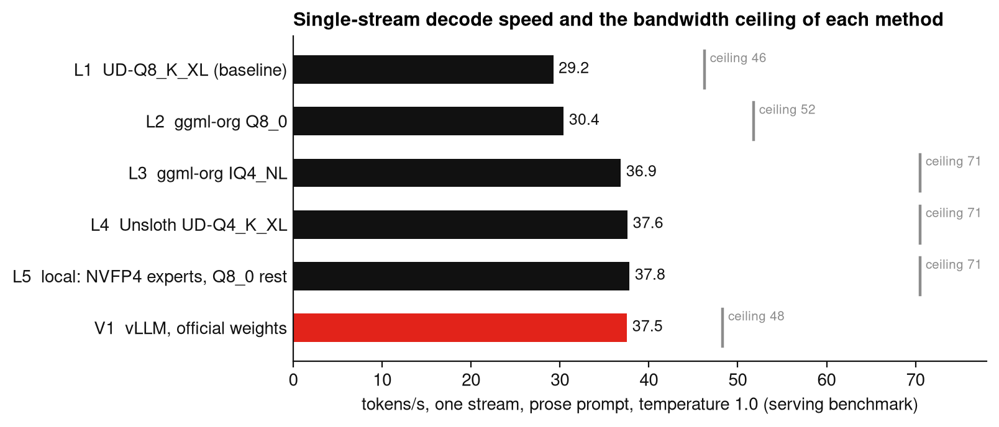
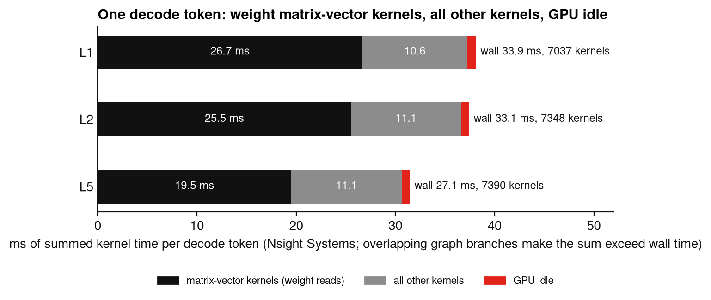
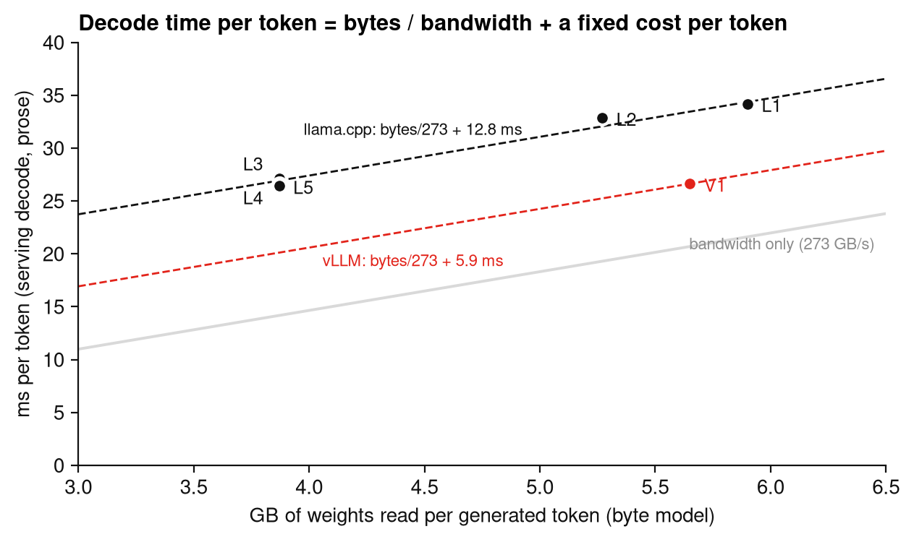
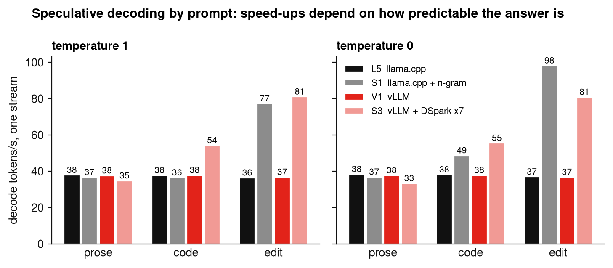
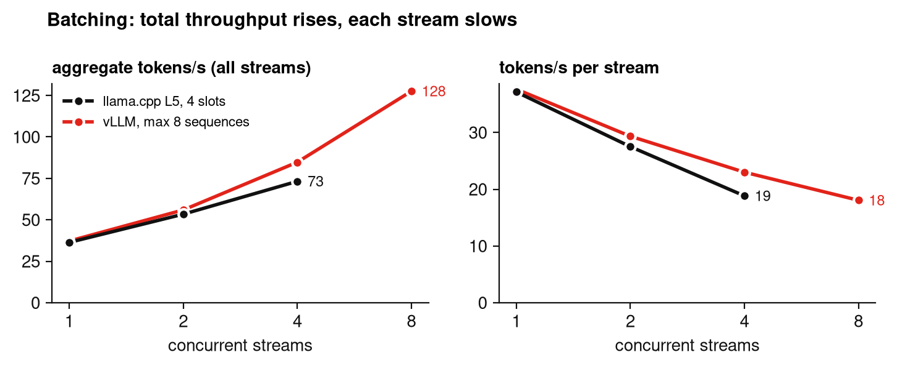
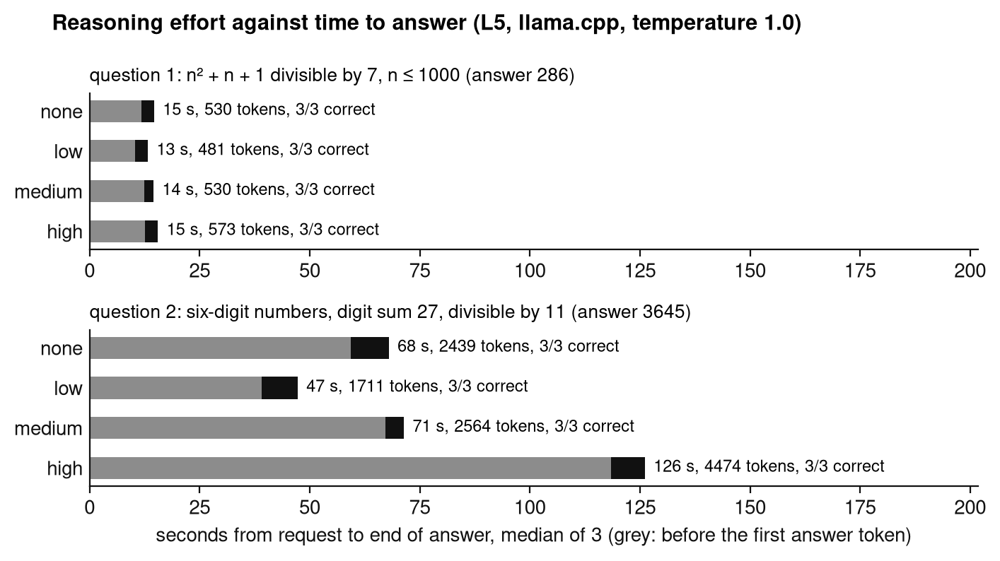

# Inkling 2 Mini on one DGX Spark: Every Inference Method Measured — Files, Runtimes, Speculation and Batching — A Technical Deep Dive

The first report on this project ([[PROJECT REPORT - Inkling 2 Mini on one DGX Spark - llama.cpp, NVFP4 Experts and a Swiss Chat Interface - A Technical Deep Dive]]) ended with a working chat assistant running at 31 tokens per second and a prediction: half of every token's memory traffic was BF16 attention and router weights, so narrowing those weights should make generation faster without touching the vendor's NVFP4 experts. This report tests that prediction and every other practical way of running Inkling 2 Mini on one DGX Spark: five GGUF files, two runtimes, three speculative decoding setups, two batching setups and four reasoning efforts. Each method was measured with the same benchmark on the same machine with all other GPU work stopped, with GPU power and clocks sampled four times per second and one decode token taken apart with NVIDIA's profilers.

> [!summary]
> - **The best llama.cpp file is 29 % faster than the original one at the same perplexity.** Keeping the vendor's NVFP4 experts and narrowing every BF16 tensor to Q8_0 raises decode from 29.2 to 37.8 tokens/s (llama-bench: 30.3 → 39.2); perplexity moves from 6.930 to 6.921, inside one standard error. The file takes nine seconds to make with `llama-quantize`, and Unsloth's `UD-Q4_K_XL` turns out to contain the same recipe.
> - **Decode time per token is bytes divided by 273 GB/s plus a fixed cost.** The fixed cost is about 12 ms per token in llama.cpp and about 6 ms in vLLM. The profiler shows what it is: about 6,500 small kernels per token (norms, scales, additions, activation quantisation), executing on the GPU, not CPU launch overhead.
> - **vLLM decodes no faster than the best llama.cpp file (37.5 vs 37.8 tokens/s), but reads a 38k-token prompt ten times faster** (13.6 s vs 131 s), uses about 25 % less GPU power per token, and reaches 128 tokens/s in total over eight concurrent streams.
> - **Speculative decoding is the only decoding method that changes speed by a factor, and only for predictable answers.** llama.cpp's free n-gram drafting reaches 77–98 tokens/s when the answer repeats the prompt (code edits) and costs 3 % on prose. The model's own DSpark draft in vLLM reaches 54 tokens/s on fresh code and 81 on edits, and costs 8 % on prose. In llama.cpp the DSpark draft does not load.
> - **Reasoning effort is a larger lever than any decoding method on hard questions.** On a counting problem that needs a real argument, effort high wrote 4,474 tokens and took 126 s; effort low wrote 1,711 and took 47 s; all answers were correct at every effort.



## Why this study exists

A day after the model's release, two groups of numbers were circulating for Inkling 2 Mini on the Spark: llama.cpp users reported around 30 tokens/s, vLLM users 39–43 tokens/s single-stream and much faster prompt processing. The numbers came from different prompts, temperatures, token counts and sampling settings (one recipe measured 400 tokens at temperature 0.7 and top-k 20, another 256 forced tokens at temperature 0), so they could not be compared with each other or with llama-bench. The earlier report had also left a specific, testable claim: the downloaded GGUF stored its attention and router weights in BF16, and those weights, read 48 times per token, cost more bandwidth than the 4-bit experts.

The goal was a decision backed by measurements on this machine: which file, runtime and decoding mode to serve the chat interface with, and an explanation of each result precise enough to predict the next one. The work is tracked in the docmgr ticket `INK-001` in the project repository, with a chronological diary of every run, including the failures.

## Current project status

- The repository `/home/manuel/code/wesen/2026-11-21--inkling-small` now serves the L5 file (NVFP4 experts, Q8_0 elsewhere) with n-gram speculation enabled by default (`scripts/02-serve-model.sh`).
- The ticket `ttmp/2026/11/21/INK-001--inkling-2-mini-inference-methods-on-one-dgx-spark-survey-reproduce-and-benchmark/` holds the methods survey (`design-doc/01-…`), the diary (`working-note/01-diary.md`) and fifteen numbered scripts (10–24): benchmark harness, method runners, run queues, telemetry sampler and report, profiler driver, per-token trace analysis, the figure generator and the HTML report builder.
- Raw results live outside the repository in `~/data/inkling/bench/<method>/` (one directory per method, with per-request JSON), `~/data/inkling/profile/<file>/` (Nsight traces) and `~/data/inkling/telemetry/ink001.csv` (about 100,000 rows of 4 Hz samples, seven hours).

## Three speeds, not one

"Faster" has three separate meanings for a chat model, and the methods in this study affect them differently.

- **Decode speed** is the rate at which the answer streams, in tokens per second. llama-bench reports it as `tg128` (generate 128 tokens). Each generated token requires one forward pass over the whole model, and that pass must read every weight it uses from memory once. On the Spark, memory bandwidth (about 273 GB/s) bounds this rate.
- **Prompt processing speed** (prefill) is the rate at which the model reads the prompt; llama-bench reports it as `pp512` and `pp4096`. All prompt tokens of a batch share each weight read, so prefill is limited by arithmetic and kernel quality, not bytes. It decides the time to first token for long prompts, images and long conversations.
- **Time to answer** is the wall time from sending the request to the end of the answer: prefill time plus (reasoning tokens + answer tokens) divided by decode speed. For a reasoning model, the number of reasoning tokens can dominate it.

A method can win on one speed and lose on another. Batching raises total throughput and lowers each stream's speed. Speculative decoding raises decode speed only when its guesses are accepted. A smaller file raises decode speed but could lower answer quality.

## Where the time of one token goes

### Bytes read per generated token

Inkling 2 Mini has 24 stored transformer layers, and layers 6 to 17 run three times per token, so one token makes 48 layer passes. Each layer has a dense part (attention, router, loop controllers, short convolutions: about 30.0M parameters) and 128 experts of which 8 are active (7.96M parameters each). The official checkpoint stores the experts of layers 0–19 in NVFP4 (4-bit values with an 8-bit scale per 16 values), the experts of layers 20–23 in MXFP8, and everything else in BF16. The output projection (201,024 × 2304) is read once per token.

| Component | Count per token | Parameters | BF16 | Q8_0 (8.5 bits) | NVFP4 / IQ4_NL (≈4.5 bits) |
|---|---|---|---|---|---|
| Dense part of a layer pass | 48 | 30.0M | 2.88 GB | 1.53 GB | 0.81 GB |
| 8 experts, layers 0–19 | 44 | 63.7M | 5.61 GB | 2.98 GB | 1.58 GB |
| 8 experts, layers 20–23 | 4 | 63.7M | 0.51 GB | 0.27 GB | 0.14 GB |
| Output projection | 1 | 463M | 0.93 GB | 0.49 GB | 0.26 GB |

Adding the rows for a given file gives its bytes per token, and 273 GB/s divided by that number gives its decode ceiling: the speed it would reach if nothing but weight reads took time. The baseline file (Unsloth `UD-Q8_K_XL`) keeps NVFP4 experts in layers 0–19 and stores the rest in BF16, so it reads 1.58 (NVFP4 experts) + 0.51 (BF16 experts of layers 20–23) + 2.88 (BF16 dense) + 0.93 (BF16 output) = 5.90 GB, a ceiling of 46 tokens/s. The dense BF16 weights alone are 2.88 GB of that, more than the 1.58 GB of NVFP4 experts.

### Testing the byte count with a profiler

A count from a parameter table can be wrong in ways that matter: the KV cache, activations and the four global-attention layers are not in it. Nsight Compute can count the bytes the GPU actually moves. GB10 has no `dram__*` counters (its memory is LPDDR5x shared with the CPU, reached through the L2 cache as system memory), so the counter used is `lts__d_sectors_fill_sysmem`, the number of 32-byte sectors the L2 cache filled from system memory. Summed over every kernel of one decode token:

| File | Kernels in one token | Bytes from memory (ncu) | Byte model | Ratio |
|---|---|---|---|---|
| L1 baseline | 7,131 | 6.03 GB | 5.90 GB | 1.02 |
| L2 Q8_0 everywhere | 7,396 | 5.66 GB | 5.27 GB | 1.07 |
| L5 NVFP4 experts, Q8_0 rest | 7,484 | 4.14 GB | 3.87 GB | 1.07 |

The model is within 2–7 %. The excess is the KV cache, the activations, and re-reads caused by Nsight Compute flushing the caches between kernels, so these numbers are upper bounds.

### The fixed cost per token

If bytes were the only cost, the baseline would run at 46 tokens/s; it runs at 30. The measurements across files fit a two-term model:

```text
time per token  ≈  bytes per token / 273 GB/s  +  fixed time per token
L1:  33.0 ms  =  5.90 GB / 273 GB/s (21.6 ms)  +  11.4 ms      (llama-bench tg128)
L5:  25.5 ms  =  3.87 GB / 273 GB/s (14.2 ms)  +  11.3 ms
```

The difference between the two files, 7.5 ms, is almost exactly the 2.03 GB difference in bytes at full bandwidth (7.4 ms), so the bandwidth term behaves as predicted. The question is what the fixed 11–12 ms consists of. A common answer is CPU launch overhead: llama.cpp launching thousands of small kernels, one after another, with the GPU waiting between them. Two observations rule that out. llama.cpp uses CUDA graphs during decode (its debug output reports `CUDA Graph id 24 reused`), which submit the whole token's kernels in one call. And Nsight Systems, tracing 32 decode tokens with the graph nodes expanded, shows that the GPU is almost never idle:



| File | Wall time per token | Kernels | GPU busy (union of kernel intervals) | GPU idle | Kernels under 5 µs | Their summed time |
|---|---|---|---|---|---|---|
| L1 | 33.9 ms | 7,037 | 33.1 ms | 0.8 ms | 6,404 | 11.4 ms |
| L2 | 33.1 ms | 7,348 | 32.3 ms | 0.8 ms | 6,628 | 11.3 ms |
| L5 | 27.1 ms | 7,390 | 26.3 ms | 0.8 ms | 6,771 | 11.7 ms |

The GPU is idle for 0.8 ms of each token, about 3 %. The fixed cost is GPU execution: in every file, about 6,500 kernels that each run for less than 5 µs (RMS norms, scales, element-wise additions and multiplications, concatenations, and the `quantize_q8_1` step that converts activations to 8-bit before each quantised matrix product) add up to 11.3–11.7 ms. Each of these kernels touches a 2304-element vector; its duration is set by the minimum time any kernel takes to start, run one wave of thread blocks and finish, not by the work inside it. The matrix-vector products that read the weights account for the rest: 19.5 ms per token in L5, reading at about 200 GB/s each (75 % of peak).

This explains why kernel fusion matters on this model and this machine. The model's 48 passes per token multiply the per-layer operation count, so a per-operation cost of a few microseconds becomes 34–43 % of every token. CUDA graphs remove the CPU from the loop, but they do not remove the kernels; only fusing several small operations into one kernel does. vLLM's compiled graph does exactly that (its log lists the enabled fusions `norm_quant` and `act_quant`), and the measurements below show its fixed cost at about half of llama.cpp's.

One correction from the timing work itself: summing kernel durations gives more GPU time than wall time (30.8 ms of kernels in a 27.1 ms token for L5), because a CUDA graph launches independent nodes concurrently and their intervals overlap. The busy time above is the union of the kernel intervals, not their sum.

## The methods

Each method has an identifier used in the scripts, the result directories and the diary.

| ID | Group | What it is |
|---|---|---|
| L1 | File (llama.cpp) | Unsloth `Mainline_Support/UD-Q8_K_XL`: NVFP4 experts 0–19, everything else BF16. The original setup. |
| L2 | File | ggml-org `Q8_0`: every tensor Q8_0, the experts widened from NVFP4. The largest file. |
| L3 | File | ggml-org `IQ4_NL`: experts re-quantised from NVFP4 to IQ4_NL, everything else Q8_0. |
| L4 | File | Unsloth `Mainline_Support/UD-Q4_K_XL`. Read from the file: NVFP4 experts 0–19, everything else Q8_0. |
| L5 | File | L1 re-quantised locally: NVFP4 experts copied unchanged, every BF16 tensor to Q8_0. |
| V1 | Runtime | vLLM (`vllm/vllm-openai:inkling-2-mini`, build `0.1.dev25855`) with the official weights. |
| S1 | Speculation | llama.cpp `--spec-type ngram-mod` on L5: drafts from earlier text in the context. |
| S2 | Speculation | llama.cpp with the model's own DSpark draft (Unsloth's GGUF conversion). |
| S3 | Speculation | vLLM with the DSpark draft, 7 speculative tokens, probabilistic drafting. |
| C1 | Concurrency | llama.cpp L5, `--parallel 4`, 1/2/4 concurrent streams. |
| C2 | Concurrency | vLLM, `--max-num-seqs 8`, 1/2/4/8 concurrent streams. |
| E1 | Reasoning effort | L5, two checkable questions at efforts none, low, medium, high. |

L4 deserves a remark. It was downloaded as the "4-bit K-quant" comparison, but reading its tensor table before running it showed no K-quants at all: the experts are the vendor's NVFP4, the experts of layers 20–23 and every dense tensor are Q8_0. It is the L5 recipe made by Unsloth, so L4 and L5 measure the same configuration twice, from two independent conversions. They agree within 0.6 %.

## How everything was measured

### The machine

One DGX Spark (GB10 GPU, compute capability 12.1, 128 GB LPDDR5x shared by CPU and GPU, about 273 GB/s). The ForeSeek fine-tuning run on the same machine was paused for the whole study, and the chat interface's own server was stopped before each run. Three background containers were stopped for the duration. One CPU-heavy process (`realmd.mjs`, about 115 % CPU for two days) was still running during L1, L2, L4, L5 and most of L3, and was stopped at 19:36 on 2026-11-21; S1, the profiles, the vLLM runs, C1 and E1 ran without it. Its effect on decode is small but not zero: L5 decoded 37.8 tokens/s with it and 38.3 without it (at a different temperature), and L1's `tg128` came out 1.0 tokens/s lower than in a measurement before this study. The runs were not repeated. The queue was also paused for five and a half hours so a colleague could use the GPU.

### Kernel level: llama-bench and perplexity

For each llama.cpp file: `llama-bench -ngl 999 -fa 1 -p 512,4096 -n 128 -d 0,16384 -r 3`, which measures prompt processing at 512 and 4096 tokens and generation of 128 tokens, each at an empty context and at 16,384 tokens of existing context. Quality: `llama-perplexity` on the wikitext-2 test set, 64 chunks of 512 tokens. Perplexity does not capture everything about a model's answers, but a quantisation that damages the model shows up there first.

### Serving level: one harness for every method

Speculative decoding and batching exist only in the servers, and vLLM has no llama-bench, so every method was also measured through its OpenAI-compatible endpoint with one Python script (`scripts/10-bench-serve.py`). It streams each request and records the time to the first token (reasoning included), the completion token count from the server's `usage` field, and the decode rate:

```python
decode_tps = (completion_tokens - 1) / (t_last_chunk - t_first_chunk)
```

Streamed chunks are not tokens (with speculation, one chunk can carry several), which is why the count comes from `usage`. Four prompts, each run three times after one warm-up request:

| Prompt | Content | Answer budget |
|---|---|---|
| prose | explain how an MoE router chooses experts, about 300 words | 512 tokens |
| code | write `merge_intervals` with five pytest tests | 512 tokens |
| edit | 60 lines of the project's `chat/server.py`; return the file with one variable renamed | 2048 tokens |
| long | 38,414 tokens of llama.cpp documentation; one-sentence summary | 64 tokens |

Every prompt starts with a random line (`[run <uuid>]`), because both servers cache prompt prefixes and repeated `long` requests would otherwise measure the cache instead of prefill. Reasoning effort was `low` and temperature 1.0 (the model card's recommendation), with temperature 0 as a second setting for the speculative methods. Acceptance rates come from llama-server's per-request `timings` and from vLLM's Prometheus counters, read before and after each request.

### Hardware telemetry

`scripts/15-telemetry.py` ran for the whole study. It keeps one `nvidia-smi --query-gpu=… -lms=250` process open (GPU utilisation, SM clock, averaged and instantaneous power, temperature, the active clock-event reasons and the cumulative software-power-cap counter) and, at every sample, reads `/proc/stat`, `/proc/meminfo` and the seven ACPI thermal zones. GB10 reports no memory clock, memory bandwidth or memory use through `nvidia-smi`. The harness records wall-clock timestamps for every request, and `scripts/16-telemetry-report.py` averages the samples inside each request's decode window. Power is the GPU rail only, so joules per token below are GPU joules, not wall-socket joules.

## Results

### The file: narrow the BF16 tensors, keep the experts

| Method | Size | pp512 | pp4096 | tg128 | tg128 @16k | Perplexity | Serving decode (prose) | Long-prompt TTFT |
|---|---|---|---|---|---|---|---|---|
| L1 UD-Q8_K_XL (BF16 dense) | 21.3 GiB | 814 | 566 | 30.3 | 27.2 | 6.930 | 29.2 | 135 s |
| L2 Q8_0 everywhere | 25.9 GiB | 726 | 525 | 31.6 | 28.2 | 6.896 | 30.4 | 146 s |
| L3 IQ4_NL experts | 16.4 GiB | 827 | 568 | 38.3 | 33.7 | 6.921 | 36.9 | 133 s |
| L4 Unsloth UD-Q4_K_XL | 16.4 GiB | 848 | 586 | 39.0 | 34.1 | 6.915 | 37.6 | 131 s |
| **L5 NVFP4 experts, Q8_0 rest** | 16.4 GiB | 843 | 583 | **39.2** | **34.4** | 6.921 | **37.8** | 131 s |

All perplexities lie within 0.04 of each other with a standard error of 0.133, so no file is measurably worse than another. The speeds sort by bytes per token, as the model predicts:

- **L2 is the largest file and barely faster than the baseline.** It reads 5.27 GB per token: its experts are twice as wide as NVFP4, but its dense part is half the width of BF16. The two-term model predicted 32.6 tokens/s before the run; llama-bench measured 31.6.
- **L3, L4 and L5 read the same 3.87 GB per token and run at the same speed.** L3's IQ4_NL experts are about 2 % slower than L5's NVFP4 experts in llama.cpp's kernels; the prediction for L3 was about 39, the measurement 38.3.
- **Prompt processing hardly depends on the file** (726–848 tokens/s at 512 tokens), because prefill is limited by arithmetic and attention, not by weight bytes. At 16k tokens of context every file drops to about 300–320 tokens/s.

The L5 file is made in nine seconds from the L1 file. `llama-quantize` converts a tensor only when its target type differs from its current type (`bool quantize = cur_type != new_type;` in `src/llama-quant.cpp`), and it matches per-tensor overrides with `std::regex_search`. Overriding the 40 NVFP4 expert tensors to NVFP4 therefore copies them unchanged, while the global target Q8_0 applies to everything else:

```bash
llama-quantize --tensor-type 'blk\.([0-9]|1[0-9])\.ffn_(gate_up|down)_exps=nvfp4' \
    Inkling-2-Mini-UD-Q8_K_XL.gguf Inkling-2-Mini-L5-NVFP4exp-Q8_0.gguf Q8_0 $(nproc)
```

Without the override, the experts would be widened from NVFP4 to Q8_0 and the file would become L2.

### The two runtimes on one plot



The plot puts every file and vLLM on the axes of the two-term model, using the serving benchmark's decode rate for all six points so that they are measured the same way. With the slope fixed at 1/273 GB/s, the llama.cpp files lie within 0.7 ms of one line whose fitted intercept is 12.8 ms (11.4 ms in llama-bench, which excludes the server). vLLM reads 5.65 GB per token with the official weights (BF16 dense, NVFP4 and MXFP8 experts) and takes 26.6 ms, which leaves 5.9 ms of fixed time: half of llama.cpp's. vLLM gets the same speed as L5 with 46 % more bytes per token, because its per-token overhead is smaller.

The plot also shows what neither runtime offers today: the L5 file's 3.87 GB per token with vLLM's 5.9 ms of overhead would take about 20 ms per token, about 50 tokens/s. That requires either vLLM loading Q8_0 dense weights or llama.cpp fusing its small kernels.

### vLLM: the same decode, ten times the prefill

| | llama.cpp L5 | vLLM V1 |
|---|---|---|
| Decode, prose / code / edit (tokens/s) | 37.8 / 37.7 / 36.3 | 37.5 / 37.7 / 36.7 |
| Time to first token, 38,409-token prompt | 130.6 s | 13.6 s |
| Prefill rate on that prompt | 294 tokens/s | 2,832 tokens/s |
| Decode after that prompt | 30.3 tokens/s | 31.1 tokens/s |
| GPU power while decoding | 30.8 W | 22.5–24.8 W |
| GPU energy per token | 0.80 J | 0.60–0.66 J |
| Memory in use | 32 GB | 87 GB (70 % reservation; 241,313 KV-cache tokens) |
| Start-up time | about 20 s | 208–228 s (103 s of it loading weights) |

The decode speeds are identical within 1 %. vLLM's advantage is prefill, ten times faster on a 38k-token prompt, which decides the wait before the first token of a long conversation, a pasted document or an image. The published 3,150 tokens/s at 32k was reproduced within 10 %. vLLM's published single-stream decode of 39–43 tokens/s was not: this machine measured 37.5–37.7, which is within 5 % of the lower published figure; the published runs used shorter answers and different sampling.

vLLM decodes at the same speed with about 25 % less GPU power, although it moves more bytes per token. The SM clock is the same in both (2,411 MHz), so the difference is in what the SMs do; the telemetry cannot separate it further. The likely cause is the 6,500 small kernels per token in llama.cpp, each of which occupies the GPU without moving much data, against fewer, fused kernels in vLLM. A profile of vLLM would test this; it was not taken. vLLM's costs are memory (it reserves 70 % of the 121 GiB at start-up, most of it as KV cache) and start-up time (almost four minutes, two of them loading the 18 GiB checkpoint). The first request of a new shape can also take several extra seconds: the log reports `Triton kernel JIT compilation during inference: _rel_attention_kernel`, and some first requests waited 1.7–7.7 s for their first token.

### Speculative decoding

Speculative decoding guesses several tokens cheaply, then has the full model check all of them in one forward pass. Checking k tokens costs about as much bandwidth as generating one, because the weights are read once for the whole batch of k positions. Every accepted guess is a token that did not need its own pass over the weights; every rejected guess is wasted work. With the standard acceptance rule the output distribution is the same as without speculation, so speculation changes speed, not answers.



| Method | Prompt | T = 1.0 tokens/s | accepted | T = 0 tokens/s | accepted |
|---|---|---|---|---|---|
| S1 llama.cpp + n-gram | prose | 36.6 | 4 % | 36.8 | 21 % |
| | code | 36.4 | 6 % | 48.6 | 53 % |
| | edit | 77.3 | 80 % | 98.2 | 80 % |
| S3 vLLM + DSpark ×7 | prose | 34.7 | 15 % | 33.2 | 14 % |
| | code | 54.2 | 36 % | 55.5 | 36 % |
| | edit | 81.0 | 56 % | 80.8 | 58 % |

The two drafts behave differently because they guess from different information.

- **n-gram drafting (S1)** looks up the last few tokens in a hash of the text already in the context and proposes whatever followed them there. It costs nothing to run and needs no extra model. When the answer copies the prompt, as in the edit task, it proposes runs of 50 tokens at a time (`draft acceptance = 0.80246 (719 accepted / 896 generated), mean len = 52.36`) and doubles the speed. When the answer is new text, it rarely finds a match and costs about 3 %. At temperature 0 the code answer becomes repetitive enough for 53 % acceptance.
- **The DSpark draft (S3)** is a three-layer transformer shipped with the model (`mtp.safetensors`) that reads hidden states from target passes 5, 23, 41 and 48 and proposes a block of tokens. It predicts new text, so it helps on fresh code even at temperature 1.0 (+44 %), and it helps less than n-gram on the copy task (81 vs 98 tokens/s at T = 0) because it proposes at most 7 tokens per step. Its own forward pass costs about 8 % on prose, where only 15 % of its guesses are accepted. The published acceptance rates of 16–26 % are close to the 14–15 % measured here on prose.

**S2, the DSpark draft in llama.cpp, does not load.** Unsloth's conversion of the draft (`dspark-Inkling-2-Mini-Q8_0.gguf`) stores the draft's Markov head at the padded vocabulary size, and llama.cpp expects the unpadded one:

```text
E llama_model_load: error loading model: check_tensor_dims: tensor 'markov_w1.weight' has wrong shape;
  expected 256, 200058, got 256, 201024, 1, 1
```

The model's vocabulary has 200,058 real tokens, padded to 201,024 in the embedding and output matrices. llama.cpp sizes the head from `dflash.vocab_size_unpadded`; the converter wrote the padded matrix. Either side could be changed (slice the matrix in the converter, or accept the padded size in the loader); this study recorded the failure and did not patch either.

### Concurrency



| Streams | llama.cpp L5 aggregate / per stream | vLLM aggregate / per stream | vLLM GPU energy per token |
|---|---|---|---|
| 1 | 36.4 / 37.1 | 37.2 / 37.6 | 0.65 J |
| 2 | 53.4 / 27.5 | 56.0 / 29.3 | 0.42 J |
| 4 | 73.2 / 18.8 | 84.8 / 23.0 | 0.28 J |
| 8 | — | 127.6 / 18.1 | 0.18 J |

Batching reads each weight once for several streams, so total throughput rises. For a mixture-of-experts model the gain is sub-linear: different streams choose different experts, and the union of experts read per step grows with the batch. Four streams give 2.0× (llama.cpp) and 2.3× (vLLM) the single-stream throughput, eight streams 3.4× in vLLM. GPU power hardly changes with the batch (24.7 W at one stream, 25.9 W at eight), so energy per token falls in proportion to throughput. For one person chatting, concurrency is irrelevant; for several users or agents sharing the Spark, vLLM at eight streams delivers 128 tokens/s, and llama.cpp at four slots delivers 73.

### Reasoning effort

The model's chat template accepts a reasoning effort between 0 and 0.99 (names: `none` 0.0, `low` 0.2, `medium` 0.7, `high` 0.9) and writes it into a system message, `Thinking effort level: 0.9`; without the setting it defaults to 0.9. A verbose llama-server log confirmed that the request field `chat_template_kwargs.reasoning_effort` reaches the prompt. Effort does not change the decode rate; it changes how many tokens the model writes before answering. E1 measured that on the L5 file with two questions whose answers can be checked automatically (the reply must end with `ANSWER: <number>`), three runs per effort at temperature 1.0.



| Effort | Question 1: time / tokens / correct | Question 2: time / tokens / correct |
|---|---|---|
| none | 14.6 s / 530 / 3 of 3 | 67.9 s / 2,439 / 3 of 3 |
| low | 13.2 s / 481 / 3 of 3 | 47.2 s / 1,711 / 3 of 3 |
| medium | 14.5 s / 530 / 3 of 3 | 71.4 s / 2,564 / 3 of 3 |
| high | 15.5 s / 573 / 3 of 3 | 126.1 s / 4,474 / 3 of 3 |

Question 1 asks how many n ≤ 1000 make n² + n + 1 divisible by 7 (286). It is easy enough that the model reasons about 500 tokens at every effort, and the differences between efforts are smaller than the differences between runs (439–574 tokens at effort low, 474–866 at effort high). Question 2 asks how many six-digit numbers have digit sum 27 and are divisible by 11 (3645). It requires an argument: the digit sum is odd, so the alternating digit sums must differ by exactly 11, and the two cases 19/8 and 8/19 have to be counted with digit bounds. Here effort matters: high wrote 4,474 tokens where low wrote 1,711, and took 2.7 times as long. It was not more often correct, and the order is not monotonic: effort none reasoned longer than low.

All 24 answers were correct, so this small sample shows no quality cost at low effort, and it cannot show a quality gain at high effort either. What it shows is the size of the lever. Decode ran at 35.6–37.9 tokens/s throughout (slightly slower for the longest answers, because attention reads a longer KV cache), so time to answer is the token count divided by that rate. Going from high to low effort shortened the hard question's answer by 79 seconds. The speculative methods were not run on these questions; on prose, the closest measured workload, they changed decode speed by −3 % (n-gram) and −8 % (DSpark), so no decoding method in this study is likely to save a comparable amount on reasoning text. Even at effort none, the model reasoned for 50–90 seconds on question 2 before writing its answer, as the model card warns: the minimum effort does not disable reasoning.

### Power, clocks and temperature

During single-stream decode the GPU draws 22–35 W, holds its SM clock at 2,400–2,411 MHz (maximum 3,003 MHz), reports 86–96 % utilisation, and never entered the software power cap: the cumulative `clocks_event_reasons_counters.sw_power_cap` counter did not advance during any benchmark window, and no clock-event reason was active. GPU temperature stayed between 48 and 66 °C, the hottest thermal zone between 54 and 79 °C (the higher values from the runs beside the CPU-heavy background process). Decode on this machine is limited by memory traffic and per-kernel time, not by power or heat.

| Method | Prompt | Decode tokens/s | GPU W | GPU J/token |
|---|---|---|---|---|
| L2 | prose | 30.4 | 31.3 | 1.03 |
| L3 | prose | 36.8 | 33.0 | 0.90 |
| L5 (T = 0) | prose | 38.3 | 30.8 | 0.80 |
| S1 | edit | 77.3 | 29.1 | 0.38 |
| V1 | prose | 37.5 | 22.5 | 0.60 |
| S3 | edit | 81.0 | 26.7 | 0.33 |
| C2, 8 streams | prose | 127.6 total | 25.9 | 0.18 |

Speculation and batching both reduce energy per token by about the same factor as they raise throughput, because neither changes the power draw by more than a few watts.

## Recommendation

| Use | Setup | Why |
|---|---|---|
| One person chatting (this project's interface) | llama.cpp, L5 file, `--spec-type ngram-mod` | 37.8 tokens/s, 32 GB, starts in 20 s; doubles on code edits; perplexity unchanged |
| Long documents, images, long conversations | vLLM V1 | 10× faster prefill; same decode |
| Writing new code | vLLM S3 (DSpark ×7) | 54 tokens/s on fresh code, the only method that speeds up non-repetitive text |
| Any reasoning-heavy question where latency matters | effort `low` | 2.7× shorter answers than `high` on the hard test question, with the same correctness in this small sample |
| Several users or agents | vLLM C2 | 128 tokens/s total at 8 streams, 0.18 J per token |

The chat interface's serve script now selects the L5 file if it exists, otherwise Unsloth's `UD-Q4_K_XL` (the same recipe, downloadable), otherwise the original file, and enables n-gram speculation unless `SPEC=` is set empty.

## Failure modes encountered

- **The S2 vocabulary mismatch** described above: the draft converter and the loader disagree about padded and unpadded vocabulary sizes.
- **A file name that does not describe its contents.** `UD-Q4_K_XL` contains no Q4_K tensors and `UD-Q8_K_XL` contains no 8-bit weights; the tensor table, read with `gguf-py` from the llama.cpp tree (the PyPI `gguf` 0.17.1 fails with `40 is not a valid GGMLQuantizationType`, NVFP4's id), is the only reliable description.
- **Summed kernel time exceeding wall time** in the Nsight Systems trace, because CUDA graph branches run concurrently; the busy time is the union of intervals.
- **Stopping a queue of shell scripts.** `pkill` on the waiting parent scripts did not stop a child benchmark that had already started; its server and client had to be stopped by name. The final queue checks a pause file before each stage instead.
- **Profiler bias.** Tracing with graph nodes expanded slowed decode by about 7 % (L5: 36.9 tokens/s under Nsight Systems, 39.2 in llama-bench), and Nsight Compute flushes caches between kernels; the analysis uses ratios between files and byte counts as upper bounds.

## Open questions

- Would vLLM load a checkpoint whose dense weights are FP8 or INT8? That would combine L5's bytes with vLLM's overhead, about 50 tokens/s by the two-term model.
- How much of llama.cpp's 6,500 small kernels per token could be fused for this architecture (norm + quantize, scale + add) without new kernels per model?
- Does the n-gram draft combine with the DSpark draft in vLLM, or with batching, without losing the gains of either?
- Does the DSpark draft load in llama.cpp once its Markov head is sliced to 200,058 rows?

## Near-term next steps

- Report the S2 vocabulary mismatch upstream with the exact error.
- Re-run L1–L5 on a fully idle machine if the 1–3 % background effect ever matters for a decision.
- Try vLLM with the n-gram speculator (`"method": "ngram"`) on the edit prompt.

## Reproducing

```bash
cd /home/manuel/code/wesen/2026-11-21--inkling-small/ttmp/2026/11/21/INK-001-*/scripts
bash 13-make-l5-requant.sh                                     # L5 file, 9 s
METHOD=L5 MODEL=~/data/inkling/models/local/Inkling-2-Mini-L5-NVFP4exp-Q8_0.gguf bash 11-run-llama-method.sh
METHOD=V1 bash 12-run-vllm-method.sh                           # vLLM, official weights
METHOD=S3 SPEC=dspark7 bash 12-run-vllm-method.sh              # vLLM + DSpark
TAG=L5 MODEL=… bash 17-profile-decode.sh                       # nsys + ncu of one decode token
python3 20-nsys-token-breakdown.py ~/data/inkling/profile/L5/trace_cuda_gpu_trace.csv
python3 16-telemetry-report.py --telemetry ~/data/inkling/telemetry/ink001.csv --bench ~/data/inkling/bench
uv run --with matplotlib python 22-make-figures.py --out <dir>
```

## Project working rule

Predict before measuring. Every file method in this study had a predicted decode speed written into the diary before its run, from the byte count and the two-term model; the predictions were within 3 %. When a measurement disagrees with the prediction, the disagreement is the finding, and the next step is a profiler, not another benchmark.
