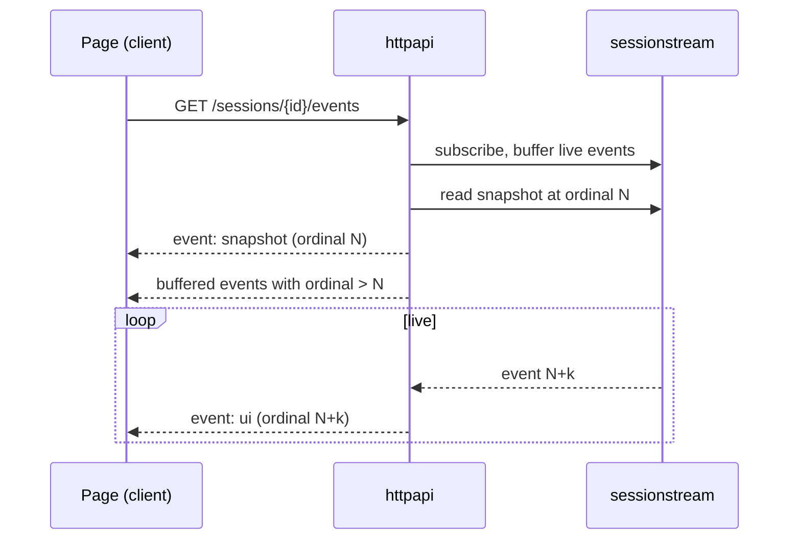
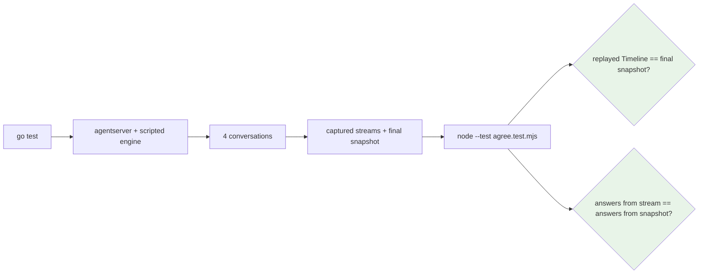

# One chatapp stack

Three applications run LLM agents on pinocchio. pinocchio is a Go library and CLI for model calls and tool loops; its `pkg/chatapp` package serves agent conversations over HTTP. slop-computer is an app platform whose pages get an `agent` capability. homolog-bench is a bioinformatics workbench whose agent writes JavaScript that runs in a server-side room. Until this work, the three had one server library in common and four separate clients that each turned the server's events into a conversation on screen. Each client had its own bugs, and some of those bugs could not be fixed in the client at all, because the server never sent the facts the client needed.

This report explains how the three applications came to share one stack: one server package, one record of every answer, and one browser client that ships inside the Go module and is tested against the server it talks to. It covers the design principle behind the change, the five implementation phases, the tests that hold each part in place, and the mistakes made along the way.

> [!summary]
> - **An answer is a record.** Model, start and end times, token usage, the number of model calls, and the times of every thinking block and tool call are now part of the server's timeline. A snapshot alone rebuilds everything a page shows, so reloads, second tabs and reconnects show the same answer as a page that watched it stream.
> - **One browser client.** `pkg/chatapp/webclient` is a pure reducer (`Timeline`) plus an I/O layer (`Session`). Its built bundle is embedded in the Go module and served at `{prefix}/client.js`, so a page cannot run a client from a different version than its server.
> - **The client is tested against the server.** A Go test runs real conversations, captures the event streams, and replays them in Node. The client must reproduce the server's final snapshot exactly. A one-line change to the reducer fails 9 of the 17 checks.
> - **The applications supply content, and chatapp supplies the mechanism.** homolog-bench's eval tool, room instructions, room context and person waits are now four hooks on `agentserver`. slop-computer's server and page dropped their own copies of the same code.

## Why this project exists

The trigger was a round of bug reviews on homolog-bench's agent view. The bugs had a common shape. The page reconstructed facts that the server either did not have or did not send, and every reconstruction failed in some situation:

- A page opened while an answer was running missed everything before that moment. Its stream started after the current sequence number, and the snapshot only held finished turns. The page recovered the text from an accumulated field on the next text delta (`catchUp`) and showed a note saying that thinking and tool calls would appear later.
- Footer data was page-only: the answer's duration, its token usage, the number of model calls, and each thinking block's duration. After each run the page reloaded the conversation from the server, then copied the page-only fields onto the new objects by position (`turnsOf`, `carry`). A reload or a second tab lost them for every answer.
- A failed or stopped answer that produced no text left no trace on the server. The page re-inserted its own error note on every rebuild, and a reload lost it.

The analysis that followed (homolog-bench ticket HB-006, design-doc 02) wrote these down as a contract of six requirements, R1 to R6, that any replacement for the agent service had to meet. In parallel, pinocchio and slop-computer had moved their agent features onto `pkg/chatapp`. So there were two possible directions: homolog-bench could import slop-computer's client, or all three applications could share code that lives in pinocchio. The user chose the second: everything lives in pinocchio, and homolog-bench does not import slop-computer.

## The starting point: one library, four clients

| Client | Where | How it builds a conversation |
|---|---|---|
| Projections (Go) | `pinocchio/pkg/chatapp/projections.go`, `plugins/` | The server's own reducer: events become timeline entities. |
| react-chat | pinocchio's web chat (`chat-provider`) | A Redux store over a WebSocket, with its own `runStatsSlice` for usage. |
| slop's `agent.ts` | `slop-computer/web/runtime/src/agent.ts` | A single-path reducer over SSE, with a tool outbox. |
| homolog's `agent.js` | `homolog-workbench/web/js/agent.js` | agentd's event vocabulary, rebuilt from the session view after every run. |

The first row is the reference: it defines what the conversation *is*. The other three are re-implementations of it in a different language, each with its own understanding of the event names and payload fields. Nothing tested that any of them agreed with the first.

## The model underneath: events, ordinals, entities and snapshots

chatapp is built on sessionstream, an event-sourcing library. Its vocabulary is precise, and the rest of this report depends on it.

An **event** is a fact the backend published about a session: `ChatRunStarted`, `ChatTextPatch`, `ChatToolResultReady`. Every event of a session gets an **ordinal**, a number that increases by one per event, so ordinals totally order a session's history. A **projection** is a function from events to **timeline entities**. An entity has a kind (`ChatMessage`, `ChatRun`, `ChatToolCall`, `ChatToolResult`, `ChatFrontendToolCall`), an id, the ordinal of the event that created it, and a payload. A **snapshot** is the set of a session's entities at an ordinal. A **UI event** is an event as a client receives it: `{sessionId, ordinal, name, payload}`.

The HTTP API sends a session's events as a server-sent event stream. Every connection starts with a snapshot and then sends UI events in ordinal order:

```text
event: snapshot
data: {"sessionId":"d7fb…","snapshotOrdinal":"41","entities":[…]}

event: ui
data: {"sessionId":"d7fb…","ordinal":"42","name":"ChatTextPatch","payload":{…}}
```

There is no resume cursor. A client that reconnects gets a new snapshot, so it cannot silently skip events. A subscriber that falls behind receives `event: error` with code `stream_overflow` and the stream is closed; the client reconnects and starts from a snapshot again.



Entity ids connect the pieces of an answer. A message the person sends is accepted as `<run>-user`. The run's text segments are `<run>:text:<segment>`, its thinking segments `<run>:thinking:<segment>`. A server-side tool call's entities carry `messageId = <run>`; a browser tool call carries `parentMessageId = <run>`. A tool result is `<call>:result`. With these ids, a client can group entities into questions and answers without relying on their position in a list.

## The principle: the server stores every fact a page shows

The design rests on one rule: if a page shows a fact, the server has it in the timeline. The rule follows from the bug list. Each workaround existed because a fact was only in one browser tab's memory. Once the fact is an entity field, a snapshot carries it, and every way of arriving at a conversation (watching it stream, reloading, opening a second tab, reconnecting) goes through the same code: apply a snapshot, then apply events.

Four further decisions shaped the implementation:

- **D1: the client lives in pinocchio.** It is the same package as the projections it mirrors, and it changes in the same commit.
- **D2: the transport is SSE.** It is what slop-computer and homolog-bench already used, and the HTTP API already served it.
- **D3: the client's reducer mirrors the Go projections, and a test checks that they agree.** Streaming the entities themselves instead of events was considered and deferred.
- **D4: times are carried in events.** An event is stamped with the time when it is published. Projections copy the times and never read a clock.

D4 needs a word of explanation. A projection runs again whenever the timeline is rebuilt from the event log. If it read the current time, a rebuilt timeline would carry different times than the original. Stamping at publication makes the timeline a pure function of the log.

## Phase 1: an answer is a record

The first phase added the facts to the protocol and to the entities (pinocchio commit `db9cc10a`).

The protobuf messages gained time fields. User-accepted, text and reasoning segment start/patch/finish, tool execution start, result ready, call finished, and the frontend-tool request/receive events all gained `at_ms`. `ChatRunStarted` gained `started_at_ms` and `model`, and the run's end events gained `finished_at_ms`. The entities gained the matching fields: `ChatRunEntity` has `model`, `started_at_ms`, `finished_at_ms`, `usage` and `provider_calls`; messages and tool calls have start and finish times; a tool call has a `state`.

The stamping is one function. It sets every unset time field of a message from the server's clock through protobuf reflection, so a new event type with an `at_ms` field is stamped without further code:

```go
// pkg/chatapp/stamp.go
func Stamped(pub sessionstream.EventPublisher) sessionstream.EventPublisher // stamps every event it publishes
func StampTimes(msg proto.Message, now time.Time)                          // at_ms, started_at_ms, finished_at_ms if 0
```

The inference handler wraps its publisher (`pub = Stamped(pub)`), and so do the frontend-tool handlers.

Usage attribution needed a fix of its own. `ChatProviderCallFinished`, the event that reports one model call's tokens, was published with an empty correlation, so no client could tell which answer the tokens belonged to. The event now carries the run's `messageId`, and the run projection sums usage and counts calls:

```go
case EventChatProviderCallFinished:
    run := runEntity(p.MessageId)
    run.Usage = AddUsage(run.Usage, p.Usage)
    run.ProviderCalls++
```

A new event, `ChatToolCallProgress{message_id, tool_call_id, state, limit_ms, at_ms}`, sets the tool call entity's `state`. Its first user is the person wait of Phase 2: `state: "awaiting-person"` while a person decides, cleared when the call finishes.

This is a finished run as homolog-bench's server test reads it from a snapshot:

```json
{
  "kind": "ChatRun",
  "id": "chat-msg-3859a43c-…",
  "payload": {
    "messageId": "chat-msg-3859a43c-…",
    "model": "fake:scripted",
    "status": "finished",
    "startedAtMs": "1795399010120",
    "finishedAtMs": "1795399010136",
    "providerCalls": 2,
    "usage": { "inputTokens": 3718, "outputTokens": 20 }
  }
}
```

The `*AtMs` values are strings because protojson encodes int64 that way. Both the Go code and the client treat them as numbers after parsing.

The test for this phase, `TestAnAnswerIsARecordInTheSnapshot`, runs the scripted engine with the prompt `/think plan the call -- /tool noop {}` and checks the model, the times, the usage and the provider-call count in the snapshot. The scripted engine gained `/think THOUGHT -- REST` for this test: it streams THOUGHT as reasoning, then runs REST as the script.

## Phase 2: hooks for the program that embeds the server

homolog-bench and slop-computer each embed chatapp's server and add something only they know. Before this phase, they did it by copying code out of `agentserver`. Phase 2 (commit `a42c4a26`) turned those copies into options.

| Hook | What it does | Replaces |
|---|---|---|
| `httpapi.WithStateDir(dir)` | Opens the three SQLite stores (sessions, turns, timeline) under one directory | slop's `openStores` |
| `httpapi.ContextField(maxBytes)` | A message's `context` field becomes a user block after the message | slop's `contextBlocks` |
| `httpapi.Coded(code, msg)` | An error with an API code | slop's `codedError` |
| `agentserver.WithSessionInstructions(fn)` | Text added to the preset's system prompt, set once when the session is created | agentd's `Instructions` hook |
| `agentserver.WithMessageContext(fn)` | Text added after every message | agentd's `Context` hook |
| `(*agentserver.Server).Session(ctx)` | The session of the run a tool is called in | agentd's `*Session` argument |
| `toolexec.AwaitPerson(ctx)` | The call waits for a person: the person limit applies | agentd's `SetCallState` |

Session instructions are written into the session's data under `serverInstructions` when the session is created, and the create hook always rewrites that key. A page can send its own instructions (`data.instructions`, for presets that allow it), but it cannot set or overwrite the program's. The system prompt is then the preset's prompt, the program's instructions, and the page's instructions, in that order.

Message context exists because the conversation is append-only. The model sees the whole history on every call, and nothing can be removed from it. A program that wants the model to know the current state of something (homolog-bench's room: which engine is active, which pages are open, the agent's mode) adds it after each message.

`Session(ctx)` needed a way to get the run into a tool's context. chatapp already had `WithRunTools`, a function that may change the context and tools of each run. agentserver installs one that stores the run's scope (session id, message id, publisher) in the context:

```go
func keepRun(ctx context.Context, scope chatapp.RunScope, tools chatapp.RunTools) (context.Context, chatapp.RunTools, error) {
    return context.WithValue(ctx, runKey{}, scope), tools, nil
}
```

`Session(ctx)` reads the scope and loads the session from the store. The same scope gives the tool-progress events their publisher.

### Person waits

homolog-bench's agent can start work that a person must approve first, such as tool runs on the real engine. The eval call then waits, possibly for minutes, while the tool limit is two minutes. agentd solved this with `SetCallState(callID, state)`: while the state is `awaiting-person`, the call runs under the person limit, and when the state changes back the full tool limit starts again.

The chatapp version is a deadline middleware with a person limit:

```go
deadline := toolexec.DeadlineBy(toolLimit, timeoutMessage,
    toolexec.WithPersonLimit(personLimit),  // the preset's personTimeout
    toolexec.OnState(publishToolState))     // → ChatToolCallProgress

// inside a tool:
release := toolexec.AwaitPerson(ctx)  // timer reset to the person limit; OnState("awaiting-person")
defer release()                       // timer reset to the tool limit;   OnState("running")
```

`DeadlineBy` puts a call control into the context: a `time.AfterFunc` timer and a `context.WithCancelCause`. `AwaitPerson` resets the timer to the person limit. Waits nest: a counter keeps the person limit until the last wait is released. Without a deadline in the context, `AwaitPerson` does nothing, so a tool can call it unconditionally. When the timer fires, the call is cancelled with the timeout message as its cause, and the model receives that message as the tool's error.

## Phase 3: one browser client

Phase 3 (commit `75780996`) wrote the client: `pkg/chatapp/webclient`, in TypeScript, built by esbuild 0.25.12 into one ES module of 26 KB. It has two layers, and the split matters for testing.

**`Timeline` is pure.** It holds a copy of the session's entities and changes only through two methods. `reset(snapshot)` replaces the copy; `apply(uiEvent)` reduces one event. An event whose ordinal is not above the copy's current ordinal is ignored: the snapshot already reflects it. The reducer has one case per event name and was written next to the Go code it mirrors (`projections.go`, `plugins/reasoning.go`, `plugins/toolcall.go`, `frontendtools/plugin.go`), including details such as when an empty text-segment start creates no entity, and that patches append unless their mode says replace.

On top of the entities, `answers()` returns the conversation as a list of turns, each `{question, answer}`. An answer collects:

- the run's status, error code, model, start and finish times, usage, and number of model calls;
- its parts in creation order: thinking, text, and tool parts, where one tool part merges a call's `ChatToolCall`, its `ChatToolResult` and, for a browser tool, its `ChatFrontendToolCall`;
- its text: the text parts joined.

```ts
type Answer = {
  id: string; status: 'running' | 'finished' | 'failed' | 'stopped'; code: string; error: string;
  truncated: boolean; reason: string; model: string; startedAt: number; finishedAt: number;
  usage: { input: number; output: number; cachedInput: number }; providerCalls: number;
  parts: Part[]; text: string;
};
type ToolPart = { kind: 'tool'; id: string; name: string; input: unknown; result: unknown; error: string;
  status: string; state: string; where: 'server' | 'browser'; mode: string; executor: unknown;
  startedAt: number; finishedAt: number };
```

**`Session` does the I/O.** It is adapted from slop's `agent.ts`. `create`, `open`, `attach` and `list` give a session object; `on(fn)` reports every change; `send(prompt)` resolves with the run's id from the 202 response; `wait(id)` resolves when that answer ends; `stop`, `delete` and `close` do what they say. The event stream is read from a `fetch` body, not an `EventSource`, so the caller can supply its own `fetch` (slop-computer needs authenticated requests). On a closed or failed stream it reconnects with exponential backoff, capped at 5 s, and the next snapshot resets the copy. `tools(list)` registers browser tools; the session runs the calls the server assigns to this page and keeps each result in an outbox until the server confirms it, retrying network failures and dropping a result the server refuses with a 4xx.

The built file is embedded with `//go:embed chatapp-client.js` and served by every chatapp server at `GET {prefix}/client.js`, with an ETag. A page loads the client from the server it talks to, so the client and the projections it mirrors always come from the same build.

### The agreement test

The claim that the client mirrors the projections is checked on every `go test`. `TestTheClientAgreesWithTheServer` runs real conversations through `agentserver` with the scripted engine:

| Scenario | What it exercises |
|---|---|
| `server-tool-two-answers` | thinking, a server tool, the answer; then a second answer with page context |
| `browser-tool-and-late-attach` | a browser tool's manifest, request and result; a second stream opened after the first text patch, so it starts with a partial snapshot |
| `stopped` | `/sleep 3000`, then `/stop` |
| `failed-quota` | a preset with a token budget of 1 |

The test records every stream's frames and the server's final snapshot into JSON files, then runs `node --test test/` with the directory in `CHATAPP_CAPTURES`. For each stream, `agree.test.mjs` applies the snapshot and the events to a `Timeline` and requires two things. First, the client's copy must equal the server's final snapshot: the same kinds, ids, creation ordinals and payloads. Second, `answers()` computed from the replayed stream must equal `answers()` computed from the final snapshot alone.



The comparison normalizes both sides in the same way, because protojson omits empty values while the client keeps some explicitly (`streaming: false`, `state: ""`). It drops empty strings, `false`, zeros, nulls and empty containers before comparing.

A test that passes on its first run proves little until it has been seen to fail. The bundle was changed by hand to count each provider call twice (`providerCalls + 2`): 9 of the 17 checks failed. After the bundle was restored, `npm run build` reproduced it byte for byte. `make webclient-check` and a CI workflow now enforce both properties: the committed bundle equals a fresh build, and the agreement test passes.

## Phase 4: slop-computer

slop-computer's server moved to the shared helpers in a few lines: `httpapi.WithStateDir(cfg.Dir)`, `httpapi.ContextField(MaxContextBytes)`, `httpapi.Coded`, and `Model: model.Model` on the runtime, so each answer records its model.

The page is a different build: slop bundles its runtime into an IIFE together with its transport and consent code. It therefore copies the client's TypeScript source, not the built bundle. `web/runtime/sync-chatapp.mjs` finds the pinocchio module with `go list -m -f {{.Dir}} github.com/go-go-golems/pinocchio` and copies `pkg/chatapp/webclient/src/*.ts` into `src/chatapp/`. A test, `chatapp-copy.test.ts`, fails while the copy differs from the source of the pinocchio version in `go.mod`. A pinocchio upgrade then forces a re-sync.

slop's `agent.ts` kept its public API: open a session by key, `send()` with its result shape, consent before the first message, and an abort at any stage. Its private stream, reducer and outbox were replaced by the shared `Session`. slop needed one addition to the client, `Session.attach(base, info)`: slop lists or creates the session itself, so it needs a session object without fetching the session a second time.

Of slop's 11 agent tests, two failed after the switch. Both concerned the scripted server in the test fixture. After sending a snapshot at ordinal 30, it continued with event ordinals 6, 7, 8. The real server never does this. The old `agent.ts` never compared ordinals, so the mistake was invisible. The shared client ignores events at or below the snapshot's ordinal, so it dropped the fixture's events and the tests waited until they timed out. The fix was in the fixture (`ordinal = 30` after that snapshot). Afterwards all 32 runtime tests and slop's Go suite passed.

## Phase 5: homolog-bench

homolog-bench needed the most: its agent's only tool, `eval`, runs code in a server-side JavaScript room and depends on everything Phase 2 added.

### The server

`server.Agent` assembles the service (error handling omitted):

```go
func Agent(m *rooms.Manager, ps map[string]*presets.Preset, opts ...agentserver.Option) (*agentserver.Server, error) {
    var srv *agentserver.Server
    eval, _ := EvalTool(m, func(ctx context.Context) (sessions.Info, bool) { return srv.Session(ctx) })
    reg := geptools.NewInMemoryToolRegistry()
    _ = reg.RegisterTool("eval", *eval)
    srv, err := agentserver.New(ps, append([]agentserver.Option{
        agentserver.WithPrefix("/api/v1/agent"),
        agentserver.WithDefaultPreset("homolog-bench"),
        agentserver.WithToolRegistry(reg),
        agentserver.WithSessionInstructions(Instructions(m, ps)), // the room's API reference
        agentserver.WithMessageContext(Context(m, ps)),           // the room's [context] block
    }, opts...)...)
    return srv, err
}
```

The tool needs the server to find its session, and the server needs the tool registry. A closure over `srv` resolves the cycle: the tool runs only after `New` has returned.

`EvalTool` is now an ordinary geppetto tool. It finds the session with `srv.Session(ctx)`, the room from the session's `room` label, and its call id with geppetto's `CurrentToolCallFromContext`; the room logs that id with the code it runs. The room reports person waits through a callback, `OnAwaiting("awaiting-person" | "running")`, which it calls from its own goroutine. A small type turns those states into `AwaitPerson` waits:

```go
func (w *personWait) set(state string) {
    w.mu.Lock(); defer w.mu.Unlock()
    switch {
    case state == "awaiting-person" && w.release == nil:
        w.release = toolexec.AwaitPerson(w.ctx)
    case state != "awaiting-person" && w.release != nil:
        w.release(); w.release = nil
    }
}
```

The presets moved from `hostTools: [eval]` to chatapp's `tools: [eval]`, and `--engine fake` became pinocchio's scripted engine. The state directory changed from `data/hb-server/agentd` to `data/hb-server/agent`. The formats differ, and the project does not keep compatibility layers, so agentd's conversations are not carried over.

A test checks what the model is actually given. The engine in the test records every turn it receives and passes it on to the scripted engine. For a workbench session, the system block is the preset's prompt followed by the room's API reference, and the user blocks are the message followed by the room's context, for every message. A judge session, whose preset has no eval, gets neither.

### hb-eval

hb-eval runs persona conversations against a test instance and scores them; its Go client moved to chatapp's protocol. `Turn` opens the event stream and waits for the first snapshot before it posts the message, so no progress event of the run can be missed. The run's id is only known from the 202, so the stream ends on that run's `ChatRunFinished`, `ChatRunFailed` or `ChatRunStopped` event, and a two-second poll covers a run that ended before its id was known. The reply (text, steps with code, status, result and duration, and usage) is then read from the final snapshot: the answer's record, not an accumulation of events. A step's "waited for a person" flag is the one fact taken from the stream, because the tool call's `state` is cleared when the call finishes.

Two facts needed a new route. The judge is shown the first context block the agent received. chatapp keeps context blocks in the turn store, not in the timeline, so the room renders it on request: `GET /api/v1/rooms/{id}/agent-context`. The cost of a run is not in the record either. The record has tokens; hb-eval and the page compute cost from the prices in `GET /models`.

### The page

`agent.js` loads the client with `import(BASE + '/client.js')` and renders `timeline.answers()`. Its renderer was kept as it was: it draws incrementally, with one DOM node per message and per part, and redraws a part only when the part's version changed. It also remembers whether a person opened or closed a part. That renderer depends on stable object identity. Rebuilding display objects from `answers()` on every change would have redrawn everything and lost the open state. The mapping therefore keeps one display object per entity id and bumps its version only when a field actually changed (simplified from `agent.js`):

```js
function upd(o, fields) {                 // assign fields; bump the version if any differed
  let changed = false;
  for (const [k, v] of Object.entries(fields)) if (!same(o[k], v)) { o[k] = v; changed = true; }
  if (changed) touch(o);
  return o;
}
const kept = (cache, key, make) => cache.get(key) || (cache.set(key, make()), cache.get(key));

function displayOf(timeline, cache) {
  const out = [];
  for (const t of timeline.answers()) {
    if (t.question) out.push(upd(kept(cache, 'q:' + t.question.id, () => ({ role: 'user' })), { id: t.question.id, text: t.question.text }));
    if (t.answer) out.push(answerOf(cache, t.answer)); // parts via partOf(cache, part, done, nextPart)
  }
  return out;
}
```

One rule from the old page was kept deliberately: a thinking part ends when another part follows it, even if the provider has not yet sent the segment's finish event. The person sees thinking close as soon as text or a tool call starts, whichever provider is in use.

The deleted code is the measure of this phase: the agentd event reducer, the conversion of the session view, the reload after every run, `catchUp` and its "opened while answering" note, `turnsOf` and `carry`, and the reordering of an empty placeholder answer. The page pairs a question it sent with the server's question by the run id that `send()` returns, never by text or position.

## The contract, checked

| | Requirement | Check |
|---|---|---|
| R1 | A running answer is in the snapshot | `agent.test.mjs` (real server): a second page opened while eval waits 2.5 s shows `reasoning,tool:running`, the same as the page that watched, and the same finished answer and footer. `agent-render.test.mjs`: opening a running answer shows its thinking and text so far. |
| R2 | Each answer is a record and persists | `agent.test.mjs`: all three footers are identical after a reload (`1 tool call · 611 ms · 6.3k in / 9 out · 2 model calls`). `agent-render.test.mjs`: "Thought for 2.5 s" and the tool's "500 ms" after a reload. |
| R3 | Stable ids connect blocks to answers | Entity ids; the page pairs by run id. |
| R4 | Failed and stopped answers stay | `agent.test.mjs`: a stopped answer still says "Stopped." after a reload. The capture test: a failed answer keeps `quota_exceeded`. |
| R5 | The stream says when it cannot continue | No resume cursor. `agent-render.test.mjs`: after `stream_overflow` and a closed stream, the page reconnects; an answer that happened in between appears from the new snapshot. |
| R6 | Deltas need not be accumulated | The view reads answers, never an accumulated delta field. |

The render test deserves a note on method. It replaces the page's `fetch` for the event-stream URL with a stream the test writes to, one event at a time, and builds the snapshots it serves with the page's own `Timeline`. It loads that `Timeline` into Node by fetching `client.js` from the test server and importing it as a `data:` URL. Its fixtures are chatapp UI events in the shapes the captures show, and a snapshot the reducer would not produce cannot occur.

## Failure modes met along the way

**A branch that pushed to main.** The global git configuration has `push.default=tracking`. A branch created with `git checkout -b X origin/main` tracks `origin/main`, and `git push -u origin X` then updates the remote's `main`. The output was suppressed with `-q`. The mistake only surfaced when `gh pr create` reported `No commits between main and task/one-chatapp-stack`. Six commits of phases 1 to 3 reached pinocchio's main without review. They are signed and passed the race tests, lint and the client check. The follow-up PR, go-go-golems/pinocchio#222, states this and asks for their review. Since then, branches are created with `--no-track`, pushes name their destination (`git push origin HEAD:refs/heads/<branch>`), and `git ls-remote` confirms the branch before a PR is opened.

**A test that asked the wrong code to wait.** The first end-to-end test of person waits ran `await host.ask(...)` as agent code and received `ReferenceError: host is internal to the room`. In homolog-bench only real-engine tool work asks a person, and the test server runs the simulator. The test was replaced by one that drives `personWait` under `toolexec.DeadlineBy` with a 20 ms limit and a 100 ms wait, and requires the call to succeed with the states `awaiting-person`, `running`.

**A stricter client exposing a wrong fixture.** slop-computer's fixture reused ordinals below its own snapshot. That was harmless while the client did not compare ordinals. The shared client's rule turned it into two timeouts.

**A check that read the DOM too early.** The page derives its messages synchronously but draws on the next animation frame. A footer check that ran right after the data changed saw one footer instead of two.

## Current project status

The three applications run on the shared stack in their branches:

- pinocchio: phases 1–3 on `main` (`94c6f440..78a009e4`). `Session.attach` and the ticket's diary steps are on `task/webclient-attach` (PR #222).
- slop-computer: `task/one-chatapp-client`, PR #57, pinned to the pinocchio pseudo-version `v0.11.20-0.20261123014038-ea7ebbe8162d`.
- homolog-bench: `task/hb-007-chatapp`, PR #5, with the same pin. Its Go tests and all six UI suites pass against a test instance with the scripted engine: agent (22 checks), agent-render (33), dock, replica, jobs, restart.

The live workbench on :8787 still runs the agentd build. It moves when the PRs are merged.

## Open questions and next steps

- Release pinocchio after #222, then replace the pseudo-version in slop-computer and homolog-bench with the release.
- Deploy homolog-bench to :8787 after the merge. Conversations stored by agentd will not appear in the new service.
- Cost is computed on the client from model prices. If cost should be part of the record, `ChatRun` needs a cost field computed from the price at the time of the call.
- The client does not reduce chatapp's compact UI events (`WithUIEventTransformers`). The HTTP API does not use them today; a server that enables them would need the client to learn them.
- react-chat, the fourth client, can feed its Redux store from `Timeline`. That is a separate ticket (phase 6).

## Important project docs

- Intern guide: `/home/manuel/code/wesen/go-go-golems/pinocchio/ttmp/2026/11/22/PIN-20261122-ONE-CHATAPP-STACK--one-chatapp-stack-for-pinocchio-slop-computer-and-homolog-bench-answer-records-embedding-hooks-one-browser-client/design-doc/01-intern-guide-one-chatapp-stack-for-three-applications.md`
- Diary (steps 1–5): the same ticket, `reference/01-diary.md`
- The contract: `/home/manuel/code/wesen/2026-11-19--homolog-workbench/ttmp/2026/11/21/HB-006--workbench-core-grammar-components-effects-turns-and-the-replica-store/design-doc/02-agent-session-contract-what-the-pinocchio-agentd-refactor-must-provide.md`
- homolog-bench's side: `/home/manuel/code/wesen/2026-11-19--homolog-workbench/ttmp/2026/11/22/HB-007--the-agent-on-pinocchio-chatapp-agentserver-the-shared-browser-client-r1-r6/index.md`
- Code: `pinocchio/pkg/chatapp/stamp.go`, `projections.go`, `toolkit/toolexec/toolexec.go`, `agentserver/run.go`, `webclient/src/timeline.ts`, `webclient/src/session.ts`, `webclient/capture_test.go`; `homolog-workbench/internal/server/server.go`, `web/js/agent.js`, `internal/evalrun/client.go`; `slop-computer/web/runtime/src/agent.ts`, `web/runtime/sync-chatapp.mjs`.

## Related notes

- [[ARTICLE - Playbook - Improving an Agent-Facing JavaScript API with Persona Runs - Lessons from homolog-bench]]
- [[ARTICLE - Playbook - Persona Sessions with Agents - Improving Software and APIs from Usability Reports]]

## Project working rule

If a page shows a fact about an answer, the fact is a field of a timeline entity, stamped when its event is published. A client that needs a fact the snapshot does not carry is a sign that the server is missing it. Fix the server; do not reconstruct the fact in the page.
