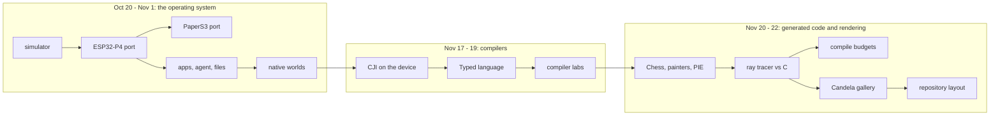
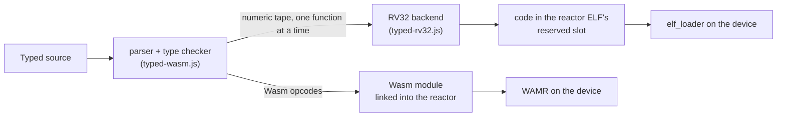
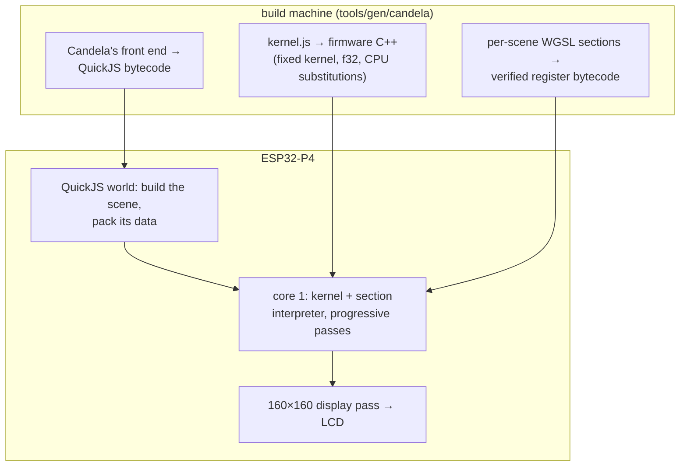

# PicoCalc: an operating system that compiles its own applications

This report describes the whole PicoCalc project as it stands on 22 November 2026: what the repository holds, why each part exists, how the parts are used, and what five weeks of work established. The project began as a JavaScript operating system for a pocket computer and became, along the way, a study of what a compiler can afford to do on the device it compiles for. Its repository ended with 973 commits and 104 tickets. The last of those tickets reorganized the repository so that every piece of reusable code has one place to live; that reorganization is described here too, because it is the clearest statement of how the project's parts relate.

The report is written for a reader who knows C, JavaScript and basic compiler construction but has not seen this project. Each part opens with the problem it addresses, then shows the mechanism, then the measurements that decided its shape.

> [!summary]
> - **An operating system of isolated worlds.** A C nucleus runs every driver, service and application as a separate QuickJS runtime on one scheduling lane. Effects are deferred until a turn ends cleanly, authority comes only from a manifest and from handles, and a world that fails is restarted. Applications describe their screens as data; one compositor draws.
> - **Two compilers, because the first one was correct but slow.** CJI compiles ordinary JavaScript with whole-program type and range inference. It took 24 min 40 s to compile the Agenda app on the device. The Typed compiler handles a typed subset with declared representations, checks one function at a time, and compiles an application at boot in 0.2 to 3 s, inside QuickJS, on the 360 MHz ESP32-P4.
> - **Optimization was decided by the board.** The Typed ray tracer went from 5.84× the frame time of GCC's C to 1.42× through 21 board-gated steps. Those optimizations then broke the boot-time compile deadlines, which led to per-application code-generation policies.
> - **Evidence is the project's main product.** Every claim rests on an oracle, every timing on a matching output digest, every comparison on paired blocks. The reorganization made that machinery reusable: one measurement harness in `bench/`, a reproducible firmware recorded in `firmware/PLAYABLE.json`, and `make test`.

## 1. The device and the goal

The PicoCalc is a ClockworkPi handheld kit: a 320×320 LCD driven by an ST7365P controller, a keyboard behind an STM32 microcontroller at I2C address `0x1F`, a battery, and a socket for a Raspberry Pi Pico. In this project the Pico is replaced by a Waveshare ESP32-P4-WIFI6 module on an adapter. The P4 has two 360 MHz RISC-V cores implementing RV32IMAFC with a single-precision FPU and Espressif's packed-SIMD extension (called PIE in the project), 32 MB of PSRAM, and an ESP32-C6 radio reached over SDIO. The keyboard's I2C bus sits on GPIO 50 and 49, the LCD on SPI2 at 40 MHz, and a console runs over a CH343 USB UART. A second target, the M5Stack PaperS3 (ESP32-S3, 4.7-inch e-paper, GT911 touch), runs the same nucleus with MicroQuickJS.

The goal changed twice. It started as "a JavaScript operating system on the PicoCalc": small apps written in JavaScript, isolated from each other, with a calculator, an editor, an agenda and an LLM agent. Once that worked, the question became whether the handheld could turn its own applications into machine code, without a workstation in the loop. That question produced two compilers and most of the project's measurements. The third goal arrived late: rendering, first a ray tracer and Chess in 3D, then Candela, a physically based path tracer, drawing 18 scenes on the handheld's screen.

## 2. The repository at a glance

The repository is `/home/manuel/code/wesen/2026-10-20--ds-js-os`. After the reorganization of 22 November its top level is:

| Path | Tracked lines | What it holds |
|---|---:|---|
| `firmware/` | 60,000 (+200,000 in `third_party/`) | The operating system: nucleus, native-world SDK, natives, host simulator, ESP32-P4 and PaperS3 ports, vendored QuickJS, WAMR, Candela and fonts, `PLAYABLE.json` |
| `compiler/typed/` | 9,200 | The Typed compiler the firmware runs at boot; `rv32/` holds the sources of the generated `typed-rv32.js` |
| `compiler/cji/` | 16,400 in `src/`, plus runtime and SLJIT | CJI, the whole-program compiler; the firmware's device compiler is built from it |
| `apps/` | 14,700 | Typed worlds with their link adapters (`apps/typed/`), the QuickJS roots and worlds (`apps/js/`), simulator tours (`apps/tours/`) |
| `bench/` | 5,500 | Host gates, the board study harness, the RV32 emulator, reference data |
| `tests/compiler/` | 1,500 | The Typed compiler's tests and pinned image digests |
| `tools/gen/candela/` | 3,100 | Generators of the firmware's Candela sources |
| `cmd/trace-repl`, `pkg/` | 18,500 | The trace REPL, a Go and goja workbench for compiler evidence |
| `docs/` | 1,700 | Current guides |
| `ttmp/` | 859,000 | 104 tickets: designs, diaries, analysis, scripts and evidence |

The proportions say something about the project. The work log in `ttmp/` has about twice as many lines as everything else together, and about four times as many as the project's own code once the vendored third-party sources are left out. That is not documentation inflation: each ticket keeps the scripts that produced its numbers and the raw evidence (UART logs, JSON receipts, screenshots) beside the prose that interprets them. The repository is as much a laboratory notebook as a code base.

The history has two halves. From 20 October to 1 November about 120 commits built the operating system and its apps. Nothing was committed from 2 to 16 November. From 17 to 22 November about 850 commits built the compilers, the measurement practice, the rendering work and Candela. The second half is where the project's research questions were asked.



## 3. The operating system

### 3.1 Why worlds

The ESP32-P4 has no memory management unit that an operating system of this size can use for isolation. Applications therefore cannot be separated by address spaces. The project separates them by runtime instead: every driver, service and application is a *world*, which is its own QuickJS runtime with its own heap limit, turn budget and priority. A world cannot reach another world's objects, because no JavaScript reference crosses a runtime boundary. Everything that crosses is a message, serialized as JSON.

The nucleus is C in `firmware/nucleus/`. Its central file, `kernel.c`, implements one scheduling *lane*. Runnable worlds are taken by priority class (drivers, then services, then apps, then the sandbox) and, within a class, in order of arrival. Each world runs a *turn*: it handles one message or event and returns. A turn has a budget in milliseconds; a world that exceeds it is interrupted.

The single lane is deliberate. It removes locks from the kernel, because only one world runs at a time, and it makes the order of events reproducible, which the simulator relies on. Its cost is that all JavaScript runs on one of the P4's two cores (core 1, in the kernel task); core 0 runs the bus workers.

### 3.2 Deferred effects and supervision

A turn's effects (messages sent, bus transfers, file and store writes) are collected while the turn runs and applied only if the turn ends cleanly. A world that throws, overruns its budget or runs out of heap has its turn discarded as if it had not run. The kernel then restarts the world with backoff from 100 ms to 2 s, and stops it after five crashes in ten seconds. Every crash is written to the UART as one JSON line starting with `#OCT1`.

Deferred effects matter for two reasons. A crash cannot leave half of a protocol exchange done, so a restarted world sees a consistent system. And in the simulator, where time is virtual, effects becoming visible only at turn ends keeps virtual time causal.

### 3.3 Authority: manifests, claims and handles

What a world may touch is declared in the system manifest, `apps/js/picocalc/system.json`. Three real entries:

```json
{"name": "keyboard", "file": "drivers/keyboard.js", "claims": ["i2c0:0x1f", "keys.raw"], "budget_ms": 20, "mem_kb": 320}
{"name": "files",    "file": "apps/files.js",       "claims": ["fs:/"],                   "mem_kb": 384}
{"name": "editor",   "file": "apps/editor.js",                                           "mem_kb": 512}
```

The keyboard driver may talk to one I2C address and publish raw keys. Files may open the whole filesystem. Editor holds no claim at all: when a user opens a document, Files narrows a filesystem handle to that one file and sends it to Editor, revoking the previous one. A handle is checked by the kernel on every use, for holder and rights, and can be narrowed, passed in a message and revoked.

Claims are the whole security policy. The project found the consequence of that the hard way: before the SYS ticket, any world could subscribe to the key channel and read a typed Wi-Fi password. Keys then needed the `keys.raw` claim, screens `frames.read`. Applications loaded from storage (`apps/*.js`) run as `u-<name>` with no claims at all and an 8 KB store.

### 3.4 The screen is data

Applications never draw. A world's `screen(state)` returns a tree of UI nodes (`col`, `row`, `text`, `list`, `table`, and so on), which the nucleus publishes as a *retained* post on the `frames` channel. A retained post is kept by the kernel, so a compositor that restarts gets every application's last frame back without asking. The compositor world lays out the focused application's tree; the nucleus diffs the back buffer against the front buffer; the display driver, itself a JavaScript world, sends the changed rectangles over SPI2.

This design later made two things possible that a drawing API would not have. The render studies of 20 November replaced the JSON tree for specific apps with a binary snapshot format (PSIX) and with semantic snapshots, where Snake publishes its game state and the compositor draws it. And Chess sends the compositor the Typed source of its own *painter*, which the compositor compiles to RV32 on the device and calls on every board position. Because screens were already data, both were changes to the compositor, not to every application.

### 3.5 Native worlds

Some worlds need machine speed. A native world is written in C against `firmware/sdk/nw.h` and talks to the kernel through 19 system calls. One source builds for three engines:

| Engine | Where | Isolation |
|---|---|---|
| A Linux child process under seccomp | the host simulator | an operating-system process |
| WebAssembly in WAMR | host and device; loadable from storage | the Wasm sandbox, metered by instruction count |
| RV32 machine code through Espressif's `elf_loader` | device only, from the firmware | none: trusted, about 26× faster than WAMR |

A native turn of the Dial example takes 1.3 ms as machine code against about 20 ms in WAMR. The ELF engine runs in machine mode with the firmware; a store to address 0 panics the board. Real isolation of machine code (user mode, the physical memory protection unit, a verifier) is proposed in the NATIVE-NEXT plan but not built.

### 3.6 Ports and the simulator

The nucleus calls a small port API declared at the end of `nucleus.h`: bus back ends, a clock, heaps, files. Three ports implement it: the host simulator (`firmware/host/` and `firmware/sim/`), the ESP32-P4 port and the PaperS3 port.

The simulator models the PicoCalc's chips at register level (the ST7365P's panel memory, the STM32 keyboard, timed buses) and runs on a virtual clock. One QuickJS interrupt-counter step was calibrated to 665 virtual nanoseconds from a measurement on the P4. Because every run is deterministic, screenshots of scripted sessions became the first test suite: `make -C firmware shots` replays the 13 tours in `apps/tours/picocalc/` and writes 79 capture files, which must not change unless a change intends them to.

On the device, budgets are wall-clock deadlines, the kernel task runs on core 1 and bus workers on core 0, heaps and framebuffers live in PSRAM, and the JavaScript root is bundled into the firmware image. Bringing the port up found bugs the simulator could not: QuickJS's NaN-boxing was miscompiled by GCC 14 on RV32 at `-O2` without `-fno-strict-aliasing`, ESP-IDF heaps are 4-byte aligned where QuickJS assumes 8, and 32 KB of low-power SRAM that ESP-IDF adds to the heap cost 994 ns per access against 14 ns elsewhere, which made all JavaScript 2.8× slower once a native module had been loaded.

## 4. Why there are two compilers

### 4.1 CJI: correct and slow

The first compiler came from outside. CJI is the companion compiler of the book *Compiling JavaScript, Incrementally*, imported into the repository with its tests. It compiles a large subset of ordinary JavaScript through a classical pipeline:

```text
uniquify → lower_rest → lower_async → infer_types → instantiate_library → type_check → cast_insert → shrink
→ convert_assignments → convert_to_closures → … → explicate_control → select_instructions
→ uncover_live → build_interference → allocate_registers → patch_instructions → prelude_and_conclusion
```

Its analysis is whole-program: abstract interpretation infers types (`infer.js`), and an interval analysis proves integer ranges (`ranges.js`) so that numbers can be represented as unboxed integers. Its output is SLIR, assembled to machine code with SLJIT. CJI builds itself as an RV32 program, so it can run on the handheld.

On the P4 it compiled 20 of the 22 catalog worlds, and its output was byte-identical to the workstation's. But it was slow: from 8 s for a trivial world to 24 min 40 s for Agenda. Profiling put almost all of the time in range analysis, repeated across rounds of library specialization. Two tickets attacked that cost: guarded proof scheduling took Agenda from 1,474.6 s to 544.3 s, and avoiding redundant range-state writes took it to 522.6 s. That is still eight and a half minutes for one application.

### 4.2 The decision

The decisive measurement was not about CJI at all. QuickJS compiles Agenda to bytecode in 37.1 ms on the same board, and CJI with the range proof removed still took 169.7 s. A new language could therefore not be justified by compile speed against the interpreter; QuickJS would always be faster to start. The justification had to be what the compiled code could know: representations declared in the source instead of inferred, checking that needs only one function at a time, and runtime behavior that never depends on whether a proof succeeded. A prototype that compiled one typed function to WebAssembly on the board in 10.4 ms, and matched the JavaScript original on 667,780 inputs, settled it.

### 4.3 The Typed language

Typed reads as JavaScript with annotations. A real function from the Files app:

```js
function filesAlnum(c: i32): bool {
    return (c >= 48 && c <= 57) || (c >= 65 && c <= 90) || (c >= 97 && c <= 122);
}

function filesSelect(current: i32, count: i32, delta: i32): i32 {
    const next = current + delta;
    const last = Math.max(0, count - 1);
    …
}
```

Its semantics are not JavaScript's. Every value is one 32-bit word. `i32` arithmetic wraps; division by zero and `INT_MIN / -1` trap. A `string` is read-only, a 32-bit length followed by UTF-16 units; a `buffer` is writable with a capacity header; every `charCodeAt` and `setCharCodeAt` is bounds-checked. There is no allocation and no string concatenation. Parameters and results are annotated; locals take the type of their initializer.

The language grew with its applications. The first version had no `else`, `for`, `break` or `!==`. By 20 November it had those, forward calls (with a check that the call graph is acyclic, since there is no recursion), `enum` with exhaustive `match`, `distinct` integer types (so a UTF-16 offset cannot be passed where a display column is expected), and `async`/`await`. An `await` compiles into a state machine whose live scalars are stored in fields of the world's state: the Editor's Open and Find use 70 such fields, one fewer than the hand-written version, with no runtime penalty. What Typed still lacks (floating point, arrays, closures) is why the calculator, 96 KB of floating-point JavaScript, was never ported.

### 4.4 The pipeline

The Typed compiler has no abstract syntax tree. A single recursive-descent parser checks types while it parses and writes WebAssembly opcodes per function. Compile cost is therefore proportional to the length of each function, which is the property that makes boot-time compilation predictable.



There are two targets. For WebAssembly, `linkWorld` appends the typed functions to a prebuilt Wasm *reactor*, a trusted C module that implements the world interface, and patches its placeholder exports. For RV32, the parser hands the backend the same operations as a *tape*: an array of numeric cells, one opcode or operand per cell, instead of LEB128-encoded Wasm bytes. The backend lowers each function's tape to machine code as soon as the function is parsed, then frees it, and `linkSlot` copies it into a reserved slot of an ELF reactor, patching entry stubs and runtime calls through a trampoline table in `firmware/sdk/typed/rv32-slot.S`. The ordinary ELF loader then relocates the result. Either way the application is an ordinary native world to the kernel.

The RV32 backend began as 327 lines that kept every value in a stack slot. It is now a planner with passes in `compiler/typed/rv32/`: constant commuting and inlining, loop versioning with induction variables, invariant hoisting, local splitting, division facts, value sets, fused conjunctions, location planning (register homes and pointer groups), and a separate code generator for frameless leaf functions. `rv32/build.mjs` concatenates the 13 source files into the 150 KB `typed-rv32.js` that the firmware bundles; a test fails if the bundle is stale.

### 4.5 Compiling at boot

On the device, `p4_typed_compile` in `firmware/port/esp32p4/main/typed_p4.c` creates a fresh QuickJS runtime with a byte-counting allocator cap and an interrupt deadline (2 MiB and 1.7 s by default; Editor gets 4 MiB and 6 s), evaluates the compiler bundle, compiles the application against its reactor, and returns the module. The manifest names a path such as `editor/compiled.bin`; the port intercepts the read of that path and compiles. If the compile fails or misses its deadline, the system falls back to the JavaScript version of the app. The user sees an application either way.

Typed compiles an application at boot in 0.2 to 3.1 s with 0.4 to 2.2 MB of compiler memory. CJI needs an 8 MiB heap and 9 to 14 MB of scratch space for the same job. The comparison that decided the project:

| World | QuickJS compile | CJI native, best |
|---|---:|---:|
| Flaky | 3.9 ms | 8.2 s |
| Files | 15.9 ms | 140.6 s |
| Agenda | 37.1 ms | 169.7 s without the range proof, 522.6 s with it |

CJI stayed in the repository. The device compiler built from it (`PICOCALC_DEVICE_COMPILER`) still compiles trusted JavaScript worlds on the handheld, and its fixture tests run in `make test`.

## 5. Making compiled code fast, and the compile cheap

### 5.1 Three clocks

A boot-time compiler is judged by three times that pull against each other. The *clean compile* is how long an application takes to compile from source at boot. The *edit-to-native-return* is how long the system takes to give back native code after a user edits one function. The *generated-code runtime* is how fast the result runs. A change that makes generated code faster usually makes the compile slower; a change that caches compile state usually costs memory. The compiler labs of 19 November measured all three separately and reported them separately, because a design that wins on one routinely loses on another.

The Editor, 120 functions and 70,859 bytes of source, was the reference workload:

| Point | Cold compile on the P4 | Peak heap |
|---|---:|---:|
| First RV32 backend (stack slots) | 3.138 s | 2,454,960 B |
| First Wasm backend | 1.988 s | 1,470,268 B |
| Operand registers | 2.863 s | 2,154,834 B |
| Streamed numeric operands (production default) | 2.452 s | 1,410,844 B |
| Cursor scanner and token reuse | about 2.15 s | +9 KB |

Five fixed operand registers roughly halved the emitted code (Editor 43,965 → 21,886 instructions). Streaming lowered each function as soon as it was parsed and freed its operation stream, which cut the peak by 348 KB for about 0.1 s. Rebuilding only the changed native functions returned a Files edit in 43 to 44 ms against 107 ms for a warm full compile, and an Editor body edit in 488 ms against 2.3 s.

### 5.2 The ray tracer and the gap to C

The generated-code question got its benchmark on 20 November: a ray tracer drawing a 160×160 frame of spheres over a checkered floor with shadows, written once in C and once in Typed. Scalar C drew the frame in 9.52 ms and ordinary Typed in 57.7 ms, 6.06 times slower.

Three days of compiler labs followed and moved the frame very little: the best compiler-only result by the end of 21 November was 46.1 ms. The retrospective found why. The dominant cost was where values lived: locals in stack slots, reloads around every checked read. A study that split the shadow-predicate gap of 3.75× attributed 2.04× to code generation, 1.54× to bounds checks and 1.20× to data representation. SIMD, which three studies pursued, addressed about 1% of the frame. A register-homes patch that would have helped existed on 19 November but was deferred, and was rediscovered 46 hours later.

The RAY-PARITY ticket then changed method. Each optimization became an option, was measured on the board against the previous image in paired blocks, and became the default only if it won. Options accumulated instead of being studied in isolation:

| Step | Change | Typed frame | Ratio to C |
|---|---|---:|---:|
| start | | 45.14 ms | 5.84× |
| 6 | instruction selection | 31.51 ms | 4.08× |
| 7 | inlining, capacity homes | 24.18 ms | 3.13× |
| 13 | versioned loops, split ranges | 16.26 ms | 2.11× |
| 15 | division facts | 15.27 ms | 1.97× |
| 18 | invariant hoisting | 12.45 ms | 1.61× |
| 21 | reused argument registers | **10.99 ms** | **1.42×** |

At Step 13, executed instructions explained about 90% of the remaining gap: 4.89 million against GCC's 2.45 million, with cycles per instruction within 10%. At Step 16 the register allocator itself became the limit: every attempt to give a hot value a register displaced another value worth more. The steps after it remove work instead of moving it. By Step 21 the tracing half of the frame executes fewer instructions than GCC's (925,448 against 1,132,651); what remains is in shading, mostly register pressure.

### 5.3 When faster code broke the boot

Every one of those steps cost compile time. When the defaults moved forward, Agenda's boot compile went from 0.86 s to 2.75 s against a 1.7 s deadline, and Editor's from 2.82 s to 7.89 s against 6 s. The handheld booted without its applications: each compile missed its deadline and fell back to JavaScript.

The repair was to stop pretending one set of defaults fits every program. `compiler/typed/rv32/60-policies.js` names five policies:

| Policy | Contents | Used by (boot compile, deadline) |
|---|---|---|
| `stock` | the code generator before RAY-PARITY | control arm in experiments |
| `interactive` | operand locations and instruction selection; no inlining, no loop transforms | Agenda 0.64 s / 1.7 s; Editor 2.94 s / 6 s |
| `balanced` | `default` without loop versioning and split locals | Chess in 3D, 3.76 s / 6 s |
| `default` | every optimization that passed the host differential, the replays and a paired board trial | Files 0.40 s / 1.7 s |
| `kernel` | `default` plus division facts, value sets, hoisting, fused conjunctions, induction variables, reused argument registers | the ray tracer, 2.02 s, no deadline |

A second change cached the compiler itself as QuickJS bytecode in the firmware, which cut the cost of evaluating the compiler from 0.41 to 0.53 s down to 0.05 s per compile. And the gate changed: a new default must keep every boot application within 75% of its deadline on the device, and must pass a feature comparison against the firmware it replaces. A measurement taken in the goja interpreter on the host understated the compile-time growth by half, so only device measurements count for this gate.

## 6. Rendering and Candela

### 6.1 Painters, snapshots and SIMD

The rendering studies of 20 November used the screen-as-data design. One Chess cursor move had published 4,935 bytes and taken 90.7 ms from key event to the last SPI pixel. Semantic snapshots and a binary format shrank what applications send; the Snake integration cut draw dispatch by 58% and bytes per frame by 64%. Chess's *delivered painter* went furthest: Chess sends Typed source that projects a low-poly board and six piece meshes under an orbiting camera; the compositor compiles it to RV32 on the device and calls it on each position.

The P4's packed-SIMD extension paid off in exactly those painters. Lowering a scalar Typed vertex loop to eight-lane PIE took a 256-vertex projection from 45,675 cycles to 1,644. Incremental edges and PIE span stores took the Chess raster body from 17.6 ms to 3.9 ms. In the ray tracer, as noted, SIMD was worth about 1%: the frame's cost was elsewhere.

### 6.2 Candela on a 360 MHz handheld

Candela is a physically based path tracer written for the browser: scenes are JavaScript programs, the kernel is WGSL. Running it on the P4 meant answering a cost question first. A survey of its 105 presets estimated 6,100 to 11,300 RV32 instructions per camera sample, and a 28-preset tier (T0) that could plausibly run.

The design that followed splits Candela at its natural seams:



The front end runs unchanged in a QuickJS world: 21 modules load from bytecode in 175 ms and B-01 builds in 124 to 128 ms. The fixed kernel is generated as firmware C++ at build time and costs 6,832 cycles per sample for B-01, about 52,700 samples per second on one core; measured instruction latencies (19 cycles for `fdiv.s` and `fsqrt.s`) explain its cycles per instruction of 1.28 to 1.72. Per-scene shading code becomes register bytecode interpreted by the kernel: 105 of 105 presets translate, and only 2 of 2,016,847 material evaluations differ from the reference, in the last bit. Whether `-ffp-contract` is on decides whether device digests match the host's.

The gallery is the result now on the handheld. Eighteen presets are path-traced progressively at 160×160 on core 1 and shown on the screen; B-01's first image appears after about 0.3 s and each pass takes 0.88 s. Every scene's frame-0, accumulation and display digests equal those of the same kernel compiled for the host's RV32 emulator. The gallery build is the everyday firmware.

## 7. How the project produces evidence

The project's most transferable product is its practice of measurement. It was built up ticket by ticket, and the reorganization turned it into code.

### 7.1 Tickets and diaries

Every unit of work is a ticket under `ttmp/YYYY/MM/DD/ID--slug/` managed with `docmgr`. A ticket holds a design guide written for a newcomer, one or more chronological diaries, analysis articles, the scripts that produced each number and the raw evidence. Diary entries follow a fixed skeleton (Prompt Context, What I did, Why, What worked, What didn't work, What I learned, What was tricky, What warrants a second pair of eyes, Code review instructions, Technical details). The "What didn't work" section is not ceremony: it records exact error text, and several findings in the project came from reading it.

### 7.2 Oracles and digests

Three rules decide what counts as a result.

- **An existing implementation is the oracle.** The JavaScript apps were the reference for their Typed ports, compared on generated inputs (235,158 calendar cases, 107,776 layout vectors, 667,780 scroll inputs) and frame by frame. The Chess engine's legal moves, perft counts and mate-in-one answers are checked against reference positions, and the RV32 build must then reproduce the WebAssembly build's 6,981 output words exactly.
- **A timing counts only with a matching output digest.** A compile time is admitted only when the compiled image's hash matches an independent build; a frame time only when the frame's pixels match the C reference. This rule caught a negative-zero bug that a timing would have hidden.
- **Byte identity gates "pure cost" changes.** A change claimed to make the compiler faster without changing its output must produce identical bytes. The compiler's tests pin the image digest of each policy.

### 7.3 Paired blocks on one board

There is one handheld. Every board measurement takes a serial lock, so only one process owns the port. It backs up the playable firmware, flashes only the application partition, runs the study and restores the playable image, checking afterwards that every native world is healthy. Within a study, the compared arms run in balanced (Williams) orders inside six blocks, so the board's drift in temperature or clock does not favor the arm that runs first. The reported effect is the median of per-block differences, with the number of blocks won; late in RAY-PARITY an option was adopted only if it won all six. Code placement alone moves results by about ±2%, so effects smaller than that need several images.

### 7.4 The workbench and the agents

The trace REPL (`cmd/trace-repl`, `pkg/trace*`) is a Go service that opens an immutable archive of evidence (GCC and LLVM pass dumps, emulator per-PC counts, board timing captures), verifies it by digest, and gives each session its own goja JavaScript VM. `compiler.at(rev)` loads the Typed compiler at any git revision into the session; `rv32` is a native Go RV32 interpreter that matches the reference interpreter bit for bit and runs about 440 times faster; `stats.paired` scores board studies. Its documented caveat is accurate: it made evidence reliable, but it did not by itself find the compiler's bottleneck.

Much of the work was done by agents in defined roles: supervisors that owned the board and the synthesis, one researcher per study, independent examiners who built counterexamples, and model "student readers" whose quiz scores before and after reading tested the newcomer articles. Side projects ran as subagents in separate git worktrees and were merged by the main agent.

## 8. The repository reorganization

### 8.1 What had gone wrong

By 21 November the measurement practice existed only as copies. The board harness lived in one ticket's scripts; the next ticket copied it and patched it; a third copied the copy. A census found 137 ticket scripts reaching into other tickets. Flashing code was loaded by path through three tickets. Each board study built its harness by string-replacing parts of the previous study's staging script, and a fixed-size buffer in one copied file (`char cell[180]`) truncated a longer options string and lost 12 of 48 cold-compile measurements without any error. The 24 host replays that gate every compiler change were not in any test target, so 13 Editor checks once failed for a day unnoticed. The playable firmware was named by a pointer file in `/tmp`, so restoring the device after an experiment depended on a build directory surviving. And the firmware build itself depended on ticket code: the Candela sources were regenerated by ticket scripts.

### 8.2 Rules

The design (`PICOCALC-REPO-LAYOUT`) states six rules. `ttmp/` is the log: nothing outside it imports, globs or copies ticket code. Every concern has one home. A difference between two uses is a parameter, not a patched copy. Build output is not tracked, and a generated file may be tracked only with a check that regenerates and compares it. `make test` checks the tree. `firmware/PLAYABLE.json` defines what the handheld runs.

### 8.3 What was built

**One measurement harness.** `bench/host/gates.sh --options JSON` runs the three host gates with one set of compile options: the opening ray frame (its digest must be `430f0d50…`), the Chess oracle (6,981 words) and the 24 replays. The options reach every compile through one mechanism: `bench/lib/compiler.mjs` loads the compiler and wraps `typedRv32.compile` at the moment the compiler publishes it, so even calls made inside `typed-world.js` see the defaults.

```sh
bench/host/gates.sh --options '{"policy":"kernel"}'
# == ray profile        custom: 3,239,635 instructions, 11544 B image, output 430f0d501659 (reference)
# == Chess engine oracle  6981 words match; engine 118,361,847 instructions, 19892 B
# == replays            24/24 workflows passed
```

A board study is now a JSON file in `bench/board/studies/` naming its modes and the image each must compile to; `make bench-board STUDY=…` stages, builds, runs, restores and checks row counts. The harness was qualified by repeating RAY-PARITY's run 15 from its study file: the C frame measured 7,730.5 µs against 7,733 µs before, the control 11,162.5 µs against 11,164.5 µs, and the candidate won all six blocks again in all 12 scenes.

**A recorded, reproducible firmware.** `firmware/port/esp32p4/build.sh PROFILE BUILD` builds a profile (`playable`, `candela-world`, `offline`, `agent`, `agent-elf`) from a file of options. `bench/board/playable.py` stores the image under `~/.cache/picocalc/firmware/<digest>/`, installs it, checks health and rewrites `PLAYABLE.json`. The builds were made reproducible: ESP-IDF's reproducible-build option removes dates and times, and prefix maps remove the checkout path from the firmware. A second build of the same commit from a checkout in `/tmp` first gave a different image. Comparing the two build trees narrowed the difference to the device-compiler tool, built by clang outside ESP-IDF, whose SLJIT assertion strings carried `__FILE__`. With that mapped too, two checkouts of one commit build the same image, `f8f36bd1…`, which is the firmware now installed.

**The moves.** Each move was one checked script with a dry run that asserted how often each rewritten string occurred, so an unknown reference failed the script instead of surviving it. The compilers went to `compiler/`, the applications and tours to `apps/`, and finally `picocalc-os/` became `firmware/`; because the firmware tree moved as a whole, every path inside it stayed valid. Reads of old revisions keep their old paths: the trace REPL's module table lists each file's paths newest layout first, so `compiler.at` loads a revision from before the move and one after it in the same session.

**Checks that run.** `make test` runs the Node tests, the generated-file checks, `go test ./...`, the host binary's Python tests and cji's fixtures. It passes, with one test marked as an expected failure: a launcher test that already failed at a commit before any of the moves, now tracked as an open task.

### 8.4 What the gates caught

The gates earned their cost during the migration itself. Moving cji's small C runtime into the emulator's directory looked safe because every replay passed; the next firmware build failed, because the firmware's device-compiler tool links the same files. The move was undone, and the design was corrected. Three replay drivers built paths as `join(os, 'js', file)`, a form the move script did not know; the replays fell to 9/24 until the form was added to the script. The tour captures stayed byte-identical through every move except the two log screens and the UART log, which show the boot line naming the manifest's path; that is the only expected difference.

## 9. Using the repository

```sh
make test                                     # every fast suite
make test-host OPTIONS='{"policy":"kernel"}'  # the compiler gates
make -C firmware shots                        # simulator tours → firmware/out/
make playable && make install-playable        # build, store, flash, check health, record (then commit PLAYABLE.json)
make restore-playable                         # after an experiment image
make bench-board STUDY=bench/board/studies/ray-parity-run15-reuse-args.json
```

`AGENTS.md` is the entry point; `docs/measuring.md` explains the host gates and board studies; `docs/typed-compiler-and-the-ray-tracer.md` and `docs/candela-on-the-p4.md` are the guides to the two largest workloads; `ttmp/ACTIVE.md` lists the 25 tickets still open.

## 10. What the project taught

These are the findings that held across tickets, stated as precisely as the evidence allows.

- **On a device without memory protection, runtimes are the isolation boundary.** Separate QuickJS runtimes with deferred effects and supervision gave isolation, crash recovery and reproducible event order without an MMU. The price is JSON at every boundary and one lane on a two-core chip.
- **Authority must come from data the kernel checks.** Names and conventions leaked: a key channel open to every world exposed passwords. Claims in a manifest and revocable handles closed it.
- **Correct whole-program analysis can be unaffordable on the target.** CJI produced byte-identical code on the handheld and took 24 minutes. Declared representations and per-function checking made compile cost proportional to source length.
- **Compile time is a resource the generated code spends.** Every optimization that sped up the ray tracer slowed boot compiles, until the applications missed their deadlines. Per-program policies and a deadline gate measured on the device were the repair.
- **Find the bottleneck before choosing the optimization.** Three days of SIMD and bounds-check studies moved the ray tracer a few percent because the cost was where values lived. Cumulative, board-gated options then closed most of the gap.
- **Optimizations that share an output do not add up.** Branch fusion and compact output each helped; together they helped Editor and cost Files and Agenda 19 KB of heap.
- **A timing without an output digest is not a result.** Requiring matching digests caught real bugs and made host, emulator and device results comparable.
- **Host estimates do not replace the board.** goja understated compile-time growth by half; code placement alone moves P4 timings by about ±2%.
- **Shared measurement code must have one home, or it silently diverges.** Copied harnesses differed only in how options reached the compiler, and a gate that was not in a test target stopped being run. One parameter and `make test` fixed both.
- **A build is reproducible only after a second build from another place says so.** The prefix maps for ESP-IDF were not enough; the clang-built tool embedded its path, and only comparing two checkouts found it.

## 11. Open problems

- **Code generation.** An interval-aware register allocator cheap enough for the device; non-negativity facts for division and loop counters; splitting the `kernel` passes into a bundle that boot applications never load; tiered compilation (`interactive` at boot, `default` when idle).
- **The NATIVE-NEXT plan.** 30 of its 41 tasks were open on 20 November: a content-keyed module cache for warm boots under 100 ms, one interface description for reactors, a stack bound, fuel and an RV32 verifier, and key-to-pixel latency measured at the LCD, which no measurement has reached yet.
- **Applications.** 12 of 15 catalog apps are not ported to Typed; Calc needs floating point, arrays and closures.
- **Candela.** The gallery core behind the Candela world's render interface (Milestone B), dual-core rendering, SDF scenes at 1.55 to 2.81× the cost of path-traced ones, and the 125 ms display pass.
- **The repository.** The trace REPL, the firmware's own tests and the device tools have not yet moved to `tools/` and `tests/`; the PaperS3 host build does not link; one launcher test fails.

## Related notes

- [[PROJECT REPORT - picocalc-os - Worlds, Turns, Handles and Frames - A Technical Deep Dive]]
- [[PROJECT REPORT - picocalc-os - Two Compilers on the PicoCalc - From a 25-Minute Build to Typed Apps Compiled at Boot - A Technical Deep Dive]]
- [[PROJECT REPORT - PicoCalc Compiler - Which Compiler Work Pays for Itself on a Handheld]]
- [[PROJECT REPORT - PicoCalc Compiler - What a Compiler Can Afford on the PicoCalc]]
- [[PROJECT REPORT - PicoCalc Compiler - The Typed Ray Tracer Odyssey - Why Three Days of Compiler Labs Moved the Frame So Little - A Technical Deep Dive]]
- [[PROJECT REPORT - PicoCalc Compiler - Closing the Typed Ray Tracer's Gap to C - From 5.8x to 2.1x in Measured Steps - A Technical Deep Dive]]
- [[PROJECT REPORT - PicoCalc Compiler - Under 1.5x C - Removing the Work a Register Allocator Could Not Save - A Technical Deep Dive]]
- [[PROJECT REPORT - PicoCalc Compiler - When Faster Code Broke the Boot - Measuring and Restoring On-Device Compile Budgets - A Technical Deep Dive]]
- [[PROJECT REPORT - PicoCalc Compiler - From Trace REPL to Compiler Workbench - Seven Changes Tested Against a Real Compiler Study]]
- [[PROJECT REPORT - PicoCalc Candela - What a Physically Based Path Tracer Costs on a 360 MHz Handheld - A Technical Deep Dive]]
- [[PROJECT REPORT - PicoCalc Candela - Eighteen Path-Traced Scenes on the Handheld's Own Screen - A Technical Deep Dive]]
- [[PROJ - picocalc-os - Project Overview - A JavaScript OS on Two Devices, With an Agent]]
- Repository design: `ttmp/2026/11/21/PICOCALC-REPO-LAYOUT--give-every-piece-of-code-one-home-and-keep-ttmp-as-the-work-log/design-doc/01-reorganizing-the-repository-a-design-for-one-home-per-concern.md`, and its diary, Steps 4 to 8.
