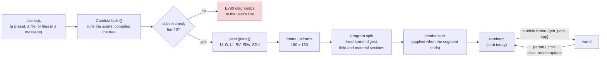

# PicoCalc Candela: Candela's Unchanged Front End as a QuickJS World on the ESP32-P4 — A Technical Deep Dive

Candela is a physically based path tracer whose scenes are JavaScript programs. A scene file imports Candela's API, describes shapes, materials, lights and a camera, and exports a scene. Candela's front end then does three things with it: it runs the program, including any code the scene runs while it is being built; it compiles the resulting component tree into one WGSL program; and it packs the scene into float buffers that the GPU kernel reads. The survey before this project ([[PROJECT REPORT - PicoCalc Candela - What a Physically Based Path Tracer Costs on a 360 MHz Handheld - A Technical Deep Dive]]) showed that this front end runs in the firmware's QuickJS on a host computer. The kernel project ([[PROJECT REPORT - PicoCalc Candela - The Fixed Path-Tracing Kernel as Firmware C++, Measured on the ESP32-P4 - A Technical Deep Dive]]) turned the fixed part of the GPU program into firmware C++.

This project moved the front end onto the PicoCalc. Candela's fifteen front-end modules are compiled to QuickJS bytecode when the firmware is built, loaded into a sandboxed world through a module loader, and run without changes. The world builds scene files, checks that they stay inside the subset the handheld can render, packs their buffers, and hands the program and the buffers to the firmware renderer through three host functions. Parameters and animation time keep running in the world after the build, so moving a slider re-packs the buffers without rebuilding.

On the ESP32-P4, Candela loads from bytecode in 175 ms. The simplest scene, B-01 (a sphere on a plane under the sky), builds in 124-128 ms, of which compilation is 70-87 ms; a pack takes 6-22 ms. 27 of the 28 tier-T0 presets build within the world's limits (4 MB of heap, a 4 s build segment, 56 KB of C stack), and for 26 of them every output — the WGSL, the packed arrays at two animation times, the frame uniforms and the generated program sections — has the same SHA-256 as Node's. The exception, D-02, calls `Math.random()` while it builds. A slider on B-01 re-packs in a 14-15 ms turn, well inside the 50 ms a world's turn may take.

> [!summary]
> - **Bytecode at build time.** `tools/candela-bc` compiles Candela's 15 modules and the world's 6 into 470 KB of QuickJS bytecode on the build machine. On the device, `JS_ReadObject` restores them in 48 ms and the whole load takes 175 ms; nothing is parsed on the handheld.
> - **Unchanged sources, identical output.** No Candela file is edited. The one expensive constant, a GGX albedo table that costs 26.7 million interpreter steps per compile, is computed once at build time and substituted through ES module export precedence. 26 of 27 built T0 presets match Node on 15 digests each.
> - **Diagnostics at the user's line.** Module names without a slash and a `Function` constructor that compiles scene files under their own names make Candela's diagnostics point at the user's line. In Node the same diagnostics are two lines late or point into Candela's own `scene.js`.
> - **A renderer seam, and a measured turn policy.** `render.start`, `render.update`, `render.stop` and a `candela.frame` event per pass, with a stub renderer behind them. Pack cost on the device ranges from 6 to 377 ms across T0 scenes, so a scene whose last pack took more than 25 ms re-packs in a long segment; B-01's slider stays in an ordinary turn.

## Why this project exists

The parent design (`PICOCALC-CANDELA-P4`) split running Candela on the PicoCalc into four tickets: the fixed kernel as firmware C++ (CPU-KERNEL), a register bytecode for each scene's generated code (SECTIONS), Candela's JavaScript front end as a world (this ticket), and a renderer that joins them (FIRST-LIGHT). The design's premise is that Candela's front end runs as it is. A rewrite would be a second implementation of a scene compiler whose output must match the original bit for bit, because the packed buffers and the generated code form an interface with the kernel.

The brief asked for five things: a bytecode bundle loaded the way the firmware's prelude is loaded; shims for what QuickJS lacks; a manifest entry with a memory limit, a turn budget, a C stack and a way to run builds that outlast a turn; host functions to start, update and stop rendering, with frame events back to the world; and device measurements of module load, build, compile and pack times, heap, C stack, all 28 T0 presets with digests equal to Node's, and a parameter re-pack inside one 50 ms turn.

## Current project status

- Ticket `PICOCALC-CANDELA-WORLD` in `/home/manuel/code/wesen/2026-10-20--ds-js-os/ttmp/2026/11/21/PICOCALC-CANDELA-WORLD--candela-s-javascript-front-end-as-a-quickjs-world-on-the-picocalc/` holds the as-built design (with the measurements and the FIRST-LIGHT checklist), the investigation diary, twelve scripts and the raw records of every run.
- The code is on branch `worktree-agent-a5ffe016ff270b9ad` of the repository, not pushed. The last commit is `990f38a`; the measured image was built from `c0bd0f3`, and the only later code change puts the nucleus additions behind the firmware flag.
- The world is part of the firmware only with `-D PICOCALC_CANDELA_WORLD=ON`. The playable firmware is built without it, and it was restored and verified on the device after every measurement run.
- The renderer is a stub. It validates what it receives and reports passes without drawing; FIRST-LIGHT replaces it.

## Project shape

| Path (under `picocalc-os/`) | What it is |
|---|---|
| `third_party/candela/src/*.js`, `PIN.json` | Candela's `src/candela.js` and its 14 imports, byte for byte from the pinned archive, with a SHA-256 per file |
| `third_party/candela/presets/*.js` | the 28 T0 preset scene files |
| `tools/candela-bc.c` | the build-time bytecode compiler (runs on the build machine) |
| `nucleus/candela_world.c` | bundle reader, module loader, the `__candela` host object |
| `nucleus/candela_render.h` | the interface between the world and the renderer |
| `nucleus/candela_render_stub.c` | a renderer that checks its input and reports passes |
| `worlds/candela-world/main.js` | the world: messages, screen, the lazy load |
| `worlds/candela-world/{shims,runner,subset,frame,program,kernel-memo}.js` | the world's modules, bundled with Candela's |
| `worlds/candela-world/bundle.list`, `manifest.json` | what goes into the bundle; the world's manifest entry |
| `tools/candela-stage.py`, `Makefile` (`CANDELA=1`) | the host simulator build with the world |

## Implementation details

### The path a scene takes



A world in the PicoCalc OS is a QuickJS runtime with its own heap limit, a turn budget enforced through QuickJS's interrupt counter, and a set of claims that decide which host services it may use. Its script runs on the kernel task, one segment at a time. A message arrives, its handler runs, every promise the handler settles is drained, and the effects it requested (messages to other worlds, screen updates, console output) are applied when the segment ends. A world whose segment runs past its budget is torn down and restarted.

The Candela world (`main.js`) does nothing when it boots. The first `load` or `build` message imports `world:runner.js`, which imports `world:shims.js` and then Candela. A `build` message runs `buildScene()`: Candela's own `build(files)`, the subset check, the first `pack({ time: 0 })`, SHA-256 digests of everything produced, the frame uniforms, the program split and `render.start`. A `param` message moves a slider. For a dynamic parameter the world calls `pack()` again and then `render.update()`; for a static one it rebuilds with the other sliders kept, as Candela's own workbench does.

### The bundle: compiling Candela when the firmware is built

QuickJS can serialise a compiled module with `JS_WriteObject` and restore it in another runtime with `JS_ReadObject`. The firmware already does this for its prelude, but it compiles the prelude at boot. Parsing Candela's 329 KB of source on the device would cost an estimated half second to a second, so `tools/candela-bc` compiles it on the build machine instead.

Bytecode is not portable across QuickJS versions, and the firmware's QuickJS carries local patches, so `candela-bc` is linked with the same `third_party/quickjs` sources. Bytecode does depend on byte order, and both machines are little-endian; it does not depend on word size, because atoms are written as strings and resolved again when read, and numbers are written as 64-bit doubles. The bundle starts with the QuickJS version string, which the loader checks before reading anything.

The first version failed in an instructive way:

```text
candela-bc: candela:candela.js: ReferenceError: could not load module 'diag.js'
```

QuickJS resolves a module's imports while it compiles the module, even with `JS_EVAL_FLAG_COMPILE_ONLY`. A bytecode compiler for ES modules therefore needs the same module loader as the runtime. `candela-bc` queues every source first, installs a loader with the device's naming rules, and compiles through it, so compiling `candela:candela.js` compiles each of its imports once, when it is first imported. Function source text is stripped (`JS_SetStripInfo(rt, JS_STRIP_SOURCE)`); line tables are kept, because diagnostics need them.

The format is small: a magic (`CQB1`), the 16-byte QuickJS version, an entry count, and per entry a kind (module or text), a name and the bytes. Besides 21 modules the bundle carries 30 texts: the pin, the 28 T0 presets as `preset:<file>`, and the world's own test scene `scene:B-01p.js`. The whole bundle is 500 KB. It is read once at boot and kept for the life of the firmware, outside the world's heap limit.

```text
candela-bc OUT --list worlds/candela-world/bundle.list picocalc-os/
  ggx    third_party/candela/src/kernel.js          # evaluate once: ggxAlbedoTable(), ggxTableWGSL()
  module candela:candela.js third_party/candela/src/candela.js
  ...    (15 Candela modules)
  memo   world:kernel-memo.js worlds/candela-world/kernel-memo.js
  module world:shims.js, world:runner.js, world:subset.js, world:frame.js, world:program.js
  text   pin third_party/candela/PIN.json
  text-dir preset: third_party/candela/presets
  text-dir scene:  worlds/candela-world/scenes
```

In the firmware build, `port/esp32p4/main/CMakeLists.txt` compiles `candela-bc` with the build machine's C compiler, runs it, adds the bundle and the world script to the firmware's file bundle, and appends the world's manifest entry after Chess. All of this is behind `PICOCALC_CANDELA_WORLD`, which is off by default.

### Module names, and why they contain no slash

The loader in `candela_world.c` names Candela's modules `candela:<file>` and the world's `world:<file>`. A relative import such as `./diag.js` resolves inside its importer's namespace. The names look arbitrary, but they decide whether Candela's diagnostics work.

Candela locates a user's mistake by walking the JavaScript stack (`diag.js`, `callSite()`). A regular expression extracts each frame's file name, strips the directory, and compares the base name with the scene's file names. A frame from Candela's own `src/scene.js` therefore matches a user file called `scene.js`, and because Candela's frame is the innermost one, it wins. This happens in Node as well: unbundled, a misspelt method on line 4 of a user's `scene.js` is reported at `scene.js:56`, which is a line of Candela's `src/scene.js`. A name with a colon and no slash does not match the regular expression at all, so Candela's frames are skipped and the first frame that matches is the user's.

### Scene files under their own names, at their own lines

Candela runs each scene file by building a function from text:

```js
new Function('__req', ..., '"use strict";\nreturn (async () => {\n' + body + '\n})();\n//# sourceURL=' + path)
```

QuickJS ignores the `//# sourceURL=` comment, so every scene function is compiled under the name `<input>` and no frame can match a user file. The world replaces the global `Function` (in `world:shims.js`, before Candela loads) with a constructor that recognises a body ending in `//# sourceURL=NAME` and compiles the same source with `__candela.evalScript(source, NAME)`, which is `JS_Eval` with that file name. Every other call goes to QuickJS's own constructor, and `prototype` is the original, so `instanceof Function` still holds.

Line numbers needed a second fix, for a Candela bug that also exists in V8. `candela.js` measures how many lines `new Function` puts before a body by compiling a probe function; in V8 and in QuickJS the answer is 2, and Candela subtracts it from every location. But `runFiles` adds two more lines of its own (`"use strict";` and `return (async () => {`), and nothing subtracts those, so in Node a `throw` on line 4 is reported on line 6. The world's `Function` lays out ordinary bodies with the standard two header lines, so the probe still measures 2, and puts `runFiles`' two prefix lines on the second header line. Line L of a scene file is then line L + 2 of the compiled source, and Candela reports L.

| Probe | World, ESP32-P4 | Node 24, unbundled |
|---|---|---|
| `throw` on line 4 | E000 at scene.js:4 | E000 at scene.js:6 |
| misspelt method on line 4 | E104 at scene.js:4 | E104 at scene.js:56 |
| a torus (tier T1) on line 5 | E790 at scene.js:5 | E790 at scene.js:114 |
| a surface field (tier T2) on line 5 | E790 at scene.js:5 | E790 at scene.js:114 |
| a syntax error on line 2 | E001 at scene.js:1 | E001 at scene.js:1 |

The syntax error stays at line 1 in both, because Candela's `syntaxLoc()` locates syntax errors by matching V8's error messages.

### A constant table, computed once, without editing Candela

`kernel.js`'s `ggxTableWGSL()` computes a 16 x 16 table of GGX directional albedo by Monte Carlo integration and formats it as WGSL, and `compile()` calls it for every scene. In host QuickJS that is 26.7 million interpreter steps; on the device it would add minutes to every build. The table is a constant.

`candela-bc` evaluates `kernel.js` once on the build machine, calls `ggxAlbedoTable()` and `ggxTableWGSL()`, and writes their results into a small module:

```js
// world:kernel-memo.js
export * from 'candela:kernel.js';
import { ggxAlbedoTable as computeAlbedoTable } from 'candela:kernel.js';
const TABLE = [/* 256 numbers */];
const WGSL = "/* the WGSL text */";
export function ggxAlbedoTable(N = 16, S = 512) { return N === 16 && S === 512 ? TABLE.slice() : computeAlbedoTable(N, S); }
export function ggxTableWGSL() { return WGSL; }
```

In an ES module, a local export takes precedence over a name re-exported with `export *`. This module therefore exports everything `kernel.js` exports, except that its two functions replace the originals. The loader resolves every import of `candela:kernel.js` to `world:kernel-memo.js`, except the memo module's own import, so Candela's modules use the memo without any change to their source. The WGSL digests below show that the memoised program is the program Candela computes for itself.

### Shims

QuickJS is a bare ECMAScript engine, and Candela's front end needs only three things from its host:

| Shim | Who needs it | What the world provides |
|---|---|---|
| `atob` | preset K-09 decodes base64 mesh data | WHATWG forgiving-base64, decoded in 8,192-byte chunks to a binary string |
| `performance.now()` | `build()` times itself | the host's real clock in milliseconds |
| `console` | `params.js` reports listener errors with `console.error` | mapped to the world's `log` |

`world:shims.js` also removes `__candela` from the global object and exports it as `host`. Only the world's own modules import it, so a scene file cannot reach the renderer.

### Which scenes the handheld accepts

The parent project sorted Candela's 105 presets into tiers by the kernel features they need. Tier T0 (28 presets) is analytic quadrics; Lambert, GGX conductors and reflect-only dielectric coats; point, spot, area and sun lights; simple environments and the Preetham sky; RGB rendering; the path integrator; and materials whose values do not vary over a surface. `world:subset.js` reads the same features from the compiled scene by the same rules, and refuses anything above T0 with one diagnostic per feature, in Candela's format, located at the shape, material or scene that asked for it:

```text
E790 scene.js:5  not in the PicoCalc's subset (tier T0): torus, a tier T1 feature
                 → build it on a desktop, or wait for the T1 kernel
```

Run in Node over the archive's presets, `subset.js` assigns the same tier as the parent project's census for 94 of 94 presets checked.

### Frame uniforms and the program split

`pack()` does not fill all of the uniform buffer U. Rows 0-5, 20 and 21 and words 80-87 and 96 hold the frame size, the sample counter, the camera, the integrator's depth and Russian-roulette settings, the spectral white balance and the seed, and Candela's viewport writes them before each dispatch. `world:frame.js` writes them exactly as `Viewport.frame()` does, for a fixed 160 x 160 frame with the pass counter at 0; the renderer owns the pass counter. In Node, its U equals the U that Candela's own `Viewport.frame()` hands a recording backend for 94 of 94 presets.

`world:program.js` is CPU-KERNEL's `splitProgram()`. It checks every boundary at which `compile.js` assembles a program from fixed and generated parts, and returns the generated field and material sections plus the SHA-256 of the fixed part (62,419 bytes of WGSL, digest `8925739795c7...`). The renderer uses the digest to refuse a program compiled against a different kernel.

### Builds that outlast a turn

A world's turn has a budget, 50 ms by default. A Candela build cannot be split across turns: `build()` is `async`, but it only awaits promises that are already settled, so the whole build runs in the job queue of one segment. Two designs were possible.

A worker task could run long builds while the kernel task stays responsive. A QuickJS runtime can move between threads, but the world's code makes host calls that read and write the kernel's state, and the kernel would have to keep the world's messages, timers and teardown away from that runtime while the worker holds it. That is a kernel change in its own right.

A long segment reuses what the boot segment already does. A world whose manifest declares `long_ms` may ask that the segment it is running in be bounded by `long_ms` instead of `budget_ms`, measured from the segment's start. The world asks for it (`__candela.longSegment()`) when it loads Candela and when it builds. The world's manifest entry:

```json
{ "name": "candela", "file": "candela/world.js", "claims": ["candela", "fs:/candela"],
  "budget_ms": 50, "long_ms": 4000, "mem_kb": 4096, "stack_kb": 56 }
```

The nucleus changes are small. `long_ms` and `stack_kb` are new manifest fields; `vm_long_segment()` raises the running segment's interrupt budget and real-time deadline; the overrun message says "long segment" when one was granted; and each world records its peak heap. `stack_kb` can only lower QuickJS's stack limit below the port's, which is 56 KB of the kernel task's 80 KB on the P4. Like the loader, these are compiled only with `PICOCALC_CANDELA_WORLD`: without the flag, the nucleus sources preprocess to exactly the text they had before, so the playable firmware is unchanged.

The device then showed that re-packs need the same treatment for some scenes. A pack recomputes the BVH and, for every light, a Planck-times-colour-matching integral over 81 wavelengths, so its cost grows with objects and lights: 6.2 ms for B-01, 38-41 ms for M-03 and M-09, 377 ms for L-05. Before the change, M-03's slider used 49.1-49.7 ms of its 50 ms turn. `repack()` now asks for a long segment when the scene's last pack took more than 25 ms, half the turn budget. The first pack in a fresh runtime is up to 3.5 times slower than later ones (QuickJS builds object shapes and inline caches the first time code runs), so this forecast errs towards a long segment.

### The renderer seam

```js
host.render.start(program, buffers, options)   // -> { gen, bytes }
  program = { sceneId, fixedKernel, spectral, integrator, fieldCode, matCode, sections, wgsl }
  buffers = { U, O, LI, BV, SDs, SDd, dynBase }  // Float32Array, whole vec4 rows
  options = { width, height, post: { tonemap, denoise, exposure, ev, ... } }
host.render.update(buffers, { reset: true })   // after every pack
host.render.stop()
// renderer -> world, after each pass: message "candela.frame" { gen, pass, spp, us }
```

On the C side, the arrays are copied into one block (`cr_scene_t`: a generation number, the frame size, `dyn_base`, the rows and offsets of six arrays, and the floats) and the program into another (`cr_program_t`). Both are handed over as deferred effects, applied when the segment ends, so a segment that crashes starts nothing. The kernel frees a crashed segment's effects with `free()`, which is why each is one `malloc` block without inner pointers. The port implements `port_candela_start`, `port_candela_update`, `port_candela_stop` and `port_candela_status_json`, and calls `candela_world_frame()` when a pass completes. The stub checks the scene's layout, refuses spectral programs, non-path integrators and programs without a kernel digest, and reports four passes 500 ms apart per generation.

## Measurements

### Host simulator

`make CANDELA=1 candela` builds the host simulator with the world. `picocalc-host` runs the same nucleus, the same QuickJS and the same bundle as the device, on x86-64 (so heap figures are 64-bit).

| | Host simulator |
|---|---|
| load: modules, bytecode, time (`JS_ReadObject`) | 21 modules, 470 KB, 2.5 ms (1.2 ms) |
| heap after load | 1,348,048 bytes |
| B-01 build / compile / first pack | 1.35 / 1.18 / 0.16 ms |
| T0 presets equal to Node on all 15 digests | 26 of 27 built, and B-01p |

The same scripts run clean under AddressSanitizer and UBSan (`make CANDELA=1 SAN=1 candela`).

### On the ESP32-P4

The final run used an image built from commit `c0bd0f3` with `build-smooth-chess.sh BUILD -D PICOCALC_CANDELA_WORLD=ON` (app SHA-256 `63a87a16...`). `scripts/08-run-device.py` took the shared serial lock, health-checked the playable app, wrote and verified the measurement app, sent 74 messages to the world through the console (`send candela TYPE JSON`), collected the world's `CW {json}` records, and then wrote and verified the playable app again.

| Measurement | ESP32-P4 |
|---|---|
| Module load in a fresh runtime (3 runs) | 175.3-175.5 ms, of which `JS_ReadObject` 47.8-48.0 ms |
| Heap after load (32-bit) | 1,107,372-1,107,392 bytes |
| B-01 build, fresh runtime / warm | 123.8-126.6 ms / 124.4-128.0 ms |
| B-01 `compile()` alone, fresh / warm | 85.5-87.1 ms / 69.6-71.1 ms |
| B-01 pack: first in a fresh runtime / warm / at t = 2.5 | 21.9 ms / 6.3-6.5 ms / 4.5-4.8 ms |
| B-01 heap peak during a build | 1,399,084 bytes (+291,692 over the loaded runtime) |
| C stack, B-01 build / pack | 20,668 / 9,296 bytes |
| C stack, all T0, build / pack | at most 23,392 (C-02) / 12,800 bytes, of a 56 KB limit |
| Heap peak, all T0 | 1,777,440 bytes (R-07), 43% of 4 MB |
| T0 presets built | 27 of 28 |
| Digests equal to Node | 26 of 27 built presets, and B-01p |
| Ten B-01 rebuilds in one runtime | 124.8-126.7 ms each; heap afterwards 1,523,064-1,523,088 bytes, no growth |

The survey had estimated 70-120 ms for B-01's build on the device. The measured 124-128 ms is just above that range. The device runs Candela's front end 70 (load) to 92 (B-01 build) times slower than the x86-64 host simulator.

Build time varies by a factor of nine across T0, and pack time by a factor of sixty:

| Scene | Build ms | Compile ms | First pack ms | | Scene | Build ms | Compile ms | First pack ms |
|---|---|---|---|---|---|---|---|---|
| A-03 | 138.5 | 54.5 | 7.3 | | L-02 | 191.5 | 98.7 | 9.6 |
| B-01 | 126.5 | 68.6 | 6.2 | | L-03 | 179.4 | 95.3 | 7.0 |
| B-03 | 205.9 | 102.5 | 64.8 | | L-04 | 202.6 | 96.2 | 18.3 |
| B-04 | 177.1 | 97.0 | 7.4 | | L-05 | 208.2 | 54.1 | 377.1 |
| B-05 | 203.7 | 125.6 | 9.5 | | L-06 | 263.0 | 149.0 | 111.4 |
| C-02 | 787.9 | 132.4 | 167.3 | | L-07 | 217.3 | 122.8 | 10.4 |
| C-03 | 313.8 | 125.8 | 62.2 | | L-08 | 158.2 | 73.9 | 46.8 |
| C-04 | 250.5 | 141.2 | 10.0 | | M-01 | 579.5 | 384.0 | 29.9 |
| D-01 | 178.8 | 93.0 | 101.0 | | M-02 | 214.5 | 71.7 | 19.3 |
| D-02 | 289.8 | 171.3 | 12.7 | | M-03 | 186.0 | 53.4 | 38.4 |
| E-03 | 204.6 | 94.9 | 64.2 | | M-09 | 133.1 | 51.1 | 40.7 |
| E-04 | 174.4 | 54.3 | 21.0 | | M-12 | stopped at 4 s | | |
| G-06 | 205.2 | 103.9 | 41.6 | | R-01 | 196.7 | 112.5 | 64.4 |
| L-01 | 151.2 | 71.0 | 116.9 | | R-07 | 1,103.5 | 732.0 | 88.7 |

M-12 is the one T0 preset that does not build: its scene file runs a Monte Carlo furnace test of 100 million steps before it builds anything, and the world is stopped at 4 s and restarted. D-02's objects and BVH differ from Node's because the prelude seeds `Math.random` per world; its WGSL is identical, and Candela itself warns about randomness in a build (W501).

Parameters and animation time:

| Change | Pack ms | Whole segment ms | Segment |
|---|---|---|---|
| B-01p roughness (5 moves) | 6.9-7.2 | 14.0-15.4 | ordinary 50 ms turn |
| L-03 sun elevation (3) | 7.2-7.4 | 14.3-15.6 | ordinary |
| D-02 gloss (2) | 13.2-13.3 | 21.7-21.9 | ordinary |
| M-03 floor IOR (3) | 38.6-38.9 | 49.0-49.1 | long |
| M-09 roughness along (3) | 40.7-40.8 | 47.7-49.2 | long |
| L-05 animation time (2) | 270.2-270.3 | 280.5-281.1 | long |
| E-03 depth (static: a rebuild) | | 427.9 | long |

B-01 has no parameters, so the measurement scene B-01p is B-01 with its sphere's roughness declared as a dynamic parameter. Its re-pack is the acceptance figure: 14-15 ms for the whole segment, including the message, the pack, the frame uniforms, copying the buffers for the renderer and the digests.

### Two problems the device found

The host simulator agreed with Node on every digest, but two problems appeared only on the device. The first was the re-pack cost above. The second was a memory leak: the effect that prints a record (`run_report`) printed its JSON and never freed it. Other effects free what they carry, and the kernel frees only the effect structure itself. The records are 0.3-3 KB, under the 4 KB threshold below which the P4's allocator prefers internal RAM, so internal RAM free fell to 36,871 bytes over one full run. After the fix, the final run went from 93,335 to 87,727 bytes free.

### Device health

Before each run, after flashing, and after the plan, the keyboard's I2C counters showed no errors. During the final restore, the user switched the PicoCalc's keyboard and display off on purpose, so the last health check found every keyboard transfer failing. That check was recorded again without the keyboard and display: the playable app verified in flash, the Files, Editor, Agenda, Chess and Snake native worlds running without restarts, the painter compiled once without rejects, and keyboard and display recorded as off by the user.

## What FIRST-LIGHT has to wire up

1. Replace the stub behind the same five functions. Run passes on a worker task on core 1 and post `candela_world_frame` back to the kernel task.
2. Bind `SD` as `SDs` at row 0 and `SDd` at row `dyn_base`, then CPU-KERNEL's `cdl_buffers { U, O, LI, BV, SD }`.
3. Refuse a program whose fixed-kernel digest differs from the kernel the firmware was generated from (`8925739795c775a2910c0096eb59dac235bd35719b5255539019b41cde12942d` at the pin). CPU-KERNEL's generator should emit the digest of the same `fixedText()`.
4. Own U[2], the pass counter, and the per-frame seed; the rest of U arrives filled.
5. Bind the field and material sections: as WGSL text today, as SECTIONS bytecode once its translator runs in the world (`program.sections`).
6. Implement exposure metering for `exposure: "auto"`, tone mapping, and the display at 160 x 160 upscaled to 320 x 320.

## Reproducing

```bash
# host simulator
cd picocalc-os && make CANDELA=1 candela
./build-candela/picocalc-host -j build-candela/candela-js ../ttmp/2026/11/21/PICOCALC-CANDELA-WORLD--*/scripts/05-host-suite.txt > suite.log
python3 -I ../ttmp/2026/11/21/PICOCALC-CANDELA-WORLD--*/scripts/04-compare.py ../ttmp/.../various/02-node-reference.json suite.log

# measurement image and device run (restores the playable app named in /tmp/picocalc-current-playable.txt)
source ~/esp/esp-idf-5.4.2/export.sh
picocalc-os/port/esp32p4/build-smooth-chess.sh BUILD -D PICOCALC_CANDELA_WORLD=ON
python3 ttmp/.../scripts/08-run-device.py --image BUILD --reference ttmp/.../various/02-node-reference.json \
    --probes ttmp/.../scripts/06-diag-probes.json --out OUT --plan full [--peripherals off-by-user]
python3 -I ttmp/.../scripts/10-summarize-device.py OUT ttmp/.../various/02-node-reference.json
```

## Important project docs

- Design (as built, with Section 9 measurements and the FIRST-LIGHT checklist): `ttmp/2026/11/21/PICOCALC-CANDELA-WORLD--candela-s-javascript-front-end-as-a-quickjs-world-on-the-picocalc/design-doc/01-design-stub.md`
- Diary: `ttmp/2026/11/21/PICOCALC-CANDELA-WORLD--.../reference/01-investigation-diary.md`
- Raw records: `various/02-node-reference.json`, `various/05-host-suite.cw.log`, `various/device-04-final/{cw.jsonl,summary.json}`
- Parent design: `ttmp/2026/11/21/PICOCALC-CANDELA-P4--run-a-subset-of-candela-on-the-esp32-p4/design-doc/01-a-candela-subset-for-the-esp32-p4.md`

## Open questions

- Should builds and heavy re-packs move to a worker task? They fit long segments, but they hold the kernel's lane for up to a second (R-07) while they run.
- Should Candela's `pack()` cache light normalisation and the BVH by the parameters they depend on? Most slider moves would then cost what B-01's does, but that is a change to Candela.
- Should the two-line offset be fixed in Candela instead of in the world's `Function`? The bug affects every V8 host as well.
- `syntaxLoc()` matches V8's syntax-error wording; a variant that understands QuickJS's messages would locate syntax errors on the device.

## Near-term next steps

- FIRST-LIGHT: a real renderer behind the seam, with B-01 and R-01 on screen.
- SECTIONS' translator in the world, filling `program.sections`.
- A scene picker and sliders on the world's own screen.

## Project working rule

Candela's sources stay byte for byte as pinned. Everything the handheld needs (bundle, loader, shims, memo, subset check) is added around them, and every claim of equality is a digest comparison against Node running the same modules.

## Related notes

- [[PROJECT REPORT - PicoCalc Candela - What a Physically Based Path Tracer Costs on a 360 MHz Handheld - A Technical Deep Dive]]
- [[PROJECT REPORT - PicoCalc Candela - The Fixed Path-Tracing Kernel as Firmware C++, Measured on the ESP32-P4 - A Technical Deep Dive]]
- [[PROJECT REPORT - Candela Render Runtime - Running Candela Scenes in Embedded V8 - A Technical Deep Dive]]
