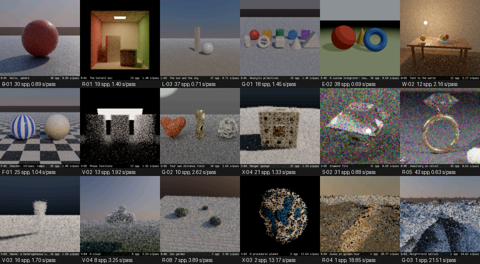
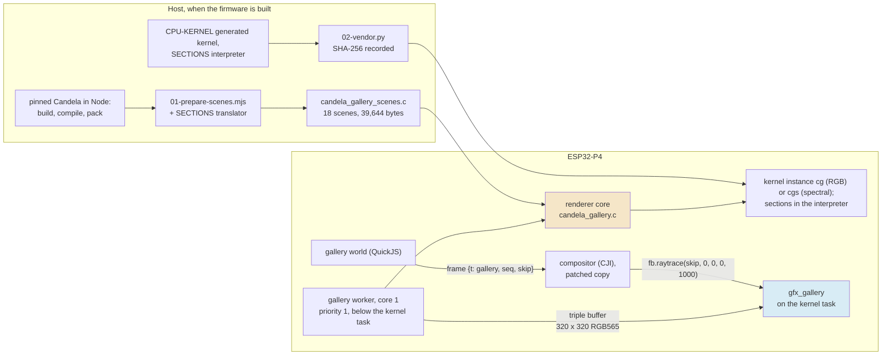
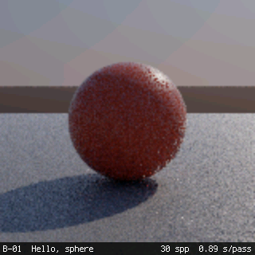
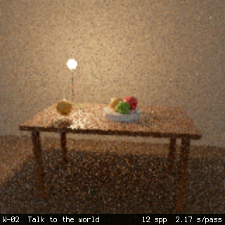

# PicoCalc Candela: Eighteen Path-Traced Scenes on the Handheld's Own Screen — A Technical Deep Dive

Candela is a physically based path tracer whose scenes are JavaScript programs. Three earlier projects took it apart for the PicoCalc, a handheld built around a 360 MHz ESP32-P4. The fixed path-tracing kernel became firmware C++ ([[PROJECT REPORT - PicoCalc Candela - The Fixed Path-Tracing Kernel as Firmware C++, Measured on the ESP32-P4 - A Technical Deep Dive]]). The code each scene generates became a verified bytecode with a C interpreter ([[PROJECT REPORT - PicoCalc Candela - Scene Code as Verified Bytecode in the Fixed Kernel - A Technical Deep Dive]]). The JavaScript front end ran unchanged in a QuickJS world ([[PROJECT REPORT - PicoCalc Candela - Candela's Unchanged Front End as a QuickJS World on the ESP32-P4 - A Technical Deep Dive]]). None of them put a pixel on the screen. The user asked: "can i see more scenes running on the device itself?"

This project answers yes. The handheld now path-traces 18 of Candela's presets on its own screen, one after another, with no keyboard needed. Every pixel is computed on the device by the kernel and interpreter of the earlier projects. A first coarse image appears about 0.3 s after a scene starts, and the image sharpens as samples accumulate. The device's frames were checked bit for bit against the same code run on the host. The gallery image is now the handheld's everyday firmware.



> [!summary]
> - **Real scenes, rendered on the device.** 18 presets (CPU-KERNEL's six and 12 of the 20 that SECTIONS verified) are prepared on the host as packed buffers and section bytecode, 39,644 bytes in all. A worker on core 1 renders them with the `cpu`-arm kernel and the interpreter. Pass 0 runs as 16 interleaved sub-passes, so a whole-frame image appears after 1/16 of a pass. AgX tone mapping and a bilinear upscale to 320 x 320 follow. B-01 shows its first image after 312 ms and then runs at 0.88 s per 160 x 160 pass, or 28,806 samples per second.
> - **Exact.** On the device, all 18 scenes' frame-0, 4-pass accumulation and display digests equal the same sources compiled for RV32 and run in a counting interpreter. Floating-point contraction is off, which costs a few percent and makes the check exact. Against x86-64, six scenes are equal in all three digests. The others differ only through libm, and their mean luminance agrees within 7e-5.
> - **Sharing a core.** The renderer runs below the kernel task, so no world waits for it. That costs 28-36% of its speed. The rest of the firmware takes 17% of core 1 directly; the keyboard driver alone takes 8.4%, polling the switched-off keyboard. The rest of the loss is cache refills after each preemption. The stack's placement is worth only 1-3%.
> - **Off by default and proven harmless.** The work is behind `PICOCALC_CANDELA_GALLERY`. Without it, every source the change reaches preprocesses to the same bytes as main's, `__LINE__` included, and the CMake configuration is identical. The installed image is that build with the option on.

## Why this project exists

The earlier projects measured the pieces. CPU-KERNEL took B-01 to 6,832 cycles per sample on a standalone benchmark app. SECTIONS showed that its bytecode computes what compiled C++ computes. WORLD ran Candela's own front end on the device behind a stub renderer. The integration was planned as `PICOCALC-CANDELA-FIRST-LIGHT` and never built, so nothing ever reached the panel.

The brief for this ticket, `PICOCALC-CANDELA-GALLERY`, set the priorities:

- render prepared presets with the real kernel and interpreter, on core 1, in a worker task, progressively, with a quick first image;
- advance scenes by themselves, because the user has switched the keyboard and the display off on purpose, and switch scenes by key when a keyboard is present;
- put everything behind a new build option, and prove that the playable firmware is unchanged without it;
- measure each scene: time to first image, seconds per pass, samples per second, peak heap;
- compare a device frame digest with the host build, and decide the floating-point-contraction policy;
- install the gallery if every existing world stays healthy.

Connecting WORLD's front end to the same renderer was Milestone B, if time remained. It did not; the plan is in the design doc.

## Current project status

- Milestone A is done. The gallery image (`/tmp/picocalc-candela-gallery-a396d3b/build`, app SHA-256 `28d9a81241870a45f75c19f0406c4c0fc8c182e2a855cbab3dae6c99caf203a6`) is installed on the handheld and named in `/tmp/picocalc-current-playable.txt`. It is main 5c01d81 with the option on. It replaced main's 3353264 build (`8acb94cc...`).
- After a boot, the gallery comes to the front by itself and cycles through the scenes. A scene changes after 64 samples per pixel plus 6 s, or after a minute on screen. F1 returns to the launcher, where the gallery's key is `p`.
- Health, judged with the keyboard and display "off by user": Snake, Files, Editor, Agenda and Chess stayed idle with no restarts and no errors. They were checked before the flash, at the gallery image's boot, and after a 30-minute run.
- Milestone B (WORLD's front end on this renderer) is not done.
- Ticket: `/home/manuel/code/wesen/2026-10-20--ds-js-os/ttmp/2026/11/22/PICOCALC-CANDELA-GALLERY--a-gallery-of-candela-path-traced-scenes-on-the-picocalc-s-screen/`. Commits are on branch `worktree-agent-a2a22bb8f46d24aa3`, from 2253ce7 to d77ec4d.

## Project shape

| Path | Role |
|---|---|
| ticket `scripts/01-prepare-scenes.mjs` | runs the pinned Candela in Node: build, compile, pack, frame uniforms, SECTIONS' translator; writes the scene table |
| ticket `scripts/02-vendor.py` | copies the kernel and interpreter into the firmware tree and records each file's SHA-256 |
| `picocalc-os/third_party/candela/` | the vendored kernel (`kernel/`), interpreter (`vm/`) and scene table (`gallery/`) |
| `picocalc-os/nucleus/candela_gallery.{h,c}` | the renderer core in plain C: passes, sub-passes, meter, display, upscale, digests; the host builds the same file |
| `picocalc-os/nucleus/candela_gallery_instance.cpp` | the kernel instance's section table bound to the interpreter, once for RGB (`cg`) and once for spectral (`cgs`) |
| `picocalc-os/port/esp32p4/main/candela_gallery_p4.c` | the worker task, scene policy, triple buffer, console command, `CGAL` records |
| `picocalc-os/nucleus/gfx.c` (`gfx_gallery`) | draws the newest frame and its caption when the compositor asks for selection 1000 |
| `picocalc-os/tools/candela-gallery-compositor.py` | patches a build-time copy of the compositor |
| `picocalc-os/worlds/candela-gallery/` | the 40-line gallery world |
| ticket `scripts/03`-`10` | host and RV32 references, the two option-off proofs, the device run, summaries, contact sheet |

## Implementation details

### The pipeline



The scenes are prepared on the host because the gallery is meant to show the renderer. Editing scenes on the device is WORLD's job. `01-prepare-scenes.mjs` loads the pinned Candela (`candela-workspace(1).zip`, SHA-256 `873b2dd4...df5d`) through CPU-KERNEL's loader. For each preset it builds and compiles the scene and packs its arrays exactly as Candela's GPU buffers are laid out. It fills the frame uniforms as Candela's viewport would for pass 0, then translates the generated WGSL sections into SECTIONS' bytecode. It also records what the viewport would do with the image: tone map, exposure mode and EV, post effects, field of view. Each program records the SHA-256 of the fixed-kernel text it was compiled against (`8925739795c7...942d`). The firmware compares that digest with its own kernel's before it renders anything.

Two presets were left out. K-04 and K-08 pack their meshes into more than a million scene-data rows each (18.2 and 17.1 MB), which is more than the 8 MB app partition. Nine scenes render at 160 x 160 and the nine heavier ones (signed-distance fields, volumes, heightfields, spectral) at 80 x 80. Two are spectral, so the firmware carries a second kernel instance compiled with `CDL_SPECTRAL=1`.

### Progressive accumulation and the first image

A pass is one sample per pixel. The accumulation keeps Candela's layout: per pixel, the sum of colour and the sample count. Every pixel is therefore shown as its own mean, wherever the current pass has got to. Each pass uses the frame index Candela's viewport would use (0, then `p + 1`), so the random sequences are Candela's.

The first pass is not rendered row by row. It is split into 16 sub-passes over 4 x 4 cells. The order is (0,0); then (2,2), (2,0), (0,2); then the twelve odd offsets. After the first sub-pass, one pixel in 16 has a sample, and the display fills each cell from it. A whole-frame image therefore costs 1/16 of a pass: 163 ms for B-01. After the fourth sub-pass, every 2 x 2 cell has its own sample. Later passes go row by row. One call renders one row, so a key or a new scene is seen within one row's time.

```text
cg_step(s):                          # one row of the current sub-pass or pass
  if s.pass == 0:
      (dx, dy) = ORDER[s.sub]        # 16 offsets inside a 4 x 4 cell
      y = 4 * s.row + dy
      for x in dx, dx + 4, ...:  render_span(y, x, x + 1, frame = 0)
  else:
      render_span(s.row, 0, w, frame = s.pass + 1)
  add each pixel's colour and count to acc
  advance row, sub-pass, pass
  return COARSE after sub-pass 1, HALF after sub-pass 4, PASS at the end of a pass
```

Candela meters an auto-exposed image at 2, 8 and 32 samples per pixel and shows EV 12 until then. The gallery runs the same meter in C, in double precision as JavaScript computes it: a centre-weighted log average over 48 x 32 blocks with a highlight limit. It also meters the first coarse image, so the first thing on screen is not exposed for a different scene.

### The display pass

Every scene in the gallery uses Candela's AgX tone map without post effects. CPU-KERNEL's generated display function costs 4,315 cycles per pixel, mostly in six `powf` calls. The gallery runs the generated AgX arithmetic, operation for operation, up to its final `pow(o, 2.2)`. That power and the sRGB encoding become one 4,096-entry table from `o` to an 8-bit value. On the host, over all 18 scenes, the table version differs from the generated function in at most 1.1% of pixels, each by one RGB565 step. The small image is then upscaled bilinearly to the 320 x 320 screen in RGB565.

A display still takes 124-131 ms at 160 x 160 on the worker. When every pass was shown, B-01 spent 14% of its minute on displays. Now, after the first four passes, a pass is shown only once ten display durations have passed since the last one. With that change B-01 reached 56 passes in its first minute instead of 49.

### Two tasks, one core, one framebuffer

The compositor owns the framebuffer, and the kernel task runs every world on core 1 at priority 5. The gallery's worker also runs on core 1, at priority 1, below the kernel task and the painter's build worker. It renders in the kernel's idle time, so no world ever waits for it. It also renders only while the gallery has been painted in the last 2 s; leaving the gallery frees the core.

Frames cross from the worker to the kernel task through a triple buffer. The worker writes one 320 x 320 frame and the kernel task reads another. The third is exchanged with one atomic operation, so neither side waits:

```c
// worker, after a display                  // kernel task, in gfx_gallery
writer = atomic_exchange(&mid,              if (atomic_load(&mid) & NEWER)
                writer | NEWER) & 3;            reader = atomic_exchange(&mid, reader) & 3;
                                            memcpy(back, frames[reader], 320 * 320 * 2);
```

A compositor has only one way to put a native image on screen: `fb.raytrace(sx, sy, lx, ly, selection)`, which the Ray Tracer app already uses. With the option, `gfx_raytrace` treats selection 1000 as the gallery. It copies the newest frame, darkens the bottom 16 rows and writes a caption: scene, samples per pixel, seconds per pass. The compositor is JavaScript compiled to native code by CJI. The build runs a small tool on a copy of it, never on the original. The tool makes four anchored edits: a full-screen gallery path, the gallery inside the normal chrome when a banner is up, and validation of the gallery world's frames. If an anchor does not occur exactly once, the build stops.

The gallery world is 40 lines of QuickJS. With the keyboard off, nobody can open it. So at start, and then every second until it has been in front once, it asks the compositor to bring it to the front. It republishes its frame to make the compositor repaint: four times a second for two seconds after it opens or a key changes the scene, then twice a second. It counts Left and Right into a counter that reaches the renderer through the draw call.



### Proving the playable firmware unchanged

`PICOCALC_CANDELA_GALLERY` is off by default. Two scripts prove that the build without it is the playable build.

- `05-same-without-option.py` preprocesses every source the change reaches with the playable build's exact compile commands: `gfx.c` and the 18 sources that include `p4.h`. It does this once from main's text and once from the worktree, and requires byte-equal output, including what `__LINE__` and `__FILE__` expand to. The base copy is written to a temporary directory, so `-fmacro-prefix-map` maps that directory back to the real one.
- `08-same-build-files.py` compares a fresh configure of main with a fresh configure of the worktree: every compile command, `build.ninja` and the five world manifests. Tree paths, the app version string, the Python environment and the git HEAD files ESP-IDF watches are set aside, and the script lists them.

Against main 5c01d81, 19 of 19 sources were equal, and the configurations were equal too.

The first version of the proof failed, usefully. `main_p4.c` differed in one line, an `ESP_ERROR_CHECK(uart_driver_install(...))`. That macro writes `__LINE__` into the binary, and the gallery had added lines above it, so even the option-off firmware would have changed. The fix keeps `main_p4.c` the same length. The console command is a macro appended to an existing line, and `p4.h` defines it empty without the option. The worker starts on the compositor's first draw of the gallery, so `main()` calls nothing new. A second trap: two configures of the same build directory write different `TARGET_PDB` lines in `build.ninja` than one configure does. Both sides of the comparison must therefore be first configures.

### Floating-point contraction

GCC contracts `a * b + c` into `fmadd.s` on RV32 and not on x86-64. With contraction, a device frame cannot be compared bit for bit with a host frame. The gallery compiles the kernel, the interpreter and the core with `-ffp-contract=off -fno-math-errno -fwrapv`. SECTIONS measured the cost at 5-8% more instructions. In return, a device frame equals the same sources compiled for RV32 and run in a counting interpreter, bit for bit. That is the only way to tell a renderer bug from rounding at a glance. The remaining x86-64 differences come from libm, which no flag removes.

## Results

All numbers are from one device run (`various/device-04-a396d3b/`). The board lock was held throughout, and the image left installed afterwards was the one measured.

### Time per scene

From each scene's record while it was on screen. "First image" runs from the scene's start to the first published frame: the coarse sub-pass, metered and displayed. "Later pass" is the median of the passes after the first. Samples per second count wall time, so they include everything else that ran on core 1.

| Scene | Size | First image | First full pass | Later pass | Samples/s | Cycles/sample | Peak heap, PSRAM / internal |
|---|---|---:|---:|---:|---:|---:|---:|
| B-01 Hello, sphere | 160 | 312 ms | 1.36 s | 0.88 s | 28,806 | 12,469 | 541,720 / 4,044 B |
| R-01 The Cornell box | 160 | 359 ms | 1.91 s | 1.38 s | 18,293 | 19,650 | 542,528 / 4,044 B |
| L-03 The sun and the sky | 160 | 317 ms | 1.23 s | 0.69 s | 36,135 | 9,938 | 558,460 / 5,120 B |
| G-01 Analytic primitives | 160 | 362 ms | 1.94 s | 1.42 s | 17,687 | 20,325 | 545,172 / 4,168 B |
| E-02 Custom integrator | 160 | 314 ms | 1.19 s | 0.67 s | 37,089 | 9,692 | 542,016 / 4,268 B |
| W-02 Talk to the world | 160 | 386 ms | 2.74 s | 2.14 s | 11,865 | 30,304 | 545,748 / 4,204 B |
| F-01 Checker, stripes, ramps | 160 | 295 ms | 1.53 s | 1.02 s | 24,522 | 14,642 | 542,096 / 4,144 B |
| V-02 Phase functions | 160 | 378 ms | 2.50 s | 1.90 s | 13,303 | 27,027 | 542,200 / 4,044 B |
| G-02 Your own distance field | 160 | 400 ms | 3.24 s | 2.63 s | 9,755 | 36,868 | 541,976 / 5,080 B |
| X-04 Menger sponge | 80 | 241 ms | 1.56 s | 1.33 s | 4,818 | 74,660 | 236,920 / 4,188 B |
| S-02 Diamond fire (spectral) | 80 | 155 ms | 1.07 s | 0.87 s | 7,264 | 49,497 | 271,856 / 4,120 B |
| R-05 Jewellery (spectral) | 80 | 110 ms | 0.79 s | 0.62 s | 10,132 | 35,479 | 239,592 / 4,316 B |
| V-03 Smoke | 80 | 253 ms | 1.91 s | 1.69 s | 3,774 | 95,294 | 234,832 / 5,276 B |
| V-04 A cloud | 80 | 258 ms | 3.44 s | 3.23 s | 1,967 | 182,939 | 236,952 / 5,196 B |
| R-08 Zen garden | 80 | 392 ms | 4.24 s | 3.98 s | 1,645 | 218,704 | 237,176 / 4,264 B |
| X-03 A procedural planet | 80 | 941 ms | 14.31 s | 13.54 s | 486 | 740,457 | 269,816 / 6,880 B |
| R-04 Dunes at golden hour | 80 | 1,358 ms | 21.72 s | — | 340 | 1,060,159 | 236,920 / 9,564 B |
| G-03 Heightfield terrain | 80 | 1,677 ms | 25.59 s | — | 298 | 1,209,502 | 236,836 / 9,584 B |

"Peak heap" is how far the free heap fell from the scene's start to its lowest point. That figure includes every task's allocations. The three 320 x 320 frames and the display image (665,600 bytes of PSRAM) are allocated once, when the gallery is first shown, and are not in the table.

The heightfields and the procedural planet are far slower than the rest. A sample of R-04 costs 650,101 counted RV32 instructions, against 5,744 for B-01. Their first pass takes 14-26 s, but the coarse image arrives in 0.9-1.7 s and fills in as the pass goes on.

### Agreement

For each scene, `gallery digest ID 4` renders frame 0 row by row and then 4 passes exactly as the gallery does. It prints three FNV-1a digests: frame 0 (every pixel's 48-byte kernel output), the accumulation, and the display image.

- **RV32: 18 of 18 scenes equal in all three digests.** The reference is the same renderer core, scene table, kernel and interpreter, built with ESP-IDF's GCC 14.2 and run in SECTIONS' counting RV32 interpreter. The device therefore ran exactly the code that was counted.
- **x86-64: six scenes are equal in all three digests** (R-01, E-02, W-02, X-04, S-02, X-03). G-02 has an equal frame and accumulation but a different display, which isolates libm's `log2f`, used by the tone map. The other eleven differ from frame 0 on. SECTIONS had traced that difference to `acosf` in the sky table's construction (glibc against newlib). Mean luminance after 4 passes agrees within 7e-5 in every scene.

### Where the cycles go

Divided by the counted instructions, the worker's cycles give an apparent CPI of 1.69-2.28. CPU-KERNEL's standalone benchmark measured 1.28-1.72. To find the difference, the digest can run on a helper task with three different setups on the same boot:

| Scene | PSRAM stack, below the kernel task | Internal stack, below | Above the kernel task |
|---|---:|---:|---:|
| B-01 | 13,545 | 13,219 | 8,622 |
| R-01 | 20,687 | 20,429 | 14,662 |
| W-02 | 31,592 | 31,016 | 21,861 |
| X-04 | 77,983 | 77,204 | 55,934 |
| S-02 | 51,775 | 50,360 | 35,769 |

All 15 runs gave the same digests. Above the kernel task, B-01's CPI is 1.51, inside the standalone range. So the kernel and the interpreter run as fast as they did alone, and the loss comes from sharing the core:

- **17% is taken directly.** A probe loop at the worker's priority counted every step longer than 1 us while the gallery was on screen. It lost 16.94% of its time, in 917 interruptions per second, the longest 35.5 ms.
- **The kernel task was busy 19.6%** of the 988 s scene phase. Its largest users were the keyboard driver at 8.40%, polling the keyboard the user had switched off (the I2C bus was busy 29.4% of the time), and the compositor at 4.13%, which copies the 200 KB frame at each repaint. Snake, sysmon, the gallery world and the logs took about 1% each.
- **The rest, about 11-19%, is cache refills.** After each preemption, the worker's code and scene data have to be fetched again.

The stack stays in PSRAM. An internal-RAM stack saves 1-3%, and the internal heap has only about 70 KB free while the gallery runs. The worker also stays below the kernel task: the user's worlds come first.



### Keys and health

The console's `key right` injects a key where the keyboard driver reads it. It ended B-01 with reason `next`, and `key left` ended the following scene with reason `previous`, the path a physical key takes. The judged worlds stayed healthy throughout. One world, `nat-import`, is stopped after five crashes, but main's playable image showed the same five crashes in its statistics before the flash.

## Important project docs

- Design and results: `ttmp/2026/11/22/PICOCALC-CANDELA-GALLERY--a-gallery-of-candela-path-traced-scenes-on-the-picocalc-s-screen/design-doc/01-render-candela-s-presets-progressively-on-the-picocalc-s-screen.md`. Section 9 holds the results, Section 10 the Milestone B plan.
- Diary: `.../reference/01-investigation-diary.md`, five steps with commands, failures and numbers.
- Evidence: `.../various/device-04-a396d3b/` (the run: `summary-tables.txt`, `summary.json`, `uart.log`, `run.json`, screen captures, contact sheet), `.../various/device-03-placement/` (stack placement), `.../various/identity/` (the option-off proofs), `.../various/references/` (x86-64 and RV32 digests).
- Build: `source ~/esp/esp-idf-5.4.2/export.sh; picocalc-os/port/esp32p4/build-smooth-chess.sh BUILD -D PICOCALC_CANDELA_GALLERY=ON`.

## Open questions

- **The keyboard driver's cost with the keyboard off.** It takes 8.4% of core 1 to poll a keyboard that does not answer. Should it back off after repeated I2C errors? That would help every world, not only the gallery.
- **Repaint cost.** Each repaint copies the whole 320 x 320 frame and compares it with the front buffer, even when no new frame was published. Could `gfx_gallery` skip unchanged frames without risking a stale screen after another app has drawn?
- **Faster display.** Three `log2f` calls and four divisions per pixel make a display take about 125 ms. A polynomial `log2` would change the display digests, which the references would then have to follow.
- **The heavy scenes.** R-04 and G-03 need 21-26 s for one pass. Should the gallery render them at 40 x 40, or leave them out of the cycle?

## Near-term next steps

- Milestone B: put the gallery's core behind `candela_render.h` in place of WORLD's stub. That means an adapter from `cr_scene_t` and `cr_program_t` to the gallery's scene description, joining the static and dynamic scene-data arrays, refusing frames larger than 160, and drawing the renderer's frames inside the Candela world. The same frame-0 digest is the acceptance test: `e2ba6956` for B-01.
- Fix the frame-0 cycle count in the digest record. The 32-bit cycle counter wraps after 11.9 s, which makes the figure wrong for X-03, R-04 and G-03; the 4-pass figure is unaffected.

## Project working rule

The device's frames must equal the RV32 reference bit for bit. A change to the kernel, the interpreter, the renderer core or the compiler flags is accepted only when all 18 digests still match. A change outside the option is accepted only when the two option-off proofs still pass against main.

## Related notes

- [[PROJECT REPORT - PicoCalc Candela - The Fixed Path-Tracing Kernel as Firmware C++, Measured on the ESP32-P4 - A Technical Deep Dive]]
- [[PROJECT REPORT - PicoCalc Candela - Scene Code as Verified Bytecode in the Fixed Kernel - A Technical Deep Dive]]
- [[PROJECT REPORT - PicoCalc Candela - Candela's Unchanged Front End as a QuickJS World on the ESP32-P4 - A Technical Deep Dive]]
- [[PROJECT REPORT - PicoCalc Candela - What a Physically Based Path Tracer Costs on a 360 MHz Handheld - A Technical Deep Dive]]
