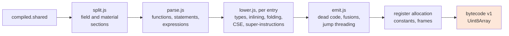
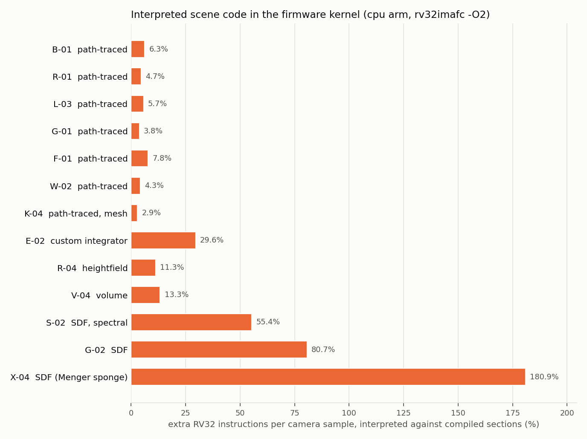
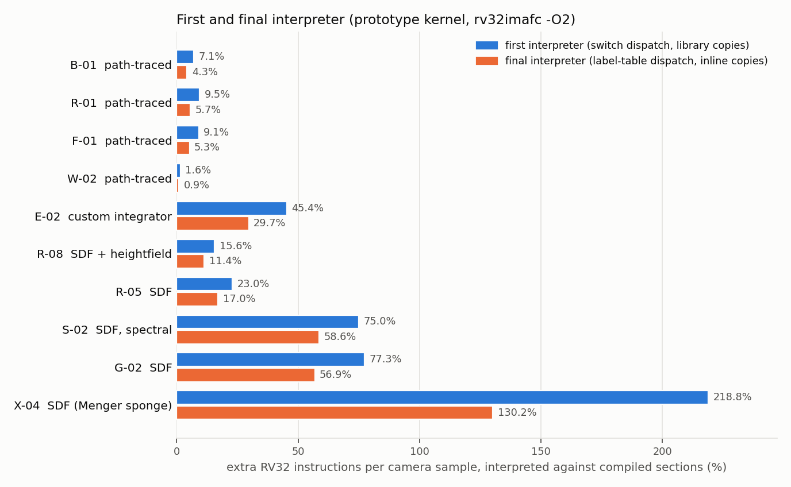

# PicoCalc Candela: Scene Code as Verified Bytecode in the Fixed Kernel — A Technical Deep Dive

Candela is a physically based path tracer whose scenes are JavaScript programs. Its scene compiler emits WGSL in two parts. The fixed kernel is the same for every scene. Each scene adds a few generated functions: its materials, its signed-distance and height fields, its participating media and an optional custom integrator. The previous project ([[PROJECT REPORT - PicoCalc Candela - The Fixed Path-Tracing Kernel as Firmware C++, Measured on the ESP32-P4 - A Technical Deep Dive]]) compiled the fixed kernel into the PicoCalc firmware as C++. The per-scene functions cannot be compiled that way, because a scene is written and changed on the handheld while the firmware stays the same. This project gives them a form the device can produce and run by itself. A JavaScript translator, running in the firmware's QuickJS, turns the WGSL that Candela's unchanged compiler emits into a register bytecode. A C verifier checks the bytecode once, and a C interpreter runs it behind the kernel's five dispatch functions.

The result is exact. Over all 105 presets, interpreted sections compute bit for bit what compiled C++ computes from the same WGSL. Two of two million material evaluations are the exception; each differs in the last bit of one field. Inside the fixed kernel's own code, built for the host, interpreted and compiled sections produce identical pixels. That check covers 40 renderings, 20 presets in two kernel configurations, and compares the 48-byte output record of every pixel in every frame. The cost was measured in RV32 instructions. The interpreter runs section code 4.3 to 10.8 times slower than compiled code. Sections are about 1% of the work in the path-traced presets, so those scenes need 2.9-7.8% more instructions per sample. In presets that sphere-trace a user signed-distance function the sections are a quarter of the work, and the Menger sponge needs 2.8 times as many.

> [!summary]
> - **A translator for the generators' WGSL, not for WGSL.** Two generators write all section code: straight-line `let` sequences for fields, and stochastic selection on a random variable `u` with runs of `Lobe` field assignments for materials. The translator parses exactly that subset, inlines every generated function, folds constants in single precision, and has three super-instructions for the generators' patterns (`CHOOSE`, `LOBE`, `SWITCH`). All 105 presets translate, and the bytes are identical in Node and in 32- and 64-bit QuickJS.
> - **A verified format.** Bytecode version 1 has fixed operand layouts, forward-only jumps and one disjoint register frame per entry. `cdl_vm_load` checks every operand, target, frame and kernel call before anything runs. A verified program therefore cannot read or write outside its registers and the input hit record, and it always terminates. All 17 targeted malformations and 184,933 of 210,000 random mutants are rejected; the accepted mutants run under AddressSanitizer without a fault.
> - **Agreement at three levels.** Per evaluation against the prototype C++ translation: 2,016,845 of 2,016,847 material evaluations and all 14.96 million evaluations of the other four entries are bit-identical over 105 presets at 4 spp. Per frame: the 64 spp frames of B-01, R-01, F-01 and W-02 are identical in every pixel. Per pixel inside the firmware kernel: 40 of 40 renderings are identical, including the six frame digests the kernel project published. With floating-point contraction off, the RV32 builds agree bit for bit too.
> - **Measured cost.** In the firmware kernel's fastest configuration, interpreted sections add 2.9-7.8% to the RV32 instructions per sample of path-traced presets, 11-13% for a heightfield and a volume, 29.6% for the custom integrator, and 55-181% for presets with user signed-distance functions. Calls with side effects run in WGSL's order by construction; the kernel project had discovered that requirement in its own translator.

## Why this project exists

The survey that started the Candela-on-PicoCalc work ([[PROJECT REPORT - PicoCalc Candela - What a Physically Based Path Tracer Costs on a 360 MHz Handheld - A Technical Deep Dive]]) proposed a three-way split. Candela's JavaScript front end runs unchanged in a QuickJS world on the device. Its fixed kernel becomes C++ when the firmware is built. The code each scene generates becomes a bytecode that a C interpreter runs. The fixed kernel was the first ticket. This is the second, `PICOCALC-CANDELA-SECTIONS`. Its acceptance criteria were:

1. a translator, in JavaScript that QuickJS runs, with a diagnostic naming every unsupported construct;
2. a versioned format and a verifier that rejects malformed programs before they run;
3. an interpreter whose heavy operations are calls into compiled C;
4. agreement with the compiled C++ of the same WGSL over all 105 presets: per evaluation to 1e-5 relative, and frame luminance within 1% at 64 spp;
5. RV32 instructions per sample, interpreted against compiled, with the presets that sphere-trace user signed-distance functions reported separately.

The alternative to a bytecode is native code generated on the device. A WGSL-to-RV32 compiler would run faster, but it would be much larger to build and harder to trust. The survey estimated that sections are a small part of most samples. The cost measurement answers whether that estimate holds and for which scenes it does not.

## Current project status

- Ticket `PICOCALC-CANDELA-SECTIONS` in `/home/manuel/code/wesen/2026-10-20--ds-js-os/ttmp/2026/11/21/PICOCALC-CANDELA-SECTIONS--candela-s-generated-wgsl-sections-as-bytecode-interpreted-by-the-p4-kernel/` holds:
  - the design (`design-doc/01-design-stub.md`) and an investigation diary;
  - the translator, the C verifier and interpreter, and the adapter for the fixed kernel;
  - every test and measurement script, with its evidence files in `various/`.
- Everything ran on the host: the translator in Node and QuickJS, the interpreter natively and in a counting RV32 interpreter. No device run was made; device timing was optional for this ticket.
- The interface the next ticket, `PICOCALC-CANDELA-FIRST-LIGHT`, needs is defined and tested. It consists of `vm/cdl_vm.h` and the adapter `ck/cdl_vm_sections.cpp`, which makes the bytecode a section table of the fixed kernel.

## Project shape

| Path (in the ticket's `scripts/`) | Role |
|---|---|
| `translator/*.js` | the translator: `split.js` finds the sections in a compiled program; then `parse.js`, `lower.js`, `emit.js`, `index.js`. `isa.js` is the single opcode table |
| `vm/cdl_vm.h`, `vm/cdl_vm.c`, `vm/cdl_vm_isa.h` | the C interface, verifier and interpreter (C99); `vm/gen-isa.mjs` generates the ISA header from `isa.js` |
| `ck/cdl_vm_sections.cpp`, `ck/cdl_vm_ck_math.h`, `ck/driver.c` | the bytecode as a `Sections` table of a fixed-kernel instance; the instance's math for the interpreter; a driver with per-pixel digests |
| `harness/` | the three-mode harness over the prototype C++ translation, and the counting RV32 interpreter |
| `01-` to `12-` | numbered drivers: export, translate all, agreement, QuickJS, engine summary, luminance, RV32 counts, kernel digests, evaluation order, effects census, cost tables, figures |

## Implementation details

### The seam: five functions per scene

Candela's compiler assembles every scene program from fixed and generated parts:

```text
head + PRELUDE + SPECTRAL + ggxTableWGSL() + sdfCode + hfCode + densCode + CORE + metalAt + matCode + PATH
```

The fixed kernel reaches the generated parts through five functions:

- `evalMaterial(h, wo, u) -> Lobe`;
- `sdUser(k, p) -> f32`;
- `heightAt(k, xz) -> f32`;
- `densityOf(m, P) -> f32`;
- `customKernel(ro, rd) -> vec3f`.

The firmware kernel calls them through a table of five function pointers (`struct Sections`). A scene binds its table, which until this project was always compiled C++. Generated code calls back into the kernel through 15 functions. The kernel project counted them over all 105 presets and exports them as its section API: `lobeNone`, `fresnelDielectric`, `metalAt`, `fbm3`, `tangentWorld`, `safeNorm`, `lum`, `fmodp`, `sellmeier`, `voronoi3`, `noise3`, `fmodp3`, `hitAlbedo`, `occluded` and `traceScene`.

A material is evaluated about once per path vertex, 0.81 times per camera sample in B-01. A user signed-distance function is evaluated at every step of sphere tracing, up to 220 times per ray. Whether interpretation is cheap or expensive for a scene depends mostly on which entries the scene uses.

### What the generators emit

Two generators write all section code. `genSurface` lowers Candela's BSDF algebra (`mix`, `add`, `layer`) to stochastic selection. A uniform draw `u` chooses one branch and is then rescaled, so the chosen branch receives a fresh uniform variable:

```wgsl
let x0_1: f32 = clamp(T, 0.0, 1.0);
if (u < x0_1) {
  u = u / max(x0_1, 1e-6);
  ... one branch ...
} else {
  u = (u - x0_1) / max(1.0 - x0_1, 1e-6);
  ... the other branch ...
}
```

Every leaf is a run of assignments to fields of a `Lobe` (`L.kind = 2; L.c0 = ...; L.ax = ...`). The second generator, `fx.js`'s `Gen`, walks a field's expression graph and emits one `let` per node, so a signed-distance function is a straight sequence of single-operation lets. Over the 210 section texts of the 105 presets there are 2,536 `let`s, 1,785 `var`s (nearly all `u`, `L` and `wgt`) and 1,003 `if`s. There are no loops, `switch`es or pointers. This sets the translator's scope. It needs a parser for this small subset, not for WGSL, and it refuses anything outside the subset with a diagnostic that names the construct, such as `E-SECT-UNSUPPORTED statement:for`.

### The translator



The translator is about 1,900 lines of ES modules with no Node API. `translateProgram(compiled.shared, kernelModule)` finds the sections with the same boundaries the compiler used to assemble the program. `translateSections(fieldCode, matCode, { spectral })` then returns `{ ok, bytes, diagnostics, stats }`.

Each of the five entries is lowered separately:

- **Inlining.** Calls to generated functions (`mat_k`, `sdf_k`, `bumpN_k`, ...) are inlined. WGSL forbids recursion and the call graph is a small tree, so inlining removes every call and return from the bytecode.
- **Types.** Every expression is typed (`f32`, `i32`, `bool`, `vec2f` to `vec4f`, `Hit`, `Lobe`), and the type chooses the instruction.
- **Constant folding.** Operations on constants are computed at translation time in single precision. Each intermediate result is rounded with `Math.fround`, so `(1.0 + sqrt(0.04)) / (1.0 - sqrt(0.04))` becomes exactly the float the compiled kernel computes. `SPECTRAL_ON` is a constant of the program, so whole branches disappear in RGB scenes.
- **Exact identities.** A `var` that is never reassigned is treated as a constant. With the identities `x * 1`, `x / 1`, `pow(1, y) = 1` and `x - (+0)`, this removes `L.w = L.w * wgt` from untinted layers and the `P - vec3f(0, 0, 0)` of a primitive at the origin. `x + 0` is not an identity, since `-0 + 0 = +0`, and it stays.

Three further steps remove copies. Common-subexpression elimination merges pure instructions within the enclosing blocks. A constructor of consecutive words, such as `vec3f(a.x, a.y, a.z)`, becomes a reference to those words. Retargeting writes a computed value directly into the register of the variable or `Lobe` field it is assigned to. Retargeting caused the project's one real bug, described in the section on agreement.

### Registers are words, swizzles are addresses

The interpreter has one file of 32-bit registers per core, each a union of `float` and `int32_t`; a vector occupies consecutive words. A register operand is a word index. `m4.x`, `U(32).xyz` and the field `k1.P` of a register-held `Hit` are therefore operand offsets and cost no instruction. Only non-contiguous swizzles such as `h.P.xz` need a `GATHER`. Reads of the material's input `Hit` are loads (`HLD`) from the kernel's own hit record, emitted once per field and cached.

The translator divides the register file once:

- **Constants and uniforms.** Words `[0, nconst)` hold constants and uniform imports. A vector constant is a run of words. `U(row)` becomes a four-word block, copied from the uniform buffer when the program is bound. The bytecode therefore never decodes a float immediate.
- **Frames.** Above them, each of the five entries has its own frame, disjoint from the others. Inside a frame, registers are allocated by first-fit linear scan over the linearised code. The code has only `if`/`else` and forward jumps, so a value's interval from definition to last use in linear order covers every path between them. No data-flow analysis is needed, and a register freed at the end of a `then` branch is reused in the `else` branch.

Disjoint frames make nested calls safe while the caller's frame is live. A custom integrator calls `hitAlbedo`, which calls `evalMaterial`, and `traceScene` sphere-traces through `sdUser`.

The programs are small. The median preset's program has 572 bytes, 90 register words and 171 code halfwords. The largest is K-03, a mesh scene with nine textured materials, at 2,888 bytes and 175 register words; its register file takes 700 bytes.

### Super-instructions

**`CHOOSE u v t`** performs the stochastic selection in one instruction:

```c
if (R[u] < R[v]) { R[u] = R[u] / fmaxf(R[v], 1e-6f); pc += 4; }            /* then branch */
else             { R[u] = (R[u] - R[v]) / fmaxf(1.0f - R[v], 1e-6f); pc = t; }  /* else branch */
```

`CHOOSE0` is the same test without the rescaling, for a selection whose branches never read `u` again.

**`LOBE base mask s...`** writes a run of `Lobe` fields. Bit `i` of the mask selects field `i`, and one source register follows per set bit. Within a run, the translator resolves reads of fields written earlier in the run (`L.ay = L.ax`, `L.flags = L.flags | 8`) to their sources. It also tracks which fields still hold `lobeNone()`'s values, so `L.med = -1` after `lobeNone()` writes nothing.

**`SWITCH s n ...`** replaces each dispatch function's `if (h.mat == k) { return mat_k(...); }` chain with a table jump.

Over all presets these three account for 1,597 of 6,922 instructions: `LOBE` 1,089, `CHOOSE` and `CHOOSE0` 390, and `SWITCH` 118.

Four fusions combine a producer with its only consumer:

- `fresnelDielectric(clamp(dot(a, b), 0, 1), eta)`, which every `layer` emits, becomes one instruction (`FRESDOT`, 305 times).
- `step(d, fract(x * n))` and `fmodp(floor(p * n).x + floor(p * n).y, 2.0)` are Candela's fx macros `stripes` and `checker`. They arrive as three to five lets and become `STRIPES` and `CHECKER`.
- `a * b + c` becomes `MAD` (65 times).

Every fusion performs the same floating-point operations in the same order as the code it replaces. It saves dispatches, not roundings.

### Calls with side effects

The kernel project found that evaluation order matters. WGSL evaluates operands and arguments left to right, and C++ leaves that order unspecified. In the kernel's `sampleLobe(L, woL, rnd2(), rnd())`, GCC drew the two random numbers in different orders on x86-64 and RV32. The frame means agreed, but only 42-59% of pixels did. That project's translator now hoists such calls into temporaries in WGSL order (its rule 5). Its manifest lists 13 kernel functions that change module state. Four are reachable from sections: `traceScene`, `occluded`, `rnd` and `rnd2`.

The bytecode follows WGSL's order by construction. Lowering emits one instruction per call in source order, operands and arguments left to right, and no later pass moves an instruction with effects. Three more rules complete the guarantee:

- **Unused calls stay.** Dead-code removal keeps a call with effects whose result is unused. Before this rule, `let o = occluded(...)` with `o` unused would have been removed along with its update of the trace state.
- **No merging.** Common-subexpression elimination merges only pure kernel calls, so two equal `traceScene` calls stay two calls.
- **Short-circuit operators.** WGSL's `&&` and `||` evaluate the right operand only when it is needed, while the bytecode evaluates both. A right operand with a side effect, directly or through a generated function, is refused rather than translated wrongly.

By default the translator also accepts kernel calls only to the manifest's 15 functions.

A test makes the rules observable. A stub kernel changes one counter on every side effect: `rnd` adds 1 and returns the counter, `rnd2` adds 1, `occluded` adds 10 and `traceScene` adds 100. Twelve custom-integrator bodies have expected results worked out by hand from WGSL's rules. For example, `vec3f(rnd(), rnd() * 2.0, rnd() + 1.0)` must give `(1, 4, 4)`. `select(rnd(), rnd(), true)` consumes two draws and returns the second. Three more bodies must be refused with a named construct. All 15 cases pass.

A census over the 105 presets finds 2 of 13,205 section statements with a call with side effects, E-02's `traceScene` and `occluded`, and none with two. No current preset's image can depend on evaluation order; the rules protect against the next version of the generators.

### Bytecode version 1

All fields are little-endian. A blob is laid out as follows:

1. a 20-byte header: magic `CDVM`, version, flags (bit 0 marks a spectral program), register count, constant count, import count, code length, and a bit mask of the kernel functions called;
2. five 12-byte entry descriptors, each with `pc`, `end`, the frame bounds, the argument block and the result block;
3. the constant words;
4. the imports, as `reg`, `row` pairs;
5. the code.

An instruction is an opcode halfword followed by operand halfwords. Their number depends only on the opcode, except for `SWITCH`, `LOBE`, `CALL`, `GATHER` and the two hit loads. The opcode's high byte carries a width, broadcast flags or a kernel-function number. One table, `translator/isa.js`, defines all 143 opcodes, and `vm/gen-isa.mjs` generates the C header from it. Translator, verifier and interpreter therefore cannot disagree about an encoding.

### The verifier

`cdl_vm_load` checks a blob completely before any of it runs, and names the first violation it finds:

1. **Header and entries.** Sizes agree with the blob's length, there are at most 4,096 registers, and entry code ranges are disjoint and inside the code. Frames are disjoint and lie above the constants, and argument and result blocks lie inside their frame.
2. **Every instruction**, decoded linearly through each entry:
   - a known opcode, with its operands inside the range;
   - destinations inside the entry's frame, and sources inside the constants or the frame;
   - widths in range;
   - jump targets forward, inside the entry and on an instruction boundary, checked against a bitmap built during the walk;
   - hit fields inside the 23-word record, and an `fbm3` octave count of at most 16.
3. **Termination.** Each entry ends in `RET` or `JMP`.
4. **Kernel calls.** The function number is known, and the kernel table supplied at load time exports the function. The ray-tracing and material-calling functions appear only in the custom integrator's range, and the input hit only in the material's.

A verified program cannot touch memory outside its register file and the input hit. Every jump goes forward, so every evaluation ends after at most `end - pc` instructions plus bounded kernel calls.

The test `vm/test-verify.c` is built with AddressSanitizer and UndefinedBehaviorSanitizer. It applies 17 targeted malformations to a real blob, and all are rejected with distinct messages. They include a backward jump, a jump into the middle of an instruction, a destination outside the frame, overlapping frames, a 300-case `SWITCH` and a kernel without `fresnelDielectric`. It then corrupts each of the 105 blobs 2,000 times. Of the 210,000 mutants, 184,933 are rejected. The 25,067 accepted ones are bound and run on six inputs per entry: 755,160 evaluations, each within its step bound and none with a sanitizer report.

### The interpreter

The interpreter runs the code in place. Under GCC it dispatches through a table of label addresses, and each handler ends in its own copy of the dispatch. A verified program holds only defined opcodes, so the table needs no bounds check. The heavy operations are calls through a table of C function pointers supplied by the kernel. The presets use nine of them: `fresnelDielectric`, `noise3`, `fbm3`, `voronoi3`, `tangentWorld`, `sellmeier`, `traceScene`, `occluded` and `hitAlbedo`. The other six section-API functions are short enough to be bytecode.

The first version used a `switch`. Its RV32 profile showed two avoidable costs:

- `memcpy` took 256 instructions per sample in B-01. GCC had turned the 104-byte `lobeNone()` template copy, the result copy and the vector result loops into library calls.
- `__ctzsi2` appeared in the profile. RV32IMAFC has no count-trailing-zeros instruction, so `__builtin_ctz` in `LOBE` was a call.

The final version writes these copies out word by word and walks `LOBE`'s mask with a shift loop. It decodes the high byte only in the handlers that use it and writes the vec3 handlers per component. A vec3 handler reads all three source words before it writes the first destination word, because a destination may overlap a source. A scalar `SUB` is now 19 RV32 instructions:

- three operand loads, three index scalings and three address additions;
- two float loads, the subtraction and the store;
- six instructions of dispatch.

### The C interface and the kernel adapter

```c
int    cdl_vm_load(cdl_vm_program *p, const void *blob, size_t len, const cdl_vm_kernel *k, char *err, size_t errlen);
int    cdl_vm_bind(cdl_vm_ctx *c, const cdl_vm_program *p, const cdl_vm_kernel *k, void *regs,
                   const float *U, unsigned nU_rows, char *err, size_t errlen);   /* constants and uniform imports */
void   cdl_vm_rebind_uniforms(cdl_vm_ctx *c, const float *U);                    /* after every pack */
void   cdl_vm_eval_material(cdl_vm_ctx *c, const cdl_hit *h, const float wo[3], float u, cdl_lobe *out);
float  cdl_vm_sd_user(cdl_vm_ctx *c, int k, const float p[3]);
float  cdl_vm_height_at(cdl_vm_ctx *c, int k, const float xz[2]);
float  cdl_vm_density_of(cdl_vm_ctx *c, int m, const float P[3]);
void   cdl_vm_custom_kernel(cdl_vm_ctx *c, const float ro[3], const float rd[3], float out[3]);
```

A context is per core, as the kernel's random state is. `cdl_hit` and `cdl_lobe` have the layout of the kernel's C++ `Hit` (23 words) and `Lobe` (26 words).

`ck/cdl_vm_sections.cpp` is compiled inside a kernel instance's namespace, with that instance's switches. It asserts that `Hit` and `cdl_hit`, and `Lobe` and `cdl_lobe`, agree in size and in every field's offset. The interpreter therefore reads the kernel's hit record and writes its `Lobe` in place. The adapter exports:

- `<ns>_sections_vm`, which `<ns>_bind` accepts in place of a compiled scene's table;
- `<ns>_vm_load`, which verifies a blob, refuses an RGB program for a spectral instance and the reverse, and binds the blob to the instance's uniform rows;
- `<ns>_vm_rebind_uniforms`;
- the instance's own `floor`, `sin`, `cos` and `exp`.

The math functions decide exactness. The kernel's fastest configuration replaces `floor` by a conversion, `sin` and `cos` by a degree-9 polynomial and `exp` by a degree-6 polynomial. Compiling the interpreter with `-include ck/cdl_vm_ck_math.h` points its math macros at the instance's functions, so interpreted sections round exactly as that instance's compiled sections do.

### Agreement

The first reference was the parent ticket's prototype C++ translation of a whole scene program. A script renames that translation's five dispatch functions to `F_compiled` and adds a wrapper for each. The harness then builds in three modes: compiled, interpreted and compare. In compare mode every evaluation during the render calls both versions. The kernel's random state is saved before the compiled call and restored around the interpreted one, and the outputs are compared field by field. Integer fields must be equal. A float vector must agree to `1e-5 × max(|a|, |b|)` in its largest component. The hit records are the render's own, covering every evaluation of every dispatch function in the frame.

The first full run found one bug. All entries of all presets agreed bit for bit, except `evalMaterial` in the eight mesh presets K-01 and K-03 to K-09. There, 2,753 of 504,351 material evaluations differed, all in metal lobes with tangents, and in K-04 the tangent pointed in another direction altogether.

K-04's listing showed the cause: `CALL tangentWorld r80:3, h, r83:3, r0, r86:3`. Its last operand should have been the shading normal `h.N`, but it was the register of an unrelated difference vector. `h.N` had been loaded once and kept in the load cache. A later `L.N = h.N` then retargeted the load into the `Lobe`'s normal field. The cache still named the old virtual register, which no instruction wrote any more, so the allocator gave its slot to another value. Values bound to a name or held in the cache are now marked shared, and retargeting refuses them.

After the fix, the results at 4 spp and 64 x 64 over all 105 presets were:

| Entry | Presets | Evaluations | Bit-identical | Over 1e-5 |
|---|---:|---:|---:|---:|
| `evalMaterial` | 105 | 2,016,847 | 2,016,845 | 0 (largest relative difference 2.5e-7) |
| `sdUser` | 6 | 1,541,521 | all | 0 |
| `heightAt` | 3 | 6,851,269 | all | 0 |
| `densityOf` | 4 | 6,547,730 | all | 0 |
| `customKernel` | 1 | 16,384 | all | 0 |

No integer field and no random-number draw differed. At 64 spp and 160 x 160, the frames of B-01, R-01, F-01 and W-02 are identical in all 25,600 pixels. The luminance criterion is therefore met with a ratio of exactly 1.

Once the firmware kernel was on the main branch, the reference became that kernel's own compiled sections, produced by its own translator. `08-kernel-digest.py` builds one executable per kernel instance and preset that links both section tables. A preset the kernel project did not generate goes through that project's own scene generator first. The executable renders frames 0 to 3 with each table. For every pixel it hashes, with FNV-1a, the 48-byte output record (colour, albedo and normal) over all four frames. Frame 0's hash over all pixels is the frame digest that the kernel's own driver and board app print.

| Arm | Presets | Pixels identical |
|---|---|---|
| `lazy` (Candela's arithmetic) | B-01, R-01, L-03, G-01, E-02 at 160 x 160; W-02, F-01, K-04, K-08, G-02, X-04, S-02, X-03, R-04, R-05, R-08, G-03, V-02, V-03, V-04 at 80 x 80 | 20 of 20 presets, every pixel |
| `cpu` (all CPU substitutions) | the same 20 | 20 of 20 presets, every pixel |

The set covers:

- materials of every kind, and mesh tangents (K-04, K-08);
- user signed-distance functions (G-02, X-04, S-02, R-05, R-08), heightfields (R-04, G-03) and media (V-02 to V-04, X-03);
- the custom integrator (E-02) and spectral rendering (S-02, R-05).

With the bytecode, the `cpu` arm's frame digests are B-01 `df6d3f85`, R-01 `e8421c97`, L-03 `585a3f2f`, G-01 `211878db`, E-02 `de9e22b5` and W-02 `794c1a46`. These are the six digests the kernel project published from its compiled sections.

The kernel's eager configuration, `wgsl`, could not be compared. There `select` evaluates both values, so in a scene without an HDRI environment `hdriTexel` computes `x0 % W` with `W = 0`. That traps on x86-64 for both section tables. The kernel project's own host frames use the lazy configurations for the same reason.

### What interpretation costs

The counts come from the counting RV32 interpreter of the earlier compiler studies. It models rv32imfc, counts every retired instruction once, marks a region per row and keeps a per-function profile. The code was built by the ESP-IDF GCC 14.2 for `rv32imafc/ilp32f` at `-O2`.

The table below is the firmware kernel's `cpu` arm with that project's flags, frame 0, at 160 x 160 or 80 x 80. The kernel calls compiled sections through its table, so they are separate functions and the profile measures them directly.

| Preset | Compiled frame | Interpreted frame | Ratio | Sections compiled | Sections interpreted | Slowdown on section code | Section share, compiled |
|---|---:|---:|---:|---:|---:|---:|---:|
| B-01 | 4,419.5 | 4,696.8 | 1.063 | 54.9 | 359.7 | 6.6 | 1.24% |
| R-01 | 9,533.8 | 9,978.6 | 1.047 | 95.5 | 585.3 | 6.1 | 1.00% |
| L-03 | 3,408.8 | 3,604.3 | 1.057 | 41.5 | 256.7 | 6.2 | 1.22% |
| G-01 | 8,240.0 | 8,555.1 | 1.038 | 69.6 | 417.0 | 6.0 | 0.84% |
| F-01 | 5,252.5 | 5,663.1 | 1.078 | 103.7 | 556.3 | 5.4 | 1.97% |
| W-02 | 13,890.3 | 14,486.7 | 1.043 | 142.3 | 806.7 | 5.7 | 1.02% |
| K-04 | 16,675.4 | 17,159.3 | 1.029 | 95.0 | 625.3 | 6.6 | 0.57% |
| E-02 (custom integrator) | 3,535.4 | 4,583.6 | 1.296 | 271.4 | 1,250.9 | 4.6 | 7.68% |
| R-04 (heightfield) | 559,279.0 | 622,748.4 | 1.113 | 17,354.0 | 81,399.8 | 4.7 | 3.10% |
| V-04 (volume) | 83,169.6 | 94,254.3 | 1.133 | 2,069.7 | 13,190.4 | 6.4 | 2.49% |
| S-02 (spectral, SDF) | 14,878.9 | 23,117.4 | 1.554 | 849.9 | 9,170.3 | 10.8 | 5.71% |
| G-02 (SDF) | 9,569.6 | 17,296.0 | 1.807 | 2,349.3 | 10,108.9 | 4.3 | 24.55% |
| X-04 (Menger sponge SDF) | 13,687.3 | 38,450.7 | 2.809 | 3,938.3 | 32,042.3 | 8.1 | 28.77% |

All values are instructions per camera sample. "Sections interpreted" includes the interpreter and the adapter functions.



The kernel project measured section code at 0.8-1.2% of B-01's, R-01's and G-01's instructions and estimated a 7-20 times interpreter slowdown. The measured slowdown on section code is 4.3-10.8 times. Those three scenes need 3.8-6.3% more instructions, and all seven path-traced presets 2.9-7.8%.

The custom integrator E-02 spends 7.7% of its compiled work in sections, for three kernel calls per sample including a full `traceScene`, and needs 29.6% more. The presets that sphere-trace a user signed-distance function form a separate class. Their sections are up to 29% of the compiled work, and interpretation multiplies the whole sample by 1.55 (S-02), 1.81 (G-02) and 2.81 (X-04). X-04 evaluates a Menger sponge of 57 bytecode instructions about 20 times per sample, at 1,374 interpreted RV32 instructions per evaluation.

The interpreter's own changes are visible in the prototype kernel, where the first version was measured as well:



The final interpreter removes 22-44% of the first one's overhead: B-01 falls from 7.1% to 4.3%, G-02 from 77% to 57% and X-04 from 219% to 130%. The prototype inlines compiled sections where GCC chooses, and its volume presets cost far more per sample than the firmware kernel's (V-04: 4.7 million instructions against 83,170). The firmware kernel's table is therefore the one to plan with.

### Contraction on RV32

GCC contracts `a * b + c` into one `fmadd.s` in GNU C++ mode. The compiled sections therefore round once where the interpreter, compiled as C99 without contraction, rounds twice. The RV32 frame digests with the kernel project's flags reflect that. They are equal for B-01, R-01, L-03, G-01 and K-04, and differ for E-02, W-02, F-01, G-02, X-04, S-02, R-04 and V-04.

With `-ffp-contract=off` on every file, the digests are equal for all 13 presets. The interpreter is therefore bit-exact on RV32 as on x86-64, and the default build's differences are roundings of the compiled sections. Turning contraction off costs the kernel 5-8% more instructions (B-01 from 4,419.5 to 4,678.1). The interpreted-to-compiled ratios change by at most 0.12, for X-04.

### Translation on the device

The translator produces the same bytes in Node and in the firmware's QuickJS, 32- and 64-bit host builds, for all 105 presets. The host runs record CPU time and QuickJS's own step counter. The median preset takes 161,149 QuickJS steps, and the largest, K-03 with 28 KB of section WGSL, takes 1.33 million. In the 32-bit host build on a shared machine, B-01 took 6.3 ms and K-03 77 ms. An earlier lexer, which matched a regular expression against a fresh substring for every token, took 16.5 ms for B-01. The parent ticket measured QuickJS on the P4 at 33-44 times slower than that host build. Device translation would therefore take about 0.2-0.3 s for B-01 and 2.5-3.4 s for K-03. That is acceptable once per scene change, but too slow to repeat on every edit.

## Important project docs

- Design: `ttmp/2026/11/21/PICOCALC-CANDELA-SECTIONS--candela-s-generated-wgsl-sections-as-bytecode-interpreted-by-the-p4-kernel/design-doc/01-design-stub.md`. It covers the seam, the subset, the translator, the format, the verifier, the interpreter, the C interface, the tests and the results.
- Diary: `.../reference/01-investigation-diary.md`, in eleven steps with commands, failures and evidence.
- Evidence: `.../various/` holds the translation summary, the 4 spp agreement, the verifier test, the QuickJS engine comparison, the order test, the effects census, the kernel digests and the cost tables.
- Kernel project: `ttmp/2026/11/21/PICOCALC-CANDELA-CPU-KERNEL--candela-s-fixed-path-tracing-kernel-as-firmware-c-on-the-esp32-p4/`. Its `scripts/generated/manifest.json` is the section API and side-effect list this project follows.

## Open questions

- **Signed-distance scenes.** At 1.55-2.81 times the compiled instructions per sample, are SDF presets acceptable on the device, or do they need native code? A direct RV32 emitter from the verified bytecode would keep the translator and the verifier and replace only the interpreter's dispatch.
- **Device translation time.** Is 0.2-3.4 s per scene change acceptable for editing on the handheld, or should the bytecode be cached by a hash of the section text?
- **Contraction in the firmware.** Should the firmware build the kernel with `-ffp-contract=off`, at 5-8% more instructions, so that interpreted and compiled sections give identical images on the device as well? Otherwise a device check of the interpreter can compare digests only against a build without contraction, or compare mean luminance.

## Near-term next steps

- `PICOCALC-CANDELA-FIRST-LIGHT`:
  - compile `vm/cdl_vm.c` (with `-include ck/cdl_vm_ck_math.h`) and `ck/cdl_vm_sections.cpp` into the firmware next to the kernel instance;
  - run the translator in the Candela world after `compile`, and pass the bytes to the render service with the packed buffers;
  - call `<ns>_vm_rebind_uniforms` wherever the buffers are rebound.
- Time a board run of B-01 and one SDF preset with the bytecode, under the usual serial lock, and compare cycles per sample with the instruction counts above.
- If SDF presets matter, implement the prepared code form. After verification, the code would be rewritten once into handler addresses and pre-scaled byte offsets. That removes the opcode decode and three of a scalar operation's 19 instructions.

## Project working rule

A section program reaches the kernel only through the verifier. A change to the translator or the interpreter is accepted only when the agreement tests stay bit-exact and the per-pixel digests stay equal. Exactness is what allows interpreted and compiled sections to be swapped without validating the images again.

## Related notes

- [[PROJECT REPORT - PicoCalc Candela - The Fixed Path-Tracing Kernel as Firmware C++, Measured on the ESP32-P4 - A Technical Deep Dive]]
- [[PROJECT REPORT - PicoCalc Candela - What a Physically Based Path Tracer Costs on a 360 MHz Handheld - A Technical Deep Dive]]
