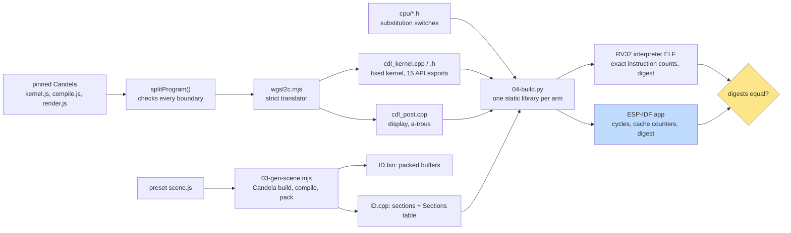
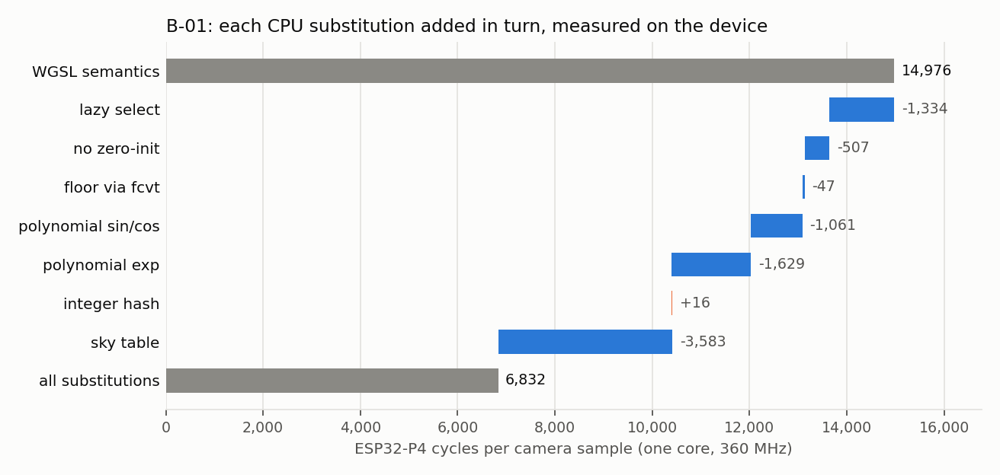
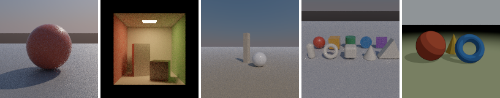

# PicoCalc Candela: The Fixed Path-Tracing Kernel as Firmware C++, Measured on the ESP32-P4 — A Technical Deep Dive

Candela is a physically based path tracer whose scenes are JavaScript programs. Its renderer is a fixed WGSL kernel plus a few functions that the scene compiler generates for each scene. The survey before this project ([[PROJECT REPORT - PicoCalc Candela - What a Physically Based Path Tracer Costs on a 360 MHz Handheld - A Technical Deep Dive]]) counted the instructions that kernel would execute on the PicoCalc's ESP32-P4 and estimated its time from an assumed cost per instruction. This project made the fixed kernel a build product, C++ generated from Candela's own `src/kernel.js` and compiled with the firmware's GCC for `rv32imafc/ilp32f`, and measured what a camera sample costs on the device.

The measurement replaces the estimate. The simplest scene, B-01 (a sphere on a plane under a sun and sky), costs **6,832 cycles per camera sample** on one 360 MHz core with the CPU substitutions this project added, and 14,976 cycles with the semantics of the GPU code. That is 52,700 samples per second, against the survey's estimate of 28,500-41,000. Every device frame's digest equals the digest of the same code in a counting RV32 interpreter, so the cycle counts can be divided by exact instruction counts. The resulting cycles per instruction (1.28-1.72) are explained by the processor's latencies, which the project also measured.

> [!summary]
> - **A generated kernel with a seam.** `kernel.js` is split at the boundaries `compile.js` uses to assemble programs. A strict WGSL-to-C++ translator translates the fixed part. The five per-scene functions are called through a table of function pointers, and the 15 kernel functions that generated code calls back into are the kernel's exported API. The generated files reproduce byte for byte.
> - **Measured cost.** At 160 x 160 and 1 spp: B-01 6,832 cycles per sample, L-03 5,358, G-01 11,960, R-01 12,867, E-02 4,918; W-02 (fbm wood) 19,413. Seven CPU substitutions, each switchable and each measured on the device, make B-01 2.19 times faster than the GPU semantics. The sky table alone is worth 3,583 cycles per sample.
> - **Why it costs that.** Simple FP operations have a latency of 4 cycles, `fmadd.s` 5, and `fdiv.s` and `fsqrt.s` 19 on one unpipelined unit. The 50.5 KB kernel misses the L1 instruction cache on up to 16% of fetches, and L2 serves almost all of those misses. Identical machine code placed at other addresses varies by up to 2.3%, which bounds what an arm-to-arm comparison can resolve.
> - **Agreement, after one translation bug.** 64 spp frames rendered on the device equal the host build's frames to floating-point rounding: mean luminance within 0.005%, and 99.1-100% of pixels within 1%. Reaching that required a fifth translation rule. WGSL evaluates function arguments left to right; C++ does not specify the order, and GCC orders them differently on x86-64 and RV32. As a result, one statement drew its random numbers in a different order on the host.

## Why this project exists

The survey proposed a split for running Candela on the PicoCalc. Candela's JavaScript front end runs unchanged in a QuickJS world. Its fixed kernel becomes C when the firmware is built. The code each scene generates becomes a bytecode that a C interpreter runs on the device. The survey filed one ticket per part, and this is the first: `PICOCALC-CANDELA-CPU-KERNEL`. Its acceptance test was the first number from the device: cycles per camera sample, measured with the cycle counter, with and without each CPU-specific substitution. Image agreement with a host build and the instruction latencies that explain the cycle count completed it.

The survey's time figures all had the form "exact instruction count times assumed cycles per instruction". The assumption came from GCC's integer ray tracer on the same board: 1.13 cycles per integer instruction, 10-30 per division and square root, 1-2 per other FP instruction. Candela's code is mostly short chains of dependent single-precision operations, so the assumption could be wrong by a factor of two in either direction. The resolution and refresh policy for the first rendering on the device (`PICOCALC-CANDELA-FIRST-LIGHT`) depend on that number.

## Current project status

- Ticket `PICOCALC-CANDELA-CPU-KERNEL` in `/home/manuel/code/wesen/2026-10-20--ds-js-os/ttmp/2026/11/21/PICOCALC-CANDELA-CPU-KERNEL--candela-s-fixed-path-tracing-kernel-as-firmware-c-on-the-esp32-p4/` holds the design, the analysis of the device results, an investigation diary, the generator, the generated kernel, the host and interpreter tests, the board benchmark app and its runner.
- Device runs: two timing runs (18 kernel configurations x 6 scenes, microbenchmarks, post pass, buffer placement), one before and one after the translation fix, and one image run (64 spp frames). After each run the board was restored to the current playable firmware and passed its health check (eight worlds, the painter service, keyboard I2C with no errors).
- Commits in the code repository: `b6217e9` (design), `63e6997` (generator, section tables, 18 measurement configurations), `f65c225` (host tests, board app, runner), `d50dc3e` (first device cycles per sample), `4c10512` (translation rule 5, device acceptance, analysis).
- Not yet done: integration into the playable firmware (FIRST-LIGHT), the bytecode for per-scene code (`PICOCALC-CANDELA-SECTIONS`), and per-core kernel state for rendering on both cores.

## Project shape

| Path (under the ticket's `scripts/`) | What it is |
|---|---|
| `lib/candela.mjs` | Version pin of the Candela sources, `splitProgram()`, scene export |
| `lib/wgsl2c.mjs` | The strict WGSL-to-C++ translator |
| `02-gen-kernel.mjs` | Generates `generated/cdl_kernel.{h,cpp}`, `cdl_post.cpp` and a manifest of the section API |
| `03-gen-scene.mjs` | Builds a preset in Node and writes its sections (`generated/scenes/ID.cpp`) and packed buffers (`ID.bin`) |
| `cpu/` | The substitution switches, scalar built-ins, the sky table and the integer hash |
| `04-build.py` | Builds every measurement configuration ("arm") for the RV32 interpreter, the host and the board |
| `05-rv32imfc-count.c`, `06-driver.c` | The counting interpreter with marked regions and per-function profiles, and the driver shared by host and RV32 |
| `09-host-tests.py`, `07-sky-error.cpp` | Poison test, sky-table error sweep, 64 spp host reference frames, FMA comparison |
| `board/`, `07-stage-board.sh` | The ESP-IDF benchmark app (timing mode and image mode) |
| `09-run-board.py` | Flash, collect, restore and health-check under the shared board lock |
| `10-score-board.py` .. `16-layout-noise.py` | Device scoring, image agreement, cycle models, the ladder figure, the evaluation-order check, layout noise |

## Implementation details

### Where the fixed kernel ends

Candela's `src/compile.js` assembles each program from fixed strings and generated strings in one order:

```text
head + PRELUDE + SPECTRAL + ggxTableWGSL() + sdfCode + hfCode + densCode + CORE + metalAt + matCode + PATH
```

`head` is one constant (`SPECTRAL_ON`). `sdfCode`, `hfCode` and `densCode` are the scene's signed distance fields, height fields and media densities. `matCode` holds the scene's materials and ends with `customKernel`, the hook for a scene-defined integrator. Everything else is the same for every scene. `splitProgram()` checks every boundary of that string and throws on any other layout. All 105 presets of the pinned Candela version pass. A newer Candela version that changes the layout therefore fails at build time rather than producing a wrong kernel.

The split defines a seam in two directions. The fixed kernel calls five generated functions: `evalMaterial`, `sdUser`, `heightAt`, `densityOf` and `customKernel`. In the firmware these come from a table that a scene binds:

```cpp
struct Sections {
  Lobe  (*evalMaterial)(const Hit& h, vec3f wo, f32 u);
  f32   (*sdUser)(i32 k, vec3f p);
  f32   (*heightAt)(i32 k, vec2f xz);
  f32   (*densityOf)(i32 m, vec3f P);
  vec3f (*customKernel)(vec3f ro, vec3f rd);
};
```

In the other direction, generated code calls kernel functions. A census over all 105 presets found that it calls only 15 of the kernel's 107 functions. In order of the number of presets that use them, they are: `lobeNone`, `fresnelDielectric`, `metalAt`, `fbm3`, `tangentWorld`, `safeNorm`, `lum`, `fmodp`, `sellmeier`, `voronoi3`, `noise3`, `fmodp3`, `hitAlbedo`, `occluded`, `traceScene`. Generated code also reads the globals `gTime` and `gLam` and the uniform accessor `U`. The kernel exports exactly these 15 functions, and every other function stays `static`. Two properties follow. GCC inlines inside the kernel as freely as in a whole-program build, and a scene that calls anything else fails to link. The bytecode interpreter of the SECTIONS ticket uses the same list as its call targets.

### The generator



The translator keeps the survey prototype's rules: typed declarations, function prototypes, struct parameters by `const&`, a generated vector prologue with the swizzles in use, and an `f` suffix on float literals. It adds five things.

1. **Strictness.** Each line is tokenised. A keyword outside the subset Candela uses (`switch`, `while`, `ptr`, `bitcast`, attributes, texture calls), a call to an unknown function, an assignment to a swizzle, or address-of stops the build with the line number. GCC would reject some of these constructs. The others would compile and mean something different.
2. **Macros for GPU semantics.** WGSL's `select(f, t, c)` evaluates both arguments. It becomes `CDL_SEL(f, t, c)`, which is either an eager function call or a conditional expression. A `select` whose argument has side effects (for example, draws a random number) stays eager, so the random stream is the same under every switch. `var x: S;` for a struct or array becomes `S x CDL_ZI; CDL_POISON(x);`, where `CDL_ZI` is `{}` (value-initialisation) or empty.
3. **Override points.** The functions a substitution replaces (`hash3`, `hash13`, `skyL`, `voronoi3`'s cell hash, `atrousW`'s power) are emitted under an alternative name. A forwarding definition then selects either the original or the CPU version.
4. **Namespaced instances.** Everything is inside `namespace CDL_NS`, and the C entry points carry the namespace in their names (`cdl_cpu_bind`, `cdl_cpu_render_span`). The benchmark links 18 instances into one image, and a later firmware can hold an RGB instance and a spectral one.
5. **WGSL's evaluation order.** Calls with side effects on module state that share one statement are hoisted into temporaries in left-to-right order. This rule was added after the image comparison exposed its absence; the section on agreement below explains it.

The C interface has three render-side functions. `NS_bind(buffers, sections)` installs a scene's packed buffers and section table, and rebuilds the sky table when the sun has moved. `NS_render_span(y, x0, x1, frame, out)` renders a row segment. `NS_render_pixel` delegates to `render_span`, so the kernel's `renderPixel` has one caller and stays inlined in the pixel loop. Two other choices kept the generated kernel as fast as the prototype. Value-initialisation replaced `memset`, because only with value-initialisation can GCC drop stores that a later write makes redundant. The pixel output is copied field by field instead of with a 48-byte `memcpy`. Together these removed about 120 instructions per sample.

The generated files are committed, so the board build needs neither Node nor the Candela archive. Running the generator again reproduces them byte for byte.

### The CPU substitutions

Each substitution is a preprocessor switch. Each is measured on the device both as a step of a cumulative ladder and by removing it from the shipping configuration `cpu`.

| Switch | What changes |
|---|---|
| `CDL_LAZY_SELECT` | `select` evaluates only the chosen argument |
| `CDL_NO_ZERO_INIT` | structs and arrays declared without a value are not zeroed |
| `CDL_FAST_FLOOR` | `floor`/`fract` through `fcvt.w.s`, since RV32F has no round-to-integer instruction |
| `CDL_FAST_TRIG` | one-step range reduction and a degree-9 polynomial for `sin`/`cos` |
| `CDL_FAST_EXP` | `exp` through `exp2` with a degree-6 polynomial |
| `CDL_INT_HASH` | pcg3d on the float bit patterns instead of `fract(sin(x) * 43758.5453)` |
| `CDL_SKY_TABLE` | Preetham sky as a 64 x 64 bilinear RGB table in hemi-octahedral coordinates, rebuilt when the sun moves (49 KB) |
| `CDL_POW32` | in the denoiser, `pow(x, 32)` as five squarings |

Each switch needs evidence that it changes nothing that matters. That evidence came from the host, where results reproduce bit for bit:

- **Skipped initialisation** is safe when no field is read before it is written. `CDL_POISON_INIT` fills each skipped initialisation with 0xA5 bytes instead of zero. Host frames from the poisoned and zeroed builds are bit-identical for 18 of 18 scene and configuration pairs.
- **The sky table's error** at 64 x 64 texels, against the exact `skyL` over 400,000 random directions, is 0.057% mean and 0.44% at the 99th percentile in the upper hemisphere. At 32 x 32, which needs 12 KB, the mean is 0.23%.
- **The polynomials and the hash** change the 64 spp mean luminance against the exact-math build by at most 0.021% on the six test scenes. B-01's 0.021% comes entirely from the sky table. These are paired comparisons, because no switch changes the random stream.

### Proving the device ran the counted code

`04-build.py` compiles each arm once into a static library. The same objects are linked into a bare-metal driver for the counting interpreter and into the ESP-IDF benchmark app. The interpreter supports marked regions: a system call starts and stops the counters around each row's render call. Each frame produces a digest, FNV-1a over every pixel's 48-byte output. For all 108 arm and scene pairs, in both timing runs, the device's digest equals the interpreter's. So the cycles measured on the device were spent on exactly the instructions counted, and their ratio is a measured CPI rather than a model.

The same digests located the first serious bug in the translation layer. The eager `select` was first written as `template<class A, class B> auto select(A f, B t, bool c) -> decltype(c ? t : f)`. When both arguments are lvalues of the same type, `decltype` of the conditional is a reference type, so the function returns a reference to its own by-value parameter. At -O0 the stack slot survived. At -O2 `safeNorm` returned zero, and the eager configurations rendered black frames at a third of the instruction count. A plain `auto` return type fixed it.

### The device benchmark

The benchmark is a standalone factory app, flashed at 0x10000 in place of the playable firmware for one run. `09-run-board.py` takes the board lock shared with other sessions. Only once it holds the lock does it read the current restore target from a pointer file, because another session may install a new playable build while the run waits. It then checks the running firmware's health, verifies the playable image on flash, and writes and verifies the benchmark app. It collects UART output between `CANDELA BEGIN` and `CANDELA END`. Finally it writes and verifies the playable app and checks health again. A keyboard I2C failure stops all device work, because recovering from it needs a power cycle.

The app runs on core 0 with the task watchdog disabled. In timing mode it runs dependent-chain microbenchmarks, then three blocks of 1 spp frames for every arm and scene. Each frame is timed with `mcycle` around the row render calls, so the digest and output handling stay outside the timed region. The L1 and L2 cache hit and miss counters are read around the same frames. It also times the post pass and the `cpu` arm with its buffers in PSRAM. In image mode it renders five scenes at 64 spp, accumulated over frame indices 0-63 the way the progressive renderer will. It sends per-pixel f32 luminance and an RGBE preview as base64.

### What a sample costs on the device

| Scene | GPU semantics (`wgsl`) | All substitutions (`cpu`) | Speed-up | `cpu` samples per second | One 160 x 160 pass |
|---|---:|---:|---:|---:|---:|
| B-01 hello sphere | 14,976 | **6,832** | 2.19x | 52,700 | 0.49 s |
| R-01 Cornell box | 15,536 | 12,867 | 1.21x | 28,000 | 0.92 s |
| L-03 sun and sky | 13,570 | 5,358 | 2.53x | 67,200 | 0.38 s |
| G-01 primitives | 19,817 | 11,960 | 1.66x | 30,100 | 0.85 s |
| E-02 toon (custom integrator) | 5,736 | 4,918 | 1.17x | 73,200 | 0.35 s |
| W-02 table, fbm wood (80 x 80) | 102,659 | 19,413 | 5.29x | 18,500 | 1.38 s at 160 x 160 |

*Cycles per camera sample on one 360 MHz core, median of three blocks. Within a run, frames of the same arm and scene differ by at most 0.21%. The first frame costs the same as later ones, because 25,600 samples amortise any cache warm-up.*



*Each bar is the change in measured cycles per sample when one switch is added to the previous configuration, in the order shown.*

The ladder and the leave-one-out measurement disagree wherever substitutions overlap, and both are informative:

| B-01 switch | Cycles saved when added in the ladder | Cost of removing it from `cpu` |
|---|---:|---:|
| lazy `select` | 1,334 | +1,632 |
| no zero-initialisation | 507 | +523 |
| `floor` via `fcvt` | 47 | +122 |
| polynomial `sin`/`cos` | 1,061 | +647 |
| polynomial `exp` | 1,629 | +129 |
| integer hash | −16 | +96 |
| sky table | 3,583 | +3,583 |

The polynomial `exp` saves 1,629 cycles when it is added before the sky table, and only 129 once the sky table is present: most of B-01's `exp` calls are in the sky. Across scenes, the sky table saves 3,329-3,676 cycles wherever the sky is visible, and lazy `select` saves 970-1,770 cycles in every path-traced scene. W-02 shows the largest effect of a single switch: polynomial `sin`/`cos` removes 76,488 of its 102,659 cycles. Its wood grain hashes positions with `sin` of large arguments, and newlib reduces those exactly with Payne-Hanek reduction. The conversion `floor`, the integer hash outside W-02, and the polynomial `exp` once the sky table is present each change B-01 by less than the layout noise described below. The same holds for the dispatch seam: measured against a configuration with kernel and sections in one translation unit, it changes cycles by −2.5% to +2.7%. `-O3` is 0.2-2.6% faster than `-O2`, and its kernel is 17% larger.

### Why a sample costs what it costs

Dependent chains of 256 instructions in inline assembly give these latencies:

| Instruction | Cycles |
|---|---:|
| `add`, `addi` | 1 |
| `mul`, `lw` (load to use) | 2 |
| taken branch | 3 |
| `fadd.s`, `fmul.s`, `fmin.s` | 4 |
| `fmadd.s` | 5 |
| `fcvt.w.s` followed by `fcvt.s.w` | 6 for the pair |
| `fdiv.s`, `fsqrt.s` | 19 (`fdiv.s` with both operands 1.0: 6) |
| two interleaved `fdiv.s` chains | 17 per division |
| `fdiv.s` followed by 8 independent `addi` | 19 per group |

The last two rows describe the divider. It is a single unit that does not accept a second division while one is in flight, and integer instructions continue to issue while it works. Every FP result arrives four cycles after issue. A typical step of Candela's shading code is a dot product, its square root, and a division by the result. Each instruction in that chain waits for its predecessor, so this code runs well below one instruction per cycle.

Dividing measured cycles by the interpreter's exact instruction counts gives a CPI of 1.28-1.72 over all 108 pairs. A bracket built from the latencies contains every measurement. Its lower edge charges one cycle per instruction plus the divider time; its upper edge charges every instruction its full latency. For B-01 `cpu` the bracket is 5,633-10,069 cycles, and the measurement is 6,832. The survey's assumed model also contains every measurement, but the device sits at 0.79-0.98 of the model's upper end. The model charged too little for ordinary FP operations and too much for division.

A non-negative least-squares fit of the 108 measured cycle counts reproduces every measurement within 5.1% (median 1.0%). Its inputs are the interpreter's instruction counts by class and the measured L1 cache misses. The coefficients are correlated, because integer and FP counts move together across configurations, so they serve as a budget rather than as latencies. For B-01 `cpu`, integer and memory instructions take about 45% of the cycles, FP arithmetic and fused multiply-adds 38%, `fdiv.s` and `fsqrt.s` 9%, and L1 instruction-cache misses 13%.

The `cpu` kernel's `.text` is 50.5 KB, larger than the core's L1 instruction cache. The P4's cache counters report 851 L1 misses per B-01 sample out of 5,380 fetch accesses (15.8%). Across scenes the miss rate ranges from 0.6% (E-02, whose custom integrator runs a small loop) to that 15.8%. The 128 KB L2 cache serves almost all of the misses: 4-9 L2 misses per sample (43 for W-02). The `cpu-iram` configuration places the whole kernel in internal RAM, at `0x4ff0…` instead of flash-mapped `0x4007…`. Its L2 misses go to zero, but its L1 misses do not fall (920 per sample), and it is 0.5-1.5% slower than running from flash. The cost of a miss is the L1 refill wherever the code lives, so internal RAM is better spent on something else. For contrast, executing 1,000 never-before-run `addi` from flash took 43,186 cycles for 63 cache lines: about 680 cycles per line that is in neither cache. A frame pays that only in its first few samples.

### Layout limits the resolution

The timing run was made twice, with board images built before and after the translation fix. Thirteen of the 16 multi-file kernel objects compiled to identical machine code in both images. Their code nevertheless sat at different addresses, along with their scenes' section code and the libm functions they call, because three other arms changed size. For those 78 arm-and-scene cells, cycles per sample changed by a median of 0.36% and at most 2.27%. The largest change was `cpu-floor` on L-03: +123 cycles per sample, with 100 more L1 instruction misses. Changes in cycles and changes in L1 instruction misses correlate (r = 0.60, about 1.5 cycles per additional miss). One arm, `lazy`, had its render function at the same address in both images and still moved 1.6% on L-03, because the code it calls had moved. The precision of a comparison between two configurations is therefore about ±2%, set by code placement, and not the 0.2% spread within a run. The cheapest substitutions sit below that resolution.

Data placement does not matter at this size. The scene buffers are 1-3 KB, and the L1 data cache misses fewer than six times per sample. B-01 takes 6,809 cycles per sample with its buffers in PSRAM and 6,816 in internal RAM.

### The post pass

Candela's display pass (exposure, AgX tone mapping, sRGB) costs 4,315 cycles per pixel. One à-trous denoiser iteration (25 taps) costs 23,004 cycles per pixel with the GPU semantics and 11,842 with the polynomial `exp` and `pow(x, 32)` as squarings. Candela runs four iterations, about 47,400 cycles per pixel or seven B-01 samples. The denoiser therefore runs once when accumulation pauses, as the survey's design proposed. The display pass costs 0.63 of a B-01 sample per pixel: 110 million cycles, 0.31 s, for a 160 x 160 frame on one core, and 0.08 s at 80 x 80. Refreshing the screen after every 160 x 160 pass would add 63% to B-01's pass time. Per pixel the display pass calls newlib's `log2f` three times (AgX's log encoding) and `powf` six times (AgX's final 2.2 power and the sRGB encoding, one per channel). Two one-dimensional tables would remove all nine calls. One would cover the log encoding and AgX curve, indexed by the float's exponent and leading mantissa bits. The other would cover the 2.2 power composed with the sRGB curve on [0, 1]. Neither has been measured.

### Agreement with the host build

The acceptance test renders five scenes at 64 samples per pixel on the device, accumulated over frame indices 0-63 the way the progressive renderer will. It compares them with frames from the host build of the same C++.

| Scene | Device mean luminance | Host mean luminance | Ratio | Pixels within 1% of the host |
|---|---:|---:|---:|---:|
| B-01 | 8,464.8307 | 8,464.8342 | 0.9999996 | 99.996% |
| R-01 | 62.172685 | 62.172685 | 1.0000000 | 99.996% |
| L-03 | 9,462.1294 | 9,462.1295 | 1.0000000 | 100% |
| G-01 | 11,584.481 | 11,585.048 | 0.99995 | 99.1% |
| E-02 | 0.44502534 | 0.44502530 | 1.0000001 | 99.996% |

The acceptance criteria were mean luminance within 1% for the first four scenes, and at least 99% of E-02's pixels within 1%. The measured agreement is two to four orders of magnitude tighter. The device renders the same image as the host, not merely an image with the same statistics.



*B-01, R-01, L-03, G-01 and E-02, rendered by the `cpu` kernel on the device at 160 x 160 and 64 spp, tone-mapped for display from the device's RGBE preview.*

The first comparison did not look like this. It passed the mean-luminance criterion (ratios 1.00021-1.00046), but only 42-59% of the path-traced scenes' pixels agreed within 1%. That is the signature of two renderers drawing different samples from the same distribution. FMA contraction was the first suspect, because the device build contracts `a * b + c` into `fmadd.s` and the host reference build has no FMA. A direct test refuted it: two host builds that differ only in FMA contraction agree on 99.1-100% of pixels. The decisive measurement used a single sample per pixel. The counting interpreter's 1 spp frame, which equals the device's by digest, differed from the host's in 58% of pixels. The sky rows agreed to 1e-6, and large differences began at the first surface rows. So the paths diverged at the first bounce, in their decisions rather than in their rounding.

The cause was evaluation order. One statement in Candela's `tracePath` passes two random draws as arguments:

```wgsl
let bs: BS = sampleLobe(L, woL, rnd2(), rnd());
```

WGSL defines left-to-right evaluation, so a GPU calls `rnd2()` first. C++ leaves the order of function arguments unspecified, and GCC at -O2 evaluated them in WGSL's order on RV32 and in the reverse order on x86-64. The fix is translation rule 5. The translator computes the set of functions with side effects on module state: those that assign a `var<private>` global, and their callers, transitively. The set has 13 functions, among them `rnd`, `rnd2` and the intersection functions that write the hit globals `gTri` and `gBary`. In a declaration whose initialiser calls two of them, the calls are hoisted into temporaries in WGSL's order:

```cpp
const auto cdlSeq1313_0 = rnd2(); const auto cdlSeq1313_1 = rnd(); const BS bs = sampleLobe(L, woL, cdlSeq1313_0, cdlSeq1313_1);
```

Any other statement shape with two such calls fails the build, because hoisting out of a condition, a loop header or a lazy `select` would change meaning. After the fix, all 108 RV32 digests and the `cpu` kernel's machine code were unchanged. The device had rendered Candela's samples all along, and only the host reference had been wrong. The remaining per-pixel differences are FMA contraction. A host build with `-mfma -ffp-contract=fast` reproduces the device frames to within 1.8e-6 relative on every pixel of B-01, R-01, L-03 and E-02, and on 99.8% of G-01's pixels. The dependence on evaluation order is well defined in Candela's WGSL and becomes a bug only in translation. The same holds for any WGSL-to-C or WGSL-to-C++ translator: a statement that consumes two values from a stateful generator depends on an order that WGSL fixes and C and C++ do not, and a mean-luminance test cannot detect the difference. The survey's prototype translator has the same defect.

### Size

| Part | `.text` |
|---|---:|
| kernel, `cpu` configuration, -O2 | 50,522 B |
| post pass | 5,658 B |
| one scene's compiled sections (stand-in for SECTIONS' bytecode) | 554-2,418 B |
| newlib single-precision libm functions the kernel uses | 8,308 B |

One kernel instance with its post pass and libm functions is about 67 KB, 1.45% of the playable firmware image (4,626,128 bytes). The GPU-semantics kernel is smaller (37,718 B), because it calls libm where the CPU configuration inlines polynomials. The sky table adds 49 KB of RAM.

## Important project docs

- `/home/manuel/code/wesen/2026-10-20--ds-js-os/ttmp/2026/11/21/PICOCALC-CANDELA-CPU-KERNEL--candela-s-fixed-path-tracing-kernel-as-firmware-c-on-the-esp32-p4/design-doc/01-design-stub.md` — the design: seam, generator, translation rules, substitutions, arms, tests, benchmark, results
- `/home/manuel/code/wesen/2026-10-20--ds-js-os/ttmp/2026/11/21/PICOCALC-CANDELA-CPU-KERNEL--candela-s-fixed-path-tracing-kernel-as-firmware-c-on-the-esp32-p4/analysis/01-what-candela-s-fixed-kernel-costs-on-the-esp32-p4-measured.md` — the device results
- `/home/manuel/code/wesen/2026-10-20--ds-js-os/ttmp/2026/11/21/PICOCALC-CANDELA-CPU-KERNEL--candela-s-fixed-path-tracing-kernel-as-firmware-c-on-the-esp32-p4/reference/01-investigation-diary.md` — the investigation diary, including both bugs and the refuted FMA hypothesis
- `scripts/various/06-board-timing/score.txt` (all cycle tables), `scripts/various/07-cycle-model.txt` (cycle models), `scripts/various/08-board-images/compare.json` (image agreement), `scripts/various/06-board-timing/layout-noise.txt` (layout comparison)

## Open questions

- **Code placement.** L1 instruction misses cost about 13% of B-01's cycles, and placement alone moves cycles by up to 2%. A kernel compiled with `-Os`, or one whose hot path (kernel loop, section code and the libm functions it calls) is placed contiguously, might turn the variation into a stable gain. Neither has been measured.
- **Two samples at once.** With four cycles of FP latency and dependent chains, interleaving two independent samples' arithmetic could raise instructions per cycle. That requires restructuring the kernel, which is generated from Candela's code, so it is a translator question rather than a hand optimisation.
- **Interpreter overhead.** The SECTIONS bytecode replaces natively compiled sections. In the `cpu` arm, section code executes 0.8-1.2% of the instructions of B-01, R-01 and G-01, measured with the interpreter's per-function profile. At the survey's measured 7-20x interpreter slowdown those scenes would become 5-23% slower. Scenes with user SDFs, which call `sdUser` at every sphere-tracing step, will cost more and have not been measured.
- **Dual-core rendering.** The kernel's private globals (`rngS`, `gTime`, `gLam`, `gTau`, `gTri`, `gBary`) are shared. A second core needs them moved into a per-core context.

## Near-term next steps

1. FIRST-LIGHT: link the `cpu` kernel into the playable firmware, call `NS_bind` from the world after `pack`, and render rows from a worker task. Use 80 x 80 (0.09-0.23 s per pass for the scenes measured) while the camera moves and 160 x 160 at rest. Run the display pass at the lower resolution during interaction, and measure a table-driven display pass before refreshing after every pass.
2. SECTIONS: the bytecode compiler and interpreter. The 15 exported kernel functions in `generated/manifest.json` are its call targets. The bytecode compiler must evaluate operands left to right, and the manifest's `sideEffects` list names the 13 functions whose calls it must not reorder. The natively compiled sections of this ticket are its reference for agreement and cost.
3. Per-core kernel state, then a second rendering core.

## Project working rule

Measure the code that ships, and prove it is the code that was counted. Each device number in this project rests on a digest match between the device and an instruction-counting interpreter running the same object files. Each CPU substitution rests on a host test showing that it changes nothing that matters. Compare images per pixel, not only by their means: two correct-looking renderers can draw different samples, and only a per-pixel comparison shows it.

## Related notes

- [[PROJECT REPORT - PicoCalc Candela - What a Physically Based Path Tracer Costs on a 360 MHz Handheld - A Technical Deep Dive]]
- [[PROJECT REPORT - Candela on the DGX Spark - From a JavaScript Scene API to OptiX Ray Tracing - A Technical Deep Dive]]
- [[PROJECT REPORT - Candela Render Runtime - Running Candela Scenes in Embedded V8 - A Technical Deep Dive]]
- [[ARTICLE - PicoCalc Scalar Breakdown - Separating the costs of a scalar ray on the ESP32-P4]]
