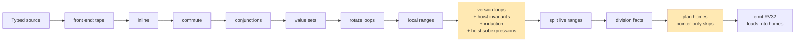

# Under 1.5× C

The PicoCalc compiles its own programs. A compiler written in JavaScript runs in QuickJS on the ESP32-P4 and turns Typed, a typed subset of JavaScript, into RISC-V code. The benchmark is a ray tracer: one 160×160 frame of spheres over a checkered floor, with shadows. The same renderer in C, compiled by GCC at -O3, draws a frame in 7.74 ms.

[[PROJECT REPORT - PicoCalc Compiler - Closing the Typed Ray Tracer's Gap to C - From 5.8x to 2.1x in Measured Steps - A Technical Deep Dive]] took the Typed frame from 45.1 ms to 16.3 ms (2.11× C). This report continues from there. Seven more steps brought it to 10.99 ms, 1.42× C. It explains each change, why the earlier approach of better register assignment stopped working, and what the speed cost in on-device compile time.

> [!summary]
> - Six steps of new passes, each timed on the P4 against the previous image and adopted only after winning all six paired blocks: division facts, value sets, loop-invariant hoisting, fused conjunctions with loads into homes, induction variables with pointer-only sources, and reused argument registers. Frame 16.26 → 10.99 ms.
> - In the middle, Step 16 found that the register allocator, not instruction selection, limited the remaining gains. Every attempt to give a hot value a register displaced others worth more. The steps after it remove work instead of moving it.
> - Typed's trace half now executes fewer instructions than GCC's (925,448 against 1,132,651). The whole remaining gap is in shading, and most of it is register pressure.
> - The cost is compile time: the ray tracer's on-device compile went from 1.45 s to 2.02 s. The passes live in a separate `kernel` policy, so the boot apps don't pay it.

## Why this phase was different

Up to Step 13, each step taught the code generator something it didn't know: immediates, a multiply instead of a division, a register home for a hot local, a loop without bounds checks. Each of those made existing work cheaper.

Step 16 asked where a floor pixel still spent its roughly 100 instructions. The largest single item was the pixel store's address, `pixels + 2·(row + x)`, rebuilt every pixel from two values in stack slots. The compiler already had the right tool, a pointer home that advances with `x`. The planner simply hadn't chosen it. Raising its score gave it a register, and the frame got worse: the pointer is live for the whole function and evicted several short-lived values worth more. A prototype allocator that packed intervals optimally per register cut stack traffic by half and still made the frame 114k instructions worse, because constants and pointers counted as live everywhere.

The conclusion was that, without a new allocator, the remaining gains had to come from removing work that needs no register at all. That is what Steps 17–20 do.

## The measurement chain

Every step passed the same gates as before:

| Gate | What it checks |
|---|---|
| Host opening frame | executed RV32 instructions in the repository's interpreter, and the digest of the output image |
| Unit tests | each pinned image, and a differential test per pass against the unoptimized `stock` policy, including inputs that trap |
| 24 host replays | Files, Editor, Agenda and Chess end to end, with `kernel` forced as the default |
| Chess engine oracle | 6,981 result words of a Typed chess engine |
| P4 board run | paired timing over 6 blocks and 12 scenes, the C frame as reference, and the cold compile on the device |

A board run flashes a temporary image, alternates control and candidate inside each block, then restores the everyday firmware and checks its eight worlds. A step is adopted when the candidate wins all six blocks.

## The progression

| Step | Change | Host instructions | P4 frame | × C | Ray compile on the P4 |
|---|---|---:|---:|---:|---:|
| 13 | versioned loops, split live ranges (`default`) | 4,888,369 | 16.26 ms | 2.11× | 1.45 s |
| 15 | division facts (`kernel`) | 4,532,990 | 15.27 ms | 1.97× | 1.84 s |
| 17 | value sets | 4,080,475 | 13.84 ms | 1.79× | 1.73 s |
| 18 | loop-invariant hoisting | 3,646,781 | 12.45 ms | 1.61× | 1.93 s |
| 19 | fused conjunctions, loads into homes | 3,399,939 | 11.43 ms | 1.48× | 1.97 s |
| 20 | induction variables, pointer-only sources | 3,278,213 | 11.17 ms | 1.44× | 2.01 s |
| 21 | locals in unused argument registers | 3,239,635 | 10.99 ms | 1.42× | 2.02 s |

Step 17's compile reads lower than Step 15's because a cheaper division-fact scan landed in between: the same Step 15 image compiled in 1.63 s in run 11 against 1.84 s in run 10.

## Where the passes sit



Every pass reads and writes the *tape*, a flat list of stack operations close to WebAssembly (`get`, `set`, `const`, `add`, `block`, `loop`, `br_if`), plus three access operations: a checked address (`0xf1`), an unchecked address (`0xf3`) and a store. The planner then assigns register homes, and the emitter streams instructions one tape operation at a time.

## The changes, in order

### Division facts (Step 15)

`x / 16` on a signed integer needs a rounding correction when `x` is negative: on RISC-V, `srai` alone rounds toward minus infinity, while JavaScript's semantics truncate toward zero. If the compiler can prove `x ≥ 0`, the correction disappears. The pass computes one interval per local, the join of everything ever written to it, on the tape after loop rotation and before versioning. A loop counter that starts at 0 and steps up to a bound is `[0, bound]`. Versioning and live-range splitting later change where values are computed but not which values a local can hold, so the intervals stay valid; a split local inherits its origin's interval.

One detail made it work. `level = level / 3` lowers `level`'s lower bound on every pass of the fixed point. Widening that straight to −2³¹ lost every fact in the function, so a lower bound that is still non-negative widens to 0 instead. With that, `LitRow` gets 16 facts instead of 2.

Facts cost Chess's boot compile about a quarter more, past its budget. They became the first flag of a separate `kernel` policy, for compute kernels only.

### Value sets (Step 17)

The floor's brightness takes one of four values. The source is:

```js
let level = 117;
if ((x / 16 + y / 16) % 2 === 1) { level = 177; }
if (typedRayInShadow(work, x, y)) { level = level / 3; }
return typedRayPack(105, 134, 158, level);
```

`level` is 117, 177, 39 or 59. GCC folds `Pack` into four precomputed colours and a branch. Typed recomputed three multiplies and three divisions per floor pixel.

The pass finds value blocks whose body is straight-line pure arithmetic over one local. A flow-sensitive analysis gives each such local a set of at most four constants, or unknown. When the set is known, the body is evaluated once per value, and a balanced tree of comparisons over the sorted values replaces it. Two refinements made it pay:

- **Liveness.** `Pack` is inlined four times into the same caller, and the copies share their locals. A backward liveness analysis proves the body's own writes are dead afterwards.
- **Sinking.** A block right after a void `if` moves into both arms. When an arm is itself pure, like `level = level / 3`, it goes inside its copy, so the division folds too.

Frame 15.28 → 13.84 ms.

### Hoisting loop invariants (Step 18)

After inlining, the shadow test runs once per floor pixel and begins with setup that never changes along a row: the light vector `work[17..19]`, the sphere count `work[16]`, `4096 + 32·y`, and the inner loop's bounds guard. Twenty-three of its 26 setup instructions don't depend on `x`.

`versionLoops` already emits each counted loop twice behind a guard that proves its accesses in range: an unchecked fast copy, and the original as a slow copy. Hoisting works inside that structure. A statement moves from the fast copy into the guard block when its inputs aren't written in the loop and it can't trap. A load needs more: the loop's stores must not be able to reach its buffer. The loop stores to `pixels`, which a caller could pass as the same object as `work`. So the guard gains a term `pixels == work → slow copy`, and calls inside the loop must be to functions that store nothing.

Two failures shaped the rules. The first version made the frame 175k instructions worse: only index statements moved, and their loads then rebuilt addresses from a stack slot. The cause was that `storeless(f)` read a function's tape after the emitter had already released it, so every call looked like it might store. A second version kept copied statements duplicated in the loop, and they became dead stores of values now live across the loop. A copy that only moved statements read now moves outright.

Frame 13.86 → 12.45 ms, for 11% more compile time.

### Fused conjunctions and loads into homes (Step 19)

The front end lowers `if (a && b) BODY` to a value block that builds 0 or 1, which a second `if` tests again:

```text
a; if (result i32) b else const 0 end; if BODY end
→ a; if b; if BODY end end
```

After the rewrite, `b` is an `if` of its own inside the test of `a`. Branches that leave `BODY` gain one nesting level, and the `br_if` form is handled the same way. Separately, a checked load whose value goes to a local with a register home now writes that register directly instead of going through a temporary.

Both are local rewrites over a few operations, and they cost 1% of compile time where hoisting cost 11%. Frame 12.45 → 11.43 ms, under 1.5× C.

### Induction variables and pointer-only sources (Step 20)

The shadow test's inner loop reads four cells per sphere at `shadow = 21 + 4·sphere`, and rebuilt `work + 2·shadow` every iteration. GCC keeps a pointer that advances 8 bytes per sphere. Two cooperating changes now produce the same loop.

`select.induction` rewrites the fast copy. `shadow`'s definition is removed, `shadow = 21` (that is, `4·k0 + 21` with `k0 = 0`) goes into the guard block, and `shadow = shadow + 4` goes beside `sphere = sphere + 1`. It applies only when the loop counter starts at a known constant, the definition runs every iteration and contains a multiply, and every read of `shadow` lies inside the loop after its definition. The last condition guarantees that no read sees the value one step past the end.

`operandLocations.pointerOnly` then notices that `shadow` is read only through its pointer home and its own step. Its step needs only to advance the pointer. The emitter replaces `get shadow; const 4; add; set shadow` with `addi p, p, 8`. After a skipped step `shadow`'s own register is stale, so every other read of it in that loop must be an unchecked access, which needs no index. The slow copy recomputes `shadow` from its definition, so its checked accesses still see the exact value.

The loop on the device now looks like this:

```text
194c  lhu  t2,-2(s1)      ; work[shadow]
1950  sub  t1,s3,t2       ; scaledX - work[shadow]
1954  bge  t1,zero,195c
1958  sub  t1,zero,t1     ; absolute value
195c  lhu  t2,2(s1)       ; work[shadow + 2]
1960  blt  t2,t1,1a14     ; outside: next sphere
      ...                 ; second axis, then the hit test
1a14  addi s1,s1,8        ; the pointer
1a18  addi a5,a5,1        ; sphere
1a1c  blt  a5,s2,194c
```

The first induction version miscompiled. It reduced a definition whose index versioning had already folded into an access displacement, so the offset was counted twice and an access trapped where `stock` did not. The differential test caught it before any device run. Reducing copies and conditional definitions also made the frame worse: a conditional definition gains a step on every iteration and saves work only when its branch runs.

Frame 11.44 → 11.17 ms (1.44× C).

### Argument registers for locals (Step 21)

`LitRow` receives `stride` in `a3`, reads it once to compute `row`, and never gives it a home, so the prologue stores it to its slot. The register then sat idle for the whole function, because the allocator's free list for a leaf started after the last parameter. With `reuseArgs`, the argument register of a parameter without a home there joins the free list at no cost. Only plain locals may take it. Parameter, capacity and pointer homes are filled in the prologue from the incoming registers, so they must not find one of them already overwritten. In `LitRow`, `a3` now holds the sphere count, and the saved register that held it goes to `dz`, whose spill disappears.

Frame 11.16 → 10.99 ms (1.42× C), at no compile cost.

## What it cost the compiler

Each step was also timed as a compile on the device. The ray tracer's compile grew from 0.31 s at the start of the first report to 1.45 s at Step 13 and 2.02 s now. Peak heap during that compile grew from 0.88 MB to 1.55 MB. Both arms of every board run show the same peak, which means the peak is reached while QuickJS loads the compiler itself. It tracks the size of `typed-rv32.js`, which has grown from about 19 KB to 150 KB, not the work of the passes.

For a renderer the trade is easy to justify: each frame is 34.15 ms faster than at the start, so 1.72 s of extra compile pays for itself after about 50 frames. For the boot apps it isn't, and [[PROJECT REPORT - PicoCalc Compiler - When Faster Code Broke the Boot - Measuring and Restoring On-Device Compile Budgets - A Technical Deep Dive]] describes how the full set of optimizations broke their deadlines. Each app therefore names a policy, chosen from on-device measurements:

| App | Policy | Compile on the P4 | Deadline | Under the `kernel` of 21 Nov |
|---|---|---:|---:|---:|
| Files | `default` | 0.40 s | 1.7 s | 0.41 s |
| Agenda | `interactive` | 0.64 s | 1.7 s | 2.87 s |
| Editor | `interactive` | 2.94 s | 6 s | 7.71 s |
| Chess (3D) | `balanced` | 3.76 s | 6 s | 5.37 s |
| Ray tracer | `kernel` | 2.02 s | none | |

The passes of this report are all `kernel`-only, so none of these boot times changed.

## Where the gap is now

Splitting both frames at the same point, tracing the rays of a row and then shading its pixels:

| | C (GCC -O3) | Typed `kernel` |
|---|---:|---:|
| trace | 1,132,651 | 925,448 (0.82×) |
| shading | 1,317,388 | 2,299,371 (1.75×) |

What remains in shading, per frame:

| Where | Instructions | Cause |
|---|---:|---|
| pixel store address | 5 × 25,600 | `row` and `pixels` live in stack slots |
| checker `% 2` sign fix | 4 × 19,477 | `y` is a parameter, so its sign is unknown |
| sphere-hit address | 5 × 9,642 | a second affine index, stride 5, not tied to the pointer |
| row-invariant reloads and spills | about 186k stack accesses | seven values that live across the whole `x` loop |

Most of this is register pressure. The values that stay constant along a row (`pixels`, `row`, `y / 16`, the light vector) each need a register for the whole loop. Every register is taken somewhere by a short-lived value, and the allocator assigns greedily by score.

## What the measurements ruled out

- **Scoring the pixel pointer higher** (Step 16, again in Step 20 with more registers). It always evicts values worth more. Once in a register, the index `row + x` was still computed and then overwritten, so the store needs a dead-code fix too.
- **An optimal interval packing per register** (Step 16). It halves stack traffic but loses constant and pointer homes, which the prologue initializes and which therefore count as live everywhere.
- **Weighting slow loop copies as cold code** (Step 20 scratch): −0.57%, but it moves cost from `LitRow` to `ComputeRow`.
- **Moving the work buffer to internal RAM** (first report): no effect.

## Important project docs

- Ticket: `ttmp/2026/11/21/PICOCALC-RAY-PARITY--make-typed-compiler-optimizations-cumulative-and-close-the-ray-tracer-s-gap-to-c/`
  - `reference/01-investigation-diary.md`, Steps 15–22
  - `design-doc/01-how-the-typed-compiler-reaches-c-on-the-ray-tracer-an-intern-guide.md`
  - board evidence: `various/59…62` (facts), `66…69` (sets), `70…75` (hoist), `76…81` (fusion), `82…87` (induction), `88…93` (argument registers)
  - scripts: `10-stage-board.py`, `11-import-board.py`, `15-score-board-workbench.js`, `workbench/hot-code.js`
- Compiler: the sources in `picocalc-os/compiler/rv32/` (`40-ranges.js`, `41-value-sets.js`, `30-version-loops.js`, `42-conjunctions-and-rotation.js`, `50-planner.js`, `60-policies.js`), built into `picocalc-os/compiler/typed-rv32.js`
- Tests: `picocalc-os/tests/typed-rv32.test.mjs`, one differential test per pass and the kernel pins
- An illustrated timeline of all steps: the "PicoCalc Compiler Timeline" artifact

## Open questions

- Can an allocator that weighs a value against the length of its interval be cheap enough to run on the device? Step 16's packing prototype suggests it also needs constants, capacities and pointers materialized at the entry of the loop that uses them, so they get real intervals.
- Should Typed gain a bitwise `and`? It would let `v % 2 === 1` become `(v & 0x80000001) === 1`, as GCC emits.
- `typed-rv32.js` is now built from 13 files in `compiler/rv32/` (Step 22); the first build reproduced the old file byte for byte, so no loader changed. Should the `kernel`-only passes become a separate bundle that boot apps never load, to lower their first compile and peak heap?

## Near-term next steps

- Phase 4a: the interval-aware allocator, with region-entry materialization.
- A persistent bytecode cache for the compiler in flash.

## Project working rule

A pass is adopted when the device says so: six of six paired blocks on the frame, with its on-device compile cost recorded next to the gain.
