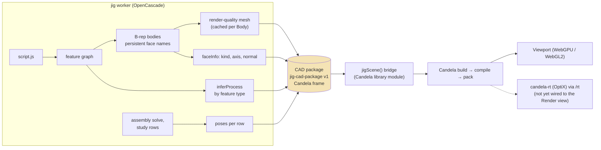
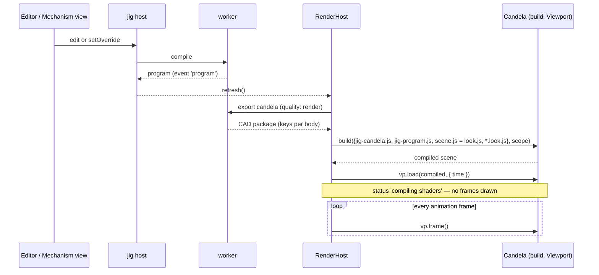
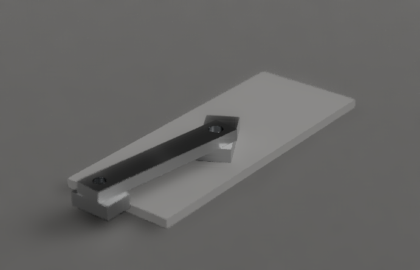
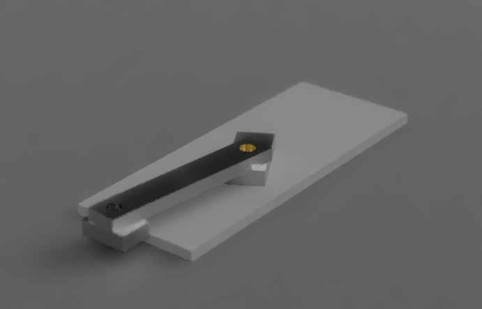

# jigcad: Rendering CAD with Candela — Face Names, a CAD Package and a Path-Traced Render View — A Technical Deep Dive

jig is a parametric CAD workbench whose models are JavaScript programs, evaluated on an OpenCascade kernel compiled to WebAssembly. Candela is a physically based path tracer whose scenes are also JavaScript programs. Candela runs in the browser on WebGPU or WebGL2, and on NVIDIA hardware through `candela-rt`. This report describes JIG-016, the work that made Candela jig's renderer, and that work's central design decision. jig hands Candela its model as a **CAD package**: tessellated bodies whose faces keep their persistent jig names and carry exact geometric metadata, such as surface kind, axis, the feature that made the face, and the machining process inferred from that feature. Candela then dresses each face from that metadata. A jig user gets a Render tab that path-traces the open model, names any face they click the way jig names it, writes material choices into an editable scene file, plays an assembly's motion studies, and renders stills and video.

The report is written for a reader who programs but has not worked in either codebase. It starts from what each system knows about a face, then follows the data from jig's worker through the CAD package, the bridge module, and the Render view, to the pixels. Later parts cover verification: a headless browser on a laptop GPU, and a face-by-face comparison against an older converter that had only meshes. They also cover performance work, motion, and the NVIDIA sidecar. Every number in the report comes from a test or measurement run during the work.

> [!summary]
> - **Names survive rendering.** jig exports a CAD package whose 1,124 lockstitch faces carry the same persistent names jig uses (`rod#body/side[s.big]`). A click in the path-traced view resolves to the same face the stage selects.
> - **Metadata, not materials.** jig infers a machining process from the feature that made each face: a revolve is turned about its axis, a hole is ground, an extrude is milled. It ships that metadata rather than a Candela material. Candela's `autoFinish` turns metadata into anisotropic grooves about the exact axis, so a material change in the Render view stays a metadata patch.
> - **A bridge, not an exporter.** The jig side of Candela is one library module, `jigScene()`, sent with the scene's own files. Candela's core needed a single upstream change: path-shaped ids.
> - **Measured.** 13 browser checks pass on an Intel Iris Xe GPU through ANGLE on Vulkan. The lockstitch comparison agrees with the converter's cylinder fits to 5e-5 mm. Content-keyed caching cut a pose change on the 171k-triangle planetary gearbox from 3.4 s to 19 ms of export and from 1.5 s to 89 ms of scene build.

## Why this project exists

jig draws its models with a fast, flat stage renderer. That renderer is built for editing: it picks faces, draws sketches and overlays joints. It is not built for showing what a part will look like when it is made. Designers use tools such as KeyShot for that step. They load a model, assign physically based materials, light it with an environment map, and render stills and turntables. Candela already does the rendering half of that job in the same language and runtime as jig. It traces paths through a scene built in JavaScript, has a catalogue of metals, plastics and coatings, and has `finish.fromMetadata`, which builds a material from a small record such as `{ material: 'steel', process: 'turned', axis, center }`.

The gap was the interface between the two. Before JIG-016, the only jig model rendered in Candela was the lockstitch sewing-machine head, Candela's preset K-09. It went through `tools/lockstitch/convert.py`, a Python converter that read a triangle-mesh export. Meshes lose almost everything CAD knows. The converter had no face names, so it could not let a user address "the crank pin bore". It had no axes, so it fitted cylinders to vertex normals to recover them. It had no features, so it decided which faces were turned by comparing each face against the largest cylinder of the part. Section 7 shows what that cost: on one part the fit was 90° off, and the render grooved a whole sub-assembly about the wrong axis.

JIG-016 replaces that pipeline with one that keeps what jig knows. The requirement that shaped the design is easy to check. A face clicked in the path-traced view must be named exactly as jig names it, and a material chosen for that face must survive the next recompile of the model.

## Current project status

The work lives on branch `jig-016-render` of `/home/manuel/code/wesen/go-go-golems/jig`, in the `import/jigcad` tree. The ticket is `ttmp/2026/11/22/JIG-016-RENDER--…`, holding an intern-facing design guide, a diary, and tasks. The design guide was written first. Its §0 records where the build deviated from it.

| Phase | What it delivered | State |
|---|---|---|
| 0 | Candela's engine vendored into jig; path ids upstream | done |
| 1 | CAD package export; the `jigScene()` bridge; headless tests on F-06 | done |
| 2 | `.finish()` on parts; display-colour rule; brass, bronze, copper | done |
| 3 | The Render view: Viewport, picking, material library, `look.js` | done, verified on a GPU |
| 4 | Study poses; timeline; render jobs; drive following; motion blur | done |
| 5 | `candela-rt` as a supervised sidecar behind `/rt` in `jigcad serve` | server side done, tested against a fake `candela-rt`; the Render view does not yet connect to `/rt` |
| — | `.finish()` on assemblies; caching between compiles; lockstitch comparison | done |
| — | The Compur shutter preset with poses baked from its own simulation | in progress on a branch |
| 6 | Merging the pbr-spark repository into jig; CI on an NVIDIA runner | deferred until the OptiX work settles |

Nothing has been pushed. The Candela change that jig vendors is commit `38fc068` on a local pbr-spark branch, `jig-016-path-ids`. Both pushes wait for a decision by the repository owner.

## Part 1. Foundations

### What jig knows about a face

A jig model is a script that returns a part or an assembly. Each modelling operation is a **feature** with an id: `extrude`, `revolve`, `hole`, `fillet`, `pattern`, `add` and so on. The kernel produces a boundary representation (B-rep), a set of faces bounded by edges. jig names each face after the feature and sketch entity that produced it, and these **persistent names** survive recompiles as long as the producing geometry exists. For example, `body/side[s.big]` is the side face that the extrude `body` swept from the sketch entity `s.big`. In an assembly, the component id comes first, separated from the face name by `#`, as in `rod#body/side[s.big]`.

For every face jig also knows a small geometric record, its `faceInfo`. That record holds the surface kind (plane, cylinder, cone, torus, B-spline), the normal of a plane, the axis line and radius of a cylinder or cone, and a centre. These are exact: they come from the B-rep surface, not from triangles.

An assembly adds components, joints, drives and **studies**. A study sweeps a drive, such as the crank angle of the slider-crank preset F-06, through a range. At every row it solves the mechanism and records measurements. For rendering, the important output is that each row's solved world transform can be recorded for every component.

### What Candela needs to render a face

Candela renders meshes. A **mesh definition** holds positions, normals, triangle indices, and optionally a face table: a per-triangle face index plus one record per face, `{ id, meta }`. A scene node instantiates a definition and gives faces materials from three sources. A face's material is decided in this order:

1. The last `.face(selector, material)` call that selects the face, if any.
2. Otherwise, the material `autoFinish` builds from the face's `meta` through `finish.fromMetadata(meta)`, if the shape was made with `shape.mesh(def).autoFinish(fn?)`.
3. Otherwise, the shape's own material.

`finish.fromMetadata` is where the face metadata pays off. Given `{ material: 'steel', process: 'turned', axis: [0, 1, 0], center: [...] }`, it builds an anisotropic steel whose microgrooves run around that axis through that centre. That is how a turned shaft looks, and only exact axes make the grooves concentric with the part.

Candela scenes are built by a small module system. `build(files, { scope })` takes a map of file names to sources. It resolves imports of Candela's own libraries (`candela`, `candela/fragments`, `candela/test`, `candela/units`), resolves every other import as a file of the map, and runs each module inside an async function. The `scope` object injects values into that function's scope. JIG-016 uses that to hand the CAD package to a scene without serialising it into source text.

### Two coordinate frames

jig works in millimetres with Z up and the front of a model toward −Y. Candela works in metres with Y up. A jig point becomes a Candela point by

$$p' = 0.001 \cdot (x,\; z,\; -y)$$

and a rigid transform $T$ (column-major 4×4) becomes $T' = C\,T\,C^{-1}$, with

$$C = \begin{pmatrix} 0.001 & 0 & 0 & 0\\ 0 & 0 & 0.001 & 0\\ 0 & -0.001 & 0 & 0\\ 0&0&0&1 \end{pmatrix}.$$

Directions such as normals and axes take the rotation part alone, $(x, z, -y)$. One copy of this code now exists, in `src/render/frame.js`. Both the worker, which writes the package, and the page, which converts live drag poses, import it. Before that consolidation the two copies were identical, but nothing enforced it.

## Part 2. The CAD package

The CAD package is a JSON document of format `jig-cad-package`, version 1, made by the worker on request (`export` with format `candela`). Its top level has `format`, `version`, `source`, `frame`, `bounds`, `components`, `bodies`, `studies`, `diagnostics` and `views`. Everything in it is already in Candela's frame. A real export of F-06 at render quality takes 160 ms cold and is 160 KB.

### Components and bodies

A component record names a component, its parent subassembly, its world transform, and its appearance:

```json
{ "id": "rod", "parent": null,
  "transform": [-0.12917, 0, 0.99162, 0,  0, 1, 0, 0,  -0.99162, 0, -0.12917, 0,  0.003875, 0.006, 0.043172, 1],
  "material": "steel", "color": null, "look": { "material": "steel" } }
```

A body record carries the triangle arrays base64-encoded (`positions`, `normals`, `indices`, `triFace`), its transform, and its face table. Each face is its persistent name plus metadata. These are two faces of F-06's connecting rod as exported:

```json
{ "id": "body/side[s.big]",
  "meta": { "kind": "cylinder", "feature": "body", "featureType": "extrude",
            "center": [-0.03, 0, 0], "axis": [0, -1, 0], "axisOrigin": [-0.03, 0, 0], "radius": 0.003,
            "process": "ground" } }
{ "id": "body/side[s.r.bottom]",
  "meta": { "kind": "plane", "feature": "body", "featureType": "extrude",
            "normal": [0, 0, 1], "center": [0, 0.0025, 0.006],
            "process": "milled", "direction": [0, 1, 0] } }
```

The first is the big-end bore, a 3 mm radius cylinder through the rod. It is `ground` because it is concave, a surface that faces its own axis. The second is a flank of the rod's outline, milled along the extrude direction.

### Inferring a process from a feature

The process is inferred in `inferProcess(featureType, face, ctx)` in `src/engine/cadpkg.js`, only for parts whose material is a metal. The rules follow how each feature is made in a shop:

| Feature | Round face (cylinder, cone, torus, sphere) | Flat face |
|---|---|---|
| `revolve` | turned about the revolve axis | faced about its normal |
| `hole` | ground about its axis | milled |
| `extrude`, `emboss`, `rib` | ground if concave (a bore), else milled about the axis | milled along the extrude direction, or face-milled when it is an end |
| `add` (a primitive such as `j.cyl`, `j.box`) | turned about its own axis; ground if concave | faced when across a round face of the same primitive, else face-milled |
| `fillet`, `chamfer`, `draft`, `shell`, `sweep`, `loft` | milled | milled |

Concavity is decided from the mesh, in `concave()`. It takes the first vertex of the face's first triangle and removes the vertex's component along the axis, which leaves the radial vector from the axis to the vertex. It then takes the dot product of that vector with the vertex normal. A negative product means the normal points toward the axis, so the face is a bore. One vertex suffices, because a cylinder's or cone's normals all point toward the axis or all point away from it.

Two rows of that table were added after the lockstitch comparison in Part 7 found them missing: `add`, and the handling of pattern copies. A pattern or mirror instance is named `spokes[1]/spoke/end`, its pattern id and instance index followed by the source face's name. The original code took `spokes[1]` as the feature, which is no node of the feature graph, so the face got no type and no process. `sourceOf(name)` now strips leading `x[k]/` segments. The face's `feature` and `featureType` become the source's (`spoke`, an extrude), `meta.copy` records the instance (`spokes[1]`), and the extrude direction is read from the copy's own end face, which is rotated with it.

### Appearance from the script: `.finish()` and the colour rule

A part script can state its appearance where the part is defined:

```js
j.part('pin').material(j.material('steel'))
  .revolve(sec.profiles(), j.axis.Z, turn(1), { id: 'rev' })
  .finish({ finish: 'black-oxide' })                         // the whole part
  .finish('rev/side[sec.s.top]', { process: 'polished' })    // one face, by name
  .finish(j.feat('rev').faces(), { roughness: 0.2 })         // faces, by jig selector
```

The keys are `finish`, `process`, `color` and `roughness`. Unknown keys, processes and finishes throw at the call, so the compile error points at the script line. A selector that names no face produces a `finish.unresolved` warning in the package, quoting the closest real names. It does not fail: a typo in an appearance should not stop an export. Finish records are stamped with their source line through a non-enumerable property, so the line never enters a cache key. The test "changing a finish re-runs no feature" checks this through the feature graph's `cached` flags.

jig's display colours are a drawing convention: the Compur's brass housing is drawn dark grey on the stage. The package therefore applies a rule (`settleColor`). A plastic takes its display colour. A metal shows a colour only under a coat (`paint`, `powder-coat`, `anodized`). `.finish({ color })` always wins.

Assemblies got the same call, merged after the parts' finishes: `asm.finish('slider', meta)` and `asm.finish('rod', 'body/side[s.big]', meta)`. A component argument may be a subassembly id or a `*` glob. Assembly finishes apply after part finishes, key by key and in call order. Subassemblies carry their finishes under their prefix (`slider` becomes `sub/slider`), so the expansion table that lists carried declarations now includes `finishes: 'carried'`.

### Studies and poses in the package

Every study keeps its solved transforms per row on the worker side (`prog.studyPoses()`). The package carries them per study: the drive values reached (`x`, in degrees or millimetres) and, per moving component, a float32 array of 16 numbers per row in Candela's frame. Components the study does not move are left out, and the bridge leaves them at their package transform. F-06's `cycle` study sweeps the drive `main` from 0° to 360° and moves `crank`, `rod` and `slider`.



## Part 3. The bridge: `jigScene()`

### Why a library module

The design guide considered putting the bridge into Candela's core bundle and rejected it. The bridge would then version with Candela, a jig change would need a Candela release, and the bridge would need to be present in `candela-core.js`, which `candela-rt` loads too. Instead the bridge is an ordinary Candela module, `src/render/jig-candela.js`. It imports only from `candela`, and its source is embedded into jig's build as `src/generated/candela-lib.json`. Every scene build sends it as the file `jig-candela.js`, beside two more files: `jig-program.js`, which is the single line `export const program = __jigPackage;`, and the scene itself, which jig calls `look.js`. The package arrives through `scope: { __jigPackage }`. Any host that builds the scene from those files runs the same bridge bytes: the browser today, and `candela-rt` once the Render view sends it the same files over `/rt`. Candela's core needed one change. That change is upstream commit `38fc068`. It widens the node id grammar to `^[\w-]+([./][\w-]+)*$`, so that a node can be named `sub/slider` or `rod/body1`, as jig names them.

A look is a short program:

```js
import { scene, shape, light, camera, hdri, material, finish } from 'candela';
import { jigScene } from 'jig-candela';
import { program } from 'jig-program';

const asm = jigScene(program, { autoFinish: true })
  // materials: the Render view adds lines here
  .meta("rod#body/side[s.big]", { material: "brass", finish: null })
  ;
const v = asm.view('axo'), floor = asm.bounds() ? asm.bounds()[0][1] : 0;
export default scene()
  .add(asm)
  .add(shape.plane().at(0, floor, 0).material(material.pbr().baseColor(0.18).roughness(0.8)).id('floor'))
  .add(light.env.hdri(hdri.studio(), { rotate: 30 }))
  .camera(camera.thinLens().at(v.at).lookAt(v.target).focal(v.focal).fstop(8));

export const animation = asm.animate("cycle", { duration: 4 });
```

### Addresses and the immutable chain

`jigScene(pkg, options)` returns a group whose faces are addressed in jig's terms:

| Address | Selects |
|---|---|
| `'rod'` | every face of component `rod` |
| `'rod#body/side[s.big]'` | one face of `rod` |
| `'#body/end'` | a face of a single-part model |
| `'sub/*'`, `'rod#body/side[s.*]'` | globs over component ids or face names |
| `['rod#body/side[s.big]', 'rod#body/side[s.small]']` | a union |
| `(f) => f.meta.featureType === 'hole'` | a predicate over `{ component, id, meta }` |

Globs match names, not geometry. In F-06, `rod#body/side[s.*]` matches the two pin bores and also the outline's sides `body/side[s.r.*]`. The test for the bores first failed on exactly that, and the documented form is now the list.

Every Candela builder is immutable, so the bridge is too. `.face(sel, material)`, `.material(sel, material)` and `.meta(sel, patch)` each return a new group, and a look is one chain. The bridge holds its state (package, options, the ordered list of face assignments) in a plain object and returns a `Proxy`. Known method names return new proxies. Any other property, including the symbol Candela uses to recognise a builder, realises the group and forwards to it. Realising happens once per state.

### Explicit materials and metadata patches

`.meta(sel, patch)` is the call the Render view writes. It does not choose a material; it changes the face's metadata before `autoFinish` reads it. `{ material: 'brass', finish: null }` on a turned steel face gives turned brass about the same axis. A Candela material assigned with `.face()` would have discarded the axis. Within one face, the last call in chain order decides between an explicit material and a metadata patch. `realize()` keeps per-face lists of both and builds:

```js
node = shape.mesh(def).autoFinish((meta, f) =>
  patches.has(f.id) ? finish.fromMetadata({ ...meta, ...patches.get(f.id) })
                    : auto ? finish.fromMetadata(meta) : null);
for (const [material, ids] of explicitByMaterial) node = node.face(ids, material);
```

### Placing components without a matrix

Candela nodes have `at`, `rotateX/Y/Z` and `scale`, but no general matrix. `nodeXf` composes the calls in order as $M = R_n \cdots R_1 S$, so `.rotateX(a).rotateY(b).rotateZ(c)` produces $R_z R_y R_x$. The bridge's `place(node, M)` therefore extracts ZYX Euler angles from each component's rotation:

$$y = \arcsin(-r_{20}),\quad x = \operatorname{atan2}(r_{21}, r_{22}),\quad z = \operatorname{atan2}(r_{10}, r_{00}),$$

with a separate branch when $|r_{20}| \to 1$ (gimbal lock). The first placement test passed even with the rotation order deliberately reversed, because every F-06 component rotates about one axis only. A test that cannot fail under a mutation tests nothing. The suite now includes synthetic packages with general rotations and the gimbal case, and fails when the order is mutated.

### Studies as a timeline

The bridge turns the package's study poses into Candela poses:

- `asm.studies()` lists `{ name, drive, unit, from, to, rows, wraps, components }`.
- `asm.posesAt('cycle', 30)` returns `{ crank: [16 numbers], rod: […], slider: […] }`. Positions are interpolated linearly between rows and rotations by quaternion slerp. A study of whole turns of a revolute drive wraps outside its range; any other study holds its first or last row.
- `asm.animate('cycle', { duration: 4 })` returns a function of time that a look exports as `animation`. The function carries `duration`, `study`, `from` and `to`, so the Render view can map a drive value back to a time.

Poses are world matrices in the package frame, and in Candela a pose replaces every transform above its node. A look that moves the whole `jigScene` group would therefore see posed components jump back to the origin. This is documented in the bridge header.

## Part 4. The Render view

The Render view is a workbench tab, `src/ui/views/render.jsx`. Its controller is `RenderHost` in `src/render/host.js`. The controller loads `dist/candela.js` on first use (420 KiB). That file is a bundle of Candela's core, the `Viewport`, render jobs, the video encoder and `rayMesh`. Through it the controller drives one `Viewport` on a canvas.

### From a recompile to pixels



`refresh()` builds a model key from the project files except the look files, the parameter overrides, and the program hash. When that key changes it exports a new package. When only the look changed it rebuilds without exporting. It does not export while the editor has unsaved changes or a compile is running. An edit emits `files` before the compile starts, so exporting at that moment would export the previous program. The program event that follows triggers the refresh.

The render loop draws no frames while `vp.load` is in progress. The first headless run produced `TypeError: Cannot read properties of undefined (reading 'U')` from `Viewport.frame`. `Viewport.load` sets `compiled` before `packed` exists, and the loop had been checking only `compiled`. The guard is a `loading` flag around the awaited load, plus a check that `packed` exists.

### Picking and writing `look.js`

A click that is not a drag casts a ray from the camera through the pixel. The ray is tested with Candela's `rayMesh` against every packed mesh object. The nearest hit's triangle gives a face index through the definition's `triFace`, and `faceAt()` maps the result to `{ component, body, face, address }`. The side panel shows the component, the persistent face name, the feature that made it and its current metadata. The view also calls `host.select({ body, name })`, so the stage selects the same face.

Choosing a material writes a line into `look.js`. The view never rewrites the user's file as a whole. It looks for the marker line `// materials: the Render view adds lines here` and inserts a `.meta(…)` line before the first line after the marker that consists of a single `;`. Later lines in a chain win, so each choice appends to the end of the chain. The library entries are metadata patches. For example, `Brass` is `{ material: 'brass', finish: null }`. The explicit `finish: null` clears a coating set by a jig `.finish()` call, so a black-oxide part can be turned into bare brass from the Render view. If the user removed the marker, `applyMeta` throws a message that contains the exact line to paste.





Project files whose names end in `.look.js` are sent to Candela with `look.js` and excluded from the model key. A look can therefore import data the project carries, such as baked poses or shared materials, and jig's own compile never runs those files.

### Render jobs

Two buttons run Candela's `runRender` with a fixed size and sample count. "Render PNG" produces 1920×1080 at 256 samples per pixel. "Render video" renders the timeline at 24 fps, 1280×720 and 32 samples per pixel, encoded to MP4 through WebCodecs. `runRender` meters exposure on the first frame and then holds it, so a sequence does not flicker. Its `seek` callback re-packs the scene at each frame's time. Results go through jig's existing `saveOrCopy`. It saves through the hosting page's downloads capability when one exists, downloads in a plain browser, and otherwise copies text output to the clipboard. While a job runs, the interactive loop stops and the toolbar shows progress and a Cancel button.

## Part 5. Following the mechanism

An assembly's pose can change in three places outside the Render view: the Mechanism view's joint sliders, a click on a study's chart, and a drag on the stage. The first two call `host.setOverride(driveId, "90 deg")`, which recompiles the model with the drive at the new value. A stage drag calls the worker's `dragPose` repeatedly while the pointer moves, draws each solved pose at once, and on release pins the result with overrides.

### Overrides move the timeline

The default look animates the first study, so what the Render view shows is the study at the timeline's time, not the package's rest pose. Without further work, a drive override would rebuild the package at the new pose while the animation kept showing the old time. The controller handles this in two steps:

- `followDrive(overrides)` listens to the host's `overrides` event. If the timeline's study is driven by the changed override, it parses the value (`<number> deg|°|mm`) and moves the timeline to the matching time immediately, using poses the package already has.
- After the compile, `build()` compares the drive's solved value with the last one it synchronised to, under the key `study\0value`. Whenever the value differs, it sets the time again, unless the timeline is playing.

The mapping is `timeAt(anim, v)`: $f = (v - \mathit{from}) / (\mathit{to} - \mathit{from})$, wrapped into $[0, 1)$ for a study of whole turns, otherwise clamped, then multiplied by the duration. F-06 opens at the stage's 30° as $t = 4 \cdot 30/360 = 0.333\text{ s}$. An override to 90° moves it to $t = 1$ before the compile and leaves it at $t = 0.9999999999998$ after.

### A drag shows live

`stage.js` emits `pose { source: 'drag', transforms }` after each `dragPose` solve. `transforms` maps component ids to jig-frame world matrices. The Render view converts them with `toCandelaMatrix` and passes the map to `vp.setPoses`. Candela's poses from `setPoses` win over the scene's animation (`viewport.ts:104-107`), so the drag shows over a playing study. On release the stage emits `{ done, changed }`. If the drag pinned overrides, the view keeps the live pose until the new package's build is about to load, so the old pose does not reappear in between. If the drag pinned nothing, it releases at once.

The browser test checks the placement numerically. For the rod, it multiplies the packed world-to-object matrix $W$ by the component's world matrix $M$. The product $W M$ is the body's transform within its component, which a correct pose leaves unchanged. The test therefore compares $W_1 M_1$ during the drag with $W_0 M_0$ at rest, within 1e-4.

In every built-in layout the stage and the Render view share a tile, so the live drag pose is visible only after the user moves the Render tab into another tile. The Mechanism view sits in its own tile, so the override path is the one users see by default.

### Motion blur

Candela's camera accepts `.motionBlur({ angle, fps, steps })`. Each path then samples the scene at its own instant within the shutter interval. The Render view adds a control in the timeline row with three settings. "As the look" leaves `vp.motionOverride` undefined, so the camera decides. "Off" sets it to `null`. "180° at 24 fps" sets it to `{ interval: 1/48 s, steps: 8 }`. The setting applies to the interactive view and to render jobs, and it survives a restart of the view.

## Part 6. Verification in a browser

### The headless GPU problem

The Render view had to be checked in a real browser. The first headless runs used SwiftShader, a CPU implementation of the GPU interfaces, and failed in two ways. Candela's path-tracing kernel took 33.8 s to compile. Accumulation then stopped at 2 samples per pixel, with `busy: false` and `metered: 0`, at full and at quarter resolution. A subsequent `vp.snapshot()` threw `OperationError: A valid external Instance reference no longer exists`: the software WebGPU device had been lost. The white screenshot at 2 spp was that lost device, not a broken scene.

The laptop has an Intel Iris Xe (TigerLake GT2). Chromium uses it headless when launched with `--enable-unsafe-webgpu --enable-features=Vulkan --use-angle=vulkan --use-vulkan --ignore-gpu-blocklist`. The WebGL renderer then reports `ANGLE (Intel, Vulkan 1.4.318 (Intel(R) Iris(R) Xe Graphics …), Intel open-source Mesa driver)`. A probe on `about:blank` reported no WebGPU adapter, while the served workbench at `127.0.0.1` got `intel gen-12lp`. The probe page was the difference, and it was not investigated further. The first shader compile there took 38.8 s, and later loads took 119–511 ms. Each Playwright launch starts with a fresh browser profile, so the speed-up comes from the driver's own disk cache, Mesa's shader cache.

The view now detects `backend.lost` and shows an error with two buttons. Restart replaces the canvas and re-attaches. A canvas that once held a WebGPU context cannot become WebGL2, which is why the canvas is replaced. "Use WebGL2" stores the choice in `localStorage` (`jig.render.backend`).

### What the browser test checks

`test/ui/render.cjs` drives the workbench with Playwright. It loads F-06, opens the Render tab and runs 13 checks, all passing on WebGPU. The first six also passed on WebGL2 (`RENDER_BACKEND=webgl2`) before the later checks were added.

| Check | Result |
|---|---|
| F-06 renders, 5 objects, ≥ 16 spp | WebGPU, 16 spp |
| The timeline opens at the stage's pose | t = 0.3333 s for 30° |
| The crank-pin bore is on screen and a click names it | `rod#body/side[s.big]` |
| The stage selects the same face | `{ name: "body/side[s.big]", body: 2 }` |
| Brass writes one `.meta()` line and the view rebuilds | `.meta("rod#body/side[s.big]", { material: "brass", finish: null })` |
| The timeline moves the rod | packed transform differs between t = 0 and t = 1 |
| A drive override moves the timeline at once and after the compile | t = 1, then 0.9999999999998 |
| A drag on the stage poses the view live and lets go | drag `crank:pin`: moved, placed (1e-4), released |
| Motion blur 180° changes the still | interval 1/48, 8 steps, PNG differs at equal seed |
| A still renders to PNG | 12,798 bytes at 96×64, 4 spp |
| The timeline encodes to video | MP4 1,655 B, WebM 4,280 B |
| No console errors | the browser's own favicon request excluded |

## Part 7. The lockstitch comparison

The lockstitch head is a real mechanism of 27 parts. Before JIG-016 it was rendered through `convert.py`, so it is a natural test of the CAD package. The test `test/render/lockstitch.test.mjs` compiles every part script in jig with the converter's material and exports a package. It then compares each package face by face against what the converter produced. The expectations come from `fixtures/lockstitch/gen-expected.py`, which runs `convert.py` itself and reads its `cyl_axis` function from the source with Python's `ast` module. A rerun gives byte-identical output. The whole test runs in about 6 s.

### Names and axes

All 1,124 faces the converter saw exist in jig's package under the same name, kind, body and order. For the 108 cylinders the converter fitted, jig's exact axes agree within 5e-5 mm of axis-line distance and 7e-15 mm of radius. All 44 faces the converter turned, and all 153 it faced, lie on jig's exact axes of those faces.

### The converter's cone fit

Six faces are cones. Two of them, the needle's taper and point, are shallow; the converter's fit is 0.775° off there. Four, the handwheel's 45° chamfers and the tension discs, come out 90° off. The cause is the fitting method. `cyl_axis` takes the axis as the eigenvector of the smallest eigenvalue of $N^\top N$, where $N$ stacks the unit vertex normals. For a cylinder, every normal is perpendicular to the axis, so the axis has eigenvalue 0. A cone of half-angle $\alpha$ is different. Each normal has component $\sin\alpha$ along the axis and $\cos\alpha$ in the plane across it. Over $n$ normals spread evenly around the axis, the eigenvalue along the axis is $n\sin^2\alpha$, and each of the two across it is $n\cos^2\alpha / 2$. The axis is the smallest eigenvector only while

$$\sin^2\alpha < \tfrac{1}{2}\cos^2\alpha \iff \tan\alpha < \tfrac{1}{\sqrt 2} \iff \alpha < 35.26^\circ.$$

At 45° the smallest eigenvector lies across the axis. The converter then made the largest fitted face its lathe axis. On the tension unit that face was the first disc, at 108 mm² larger than the 100 mm² boss, and its wrong fit became the part's lathe axis. As a result, K-09 grooved the tension unit 90° off its real axis. jig reads the axis from the B-rep surface, so it has no such threshold.

### Processes, and the two gaps

The converter and jig use different vocabularies. The test maps converter `turned` to jig `turned` or `ground` (normals alone cannot tell a bore from a boss), `faced` to `faced`, and `polished` to no process. On the first run, the two agreed on a process for 3 faces and on no process for 283. The disagreements included two classes caused by jig:

- `inferProcess` had no case for `featureType: 'add'`. Most lockstitch parts are built from `.add(j.cyl(…))`, so 81 round faces of metal parts got no process even though jig knew their exact axes.
- Pattern copies had no feature type, as described in Part 2.

After the `add` rule and `sourceOf()` were added, the two agree on a process for 123 faces and on none for 10. Every remaining disagreement falls into a named class whose reason is asserted in the test. An unexplained disagreement fails it.

| Class | Faces | Reason |
|---|---|---|
| `gear-flank` | 312 | the hook gear's flanks are B-splines; jig mills them by the extrude rule, the converter fits only cylinders and cones |
| `off-the-lathe-axis` | 373 | on a lathe part the converter grooves only faces round its one axis; jig treats each feature on its own (the crank web, the crank pin) |
| `not-a-lathe-part` | 231 | the converter grooves only parts on its LATHE list; jig infers for every metal part |
| `extrude-end-milled` | 69 | an extrude's end is face-milled in jig, faced by the converter |
| `extrude-side-milled` | 3 | an extrude's outer round side is milled in jig, turned by the converter |
| `add-box-milled` | 3 | a box added to a turned part is face-milled in jig, faced by the converter |

The counts are fixed numbers on purpose. A change to the inference rules changes them, and the test then forces the author to state why.

## Part 8. Caching between compiles

A recompile that changes one parameter used to cost a full re-export. The worker re-tessellated every body at render quality, and the page decoded every array and built a new Candela mesh definition with its BVH (bounding volume hierarchy, the tree used to intersect rays with triangles). The bridge already cached definitions in a `WeakMap`, but it was keyed by the package's body object, and every export makes new objects.

The fix has three parts:

1. **In the worker**, Body objects survive recompiles: a feature-cache hit returns the same state, and garbage collection keeps those bodies. The render-quality mesh is therefore kept in a `WeakMap` keyed by Body. The stage keeps its own coarser mesh in `body._mesh`.
2. **In the package**, each body gets two content keys. `meshKey` hashes the arrays and face ids. `key` hashes that plus the body id, its component, the component's look, and every face's metadata.
3. **In the bridge**, definitions are cached in a `Map` by `key`, least recently used first, within a budget of one million triangles. Entries are evicted only at the end of a build, and never one the current build uses. When `key` misses but `meshKey` is held, only face metadata changed, as with a finish edit. The bridge then derives a copy with Candela's `withMeta`, which shares the triangles and the BVH, and sets the copy's name, metadata and face table.

Measured in Node at render quality:

| Model and change | Export before → after | Scene build before → after | New definitions before → after |
|---|---|---|---|
| F-06, rod length changed | 13 → 12 ms | 82 → 82 ms | 4 → 1 |
| F-06, pose override or finish only | 13–14 → 2–3 ms | ~85 → ~80 ms | 4 → 0 (a finish: 1 derived) |
| M-10 planetary gearbox, carrier changed | 3141 → 47 ms | 1206 → 95 ms | 7 → 1 |
| M-10, pose override | 3418 → 19 ms | 1491 → 89 ms | 7 → 0 |
| M-10, finish only | 2533 → 20 ms | 1139 → 97 ms | 7 → 0, 1 derived sharing its BVH |
| M-10, first compile | 1993 → 1050 ms | — | — |

M-10 has 7 bodies and 171k triangles. Its first compile also became faster: its three planets share one Body, which is now meshed once. The derived copies depend on two Candela internals, `withMeta` sharing the BVH and writable `name`, `meta` and `faces` on a fresh copy. `test/render/cache.test.mjs` checks both, so a Candela upgrade that changes them fails a test rather than silently rebuilding BVHs.

## Part 9. The `candela-rt` sidecar

Candela on NVIDIA runs as `candela-rt`, a C++ program that embeds V8 and renders with CUDA or OptiX; it is the subject of [[PROJECT REPORT - Candela on NVIDIA - From a Browser Path Tracer to OptiX, NVENC and a Live Workbench on the DGX Spark - A Technical Deep Dive]]. JIG-016 makes `jigcad serve` start it as a supervised child process when the machine has one. The Go code is in `pkg/render`:

- `jigcad serve --render auto|off|<path>` selects the binary. `auto` uses `$JIGCAD_CANDELA_RT` when it is set and otherwise looks for `candela-rt` on the `PATH`. Finding none is the common case, and rendering then stays in the browser.
- The child runs as `candela-rt serve --bind 127.0.0.1 --port <free port> --token <random> --bundle <dist>/candela-core.js`. Candela's core is the same bundle the browser loads, so both hosts run identical scene code.
- `GET /rt` upgrades to a WebSocket and proxies it to the child, adding `token=` to the URI. It rejects a cross-origin `Origin` header.
- `GET /api/render/capabilities` returns `{ rt, state, reason, restarts }`.
- A child that exits is restarted. After five failed starts in a row the sidecar stays down, with the exit status and the tail of its stderr as the reason.

The design guide had proposed a `candela-rt info` probe and a `/renders/` file proxy. The build needs neither. Readiness is the port accepting connections, and the browser learns the device from `candela-rt`'s own `hello` message. `candela-rt serve` has no job or file endpoint yet, so offline jobs through the sidecar remain future work. The Render view does not connect to `/rt` yet: Candela's remote-rendering client still has to move into the bundle jig loads. Today the sidecar is reachable but unused by the view. The Go tests use a fake `candela-rt` (`pkg/render/rendertest`), because the laptop has no NVIDIA GPU.

## Part 10. The Compur shutter (in progress)

The Synchro-Compur 0-MXV is a leaf shutter, modelled in a separate project as a 29-part jig assembly. Its dynamics come from a planar multibody simulation of its own (`web/sim.js`), not from a jig study. It is the test case for poses from an outside engine. At the time of writing, a branch holds two commits that have not yet been reviewed or merged. The description below comes from those commits.

- **Preset `M-11-synchro-compur`.** The assembly script, 61 KB, dressed in the materials its comments state.
- **`tools/compur-poses.mjs`.** It runs one 1/125 s release in the simulation, sampled at 24 kHz for 20 ms. It maps each simulated body to the jig component of the same name and writes `compur-poses.look.js`, 71 KB with 481 samples and 17 components. Per component, the file holds a pivot, plus an angle about jig Z and a pivot translation per sample, relative to the drawn pose.
- **The preset's `look.js`.** It lifts those planar motions to the package frame ($C M C^{-1}$; a turn about jig +Z is a turn about Candela +Y), composes them with each component's placement, and exports `animation`. The animation runs half a second at rest, then the release slowed 250×, then a second at rest.
- **`test/render/compur.test.mjs`.** It checks the baked pivots against jig's joints and the cocked start against the assembly's placement. It also checks that Candela's packed blades move between two times while the plates do not.

The `*.look.js` contract in Part 4 exists for this preset. Without it, the baked poses would have to be pasted into `look.js` itself.

## Measurements

| Quantity | Value |
|---|---|
| F-06 CAD package, cold export at render quality | 160 ms, 160 KB |
| Candela kernel compile, Iris Xe, cold / Mesa-cached | 38.8 s / 0.12–0.51 s |
| Candela kernel compile, SwiftShader | 33.8 s, then device lost at 2 spp |
| `dist/candela.js` / `dist/candela-core.js` | 420 KiB / 370 KiB |
| Browser checks on WebGPU | 13 / 13 |
| Node render tests | 64 / 64 |
| jig engine suite / engine-core / agent and UI tests | 62 / 69 / 90, all passing |
| Lockstitch faces compared; name agreement | 1,124; 100 % |
| Cylinder axes, jig vs converter fit | ≤ 5e-5 mm |
| Process agreement with the converter (before → after the fixes) | 3 → 123 on a process; 283 → 10 on none |
| M-10 pose change, export / build | 3418 → 19 ms / 1491 → 89 ms |

## Failure modes encountered

- **A camera method that does not exist.** The design guide wrote `.target()`. Candela rejects it with `E104 'target' is not a method of camera.thinLens`; the method is `.lookAt()`.
- **Globs that match more than intended.** `rod#body/side[s.*]` also matches `s.r.*` outline sides. The bore selection is now a list of addresses.
- **A test that could not fail.** The placement test passed with the rotation order reversed, because F-06 rotates about one axis. It was rewritten with general rotations and confirmed to fail under the mutation.
- **Base64 decoding through Node's Buffer pool.** Decoding with `Buffer.from(...).buffer` reads the whole pool. The decode now slices with `byteOffset` and `byteLength`.
- **A string selector reaching the selector engine.** `.finish('rev/end')` on a part without that face crashed the export with `expected a selector, got rev/end`. A string is now a name or glob only, and a miss is a warning.
- **Frames before the scene was packed.** `TypeError … reading 'U'` came from drawing between `compiled` and `packed` (Part 4).
- **A lost software GPU device.** SwiftShader lost the device after 2 spp (Part 6). The view now reports it and offers a restart or WebGL2.
- **The pivot cannot be dragged.** The first live-drag check grabbed `crank:pivot`, which sits on the fixed axis and moves nothing. The check now takes the crank's port farthest from the axis.
- **Two process-inference gaps and a converter bug,** described in Part 7.

## Open questions

- **Large assemblies.** Should the Render view re-export on every compile, or only after the edits pause? Caching made re-exports cheap for M-10, but has not been measured on an assembly an order of magnitude larger.
- **Animated bodies through OptiX.** Should `candela-rt` render a CAD package offline (a scene-directory form of `render`) so that long video jobs run on NVIDIA hardware, rather than only through the live `/rt` protocol?
- **One repository or two.** Should the vendored engine be replaced by a subtree merge of pbr-spark (Phase 6)? That merge pays off once jig's CI builds `candela-rt` itself; until then vendoring with checksums is simpler.
- **Moving a jigScene group.** Should poses become relative to their parent, so that a look can move a posed `jigScene` group as a whole? Today they are world matrices and replace everything above them.

## Near-term next steps

- Review, merge and verify the Compur preset branch, including a browser render of the release.
- Connect the Render view to `/rt`, so that a machine with `candela-rt` renders the view with OptiX.
- Push `jig-016-render` and open a pull request; ask the pbr-spark owner about pushing `jig-016-path-ids`.
- Test the sidecar against a real `candela-rt` on the DGX Spark.
- Mark `j.lib.gear` flanks as hobbed, and fix the converter's cone fit upstream, or retire the converter in favour of the CAD package.

## Important project docs and code

- Repository: `/home/manuel/code/wesen/go-go-golems/jig`, branch `jig-016-render`, tree `import/jigcad`.
- Ticket: `ttmp/2026/11/22/JIG-016-RENDER--keyshot-style-rendering-for-jig-candela-as-jig-s-renderer-a-scene-package-from-jig-and-candela-rt-as-an-nvidia-sidecar/`
  - `design-doc/01-rendering-jig-with-candela-intern-guide-design-and-implementation-plan.md` is the intern guide; §0 is the as-built status.
  - `diary/01-diary.md` holds steps 1–8, with the failures and their diagnostics.
- CAD package: `import/jigcad/src/engine/cadpkg.js`, with `inferProcess`, `sourceOf`, `faceRecords`, `settleColor` and the content keys.
- Frame change: `import/jigcad/src/render/frame.js`.
- Bridge: `import/jigcad/src/render/jig-candela.js`, with `jigScene`, `realize`, `place`, `posesAt`, `animate` and the definition cache.
- Render view: `import/jigcad/src/render/host.js` (`RenderHost`) and `import/jigcad/src/ui/views/render.jsx`.
- Live drag: `import/jigcad/src/stage/stage.js`, in `poseStep` and `commitPose`.
- Finishes: `import/jigcad/src/engine/part.js` (`.finish`, `finishMeta`) and `import/jigcad/src/engine/assembly.js`, which handles assembly finishes and study poses.
- Sidecar: `pkg/render/` and `pkg/server/server.go`; the flag is in `cmd/jigcad/main.go`.
- Vendoring: `import/jigcad/tools/vendor-candela.sh` and `import/jigcad/vendor/candela/`, with its `VERSIONS` and `SHA256SUMS`.
- Tests:
  - `import/jigcad/test/render/`: bridge, appearance, finishes, poses, cache and lockstitch tests;
  - `import/jigcad/test/ui/render.cjs`: the browser check.

## Related notes

- [[PROJECT REPORT - jigcad - Architecture of a Browser CAD Workbench, from Script to Agent]]
- [[PROJECT REPORT - Candela on NVIDIA - From a Browser Path Tracer to OptiX, NVENC and a Live Workbench on the DGX Spark - A Technical Deep Dive]]
- [[PROJECT REPORT - Candela on the DGX Spark - From a JavaScript Scene API to OptiX Ray Tracing - A Technical Deep Dive]]
- [[PROJECT REPORT - Candela Render Runtime - Running Candela Scenes in Embedded V8 - A Technical Deep Dive]]
- [[PROJECT REPORT - jigcad - Exports That Save, in Any Page and From the Agent]]
