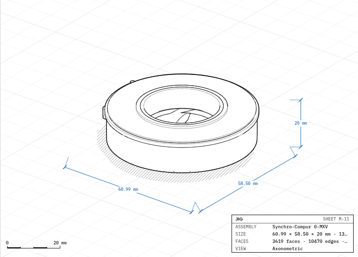
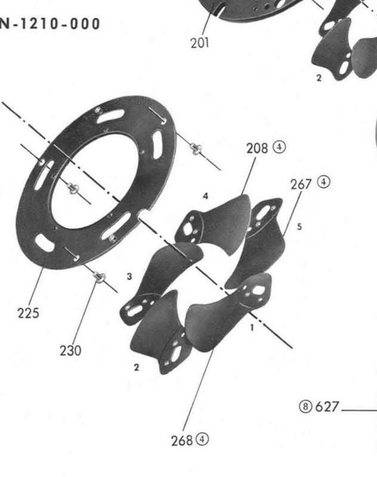
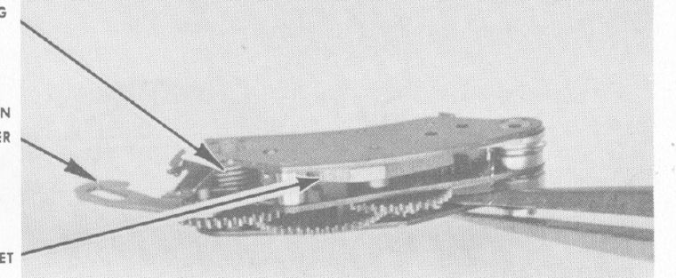
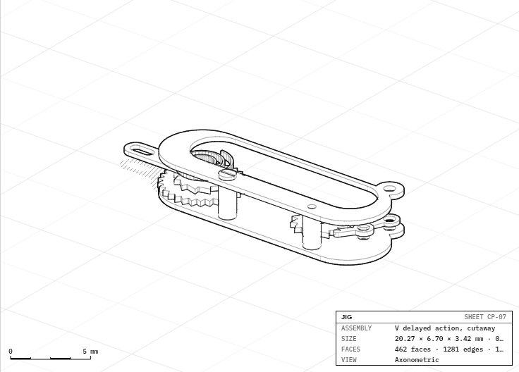
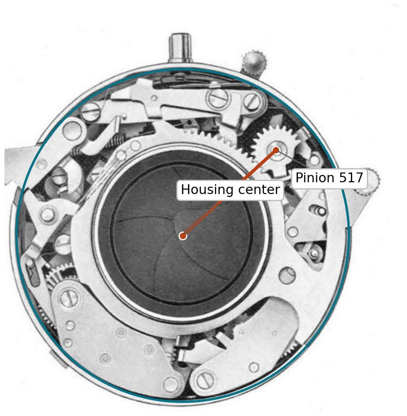
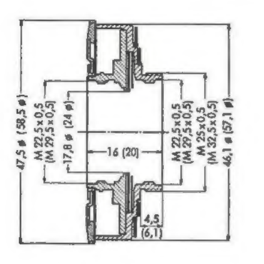
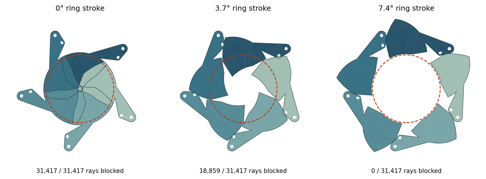
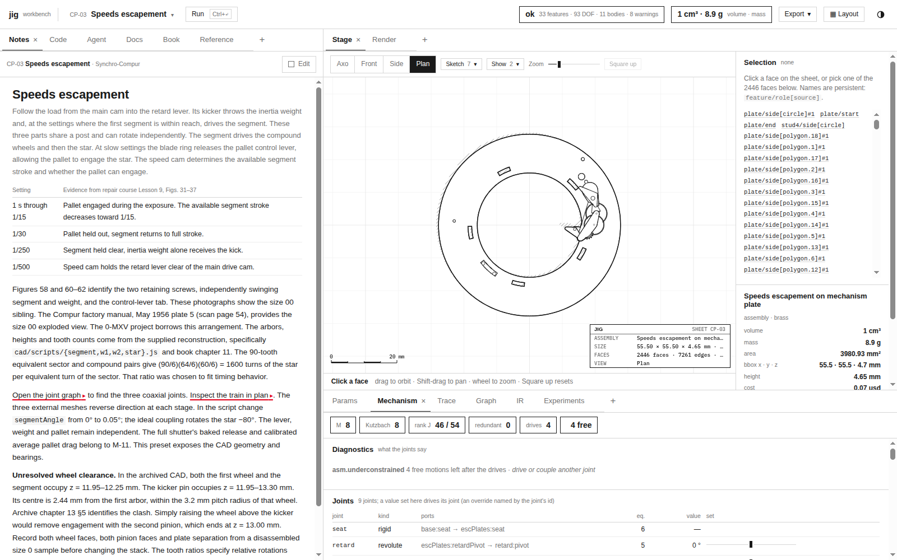
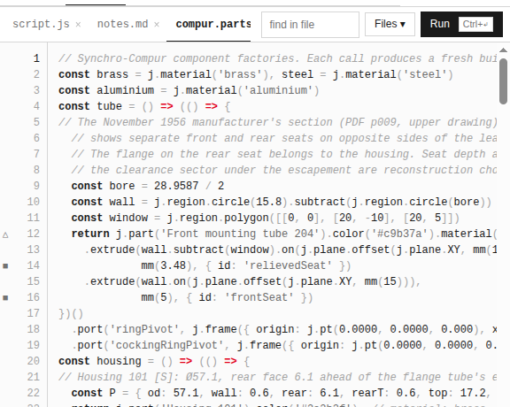

# Reconstructing the Synchro-Compur 0-MXV from service drawings

The five shutter blades provide a compact answer to two questions about this reconstruction. Do we have every part in the catalog? **No.** The manufacturer specifies screws numbered 230 to retain the blade mounting plate. The Jig assembly contains the plate and all five blades, with no separate instances of those screws. How accurately have we placed the parts we do have? The manual identifies the first and last blades and explains why their tips turn upward. Our digital blades occupy the specified order, have flat tips, and close a sampled optical opening. We have strong evidence for their identities, useful evidence for their motion, and a known difference in their shape.

Those distinctions matter when reading the model. A technician ordering a replacement needs a service number and the shutter revision. A designer checking light passage needs the projected contours of all five blades at a particular angle. Someone making a replacement needs thickness, bend, material, clearances and tolerances. The same CAD file can answer the second question in detail while leaving much of the third open.



*M-11 in the JigCAD Stage. The closed blades are visible through the front seat. The dimension arrows describe the modeled assembly bounds, including projections. The factory sheet separately dimensions the circular case and setting ring.*

## Which shutter, and what counts as a part?

The target is the Synchro-Compur **size 0 with tensioning ring**, factory type **CN-1210-000**. The repair binder covers several sizes, later revisions and camera-specific versions. On the May 1956 exploded drawing of the blade assembly, for example, the heading names CN-1110-000, the smaller size 00. An inset on that sheet identifies CN-1210-000. The repair text specifically calls out the end blades for size 0. Looking up a number without reading the inset or sheet heading can assign a genuine Compur part to the wrong mechanism. [Factory repair manual, PDF pp. 9 and 56, specification page 1 and plate 7.]



*The size-0 inset on factory plate 7 (PDF p56) labels the retaining plate 225 and its screw 230. The small unboxed numerals at the blade outlines give the assembly order. Source: the supplied reconstruction archive’s plate-7 crop.*

There are three useful counts. A **service item** is an entry that identifies a replaceable piece or assembly. A CAD **occurrence** is one named placement in an assembly, such as `blade3`. A **solid body** is one connected volume produced by the geometry kernel. Five blade occurrences use three service numbers. The front cover and its retaining ring are combined in one builder. A pair of spacer pillars in the timer study can produce two solids from one occurrence. A count at any one level gives no reliable conversion to either of the others.

The full-shutter preset M-11 has **29 named occurrences**. CP-01 through CP-05 isolate groups of those occurrences. CP-06 through CP-08 add separate contact, timer and diaphragm studies. Adding all nine preset counts would count the base plate, ring and other shared pieces repeatedly. The project has no completed line-by-line reconciliation of the applicable catalog, with quantities and revision substitutions. A catalog coverage percentage therefore has no established denominator.

| Study | What exists in Jig | What a service or fabrication inventory would still need |
|---|---|---|
| CP-01, housing and optical stack | Housing 101, front mounting tube 204, rear flange thread, front cover and full-open diaphragm envelope | Cell thread forms, internal relief dimensions and tolerances |
| CP-02, shutter pack | Supporting plate 201, retainer 225, operating ring 202 and five blades in order 268, 208, 208, 208, 267 | Separate screws 230, measured blade outlines and the upturned tips on 268 and 267 |
| CP-03, speeds escapement | Retard lever, segment and weight, compound wheels, escape wheel, pallet, carrier and plates | Measured arbor heights, gear profiles and clearance between the first wheel and the driving pin |
| CP-04, cocking and release | Toothed setting sector, pinion, main cam, bridge, catch and trip lever | Return springs, adjustment eccentric and secondary catch details |
| CP-05, front controls | Setting ring, speed cam envelope and retaining cover | Working cam steps, knurl and engraved settings |
| CP-06, flash contacts | Grounding strip, terminal strip, M-closing lever and contact lever on a local axis | Size-0 mounting location, contact angles, springs and M-delay mechanism |
| CP-07, delayed action | Twelve occurrences representing plates, supports, spring, input/clutch and pallet ends of the timer | Intermediate gearing and its mounting transform into the size-0 case |
| CP-08, diaphragm | Five separate leaves and two covers at full aperture | Measured slot curves, actuator travel and aperture calibration for the specimen |

The diaphragm illustrates the importance of revision control. Supplement sheet 13, September 1973, specifies five enameled blades 105 for replacement housing 101, index 88. That is evidence for a particular replacement configuration. Plate 8, PDF p57, supplies a useful view of the related size-00 covers and leaf pins. CP-08 identifies both sources. M-11 still represents the diaphragm by an annulus. Likewise the delay cartridge and flash contacts remain separate studies. An occurrence in a study establishes that the piece was drawn. Installation in M-11 requires an independently supported position and orientation.



*Repair Course Lesson 9, figure 59. This side photograph of the size-00 delayed-action unit shows a layered cartridge. Its projected outline gives little information about the heights of the internal wheels. Source: the supplied archive’s figure-59 crop.*



*CP-07 in JigCAD. Compare the setting lever and spaced plates with the preceding service photograph. The open region between the modeled end mechanisms is where the unresolved intermediate train belongs.*

## How a drawing becomes a coordinate

The November 1956 specification sheet gives the strongest dimensional evidence. In its upper drawing, the **bracketed** dimensions apply to CN-1210-000. The housing outside diameter is 57.1 mm, the maximum outside diameter is 58.5 mm, the clear opening is 24 mm, the cell-seat spacing is 20 mm and the rear projection is 6.1 mm. The cell threads are M29.5 × 0.5 and the rear mounting thread is M32.5 × 0.5. Using the neighboring unbracketed 4.5 mm projection would shorten the size-0 rear mount by 1.6 mm. These numbers describe nominal interfaces. No specimen was measured in this project.

A dimension acquires a position only after choosing a **datum**, a surface or axis from which coordinates are measured. Jig places the origin at the center of the rear end of the threaded flange. The optical axis is Z, positive toward the subject. The XY plane is perpendicular to that axis. This convention locates the rear face of the housing at Z = 6.1 mm. It leaves the position of an off-axis pivot undetermined.

The archive documents how its authors estimated one such pivot. On a front view of the size-00 shutter, they measured the radial offset of pinion 517 as a fraction of the drawn housing radius. The first reading was 0.757 at an angle of 43°. Applying that ratio to the size-0 housing gives:

```text
housing radius       = 57.1 / 2              = 28.55 mm
estimated pin radius = 0.757 × 28.55         = 21.61 mm
model radius         = 21.7 mm
model X              = 21.7 × cos(43°)      ≈ 15.8704 mm
model Y              = 21.7 × sin(43°)      ≈ 14.7994 mm
```



*Factory plate 2, size 00, with the archive’s fitted center and rim in teal and the center-to-pinion radius in orange. The overlay uses the original pixel coordinates in compur/book/data/plate2.json. Scaling this measurement to size 0 introduces the uncertainty discussed below.*

The archive subsequently fitted a circle to points on the scanned housing rim. The fitted radius was 375.4 pixels. The revised reading placed the pinion at 0.761 radii and 42.5°, equivalent to about 21.73 mm on the size-0 scale. A second feature, the cell bore, came out at 28.82 mm against a nominal minor diameter of about 28.96 mm. The bore supplies a check on image scale. Both pinion readings still share the assumption that the relative position transfers from size 00 to size 0. The archive estimates roughly half a millimetre of uncertainty for plate-derived positions. Four decimal places in the code let two features reuse the same center exactly within the model. They do not establish four decimal places of physical accuracy. [Model archive, book chapters 3 and 23.]

The reconstruction consequently contains several kinds of number. The 57.1 mm housing diameter is **specified**. The cam center is **estimated from a drawing**. Its XY components are **calculated**. A wall thickness of 0.6 mm and a blade thickness of 0.08 mm are **design assumptions**. Spring and braking parameters selected to reproduce target exposures are **calibrated**. For the last category, testing against the target used during calibration supplies little new evidence. A trace of an independent physical release would supply substantially more.

## A placement error that passed the original render

The earlier M-11 model ran a continuous mounting tube between the two cell seats. It met the external mounting dimensions and rendered plausibly with the cover installed. It also put a cylindrical wall through both sets of moving leaves. A drawing can specify two end surfaces precisely while leaving a modeler considerable freedom to draw the wrong material between them.



*November 1956 specification page 1 (PDF p9), upper section detail. The horizontal line is the optical axis. The bracketed 20 mm spans the cell seats and the bracketed 6.1 mm gives the rear projection. Hatching identifies material on each side of the central mechanism.*

The enlarged axial section on factory PDF p9 shows distinct front and rear seats. The corrected model attaches the rear threaded projection to housing 101 and starts the separate front seat at Z = 11.52 mm. A relieved lower section extends 3.48 mm to Z = 15 mm. Separating the seats follows the section. Those two internal lengths are estimates chosen to clear the reconstructed mechanism. On the final assembled-pose check, the front tube cleared the shutter blades, iris and pallet carrier. It still meets the retaining cover at their nominal common diameter.

This sequence distinguishes two forms of cross-check. The drawing supplies independent evidence about which pieces are connected. The kernel tests what follows from the revised solids. The STEP export, a screenshot and the Jig builder can agree with one another even when all three derive from the same mistaken source geometry.

## Following a drive pin through an exposure

The shutter leaves block light between exposures. The diaphragm behind them controls how much light passes while they are open. On release, the main cam turns the shutter's operating ring. Each ring pin follows a circle around the optical axis and pushes against an elongated opening in one leaf. The leaf rotates around its own fixed stud. This offset between rotation centers determines the relation between ring angle and leaf angle.


CP-02 makes the calculation explicit. Let **C** be the first blade's fixed pivot at (15.8704, 14.7994) mm and **P** the ring pin initially at (14.0835, 11.528) mm. Rotate **P** about the optical axis through the selected ring stroke. From **C**, measure the change in direction to the pin. The straight slot in the model turns through that same angle. Wrapping the angular difference handles the discontinuity in the angle function at ±180°.

```text
movedPin   = rotateAroundOrigin(P, ringStroke)
oldHeading = atan2(P.y - C.y, P.x - C.x)
newHeading = atan2(movedPin.y - C.y, movedPin.x - C.x)
bladeAngle = wrapToSignedAngle(newHeading - oldHeading)
```

At 7.4° of ring travel the blade swings about −36.7°. That relationship still permits many possible blade outlines. During reconstruction, trimming one edge to clear the neighboring pin left 598 sample points admitting light when closed. Widening the other edge sealed the opening but blocked 315 points at full opening. The final contour used the open pupil transformed back into the leaf's coordinates to identify material that could be removed. The repair text supplies the blade sequence. The interference and coverage requirements constrain this particular reconstruction of the contours.

The optical check projects the five posed blade meshes onto a plane and counts covered points on a 0.125 mm lattice inside a 25 mm design pupil. This pupil is deliberately larger than the 24 mm factory clear opening. The ticket records the following results.

| Ring stroke | Sampled rays blocked out of 31,417 | Outermost blade radius |
|---:|---:|---:|
| 0° | 31,417 | 23.400 mm |
| 3.7° | 18,859 | 23.397 mm |
| 7.4° | 0 | 26.056 mm |



*Plan projections regenerated from CP-02’s posed CAD meshes. Color distinguishes the five blades and the dashed circle marks the 25 mm test pupil. All three panels use the same scale and optical center.*

A ray here is a projected point-in-triangle test. All points have equal weight. The result establishes sampled coverage for those model poses. Slivers between samples, transmission through a lens, blade flex, time to traverse the stroke and the factory tip bends remain outside the calculation.

## A coupled gear train can move correctly and still clash

The cocking gear check examines a different property. The inherited sector and pinion use the equivalent of 127 and 18 teeth. The gear module is its pitch diameter divided by the number of teeth. The pitch radius is half that diameter. At a module of 0.3 mm, the sum of their pitch radii is 0.3 × (127 + 18) / 2 = 21.75 mm. The modeled axes are 21.70 mm apart. Keeping the ratio, the revision chose a module of approximately 0.29862 mm, giving a pitch-radius sum of 21.65 mm. It also relieved the sector blank and phased a pinion gap opposite a tooth. The ticket's checker reads the actual modeled profiles and rotates them around their port axes at 761 positions from −19° to +19°. The minimum sampled planar separation was 0.017339 mm. That is a numerical property of these profiles at these poses. Physical backlash under load still requires a measurement.

The slower exposure speeds engage a different train. In CP-03 three external meshes give angular factors of −90/6, −64/6 and −60/6. A +0.05° input at the gear segment yields −0.75° at wheel one, +8° at wheel two and −80° at the star wheel. A nonzero input exposed a missing rigid seat between the escapement cartridge and its base. Both components appeared in the correct place at rest. Only after adding the joint did the solver produce the expected wheel angles.



*CP-03 in the workbench. The plan view shows where the speed train sits on the plate. The Mechanism pane exposes the modeled joint values. To investigate the wheel–kicker overlap, the next measurement must resolve height along Z.*

There is still a physical contradiction at the first wheel. The wheel and segment both occupy Z = 11.95–12.25 mm. The driving pin, called the kicker, extends to Z = 13.30 mm. Its center lies 2.44 mm from the wheel axis, inside the wheel's 3.2 mm pitch radius. Raising the first wheel above the pin would lose engagement with the second pinion, which ends at Z = 13.00 mm. A solver that enforces angular ratios can give the exact four angles above through this clash. The decisive missing evidence is the axial stack on a size-0 specimen, including both wheel faces, both pinion faces and the separation between the supporting plates.

Across M-11 the final reference-pose query flagged 30 component pairs as touching or overlapping. Its body-level calculations comprised 134 exact comparisons, 77 mesh comparisons and 223 bounding-box exclusions. A retaining cover meeting its seat and a kicker entering a wheel both yield zero clearance. The count needs the component names, pose and intended mechanical relationship before it can support a repair decision.

## Why the presets share geometry

In Jig a part builder describes solid features and can expose named coordinate frames called ports. An assembly creates an occurrence and connects its port to a port on another occurrence. The library keeps the stable occurrence names used by the recorded M-11 release. This small assembly uses the same plate and blade definitions as the complete shutter:

```js
const parts = await importPartFile('compur.parts.js')
return j.assembly('First leaf on its stud')
  .add('base', parts.base(), { ground: true })
  .add('blade1', parts.blade1())
  .joint('blade1', j.joint.revolute(),
         'base:blade1Pivot', 'blade1:pivot')
```

Here a factory is a function that constructs a fresh part each time it is called. It returns builders whose geometry already uses the shutter coordinate frame. Applying the pivot displacement again when adding the leaf would translate it twice. The revolute joint makes the axes coincident and permits rotation. CP-02 supplies the rotation calculated from the pin path. M-11 instead plays precomputed poses from the external planar exposure simulation. Its nine render tests check properties including component identity, pivot mapping, animation and the material budget. Their success tells us that the renderer is displaying the model's intended motion.

Repository presets share the canonical part file through relative links resolved at build time. In the running workbench, **Code → Files → Copy a published part file** copies one library into the open project. A local edit then affects that project's copy. For an isolated study such as CP-06, this mechanism transfers the geometry; installing it in M-11 also requires a size-0 mounting transform. A pivot center establishes location, a bearing axis establishes direction, and a second landmark fixes angular orientation around the axis. Axial seating and lever contact heights must agree as well.



*The published Compur library opened in the A-01 editor after copying it through Files. The visible tube factory contains both the front-seat construction and its named pivot ports.*

## What would establish catalog completeness?

Start with a single type and applicable revision. Transcribe each callout and quantity from its exploded plates and parts list. Include small hardware and replacement instructions. For each row, record the plate and inset, full order number where available, quantity, and corresponding CAD occurrence or feature. Explicitly mark pieces that are merged, represented by an envelope, drawn in an isolated study, or missing. The following three rows illustrate what an auditable inventory would say today.

| Catalog evidence | CAD correspondence | Outstanding evidence |
|---|---|---|
| Blade 268, first position in size-0 stack | `blade1` in M-11 and CP-02 | Tip rise and as-manufactured contour |
| Fastening screw 230, blade mounting plate | No standalone screw in the full assembly or blade pack | Applicable dimensions and quantity from the matching plate and list |
| Diaphragm blade 105, five in the index-88 replacement instruction | Five leaves in CP-08, one annular envelope in M-11 | Applicability to the individual shutter, actual slot curves and travel |

For the mechanism's accuracy, the most informative measurements would be the wheel stack causing the known clash, the cam-axis position relative to the optical axis, the heights and angles at the leaf pins, and the flash and timer seats. Each measurement would settle a named uncertainty. An independent exposure trace would then test timing under actual spring load. Until then the project offers a reproducible mechanism study with a dimensioned outer envelope, identified service pieces and testable internal geometry. Ordering or manufacturing a complete shutter requires the additional catalog and specimen evidence above.

## Inspecting the evidence

The implementation discussed here is the Jig repository at revision `c4f5aa8`. From its root, the shell commands below rebuild the workbench, compile the CP presets, and reproduce the optical and gear tests. The recorded results above come from the COMPUR-002 validation run.

```sh
make web
node import/jigcad/tools/preset-check.mjs CP- --quiet
ticket=ttmp/2026/11/23/COMPUR-002--synchro-compur-0-mxv-assembly-library
node "$ticket/scripts/check-blade-aperture.mjs"
/usr/bin/python3 "$ticket/scripts/check-cocking-mesh.py"
node "$ticket/scripts/02-check-home-clearances.mjs" M-11
```

The gear check uses Shapely and Node. The canonical part definitions live in `import/jigcad/content/presets/M-11-synchro-compur/compur.parts.js`. The eight sibling `CP-*` directories contain the assembly entries and notes. The ticket's design guide contains a component cross-reference; its diary records the unsuccessful geometries as well as the accepted ones. [Jig ticket at the audited revision](https://github.com/go-go-golems/jig/tree/c4f5aa8/ttmp/2026/11/23/COMPUR-002--synchro-compur-0-mxv-assembly-library)

The primary manufacturer source is the Compur repair manual in `synchro-compur-sources.zip`, particularly PDF p9, plates 7–8 on pp56–57, the CN-1110-000 repair instructions containing the size-0 blade exception, and the September 1973 spare-parts supplement sheet 13. Repair Course Lesson 9 supplies the size-00 operating photographs. The separate reconstruction archive, `synchro-compur-0-mxv(3).zip`, contains the scale analysis in `compur/book/src/chapters/03-measuring.md`, the design limitations in chapter 23, and the generated CAD in `compur/cad/`. The archive filenames and full hashes are preserved in the ticket diary.

For the path from a named CAD face to the rendered release, see [[PROJECT REPORT - jigcad - Rendering CAD with Candela, Face Names, a CAD Package and a Path-Traced Render View - A Technical Deep Dive]].
