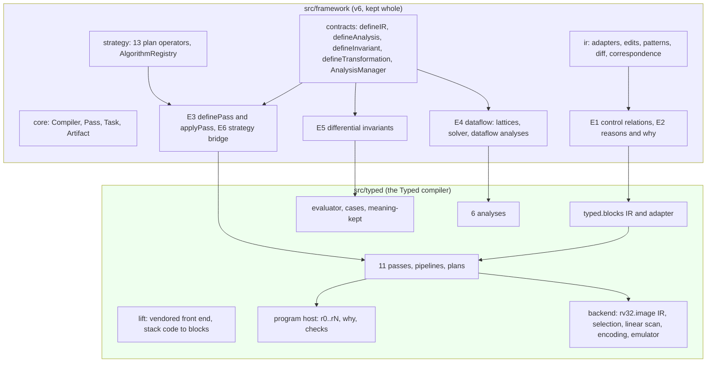

# A compiler defined on its own IR framework

Two pieces of software came into this project from outside it.

**IR Workbench v6** is a TypeScript framework for building compilers whose every step can be inspected. It has four layers:
- **core:** passes, tasks and artifacts;
- **strategy:** a small language of plans;
- **contracts:** typed IRs, analyses, invariants and transformation contracts with assurance levels;
- **ir:** adapters that project a native representation into entities and relations, plus edits, patterns, diffs and correspondence.

**Compiler Workbench** is a JavaScript prototype that compiles Typed, the typed subset of JavaScript used on the PicoCalc, to RV32. It comes with 44 example projects and a book that reports exact numbers for them.

The goal of ticket IRWB-001 is a compiler that is *defined on the framework*: every IR registered as a framework IR, every pass a framework pass, every check a framework invariant, every pipeline a framework plan. Where the framework lacked something the prototype needed, the framework was extended rather than bypassed. This report covers the first milestone. The middle end and the backend run on v6, and every number the prototype's book states for them is reproduced.

> [!summary]
> - **The whole v6 framework was kept, and six extensions were added to it** (control relations, reasons with `why`, `definePass`, dataflow analyses, differential checks, passes as strategy algorithms). The Typed compiler is a domain written against them: 11 passes, 6 analyses, an evaluator, and an RV32 backend.
> - **The prototype's book is the regression oracle.** Blend lifts to 7 blocks and 13 statements and lowers to 96 bytes and 531 instructions. O2 makes the same six revisions, yields the same `why` tree node for node, and shrinks the image to 88 bytes and 451 instructions. Across 44 projects, 70 functions and 7,000 cases, 6,986 decided cases agree and 14 hit the step limit, as the book reports.
> - **Checked preservation found a bug the prototype shipped with.** Its `lvn`, `dce` and `subst` claim to preserve the loop analysis, which is false. The prototype never checks such claims; the framework does, and refused the first one on the first full corpus run.
> - **Matching another tool's facts required matching its schedule.** With widening, the order in which a dataflow solver visits blocks changes the result. The framework solver gained the prototype's round-robin schedule and its delayed widening so that range facts, and the pass decisions built on them, come out the same.

## 1. What "defined on the framework" means

A compiler written *with* a framework uses some of its utilities. A compiler *defined on* a framework gives the framework every object it needs to reason about the compilation: the IRs, the passes and what they read and write, the facts and what they depend on, the checks and how strong their evidence is. The difference shows up as soon as something goes wrong. If a pass changes a kind of entity it did not declare, the framework can say so only if the declaration is framework data. If a pass claims an analysis survives its edit, the framework can verify the claim only if the analysis is a framework analysis cached per revision.

The v6 framework already provides most of this machinery in generic form. An **IR type** is a validator for native values. An **adapter** projects a native value into a graph of entities and relations, and can rebuild a native value from an edited graph. An **artifact** is an immutable value with a content-derived revision hash. An **analysis** is a versioned function from an artifact to a value, cached by exact revision. A **transformation contract** names the invariants an output must satisfy relative to its inputs. And **correspondence** records which entities of one revision became which entities of the next.

What v6 did not have was a notion of a compiler pass as such, dataflow analyses, sampled checks, or control-flow edges as a relation category. The design phase of the ticket listed nine extensions, E1–E9, and this milestone implements six of them in the framework itself. The other three (handles, revision timelines, the tiling schedule) live in the domain for now.



The framework layers keep their original rule: strategy, contracts and ir import only `core/data` and `core/types` from core, and nothing in `src/framework` imports from the domain. A test enforces it.

## 2. The representation: native tables and a projection

The Typed front end is reused unchanged from the ds-js-os repository. It is vendored at a pinned commit, and every file's SHA-256 is checked before it is loaded. It parses and type-checks a program and writes a *tape*, a compact stack-machine encoding. Lifting, ported from the prototype, turns each function's tape into a control-flow graph. Its blocks hold statements (`set`, `store`, `eval`, `br`, `br_if`, `return`, `trap`) over *value trees*: pure expression nodes such as `const`, `get`, arithmetic, comparisons, loads and calls, where each value has exactly one user. The operand stack is materialized into temporaries wherever evaluation order could change: before a local that a pending value reads is assigned, before memory changes, before a call, and around control flow.

Blend, the running example of the prototype's book, lifts to this:

```text
function blend(work: buffer, n: i32, a: i32, b: i32): i32
bb:blend.0  -> [.1]
    s:blend.0    scale = (4 * 16)
    s:blend.1    s = 0
    s:blend.2    i = 0
    s:blend.3    goto .1
bb:blend.1  -> [.2, .3]
    s:blend.4    if !((i < n)) goto .2 else .3
bb:blend.2  -> []
    s:blend.14   return (s / 8)
bb:blend.3  -> [.4, .5]
    s:blend.5    t7 = i
    s:blend.6    if (t7 >=u load32[work+0]) goto .4 else .5
bb:blend.4  -> []
    s:blend.7    trap
...
```

The native value of one revision, `TypedBlocks`, is a set of id-keyed tables (functions, blocks, statements, values, front-end ops) plus the id counters and a revision number. It is finite JSON, so it can be hashed, cached and compared. Passes do not edit it directly. They edit a mutable working copy and hand back a new native value.

The framework sees the same revision through the `typed.blocks` adapter, which projects six entity kinds (`fn`, `local`, `block`, `stmt.<op>`, `value.<op>`, `op`) and nine relation kinds in four categories:

| category | relations | meaning |
|---|---|---|
| containment | `declares`, `contains`, `emits` | a function declares its locals and contains its blocks; a block contains its statements |
| dependency | `uses`, `operand`, `reads` | a statement uses a value tree; a value has operands; a `get` reads a local |
| binding | `writes` | a `set` writes a local |
| control | `succ`, `jump` | a block's successors; a branch statement's targets |

`control` is extension E1. v6 had containment, dependency, binding, adjacency and provenance, but nothing that distinguished a control-flow edge from a data dependency. Without it, a generic dataflow analysis cannot find the flow graph in an arbitrary IR.

The projection and the adapter's `rebuild` are exact inverses, which a test checks on every corpus program: project the native value, rebuild it from the projected graph, and compare canonical encodings. This inverse property is what makes the framework's generic operations meaningful. A v6 `diff` between two projections *is* the change a pass made, and a v6 `IREdit` on the projection rebuilds into valid native tables.

## 3. A pass, from declaration to published revision

Extension E3 adds `definePass`. A pass declares four things besides its code:

- **`needs`**: analyses it reads, computed by the analysis manager for the exact input revision.
- **`writes`**: the entity and relation kinds it may change.
- **`preserves`**: analyses whose results it claims survive its edit.
- **`contract`**: a transformation contract its output must satisfy.

Here is `fold`, ported from the prototype. Its body is the prototype's code; the surrounding declaration is what the framework acts on:

```ts
export const fold = typedPass({
  name: 'fold',
  about: 'constant folding: an operator whose operands are constants becomes a constant',
  writes: ['values'],
  preserves: ['cfg', 'dominators', 'loops', 'liveness', 'reaching'],
  body: ({ tx }) =>
    tx.rewrite(v => {
      if (v.op === 'eqz' && v.args[0].isConst) return tx.const(+(v.args[0].imm === 0), { because: [v.args[0]] });
      if (!FOLDABLE.has(v.op) || !v.args.every(a => a.isConst)) return;
      const [a, b] = v.args.map(x => x.imm as number);
      if ((v.op === 'div' || v.op === 'rem') && (b === 0 || (a === -2147483648 && b === -1))) return; // keep the trap
      return tx.const(binop(v.op, a, b), { because: v.args });
    }),
});
```

`typedPass` maps the prototype's four write kinds (`values`, `stmts`, `locals`, `cfg`) onto projection kinds, maps analysis names onto framework analyses, and runs the body once per function through the prototype's transaction object, `Tx`. The transaction is the only way a pass changes the working copy. Every entity it creates records an *origin*: what it was made from, which pass made it, at which revision, and `because`, the facts or entities that make the change valid. A removal without a `because` is refused.

The framework then applies the pass with `applyPass`, and nothing is published unless every stage succeeds:

```text
applyPass(pass, before):
  facts   <- for each need: manager.analyse(need, before)        -- cached per exact revision
  after   <- pass.run(before, facts)                              -- a native value, or an IREdit on the projection
  changes <- diff(project(before), project(after))
  if changes touch kinds outside pass.writes:  fail undeclaredWrite
  corr    <- correspondence(before, after)                        -- from origins and removal reasons
  if contract: manager.verifyTransformation({input: before, origin: r0}, {output: after}, contract, corr)
                                              -- failure: contractRejected
  for each claimed analysis A that the manager holds for `before`:
      try transfer A's fact via its own verifier (the reads it declares are untouched)
      else recompute A on `after`; if the value differs:  fail preserveViolated
  return { artifact: after, changes, correspondence: corr, report }
```

Two of these stages deserve a closer look. The first is correspondence. The prototype's transactions already record an origin for each new entity, and the ported pass turns those records into framework correspondence entries. Each new entity is grouped under the old entity it was made from. A removed statement becomes an entry with an empty target and the removal's `because`. A surviving entity is retained automatically. Extension E2 added `because` and `note` to v6 correspondence entries, and `whyEntity`, which walks a chain of correspondences backwards. A removed entity's reason therefore survives in framework data, not only in the domain's edit log.

The second is the preservation check, discussed in section 6, because it found the most interesting result of the milestone.

## 4. Meaning as a framework invariant

The prototype checks a pass by running both programs on generated inputs, the transformed head and the original r0, and comparing results, traps and the memory each wrote. A step limit on either side makes a case inconclusive rather than a verdict. This is sampled differential testing, and v6 only knew exact checkers.

Extension E5 adds `differential(spec)`, which returns an ordinary v6 invariant. The specification names the baseline and subject ports, a seeded case generator, a runner, a comparison, and an `inconclusive` predicate. Its evidence records the method as `sampled`, the case count and seed, how many cases agreed, disagreed or were inconclusive, and the first counterexamples. A check with no decided case fails, because it has established nothing. The domain's `typed.meaning-kept` is one such invariant, and the optimization contract every pass application must satisfy consists of that invariant alone:

```ts
// abridged from src/typed/evaluate.ts (meaningKept)
check = differential({
  id: 'typed.meaning-kept', version: `1+${hash(params)}`,
  inputs: { origin: BlocksIR, candidate: BlocksIR }, baseline: 'origin', subject: 'candidate',
  count, seed, random: rng,                       // the prototype's xorshift32, so its cases come out
  cases: ({ origin }) => functionsOf(origin).flatMap(fn => casesFrom(origin, fn, { count, seed, inputs })),
  run: (_side, art, c) => evaluate(art, c.fn, c.args, c.memory, { limit: 2e4 }),
  inconclusive: r => r.limit,
  compare: (expected, got) => agrees(expected, got),
});
```

Two details matter for reproducing the prototype's numbers. The case generator must be the prototype's own xorshift32, seeded per function, because the book's counts depend on exactly which inputs are drawn. And the case parameters, the per-project input specifications from `project.json`, are part of the definition. The registry identifies definitions by id and version, so one definition object exists per parameter set, and its version carries a hash of the parameters.

The deliberately wrong pass in the corpus, `div-to-shift`, which rewrites `x / 2^k` as `x >> k` without proving `x ≥ 0`, is rejected by this contract with counterexamples, and nothing is published. Through the strategy bridge (E6) the same rejection becomes a recoverable strategy rejection, so a plan can wrap a risky pass in `attempt` with an identity fallback.

## 5. Facts that match another tool's facts

The six analyses (cfg, dominators, loops, liveness, reaching definitions, ranges) are framework analyses. The first three are plain `defineAnalysis` definitions. The other three use extension E4's `dataflow()`, which takes a lattice, a direction, flow regions and a transfer function, and returns a v6 analysis whose transfer verifier compares the reads the analysis declares against the change set a pass actually made.

Ranges are where porting became subtle. The range analysis maps every local to an integer interval, refines intervals along branch edges (`i < n` taken means `i ≤ n − 1` on that arm), and widens at loop heads so that iteration terminates: a bound that moved jumps to the domain's extreme. With widening, the result of a dataflow solve is not unique. It depends on when widening happens, and so on the order in which blocks are visited.

The first E4 solver used a worklist in reverse postorder and widened at a loop head from its first revisit. The prototype sweeps all blocks round-robin in reverse postorder until nothing changes, and widens at a loop head only after it has been visited three times. A loop with a small constant bound keeps an exact interval under the prototype's policy and loses it under the worklist's. The `strength` pass replaces `x / 2^k` by a shift only when ranges prove `x ≥ 0`, and `bce` removes a bounds check only when ranges prove the index non-negative. Different intervals therefore mean different programs.

The solver now takes three additional options: `edge`, a per-edge transfer for branch refinement; `widenAfter`; and `strategy: 'round-robin'`. The typed analyses choose the prototype's settings:

```ts
// abridged from src/typed/analyses.ts; helper names stand for inline code there
export const rangesAnalysis = dataflow({
  id: 'typed.ranges', direction: 'forward',
  lattice: mapLattice(intervalLattice()),
  strategy: 'round-robin', widenAfter: 3,
  boundary: (_r, { f }) => paramsFullOthersZero(f),
  transfer: (block, env, { st }) => block.stmts.reduce(step, env),
  edge: (from, to, out, { st }) => refineOnBranch(from, to, out),
  widen: (a, b) => pointwise(interval.widen, a, b),
  reads: { entities: ['block', 'stmt.*', 'value.*', 'local'], relations: [...] },
});
```

A second design point concerns what a fact *is*. v6 analysis results must be immutable finite JSON, and the prototype's facts are objects with methods (`liveAfter(stmt)`, `reachingAt(stmt, local)`, `ranges.of(stmt, value)`). The framework stores only per-block facts. Pass code reads them through *views* that rebuild the query methods on demand. The views are built on the pass's working copy, not on the input revision, because `strength` asks for the range of a value that the same transaction has just rebuilt. This choice also makes preservation checkable: two facts are equal exactly when their canonical JSON encodings are equal.

## 6. A false claim, caught on the first full run

The prototype's passes declare which analyses they preserve, and the prototype uses the declarations only to keep cached facts fresh. Nothing checks them. In the framework, `applyPass` checks every claim for which a fact exists on the input revision. It first tries the analysis's own transfer verifier and then falls back to recomputation and comparison.

The first full corpus run ended with one failure:

```text
value-numbering        ERROR [preserveViolated] Pass typed.lvn claims to preserve typed.loops, but it changed
{"projects":44,"functions":69,"cases":6900,"decided":6886,"agree":6886,"inconclusive":14,"failures":1}
```

`lvn`, local value numbering, computes a repeated pure expression once into a new local `vn` and reads the local twice. When the block is inside a loop, the new `set vn` is an assignment in the loop body. The loop analysis records, for each natural loop, the set of locals the loop assigns, because `licm` uses that set to decide what is invariant. Adding `set vn` changes the set, so the claim "lvn preserves loops" is false. The same reasoning applies to `dce` and `subst`, which remove assignments. Their claims never fired only because no corpus run had computed loop facts on their input revisions.

In the prototype, the false claim keeps a stale loop fact marked fresh after `lvn`. The defect is latent there: both pipelines that contain the two passes run `licm` before `lvn`, so no hoisting decision is ever made on a stale fact. Had a user's pipeline put `licm` after `lvn`, it would have hoisted with an assigned-locals set that missed `vn`.

The three claims were corrected to `['cfg', 'dominators']`, each with a comment saying why the prototype's claim was wrong, and a regression test shows the old claim is refused. With the correction the corpus totals became the book's.

## 7. The parity results

Every number below is stated in the prototype's book and measured in this repository by an automated test.

| measure | book | here |
|---|---|---|
| Blend at r0 | 7 blocks, 13 statements | 7, 13 |
| Blend image at r0 | 96 bytes; 531 instructions on 40 cells, n = 40 | 96; 531 |
| Blend image, fuse/immediates/divmagic off | 116 bytes | 116 |
| O2 revisions on Blend | cfg, fold, simplify, constprop, dce, licm | r1 cfg … r6 licm |
| `s:blend.15` after O2 | `inv = ((a * b) + 64)`, licm at r6 | same |
| `s:blend.0` after O2 | reads `scale = 64`, removed at r5 | `removed@r5` |
| Blend image after O2 | 88 bytes; 451 instructions | 88; 451 |
| covers of `mul t2, a2, a3` | `v:blend.23`, `s:blend.15` | same |
| instructions attributed to line 5 | 322 of 451 | 322 |
| Checksum | 64 bytes, 446 instructions → 52 bytes, 366 after O2 | same |
| corpus, 100 cases per function | 44 projects, 70 functions, 6,986 decided agree, 14 at the step limit | same |

The `why` tree is the most demanding of these, because it depends on lifting, id allocation, the pass decisions, the origins, and provenance resolution across revisions all at once. The book prints it as:

```text
s:blend.15  inv = ((a * b) + 64)        live · via licm · r6 · hoisted out of loop:blend@bb:blend.1
  made from v:blend.37  ((a * b) + 64)  live · via constprop · r4 · rebuilt around a changed argument
    made from v:blend.25  ((a * b) + scale)   detached · via ingest
      made from op:blend#35  i32.add (line 5)
  because loop:blend@bb:blend.1
```

`Program.why('s:blend.15')` returns this tree, and a test asserts each node's id, text, status, pass, revision and note. `v:blend.25` exists only in revisions r0–r3, so the host resolves ids from the head backwards through the immutable revision artifacts. That is also how a removed statement still reads as it was. The prototype achieved the same effect by never deleting entities from its store and restoring statement fields from snapshots.

The backend was ported in parallel by a subagent working in its own git worktree, with its own diary. It reproduces the book's r0 numbers for selection by tiling, linear-scan allocation, frames, encoding, magic-number division and calling-convention-checked runs on the vendored RV32IM interpreter. Its `imageAgrees` invariant, the evaluator on the program against the emulator on the image, passes on all 70 functions. The subagent also found that `blocksAdapter.resolve` scanned every entity on each call, which made every projection quadratic. Indexing it cut the full test suite from 32.7 s to 6.8 s.

## 8. What did not go as planned

The original plan for parity was to run the prototype itself and record its outputs. Running code from the downloaded archives was refused by the session's permission policy, and the work was not routed around that refusal. Parity instead rests on two independent sources: the numbers printed in the prototype's book, and the user's own ds-js-os components (front end, interpreter, reference compiler), which are vendored and digest-checked. The constraint improved the result. The book's numbers are exact, cover the whole pipeline, and could not be regenerated by mistake from the code under test.

The vendored reference compiler includes only its core bundle. Its default policy needs pass-group files that were not vendored, so the oracle tests compile with the `interactive` policy, and its instruction counts differ from the book's reference figures. Vendoring the pass-group files would close that gap.

## 9. Where this leads: Candela

The reason for building the compiler this way is design-doc 03's proposal: compile Candela, the path tracer that ds-js-os translates from WGSL into Typed, through one artifact chain, so that passes on the Typed code can use facts known only at the Candela level. The first such fact is the scene index on which the kernel dispatches. With it, specialization can delete the code of the other seventeen scenes, and `why` can name the Candela fact that justified each deletion.

An inventory of the gallery program measured what that requires. The program has 332 functions. About 13,000 of its operations, a little under a third, are f32 operations, and the prototype's IR, evaluator, passes and backend are i32-only. The front end's inspection path, which the lifter uses for source positions, fails on this program (`unknown tape opcode 151 at 12`), while raw tape decoding succeeds for every function, so a second lifter entry point will read the tape directly. The vendored interpreter executes RV32F with rounding modes and saturating conversions, so it can serve as the oracle for floating-point behaviour too. Typed f32 values, the raw-tape lifter, f32 evaluation checked against reference images, and float-safe pass rules are in progress in a second worktree.

## 10. Open problems

- **Preservation is checked only when the fact exists.** A pass whose claim is false escapes detection whenever the analysis was not computed on its input revision, as `dce`'s and `subst`'s did. A paranoid mode that always computes and compares, at least in tests, would audit every declaration on the corpus.
- **The full corpus check takes 84 seconds.** Most of the time goes to per-revision meaning checks (40 cases per function per changed revision) and to recomputation in preservation checks. The default test run uses a ten-project subset, and the full run is opt-in.
- **Correspondence uses only the first origin.** It is adequate while every entity has one origin, as all of the prototype's do. Merges with several sources would need all of them.
- **The tiling schedule (E7) lives in the domain.** The backend's selection is the prototype's algorithm in TypeScript. Expressing it as framework rewrite rules is the remaining extension that would let a strategy plan choose among instruction selections.
- **The workbench UI has not moved yet.** The program host provides the members the prototype's UI and agent call, but they are async here because framework analyses and contracts are.

## Related notes

- [[PROJECT REPORT - PicoCalc Candela - The Path Tracer in Typed - Generated from WGSL, Compiled on the ESP32-P4, 1.76x the C++ Kernel - A Technical Deep Dive]]
- [[PROJECT REPORT - PicoCalc Compiler - Value Types in a Streaming Compiler - Scalar Replacement Without a Syntax Tree, and Candela's Kernel from 1.76x to 1.46x C++ - A Technical Deep Dive]]
- Ticket workspace: `/home/manuel/code/wesen/2026-11-24--compiler-workbench/ttmp/2026/11/24/IRWB-001--ir-workbench/` (design docs 01–03, the Candela inventory, and the implementation diaries 02–04)
