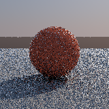
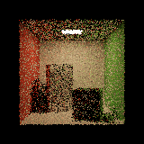

# Per-scene kernels for Candela

Report 3 ended with Candela, the 332-function path tracer of the PicoCalc gallery, lifted into the compiler's block representation (`typed.blocks`, on the v6 framework) and carried through O2 with every pass checked against the original program. Three things were still missing at that point:
- **A pass was expensive.** It cost about two minutes even when it changed nothing.
- **No machine code.** The compiler's own backend handled only 32-bit integers, so Candela could be evaluated but not compiled.
- **No rendered picture.** Every check compared single function calls on generated inputs.

This report covers the milestone that closes those gaps and then uses them. Candela's gallery program contains all eighteen scenes and chooses among them at run time by reading a field of its kernel record. A device that shows one scene needs only that scene's code. The compiler can now:
1. bind that field to a constant;
2. remove what no longer runs;
3. compile the remainder to RV32 with its own backend;
4. render the scene from the result and compare every output float with the reference compiler's image on the emulator.

Three similar terms recur with different meanings, so they are fixed here:
- **A per-scene kernel** is Candela's program specialized to one scene.
- **`kernel`, in code font,** is the reference compiler's most aggressive code-generation policy, against which speed is measured; `stock` is its default policy.
- **`K`** is Candela's kernel record, the structure the host fills before rendering.

Most of the work was done in this session's main thread. The f32 backend and the browser view were done by subagents, each of which kept its own diary in the ticket (`log/06-f32-backend-agent-diary.md`, `log/05-ui-agent-diary.md`).

> [!summary]
> - **Cheaper checked passes, with identical hashes.** Caching on values that cannot change made a no-change pass on Candela 4.7 times faster and the full O2 run twice as fast. Every revision hash in the 44-project corpus is identical before and after.
> - **Merged bounds checks.** Checked text addresses in one block that share a receiver and a linear base need only two checks, at the smallest and the largest position. On Candela r0, 559 checks become 100.
> - **An RV32F backend.** Every Candela function compiles, at r0 and at the O2 head, and agrees with the evaluator and with the reference compiler's image on 100 cases per function. The O2 image has 49% of the bytes of the reference's `stock` policy and executes 54% of its instructions. Against the reference's `kernel` policy it executes 16% more, mostly for lack of inlining.
> - **Per-scene kernels.** One record-field binding, a contract that compares only the host's entry functions, and dead-function elimination remove 185–197 of 332 functions per scene. Every scene's frame stays bit-identical. A per-scene image is 42% of the general one. It executes only 5–6% fewer instructions per pixel, and O2+ on top adds less than 1%. The remaining speed gap to the reference is inlining and code generation, not pass ordering.

## 1. Checked passes on a large artifact

### Where the time went

The v6 framework represents every revision of a program as an artifact. An artifact is a deep-frozen JSON value, together with a revision that is the SHA-256 hash of its canonical text. Applying a pass involves several steps that touch the whole value:
1. validate the input artifact;
2. project it into entities and relations, so that the pass's declared writes can be checked against what actually changed;
3. run the pass;
4. build the output artifact, which means encoding it canonically, hashing it and freezing it;
5. validate the new graph;
6. run the meaning contract.

For the 44-project corpus none of this is visible. Candela at r0 has 12,358 statements and 13,000 float operations, and its revisions are correspondingly large: the O2 head alone, saved as JSON, is 16 MB. Every generic step pays for that size.

A profile of one pass that changes nothing (`strength` on r0) and one that changes a great deal (`cfg`) located the cost:

| measured on Candela r0 | before | after |
|---|---:|---:|
| `createIRArtifact` (encode, hash, freeze) | 7,897 ms | 5,027 ms |
| `project` (entities and relations) | 4,792 ms | 0 ms (cached) |
| CFG analysis | 4,933 ms | 1,184 ms |
| `strength`, no change | 86,423 ms | 18,195 ms |
| `cfg`, 974 edits | 101,058 ms | 30,861 ms |

The revisions were the same before and after: `strength` returns `cd36346ea7c4f175` and `cfg` returns `4aea7e81dd046901` in both columns. Most of the no-change pass was the same value being encoded, hashed and projected several times by different layers. Each layer had received a value and could not know that another layer had already processed it.

### Caching on values that cannot change

All the changes follow one rule: a cache may be keyed only on an object that cannot change. Under that rule, a cached result is a deterministic function of its key, so caching can skip work but never alter a result. The framework already had such objects. Every artifact value is produced by `immutable`, which deep-freezes a canonical copy. What it lacked was a way to recognize them. The changes, all in `src/framework`:

- **A set of canonical values.** `immutable` now records every object it builds in a `WeakSet`. It returns an object already in the set unchanged, instead of copying it again. It also builds the copy directly, rather than through `JSON.parse(canonical(v))`, with the same rejections of non-finite numbers, accessors, cycles, holes and symbols.
- **Cached text and hashes.** `canonical` caches the text of a recognized value when the text is at least 4,096 characters long; smaller values are cheaper to encode again than to keep. `fingerprint` caches the hash of a recognized value.
- **Verified artifacts.** An artifact built by `createIRArtifact` is recorded as verified, so `validateIRArtifact` does not hash it a second time.
- **Cached projections.** `project` caches the projection of a recognized value per adapter, but only for an adapter that the framework has captured and frozen.
- **Comparison without text.** `sameCanonical` compares two values structurally instead of comparing their canonical texts. This is valid because canonical records have sorted keys.

The equivalence claim was tested, not assumed. `scripts/08-corpus-revisions.mjs` prints, for every corpus project, the r0 revision, every O2 revision and the image revision. The output with the old framework files and with the new ones is identical for all 44 projects.

The full O2 run on Candela went from 36 minutes to 19. The final check of that run, 33,200 cases, agrees on 33,184, disagrees on none, and is inconclusive on 16 that hit the step limit. Memory, not time, is now the limit on how many Candela revisions one process can hold. Thirteen revisions with their analyses peak at 5.8 GB.

One assumption is now load-bearing. The projection cache assumes adapter functions are deterministic. The framework already assumed this, since revisions are content hashes. Before, a non-deterministic `entities` function would have been caught by the resolve check; now the cache would hide it.

## 2. Merging bounds checks

### What a checked address is

Candela reads its scene data from buffers that the host fills: objects, lights, BVH nodes, uniforms and SDF data. Typed represents a buffer as text: a 32-bit capacity in UTF-16 units at byte 0, followed by the units. A read at position `p` goes through a checked address, `caddr(r, p)`. The evaluator defines it as follows:

```ts
case 'caddr': {
  // text.checked_address: trap unless position < capacity (unsigned), then receiver + 2 * position
  const r = ev(v.args[0]), p = ev(v.args[1]);
  if (p >>> 0 >= mem.getInt32(r, true) >>> 0) throw new Trap('checked address out of range', id);
  return (r + (p << 1)) | 0;
}
```

A check costs a load of the capacity, an unsigned comparison and a branch. Candela r0 has 559 of them in 41 functions; `cdlInit` alone has 256.

### What the checks look like

The design document had planned the textbook approach: remove a check when a dominating test already proves the position is in range. The checks themselves suggested something else. `oRow` reads one object row, four floats, from the object buffer `q_bO`. At r0 it makes four checked reads at positions `2·q_t0 + 1`, `+ 3`, `+ 5` and `+ 7`, with no test at all before them. A dominating test would need Candela's row-count facts from outside the program.

A script grouped all 559 checks by block, receiver and the linear base of the position (`scripts/09-caddr-patterns.mjs`). Once each local was resolved through its single assignment, 538 of the checks fell into groups of two or more, in 81 groups. The structure is regular: generated code that indexes rows reads several fields at fixed offsets from one computed base.

### The rule

Within one block, take the checks on the same receiver whose positions are `B + k` for the same symbolic base `B` and different constants `k`. If the smallest and the largest position are both in range, every position between them is in range too. So two checks suffice for the whole group. The argument needs one condition: `B + k_min + (k_max − k_min)` must not wrap modulo 2³². It cannot, because a text's capacity is below 2³¹ units; its units take two bytes each in a 32-bit address space. When all positions are constants and non-negative, the largest check alone suffices.

Moving a check is sound because every checked address of a block executes whenever the block does, unless something traps first, and a trap ends the program. The merged check can trap earlier than the original program would have, but never in a run in which the original would not have trapped. Two things end a group:
- **A call**, because the callee might not return.
- **A store**, unless it provably writes a buffer's data rather than its capacity word. A store through a checked address at a constant position `c ≥ 0`, with `2c + offset ≥ 4`, writes data. Any other store could overwrite a capacity, and the checks after it then have to see the new value.

Positions are put into linear form, `{terms, k}`, over `add`, `sub`, `shl` and `mul` by constants, all modulo 2³². The harder part is naming the terms, because two reads of a local are the same value only if no assignment intervenes. A read is named by its single reaching definition when that definition occurs earlier in the same block. That definition executes once per execution of the block, so equal names denote equal values. A local the block never assigns is named as itself.

Each site gets one of three explicit roles:
- **keep:** its own check is one of the group's two;
- **check:** it is rewritten to check the group's extreme position and to subtract the difference from the address;
- **unchecked:** it becomes `r + (p << 1)`, with a `because` link to the site that now carries the check.

An early version inferred the roles and confused "no rewrite needed" with "unchecked", which would have dropped a required check. The explicit role removed the ambiguity.

### Result

On Candela r0 the 559 checked addresses become 100. The meaning contract accepts the revision, and the pass makes 482 edits in 57 seconds. In `oRow`, the four checks become two:

```
return (loadf32[(caddr(q_bO, (t5 + 6)) + -12)+2], loadf32[(caddr(q_bO, (t6 + -2)) + 4)+2],
        loadf32[(q_bO + (t7 << 1))+2],             loadf32[(q_bO + (t8 << 1))+2])
```

Read with the positions in mind:
- **The first read checks the group's largest position.** `t5` holds `2·q_t0 + 1`, so it checks `t5 + 6 = 2·q_t0 + 7` and subtracts 12 bytes to return to its own unit.
- **The second read checks the smallest position.** `t6` holds `2·q_t0 + 3`, so it checks `t6 − 2 = 2·q_t0 + 1` and adds 4 bytes.
- **The last two reads are unchecked.**

`why` on an unchecked read follows its `because` link to the statement that carries the check.

## 3. An RV32F backend

### What Candela asks of a backend

The backend of the first milestone allocated one register class, x registers holding 32-bit integers, and used the standard integer calling convention. Candela needs more on every axis:
- **f32 operations.** About 13,000 of them, each of which must produce the IEEE result bit for bit, NaN payloads and −0 included.
- **A float calling convention.** Under ilp32f, integers travel in a0–a7 and floats in fa0–fa7, each class in order. A float beyond fa7 takes the next free integer register, and anything beyond that goes on the stack. 40 Candela functions take stack arguments. The extreme is `neeAt`, with 5 integer and 30 f32 parameters.
- **Record results.** A Typed function can return a record, which the reference compiler returns as separate leaves: registers first, then stack words that the callee writes into the caller's frame. 93 functions return some leaves on the stack. `lobeNone` returns 3 integer and 23 f32 leaves.
- **Checked addresses, frame arrays and zeroed memory** (`caddr`, `aaddr`, `zero`).

### The design

The backend subagent added an f register class beside the x class, with three pools: temporaries (ft), arguments (fa) and callee-saved registers (fs). A leaf function allocates from all three. A function that calls allocates from ft and fs, and also from fa wherever a liveness analysis of the physical registers shows them free between calls. The design document had pooled fa only in leaves. The extension applies only to f values, so integer allocation, and with it every corpus image, is unchanged. It shrank Candela's r0 image from 189,216 to 183,324 bytes.

The calling convention was factored into one module, `src/typed/ilp32f.ts`. The backend's runner and the reference-compiler oracle both use it to place arguments and read results. Two compilers share no other code. An agreement between our image and the reference image therefore also checks the convention: a disagreement cannot come from two readings of it.

Record results are read where they arrive. The lifter places every `result#k` read in the block of its call, before any other call. The allocator computes where each physical fa register holds a value: a call writes all eight, and a leaf read reads its register. A result register is therefore occupied from the call to the read of its leaf, and no other value is placed in it. So the selector reads a leaf directly from a0–a7, fa0–fa7 or the outgoing stack word, without a copy. It refuses a leaf read that is not in its call's block or that follows another call, rather than read a register that may have been overwritten.

Two further additions came from failures:
- **Branch relaxation.** The O2 head failed with `[branchRange] branch of -4512 bytes is out of range`: a conditional branch on RV32 reaches ±4 KiB. After each function's code is final, a branch outside −4096…4094 bytes is rewritten as the inverted branch over a `jal zero, target`, and positions are recomputed until no branch changes. A relaxed site costs one extra word.
- **A check of the callee-saved f registers.** The emulator checks only that callee-saved x registers survive a call. `runImage` now also compares fs0–fs11 before and after the call it makes, and reports a fault if any changed.

### Results

Every Candela function compiles at r0 and at the O2 head. On 100 cases per function, compared with the evaluator, over the 32,985 cases that every image completed within the step limit:

| image | bytes | instructions per case | disagreements |
|---|---:|---:|---:|
| ours, r0 | 183,324 | 921.0 | 0 |
| ours, O2 head | 151,748 | 870.3 | 0 |
| reference, `stock` policy | 312,740 | 1,598.6 | 0 |
| reference, `kernel` policy | 434,996 | 747.7 | 0 |

Our images also agree with the `stock` image directly, at r0 and at O2. The integer corpus is unchanged: every project's image revision under seven option sets, and after O2, is identical to the revision before the backend was extended.

Measured against `kernel`, the reference's most aggressive policy, the O2 image has 35% of the bytes and executes 116% of the instructions. The difference has three identified sources:
- **Inlining.** `kernel` inlines `q_floor` and `q_fract` into `noise3`, so `noise3` makes 8 calls where ours makes 14. `fbm3` and `cdlRenderSpan` account for half of the gap.
- **Float constants rebuilt at each use, loops included.** The reference keeps them in registers.
- **Uncoalesced copies.** The copies that licm and lvn introduce stay in the code. This is the likely reason why 21 functions became slower at O2 while 180 became faster.

Inlining is a middle-end transformation; keeping constants in registers and coalescing copies belong to the backend. Inlining and copy coalescing appear as items E3 and H2 of the research agenda in ticket IRWB-002.

## 4. Rendering a frame

### Why a frame is a stronger check

Every check so far compares single function calls on generated inputs. The input generator derives value ranges and record shapes from the program, but the inputs are still synthetic. Five deep functions (`skyBuild`, `cdlSky`, `cdlRenderSpan`, `fbm3`, `traceAOV`) hit the step limit on many of them. They account for the 215 cases of 33,200 that remain inconclusive. A rendered frame is the opposite kind of test. It runs exactly the calls that Candela's host makes, in its order, on real scene data, through the deepest functions. Its output is 12 floats per pixel, which can be compared bit for bit.

### The host protocol

The gallery's host is a JavaScript program in the ds-js-os repository. This project does not execute code from downloaded archives. The host protocol was therefore re-implemented from a reading of `host.mjs`, in `src/typed/candela-render.ts`, and the scene data comes from the gallery's generated C table, `candela_gallery_scenes.c`. That file is vendored as data with a recorded SHA-256 and parsed, never compiled. A frame takes four steps:

```mermaid
sequenceDiagram
  participant H as CandelaHost
  participant E as engine (emulator, evaluator or our image)
  H->>E: cdlLayout(lay)  — which K fields are pointers, which buffers, their sizes
  Note over H: write pointers and capacities into the arena at 4096
  H->>E: cdlInit(K)  — fill the GGX albedo table; must return 1
  Note over H: bind a scene: 5 row buffers (U, O, LI, BV, SD), K.scene at +28, K.spectral, K.skyOn = 0
  H->>E: cdlSky(K)  — build the sky table
  Note over H: K.skyOn = 1
  loop every row y (stride 1) or every sampled pixel (stride > 1)
    H->>E: cdlRenderSpan(K, out, y, x0, x1, frame)
    E-->>H: 12 floats per pixel: colour rgba, albedo rgba, normal xyz, depth
  end
```

An engine is a function `(name, args, memory) → result and memory`. Three kinds exist:
- **The emulator running the reference compiler's image**, under its `kernel` or `stock` policy.
- **Our evaluator** at any revision.
- **Our own RV32 image** of any revision, on the same emulator.

### Results

B-01 ("Hello, sphere") at its full 160×160 takes 217,105,487 instructions on the reference `kernel` image, or 8,481 per pixel, plus 5,520,419 for the sky table. Comparisons, each on every output float:

| scene, sampling | engine | work | floats that differ |
|---|---|---:|---:|
| B-01, every pixel | evaluator at r0 | 79,653,353 statements | 0 of 307,200 |
| B-01, every 4th pixel | evaluator at the O2 head | 3.75 M statements (r0: 4.98 M) | 0 of 19,200 |
| B-01, every 4th pixel | our r0 image | 17,920,579 instructions (`kernel`: 13,601,596) | 0 of 19,200 |
| R-01, every 8th pixel | reference `stock` | 44,955 instructions per pixel (`kernel`: 16,412) | 0 of 4,800 |

The images are colour, albedo, normal and depth views of the twelve outputs. The colour view maps the frame's log-average luminance to 0.18, then applies `x/(1+x)` and the sRGB curve. Candela's own viewport applies the scene's tone map and post passes; this preview does not.

| B-01, colour | B-01, normals | R-01 (Cornell box), colour |
|---|---|---|
|  |  |  |

All three are single-sample frames (one camera ray per pixel, frame 0) from the reference `kernel` image on the emulator. The grain is Monte Carlo noise; the gallery removes it by accumulating passes.

The Compiler Workbench has a Candela view built on the same code (`src/workbench/candela.ts`, `site-src/candela.js`). It offers any of the eighteen scenes, any engine, a stride of 1, 2, 4 or 8, a view, and 1–64 accumulated passes. Rows appear as they finish, and every finished frame is compared bit for bit with earlier renders of the same scene by other engines. In Chromium the emulator's instruction counts equal the Node counts exactly. Candela's sources, the scene table and the reference compiler are loaded only when the view opens, with subresource-integrity hashes checked against the vendor record. The page's content security policy forbids `fetch`, so they arrive as script tags.

## 5. Per-scene kernels

### What the program does with the scene index

The gallery compiles all eighteen scenes into one Candela program. Each scene contributes a section of functions with a prefix, `s0_` to `s17_`, of 7 to 14 functions each, 177 in all. Five dispatchers choose the section at run time:
- `evalMaterial`
- `sdUser`
- `heightAt`
- `densityOf`
- `customKernel`

Each dispatcher reads `q_k.scene`, an i32 at byte offset 28 of the kernel record `K`, and calls the matching scene's function. The host writes that field once, when it binds a scene, and the program never writes it.

A device that shows one scene still carries all eighteen. It also pays for a dispatch on every material evaluation, every SDF step and every density lookup. This is the classic setting for partial evaluation: an input that is fixed for the whole run, read deep inside the program. Report 2 introduced specialization on outer facts for function parameters. Candela's fact is a record field, so three new pieces were needed.

### Binding a record field

A binding is a fact artifact of kind `typed.bindings`, with a source and an entity name, so that every rewrite it causes can point back to it:

```json
{ "formatVersion": 1, "source": "candela gallery",
  "bindings": [{ "record": "K", "field": "scene", "value": 1, "entity": "scene/R-01" }] }
```

The `specialize` pass reads the record layout from the front end (`K.scene` is `{type: 'i32', offset: 28}`). In every function, it replaces `load32[p + 28]` by the constant `1`, provided two conditions hold:
- `p` is a parameter of type `K`;
- the read's only reaching definition of `p` is the parameter itself, so `p` has not been reassigned.

Each new constant records the binding as its reason, with the note `q_k.scene = 1 (candela gallery)`. The pass also checks the opposite direction statically. If a function stores to offset 28 through such a parameter, the pass refuses with `unsupported` rather than assume a fact the program itself could falsify.

The binding is also an assumption about inputs. A meaning check compares the specialized program with the original on generated inputs. Those inputs must satisfy the fact, or the check would report differences that no real run can produce. `Program.assume` therefore records `q_k.scene = 1` for every function with a `K` parameter. `Program.inputs` turns that assumption into `{ record: { …, scene: { oneOf: [1] } } }` inside the parameter's input specification.

### Checking only what the host calls

After the binding, `constprop`, `fold`, `cfg` and `dce` turn each dispatcher into one direct call. The other seventeen scenes' functions lose their last caller. Removing them needs two things.

The first is a contract that does not compare them. The meaning contract used so far generated cases for every function of the original program. A removed function has no counterpart to compare with, and an uncalled function may still be exactly what a host calls: no program can know its entries from its own text. The entries therefore became a declared property of the program (`Program` option `entries`). For Candela they are the four functions the gallery host calls: `cdlLayout`, `cdlInit`, `cdlSky` and `cdlRenderSpan`. When entries are declared, the contract (`MeaningParams.roots`), `check` and `verify` generate cases only for them. This states precisely what the program means to its host.

The second is the pass itself. `dfe`, dead-function elimination, is the first pass that works on the whole program rather than per function. It is written directly with `definePass`:

```ts
run({ before, params }) {
  const roots = params.roots;                    // required: the host's entries
  reached = closure of roots under "f calls g"   // over call values in every statement
  dead = functions not in reached
  delete each dead function and its front-end ops (op:<fn>#n)
  correspondence: one { from: [id], to: [], relation: 'removed', because: ['entries: …'] } per vanished entity
}
```

Its declared writes cover every entity and relation kind, since removing a function removes its locals, blocks, statements and values. Its spec is marked `program: true`, so the strategy registry does not offer per-function variants of it.

A fixture shows the whole chain in miniature. `entry(q, x)` calls `pick(q, x)`, which calls `one(x)` when `q.mode < 1` and `two(x)` otherwise; `unused` is called by nothing. After binding `Q.mode = 1`, `constprop`, `fold`, `cfg`, `dce`, `cfg` and `dfe` with root `entry`, `pick` reads:

```
function pick(q: Q, x: i32): i32
bb:pick.0  -> []
    s:pick.6     t5 = two(x)
    s:pick.7     r = t5
    s:pick.9     return r
```

`one` and `unused` are gone, and the check compares only `entry`.

### Results over the gallery

The pipeline is `specialize`, then `constprop`, `fold`, `cfg`, `dce`, `cfg`, then `dfe`. For each scene, our evaluator renders the frame from the specialized program, and the result is compared with the reference compiler's `kernel` image on the emulator at stride 8:

| scene | functions | statements | cut | floats compared | differ |
|---|---:|---:|---:|---:|---:|
| B-01 | 135 | 5,317 | 57.0% | 4,800 | 0 |
| R-01 | 137 | 5,400 | 56.3% | 4,800 | 0 |
| L-03 | 136 | 5,369 | 56.6% | 4,800 | 0 |
| G-01 | 140 | 5,577 | 54.9% | 4,800 | 0 |
| E-02 | 138 | 5,533 | 55.2% | 4,800 | 0 |
| W-02 | 147 | 5,965 | 51.7% | 4,800 | 0 |
| F-01 | 137 | 5,411 | 56.2% | 4,800 | 0 |
| V-02 | 141 | 5,395 | 56.3% | 4,800 | 0 |
| G-02 | 141 | 5,539 | 55.2% | 4,800 | 0 |
| X-04 | 137 | 5,445 | 55.9% | 1,200 | 0 |
| S-02 | 140 | 5,432 | 56.0% | 1,200 | 0 |
| R-05 | 143 | 5,548 | 55.1% | 1,200 | 0 |
| V-03 | 140 | 5,410 | 56.2% | 1,200 | 0 |
| V-04 | 140 | 5,420 | 56.1% | 1,200 | 0 |
| R-08 | 143 | 5,494 | 55.5% | 1,200 | 0 |
| X-03 | 142 | 5,484 | 55.6% | 1,200 | 0 |
| R-04 | 141 | 5,427 | 56.1% | 1,200 | 0 |
| G-03 | 139 | 5,378 | 56.5% | 1,200 | 0 |

The general program has 332 functions and 12,358 statements. Scenes 9–17 are 80×80 in the scene table, so they have fewer pixels to compare.

Each scene loses 185–197 functions, more than the other seventeen sections hold (163–170). The remainder is shared code that only other scenes reach. W-02 keeps the most, 147 functions, and every scene's frame is bit-identical.

Compiled by our backend and rendered at stride 4 (1,600 pixels), the scene images compare with the general one as follows:

| scene | image bytes, general r0 → scene | instructions per pixel, general r0 → scene | reference `kernel` | floats that differ |
|---|---:|---:|---:|---:|
| B-01 | 183,324 → 76,244 (−58.4%) | 11,200 → 10,494 (−6.3%) | 8,501 | 0 of 19,200 |
| R-01 | 183,324 → 77,688 (−57.6%) | 24,070 → 22,882 (−4.9%) | 15,656 | 0 of 19,200 |

The image shrinks by more than half, while the executed instructions fall by 5–6%. Specialization removes code that does not run. The code that does run changes only where the scene constant reaches it: at the dispatches, and wherever constant propagation carries the value further.

The design then planned O2+ on the specialized program. The intent was that the optimizing passes would find more once each dispatch was a direct call to a single callee. The measurement does not support that expectation:

| scene | statements, after `dfe` → after O2+ | image bytes | instructions per pixel | per-function check | floats that differ |
|---|---:|---:|---:|---|---:|
| B-01 | 5,317 → 4,786 | 76,244 → 74,044 | 10,494 → 10,435 (−0.6%) | 2,699 agree, 0 disagree, 1 inconclusive | 0 of 19,200 |
| R-01 | 5,400 → 4,859 | 77,688 → 75,288 | 22,882 → 22,851 (−0.1%) | 2,739 agree, 0 disagree, 1 inconclusive | 0 of 19,200 |

O2+ removes about 10% of the statements and 3% of the bytes, and it changes the executed instructions by less than 1%. All sixteen passes were accepted in both scenes, and the per-function check found no disagreement. The result locates the remaining gap to the reference `kernel` policy, 23% more instructions per pixel on B-01 and 46% on R-01. The gap is not in passes this compiler already has, applied in a better order or to a smaller program. It is in transformations the compiler does not perform at all: inlining small functions into their callers, as `kernel` inlines `q_floor` and `q_fract` into `noise3`, keeping float constants in registers, and coalescing copies. These are the next things to build, and the per-scene program is the right place to measure them. In the B-01 program after `dfe`, 55 of the 131 functions other than the entries have exactly one static call site, and 29 of those have at most 20 statements. Inlining such a function removes a call and a return, and the argument and result moves around them, without duplicating any code.

### What checks what

Four checks stand behind a per-scene kernel, each covering what the others leave open:
1. **A static refusal.** `specialize` refuses if a function writes the bound field through a `K` parameter.
2. **The entry-only contract.** Every pass is gated on generated cases for the four entries, under the scene assumption. Many `cdlRenderSpan` cases reach the step limit and are inconclusive, so this gate is weak for the deep functions.
3. **A per-function check after O2+**, run on B-01 and R-01. Every function that survives `dfe` is compared before and after O2+ on 20 generated cases. This is valid because the scene assumption is part of every function's inputs.
4. **The frame comparison.** It runs the real call sequence on the real scene data and compares every output float with an independent compiler's image.

The fourth check is the strongest single piece of evidence, and the only one that uses Candela's actual buffers.

## 6. Where this leaves the compiler

Candela is now a workload the compiler can carry end to end. It lifts the program, optimizes it with every pass checked, specializes it per scene, compiles it to RV32F, and renders frames that are bit-identical to an independent compiler's. The size results are strong. A per-scene image is 42% of the general one, and the general O2 image is already 49% of the reference's `stock` image. The speed results are honest but behind. The reference's `kernel` policy remains faster per pixel, and the measured reasons are the ones listed in section 3: inlining, constants kept in registers, and copy coalescing.

Several items in the research agenda (ticket IRWB-002) follow directly from these measurements:
- **E3, inlining**, for the `noise3` call pattern, and for the per-scene programs, where 55 functions have a single call site.
- **H2, copy coalescing**, for the copies that O2 introduces.
- **H4, identical-code folding.** The agenda's survey found 65 Candela functions that are exact copies of another.
- **F4, worker parallelism.** Eighteen per-scene runs took 75 minutes in sequence, and the browser holds its main thread for every pass over Candela.

The last of these also bounds the workbench. Opening Candela as a project in the browser holds the page for about ten seconds while the framework hashes r0. A full-resolution render holds it for up to a second per row. Both call for moving the work into a Web Worker.

## Related notes

- [[PROJECT REPORT - IR Workbench - Candela on the Kernel - Float Semantics, Lifting From the Tape, and a Checked O2 on a 332-Function Renderer - A Technical Deep Dive]] (report 3: floats, lifting, O2 on Candela)
- [[PROJECT REPORT - IR Workbench - Compilation Strategies as Checked Data - Searching Pass Orderings, Specializing on Outer Facts, and the Workbench in the Browser - A Technical Deep Dive]] (report 2: strategies, parameter specialization)
- [[ARTICLE - PicoCalc Candela Compiler Lab - From a Typed scene description to pixels on the PicoCalc]] (Candela's own pipeline)
