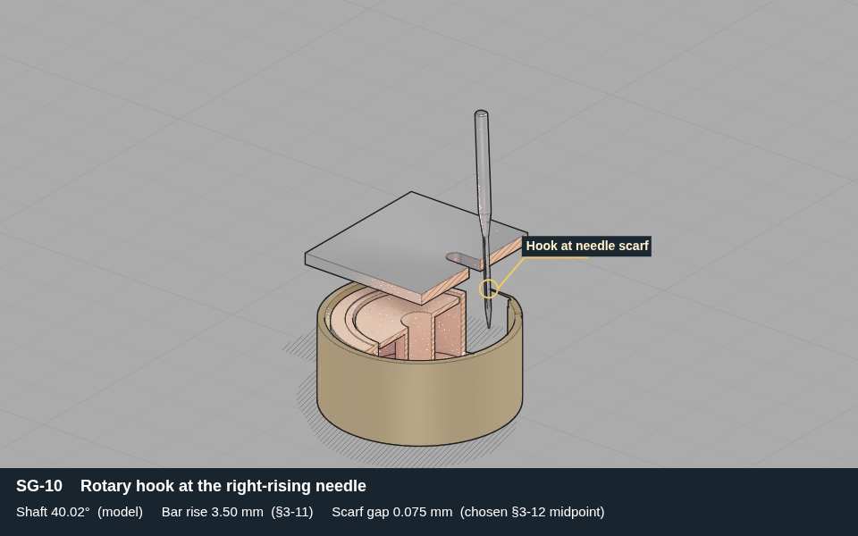
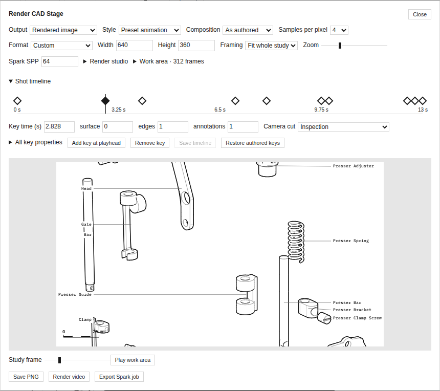
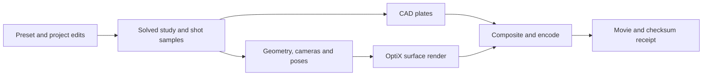

# Authoring mechanical inspection shots in Jig

At the inspection frame of the Singer 44S lower-hook study the shaft has turned 40.022°, the needle bar has risen 3.500 mm, and the hook point is 0.075 mm from the modeled needle surface. These numbers have different origins. The manual prescribes the rise. The shaft angle follows from solving the linkage. The clearance is a selected setup value, verified on the reconstructed solids. Presenting the three together requires a mechanical study, a camera and a rule for selecting the frame. Giving each of those decisions an explicit representation is the subject of this report.

*The point, scarf and dimension labels refer to one solved pose. The hook profile, ring depth and drive ratio include estimates. The service manual describes timing and lateral clearance in separate procedures.* [Service evidence and page captures](https://github.com/go-go-golems/jig/tree/f867de4/ttmp/2026/11/24/SINGER-003--singer-44s-lower-hook-and-bobbin-timing-study)

## From a mechanical coordinate to a movie frame

A study asks the solver for occurrence transforms at a sequence of drive values. An occurrence is one installed instance of a part. Two instances of the same screw can share their geometry while having different transforms and names. In the Singer upper head, a phase callback supplies joint values for the crank, rod, needle and related members. In SG-09, the shaft drive covers two revolutions. The opening spread and return use additional display translations while the mechanism stays at its initial study sample.

There are consequently three coordinates to distinguish. The shaft angle identifies a mechanical condition. Presentation time in seconds selects poses and styles. An output frame index selects a sample on the encoder clock. In the 13-second cyclic SG-09 film, frame 204 at 24 fps is 8.5 seconds into the presentation. It shows the isolated, sectioned presser group. Frames 203 through 205 form a three-frame work area. Selecting it preserves the original sample numbers, including any history needed to draw a trajectory. The exported clip lasts one eighth of a second. A one-frame or three-frame verification clip therefore flashes by when opened in a normal player.

## Camera registration through a change of resolution

The Stage camera is orthographic. The representation for a saved camera records its target in world millimetres, its resolved yaw and pitch, and its vertical field height. If a 360-pixel-high canvas shows 60 mm vertically, its scale is 6 pixels/mm. Doubling the output height doubles that scale. The same point retains its normalized vertical coordinate. Increasing only the width reveals more of the model horizontally. Pixel scale alone would describe a different crop after a resize.

The camera target includes the displacement produced by panning. On recall, applying that target and then applying the old pan again would count the displacement twice. A second defect surfaced in browser review: recalling a magnified view restored the correct image, but moving the zoom slider one tick returned the camera close to its fitted scale. The implementation now reconstructs the slider value from the saved scale and the current fit scale. Its browser test recalls a panned 2.4× camera and checks the proportional change to 2.45×. [Camera implementation and checks](https://github.com/go-go-golems/jig/tree/f867de4/ttmp/2026/11/24/JIG-021--saved-stage-cameras)

## What the shot editor saves

The shot evaluator accepts sparse keys. Surface contribution, edge opacity and annotation opacity interpolate independently. Isolation and camera selection change at their keys. Section sweeps have a component-local plane normal, two offsets and an end time. A point on the retained surface satisfies a signed-plane inequality in local coordinates before its occurrence transform is applied. Because the plane follows the occurrence, moving the part through space leaves the position of the cut within the part well defined.

The editor and preset share validation and evaluation. At the revision examined here, the editor saves a complete replacement key array for the selected study. This is convenient for a frozen preset. It becomes a problem when code and visual edits continue in parallel. Suppose a preset supplies a camera cut and a drive accent. A user moves the cut and saves. Later the author adds a needle trail to the preset. Reopening the project still selects the saved key array, which predates the trail. There is no cue identity in this representation that says “only the time of this cut was edited.” Restoring the authored keys removes the override, including the user's timing change. [Editor precedence and validation](https://github.com/go-go-golems/jig/blob/f867de4/import/jigcad/src/render/shot-editor.js)

## Appearance, visibility and identity

A studio stores Candela scene source, imported look modules and an optional fixed exposure. Lighting, background and material definitions can travel between presets. A material assignment to a specific occurrence still needs a matching occurrence in the destination. Fixed exposure is particularly important when comparing independently rendered intervals: the first frame available for metering may contain a different set of visible surfaces. In a test with two inspection looks, the same background pixel changed from RGB (86,86,86) to (39,59,82). The native render of the selected blue studio reproduced that background value at EV 9. [Studio evidence](https://github.com/go-go-golems/jig/tree/f867de4/ttmp/2026/11/24/JIG-024--reusable-render-studios)

A component mask answers a separate question: which occurrence supplied the visible surface at each pixel? The implementation assigns a color to every occurrence in the original assembly, reserves black for background, and obtains the visible occurrence from the software depth buffer. A cap inherits its cut component's ID. Generating the palette before filtering keeps the same component identifiable during isolation. A lossless PNG sequence preserves exact categorical values. A compressed movie is useful for visual inspection because it is small and easy to play, although codec conversion can alter those values. [Mask implementation and verified exports](https://github.com/go-go-golems/jig/tree/f867de4/ttmp/2026/11/24/JIG-026--component-id-mask-export)

## What crosses the workstation boundary

The browser samples the selected interval and exports geometry variants, per-view cameras, occurrence matrices and calibration plates. A plate records how Stage draws over a synthetic black or white surface image. Per pixel and color channel, the composite of a real surface value P is B + (W − B)P/255, where B and W are the corresponding plate values. This keeps the Stage's line work, section hatching and labels registered with the native shading. A split view requires a camera, image dimensions and pixel origin for each panel.

The three-frame 320 × 240 work-area test sent frames 203–205 to the Spark, retained EV 7 and requested 16 samples per pixel. Its receipt identifies OptiX and reports 44.1924 ms of native render time. That duration excludes transfer, setup, compositing and encoding. The workstation recomputed the movie's SHA-256 before publishing the result. These checks establish frame selection and transport integrity. Mechanical clearances have their own independent checks on the original solids. [Native work-area receipt](https://github.com/go-go-golems/jig/blob/f867de4/ttmp/2026/11/24/JIG-023--render-work-areas/sources/ssh-submit-receipt.json)

## Why the next design needs an authoring grammar

The renderer can already answer “what does this key array look like at 8.5 seconds?” A mechanism author also needs to express “hold when the rising needle reaches its service setting.” The second instruction refers to a solved event, may match several cycles, and changes the relation between presentation time and study time. During a hold, the camera can move and the video clock advances while the needle remains fixed.

A useful design has three testable properties. An author can name an inspection cue and reuse its construction in another preset. A visual edit can address one property of that cue and allow independent code edits to survive. The compiled presentation can supply ordinary sampled data to a native process without serializing JavaScript closures. SG-09 supplies an unusually precise regression fixture: a new authoring form should reproduce the same 312 output frames before introducing a new event or hold. The earlier report describes the reconstruction and sampling-cost experiments. [[PROJECT REPORT - Jig - From mechanism reconstruction to an animated CAD and OptiX shot]]
