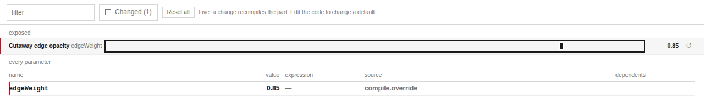
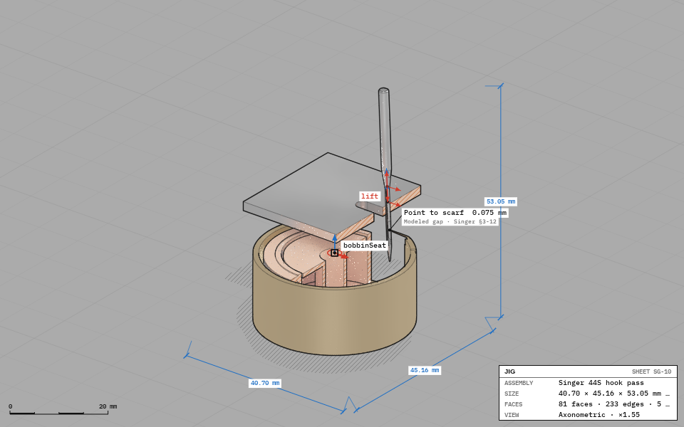
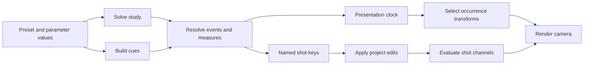
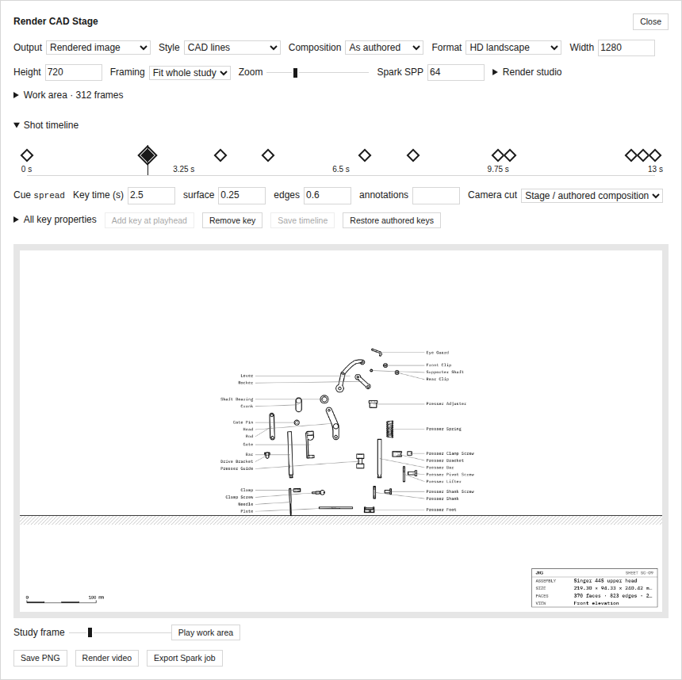
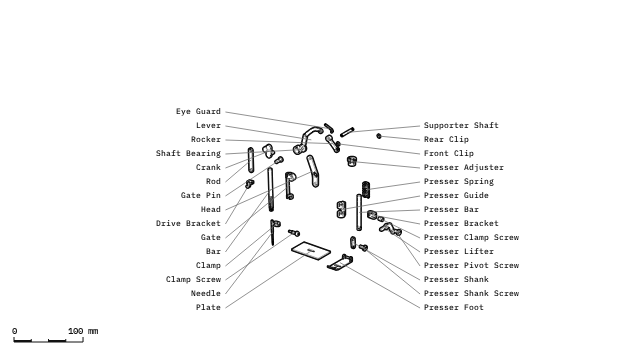

# Compiling a mechanical presentation in Jig

At two seconds into the Singer rotary-hook inspection, the model reaches the pose at which the needle bar has risen 3.500 mm. The presentation must keep the hook at that pose long enough to read its clearance. The camera, labels and shot editor must remain usable throughout that interval. Encoding the pause as repeated poses inside the mechanical study would change the meaning of a study row. JIG-027 gives the presentation its own clock and makes the relation between the clocks explicit.

The upper-head film imposes a second requirement. An operator who retimes the exploded inspection in the Stage should still receive an engineer's subsequent change to its edge opacity. That requires a persistent identity for the cue and a record of which property the operator changed. The same named cue therefore serves two purposes. Its declaration binds visual properties to time, and its ID gives the editor a stable address.

## Construction in JavaScript

An assembly study describes the phase or joint drive, the range to solve and the requested sampling density. Its presentation option attaches an authored sequence to that study. A presentation builder has a name, a base duration and a set of cues. Each callback receives a cue builder. The property methods set individual channels and return the builder for the next call. A fragment is an ordinary function that applies a set of operations to that builder.

```js
const fullPaper = cue => cue.surface(0).edges(1).annotations(1)
const presentation = j.presentation('Upper head inspection').duration(13)
  .cue('assembled', 0, c => c.surface(1).edges(0).annotations(0))
  .cue('spread', 3, fullPaper)
  .cue('inspect-spread', 4, fullPaper)
```

The time between the last two cues has constant layer weights. The mechanism can still move through an independently defined pose track. Each scalar channel interpolates only between keys that set that channel. An omitted property leaves the channel's existing interpolation intact. Selections such as an isolation group, a camera cut or a callout change at their keyed time. A section may also specify a sweep with a terminal offset and time. Clearing a selection takes an explicit value such as `section(null)`.

These distinctions matter when adding a cue. Inserting an annotation key between two surface keys leaves the surface blend intact. Giving the new cue an explicit surface value introduces another interpolation interval. The existing shot evaluator supplies both behaviors for the new grammar. Upper-head preset in `import/jigcad/content/presets/SG-09-exploded-head/script.js` · Shot evaluator in `import/jigcad/src/render/shot.js`

### Exposing a parameter

A presentation attached directly to a study snapshots its declaration. When an operator needs to control a visual quantity in Params, the study can accept a factory instead. Assembly parameter resolution supplies the values to that factory at compile time. For example, an assembly declares `.params({edgeWeight: 0.5})` and exposes the parameter with a range of zero to one and step 0.05. Its study can then use the following option.

```js
presentation: params => j.presentation('Inspection').duration(4)
  .cue('opening', 0, cue => cue.edges(params.edgeWeight))
```

The shipping SG-10 preset exposes **Cutaway edge opacity** in Params, with a default of 0.90. In the flexible subassembly test the public name becomes `slide/edgeWeight`. Recompiling with an override of 0.85 updates both the reported parameter value and the compiled edge weight. The saved cue remains identified by `opening`. A project edit to that particular edge weight takes precedence during the editor merge. Editing another property still allows the parameter to control the edge channel.



*The Params control changed from 0.90 to 0.85. The browser check waited for both the worker's parameter record and the compiled cutaway key to read 0.85, then reset the control and verified 0.90.*

## From a crossing to an event-bound cue

The hook study declares the predicate `row['Bar rise (mm)'] >= 3.5`. The study solver evaluates the predicate on its sequence of solved poses and records the crossing. The presentation refers to the event by name. The solver and the presentation have separate responsibilities. The solver determines where the mechanism reaches a condition. The cue specifies what the viewer should see there.

```js
.atEvent('inspect-gap', 'hook meets scarf', c => c.holdPose(2).annotations(1)
  .callout({
    measure: 'Point minus scarf Y (mm)',
    component: 'holder', point: study.hookPoint,
    label: 'Point to scarf', unit: 'mm',
    provenance: 'Modeled gap · Singer §3-12'
  }))
```

The compiler requires a positive occurrence number when the same event occurs more than once and the author needs to select one. It chooses the reachable row whose drive coordinate is closest to the recorded event. This is a sampling decision. Increasing the resolution of a sweep can change the selected row. Position, numeric reading and the local-to-world transform all come from that same sample. A three-decimal displayed value describes the model and its formatting. It provides no independent evidence of the dimensions of a physical machine.

For the hook study there are 121 rows over a four-second base interval. Row 60 is at base time 2.0 s. A two-second hold gives six seconds of presentation time. During the half-open interval from 2.0 to 4.0 s the clock selects the event row. Earlier and later frames use the ordinary drive progression, with the elapsed hold subtracted on resumption. The encoder emits 144 frames at 24 fps. The last output frame of this noncyclic study selects its terminal pose. Hook preset in `import/jigcad/content/presets/SG-10-hook-pass/script.js` · Playback clock in `import/jigcad/src/ui/study-samples.js`



*Figure 1. The real render dialog produced this 960 × 600 cutaway. The holder-local witness point labels a modeled 0.075 mm separation. The worker estimated the event crossing at 40.021912459° and selected the solved shaft pose at 40.021861596°. The next moving pose is at 40.438528263°.* Worker receipt in `ttmp/2026/11/24/JIG-027--composable-javascript-presentation-api/sources/sg10-held-gap.json`

## The worker boundary and render camera

Construction callbacks run in the preset environment. During compilation the assembly resolves the event references, validates the cue times and checks occurrence and measure names. A misspelled method on the guarded builder yields a diagnostic at the authoring site. A missing event can be diagnosed only after the solver supplies its events. The resulting study carries normalized shot keys and a clock record with the base duration, final duration and ordered holds. Named references, numeric values and arrays can cross the worker boundary. Playback reads that data without re-executing the preset callback for each displayed frame.



A measured callout contains a measure name and a point in the local coordinates of one occurrence. At draw time the Stage looks up the scalar in the selected row, transforms the local point with that occurrence's matrix and projects the resulting world point into the current camera. Each inset or secondary projection has its own screen position for the anchor. If isolation removes the occurrence or the reading is unavailable, the label is omitted. This separation lets the same physical point retain its meaning while the operator changes output dimensions or camera orientation.

## Saving one visual edit

The operator moved the SG-09 cue named `spread` from three seconds to 2.5 seconds. The project file records the following entry under the study name. A fresh compile still produces the preset's original three-second key.

```json
{
  "changes": [{"id":"spread","set":{"time":2.5},"unset":[]}],
  "added": [],
  "removed": []
}
```

On reopening the project, the editor applies the saved time to the newly compiled key. If the engineer changed its surface contribution to 0.25 and its edge opacity to 0.6, both authored changes survive. A new source cue at five seconds also appears. Compound properties have independent paths where appropriate. Changing an accent's color can therefore inherit a later change to its opacity. Arrays, including the three coordinates of a point, are assigned as units.

Deleting or renaming a source ID referenced by a saved edit invalidates that edit. A diagnostic identifies the missing cue. Matching it to the nearest timestamp could silently attach a section or camera to a different event. Restore clears the project's overrides for the selected study. Existing projects containing a complete key array continue to use the saved array as a complete timeline. Restoring authored keys returns them to the source presentation. The visual retiming changes when a label, cut or highlight appears. The location and length of an event hold are authored separately on the mechanical clock. Editor merge in `import/jigcad/src/render/shot-editor.js`



*Figure 2. The selected spread cue kept its edited 2.5-second time. Its displayed surface and edge weights came from the updated source. The browser check also selected the additional five-second cue, then used Restore authored keys and verified the original three-second timing.*

## Testing a film migration



*Figure 3. A 640 × 360 still exported with Save PNG at presentation sample 72. The crank linkage and presser assembly occupy different portions of the exploded view.*

The SG-09 film opens, remains spread for inspection, reassembles and runs two shaft cycles. Its 313 addressable samples include the endpoint for interactive scrubbing. Its cyclic 24 fps movie emits indices 0 through 311. The acceptance script first opened the pre-migration application in Chromium. For every emitted frame it recorded the drive coordinate, every occurrence matrix, the evaluated shot channels, component-name opacity and the fitted orthographic render camera at a fixed aspect ratio and zoom. It stored the SHA-256 digest of each serialized record. It then repeated the capture against the migrated application.

All 312 digests matched. This comparison covers transforms, section states, camera registration and layer weights numerically. A change to font rasterization or a graphics driver can still change pixels. The separate PNG export above exercises the raster output path. A high-sample OptiX rerender would answer a different question about rendering performance or image noise. Acceptance script and reference digests in `ttmp/2026/11/24/JIG-027--composable-javascript-presentation-api`

## Current boundaries

SG-09's per-occurrence explosion offsets and name fades still come from its preset metadata. The new cue grammar controls its visual sequence. SG-10 exercises the event clock on a conventional solved study. Combining that legacy exploded introduction with event holds requires a common definition of the source row's time within the introduction. The current clock reports the unsupported combination. A future sequence operator could take a duration, a source-pose rule and per-occurrence offsets, which would allow an exploded introduction to participate in the same time calculation as other clips.

Named studies with few mechanical rows still receive at least 24 display intervals per second. In the sparse regression, four solved rows support 96 distinct camera fractions and fade values over four seconds. Dense studies can retain finer sampling for interactive inspection. The current Stage bounds its allocated map at 100,000 intervals and reports a diagnostic when a named timeline exceeds that limit.

A future camera path would also need an explicit interpolation rule for target, orientation and scale. A new visual channel belongs in the normalized shot data when it must survive preview, project editing and export. Per-frame functions with external state would require their own sampling and reproducibility contract. The present implementation keeps preset evaluation, mechanical sampling and display-time interpolation independently testable.

## Reproducing the examples

The paths above are relative to the local Jig repository named in the note metadata. Check out Jig revision `9a9acea`, run `make web`, and start the workbench with `go run ./cmd/jigcad serve --dist import/jigcad/dist`. Open the SG-09 or SG-10 preset, choose the CAD Stage, open Render and select **Preset animation**. The four scripts in the JIG-027 ticket exercise frame comparison, project reload, measured export and the live Params control. Each script documents its arguments, including the workbench URL and Playwright installation.

Related report: [[PROJECT REPORT - Jig - Authoring mechanical inspection shots]].
