# From mechanism reconstruction to an animated CAD and OptiX shot in Jig

The Singer 44S upper-head study opens on an assembled mechanism. Over three seconds, its components separate while shaded metal fades into drafting lines and labels. Seven seconds into the shot, the parts are back in place and the shaft begins two stitch cycles. A cut through the presser guide exposes the rod inside it. When the complete head returns, a line shows the recent path of the needle tip. Every view uses the same solved placement for a given instant. Jig keeps that placement available to its browser drafting renderer, its Candela material renderer, and the native OptiX process that rendered the Full HD movie on the DGX Spark.

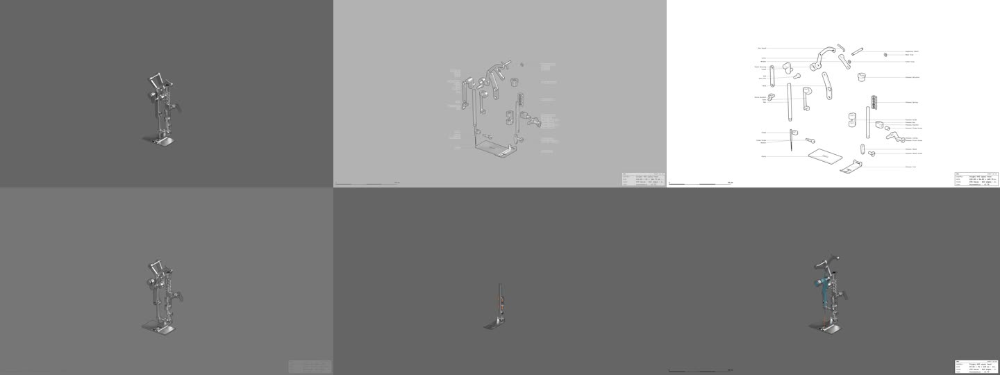

*Reading order, left to right.* Assembled head at frame 0, mid-blend at 36, exploded drawing at 84, returning assembly at 160, sectioned guide at 204 and drive highlight at 264. The film contains 312 frames at 24 fps.

> [!summary]
> - Establish an assembly's reference geometry and validate its motion before authoring how it appears on screen.
> - Sample the mechanism and shot together. Render material shading and CAD overlays from the same camera and displayed geometry.
> - Export sampled poses and cameras for native rendering. Reuse the browser's drafting output to preserve its exact placement and layering.

## What a reconstruction needs to establish

A component has a shape in its own coordinate system. An occurrence is one use of that component in an assembly, with an ID and a transform that places its local geometry in the assembly. Two screws of the same design can have the same geometry and separate occurrence IDs. A motion study samples the assembly at successive values of a driving joint, giving each occurrence a different placement matrix when its joint moves. When an apparent collision appears in an image, these distinctions narrow the investigation. The local geometry could be wrong, the installed position could be wrong, or the motion could put a correct part in the wrong place.

The Synchro-Compur 0-MXV shutter reconstruction made those problems visible in a small volume. The assembly includes a pack of overlapping shutter blades, a drive, and a timing train. A drawing can identify a plate, pin or fastener and establish its relationship to its neighbors. Position through the thickness of the assembly and the geometry of the working contact need their own evidence. Jig's CP-02 and M-11 plate audit counted one occurrence each of 225, 268 and 267, three of screw 208, and zero of 230. Preserving occurrence IDs let an audit distinguish actual parts in the CAD assembly from numbers seen on an illustrated plate. The earlier report covers the service drawings, optical opening and catalog boundaries in detail. [[PROJECT REPORT - jigcad - Reconstructing the Synchro-Compur 0-MXV from Service Drawings]]

The audit reconciled the standard 1210-000 list with Honeywell's March 1967 Table 8-3. Of 75 stock rows, 19 have a counterpart in M-11, three in CP-06, one in CP-07 and three in CP-08. Forty-nine rows still have no assigned counterpart. A row may identify an ordered subassembly or a revision. A CAD solid may combine features associated with more than one row. Even the 26 matched rows therefore require inspection before claiming that a particular part exists as a separate solid. Preserving both entries with stem 623 prevents an accidental change in the denominator. [Catalog reconciliation](https://github.com/go-go-golems/jig/blob/0ff8caa/ttmp/2026/11/23/COMPUR-002--synchro-compur-0-mxv-assembly-library/reference/04-catalog-standard-reconciliation.md)

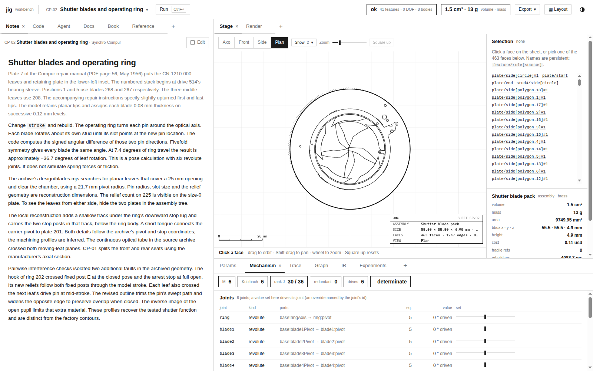

*CP-02 at home. The surrounding registration geometry and blade pack are visible in the same posed assembly. The catalog audit counts occurrences in the CAD data and uses rendered viewpoints to review their placement.*

The timing train exposes a subtler problem. A pin of radius 0.30 mm occupied the first wheel profile over 0.30 mm of thickness, giving 0.084823 mm³ of common volume. Measuring the profile includes subtracting the wheel's bore. Moving only that wheel along its axis to clear the pin would put its lower face outside 11.65–13.30 mm, while retaining positive overlap with the next pinion requires 11.70–13.00 mm. Those conditions have no common solution. A render can direct attention to the contact, but the clearance calculation determines whether the proposed adjustment is feasible. [Compur catalog and registration diary](https://github.com/go-go-golems/jig/blob/0ff8caa/ttmp/2026/11/23/COMPUR-002--synchro-compur-0-mxv-assembly-library/diary/01-catalog-audit-and-mechanical-registration-diary.md)

## From shaft angle to sampled Singer geometry

A part definition owns its local solid and interface points. An occurrence gives that definition an identity and transform within a particular assembly. Two presets can construct a needle from one definition while assigning it different motion. The stable occurrence identity lets the solver, CAD labels, renderer and shot timeline refer to the same object as its transform changes. SG-09 contains repository symlinks to the canonical files in SG-03 and SG-06. At runtime, the compiler resolves `importPartFile(name)` against the current project's file map, opens a new module scope per import, and rejects missing keys and circular imports. A saved or copied project must carry the part files it references. [Worker import resolution](https://github.com/go-go-golems/jig/blob/0ff8caa/import/jigcad/src/engine/worker.js)

SG-01 isolates the needle drive. SG-02 adds its swinging guide, and SG-03 combines the upper head. SG-04 through SG-08 split out needle hardware, gate bearings, presser hardware, take-up linkage and zigzag timing. SG-09 reuses the upper-head geometry for the presentation. Its script imports both the Singer and presser part libraries, builds the head at a shaft angle and mounts the presser before attaching the stitch study. The result includes the foot and plate, while the lower hook, bobbin and feed remain outside the modeled scope.

| Evidence | Use in the model | Remaining uncertainty |
|---|---|---|
| 130/705 H needle drawing | A 2.04 mm shank and 33.9 mm butt-to-upper-eye distance constrain the representative NM90 needle. | The specimen's installed needle size is unknown. |
| Presser service procedure 3-4 | SG-06 opens at 6.1 mm, the midpoint of the 6.0–6.2 mm setup gauge. | The spring shape supplies no force or stiffness calibration. |
| Zigzag procedure 3-5 | The lateral transfer begins after the rising needle reaches a chosen 5 mm height within the stated 3–5 mm range. | Intermediate cam geometry and symmetric return timing are inferred. |
| Linkage images and factory plate A | Two pin centers and the thread eye locate the lever in projection. | Axial depths and the absolute pin span need measurement. |

### Reading the take-up lever from two video frames

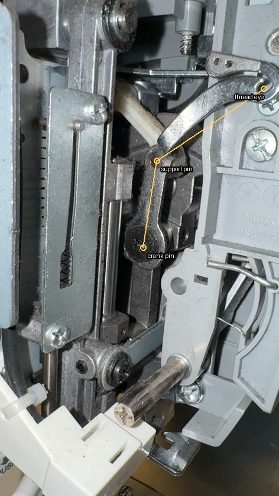

*Source evidence for SG-07.* The annotations identify the crank pin, the supporter pin and the thread eye. A single oblique frame supplies image coordinates. To recover a repeatable shape constraint from those coordinates, the reconstruction uses the line between the two pins as its reference direction and their projected distance as its unit of length.

Let **d** point from crank pin to supporter pin, and **e** from crank pin to thread eye, using image coordinates with the vertical axis pointing up. The eye's coordinates in this basis are the dot product **d · e** and the signed planar cross product **d × e**, each divided by **d · d**. The division removes the image scale. At two seconds the three image points were (242, 419), (265, 272) and (446, 150) pixels before flipping the vertical axis. The calculation gives (1.9981, −1.0751) pin spans. An independent reading at eight seconds gives (2.1110, −0.9920). The repeat confirms which side of the pin line carries the eye and constrains its projected reach. The 22 mm pin spacing in the preset remains a nominal dimension. Perspective, camera motion and landmark selection still affect the inferred profile. [Landmark extraction and coordinate calculation](https://github.com/go-go-golems/jig/blob/0ff8caa/ttmp/2026/11/24/SINGER-002--singer-44s-component-reconstruction-and-looping-playback/scripts/05-takeup-evidence.py)

### Solving the linkage

The Singer model uses shaft angle as the independent mechanical coordinate. The crank and connecting rod determine reciprocation of the needle bar, while the lateral gate angle tilts the needle assembly. The shared part code computes joint values for a specified shaft angle and gate law. SG-09 passes those values through the same mechanism definition used for the assembled head and mounts the presser at zero lift. The presser foot remains seated as the needle moves. A six-second playback of two revolutions is a choice about presentation speed. The mechanical calculation depends on the sampled shaft angle and gate law. [SG-09 study and shot](https://github.com/go-go-golems/jig/blob/0ff8caa/import/jigcad/content/presets/SG-09-exploded-head/script.js)

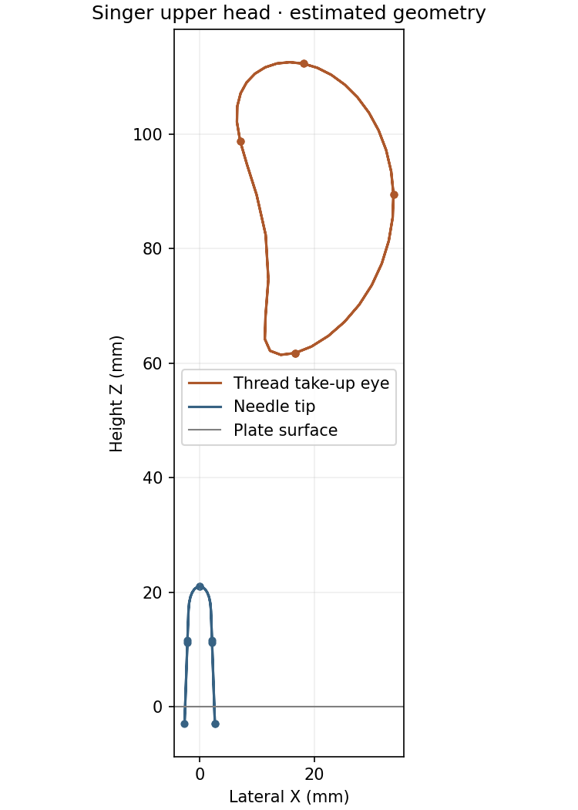

*The earlier Singer study records solved paths across a shaft turn. Sampling the mechanism makes extrema, the order of events and the relationship between vertical travel and lateral swing available for inspection.*

The geometry required a separate audit. In the reconstruction, a rib occupied part of the needle bar's travel envelope. Relieving that rib reduced the interference, and further review found an overlap at the top of the bracket stroke. When the combined head first went through an all-pairs test, nine sampled poses produced 93 positive intersections, including 199.0 mm³ between the bar and crank. The refit separated the crank journal from the needle-bar sweep, added the journal's bushing, moved a reference web clear of the gate and amended the estimated presser-axis spacing from 12 to 22 mm. That last figure is a fitting choice pending measurement on a physical head. [Singer reconstruction and geometry diary](https://github.com/go-go-golems/jig/blob/0ff8caa/ttmp/2026/11/24/SINGER-002--singer-44s-component-reconstruction-and-looping-playback/diary/01-implementation-and-geometry-evidence-diary.md)

The final model had 29 bodies. The largest reported planar closure residual was 1.73 × 10⁻⁹ mm across 145 samples. That residual measures whether the computed linkage closes. The separate solid audit checked 49 shaft positions across two cycles at 15° intervals. After screening pairs with bounding boxes, it measured common volume for candidate pairs and found none above 0.001 mm³. This result applies to the modeled solids at the checked angles. Fabric, elasticity, axial play, manufacturing tolerance and clearance between samples remain outside that evidence. [Singer audit and verification scripts](https://github.com/go-go-golems/jig/tree/0ff8caa/ttmp/2026/11/24/SINGER-002--singer-44s-component-reconstruction-and-looping-playback/scripts)

## The solver and the presentation run on separate coordinates

An explosion is an authored translation of each displayed occurrence away from the solved home pose. SG-09 supplies 28 displacement vectors around a stationary casting. During the seven-second introduction, the mechanism stays at its first solved sample. Stage applies the eased spread fraction to each displacement and uses the same fraction to fade the component labels. After the three-second separation, one-second hold and three-second return, the shot advances through the study's 144 steps from 0° to 720°. The browser check compared the matrices at full spread, after reassembly and at 720°, and verified that the presser stayed seated during sewing. [SG-09 presentation metadata](https://github.com/go-go-golems/jig/blob/0ff8caa/import/jigcad/content/presets/SG-09-exploded-head/meta.json), [Stage playback implementation](https://github.com/go-go-golems/jig/blob/0ff8caa/import/jigcad/src/ui/views/study-playback.jsx)

Additional style keys in the preset are defined in presentation seconds. The compiler validates the keys and sends data across the worker boundary. Numeric channels such as surface contribution, edge opacity and annotation opacity interpolate independently. Section, isolation and camera composition take effect at their keyed times. That lets the author adjust when a drawing fades in without editing the function that computes the joint values. The authoring interface lives in the preset's JavaScript. In the workbench, the Stage Render dialog evaluates it when Style is set to *Preset animation*. [Shot schema and evaluator](https://github.com/go-go-golems/jig/blob/0ff8caa/import/jigcad/src/render/shot.js)

| Presentation time | Stage output |
| --- | --- |
| 0–3 s | Start assembled and shaded. Separate while fading to CAD. |
| 3–4 s | Hold the full spread as a drafting view. |
| 4–7 s | Reassemble while restoring surface shading. |
| 7–8 s | Start the two-cycle shaft study. |
| 8–10 s | Isolate the presser group and section the guide. |
| 10–13 s | Return to the full head. Accent the drive and draw the needle trail before restoring the opening style. |

At 24 fps, the movie samples rows 0 through 311. Sample 36 occurs at 1.5 seconds with surface contribution 0.5. Sample 84 occurs at 3.5 seconds with zero surface contribution during the spread hold. Sample 204 occurs at 8.5 seconds with full surface contribution and the section geometry. Its exported state contains all 29 occurrence matrices, an orthographic camera spanning approximately 0.307 m vertically, and the geometry variant used for the section. The exact 13-second endpoint is omitted from the encoded loop so the opening pose is displayed once per iteration. [Stage export script](https://github.com/go-go-golems/jig/blob/0ff8caa/ttmp/2026/11/24/JIG-020-SHOT-STYLES--animated-cad-and-pbr-rendering-styles-for-mechanism-studies/scripts/07-export-stage-optix.cjs)

## One projection aligns drafting lines and shaded surfaces

There are two render passes. CAD Stage draws an orthographic sheet with silhouettes, classified edges, depth tests and annotations. Candela's physically based rendering pass computes shaded color using geometry, materials and light. A *beauty image* is the color image from that pass before Stage draws its lines and annotations over it. A manual export can hold either pass or their combination through the whole movie. An authored shot can vary all three layer opacities through time.

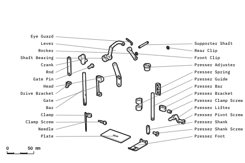

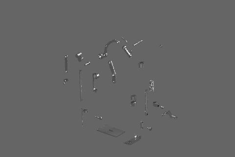

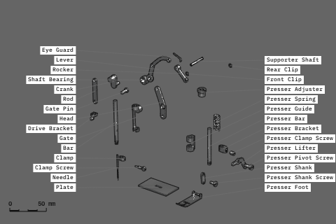

*Three exports of the same spread. The drafted view emphasizes fasteners and component locations. The shaded view shows lighting and surface form. In the combined view, the lines should coincide with the material boundaries, including on thin detached parts.*

In an orthographic projection, the scale remains constant with depth. A point's pixel coordinates follow from its offset from the camera target projected onto the right and up directions, multiplied by pixels per millimetre. A perspective camera could match the position of one component at a chosen depth and still place a component farther forward at the wrong scale. Stage resolves its camera and gives Candela the same basis, target, scale and output dimensions, with the necessary conversion to Candela's axes and units. For exploded shots the displayed transforms already include the extra translation. Fitting the camera to the study's full envelope keeps the projection scale stable as the spread changes. [Stage output camera](https://github.com/go-go-golems/jig/blob/0ff8caa/import/jigcad/src/stage/output-camera.js), [Stage PBR bridge](https://github.com/go-go-golems/jig/blob/0ff8caa/import/jigcad/src/render/stage-pbr.js)

The Render dialog previews the output camera at the selected aspect ratio. Standard format presets and explicit width and height control the encoded dimensions. Framing and zoom determine how much of that rectangle the mechanism occupies. The dialog was checked in both light and dark themes. A persistent component-name overlay allows names to stay visible while inspecting a paused sample. SG-09 also fades them with the spread fraction so the labels are readable during the exploded hold.

The registration fixture put objects at two depths and recovered identical projected bounding rectangles from both renderers. In the Singer assembly, a guide, cap and rod tracked a 42-pixel translation together. A separate measurement found 3,211 of 3,311 shaded foreground pixels on thin exploded components within three pixels of a drafting stroke. The first test isolates the projection mathematics. The assembly test exercises the actual poses, mesh conversion and drawing. [Shot rendering diary](https://github.com/go-go-golems/jig/blob/0ff8caa/ttmp/2026/11/24/JIG-020-SHOT-STYLES--animated-cad-and-pbr-rendering-styles-for-mechanism-studies/diary/01-shot-rendering-implementation-diary.md)

## A section must keep the bore open

To expose the presser rod, the shot keeps the guide, bar, shank and foot visible and cuts the guide against a plane in the guide's local coordinates. For a point $p$, a unit normal $n$ and an offset $d$ in millimetres, the retained half-space satisfies $n\cdot p\le d$. Since the plane belongs to the occurrence, it travels with the occurrence's placement. The clipping step reconstructs the face exposed by removing material. A sleeve with a bore yields an outer contour and an inner contour on that face. Filling the interior of the outer contour alone would cover the bore, changing both the image and the visibility of the bar. The cap triangulation accounts for holes and sends matching geometry to both render passes. The source solid and the solver still use the complete guide. [Section implementation](https://github.com/go-go-golems/jig/blob/0ff8caa/import/jigcad/src/stage/section.js)

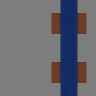

*In this high-contrast test rendering, the blue rod is visible through the orange-brown section of the guide. The native preflight compared the silhouette with the CAD outline and found alignment within one pixel on the checked section frame.*

Section verification swept four plane normals across the 29 original Singer bodies and separately measured cap area and retained volume on a bored sleeve. Isolation also affects joint marks and the selected face. The final integration check resolved the selected source body by stable ID in the displayed list and filtered annotation references to hidden occurrences. Numeric list positions can change whenever an earlier body is removed. [Section and isolation checks](https://github.com/go-go-golems/jig/tree/0ff8caa/ttmp/2026/11/24/JIG-020-SHOT-STYLES--animated-cad-and-pbr-rendering-styles-for-mechanism-studies/scripts)

At second ten, the whole head returns. The teal accent is applied to visible surfaces on the crank, rod and bar. The orange trail samples a point at local coordinates $[0,0,-17]$ on the needle, transforms it by the occurrence's historical poses and projects the resulting world points through the active camera. The shot asks for up to 1.5 seconds of history. Breaks in a study break the trail. The trail therefore describes the trajectory of the specified point and its finite history, while the accent identifies the members producing the motion. [Motion marks implementation](https://github.com/go-go-golems/jig/blob/0ff8caa/import/jigcad/src/stage/shot-marks.js), [SG-09 shot keys](https://github.com/go-go-golems/jig/blob/0ff8caa/import/jigcad/content/presets/SG-09-exploded-head/script.js)

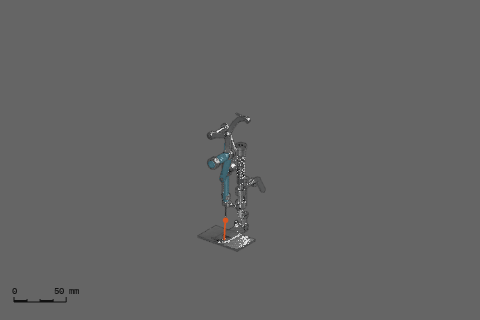

*The color overlay identifies the driving members. The thin orange stroke locates the recent motion of the needle point.*

A fixed orthographic stage view, a turntable, synchronized front and side panels and a moving detail inset are available camera compositions. Front and side make lateral and vertical motion visible from complementary directions at the same sample. The detail inset fits a camera to a chosen occurrence, such as the presser foot, while preserving the context of the full assembly in the main panel.

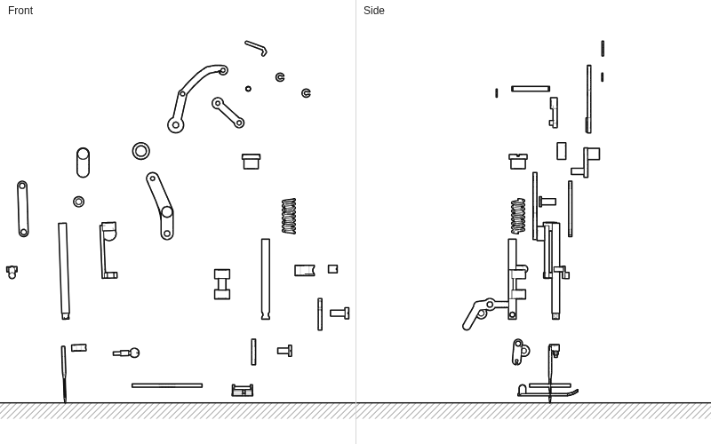

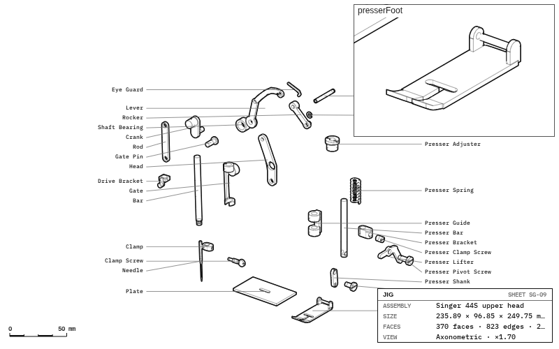

## Taking the same shot to native OptiX

The Stage export evaluates the workbench camera and the actual compiled study. The Spark job contains two geometry packages for SG-09, the complete head and the section variant. It also contains the 312 sampled cameras, occurrence transforms and surface weights. The local browser supplies the drafting plates. On the NVIDIA GB10, a native Candela executable reads the scene and track, updates the occurrence transforms for each frame and uses OptiX for the beauty image. The first native segment meters the scene at EV 6.50414. Later segments reuse the same exposure so the change in visible parts and the cutaway leave the tone mapping consistent. [Native export script](https://github.com/go-go-golems/jig/blob/0ff8caa/ttmp/2026/11/24/JIG-020-SHOT-STYLES--animated-cad-and-pbr-rendering-styles-for-mechanism-studies/scripts/07-export-stage-optix.cjs), [Spark render driver](https://github.com/go-go-golems/jig/blob/0ff8caa/ttmp/2026/11/24/JIG-020-SHOT-STYLES--animated-cad-and-pbr-rendering-styles-for-mechanism-studies/scripts/09-render-spark.py)

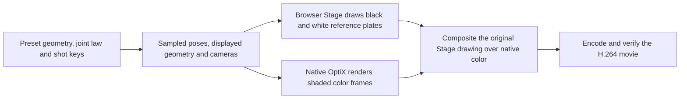

The plate export runs the existing Stage compositing path twice with synthetic beauty inputs, once with black and once with white. At one pixel and color channel, call the resulting plate values $B$ and $W$. Source-over compositing, with fixed draw colors and opacities, acts as an affine function of the input channel $P$. The value at black is $B$, and the difference $W-B$ measures how much input survives at that pixel. The compositor reads the true OptiX output and reconstructs the channel using the same arithmetic independently for red, green and blue.

```text
output = clamp(B + round((W - B) × P / 255), 0, 255)
```

Under fully opaque ink, $W=B$, so the native color contributes zero. At an antialiased edge the difference is intermediate. Where the beauty contribution is zero across the whole frame, the black plate already contains the final CAD drawing. This keeps the drafted layout, opacity ramps, labels, section hatch and motion trail in the native movie. The inputs are 8-bit plates, so arithmetic and plate quantization matter at the level of individual code values. The later video encode introduces its own differences. [Compositing script](https://github.com/go-go-golems/jig/blob/0ff8caa/ttmp/2026/11/24/JIG-020-SHOT-STYLES--animated-cad-and-pbr-rendering-styles-for-mechanism-studies/scripts/08-compose-stage-optix.py)

The 64-sample run shaded frames 0–71, 97–191, 192–239 and 240–311. Frames 72–96 reused the drafting result directly. The section set is 192–239, exactly seconds 8 through 10 at 24 fps with the upper endpoint excluded. Together the 287 native frames and 25 drafting-only frames produced a 1920 × 1080 H.264 movie of 312 frames over 13 seconds. Six frames decoded from the movie averaged about 1–2 code values of absolute RGB error against their source composites. The downloaded file and the Spark copy had matching SHA-256 hashes. [Full HD receipt](https://github.com/go-go-golems/jig/blob/0ff8caa/ttmp/2026/11/24/JIG-020-SHOT-STYLES--animated-cad-and-pbr-rendering-styles-for-mechanism-studies/sources/SG-09-optix-1080p.json)

## Sampling cost on the DGX Spark

The three exports vary the number of path samples accumulated per pixel. All three runs used the same 312 camera samples, component transforms, geometry variants, 1,920 × 1,080 frame size, scene denoiser and Stage plates. The 1,024- and 2,048-SPP runs reused the original exposure of EV 6.50414. Holding the exposure fixed matters here because a change in metering would change pixel brightness even where sampling noise had already converged.

| Measurement on the NVIDIA GB10 | 64 SPP | 1,024 SPP | 2,048 SPP |
|---|---:|---:|---:|
| Frames traced by OptiX | 287 | 287 | 287 |
| Frames drawn entirely by the CAD stage | 25 | 25 | 25 |
| Native render time summed over the four segments | 38.20 s | 594.00 s | 1,163.44 s |
| Mean native time per traced frame | 0.133 s | 2.070 s | 4.054 s |
| Time from native job start to verified MP4 on the Spark | 1 min 53 s | 10 min 27 s | 19 min 57 s |

The native timer includes installing the sampled pose, synchronizing the scene, and launching and waiting for the GPU. Image output, CAD compositing, H.264 encoding and decode checks run outside that timer. The wall-clock row uses the native log's creation time and the verification log's final write time. It includes time between stages, including a roughly 41-second gap before the original job began compositing. All three jobs already had the frame track and plates on disk when timing began. These numbers characterize the Singer shot with this framing and this driver.

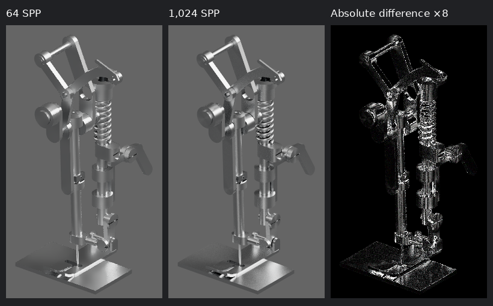

*Sampling detail.* Both crops show pixels 802–1061 horizontally and 400–854 vertically in the frame-zero native beauty image, before compositing or video compression. The third panel takes the absolute per-channel difference and multiplies it by eight, clipping at 255. The mean absolute difference across this rectangle, including its gray background, is 2.20 levels on an 8-bit channel. The machined faces, spring and needle plate account for much of the visible change. This experiment measures disagreement between two displayed images. A quantitative claim about convergence would require an independent reference with more samples.

In the same frame-zero crop, doubling the sample count from 1,024 to 2,048 changed the displayed image by 0.50 channel levels on average. Some surfaces change more than this mean suggests. At 0 seconds the reflections on the crank and spring produce larger differences than the comparatively uniform cutaway at 8.5 seconds. The fifth column below uses the same eightfold gain as the fourth. The 1,024- and 2,048-SPP columns retain visible differences on reflective surfaces.

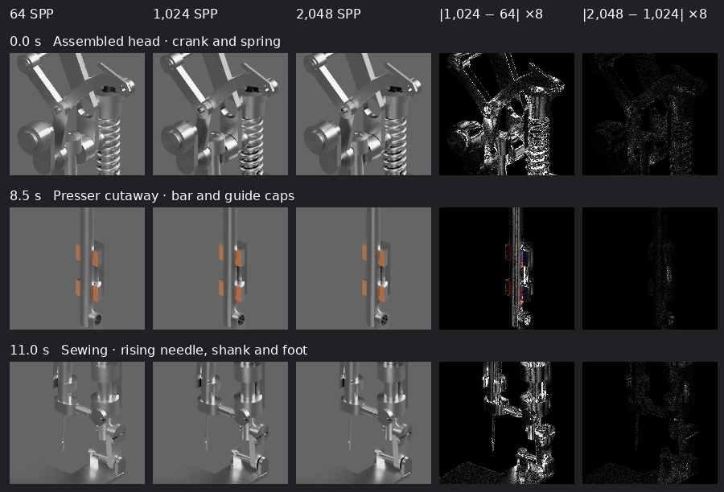

| Native 168 × 152 pixel crop | Mean absolute channel difference, 64 to 1,024 SPP | Mean absolute channel difference, 1,024 to 2,048 SPP |
|---|---:|---:|
| Crank and spring, frame 0 | 4.30 | 0.89 |
| Sectioned guide, frame 204 | 1.03 | 0.18 |
| Needle and presser foot, frame 264 | 2.91 | 0.60 |

### Sampling differences during one second of sewing

To check how sampling affects a moving mechanism, the comparison takes 24 consecutive native images, starting at frame 252 (10.5 seconds). Every panel uses the same 260 × 494 pixel rectangle for the whole second. The lossless loop displays the three versions side by side at the original average rate of 24 fps. Each of its 72 panels was decoded and checked pixel for pixel against the corresponding native source crop.

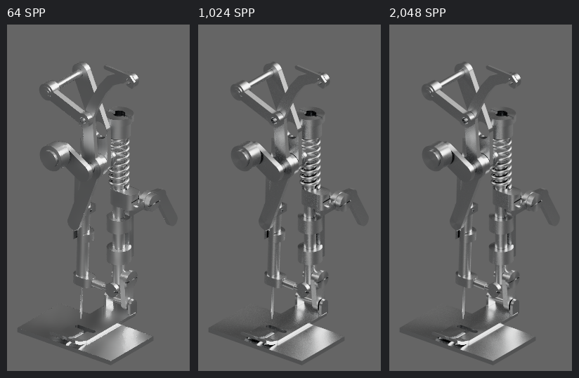

Across this sequence, the same-frame mean absolute RGB difference was **1.89** levels between 64 and 1,024 SPP, and **0.43** between 1,024 and 2,048 SPP. A second measurement compares how the two runs change over time. At each pixel, subtract one run's RGB value from the other's at the same frame. Then measure the absolute change in this signed difference between adjacent frames. Averaging over the 23 transitions gives **1.53** and **0.63** levels, respectively. An edge can carry its residual across the image as it moves, so this temporal figure includes motion as well as changes in sampling noise. All reported means include the gray background inside the fixed crop. [Comparison script and crop definitions](https://github.com/go-go-golems/jig/blob/337dde1/ttmp/2026/11/24/JIG-020-SHOT-STYLES--animated-cad-and-pbr-rendering-styles-for-mechanism-studies/scripts/12-three-way-spark-sampling.py)

Moving from 1,024 to 2,048 SPP added 9 min 29 s of native rendering on this GPU. For a repeat of this particular shot, 1,024 SPP is a practical setting for reviewing motion and annotations. The 2,048-SPP movie preserves the higher-sample result for inspecting small reflections. Both final movies include all 312 presentation frames. [1,024-SPP movie](_assets/jig-shot-sg09-1024spp.mp4) · [1,024-SPP receipt](_assets/jig-shot-sg09-1024spp.json) · [2,048-SPP movie](_assets/jig-shot-sg09-2048spp.mp4) · [2,048-SPP receipt](_assets/jig-shot-sg09-2048spp.json)

## Design and implementation records

The playback design explains the worker contract and clock ownership. The shot design covers interpolation, display geometry, registration and export behavior. The implementation diary records integration failures and the tests that exposed them. [Playback design](https://github.com/go-go-golems/jig/tree/0ff8caa/ttmp/2026/11/24/JIG-019-STAGE-PLAYBACK--play-motion-studies-in-the-cad-stage/design-doc) · [Shot design](https://github.com/go-go-golems/jig/tree/0ff8caa/ttmp/2026/11/24/JIG-020-SHOT-STYLES--animated-cad-and-pbr-rendering-styles-for-mechanism-studies/design-doc) · [Implementation diary](https://github.com/go-go-golems/jig/tree/0ff8caa/ttmp/2026/11/24/JIG-020-SHOT-STYLES--animated-cad-and-pbr-rendering-styles-for-mechanism-studies/diary)

The exported frame track records what moved and where the camera saw it. The clearance audits establish what can be concluded about the modeled hardware from sampled poses. The registration tests establish whether shading and outlines use the same projected display geometry. The movie receipt establishes the samples included in the encoded result. Keeping these checks attached to their respective data lets the mechanical study, the shot and the renderer evolve independently.
