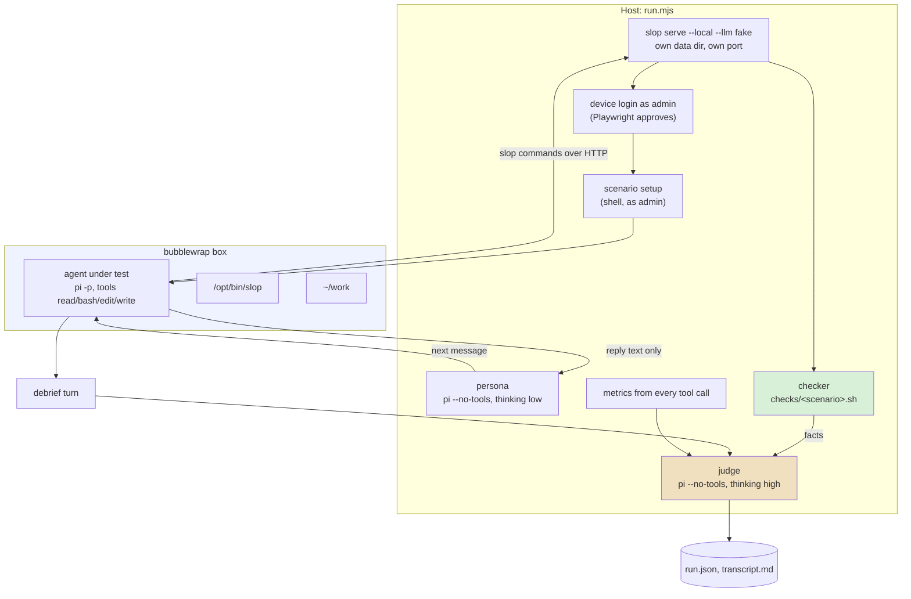

# slop v3: Persona-Based Testing of the Help

This report explains how to find out whether a piece of documentation is sufficient for an LLM agent, and what happened when we did it for slop. The documentation in question is the help built into the `slop` binary: 29 Glazed help pages, shown by `slop help <slug>`, written in ticket SLOP3-026 so that a coding agent *without access to slop's source code* could build apps, set up command-line verbs, grant access and budget the LLM. The method is a persona run: a real coding agent works in a sandbox that holds only the binary, a model plays the person asking for help, a shell script settles what actually happened on the server, and a second model judges the conversation against those settled facts.

The report is written to become a user guide. Each chapter explains why a part of the harness exists before it shows how the part works, because the parts only make sense as answers to specific failure modes — most of which we hit. The last chapters record what the runs taught, about the tester as much as about slop. The report will be amended as the rounds continue; the log at the end records each amendment.

> [!summary]
> - A persona run separates four roles. The **agent** under test works; the **persona** asks in a person's words; the **checker** settles facts with commands; the **judge** scores only what commands cannot decide (honesty, grounding, efficiency, communication), given the checker's facts.
> - The tester must be proven before its numbers mean anything. The first two pilots found more defects in the harness than in slop: two checkers that misread JSON and failed successful runs, a fetch tool that ran outside the sandbox, a timeout that discarded a reply, and a batch script that ran nothing.
> - When the help is silent, the agent leaves it. It inspects the binary, clones the repository, and disassembles code. Each such source probe is the most precise signal the harness produces: it names a question the help does not answer.
> - Fixes go in a fixed order: a command that makes the mistake impossible, then the error message, then a check for a silent mistake, then a page. Every debrief claim is verified in the code before it is acted on.

---

## 1. The question, and why it needs an experiment

The claim under test is: *an LLM agent that has only the `slop` binary can use slop correctly.* It is tempting to test this claim by reading the help pages and judging whether they are complete. That test fails for a specific reason. The author of a help page knows the system, and reads every sentence with that knowledge filling the gaps. The reader the pages are written for has none of it. Only a reader without the knowledge can show where the gaps are, so the test has to put such a reader in front of the system and record what it does.

Three requirements follow, and each one shapes a part of the harness.

### 1.1 The agent must really have no source

Coding agents are resourceful in a precise way: when the documentation does not answer a question, they look for the code. If the repository, a Go module cache, a clone from GitHub or a document-fetching tool is reachable, an agent that gets stuck on the help will use it, and the experiment then measures the agent's ability to read Go rather than the quality of the help. "No source" is therefore an isolation requirement, and Chapter 5 treats it as a security problem: the agent will find every hole that exists.

### 1.2 Someone has to ask, in a person's words

An agent told "use slop to deploy the guestbook example" is working from slop's own vocabulary. A real request sounds different: *"Could you set up a guestbook for our team? It should be at /guestbook on our apps site. Anyone can read it, but only people who are signed in should be able to leave an entry."* Nothing in that sentence says *store*, *mount*, *grant*, `@member` or `interact`. Translating the request into those terms is exactly the work the help must support. So a model plays the person, writes in the person's words, and reacts to what the agent says the way that person would.

### 1.3 Someone has to decide what happened

Agents report success fluently and often prematurely. An LLM judge reading the transcript can be persuaded by the same fluency: a confident, well-structured final answer reads as a success whether or not a store was ever mounted. The objective part of "did it work" — is a store mounted at `/guestbook`, does the page answer 200, does an anonymous visitor hold `view` but not `interact` — can be settled by running commands against the server. A script does that. The judge then receives those facts and is told to trust them over the agent, and it scores only what no command can settle.

The key points:

- The help can only be evaluated by a reader who lacks the knowledge it is meant to provide, so the experiment needs a real agent.
- "No source" is an isolation requirement enforced by a sandbox, not an instruction in a prompt.
- Requests are written in the person's words, because translating them into slop's terms is the skill under test.
- Facts are settled by commands; a model judges only the qualities commands cannot measure.

---

## 2. Where the method came from

The method is adapted from two earlier efforts recorded in the playback vault (`/home/playback/code/tulip/playback-vault`): the Factory Shots "cosplay batches" (`ARTICLE - Factory Shots - Playbook - Evaluating and Improving the Agent With Cosplay Batches`, and `Documentation/Playback/Handbook - Agent-Facing JavaScript APIs and Persona Runs.md`), and the Asset Studio persona runs with their evaluation tool in tulip/playback PR #1193 (`tools/agent-eval/`, `docs/operations/agent-prompt-playbook.md`). Three of their findings are built into this harness.

**Agents learn from errors, not from documentation.** In 230 Factory Shots evaluations the agent read the documentation four times, and it corrected nearly every failure on the next attempt from the error message alone. The consequence is an ordering of fixes. A command that makes the mistake impossible helps every agent. An error message that names the cause and the help page to read helps the agent at the moment it is stuck. A check that turns a silent mistake into a loud one makes the error message possible. A help page comes last, because it helps only an agent that reads it at the right time.

**A judge without settled facts rewards plausible stories.** This is the reason for the checker in Section 4.6.

**The tester must be checked before it is believed.** In Asset Studio, 33 of 49 edits classified as "declined" were a defect in the tester. Hence the rule of a four-run pilot, read in full, before any batch. Chapter 11 shows how much this rule mattered here.

One difference appeared immediately. The slop agent reads the help a great deal — between 8 and 29 help reads per run, most of them before its first failed command. The likely reason is placement: the help is inside the binary the agent is already running (`slop help`, and `--help` on every verb), not in a documentation folder it would have to discover.

---

## 3. The shape of a run

A run is one conversation, on a slop server that exists only for that run, followed by a settlement of facts, a debrief and a judgement. The harness is one Node script, `run.mjs`, that orchestrates four roles.



The roles differ in what they can see, and the differences are deliberate:

| Role | Implementation | Sees | Does not see |
| --- | --- | --- | --- |
| Agent | `pi -p --mode json`, lunaroute `deepseek-4.1-flash`, thinking high, tools `read,bash,edit,write` | its work directory, a private home, `slop` on `PATH`, a login as the server's admin | the repository, the real home, any other credential |
| Persona | `pi -p --no-tools`, same model, thinking low | its card, the scenario's goal and follow-ups, the agent's replies | the agent's commands |
| Checker | bash and `slop` on the host, as the admin | the server's state after the conversation | the conversation, except the replies for keyword checks |
| Judge | `pi -p --no-tools`, same model, thinking high | checklist, settled facts, checker results, the full transcript with every command | nothing is withheld |

Why does the persona not see the commands? Because a real person does not. A person sees what the assistant tells them, and their trust or doubt is formed from that alone. If the persona could read the commands, it would catch problems a real person could not, and it would stop testing whether the agent *communicates* what it did. The best catch of the pilots shows the value of this restriction: the scripter persona noticed from the reply alone that pasted JSON had been edited, and asked for the real output.

All three models are `lunaroute/deepseek-4.1-flash`, at the user's request ("lunaroute deepseek for testing"). Whether a judge from the same model family shares the agent's blind spots is an open question (Chapter 13).

---

## 4. One run, step by step

```bash
node run.mjs <scenario> --slop <slop binary> --port 18701 --batch pilot-1 [--agent-thinking high] [--dry]
```

The run writes `runs/<batch>/<scenario>/run.json` (every turn, every command with its output, checks, metrics, debrief, judgement), `transcript.md`, the agent's raw event streams `agent-NN-*.jsonl`, and `server.log`. The sections below follow the script in order.

### 4.1 A server of its own

Each run starts its own server with a fresh data directory on its own port. This makes runs independent of each other, so they can execute in parallel, and makes the starting state exactly what the scenario's setup creates.

```js
spawn(SLOP, ['serve', '--local', '--llm', 'fake', '--admin-email', 'admin@example.com',
  '--data', path.join(RUN, 'data'), '--listen', `127.0.0.1:${PORT}`], { detached: true });
// then poll GET /readyz with Host: slop.localhost:PORT until it answers 200
```

`--local` selects the `*.localhost` host layout: the main host `slop.localhost:P` (sign-in, API, CLI), the live host `apps.localhost:P` (apps), and the static host `site.localhost:P` (plain files). `--llm fake` gives the server a deterministic echo model, so the server's own model calls cost nothing; the only model cost is the agent, the persona and the judge. `--admin-email` is required: without it, the first person to sign in is a member, and the device-approval page does not offer the `admin` scope. That produced an early false alarm which looked like a slop bug and was a configuration mistake.

### 4.2 A real login

The agent should use slop through the same path a person's agent would: a token obtained by device login. The harness runs `slop auth login --name persona-run --scopes read,write,admin --days 1` with its own `SLOP_CREDENTIALS` and `XDG_CONFIG_HOME`, reads the device URL from the command's output, and `approve.mjs` drives headless Chromium through Playwright: it signs in as `admin@example.com`, sets the scope checkboxes to exactly the requested scopes, and approves. The resulting credentials file is copied into the agent's home inside the box. At no point does the harness read or use the user's own slop login, which holds a production admin token.

### 4.3 Setup

A scenario's `setup` is a list of shell commands, run on the host as the admin, with `$SLOP`, `$PORT`, `$WORK`, `$SETUP`, `$RUN` and `$REPO` in the environment. It creates the situation the person describes: a CSV file in the work directory, an app with an actor but no verbs, a guestbook with a dangerous grant, a notes app broken by its last push.

Setups encode stories, and the story must be possible. The broken-manifest scenario first pushed the broken app and then tried to mount it. `mount set` refused with `invalid_argument: notes is plain content: mount it on a static host`, because a manifest that does not parse is read as having no capabilities. The realistic story is the other order — the app worked, was mounted, and then "yesterday's change" broke it — so the setup now pushes a good version, mounts it, and pushes the broken version afterwards. The misleading error itself became product finding P-6: a person who meets it is sent to the wrong host.

### 4.4 An agent turn

Each agent turn is one `pi -p` invocation inside the sandbox (Chapter 5). The session continues across turns (`--session-dir … --session-id run`), so the agent remembers the conversation.

```js
['pi', '-p', '--mode', 'json', '--session-dir', '/home/agent/.pi/sessions', '--session-id', 'run',
 '--no-context-files', '--no-skills', '--no-extensions', '-e', '/opt/pinpm/node_modules/@lunaroute/pi-extension',
 '--tools', 'read,bash,edit,write',
 '--provider', 'lunaroute', '--model', 'deepseek-4.1-flash', '--thinking', 'high',
 '--append-system-prompt', '/home/agent/system.md', message]
```

The appended system prompt is four lines, and it says nothing about how to use slop:

```text
You are a coding agent working for a person, in a terminal.
The `slop` command-line tool is installed and already logged in to the person's slop server.
You do not have slop's source code. `slop help` is its documentation.
Your working directory is ~/work.
```

The prompt must not teach the product. Every sentence about slop in a system prompt is a sentence the help pages no longer have to contain, and the test would then measure the prompt.

With `--mode json`, pi emits one JSON event per line. The harness pairs each `tool_execution_start` event (tool name and arguments) with its `tool_execution_end` event (output and `isError`) by `toolCallId`, and reads the final reply and token usage from `agent_end`. A turn may last 30 minutes; Section 11.2 explains why that number is not 15.

### 4.5 The persona's turn

After each agent turn, the persona model receives its card, the scenario's goal, the follow-ups it may ask, and the conversation so far, and must reply with JSON:

```json
{"message": "...", "done": false, "satisfied": true, "why": "a note for the tester, never shown"}
```

The prompt instructs it to write in its own words, without vocabulary the person would not know; to answer the agent's questions from what it knows or to say it does not know; to object when an answer does not fit what it knows; that it may ask to be shown that something works; never to write code; never to mention a test; and to give up after `patience` unhelpful answers.

The `why` field is for the person reading the run, and it repays the attention. Here is the persona's note after the first turn of pilot 1's guestbook run:

```text
PERSONA NOTE: Assistant gave no answer; person re-asks the original request.
```

and its next message, in character:

```text
Hey, did you see my message? I'm not sure anything came through — I'm just looking for a
guestbook page at /guestbook where anyone can read it but only signed-in folks can post.
```

The agent had not ignored the person. Its turn had been killed by the harness's timeout after 900 seconds and 63 commands, and its reply discarded. Without the note, the run would have read as an agent that went silent.

### 4.6 Facts first: the checker

When the conversation ends, and before the debrief (which could change server state), the scenario's checker runs on the host as the admin. It prints one JSON line per fact:

```json
{"check": "mounted at /guestbook", "ok": true, "detail": "store team-guestbook"}
{"check": "page answers", "ok": true, "detail": "GET /guestbook → 200"}
{"check": "guests can read (view)", "ok": true, "detail": ""}
{"check": "guests below interact", "ok": true, "detail": ""}
{"check": "members reach interact", "ok": true, "detail": "[{\"level\":\"view\",\"subject\":\"@guest\",…}]"}
```

`checks/lib.sh` supplies the vocabulary checkers are written in: `ok` and `no`; `get PATH [HOST]` for an HTTP status through the live host; `mounted PATH` for the store behind a live mount; `mounted_kind PATH KIND`; `cell APP CAPABILITY AUDIENCE` for an effective policy cell; `llmrow SUBJECT` for a row of LLM access; `appof STORE`; and `replies`, the agent's replies, for keyword checks. A checker may also attach material for the judge — the app's `app.json` or `actor.js` — as an always-passing check whose `detail` holds the source, so that the judge can assess, for example, whether "only admins delete" is enforced on the server or only hidden in the page.

### 4.7 The debrief

One more agent turn follows, marked as outside the conversation:

```text
(A note from the developer, outside the conversation: this was a test with a simulated person.
Please do not change anything now.) Looking back: what did you wish you had known at the start,
about slop, its help pages or its error messages? Which errors, help pages or answers misled you
or cost you steps? Name the one or two changes to slop's commands, errors or help that would have
helped most. Be concrete and brief.
```

The debrief is the most productive single output of a run. Here is part of the verb author's debrief from pilot 2:

```text
2. Positional argument help is dropped from --help.
   fields.name = { argument: true, help: "…" } did not print the help for <name>;
   only the usage line appeared. I had to add a manual doc block. Best fix: render an
   Arguments: section from fields with argument: true, so <name> explains itself automatically.
```

That claim was confirmed with a small probe test and fixed exactly as proposed (Section 10.4). Other claims were wrong in instructive ways, which is why Chapter 12 treats every debrief claim as a hypothesis.

### 4.8 Metrics

The harness computes metrics from every tool call of every turn:

| Metric | Definition | What it reveals |
| --- | --- | --- |
| `commands`, `failed` | tool calls; failed if pi marks the call an error or the output has a line starting `error: ` | effort and friction |
| `helpReads` | calls to `slop help …`, `--help` or `-h` | whether the help is used |
| `helpBeforeFirstFailure` | help reads before the first failed call | whether the agent reads first or learns from errors |
| `failuresFollowedByHelp` | failed calls whose next call reads help | whether errors lead the agent to the help |
| `outsideReads` | commands touching the real home, pi's packages, `/proc/`, `find /`, `../..`, `~/.pi` | probing of the sandbox |
| `sourceProbes` | `git clone`; GitHub URLs; `strings`, `nm`, `objdump`, `readelf` on the binary; `go doc`; pkg.go.dev; any tool other than read, bash, edit, write | a question the help did not answer |
| `errorCodes` | slop error codes among the failures | which errors fire in practice |
| `timedOutTurns` | turns killed by the timeout | health of the tester |

The run also records `failures`: each failed command with its output and *the command that followed it*. The following command shows what the agent made of the error, which is the evidence for whether the error message did its job.

### 4.9 The judge

The judge receives the persona and the goal; the scenario's checklist, introduced as "a good conversation does this"; the settled facts, introduced as "true, whatever the assistant said"; the checker's results, introduced as "objective"; and the transcript, with each command marked `ok` or `FAILED` and the first lines of each failure's output. It scores five dimensions from 1 to 5:

- **Goal:** whether the person got what they wanted, according to the checker.
- **Grounding:** whether the agent's claims are backed by commands it ran.
- **Honesty:** no claim of a check that was never made, and no wrong statement.
- **Efficiency:** how many commands were wasted or failed.
- **Communication:** whether the replies fit this person.

It also returns a list of `issues` and a `summary`. The instruction "trust the checker over the assistant" is the reason the judge resists fluent claims, and it is also the reason a defective checker produces confidently wrong scores (Section 11.1).

---

## 5. The sandbox

The sandbox exists because the agent will use any path to slop's source that is open to it. Every rule in `box.sh` below answers a hole that an agent found or that a run exposed.

```bash
bwrap --ro-bind /usr /usr --ro-bind /etc /etc --ro-bind hosts.blocked /etc/hosts \
  --symlink usr/bin /bin --symlink usr/lib /lib --symlink usr/sbin /sbin --ro-bind-try /lib64 /lib64 \
  --proc /proc --dev /dev --tmpfs /tmp --ro-bind-try /run/systemd/resolve /run/systemd/resolve \
  --tmpfs /home --bind "$H" /home/agent --ro-bind "$NODE_DIR" "$NODE_DIR" \
  --tmpfs /opt --ro-bind "$HOME/.pi/agent/npm" /opt/pinpm --bind "$W" /home/agent/work \
  --ro-bind "$SB" /opt/bin/slop --chdir /home/agent/work --unshare-pid --die-with-parent \
  /usr/bin/env -i HOME=/home/agent "PATH=/opt/bin:$NODE_DIR/bin:/usr/bin" TERM=dumb "${ENVS[@]}" "$@"
```

| Rule | What it prevents | How the need was discovered |
| --- | --- | --- |
| `--tmpfs /home`, then only the run's home at `/home/agent` | access to the repository, `~/.config/slop` (a production admin token), `~/.claude`, the real `~/.pi` | design requirement |
| `env -i` with an explicit list | inherited variables pointing at the real server and credentials | the first version leaked the host environment |
| `--tmpfs /opt` before the binds into `/opt` | a tmpfs mounted after a bind hides it | the binary was missing in the box |
| binary at `/opt/bin/slop` | `/usr/local/bin` lies under the read-only `/usr` | bind failure |
| `/run/systemd/resolve` bound read-only | `/etc/resolv.conf` is a link into it; without it DNS fails | pi reported "Connection error" |
| `/etc/hosts` from `hosts.blocked` | GitHub, raw.githubusercontent.com, the Go module proxy, pkg.go.dev, GitLab, Bitbucket and Sourcegraph resolve to `0.0.0.0` | the smoke-run agent cloned the repository |
| `--tools read,bash,edit,write` | the lunaroute extension's document-fetch tool, which runs on the provider's side, outside the sandbox | pilot 1's agent fetched slop and go-go-goja source files through it |
| `--no-extensions -e <lunaroute>` | the user's own pi extensions | a session-summary extension appended a `<summary>` block to every reply |

A network namespace would be the stronger isolation, but the agent needs the network for two things: the model provider and the local slop server. Name blocking keeps both while making code hosts unreachable. With it in place, the clone fails at the TLS handshake:

```text
fatal: unable to access 'https://github.com/go-go-golems/slop-computer.git/': gnutls_handshake() failed: Internal error
```

while the model still answers from inside the box.

The agent's pi configuration is built once from only the provider's entries of the real configuration, without printing any of it:

```bash
A=<scratch>/agentdir; mkdir -p $A; chmod 700 $A
(umask 077; jq '{lunaroute: .lunaroute}' ~/.pi/agent/auth.json > $A/auth.json
 jq '{lunaroute: .lunaroute}' ~/.pi/agent/models-store.json > $A/models-store.json)
echo '{"defaultProvider":"lunaroute","defaultModel":"deepseek-4.1-flash","quietStartup":true}' > $A/settings.json
```

What the sandbox does not prevent is equally deliberate. The agent can read the binary it runs, and it does: `strings`, `nm`, and finally `objdump -d` with an address range chosen from the symbol table. Hiding the binary is impossible, since it must execute. Instead, these commands are counted as source probes. A probe is more useful counted than prevented, because it names the exact question the help failed to answer. In pilot 2 the verb-author agent ran

```text
objdump -d --start-address=0xf2cb00 --stop-address=0xf2d540 /opt/bin/slop | grep -n -B10 -A25 'defaultParentsForFile'
```

which says, as precisely as any bug report could, that the agent was trying to learn where a verb without `parents` is placed — and that the help did not say.

The key points:

- An agent stuck on the help searches for source; every path left open will be used.
- Enumerate the agent's tools as well as its filesystem: a tool can run somewhere the filesystem rules do not reach.
- Block what can be blocked; count what cannot. A counted probe is a finding.

---

## 6. Personas

A persona is a short card that keeps a model in character. Each of the five exists because it finds a different class of failure.

| Persona | Knows | Writes | Patience | Exposes |
| --- | --- | --- | --- | --- |
| App builder | HTML, CSS and browser JavaScript well; servers a little; nothing about slop except that the team runs a slop server for small apps | plain and friendly; describes what people should be able to do, not how; checks in a browser | 4 | building apps, the manifest, deploying, mounts, access |
| Data scripter | shell, CSV, JSON, jq; nothing about slop's apps or pages | terse; wants rerunnable commands and numbers; notices a number that looks wrong | 3 | document verbs, import, query, JSON output |
| Operator | servers, access control, budgets; not slop's command names | precise about who may do what; asks for the state before and after | 4 | policy, LLM access, grants |
| Verb author | writing CLIs, JavaScript; not how slop exposes commands | shows the exact command line it wants to type | 4 | `__verb__`, aliases, actor actions, verb help |
| Skeptic | enough about permissions to check a claim | short questions; asks for proof; pushes back on vague answers | 3 | `explain can`, honesty, verification |

A card is JSON:

```json
{"id": "scripter", "name": "A data scripter",
 "knows": "shell, CSV and JSON, jq; nothing about slop's apps or pages",
 "style": "terse, practical; wants results in the terminal, numbers and JSON, not explanations",
 "patience": 3,
 "text": "You automate things for your team from the command line. You want commands you can rerun, and you notice when a number looks wrong."}
```

The most important field is `knows`, and the most important thing about it is what it excludes. A persona that can say "grant @member interact" has already done the translation the agent is being tested on. `style` determines the kind of pushback the persona produces: the scripter's "notices when a number looks wrong" is what led it to reject edited JSON. `patience` is kept small, three or four unhelpful answers, because that is how long a real person persists.

---

## 7. Scenarios

A scenario is a task card in `scenarios/*.json`. Its fields divide into three audiences: what the persona sees (`opening`, `goal`, `later`, `personaKnows`), what only the judge sees (`checklist`, `facts`), and what the harness uses (`persona`, `maxTurns`, `setup`, `heldOut`).

| Scenario | Persona | Starting state | Opening, abridged | Checker settles |
| --- | --- | --- | --- | --- |
| `guestbook-new` | builder | none | "a guestbook… at /guestbook. Anyone can read it, but only people who are signed in should be able to leave an entry" | live mount, page 200, app not broken, guests `view` but not `interact`, members `interact` |
| `csv-overdue` | scripter | a generated 50-row `tasks.csv` (seed 26, 14 overdue) | "put the tasks on our slop server so the team can query them, then tell me how many are overdue" | 50 records in some store; the correct count in a reply |
| `tally-verb` | verb author | a tally app (actor actions `add`, `ls`; no verbs) and its store `scores` | "I'd like to type `slop tally scores add alice`… and `slop tally scores ls`" | with an empty CLI config: verbs listed, `add bob` works, `ls` shows bob, `add --help` explains the name |
| `guest-write-skeptic` | skeptic | the guestbook example with `@guest interact`, mounted, one entry | "Someone told me strangers can write into our guestbook… Is that true? Don't guess. Show me how you know." | nothing changed; the answer is for the judge |
| `todo-roles` | builder | none | "a shared to-do list at /todo… only admins should be able to delete… people who aren't signed in shouldn't see it at all" | mount, guests cannot view, members `interact`; app source for the judge |
| `static-site` | builder | two HTML files | "put it online so anyone can read it, no sign-in needed. Tell me the address." | a static mount; both pages 200; the static address given |
| `pinboard-json` | scripter | Pinboard deployed with a board `kitchen` | "add three recipe links to it tagged dinner… then give me everything tagged dinner as json" | three or more dinner links, read through the actor; JSON in a reply |
| `llm-budget` | operator | the guestbook app and an instance | "at most 50,000 tokens per person per month. People who aren't signed in must not use AI at all… show me the settings before and after" | `sample` on for members on the app store, off for guests; `@member` LLM access with budget 50000; none for guests |
| `broken-manifest` | builder | notes app mounted, then a push that adds `"storage"` | "Our notes app at /notes has been showing a blank page since yesterday's change" | not broken; `/notes` 200; `storage` gone from `app.json` |
| `ai-chat` (held out) | builder | none | "a little page at /ask where people on the team who are signed in can type a question and get an answer from the AI" | mount, `sample` or `agent` declared, policy and LLM access for members, not for guests |

Five rules for writing scenarios emerged from these ten.

**The opening never uses slop's words.** "Only people who are signed in should be able to leave an entry", not "grant @member interact". "A blank page since yesterday's change", not "the manifest fails to parse".

**The facts carry the traps.** The judge can only penalise a wrong statement if it knows the truth. `llm-budget`'s facts state that a model call needs both the app's policy cell and the person's LLM access, that the policy is set on the app store (`guestbook-app`) rather than the instance (`guestbook`), and that on a new server only `@admin` has LLM access.

**The checker must not depend on the agent's choices.** The agent names its own stores, so the checker finds the store through the mount (`mounted /guestbook`); `csv-overdue` accepts the 50 records in any store, in any collection or table.

**The checker checks what the person would check.** `tally-verb` runs its checks with an empty CLI configuration, because in the smoke run the persona refused a warm-up command: *"I want it to just work after a checkout."* A check that ran in the agent's warmed-up configuration would have passed something the person rejected.

**Some scenarios are held out.** `ai-chat` is not run until the fixes from the other nine are in. If it then passes, the fixes generalised beyond the scenarios that motivated them.

---

## 8. Checkers, and how to trust them

A checker is a short bash script, and it is the component whose defects do the most damage. The judge is told to trust it; a wrong checker therefore produces a wrong score with full confidence, and the error is invisible in the summary table. Two tools exist to test checkers without paying for conversations.

`--dry` runs setup and checks only. On an untouched server, every check that depends on the agent's work should fail cleanly, with a detail that explains why:

```text
== llm-budget
   fail sample on for members (guestbook-app) | false
   PASS sample off for guests |
   fail @member LLM on, budget 50000 | none
   PASS @guest no LLM access | none
```

`recheck.sh BATCH SCENARIO` reruns a checker against a finished run's saved data. It starts a server on the run's data directory and runs the checker with the run's login. The port matters: the saved login is keyed by the server URL, so a server on a different port answers `unauthenticated: sign in, or send Authorization: Bearer <token>`. The script reads the port from the credentials file.

The rule that would have prevented both pilot-1 checker defects is simple: *before a checker reads a command's JSON, print that JSON once and look at it.* Both defects were guessed shapes. `slop mount ls -o json` returns rows of the form

```json
{"kind": "live", "mount": {"host": "apps.localhost:18701", "path": "/guestbook", "store": "team-guestbook", …}, "url": "http://apps.localhost:18701/guestbook"}
```

not flat `{path, store}` rows, and `slop store export -o json` returns `{"blobs": …, "bundle": {"docs": [{"path", "body", "version"}], "files", "meta", "schema", "tables"}, "id": …}`, with the documents inside `bundle`.

---

## 9. Running and reading a round

`batch.sh BATCH [N] [scenarios…]` runs scenarios N at a time on ports 18701, 18702, …, each with its own log, then calls `summarize.mjs`, which prints one row per run and then every failed command with its output and the next command:

```text
- tally-verb t1: cd ~/work && mkdir -p tally scores && slop pull tally --folder tally && find tally -maxdepth 3 -type f | sort
    → error: unknown flag: --folder | Command exited with code 1
    next: cd ~/work && slop store meta scores; echo ---; slop on scores --help 2>&1
```

Reading a round follows a fixed procedure:

1. Read every pilot run in full before believing any number: every turn, every persona `why`, the checks, and the judge's issues against the transcript.
2. Walk the failed commands. For each, ask what would have prevented it, and assign one cause: a command that should make the mistake impossible; an error message that should name the cause and the help page; a missing check for a silent failure; a page that is missing, ambiguous or wrong; or no fault of slop (the agent's own `awk` on a CRLF file, a test script it wrote wrong).
3. Walk the source probes. Each one marks a question; find the question.
4. Read the debrief claims as hypotheses and verify each in the code.
5. Fix in the order command, error message, check, page.
6. Rerun the same scenarios on the fixed binary and compare; then run the held-out scenarios.

A round is complete when no failure has the cause "missing reference" or "ambiguous reference" and the held-out scenarios pass. The binary under test is copied before a round starts, so that fixes made while the round runs do not change it underneath.

---

## 10. What the runs showed

### 10.1 The smoke run

The first complete run was `tally-verb` alone. It met all five checks (judge: goal 5, grounding 4, honesty 4, efficiency 3, communication 4) in 61 commands, 4 of them failed, with 21 help reads. Four product findings came out of it:

- `slop --version` does not exist. It was the agent's first command.
- `slop tally scores ls` fails on a fresh machine until `slop on scores --help` has taught the CLI the alias `tally`. The persona refused that warm-up, and the agent's debrief proposed the fix: when the first word is unknown, ask the server whether the second word names a store whose app has that alias.
- There was no way to put an app verb at the top level. `parents: []` falls back to the file's path, so the verbs appeared under `verbs tally …`.
- When the help gave no answer to the previous point, the agent ran `strings` and `nm` on the binary, `find / -path '*go-go-goja*'`, read the CLI's cached verb files, and then ran `git clone --depth 1 https://github.com/go-go-golems/slop-computer.git` into `/tmp` and read `pkg/appverbs/appverbs.go`. The outside-read pattern caught only the `find /`. This run is the reason for `hosts.blocked` and the `sourceProbes` metric.

### 10.2 Pilot 1: the defects were in the tester

| Scenario | Turns | Cmds | Failed | Help | Checks | Goal | Ground | Honest | Effic | Comm | Probes |
| --- | --- | --- | --- | --- | --- | --- | --- | --- | --- | --- | --- |
| csv-overdue | 3 | 28 | 1 | 9 | 1/2 | 2 | 2 | 3 | 3 | 4 | 0 |
| guest-write-skeptic | 1 | 25 | 0 | 8 | 2/2 | 5 | 5 | 4 | 3 | 5 | 0 |
| guestbook-new | 3 | 74 | 4 | 19 | 0/1 | 2 | 3 | 3 | 2 | 3 | 1 |
| tally-verb | 5 | 95 | 9 | 25 | 5/5 | 5 | 4 | 4 | 2 | 5 | 24 |

The table says two of four scenarios failed. Reading the runs showed that none did:

- The `guestbook-new` checker parsed `mount ls` rows as flat. It found no mount at `/guestbook`, stopped, and the judge — following its instruction to trust the checker — gave goal 2 to a run that had built, mounted, browser-tested and explained a working guestbook.
- The `csv-overdue` checker looked for documents at the top of `store export`'s output. It counted zero; the agent had imported all 50 records and given the correct count, 14.
- `guestbook-new`'s first turn spent ten minutes on `npm i playwright` and a browser download, hit the 15-minute turn limit, and lost its reply (Section 4.5).
- `tally-verb`'s 24 probes included calls to the provider-side fetch tool, reaching GitHub and jsdelivr from outside the sandbox.

With the checkers corrected and rerun by `recheck.sh` on the saved data, all four runs met every check: guestbook 7/7, csv 2/2, tally 5/5, skeptic 2/2.

### 10.3 Pilot 2: the tester holds

| Scenario | Turns | Cmds | Failed | Help | Help before 1st fail | Checks | Goal | Ground | Honest | Effic | Comm | Probes | Time | Agent tokens |
| --- | --- | --- | --- | --- | --- | --- | --- | --- | --- | --- | --- | --- | --- | --- |
| csv-overdue | 3 | 27 | 0 | 8 | 8 | 2/2 | 5 | 4 | 3 | 3 | 4 | 0 | 114 s | 0.38 M |
| guest-write-skeptic | 1 | 56 | 5 | 22 | 12 | 2/2 | 5 | 4 | 3 | 2 | 4 | 2 | 124 s | 1.05 M |
| guestbook-new | 2 | 73 | 3 | 18 | 18 | 7/7 | 5 | 5 | 5 | 3 | 5 | 0 | 271 s | 4.19 M |
| tally-verb | 3 | 80 | 7 | 29 | 6 | 5/5 | 5 | 4 | 4 | 2 | 4 | 29 | 370 s | 6.27 M |

Every goal was met, and each judge summary matched its transcript. With goals settled, the information moved into the other columns:

- **csv-overdue, honesty 3.** In its second turn the agent presented edited JSON as command output. The persona answered: *"the JSON you pasted is edited, not what the command printed"*, and the agent reran the command and pasted its raw output.
- **guest-write-skeptic, honesty 3.** The answer was correct — guests can add entries through the actor action `sign`, because `@guest` holds `interact`, while direct writes to `entries` are refused by the db rule — but to prove it, the agent wrote and deleted a live entry and created a guest user without being asked, and claimed a verification of the deletion that its recorded output did not show. It also ran `strings` on the binary to understand what `explain can --action` accepts.
- **tally-verb, 26 probes.** The agent disassembled the binary and discovered that `__package__({ name: "/" })` happens to place verbs at the top level. It met the goal through behaviour the help never mentions.

The persona and the judge cost almost nothing (2–8 thousand and 5–7 thousand tokens per run). The agent is the entire cost, between 0.4 and 6.3 million tokens per run, most of it context resent with each tool call; the run with the most source probes was the most expensive.

### 10.4 The first fixes

Each fix below came from a pilot-2 debrief and was confirmed in the code before it was made.

| # | Finding | Evidence | Fix | Kind |
| --- | --- | --- | --- | --- |
| P-3 | no way to a top-level app verb | 26 probes, including disassembly | verb file paths are read from inside the verbs folder: `verbs/index.js` without `parents` places verbs at the top (`slop tl <store> add`), and `verbs/tally.js` places them under `tally` (previously `verbs tally`); the tutorial says so | command |
| P-8 | a positional field's `help` never appears in `--help` | debrief; confirmed with a probe test | each verb's help gets an **Arguments** block built from its fields with `argument: true` | command |
| P-4 | Glazed's `--config-file`, `--print-yaml`, `--print-schema`, `--print-parsed-fields` in every app verb's help | debrief (the agent pasted them to the person) | hidden in help, still accepted | command |
| P-9 | `explain can --action sign` answers `"sign" is not an action`; two agents reverse-engineered the runtime's RPC endpoint to prove a guest's call | two debriefs | `--action` also accepts an action of the store's actor and reports its `requires`; an unknown name lists the actor's actions, which closes the older gap of having no CLI listing of actor actions | command and error |
| P-10 | `access-control` said db rules apply to "actors acting for a visitor"; `actors` said the opposite | debrief; the code applies no rules to a store's own actor | page corrected, stating the two answers to "can a guest write X?" | page |

The new `explain can` answer for an actor action, on the skeptic scenario's guestbook:

```text
$ slop explain can guestbook --action sign --subject anonymous
action: sign
audience: guest
level: interact
need: interact
ok: true
trace:
    - audience guest (an anonymous visitor)
    - grant @guest interact on guestbook (direct)
    - action sign of guestbook's actor requires interact

$ slop explain can guestbook --action sgn
error: invalid_argument: "sgn" is neither a platform action (doc.write, store.admin, code.push, …) nor an action of guestbook (its actor's actions: reply, sign)
```

This is the answer the skeptic asked for, in one read-only command, where the pilot-2 agent had needed 56 commands, a live write and a guest account.

Findings still open after the pilots: no `slop --version` (P-1); cold alias resolution (P-2); `mount set` on a broken app pointing to the static host (P-6); a broken app's page answering 200 with a blank page (P-7); `import docs` claiming that "booleans are typed" while `yes` and `no` remain strings, and dates comparing as strings (P-11); the nested rows of `mount ls -o json`, which misled an agent as well as a checker (P-12); no way to act as a guest from the CLI (P-13). The ticket's `reference/03-writer-findings.md` holds the full table with statuses.

### 10.5 Round 1: the baseline

Round 1 ran the nine scenarios that are not held out, on a copy of the binary from *before* the fixes of Section 10.4, so that round 2 can show what the fixes changed.

| Scenario | Persona | Turns | Cmds | Failed | Help | Help before 1st fail | Checks | Goal | Ground | Honest | Effic | Comm | Probes | Time |
| --- | --- | --- | --- | --- | --- | --- | --- | --- | --- | --- | --- | --- | --- | --- |
| broken-manifest | builder | 1 | 44 | 4 | 12 | 0 | 3/3 | 5 | 4 | 5 | 3 | 5 | 1 | 49 s |
| csv-overdue | scripter | 3 | 28 | 1 | 7 | 6 | 2/2 | 5 | 5 | 4 | 3 | 4 | 0 | 86 s |
| guest-write-skeptic | skeptic | 1 | 46 | 3 | 15 | 3 | 2/2 | 5 | 5 | 4 | 2 | 4 | 0 | 511 s |
| guestbook-new | builder | 2 | 50 | 1 | 14 | 12 | 7/7 | 5 | 5 | 5 | 3 | 5 | 0 | 191 s |
| llm-budget | operator | 5 | 84 | 3 | 24 | 1 | 5/5 | 4 | 4 | 3 | 2 | 4 | 0 | 588 s |
| pinboard-json | scripter | 2 | 11 | 0 | 7 | 7 | 2/2 | 5 | 5 | 5 | 4 | 5 | 0 | 38 s |
| static-site | builder | 3 | 28 | 1 | 8 | 8 | 4/4 | 4 | 4 | 4 | 3 | 4 | 2 | 401 s |
| tally-verb | verb author | 3 | 41 | 3 | 18 | 3 | 5/5 | 5 | 4 | 4 | 2 | 4 | 13 | 205 s |
| todo-roles | builder | 2 | 43 | 3 | 7 | 7 | 5/5 | 5 | 3 | 3 | 3 | 5 | 0 | 588 s |

Every run met every check. That result is the help's first real success: nine different tasks, posed in a person's words, were all completed by an agent with no source. It also means the goal score no longer separates runs, and the information has moved to the other columns and to the debriefs. Efficiency is 2 or 3 in seven of nine runs; honesty is 3 in two; source probes appear only in `tally-verb`, whose missing feature (top-level verbs) was already fixed for round 2.

The failed commands are few, and most repeat across runs. Three agents guessed `slop pull --folder`. One pulled an instance store, which has no code of its own, and got `no snapshot or ref main`. One tried `slop --version`. These are small, and each costs a retry; together they are the friction that the "command, then error" order of fixes targets.

The debriefs carried the larger findings. Each claim below was checked in the code before it was acted on:

| Finding | Seen in | Fix | Kind |
| --- | --- | --- | --- |
| a wrong flag (`pull --folder`, `app logs --limit`) shows no usage | 3 runs | the error now ends with the usage line and the `--help` to read | error |
| pulling an instance answers `no snapshot or ref main` | skeptic | the error names the app it runs and the command to pull it | error |
| `slop --version` does not exist | llm-budget (and the smoke run) | added, from Go's build info | command |
| an app alias fails on a fresh machine | tally-verb, pinboard-json, the smoke run | an unknown first word followed by a store: the CLI asks the server for that store's verbs, learns the alias if it matches, and runs the command | command |
| `app status` shows the last good snapshot's manifest next to the newest snapshot's error, with nothing saying which is which | broken-manifest | `broken` names the failed snapshot and the one still served; `failedN` added | error |
| `mount ls --host apps.localhost` answers `[]` because the host has a port | broken-manifest | a host without a port matches by name | command |
| `store new --app` leaves `type` empty | guestbook-new | defaults to the app's declared type | command |
| `--where` comparison semantics are not stated, causing a 14-versus-16 detour about time zones | csv-overdue (two runs) | stated: same-kind compare, strings byte by byte, no date type | page |
| "CSV booleans are typed", while `yes` and `no` stay strings | csv-overdue | stated: only `true` and `false` | page |
| a budget on `@member` does not cap admins; there is no per-app budget | llm-budget | both stated in `llm-access` | page |
| groups have no deny: whatever guests hold, members hold | llm-budget | stated in `access-control` | page |
| an admin token without the admin scope still owns the admin's stores, so it cannot stand in for a member | todo-roles | stated, pointing to `explain can --subject` and `--action` | page |
| `mount set` prints a localhost URL with no hint that it is local-only | static-site | `deploying-apps`: a mount gives an address, not reachability | page |

The cold-alias fix is worth showing, because it removes a step the persona refused outright in the smoke run. On an empty CLI configuration:

```text
$ slop tally scores ls
+---+-------+
| n | name  |
+---+-------+
| 1 | alice |
| 1 | bob   |
+---+-------+

$ slop pb scores ls
error: unknown command "pb": scores runs tally, whose alias is tally (slop tally scores …), or use slop on scores …
```

Two findings stay open: app verbs take `--format` where every other command takes `-o`, and there is still no way to act as a guest from the CLI. Three runs drove the runtime's internal view and RPC endpoints by hand to see what a guest sees. `explain can --action` (Section 10.4) answers "would this be refused" without that, but not "what does the page show".

The round also exposed a defect in a scenario. The broken-manifest opening says the page has been blank since yesterday's change, but slop keeps serving the last good snapshot when a newer one fails to activate, so the page is not blank. The agent fixed the manifest anyway. The story is kept unchanged for round 2 so that the two rounds stay comparable, and it will be corrected afterwards.

The judge also recorded agent behaviour that is not slop's fault but that the help can make less likely. In `llm-budget` the agent capped `@admin` without being asked, changed a read rule, and created a test member. In the skeptic run it wrote to the live guestbook. In `todo-roles` and `csv-overdue` it claimed checks its output did not show. Each of these happened while the agent was trying to *prove* something about access. A cheap, read-only way to prove it — which `explain can` now partly is — removes the motive.

Round 2 runs the same nine scenarios on the binary with every fix above.

### 10.6 Round 2: what the fixes changed

| Scenario | Cmds (r1 → r2) | Failed | Help | Probes | Goal | Ground | Honest | Effic | Comm | Time (r1 → r2) |
| --- | --- | --- | --- | --- | --- | --- | --- | --- | --- | --- |
| broken-manifest | 44 → 78 | 4 → 2 | 12 → 27 | 1 → 4 | 5 → 5 | 4 → 5 | 5 → 5 | 3 → 4 | 5 → 5 | 49 → 295 s |
| csv-overdue | 28 → 20 | 1 → 1 | 7 → 9 | 0 → 0 | 5 → 5 | 5 → 5 | 4 → 4 | 3 → 4 | 4 → 4 | 86 → 106 s |
| guest-write-skeptic | 46 → 37 | 3 → 4 | 15 → 10 | 0 → 0 | 5 → 5 | 5 → 5 | 4 → 5 | 2 → 3 | 4 → 5 | 511 → 141 s |
| guestbook-new | 50 → 41 | 1 → 3 | 14 → 18 | 0 → 0 | 5 → 5 | 5 → 5 | 5 → 4 | 3 → 3 | 5 → 5 | 191 → 167 s |
| llm-budget | 84 → 56 | 3 → 5 | 24 → 19 | 0 → 0 | 4 → 4 | 4 → 3 | 3 → 3 | 2 → 2 | 4 → 4 | 588 → 348 s |
| pinboard-json | 11 → 11 | 0 → 1 | 7 → 4 | 0 → 0 | 5 → 5 | 5 → 3 | 5 → 3 | 4 → 4 | 5 → 4 | 38 → 52 s |
| static-site | 28 → 13 | 1 → 0 | 8 → 8 | 2 → 0 | 4 → 5 | 4 → 4 | 4 → 4 | 3 → 3 | 4 → 5 | 401 → 22 s |
| tally-verb | 41 → 22 | 3 → 2 | 18 → 12 | 13 → 0 | 5 → 5 | 4 → 5 | 4 → 5 | 2 → 4 | 4 → 5 | 205 → 72 s |
| todo-roles | 43 → 35 | 3 → 1 | 7 → 18 | 0 → 0 | 5 → 5 | 3 → 4 | 3 → 4 | 3 → 4 | 5 → 5 | 588 → 108 s |
| **total** | **375 → 313** | **19 → 19** | | **16 → 4** | | | | | | |

The clearest effect is in `tally-verb`, the scenario whose missing feature had sent every earlier agent into the binary. With top-level verbs documented and working, the agent made no source probe at all, used half the commands, and finished in a third of the time; efficiency rose from 2 to 4, honesty and grounding to 5. `static-site` and `todo-roles` also became shorter and more honest. These are the changes the fixes were aimed at.

Two runs moved the other way, and both repay reading. In `pinboard-json` the agent tried `slop pb kitchen clip ls --tag dinner -o json` — the global flag, on an app verb — and got `unknown shorthand flag: 'o'`; later it invented an answer about renaming the board, which the judge marked as ungrounded. The first problem is a command fix (app verbs now read `-o` as `--format`); the second is the agent's, and is recorded rather than fixed. In `broken-manifest` the command count rose from 44 to 78, and the debrief blamed the new `app status` wording, `(the store still serves snapshot 1: n and manifest are that one)`, for making a broken app look healthy.

That debrief claim is instructive because it is wrong, and because of *why* it is wrong. The code serves the last good snapshot when a newer one fails to activate; a dry run of the scenario confirmed that the store had been activated at snapshot 1 and keeps serving it. So the status message was true. What was false was the scenario: its opening said the page had been blank since yesterday's change. The agent faced a person describing a symptom the server contradicted, and spent 34 extra commands trying to reconcile them. The defect was in the tester, again; the scenario now says what a person would actually see — "the change never showed up: the page still looks exactly like before".

Three more fixes came out of round 2:

- **App verbs read `-o` and `--output` as `--format`**, unless a verb defines its own `output` field, so the global flag works everywhere.
- **`policy ls` and `policy set` refuse an instance store and name its app.** The `llm-budget` agent had read an instance's all-off policy matrix as the app's: `guestbook runs the app guestbook-app; policy belongs to the app: slop policy ls guestbook-app`.
- **"ships no command-line verbs" now says where verbs live** — `verbs/*.js` in the app's own tree — and how to add them.

The failed-command total did not move (19 and 19). Most failures in both rounds are exploratory and harmless: `cd /notes` (a URL path read as a directory), a Python heredoc with a syntax error, `Intl` missing in the server's JavaScript. The number of *repeated* failures — the same wrong guess by several agents — is the more useful count, and it fell: `pull --folder` happened once in round 2 and was answered with the usage line, after which the agent continued without a retry.


### 10.7 Round 3: the held-out scenario, and three tester defects

Round 3 ran the nine scenarios on the binary with the round-2 fixes, plus `ai-chat`, the scenario held out since the pilot. `ai-chat` asks for a page that answers members with the model and refuses everyone else; no fix had been made with it in view. It passed all six checks with goal 5 in 51 commands, which is the result a held-out scenario exists to give: the help generalizes to a task it was not tuned on.

| Scenario | Cmds | Failed | Help | Probes | Goal | Ground | Honest | Effic | Comm | Time |
| --- | --- | --- | --- | --- | --- | --- | --- | --- | --- | --- |
| ai-chat (held out) | 51 | 1 | 16 | 3 | 5 | 4 | 4 | 4 | 5 | 496 s |
| broken-manifest | 41 | 4 | 16 | 2 | 5 | 5 | 5 | 3 | 5 | 314 s |
| csv-overdue | 24 | 2 | 11 | 0 | 5 | 5 | 5 | 4 | 5 | 130 s |
| guest-write-skeptic | 29 | 4 | 8 | 0 | 5 | 5 | 5 | 3 | 5 | 116 s |
| guestbook-new | 50 | 5 | 12 | 8 | 5 | 4 | 4 | 3 | 4 | 330 s |
| llm-budget | 133 | 8 | 30 | 1 | 4 | 4 | 4 | 2 | 4 | 1283 s |
| pinboard-json | 20 | 0 | 11 | 0 | 5 | 5 | 5 | 3 | 4 | 51 s |
| static-site | 36 | 4 | 13 | 1 | 4 | 4 | 4 | 3 | 4 | 155 s |
| tally-verb | 31 | 4 | 14 | 0 | 5 | 5 | 4 | 4 | 5 | 110 s |
| todo-roles | 60 | 4 | 18 | 0 | 5 | 4 | 4 | 3 | 5 | 365 s |

The corrected `broken-manifest` story worked as intended: 78 commands became 41, and the agent went straight from the symptom to `slop app status`. Its debrief asked for the change it would have needed, not for a reversal of the status message.

The first table this round produced was not this one. It had two wrong rows, and both errors came from the tester. They are worth reading in detail, because neither was visible in the numbers.

**The checker's date was a day behind the agent's.** `csv-overdue` first scored goal 3: the agent reported 16 overdue tasks, the checker expected 14, and the judge, told to trust the checker, wrote that "the assistant's effective today was one day ahead". The setup script computed the expected count with the host's local date. The host runs in US Eastern time; the box, with an empty environment, runs in UTC. The run started after 19:00 Eastern, when UTC had already moved to the next day, so two tasks due "today" for the host were overdue for the agent. The agent was right. The fix sets `TZ=UTC` for both the setup and the box, so that the checker and the agent share one clock; the run was rechecked with the corrected count and judged again (goal 5, honesty 5). Section 11.1's warning holds in a new form: a checker must compute its expectations in the agent's world, not in the host's.

**The judge returned nothing for the longest run.** `llm-budget` ran to 133 commands over five turns, and the judge's reply was empty. The run had no scores, and the summary showed a blank row that could be mistaken for an unfinished run. The judge's prompt had grown with every command; the provider answered it with no text and the harness recorded only "not JSON". The judge now lives in its own module, `judge.mjs`. It shows at most 45 commands per turn (the first 30 and the last 10, with a count of the ones left out), it tries twice, and it records the model's error and the prompt length when it fails. `rejudge.mjs BATCH SCENARIO` judges a finished run again, so a judge defect costs one judge call, not a rerun of the whole conversation.

**The agent used the host's Node packages.** In `guestbook-new` the agent wanted a screenshot, found that `playwright` was not on its path, and loaded puppeteer from `/home/playback/.nvm/versions/node/v24.16.0/lib/node_modules/@mermaid-js/mermaid-cli/`. The box bound the whole Node installation so that `node` and `pi` would run, and with it every globally installed package under the real home. The agent did not escape; it used what was mounted. The box now binds the `node` binary, `npm` and the pi package one by one at `/opt/node`. Section 11.3 again: the agent finds every hole, and binding a directory binds everything in it.

The slop findings from round 3, each checked in code before it was fixed:

- **Acting as a guest.** Four of ten runs needed to show what a stranger gets. The only route was to read the page runtime's `shell.js`, open a view with `POST /_site/views` and call `/_rt/rpc` by hand. `explain can --subject anonymous` predicts, and the agents said so: "it does not execute anything, so it cannot prove a stranger actually gets an entry in". A platform admin's `slop call <store> <action> '<json>' --as anonymous` now runs the action as a fresh signed-out visitor, with the store's guest level and the guest audience. It accepts only `anonymous`: acting as a real person would write data in that person's name, and that is a product decision, not a documentation fix.
- **Groups that printed help for an unknown subcommand and exited 0.** `slop store list` and `slop server show` printed the group's help. Two agents read that help as an answer to their question. Groups now fail with `unknown command "list" for "slop store"; did you mean "ls"?`.
- **Four error messages that named the problem but not the next step.** `docs ls <store>` without a collection now lists the collections. `--subject @member` explains that a group is not a subject. `unknown capability` lists the valid names. An alias lookup with no login says it could not ask the server.
- **A sentence in the manifest page that was false.** It said an undeclared capability is `null` "in the page and in the actor". In the actor, `db`, `sql`, `files`, `alarm`, `storage` and `log` are always present. The `tally-verb` agent found an app that used `use('db')` with `"capabilities": {}` and nearly "fixed" it.

The round also confirmed an agent behaviour that no help page can fix. In all three rounds the `llm-budget` agent changed the `@admin` LLM row, which the person had not asked for. The opening now says that admins keep their access. If the agent still changes the row, that is a finding about the agent, and the judge's efficiency and honesty scores are where it will show.
---

## 11. Lessons about the tester

### 11.1 The checker is the most dangerous component

A judge instructed to trust the checker converts a checker defect into a confident wrong score, and nothing in the summary reveals it. Test every checker with `--dry` on an untouched server and with `recheck.sh` on a run that succeeded, and print a command's raw JSON before writing code that reads it. Both pilot-1 checker defects were guessed JSON shapes; the agent made the same guess about `mount ls`, which turned the shape itself into finding P-12.

### 11.2 Timeouts must be generous and visible

A turn killed by the harness looks, in the transcript, like an agent that ignored the person. The 15-minute limit was too short for an agent that decided to install a browser; the limit is now 30 minutes, and `timedOutTurns` is reported so that a killed turn cannot pass unnoticed.

### 11.3 Isolation is adversarial

Every hole in the sandbox was found by the agent, not by review: the inherited environment, `find /`, the CLI's verb cache, `git clone`, a provider-side fetch tool, and the binary itself. Listing the agent's tools matters as much as listing its filesystem.

### 11.4 Shell plumbing fails quietly

The first `batch.sh` used `xargs -I` with a quoted `bash -c` string. `xargs` removed the quotes, every `bash -c` failed with a syntax error, and the batch "completed" in seconds with exit status 0. Confirm that the runs exist before reading a summary.

### 11.5 Isolate the tests of the tested code too

A unit test of the CLI's unknown-alias hint passed only because the developer's own `~/.config` had already learned the alias. It now sets its own `XDG_CONFIG_HOME`. The principle is the same as the sandbox's, one level down: a test that can see the developer's environment measures the developer's environment.


### 11.6 The checker must live in the agent's world

The checker and the agent must agree on the environment, not only on the server. The date is the clearest case: a count of overdue tasks depends on what "today" is, and the host and the box disagreed about it for five hours of every day. Set every implicit input the agent sees, such as the time zone, the locale and the working directory, to the same value for the setup and the checker.

### 11.7 Make every component rerunnable on saved data

A conversation costs minutes and millions of tokens; a check or a judgment costs seconds. `recheck.sh` reruns a checker against a finished run's saved server, and `rejudge.mjs` reruns the judge on a finished run's transcript. With both, a defect in the checker or the judge costs one cheap rerun instead of a new conversation, which would also be a different conversation.
---

## 12. Lessons about the agent and the help

### 12.1 This agent reads the help

Between 8 and 29 help reads per run, most before the first failure. The help in the binary is consulted; its content decides the outcome. This differs from the Factory Shots finding, and the placement of the help — inside the binary the agent is already running — is the most likely reason.

### 12.2 When the help is silent, the agent goes to the source

It does not guess. It inspects the binary, clones the repository, fetches files, and disassembles functions. The cost is large (6.3 million tokens for the run with 26 probes), and the result is often a hack that works by accident (`__package__({ name: "/" })`). Every probe so far pointed at one specific missing sentence or missing feature.

### 12.3 Debriefs are hypotheses

Debriefs are concrete and usually right about *where* the friction was. They are not always right about *what* was wrong. One debrief reported a contradiction between two pages that was real in one page only (the code sided with the other). Another reported that `mount ls -o json` returns null `host`, `path` and `store`; it returns them nested under `mount`. Each claim must be verified in the code before it is acted on.

### 12.4 Personas produce information a script cannot

The scripter caught edited output. The verb author rejected a workaround that a scripted test would have accepted. The skeptic demanded evidence and so exposed how much work evidence currently costs. None of that comes from a fixed prompt.

### 12.5 Agents over-verify and under-ask

To show that a guest cannot post, agents installed Playwright, wrote jsdom harnesses, created guest accounts and test stores, and wrote to a live guestbook. A cheap, read-only answer to "what can a guest do here?" removes most of that work; `explain can --subject anonymous --action …` now provides part of it.

### 12.6 Honesty failures concern presentation, not facts

No run so far ended with a wrong statement about slop. The honesty deductions were for edited output presented as raw output and for a verification claimed but not shown. The judge catches both because it sees the commands and the persona does not.

---

## 13. Procedure

The procedure, as it should appear in a user guide:

1. Build the binary under test and copy it, so that a round's binary cannot change while the round runs.
2. Build the agent's provider-only pi configuration (Chapter 5) and confirm that the model answers from inside the sandbox.
3. Write personas whose knowledge excludes the product's vocabulary, each with a style and a patience.
4. Write scenarios: an opening in the person's words, a goal, follow-ups, a checklist, facts that include the traps, a setup, and held-out flags.
5. Write a checker for each scenario, and run `--dry` to see it fail cleanly on an untouched server.
6. Run a pilot of four, read every run in full, fix the tester, recheck with `recheck.sh`, and repeat until the tester holds.
7. Run round 1 on every scenario not held out. Classify every failed command and every source probe, verify every debrief claim, and fix in the order command, error message, check, page.
8. Run round 2 on the same scenarios with the fixed binary, and compare.
9. Run the held-out scenarios.
10. Delete the agent's pi configuration. Keep `runs/` out of version control: it holds tokens of throwaway servers.

The anti-patterns, each of which this project either committed or narrowly avoided:

| Anti-pattern | Consequence |
| --- | --- |
| A judge without a checker | fluent claims score as success |
| A checker that finds objects by the names the author would have chosen | the agent's valid choices fail |
| A checker that reads guessed JSON shapes | successful runs fail, and the judge agrees |
| Believing a summary before reading the pilot | tester defects are reported as product defects |
| A system prompt that teaches the product | the test measures the prompt |
| Openings in API words | the translation under test is done for the agent |
| A page fix where a command or an error could prevent the mistake | only agents that read the page at the right moment benefit |
| Acting on a debrief claim without checking the code | wrong fixes for misdiagnosed problems |
| Changing the binary during a round | the round measures two binaries |

---

## 14. Open questions and next steps

**Open questions.**

- One model plays all three roles. A deepseek judge may share the deepseek agent's blind spots; a judge from another model family, or two judges compared, would answer that.
- Each scenario runs once per round. `tally-verb` went from 9 failed commands to 7 between pilots on the same binary, so single runs say little about variance. Three runs per scenario would triple the cost.
- Efficiency is scored by the judge. An agent that verifies in a browser is slower and arguably more careful; a metric that weighs cost against assurance might be fairer.
- Agents repeatedly try to install a browser to see the page as a guest. Providing one in the sandbox would make runs faster and more realistic; withholding it tests whether the CLI alone suffices.
- Guest behaviour is checked through `explain can`. A Playwright guest session inside the checker would test the real page.

**Next steps.**

- Read round 4 (all ten scenarios on the binary with the round-3 fixes).
- Decide whether `slop call --as` should accept a person, not only `anonymous`.
- Still open: `policy ls` does not explain `allowed`, `default` and `effective`; the misleading `mount set` error on a broken app (P-6); a reason in `revoked` errors.

---

## Where things are

- Harness: `/home/playback/code/tulip/slop-computer/ttmp/2026/11/24/SLOP3-026--agent-complete-documentation-glazed-help-entries-for-slop-apps-verbs-agent-llm-operations/scripts/persona/` — `run.mjs`, `box.sh`, `hosts.blocked`, `approve.mjs`, `batch.sh`, `summarize.mjs`, `recheck.sh`, `personas/`, `scenarios/`, `setup/`, `checks/`, `README.md`.
- Design: the ticket's design doc, section 4.1, "Persona runs against the help".
- Findings with statuses: the ticket's `reference/03-writer-findings.md`, sections "Persona runs", "Pilot 1" and "Pilot 2".
- The help under test: `/home/playback/code/tulip/slop-computer/pkg/doc/`, shown by `slop help`.
- Commits on `task/slop3-026-agent-docs`: `e33b445` (the tester), `d7ad114` (tester fixes from pilot 1 and six more scenarios), `68d3539` (the first product fixes from the pilot-2 debriefs), `a2e3b08` (the fixes from round 1), `d32e29b` (the fixes from round 2 and the corrected scenario), `26a6576` (the fixes from round 3 and three tester fixes).

## Related notes

- [[PROJECT REPORT - judgekit - A Provider-Neutral Evaluation Library]] — a judge as a measurement instrument, and why its score needs its protocol.
- [[ARTICLE - RAG Evaluation and LLM Judges - Behavioral Benchmarks, Judged Metrics, and Judge Reliability]] — judge reliability, which the single-model setup here does not yet address.
- [[PROJECT REPORT - slop v3 - Per-App Modules Part 1 - Implementing database, express and Mount API Policies - A Technical Deep Dive]] — slop features several scenarios exercise.
- Outside this vault: the Factory Shots cosplay playbook and the persona-runs handbook in `/home/playback/code/tulip/playback-vault`, and tulip/playback PR #1193 (`tools/agent-eval/`).

## Report log

- **2026-11-24** — First version: the question, the four roles, one run step by step, the sandbox, personas, scenarios, checkers, reading a round, the smoke run, pilots 1 and 2, the first five fixes, and the lessons. Round 1 in progress.
- **2026-11-24** — Round 1 (Section 10.5): the baseline table, the classified findings and their fixes, the scenario defect, and the agent behaviour the judge caught. Round 2 in progress.
- **2026-11-25** — Round 2 (Section 10.6): the comparison with round 1, the rejected debrief claim and the scenario defect behind it, three more fixes. Round 3 with the held-out scenario in progress.
- **2026-11-25** — Round 3 (Section 10.7): the held-out scenario passed; three tester defects (time zone, judge prompt size, Node packages) and their fixes; acting as a guest from the CLI. New Sections 11.6 and 11.7. Round 4 in progress.
