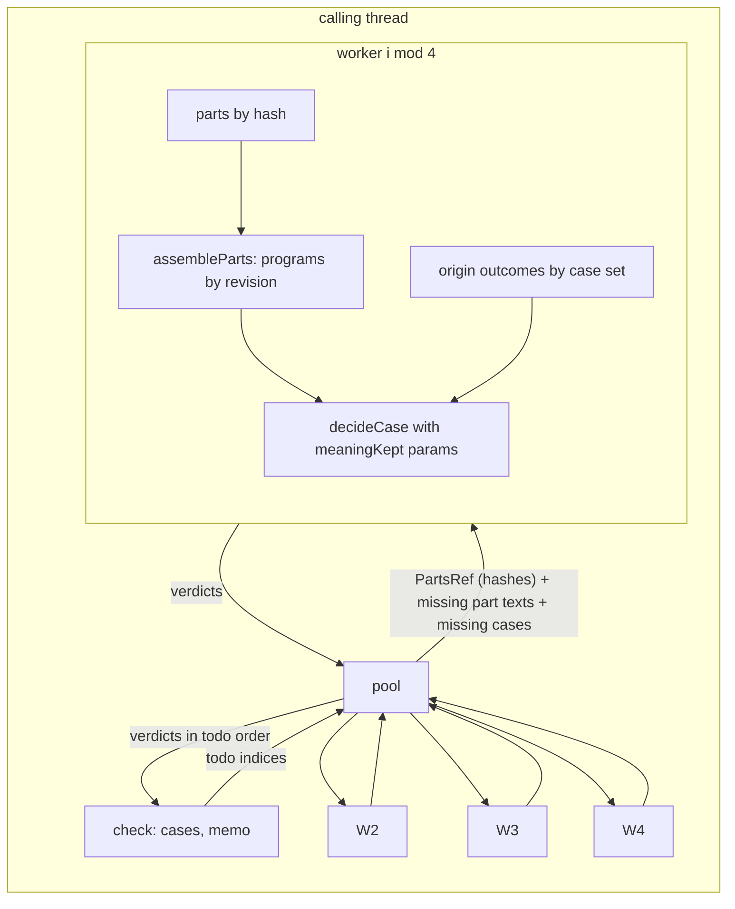
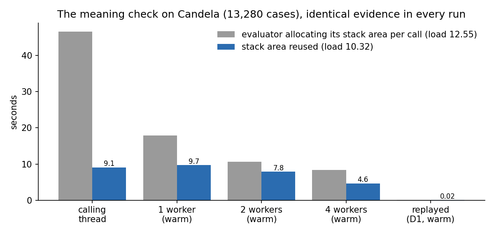
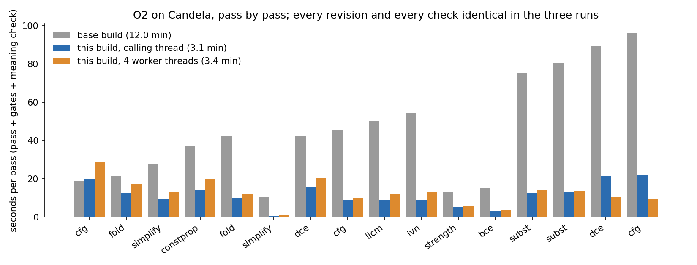
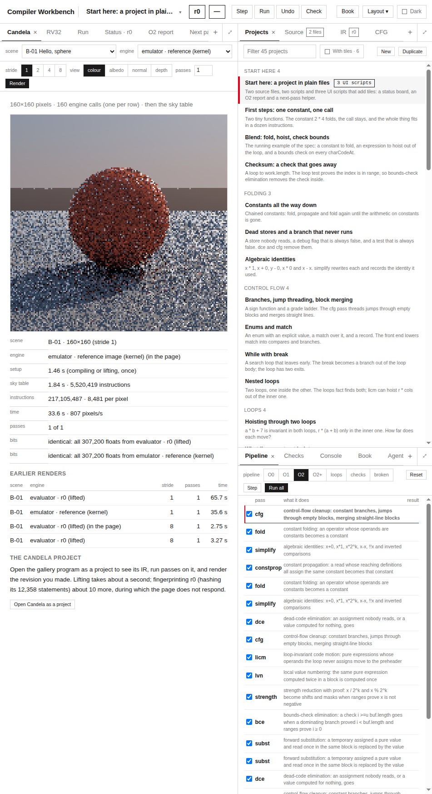

# Cheap experiments

The IR Workbench compiles Typed programs to RV32 through a framework in which every pass produces a new immutable *revision* of the program and every revision is checked: the framework validates it, diffs it against its input, records which entities correspond to which, and runs a *meaning contract* that evaluates the new program and the original on generated inputs and compares the results. The checks are what make the compiler trustworthy, and on Candela, the 332-function path tracer that the earlier reports carried through O2, they made every experiment slow. A pass that changed nothing took 13 to 18 s. O2 took 12 minutes and 5.8 GB. That figure is this milestone's measurement of its base commit; report 4's 19 minutes for the same pipeline was measured under a different machine load. Opening Candela in the browser held the page for 10 s, and a pass held it for about 45 s.

This report describes the milestone that made those experiments cheap without weakening any check and without changing any revision hash. O2 on Candela now takes 3 minutes 27 seconds. cfg on r0, with all its checks, takes 13.6 s against 41 to 51 s for the base build run alternately on the same machine. A per-scene kernel takes 119 s against 312 s. The meaning check over Candela's 13,280 cases takes 9.1 s on the calling thread (46.7 s before a fix to the evaluator's memory use), 4.6 s on four worker threads, and 21 ms when every case's verdict is already known. In the browser, the Candela view renders on a Web Worker and holds the page for at most about 100 ms. Every revision of the 44 corpus projects and of Candela is bit-identical to the base build's, and so is every check's evidence on the corpus and every check's counts on Candela.

> [!summary]
> - **The rule.** Cache only on values that cannot change: frozen objects, frozen adapters, and content hashes. Then make more values stay the same object from one revision to the next.
> - **Shared records.** A pass's output now shares every record it did not change with its input, so caches keyed on records keep working across passes. *Function parts* and *closure keys* turn this into a per-function notion of "unchanged".
> - **Replayed verdicts.** The meaning check keeps the original program's outcomes per case and each decided verdict under a hash of the code the case can reach. 63% of O2's case decisions on Candela are replays.
> - **Threads.** A worker pool decides cases in Node, and an engine worker runs the Candela view's engines in the browser. Two findings came out of measuring them: the evaluator's per-call 64 KiB buffers made the garbage collector mark the main thread's heap every second, and Chromium's canvas waited on the GPU process for seconds at a time.

Some terms recur throughout this report:
- **Value.** The program as plain data: tables of functions, blocks, statements, values and operations, keyed by id.
- **Revision.** The SHA-256 of the canonical text of `{kind, schemaVersion, value}`. In that text, keys are sorted and -0 is written as 0.
- **Frozen, or canonical.** An object built by the framework's `immutable`: deep-frozen, with its keys in sorted order, and recorded in a `WeakSet` so it is never re-checked.
- **Case.** One generated call of one function: arguments plus a memory image.
- **Outcome.** What the evaluator returns for a case: result, trap, step limit and memory.
- **Verdict.** What the contract concludes from the original's and the candidate's outcomes for a case: agree, disagree (with a reason), or inconclusive.

## 1. Where the time went

The measurements were taken before any change, on the base commit `420d8e1`, with `scripts/02-framework-cost.mjs` and V8 CPU profiles. They showed that most of a pass's time was not spent in the pass itself.

When `strength` was run on Candela's r0 and changed nothing, it took 13,265 ms (15.9 s in a second run). Of that, 11.0 s was `Edit.prepare` for an edit that recorded nothing:
- it rebuilt the program from its projection (0.4 s);
- it made an artifact of the rebuilt program again (3.7 s), which re-hashed the 18,178,949-character canonical text;
- it projected the result, diffed it against its input and computed their correspondence (6.4 s).

A real pass, cfg, took 18.6 s in its own run. Of that, 10.2 s ran under `applyPass`:
- artifact creation, 3.3 s;
- correspondence, 1.8 s;
- projection, 1.7 s;
- diff, 1.4 s;
- the pass itself, 0.9 s.

The other 6.2 s was the meaning check. Only 3.4 s of it evaluated cases; the rest hashed and validated the same two programs again (1.5 s for the invariant's cache key, 1.2 s validating its ports). The garbage collector took 5.2 s over the run. Nearly every step re-encoded, re-hashed or re-validated objects that had not changed.

Two properties of the data made the waste structural rather than incidental. First, no record survived a pass as the same object, because the working store cloned everything on the way in and the native value cloned everything on the way out. Every cache keyed on object identity therefore missed on every revision. Second, SHA-256 must hash the whole text of a changed revision: in Candela's r0 text, the operations table starts at 9.6% and the value table at 59.3%, so any change rehashes more than 96% of 18 MB. The hard constraint of the milestone was that revisions must not change. A per-function hash would have been faster but would have been a different definition. The work therefore had to make the same text cheaper to produce and the same hash cheaper to compute, and above all had to stop recomputing either.

## 2. Recomputing known facts (A1–A7)

The first increment removed recomputation of facts about frozen objects. A frozen object cannot change, so the first answer about it is the final answer. Seven changes follow from that:
- **The empty edit is the identity.** `IREdit.operationCount` counts recorded operations and correspondence entries. `applyPass` returns `{ changed: false, artifact: before }` when the count is zero, instead of rebuilding and re-hashing the program.
- **Revisions are hashed once per value.** `revisionOf(kind, schemaVersion, value)` hashes the three pieces `'{"kind":…,"schemaVersion":…,"value":'`, `canonical(value)` and `'}'`. This is the same text as `canonical({kind, schemaVersion, value})`, so the same hash. The result is cached per frozen value and per kind and schema.
- **Values are validated once per validator.** `validateOnce(validator, value)` records each frozen value that passed, in a `WeakMap` from validator to `WeakSet`.
- **The invariant's cycle key names revisions.** It used to encode two whole programs into its key.
- **Correspondence entries are sorted by keys computed once.**
- **SHA-256 streams its input.** It uses `node:crypto` when the platform has it. The portable path encodes into a 64 KiB buffer, so the 18 MB text is never materialized as bytes.
- **Long texts of frozen records are cached.** `canonical` keeps the text of every frozen record of 64 characters or more.

With the empty edit returning its input, the no-change pass fell from 13.3 s to 4.2 s on the same revision `cd36346e…`. The remainder was the `ranges` analysis the pass needs (section 9). Every one of the 44 corpus projects' r0, O2 and image revisions was identical, and so was the evidence of every check (section 5).

## 3. Records that keep their identity (F1)

A pass works on a mutable `Store`, a working copy of the frozen value, and ends with `toNative()`, which writes the store back out as a new value. The second increment changed both ends:
- `Store.from` copies records with a plain JSON copy (`copyJson`) instead of `structuredClone`, and keeps the frozen input as `store.base`.
- `toNative` compares each working record with the base record of the same id. When the two have the same canonical text (`sameJson`), it returns the base's frozen record itself rather than a copy.

```text
before (frozen r0)          Store (mutable copies)           toNative                      r1
fns, blocks, stmts,   ──▶   ents: id → working record  ──▶   for each live id:      ──▶   frozen; every unchanged
values, ops (frozen)        (a pass mutates some)            same as base[id]?             record is r0's object
                                                              yes → base[id]
                                                              no  → copy
```

The comparison is exact because `sameJson` is equality of canonical text. It compares the same own keys and equal primitives, treats 0 and -0 as equal (as `canonical` does), and compares arrays and records recursively. A property set to `undefined` is a key the other record must also have, so such a record never equals a frozen record.

`immutable` then shares what is already canonical. As a result, r1 is a new table structure around mostly old records, and every cache keyed on a frozen record starts to hit:
- **Text.** The record's canonical text is cached, so the revision text of r1 is assembled mostly from cached pieces.
- **Projection.** `blocksEntities` and `blocksRelations` now build each record's entities and relations once, as frozen arrays kept per record (`RECORD_ENTITIES`, `RECORD_RELATIONS`). A projection that shares most records with the previous one therefore shares most entities and relations.
- **Graph validation.** `validateGraph` skips entities it has seen. Per captured adapter, it also skips relations whose shape it has checked. Checks that depend on the whole graph (dangling ends, duplicates, roots) still run every time, in the original order of checks, so an invalid graph reports the same first error.
- **Diff.** `diff` compares by identity before it encodes anything.

Two smaller changes removed copies that had no purpose:
- `storeOf`, the read-only store used for printing, queries and evaluation, now wraps a frozen value's records instead of copying them (`Store.view`).
- `immutable` and `canonical` were made faster with byte-identical output. Assignment replaces `defineProperty` except for a `__proto__` key. A canonical value's text is encoded without re-checking it, since its keys are already sorted unless they are integer-like.

`scripts/07-immutable-bench.mjs` runs the base build's functions and the new ones on Candela's value. `immutable` went from 1,405 to 931 ms and `canonical` from 925 to 615 ms, with identical JSON and identical canonical text. `Store.from` went from 468 to 208 ms, and `storeOf` from 403 to 121 ms.

## 4. Functions as the unit of change

Shared records make "this function did not change" an identity test. A *function part* (`src/typed/parts.ts`) groups one function's records in one revision: its function record, and its blocks, statements, values and front-end operations, each list in id order. Parts are derived data. They are not part of the canonical value and change no hash. Their one important property is identity stability. When a later value contains the same frozen function record and the same record objects in every list, `partsOf` returns the earlier part object. Across O2 on the corpus project `calls` (three functions, one of which O2 changes), the two unchanged functions are the same part objects at the end as at r0. A survey of all 44 projects found no part that was a new object with unchanged content.

A part has a hash, `partHash`, computed once per part object over the canonical texts of its records. That is enough to build the key D1 needs: the *closure key* of a function, which names exactly the code a case of that function can execute. The key's contents follow from reading the evaluator rather than guessing. An outcome of `evaluate(store, f, args, memory, {limit})` depends on:
- the case;
- the step limit;
- every function reachable from `f` by `call` values, because calls are by name;
- whether any function in the program has frame arrays. If one does, the evaluator puts a 64 KiB stack area above guest memory, which changes the memory size every case sees.

Nothing else of the program is read. `validateBlocks` already guarantees that a statement's values and blocks belong to its own function, so grouping records by their `fn` field is exact. The closure key is therefore:

```text
closureKey(v, f) = SHA-256( sorted lines "g:partHash(g)" for every g reachable from f by calls
                             ("g:missing" for a name the program does not define)
                            + "\nframes:" + anyFunctionHasFrameArrays(v) )
```

## 5. The meaning check remembers (D1)

The contract `typed.meaning-kept` generates 40 cases per function from the *origin* (r0) and evaluates each case on the origin and on the candidate. In O2 the origin never changes, and most functions of a candidate are unchanged from the previous revision. Two kinds of reuse follow, and both are declared on the framework's generic differential check (`src/framework/contracts/differential.ts`) as optional keys:

```ts
baselineKey?: (inputs) => string | undefined;          // the cases and the baseline's outcomes are a function of this key
subjectKey?:  (subject, kase, inputs) => string | undefined; // the subject's outcome is a function of the case and this key
```

`meaningKept` sets them to the origin's `kind@schema:revision` and to the candidate's closure key for the case's function:
- Under the baseline key, the check keeps the generated cases and the origin's outcome for each case, filled the first time each case is evaluated.
- Under the baseline key, the case index and the subject key, it keeps the decided verdict.

A later check replays a verdict instead of evaluating the case. The parameters that shape cases and verdicts (count, seed, inputs, limit, entries) are already part of the check's version string, so they are part of the key.

Replay must not change the evidence. The evidence records counts, a status and the first five counterexamples in case order. All verdicts, whether replayed, decided here or decided elsewhere, are therefore collected into an array indexed by case and counted in a final pass in case order (`tally`). The tests check this directly. `tests/typed/meaning-memo.test.mjs` compares the evidence with reuse on and off for agreeing candidates and for the deliberately wrong `div-to-shift` pass, whose counterexamples must come back in the same order. `scripts/08-corpus-evidence.mjs` hashes every step's evidence for all 44 projects through O2. Its output is identical on the base build, on this build without reuse, and on this build with reuse.

Over Candela's O2, `differentialStats` counted:
- 13,280 origin evaluations, one per case;
- 64,040 candidate evaluations;
- 108,600 replayed verdicts.

That is 63% of all case decisions. A run with sections 2 to 5 in place, but before the evaluator fix of the next section, took O2 from 12:06 to 6:10 and the peak RSS from 5.8 to 3.0 GB.

## 6. A finding about the garbage collector

The Node worker pool of the next section was measured against the calling thread on the cfg check, which has 13,280 cases. One worker took 17.9 s and the calling thread took 46.7 s, on the same evaluator code. A profile of the local check (`scripts/09-candela-contract.mjs --local-only`, window `runDifferentialAsync`) attributed 18.2 of its 38.9 s to the garbage collector. With `--trace-gc`, the cause showed: a mark-compact about once a second, each marking the main thread's live heap of 464 MB and each triggered as "GC in old space requested".

Candela has frame arrays, so every evaluation allocated a working memory of the case's memory plus `STACK_BYTES` (65,536 bytes). That is about 26,560 evaluations of about 66 KiB each, or roughly 1.75 GB of ArrayBuffer backing stores per check. V8 counts these as external memory, and external memory past its limit starts a full marking of the heap. A worker's heap is small, so the same markings cost it little. On the main thread, which holds the artifacts, projections and analysis results, each one cost most of a second.

The fix keeps the evaluator's results identical:
- With a stack area, the working memory is a zeroed prefix of one reused buffer (`SCRATCH`).
- The result still receives `bytes.slice(0, memory.length)`, as before.
- The bounds check and the `DataView` cover exactly the prefix.

A call's locals likewise became a zeroed window of one reused `Int32Array`. That change alone made no measurable difference (34 mark-compacts instead of 35), and it was kept because the evidence stayed identical. After the fix, the same check ran in 10,959 ms with 5 mark-compacts for the whole process (`various/14-contract-gc.txt`). Evaluation was the contract's whole cost once D1 had removed the repeated work, so the evaluator had been paying for the size of the main thread's heap.

## 7. Worker threads for the contract (F4, Node)

The check got a third optional key, `decide(inputs, cases, todo)`, which may return a promise of one verdict per index of `todo`, or `undefined` to decide them on the calling thread. A worker must decide a case exactly as the calling thread would. Both therefore go through one exported function, `decideCase(spec, inputs, case, index, outcomes?)`: it runs the baseline and the subject, then `inconclusive`, then `compare`. A worker gets the specification by calling `meaningKept(params)` in its own realm, and `differentialSpec` returns the specification an invariant was made from.

`src/typed/parallel/node-pool.ts` implements `decide` with worker threads, and moves the two programs to the workers as function parts:



The pool works as follows:
- Case *i* always goes to worker *i* mod *N*, so each worker computes the origin's outcome of its own cases once and keeps it.
- A job names each program as a list of part hashes and carries only the part texts and cases the worker does not have yet. After the first check, a job carries the functions the pass changed.
- Jobs below 64 undecided cases stay on the calling thread.
- `tests/typed/parallel.test.mjs` compares the pool's evidence with the calling thread's for three projects through O2 and for the wrong pass, with reuse on and off and over two rounds. The evidence is identical in every comparison.



On the cfg check after the evaluator fix, at a machine load average of 10.3, with identical evidence in every run (`various/17-candela-contract-threads-inc3.json`):

| run | time |
|---|---|
| the calling thread | 9,058 ms |
| 1 warm worker | 9,702 ms |
| 2 warm workers | 7,849 ms |
| 4 warm workers | 4,637 ms (1.95× the calling thread) |
| 4 cold workers | 10,766 ms |
| verdicts replayed (same candidate) | 21 ms |

A cold pool pays for shipping 442 part texts and assembling two programs in each worker.

The full O2 on four threads took 3:42 against 3:27 on the calling thread. The machine was shared with other agents' runs at load averages of 11 to 15 on 8 cores, so the workers did not get the cores. Each revision also costs every worker a program assembly that the calling thread does not need. The workers were faster on the last two steps, dce at 10.3 s against 21.6 s and cfg at 9.4 s against 22.3 s, and slower on the first, cfg at 28.9 s against 19.8 s, which paid the cold start. The tools take `--threads N`. The pool is not the default.



For independent runs, such as a corpus project's pipeline, a scene's specialization or a strategy's candidate, `src/typed/parallel/job-pool.ts` runs one exported function of one module per job on the first idle worker. It returns results in call order. The pool was measured on the corpus through O2, one project per job, and the evidence was identical to the base build's in every run:

| run | time |
|---|---|
| one thread, no pool | 2.7 s |
| pool, 1 thread | 2.8 s |
| pool, 4 threads | 2.3 s |

The corpus's projects are small, so each worker's import of the compiler is a large share of the time. Running Candela-scale jobs side by side was not measured, because the shared machine allowed one Candela-scale process at a time.

## 8. The Candela view on a Web Worker (F4, browser)

The page runs under a strict policy:
- `connect-src 'none'`: the page fetches nothing.
- Its lazily loaded vendored scripts (the reference compiler, the Candela data) load with subresource-integrity hashes.

A worker script cannot carry an `integrity` attribute, and the policy rules out fetching bytes to check them. The engine worker therefore loads nothing at all. `tools/build-site.mjs` writes `candela/engine-worker.js` as one file: the seven vendored scripts it needs, each checked against `vendor/ds-js-os/VENDOR.json` at build time, followed by the esbuild bundle of `site-src/engine-worker.js`. This is the same trust model as `app.js`, a same-origin build output. The page's policy gained `worker-src 'self'`. `tools/serve-site.mjs` now sends the same policy as a header on every response, because a worker does not see the page's meta tag.

The worker compiles the reference image, lifts r0, builds the sky table and makes every engine call. The page posts the scene, stride and engine, receives a progress snapshot about every 100 ms, and draws. The evaluator and our own image can render a revision of the open Candela project, and that revision reaches the worker as function parts: a `PartsRef` (the revision, `fnOrder`, part hashes, counters and front end) plus the part texts the worker has not seen. The worker rebuilds the value with `assembleParts`, creates the artifact, and refuses the render unless its revision equals the one the page named. The hash thus checks the transfer from end to end.

Measuring this found a stall that had nothing to do with the engines. With every engine call on the worker, the page still froze for 3.2 to 3.6 s near the end of a render while its JavaScript profile was idle. A CDP trace located the stall:
- On the page's main thread, `CanvasRenderingContext2D::FinalizeFrame` waited under "GPU backpressure via GL_COMMANDS_COMPLETED_CHROMIUM" (581 ms in the traced run).
- The GPU process ran tasks of up to 991 ms. This was headless Chromium's software GPU on a loaded machine, and every progressive `putImageData` forced a round trip to it.

A canvas created with `getContext('2d', { willReadFrequently: true })` is kept in memory and never waits on the GPU process. With it, the longest gap between ticks of a 10 ms timer on the page fell to 25 ms. `PerformanceObserver('longtask')` reported the GPU waits as long tasks of the page; the timer heartbeat was the measure that matched the trace.

| render of B-01 (scene "Hello, sphere") | where | time | longest page gap | bits |
|---|---|---|---|---|
| evaluator r0, stride 8 | worker | 3.3 s | 25 ms | — |
| evaluator r0, stride 8 | page | 2.7 s | 1,617 ms | 0 / 4,800 differ from the worker's |
| emulator kernel, stride 1 | worker | 35.6 s | 116 ms | — |
| evaluator r0, stride 1 | worker | 65.7 s | 96 ms | 0 / 307,200 (sums 0 / 102,400) vs kernel |
| emulator kernel, stride 1 | page | 33.6 s | 3,460 ms | 0 / 307,200 vs both worker frames |



The second browser finding concerned hashing. Profiling the opening of Candela in the page attributed 5.5 of 14.1 s to SHA-256, about 7 MB/s. The streaming hash passed the *rest* of the text, `text.slice(pos)`, to `TextEncoder.encodeInto` for every 64 KiB, and Chromium flattened that rest each time. Node had never run this path on a large text, because it uses `node:crypto`. The hash now encodes a window of at most a third of the buffer's free bytes, keeping a surrogate pair together. The portable path hashes 18 MB in about 350 ms, with the same digest as `node:crypto`.

Opening Candela and applying a pass in the browser still run on the page, and the acceptance target of no task over about 100 ms was not reached for them:
- **Opening** now takes 8.6 s (profiled; 14.1 s before the hash fix): `immutable` 2.2 s, the projection that `createIRArtifact` builds eagerly 3.0 s, both hashes 1.1 s, `canonical` 0.5 s, the garbage collector 1.9 s.
- **cfg** takes 21.3 s, against about 45 s before, as one task.

Moving them into the worker needs the page to adopt a revision in slices of under 100 ms each: parts, tables, canonical text, hashing, validation and projection. Of these, the projection's sort of 130,000 relations is the one without an obvious way to split it. That work is left open.

## 9. Acceptance, measured

| item | before | after | notes |
|---|---|---|---|
| no-change pass on Candela r0 (`strength`) | 13,265 ms | 4,295 ms first, 655 ms once `ranges` is solved | revision `cd36346e…` unchanged |
| cfg on Candela r0 (pass + gates + check), base and new alternated | 51.2 s and 40.7 s | 13.6 s and 13.6 s | same revision `4aea7e81…`, check 13,280 / 13,258 / 0 / 22 |
| full O2 on Candela | 12:06, 5.79 GB | 3:27, 4.70 GB (4 threads: 3:42, 6.94 GB) | all 16 steps: same revision (13 new ones) and same check counts |
| one per-scene run (R-01, stride 8) | 312.2 s, back to back (198.6 s in IRWB-001 on a quieter machine) | 118.9 s | 332 → 137 functions in both; 0 frame bits differ |
| contract on 4 workers | 9,058 ms on the calling thread | 4,637 ms warm (1.95×) | identical evidence |
| browser render, stride 1 | page held up to 3.5 s | longest gap 96–116 ms | frames bit-identical |
| browser open / pass | 10 s / about 45 s | 8.6 s / 21.3 s, still blocking | not reached |
| revisions | — | 44 corpus projects × (r0, O2, image) and Candela r0 and O2 identical | evidence hashes identical |

The target for the no-change pass was under 1 s, or a profile explaining what remains. Once the analysis is known, the pass takes 655 ms. The first time, it takes 4.3 s, and the profile (`profiles/22-final-strength.cpuprofile`) accounts for the difference:
- **The `ranges` analysis: 2.36 s.** `strength` needs this analysis, and on r0 it has never been solved, so it is solved and frozen from scratch. Freezing its result with `immutable` takes 1.51 s and the solver 0.70 s. The result is made of hundreds of thousands of small arrays, each frozen and recorded in a `WeakSet`.
- **The pass's own run: 0.88 s.** This includes the 0.37 s working copy.
- **The framework's per-revision steps: none.** Diff, correspondence and artifact creation do not run, because the edit is empty.

Shortening the first run further means solving analyses per function and keeping their results per function part, as D1 does for verdicts. That was not done in this milestone.

## 10. What this leaves

Every earlier check still runs, and every revision is the one the base build made. The difference is that work done once is no longer done again: on a frozen value, on an unchanged record, on an unchanged function, or on a case whose reachable code has not changed. Three things remain open:
- **Opening and passes in the browser.** These need sliced adoption on the page, or a projection that is not built eagerly at artifact creation.
- **The no-change pass is still a few seconds.** The analysis it depends on is solved and frozen from scratch the first time.
- **Per-function validation.** `validateBlocks` still walks the whole value when a value is new.

The pool is not the default, because the machine it ran on was shared. On a machine with free cores it gives the contract close to a twofold gain at four threads.

Other agents' code is affected in a few compatible ways:
- The differential check has three optional keys (`baselineKey`, `subjectKey`, `decide`).
- `typed.meaning-kept` uses them.
- `Store` has `base` and `Store.view`.
- `IREdit` has `operationCount`.
- The evaluator reuses two buffers per realm.

The pass-authoring API is unchanged.

## Related notes

- [[PROJECT REPORT - IR Workbench - Per-Scene Kernels for Candela - Cheaper Checked Passes, Merged Bounds Checks, an RV32F Backend and Bit-Identical Frames - A Technical Deep Dive]] (report 4: per-scene kernels, the first framework caches)
- [[PROJECT REPORT - IR Workbench - Candela on the Kernel - Float Semantics, Lifting From the Tape, and a Checked O2 on a 332-Function Renderer - A Technical Deep Dive]] (report 3: Candela's O2)
- [[PROJECT REPORT - IR Workbench - How Strong Is the Meaning Contract - Mutation Scores, Equivalent Mutants, Boundary Cases and a Divergence Rule - A Technical Deep Dive]] (IRWB-005: what the contract this report accelerates detects)
- Ticket and diary: `ttmp/2026/11/25/IRWB-004--cheap-experiments-cached-origin-outcomes-functions-as-the-unit-of-change-workers-and-a-worker-for-the-workbench/` in the repository, `log/01-irwb-004-diary.md`; measurements in `various/`, scripts in `scripts/`.
