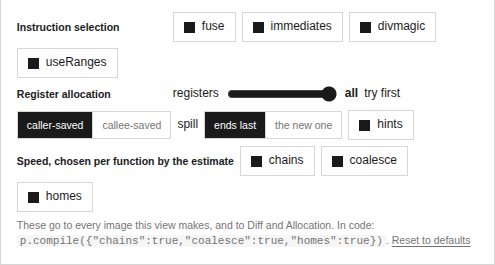
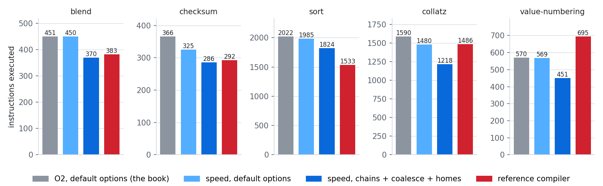
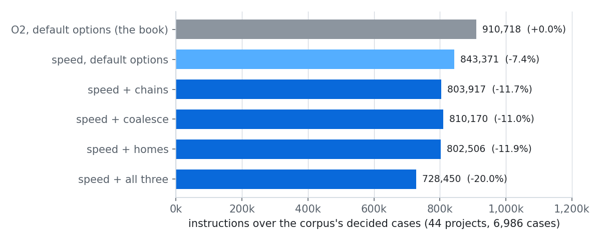
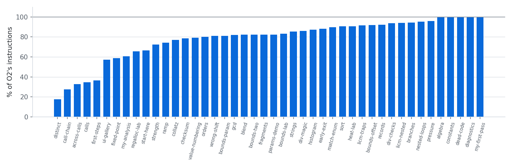
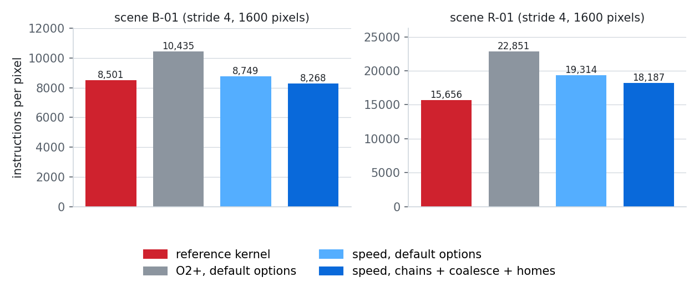

# Closing the speed gap

The compiler of the IR Workbench project lowers Typed, a small statically typed language, to 32-bit RISC-V. By the end of the previous milestone it was correct on every program it was tried on, smaller than the reference compiler of the PicoCalc toolchain, and slower than it. The gap had been measured and its causes named: no inlining, a loop shape that costs a jump per iteration, register copies the allocator could not remove, and constants rebuilt at every use. This report covers the milestone that addresses those four causes.

The milestone ran under a constraint that shaped every design decision. The book that accompanies the compiler quotes numbers produced by its O2 pipeline and its default backend options, and the test suites pin them. Nothing those numbers depend on could change. The new work therefore lives in a new pipeline, `speed`, and in three new backend options that are off by default: `chains`, `coalesce` and `homes`. With the options off and the old pipelines selected, every image, every revision hash and every test result is identical to what it was before.

Three terms recur:
- **An instruction count** is the number of instructions the emulator executes for one call of a function on one generated case. It is the measure of speed throughout.
- **The meaning contract** is the check every pass application must pass: the new revision and the original program (r0) are evaluated on generated cases, and the revision is published only if every decided case agrees.
- **`kernel`** is the reference compiler's most aggressive code-generation policy, the target for speed.

> [!summary]
> - **Four transformations.** An `inline` pass (whole program, with record results and full provenance), a `rotate` pass (loop rotation by header duplication), and three backend options: `chains` (block order by estimated frequency), `coalesce` (copy coalescing before allocation) and `homes` (constants built once per function).
> - **One rule for when an option applies.** Each option can lose on some function. The backend compiles every function plainly and with each requested option, and keeps a variant only if a static cost estimate — instructions weighted by block frequencies from fixed branch probabilities — says it is cheaper. With the options off, the backend compiles each function once, as before.
> - **The book's benchmarks.** Under `speed` and the three options: Blend 451 → 370 (the reference: 383), Checksum 366 → 286 (292), insertion sort 2,022 → 1,824 (1,533), Collatz 1,590 → 1,218 (1,486). Every result agrees with the evaluator.
> - **The corpus.** 44 projects, 6,986 decided cases: 910,718 → 728,450 instructions (−20.0%), 5,160 → 4,356 bytes, no project slower, every case agreeing with r0.
> - **Candela.** The general image executes 601.8 instructions per generated case against 727.3 for the reference's `kernel` image (at O2 it was 16% slower than `kernel`; now it is 17% faster). Per scene, B-01 runs at 8,267.7 instructions per pixel against `kernel`'s 8,501, and R-01 at 18,186.7 against 15,655.9, both 20% below O2+, with every output float bit-identical to the reference frame.
> - **Nothing frozen moved.** The 44 corpus revision lines, the parity tool and the full-corpus suites are identical to the baseline; `npm test` gains 15 tests and changes three assertions (two enumerations of passes and pipelines, and IRWB-006's pinned count of compared steps, 616 → 792, after `speed` was added to that comparison), before and after merging the parallel milestones IRWB-004 and IRWB-006.

## 1. Where the instructions went

The compiler's middle end works on `typed.blocks`: functions as control-flow graphs whose blocks hold statements over expression trees, with mutable locals. A pass edits a working copy through a transaction that records, for every new statement and value, where it came from (`from`), which pass made it (`via`) and why the change is valid (`because`). The backend selects instructions from the trees, allocates registers with a linear scan over one interval per virtual register, and records the options it used in the image it produces.

At the start of the milestone the book's table read:

| benchmark | r0 | O2 | reference |
|---|---:|---:|---:|
| Blend | 531 | 451 | 383 |
| Checksum | 446 | 366 | 292 |
| insertion sort | 2,022 | 2,022 | 1,533 |
| Collatz | 1,590 | 1,590 | 1,486 |
| value numbering | 690 | 570 | 695 |

Blend's loop shows where the instructions go. At O2 each iteration executes eleven instructions:

```text
bb.1:  blt   t1, a1, bb.3        ; the loop test, at the top of the loop
       …
bb.3:  addi  t3, t1, 0           ; a register copy: t7 = i
       lw    t4, 0(a0)           ; the buffer's capacity
       bltu  t3, t4, bb.7        ; the bounds check
       ebreak
bb.7:  slli  t3, t3, 1
       add   t3, a0, t3
       lhu   t3, 4(t3)
       mul   t3, t3, t2
       add   t0, t0, t3
       addi  t1, t1, 1
       jal   zero, bb.1          ; back to the test
```

Two of the eleven are overhead the reference compiler does not pay. The `jal` exists because the test sits at the top: every iteration jumps back to it and then branches into the body. The `addi t3, t1, 0` is a copy. The lifter introduced the temporary `t7 = i`; the forward-substitution pass cannot remove it because `t7` is read twice; and the allocator gives `t7` and `i` different registers because their intervals touch. Forty iterations of eleven instructions, plus eleven outside the loop, make 451.

Candela, the 332-function path tracer of the PicoCalc gallery, shows a third cause. Its general image at O2 executed 870.3 instructions per generated case against 747.7 for `kernel`. Two functions account for half of the per-function gaps where ours is slower, `fbm3` and `cdlRenderSpan`, and both consist of calls to small functions. Over the whole program at r0:

```text
{"fns":332,"calls":918,"rootCalls":918,"nestedCalls":0,"recordResultFns":180,
 "frameArrayFns":2,"selfRecursive":[],"singleSite":220,"smallLeaves":95}
```

Every one of the 918 calls is the whole value of a statement (`x = g(…)`, `eval g(…)` or `return g(…)`). 180 functions return a value record, whose leaves the caller reads after the call, and 220 functions have exactly one call site. The reference compiler inlines; this compiler did not.

The next sections describe the four changes in the order the backend needs them, after the one piece they all depend on: a way to decide, without running the program, whether a variant of a function is faster.

## 2. Block frequencies and a static cost estimate

Each backend change can lose on some function. Merging two registers makes one longer interval, which can push another value into a spill. A constant kept in a register occupies that register for the whole function. A block order that suits one loop can lengthen another path. Rather than tune heuristics until no benchmark regresses, the backend compiles each function plainly and with each requested option, and keeps a variant only if a static estimate of the finished code says it is cheaper.

The estimate needs a frequency for each block: how many times it executes per call, under fixed branch probabilities. The probabilities come from the strongly connected components of the control-flow graph (computed with Tarjan's algorithm), not from natural loops, because rotation can make a loop irreducible (section 3):

| edge | probability |
|---|---|
| to a block that ends in `trap` | 0 |
| inside a cycle, staying in it | 0.88 |
| inside a cycle, leaving it | 0.12 |
| from outside a cycle, entering it | 0.88 |
| any other two-way branch | 0.5 each |

The entry block has frequency 1, and every other block the sum, over its incoming edges, of the source's frequency times the edge's probability. Cycles make this a fixed-point problem; Gauss–Seidel sweeps in reverse postorder converge to a relative tolerance of 10⁻⁹ within 200 sweeps (`src/typed/backend/frequency.ts`). For rotated Blend, the loop body executes 0.88 / 0.12 = 7.33 times per call, the trap block 0 times, the exit once.

The cost estimate of a finished function is the sum, over its instructions, of its block's frequency. For Blend under the new pipeline it is 91.67 compiled plainly and 76.00 with the chosen options. The difference, 15.67, is two instructions in a block of frequency 7.33 and one in a block of frequency 1. The measured counts on the benchmark's forty iterations, 450 plainly and 370 with the options, differ by 80: two instructions in each iteration and the return value's copy, less the jump that the plain code's last iteration skips.

`chooseVariant` (`src/typed/backend/variants.ts`) applies the estimate per function:

```text
best ← compile(plain)
if chains:   consider(best's options + chains)
if coalesce: consider(best's options + coalescing)
if homes:    compile once with the choices so far, recording every constant built into a fresh register
             and the frequency of its block;
             consider(… + a home for every constant whose uses add up to more than one per call)
consider(v): keep v if estimate(v) < estimate(best) − 10⁻⁹
```

A tie keeps the variant without the option, so an option that changes nothing leaves the function as the default backend compiles it. With every new option off, the backend does not call the chooser and compiles each function once, exactly as before the milestone. `variantChoices(blocks, options)` reports, per function, which options were kept and both estimates.

## 3. Loop rotation and block chains

### Rotation as header duplication

A loop whose header is only its test, `if c goto T else E`, can be rotated by copying that test into every block that jumps to the header unconditionally. The copy in the block before the loop, the *guard*, decides whether the loop runs at all. The copy at the end of the body, the *bottom test*, decides whether it runs again. The header then has no predecessor and disappears. This is tail duplication, and it is valid whatever the test reads: every path that reached the header now executes a copy of it at the same point, once. The pass (`src/typed/rotate.ts`) adds one restriction, that the condition contains no call and no read of a record leaf, which keeps leaf reads next to their calls.

Blend after rotation:

```text
bb:blend.0  -> [.2, .3]
    s:blend.1    s = 0
    s:blend.2    i = 0
    s:blend.15   inv = ((a * b) + 64)
    s:blend.16   if (i >= n) goto .2 else .3          ; the guard
bb:blend.3  -> [.4, .7]
    s:blend.5    t7 = i
    s:blend.6    if (t7 >=u load32[work+0]) goto .4 else .7
bb:blend.7  -> [.2, .3]
    s:blend.10   s = (s + (load16[(work + (t7 << 1))+4] * inv))
    s:blend.11   i = (i + 1)
    s:blend.17   if (i >= n) goto .2 else .3          ; the bottom test
```

Each copy records the header's test as its origin and the loop and its header as the reason, so `why` on `s:blend.17` reaches the original test `s:blend.4` and source line 4 through `from`, and `loop:blend@bb:blend.1` through `because`. The meaning contract accepted the revision on 40 of 40 cases.

When both targets of the header's test are inside the loop, as in Collatz, whose `&&` condition is lifted through a temporary assigned in two blocks, the rotated loop has two entries and is irreducible. The dataflow solver widens at the target of every retreating edge of a depth-first search, and every cycle contains such an edge, so the interval analysis still terminates; the `loops` fact is empty for that function, and the strength-reduction pass, which needs the interval analysis, still runs. Loop-invariant code motion needs natural loops with a preheader, so in the pipeline it runs before rotation.

### Chains: one branch per iteration

Rotation alone saves nothing. In the IR's block order the rotated body is followed by the exit block, so the bottom test still branches to the exit and jumps back. The saving comes from the block order. With `chains`, the backend orders blocks by the Pettis–Hansen method: each edge is weighted by `freq(source) × probability`, edges are taken heaviest first, and an edge joins two chains when its source ends one and its target starts another. Rotated Blend becomes `bb.0, bb.3, bb.7, bb.2, bb.4`, and the body ends in `blt t1, a1, bb.3`: the back edge is the taken branch and the exit falls through.

The first version made six corpus projects slower, `strings` by 7,670 instructions (7%). Its `||` chains are 50/50 branches under the static probabilities, ties were broken by block position, and the rare block ended up after each test. Without a profile, a tie carries no information, and the lifter's own order is the better default, since it places the evaluation of the next operand of `||` right after the test. Ties now go to the IR's fall-through edge, and `chains`, like the other options, is kept per function only where the estimate prefers it.

## 4. Copy coalescing

Two virtual registers can share one physical register if they never hold different values at the same time. The classical test, due to Chaitin, is interference: `a` and `b` interfere if one is defined while the other is live, except when the definition is a copy from the other, since then both hold the same value. `coalesceCopies` (`src/typed/backend/coalesce.ts`) runs on the selected code before allocation:

1. liveness per machine block, then per instruction;
2. interference edges between registers of the same class (integer or float);
3. candidates: copies between two virtual registers, hottest block first;
4. for each candidate whose two sides, after earlier merges, do not interfere: merge them with a union-find, the lower register as representative, and give the representative the merged member's interference edges;
5. rename, and drop the copies that became `r ← r`.

In Blend, `t7` and `i` never hold different values while both are live, so the copy disappears. Coalescing alone takes Blend from 451 to 411 and insertion sort from 2,022 to 1,887.

## 5. Constants in registers

The instruction selector builds a constant at every use, with `addi` or `lui` and `addi`, and an f32 constant with an integer build followed by `fmv.w.x`. Inside a loop this is repeated every iteration: Collatz's loop builds 1, 2 and 3 each time.

With `homes`, selection runs twice. The first run records each constant built into a fresh register and the frequency of its block. Constants whose uses add up to more than one execution per call get a *home*: a register defined once at the function's entry and returned by the selector for every later use. The selector never writes a register it returned for a value, so nothing overwrites a home. Constants that fit an instruction's immediate field never reach this path. For Collatz the chooser gives homes to 1, 2 and 3, and the benchmark falls from 1,590 to 1,329 with this option alone, below the reference compiler's 1,486.

## 6. Inlining

### The transformation

`inline` (`src/typed/inline.ts`) is a whole-program pass, like the dead-function elimination (`dfe`) it pairs with. For a call `g(a₀, …, aₙ)` that is the whole value of statement `s` at position `k` of block `B` in function `f`:

```text
1. locals:   a new local of f for each local of g, named g_<name>; one more per leaf if g returns a record
2. split:    the statements after s move to a new block C, which takes B's successors
3. enter:    in B: p'ᵢ = aᵢ for each parameter; l' = 0 for each other local of g live at g's entry; br entry'
4. copy:     each block of g copied with fresh ids, locals and block targets renamed
5. returns:  x = g(…)      → x = e' ; br C
             eval g(…)     → eval e' if it has an effect ; br C
                             for a record: r'ⱼ = e'ⱼ for each leaf ; br C, and the caller's leaf reads → get r'ⱼ
             return g(…)   → return e'
```

Callee bodies come from the pass's input revision, never from the copy being edited, so one application inlines exactly one level and produces the same ids every time; `speed` applies the pass twice. A callee is inlined when it has at most 16 statements, or when it has a single call site and at most 200; no caller grows beyond 3,000. Callees in a cycle of the call graph, callees with a frame array, and callees whose leaf reads do not follow their own call in the same block are never inlined.

Two semantic details decide correctness. First, the evaluator gives every call fresh locals set to zero. A callee local that is read before it is written must therefore be set to zero where each inlined copy begins, or a copy inside a loop would see the previous iteration's value. Liveness at the callee's entry identifies exactly those locals. Lifted code contains none, because Typed initializes every local, so the test for this rule first applies a small pass that removes an initialization `t = 0` (valid, since a fresh frame holds 0), then checks that the copy inlined into the caller's loop begins with `last_t = 0` and still agrees with r0.

Second, the evaluator's rule for record leaves: `result#k` reads leaf `k` of *the latest multi-result call in this frame*. After inlining, a record call inside the copied body runs in the caller's frame. The pass therefore requires, in caller and callee, that every leaf read follow its call in its own block; it rewrites the reads of an inlined record call up to and including the arguments of the next record call; and it refuses a site after which a leaf read belongs to an earlier call. These are the backend's own requirements on leaf reads, so in lifted code they refuse nothing.

### Provenance

Every entity the pass creates records an origin. A copied statement or value names the callee's entity as `from`, and the call value and call statement as `because`:

```text
why s:energy.16   t6 = (sq_x2 * sq_x2)          via inline
  note    inlined from sq into energy at s:energy.2
  from    s:sq.0      return (x * x)            ← op:sq#3 end (line 2)
  because v:energy.8  sq(c)                     (detached)
          s:energy.2  t6 = sq(c)                (removed@r1) ← op:energy#6 call 0 (line 6)
```

The question "why is this statement here?" is answered from both sides: the callee's source line through `from`, the call and its line through `because`. Parameter assignments come from the call value, because of `fn:g`; the continuation block comes from the call's block. The framework's correspondence groups each copy under the callee entity it copies, so `whyChain` gives the same answer through the framework.

On the `calls` project one application removes all four calls of `energy`, three to `sq` and one to `clamp`, and the contract agrees on 120 of 120 cases. On a test fixture where `bigSum` reads twelve leaves of a record returned by `big`, the reads become reads of `big_r0 … big_r11`, and the image agrees with the evaluator with and without the new options. Under an entry-only contract, `dfe` after `inline` removes the callees that lost their last call site.

## 7. Keeping the book's numbers

Three details of the freeze shaped the design.

**Options outside the defaults table.** An image records its options, and the image validator requires exactly the keys of `backendDefaults`. Adding `coalesce: false` to that table would have put a new key into every image and changed every image revision. The new options live in a second table, `backendExtras = { chains: false, coalesce: false, homes: false }`, and option checking deletes an extra that equals its default, so an image compiled with `{ coalesce: false }` has the same revision as one compiled with `{}`.

**`chains`, not `layout: 'loops'`.** The milestone's design made the block order a second value of the existing `layout` option. A frozen test asserts that `{ layout: 'loops' }` is refused. The order became its own option.

**`speed`, not `O3`.** The brief suggested O3 as the new pipeline's name. A frozen workbench test uses `O3` as its example of an unknown pipeline. The pipeline is named `speed`:

```text
speed = inline, inline,
        cfg, fold, simplify, constprop, fold, simplify, dce, cfg,
        licm, lvn, strength, bce, subst, subst, dce, cfg, subst,      (O2+)
        rotate, cfg
```

`inline` runs first so that O2's passes see the inlined code: constant arguments propagate into the copies, and dead parts disappear. `rotate` runs after `licm`. `speed` contains no `dfe`, which needs the program's entries; the Candela measurements run it afterwards. The workbench offers the pipeline, two presets (`speed`, and `fastest-all`, which chooses among all pipelines by instructions), and a row of three toggles in the RV32 view:



Two test assertions changed, because they enumerate what the workbench offers: the number of passes (13 to 15) and the list of pipelines. Every other test, the parity tool, the full-corpus suites and the 44 corpus revision lines are identical to the baseline taken at the start.

## 8. Results

### The book's benchmarks



| benchmark | O2 (book) | speed, defaults | speed, all three | reference |
|---|---:|---:|---:|---:|
| Blend | 451 | 450 | **370** | 383 |
| Checksum | 366 | 325 | **286** | 292 |
| insertion sort | 2,022 | 1,985 | **1,824** | 1,533 |
| Collatz | 1,590 | 1,480 | **1,218** | 1,486 |
| value numbering | 570 | 569 | **451** | 695 |

The intern guide written before the code predicted Blend 371 and Checksum 286 by counting instructions in listings; the measurements are 370 and 286. Blend's loop now executes nine instructions per iteration:

```text
bb.3:  lw    t3, 0(a0)
       bgeu  t1, t3, bb.4        ; bounds check (the trap block is laid out last)
       slli  t3, t1, 1
       add   t3, a0, t3
       lhu   t3, 4(t3)
       mul   t3, t3, t2
       add   t0, t0, t3
       addi  t1, t1, 1
       blt   t1, a1, bb.3        ; the bottom test is the only branch back
```

Insertion sort stays 19% behind the reference. An iteration of its inner loop that swaps checks the buffer's capacity six times, a `lw` and a `bgeu` each, for only two positions (`j` and `j − 1`). Merging those checks is the bounds-check passes' territory, not this milestone's.

### The corpus



| pipeline, options | instructions | vs O2 | bytes |
|---|---:|---:|---:|
| O2, defaults (book) | 910,718 | | 5,160 |
| speed, defaults | 843,371 | −7.4% | 4,812 |
| speed + chains | 803,917 | −11.7% | 4,640 |
| speed + coalesce | 810,170 | −11.0% | 4,588 |
| speed + homes | 802,506 | −11.9% | 4,764 |
| speed + all three | 728,450 | −20.0% | 4,356 |

Every row agrees with r0 on all 6,986 decided cases, and in no row is any project slower than under O2. The options overlap little: against `speed` with the default options, `chains` saves 4.7%, `coalesce` 3.9% and `homes` 4.8%, and all three together 13.6%. The images shrink as well, from 5,160 to 4,356 bytes over the corpus; `calls`, for instance, goes from 212 to 108 bytes, although its callees stay in the image.



The projects built around calls gain most: `distinct` runs in 17.6% of its O2 instructions, `call-chain` in 27.6%, `calls` in 34.5%. Five projects (`algebra`, `constants`, `dead-code`, `diagnostics`, `my-first-pass`) execute exactly as many instructions as under O2.

### Candela per scene

The Candela numbers were measured after merging two milestones that ran in parallel, IRWB-004 (cheaper checks; Candela runs about 3.5 times faster) and IRWB-006 (`simplify` and `fold` as rule tables). The merge changed no corpus revision and no test result, and IRWB-006's comparison of its rule tables with the hand-written passes, extended to the `speed` pipeline, found no difference in 792 compared steps. A machine failure cut off the first run on the merged build after B-01 had finished; R-01 and the general program were then run again, each under a 14 GB memory cap.

A per-scene program is Candela's gallery program with the kernel record's scene field bound to one scene, cleaned up, and reduced by `dfe` to what the host's four entry functions can reach (report 4). Its contract compares only those entries. On such a program the measurement runs `speed` with `dfe` after each `inline`: a callee inlined at its only call site is dead at once, and removing it keeps the following passes from analysing and checking it. Without that, one `inline` took B-01's program from 5,317 to 11,979 statements, and the dead originals stayed in it until the end.

Each per-scene image renders the scene at stride 4 (1,600 pixels) on the emulator, and every output float is compared bit for bit with the frame the reference compiler's `kernel` image renders. That frame comparison is the decisive evidence for Candela. The contract's generated cases lay the kernel record `K` out in key order rather than offset order (report 7, section 12.3), so its checks on functions that take `K` exercise values no real call produces; the frame comparison runs the real host protocol and does not depend on that generator.



| | B-01 | R-01 |
|---|---:|---:|
| reference `kernel` | 8,501 | 15,655.9 |
| O2+, default options | 10,435 | 22,850.9 |
| speed, default options | 8,749.1 | 19,314.3 |
| speed, chains + coalesce + homes | **8,267.7** | **18,186.7** |
| bits differing from the reference frame | 0 | 0 |
| functions after the pipeline (scene program) | 44 (135) | 44 (137) |
| statements | 8,390 (5,317) | 8,471 (5,400) |
| image bytes, speed with options (O2+) | 94,828 (74,044) | 95,376 (75,288) |

B-01's per-pixel cost falls by 20.8% against O2+ and ends 2.7% below the reference compiler's `kernel` image. R-01's falls by 20.4% and stays 16.2% above `kernel`. On both scenes, every pass application that changed the program (18 each) was accepted by the entry-only contract on 146 of 146 cases, and the final program agrees with the scene program on 20 generated cases for every surviving function (879 agree, 0 disagree, 1 inconclusive, on each scene). The estimate kept `chains` for 16 of the 44 functions, `coalesce` for 33 and homes for 26, on both scenes (128 constants in B-01, 127 in R-01). The O2+ row for B-01 was measured on this build and reproduces report 4 exactly (10,435 per pixel, 74,044 bytes); R-01's is report 4's.

The per-scene images grow: inlining copies bodies, and B-01's image is 28% larger than O2+'s. Speed and size pull apart here, as they do for the reference compiler, whose `kernel` image of the general program is 39% larger than its `stock` image (434,996 against 312,740 bytes).

### Candela's general program per case

The general program keeps all 332 functions and all eighteen scenes, and its contract compares every function. `speed` ran on it with each pass checked on 40 cases per function and a final check of the result against r0 on 100 cases per function: 18 revisions, none rejected, 33,183 of 33,200 cases agreeing and 17 inconclusive. The first `inline` replaced 721 call sites in 185 functions, the second 388 in 81. Without entries nothing can be removed, so the program grows from 12,358 statements at r0 to 28,688.

Each image then ran 100 generated cases per function. Ours are judged by the evaluator of the program they were lowered from, `kernel` by r0's. Every image agrees with its evaluator on every case both finished (32,985 each, 0 disagreeing); instructions are summed over the 32,984 cases that every image and evaluator finished.

| image | bytes | instructions per decided case |
|---|---:|---:|
| ours, r0 | 183,324 | 894.2 |
| ours, `speed`, default options | 297,044 | 703.9 |
| ours, `speed`, chains + coalesce + homes | 263,584 | **601.8** |
| reference `kernel` | 434,996 | 727.3 |

The general image now executes 17.3% fewer instructions per case than `kernel`; at O2 it executed 16.4% more (report 4, measured on that run's own set of decided cases). Per function, 283 functions run faster than under `kernel` and 36 slower. The two functions that held half of O2's per-function gap to `kernel` changed sides: `fbm3` runs 42,790.7 instructions per case against `kernel`'s 52,061.7, and `cdlRenderSpan` 58,292 against 62,046.6. The largest remaining gaps, in `skyL_wgsl`, `hdriSample` and `traceAll`, were not investigated. The image is 44% larger than r0's and 61% of `kernel`'s size.

## 9. What remains

- **Bounds checks.** Insertion sort's remaining gap is repeated capacity loads and checks inside its inner loop.
- **Copies from inlining.** After `inline`, the parameter copies (`sq_x = a`) survive O2, which has no copy propagation; the backend's `coalesce` removes the corresponding register moves, but a pass would remove them earlier and help the other passes.
- **Static probabilities.** Collatz under O2 with `chains` alone shows the limit: the estimate preferred the chains (100.2 against 106.5 for the source order), but its 50/50 rule for `x > 1` put a rare block on the fall-through path, and the measured count rose from 1,370 for an order that happened to favour the common side to 1,480. A profile from the emulator would replace the fixed numbers.
- **Strategy metrics.** The workbench's strategy metrics compile with the default backend options, so the `fastest-all` preset sees the passes' effect only. A metric with options would let a strategy choose by the speed the options give.

## Related notes

- [[PROJECT REPORT - IR Workbench - Rewrite Rules as Verified Data and a Single-Assignment View - Rule Tables With Identical Revisions, Evidence per Rule, and SSA Checked Against Reaching Definitions - A Technical Deep Dive]] (report 5, a parallel milestone: the rule tables whose comparison now covers `speed`)
- [[PROJECT REPORT - IR Workbench - Cheap Experiments - Shared Records, Replayed Verdicts, Worker Threads and an Engine Worker, With Every Revision Unchanged - A Technical Deep Dive]] (report 6, a parallel milestone: the faster checks the Candela runs used)
- [[PROJECT REPORT - IR Workbench - How Strong Is the Meaning Contract - Mutation Scores, Equivalent Mutants, Boundary Cases and a Divergence Rule - A Technical Deep Dive]] (report 7, a parallel milestone: the strength of the contract and the record-layout defect)
- [[PROJECT REPORT - IR Workbench - Per-Scene Kernels for Candela - Cheaper Checked Passes, Merged Bounds Checks, an RV32F Backend and Bit-Identical Frames - A Technical Deep Dive]] (report 4: the RV32F backend, per-scene programs, the measured gap)
- [[PROJECT REPORT - IR Workbench - Candela on the Kernel - Float Semantics, Lifting From the Tape, and a Checked O2 on a 332-Function Renderer - A Technical Deep Dive]] (report 3: Candela lifted and checked)
- [[PROJECT REPORT - IR Workbench - A Compiler Defined on Its Own IR Framework - Typed to RV32 on v6, With the Prototype's Numbers Reproduced - A Technical Deep Dive]] (report 1: the compiler and the book's numbers)
