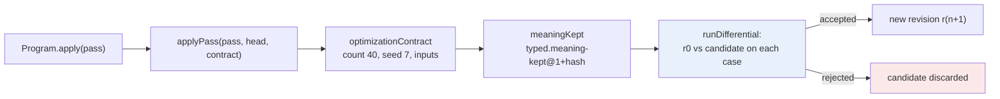
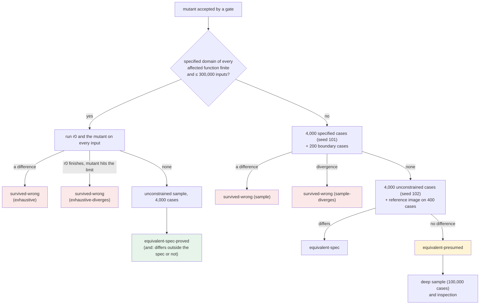
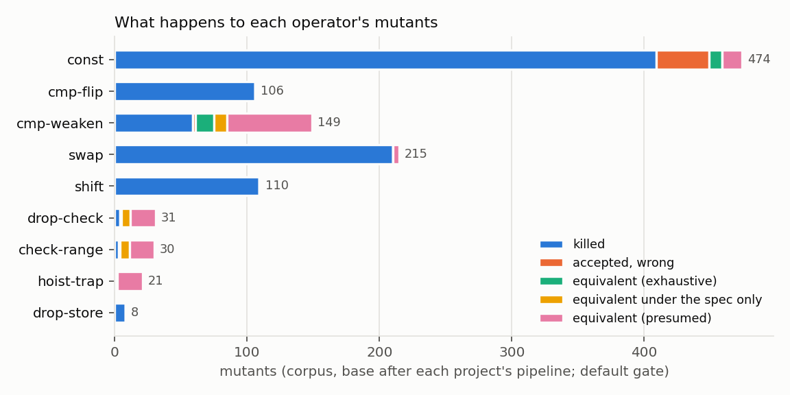
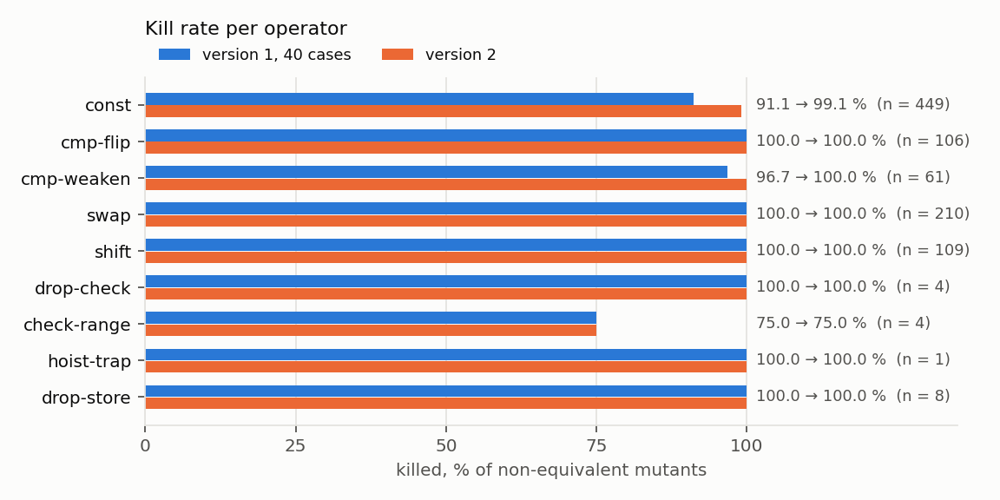
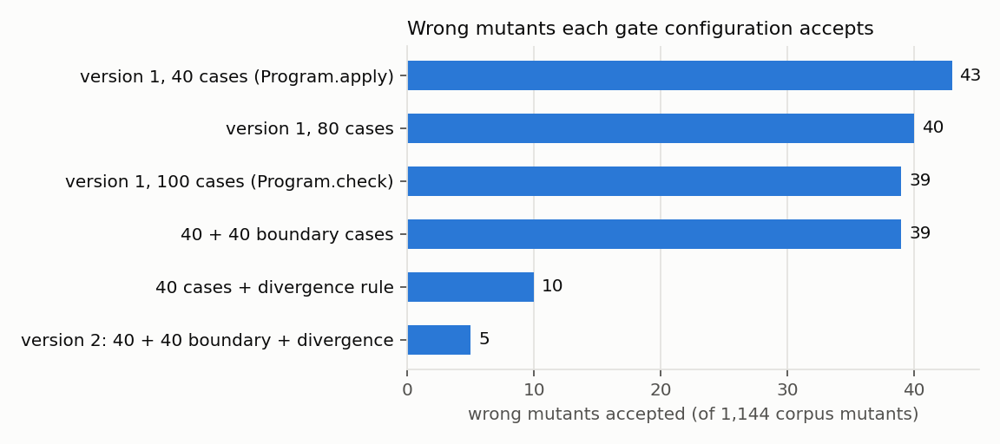
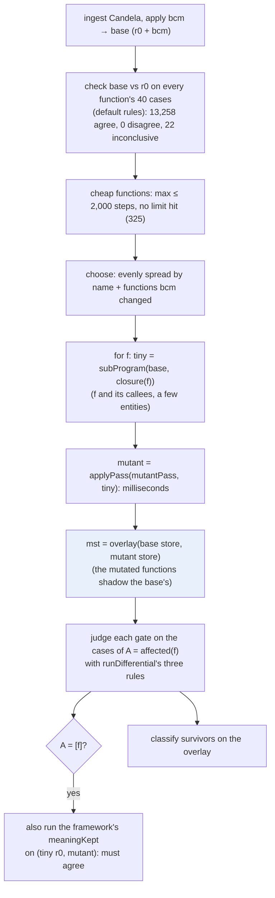
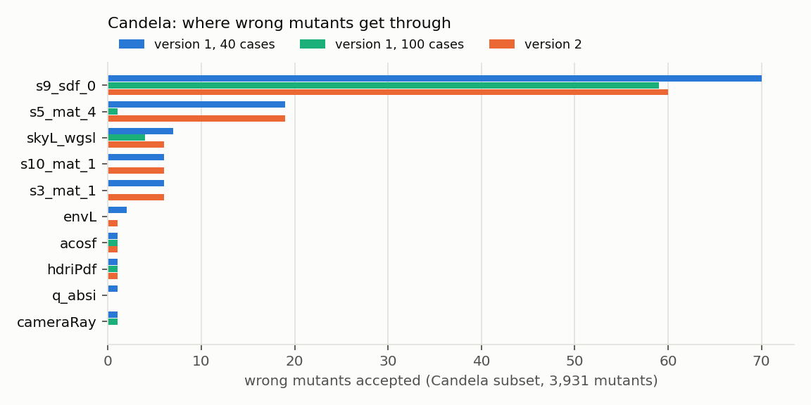

# How strong is the meaning contract

Every optimization the IR Workbench applies passes through one check before it becomes a revision of the program. The check is the *meaning contract*. It runs the original program, r0, and the candidate revision on generated inputs, 40 per function, and accepts the candidate when no input on which both finish gives a different result. The earlier milestones reported that every pass of the O2 pipeline is accepted, on the 44-project corpus and on the 332-function Candela renderer. That is a statement about the passes. This milestone asks the converse question, which is a statement about the check: when a pass is wrong, how often does the contract notice?

The question is answered by mutation testing. A *mutant* is a revision with one deliberately planted bug, of a kind a real pass of this compiler could make: a constant off by one, a comparison weakened, a bounds check dropped. Each mutant is submitted to the gate exactly as a pass's output would be, and the fraction the gate rejects is its *kill rate*. The difficult part is not producing mutants but interpreting the survivors: a mutant can be harmless, and a harmless mutant that survives is not a failure of the gate. Most of the work, and most of this report, is about telling the two apart.

The work was done in the git worktree `.claude/worktrees/agent-a6abc74d4c978a51f` of the repository, on branch `worktree-agent-a6abc74d4c978a51f`, by a subagent that kept a diary (`ttmp/2026/11/25/IRWB-005--…/log/01-gate-strength-diary.md`). The default contract was not changed; everything new is either a measurement or a second, opt-in contract version.

> [!summary]
> - **The default gate rejects between 83.1 % and 95.5 % of the wrong mutants on the corpus.** Of 1,144 mutants planted after each project's pipeline, 192 are equivalent to the original or presumed so and are set aside; of the remaining 952, the gate rejects 909 and accepts 43. The interval's lower end counts the 142 presumed-equivalent mutants as misses; section 9 argues they are equivalent, which puts the rate at the upper end.
> - **Most of what gets through does not terminate.** 33 of the 43 accepted wrong mutants loop where the original finishes. The contract treats a case that hits the step limit as no verdict, so a non-terminating mutant is accepted as soon as one case terminates and agrees. More cases do not fix this: 100 cases still accept 39.
> - **Contract version 2 rejects all but 5.** It adds 40 boundary cases built from the input specification and the program's own constants, lays records out at their declared offsets, and counts a candidate that does not finish within 10× the step limit, where r0 finished, as a disagreement. On correct pipelines it accepts exactly what version 1 accepts, on all 44 projects, at about twice the check cost. Three of the five it misses are clamp comparisons that are wrong at one value of an intermediate result; a search with 100,000 cases per function was needed to find their witnesses.
> - **On Candela the survivors are different.** On an 18-function subset (3,931 mutants), the default gate kills between 87.4 % and 96.8 % of the non-equivalent mutants; the lower end is the safer figure there, because the classifier is known to miss wrong mutants in float code such as `s9_sdf_0` (section 12.2). Nearly every survivor is a float mutant in distance-field or shading code that matters only in a small region of the input space. There, more random cases help more than boundary cases: 100 cases accept 67 wrong mutants and version 2 accepts 100, against 114 for the default.
> - **The default case generator has a layout defect.** It writes a record's fields in the key order of the artifact's tables, not in offset order. On the corpus this changes nothing; on Candela it scrambles the `K` record in the cases of 168 of 332 functions.

## 1. The gate

### 1.1 The path from a pass to a verdict

A pass in the Workbench is applied by `Program.apply` (`src/typed/program.ts:248`). It calls the framework's `applyPass` (`src/framework/passes/define-pass.ts:190`) with a *transformation contract*, `optimizationContract({ inputs, count: 40, seed: 7 })` (`src/typed/passes.ts:221`). That contract carries several invariants (validation, declared writes, preserved facts); the one this report measures is `meaningKept` (`src/typed/evaluate.ts:571`), a *differential* invariant evaluated by `runDifferential` (`src/framework/contracts/differential.ts:102`).



`runDifferential` asks the contract for its cases, runs each case on the *baseline* (r0) and on the *subject* (the candidate), and counts. Three rules decide the verdict:

1. A case on which either side reaches the step limit (20,000 executed statements by default) is *inconclusive*: it counts as neither agreement nor disagreement (`differential.ts:116`).
2. A check in which every case is inconclusive fails, with the reason "no decided case among N (all inconclusive)". A check that has decided nothing has established nothing.
3. On a decided case, `agrees` (`evaluate.ts:538`) compares the outcomes. A trap agrees with any trap. A fault (an evaluator error, such as an access outside the memory image) never agrees. Otherwise the result and the final memory image must be equal.

One disagreeing case rejects the candidate.

### 1.2 The cases

The cases come from `casesFrom` (`evaluate.ts:230`), once per function, from a xorshift32 generator seeded with 7. Each parameter's value follows the project's input specification in `project.json`: `[lo, hi]` for a uniform integer, `{ buffer: [a, b], cell: [c0, c1] }` for a buffer of random length and contents, `{ record: … }`, `{ oneOf: … }`, `{ floats: … }`, and so on. Bounds-lab's `total`, for example, is specified as `{ "a": { "buffer": [0, 24] } }`. A parameter without a specification takes a value from a fixed mixture: 72 % uniform in [−20, 60], 20 % in [−1000, 1000], 5 % from `{0, 1, −1, 2³¹−1, −2³¹, 65535, 65536}`, 3 % from the whole range. For an unspecified f32 parameter, the first ten of the 40 cases sweep a table of float edge values (NaN, ±∞, ±0, 1, −1, the smallest subnormal, the largest finite value, the smallest normal).

The specification matters for what follows. It states which inputs the program is meant to be called with, and the gate only ever tests those. A change that is wrong only for inputs outside the specification is, from the gate's point of view, not wrong at all.

### 1.3 Why the gate's strength is an open question

Forty random cases are a sample. A pass that is wrong on one input in a million is accepted with near certainty. Whether that matters depends on what kinds of bugs passes actually make, and on whether those bugs show up on many inputs or on few. Real pass bugs are too rare in this code base to measure directly; every O2 pass is accepted, and the few bugs found in earlier milestones were found by other means. Mutation testing replaces "real bugs" with a population of planted bugs whose kinds are chosen to resemble them.

## 2. Mutants as revisions

### 2.1 A mutant is a pass

The design decision with the largest consequence is that a mutant is produced by an ordinary pass. `mutantPass` (`src/typed/mutate.ts`) is a typed pass whose parameter is a *site*: an operator, a function, the value or statement to change, and the variant of the change. Applying it through `Program.apply` judges the mutant exactly as the gate judges any pass, through the same contract, the same cases, the same verdict rules. Nothing in the gate knows it is looking at a mutant.

```ts
export const mutantPass: TypedPass = typedPass({
  name: 'mutant',
  writes: ['values', 'stmts', 'locals', 'cfg'],
  preserves: [],
  body({ st, f, tx, params }) {
    if (f.name === params.site.fn) applyMutation(st, f, tx, params.site);
  },
});
```

The alternative, editing the program's store directly and calling the invariant on the result, would test a copy of the gate rather than the gate. A test (`tests/typed/mutate.test.mjs`) checks that both routes give the same verdict on every Blend mutant, so the cheaper direct route (`checkInvariant`) can be used for the further gate configurations.

### 2.2 Where the mutants are planted

The *base* of a project is its pipeline head, the revision after O2 or whatever pipeline the project names. A mutant is the base with one change, and the gate compares it against r0. Planting after the pipeline places the bug where the passes act: in code that has already been folded, simplified and stripped of checks, which is where a pass applied late in a pipeline would make its mistake. Each project's r0 was also used as a second, held-out base (section 10).

A mutation in function `f` can only be observed by cases of functions that execute `f`: `f` itself and its transitive callers. The tool computes this set, `affected(f)`, from the call graph, and the classification below runs only the cases of those functions.

### 2.3 The operators

Ten operators, each modelling a bug a specific pass could make:

| operator | change | models | corpus mutants |
|---|---|---|---:|
| `const` | an integer constant ± 1 | fold, constprop | 474 |
| `cmp-flip` | a comparison negated (`lt` → `ge`) | simplify | 106 |
| `cmp-weaken` | `lt` → `le` or `ltu`, `ge` → `gt` or `geu`, and the reverse signedness | off-by-one bounds, signed/unsigned confusion | 149 |
| `swap` | operands of a non-commutative operator exchanged | a rewrite rule with its sides mixed up | 215 |
| `shift` | shift amount ± 1, or `shr` ↔ `shru` | strength reduction | 110 |
| `drop-check` | a bounds check removed | bce without a proof | 31 |
| `check-range` | a check that admits one position more (`len` → `len + 1`) | bcm merging two checks wrongly | 30 |
| `hoist-trap` | a trapping statement moved above the branch that guards it | licm | 21 |
| `f32` | a float operator swapped (`fadd` → `fsub`, `flt` → `fle`, `ffloor` → `fceil`, …), or a float constant moved by one ulp or by its sign | float rules, float folding | 0 (61 on the f32 fixture) |
| `drop-store` | a store removed | dce treating a store as dead | 8 |

Sites are enumerated in a fixed order, so every count in this report is reproducible. The operators avoid changes that are equivalent by construction: `swap` skips an operator whose two operands are the same tree, and `shift` does not also apply `const` to a shift amount. `hoist-trap` is the most constrained: the moved statement may not read what earlier statements of its block write, may not move past a store if it reads memory, and its local must be dead on the other path. Under those conditions the only possible difference is a trap on the path where the original did not execute the statement.

Every one of the 1,144 corpus mutants is a valid revision (the validation invariants accept it) and differs from its base; none had to be discarded as invalid.

## 3. Equivalent mutants

### 3.1 The problem

A mutant is *equivalent* if it computes the same thing as the original on every input that matters. An equivalent mutant cannot be killed by any gate, and counting it as a survivor would charge the gate for a bug that is not there. In the corpus, equivalence is common, and it is common for structural reasons. Consider Blend's loop after O2:

```text
bb:blend.3   if (t7 >=u load32[work+0]) goto .4 else .7     ; bounds check on work[t7]
bb:blend.4   trap
```

`cmp-weaken` changes the unsigned `>=u` into a signed `>=`. The two differ only when `t7` is negative or the length exceeds 2³¹ − 1. Here `t7 = i`, a loop counter that starts at 0 and only increases while below `n`, and a buffer length is bounded by the memory size. The mutant computes the same result on every input, specified or not. No gate can kill it, and none should.

"Every input that matters" needs a definition. This report uses the input specification: a mutant that agrees with r0 on every specified input is *equivalent under the specification*, and is set aside. The decision is recorded as a deliberate one. It follows the gate's own definition of meaning, which never tests outside the specification, and it means a gate is not charged for changes that the project has declared irrelevant. Mutants that are equivalent under the specification but differ outside it are reported separately, because they are a different kind of information: they show where the specification, not the gate, determines what is accepted.

### 3.2 The classification cascade

Every mutant some gate configuration accepted was classified by `tools/mutation-classify.mjs`, in this order:



- **Exhaustive.** When every parameter's specification is finite and small enough (`finiteDomain`: integer ranges, `oneOf`, bools, fixed buffers), the domain is enumerated and both programs are run on every input, with a step limit of 200,000, ten times the gate's. Equality here is a proof of equivalence under the specification.
- **Divergence.** A mutant that reaches the 200,000-statement limit on an input where r0 finished in at most 20,000 statements (within the gate's own limit) is classified as wrong: it diverges.
- **Sample.** Otherwise, 4,000 specified cases from a different seed (101), plus 200 boundary cases from the version 2 generator (section 7), are compared.
- **Unconstrained.** For mutants that survive the specified inputs, 4,000 cases with no specification (seed 102) are compared. A difference here makes the mutant *equivalent under the specification* with a witness outside it. No difference makes it *presumed equivalent*: likely equivalent on all inputs, but unproved. One exception was added late (section 12.2): for a function with no specification at all, every input is a specified input, so a difference on an unconstrained case makes the mutant wrong. It affects no corpus mutant.
- **Reference.** For sampled subjects, the reference compiler's RV32 image (`referenceCompile`, `referenceRun`) was run on the first 400 sample cases, as an independent check that r0 and the evaluator agree on the inputs the classification relies on.
- **Deep sample and inspection.** The presumed-equivalent mutants were searched again with 100,000 specified cases each, and grouped by operator and site for inspection (section 9).

The kill rate is reported as an interval. Its upper end excludes every equivalent mutant: killed / (killed + survived-wrong). Its lower end counts the presumed-equivalent mutants as misses, as if each were wrong: killed / (killed + survived-wrong + presumed). The truth lies between, and after the inspection of section 9, close to the upper end.

## 4. The default gate on the corpus

The corpus run (`tools/mutation-score.mjs`) planted 1,144 mutants in the pipeline heads of the 44 projects and submitted each to six gate configurations. Under the default gate, the one `Program.apply` uses, the mutants fall into these classes after the whole cascade, including the deep search of section 9:

| class | method | mutants |
|---|---|---:|
| killed | the gate rejected it | 909 |
| wrong, accepted | divergence on the exhaustive domain | 9 |
| | divergence in the sample | 24 |
| | a different result on the exhaustive domain | 1 |
| | a different result in the 4,200-case sample | 6 |
| | a different result in the 100,000-case deep sample | 3 |
| equivalent | proved on the exhaustive domain | 26 |
| | under the specification only (a witness outside it) | 24 |
| | presumed (no witness in 108,200 cases; argued in section 9) | 142 |
| **total** | | **1,144** |

That gives 952 non-equivalent mutants, of which the gate rejects 909 and accepts 43: a kill rate of **95.5 %** at the upper end. Counting the 142 presumed-equivalent mutants as misses gives the lower end, 83.1 %. Section 9 argues that every one of the 142 is in fact equivalent, which puts the true rate at the upper end. Per operator:

| operator | mutants | equivalent | killed | wrong, accepted | kill rate, default | wrong, accepted by version 2 | kill rate, version 2 |
|---|---:|---:|---:|---:|---|---:|---|
| `const` | 474 | 25 | 409 | 40 | 88.1 % .. 91.1 % | 4 | 95.9 % .. 99.1 % |
| `cmp-flip` | 106 | 0 | 106 | 0 | 100 % | 0 | 100 % |
| `cmp-weaken` | 149 | 88 | 59 | 2 | 47.2 % .. 96.7 % | 0 | 48.8 % .. 100 % |
| `swap` | 215 | 5 | 210 | 0 | 97.7 % .. 100 % | 0 | 97.7 % .. 100 % |
| `shift` | 110 | 1 | 109 | 0 | 99.1 % .. 100 % | 0 | 99.1 % .. 100 % |
| `drop-check` | 31 | 27 | 4 | 0 | 17.4 % .. 100 % | 0 | 17.4 % .. 100 % |
| `check-range` | 30 | 26 | 3 | 1 | 13.0 % .. 75.0 % | 1 | 13.0 % .. 75.0 % |
| `hoist-trap` | 21 | 20 | 1 | 0 | 5.0 % .. 100 % | 0 | 5.0 % .. 100 % |
| `drop-store` | 8 | 0 | 8 | 0 | 100 % | 0 | 100 % |
| **total** | **1,144** | **192** | **909** | **43** | **83.1 % .. 95.5 %** | **5** | **86.6 % .. 99.5 %** |

The gate's weakness is concentrated in one operator. 40 of the 43 accepted wrong mutants are `const` mutants, and 30 of those are the same mutant in different loops (section 5). Every other operator except `check-range` is killed completely whenever it is not equivalent.



The figure shows where the equivalent mutants are. `cmp-flip`, `swap`, `shift` and `drop-store` produce almost none: negating a comparison or exchanging the operands of a subtraction changes the result on most inputs. `cmp-weaken`, `drop-check`, `check-range` and `hoist-trap` produce mostly equivalent mutants, because after O2 most of the comparisons and checks they target are bounds checks that can never fire. The O2 pipeline already removed every check its analyses could prove redundant. The ones left either guard a loop whose bound is a separate parameter that the specification keeps within the buffer's length (Blend's `n`), or are redundant for reasons the analyses cannot see (a relation such as `1 ≤ j ≤ i < len` in insertion sort, or a second check on the same index). Removing or widening them changes nothing on any specified input. For 14 of the 53 equivalent `drop-check` and `check-range` mutants, an unconstrained input (for example a loop bound larger than the buffer) shows a difference; for the others no input tried does, and section 9 argues why none can.



Per project, 42 of the 44 projects offer at least one site (`algebra` and `distinct` offer none at their head). The default gate accepts no wrong mutant in 15 of them, and its upper kill rate is lowest in `fixed-point` (84.2 %), `ramp` (88.9 %), `nested-loops` and `licm-nested` (87.5 % and 88.9 %), which are the projects with clamps and with nested loops. Version 2 accepts wrong mutants in only four projects: `bounds-lab`, `fixed-point` (two), `ramp` and `strength`. The whole table is in `various/17-report-tables-deep.md`, generated from the records by `scripts/17-report-tables.mjs`.

> [!note]- Per project (default gate and version 2)
> | project | mutants | equivalent | killed (default) | wrong, accepted (default) | kill rate (default) | wrong, accepted (strong) | kill rate (strong) |
> |---|---:|---:|---:|---:|---|---:|---|
> | across-calls | 5 | 0 | 5 | 0 | 100 % | 0 | 100 % |
> | blend | 24 | 5 | 19 | 0 | 90.5 % .. 100 % | 0 | 90.5 % .. 100 % |
> | bounds-lab | 80 | 13 | 61 | 6 | 77.2 % .. 91.0 % | 1 | 83.5 % .. 98.5 % |
> | bounds-offset | 36 | 8 | 27 | 1 | 75.0 % .. 96.4 % | 0 | 77.8 % .. 100 % |
> | bounds-param | 19 | 3 | 15 | 1 | 83.3 % .. 93.8 % | 0 | 88.9 % .. 100 % |
> | bounds-two | 22 | 3 | 18 | 1 | 81.8 % .. 94.7 % | 0 | 86.4 % .. 100 % |
> | branches | 43 | 3 | 37 | 3 | 92.5 % .. 92.5 % | 0 | 100 % |
> | call-chain | 12 | 0 | 12 | 0 | 100 % | 0 | 100 % |
> | calls | 12 | 2 | 10 | 0 | 83.3 % .. 100 % | 0 | 83.3 % .. 100 % |
> | checksum | 13 | 2 | 10 | 1 | 76.9 % .. 90.9 % | 0 | 84.6 % .. 100 % |
> | collatz | 30 | 4 | 26 | 0 | 100 % | 0 | 100 % |
> | constants | 7 | 1 | 6 | 0 | 85.7 % .. 100 % | 0 | 85.7 % .. 100 % |
> | dead-code | 5 | 0 | 5 | 0 | 100 % | 0 | 100 % |
> | diagnostics | 4 | 0 | 4 | 0 | 100 % | 0 | 100 % |
> | div-checks | 19 | 4 | 15 | 0 | 78.9 % .. 100 % | 0 | 78.9 % .. 100 % |
> | div-magic | 26 | 1 | 23 | 2 | 92.0 % .. 92.0 % | 0 | 100 % |
> | early-exit | 14 | 1 | 12 | 1 | 85.7 % .. 92.3 % | 0 | 92.9 % .. 100 % |
> | first-steps | 5 | 0 | 5 | 0 | 100 % | 0 | 100 % |
> | fixed-point | 23 | 4 | 16 | 3 | 69.6 % .. 84.2 % | 2 | 73.9 % .. 89.5 % |
> | fragments | 24 | 5 | 18 | 1 | 85.7 % .. 94.7 % | 0 | 90.5 % .. 100 % |
> | gcd | 5 | 0 | 5 | 0 | 100 % | 0 | 100 % |
> | heat-lab | 87 | 23 | 63 | 1 | 72.4 % .. 98.4 % | 0 | 73.6 % .. 100 % |
> | histogram | 48 | 13 | 34 | 1 | 70.8 % .. 97.1 % | 0 | 72.9 % .. 100 % |
> | licm-nested | 20 | 2 | 16 | 2 | 88.9 % .. 88.9 % | 0 | 100 % |
> | licm-traps | 11 | 1 | 9 | 1 | 90.0 % .. 90.0 % | 0 | 100 % |
> | match-enum | 32 | 6 | 26 | 0 | 86.7 % .. 100 % | 0 | 86.7 % .. 100 % |
> | my-analysis | 16 | 1 | 14 | 1 | 87.5 % .. 93.3 % | 0 | 93.8 % .. 100 % |
> | my-first-pass | 4 | 0 | 4 | 0 | 100 % | 0 | 100 % |
> | nested-loops | 18 | 2 | 14 | 2 | 87.5 % .. 87.5 % | 0 | 100 % |
> | orders | 36 | 5 | 30 | 1 | 90.9 % .. 96.8 % | 0 | 93.9 % .. 100 % |
> | params-demo | 25 | 4 | 20 | 1 | 90.9 % .. 95.2 % | 0 | 95.5 % .. 100 % |
> | pressure | 6 | 0 | 6 | 0 | 100 % | 0 | 100 % |
> | ramp | 22 | 4 | 16 | 2 | 76.2 % .. 88.9 % | 1 | 81.0 % .. 94.4 % |
> | records | 19 | 4 | 15 | 0 | 78.9 % .. 100 % | 0 | 78.9 % .. 100 % |
> | regalloc-lab | 45 | 5 | 39 | 1 | 92.9 % .. 97.5 % | 0 | 95.2 % .. 100 % |
> | sort | 87 | 23 | 63 | 1 | 72.4 % .. 98.4 % | 0 | 73.6 % .. 100 % |
> | start-here | 55 | 11 | 42 | 2 | 80.8 % .. 95.5 % | 0 | 84.6 % .. 100 % |
> | strength | 33 | 6 | 25 | 2 | 75.8 % .. 92.6 % | 1 | 78.8 % .. 96.3 % |
> | strings | 69 | 13 | 54 | 2 | 91.5 % .. 96.4 % | 0 | 94.9 % .. 100 % |
> | ui-gallery | 33 | 5 | 27 | 1 | 90.0 % .. 96.4 % | 0 | 93.3 % .. 100 % |
> | value-numbering | 23 | 1 | 21 | 1 | 95.5 % .. 95.5 % | 0 | 100 % |
> | wrong-shift | 27 | 4 | 22 | 1 | 81.5 % .. 95.7 % | 0 | 85.2 % .. 100 % |
> | total | 1144 | 192 | 909 | 43 | 83.1 % .. 95.5 % | 5 | 86.6 % .. 99.5 % |

## 5. What gets through: divergence

Of the 43 wrong mutants the default gate accepts, 33 diverge. 30 of them are `const −1` on a loop increment: `i = i + 1` becomes `i = i + 0` (in the two nested-loop projects also `r` and `c`). The loop no longer advances, and on every input where it starts it never ends. The other three are `div-magic.digitsum`'s loop condition and its constant, and `my-analysis.f`'s `b = 0` → `b = −1`, which stops `a = a + b + 1` from growing. The gate's rule 1 makes every such case inconclusive. Rule 2 rejects the check only if *all* cases are inconclusive. A loop over a buffer specified as `{ buffer: [0, 24] }` sees an empty buffer in some of its 40 cases; on those the loop never starts, the mutant finishes, and it agrees with r0. One terminating, agreeing case and 39 inconclusive ones make an accepted check.

The same mechanism makes the verdict non-monotone in the cases. Blend's increment mutant is rejected by the default gate, because its 40 cases all have `n > 0` and all are inconclusive: "no decided case among 40". The first version of the stronger generator added boundary cases, among them two with `n = 0`, and the same mutant was then *accepted*: agree 2, disagree 0, inconclusive 78. Adding cases turned a rejection into an acceptance. This is not a defect of the generator; it is a property of rule 2, which can only reject a check that has decided nothing, and a stronger sample decides more.

Doubling the cases does not help either, for the same reason:



Version 1 with 80 cases accepts 40 wrong mutants and with 100 cases (the count `Program.check` uses) 39. The boundary cases alone (`40 + 40 boundary cases`, divergence rule off) accept 39. A divergence rule alone, on the default 40 cases, accepts 10. Both together accept 5. The kill rate's dependence on the step-limit rule is larger than its dependence on the cases. (Three of the wrong mutants, found only by the deep search of section 9, are accepted by every configuration; they are the difference between these numbers and the 37, 36, 36, 7 and 2 of the measurement before the deep search.)

The divergence rule of version 2 is:

```text
run the subject on case c with limit L
if the subject hit L, and the baseline finished c within L:
    run the subject again with limit 10·L
    if it still has not finished: the case DISAGREES ("got no result within 10x the step limit")
if the baseline hit L: the case stays inconclusive, whatever the subject does
```

A correct pass can make a program slower, so a candidate that needs more steps than r0 is not by itself wrong. The rule only rejects a candidate that needs more than ten times the limit where r0 needed at most the limit. Section 7.4 shows that it rejects no correct pass of any corpus pipeline.

## 6. The wrong mutants that terminate

The other ten wrong mutants accepted by the default gate compute a different value. Seven were found by the classification cascade and are listed here; the remaining three were found only by the deep search and are discussed in section 9. They are the interesting ones, because they show what 40 random cases miss:

| project.function | mutant | wrong on | killed by version 2? |
|---|---|---|---|
| `branches.grade` | `score >= 80` → `score >= 79` | `score = 79` only (spec [40, 100]) | yes: 79 is a program constant − 1 |
| `branches.sign` | `x < 0` → `x < −1` | `x = −1` only | yes: −1 is a boundary value |
| `branches.sign` | `x > 0` → `x > 1` | `x = 1` only | yes |
| `fixed-point.qmul` | `(a·b + 128) >> 8` → `(a·b + 129) >> 8` | `a·b ≡ 127 (mod 256)` | yes: a boundary case happens to hit it |
| `bounds-lab.pairs` | loop exit `i >= len(a)` → `i > len(a)` | `len(b) = len(a)`, or `len(a)` ∈ {6, 14} with `len(b) > len(a)` (see below) | yes |
| `bounds-lab.pairs` | the check on `b[i]` admits `i = len(b)` | `len(a) = len(b) + 1` exactly: r0 traps, the mutant returns | no |
| `strength.meter` | `t3 < 1000` → `t3 < 999` | the running sum equals 999 at some step | no |

The first three are wrong on one input value next to zero or next to one of the program's own constants. A generator that tries the specification's bounds and the constants that appear in the code, each ± 1, finds them. The `qmul` mutant is wrong on one product in 256; 40 cases miss such a mutant with probability (255/256)⁴⁰ ≈ 86 %, and version 2's boundary cases happen to contain one.

The two `bounds-lab.pairs` mutants show how the memory model shapes what is observable. Bce removed the check on `a[i]`, because the loop condition `i < len(a)` dominates it; the check on `b[i]` remains. The first mutant runs the loop once more. If `len(b) = len(a)`, that extra iteration fails the check on `b` and traps where r0 returns. If `len(b) > len(a)`, it reads `a[len(a)]` without a check. Buffers are allocated at 16-byte boundaries, so that read normally lands in the zero padding after `a`'s last cell and adds 0; only when `4 + 2·len(a)` is a multiple of 16 does it read the next item's length word instead. The second mutant admits `b[len(b)]`, which also reads padding; it differs from r0 only when that one extra read is the loop's last, which needs `len(a) = len(b) + 1`. With both lengths uniform in [0, 20], that relation holds for 20 of 441 length pairs, 4.5 % of the specified inputs, and 40 cases miss it with probability 0.955⁴⁰ ≈ 16 %. The default seed is in that 16 %, and version 2's boundary cases, which vary the two lengths independently, do not produce the relation either; the classifier's sample found a witness at its second case.

`strength.meter` is different in kind. O2 has turned `Math.min(level + c, 1000)` into a branch, and the mutant changes the branch's constant but not the clamp value it assigns, so the result differs only when the running sum is exactly 999 at some step. That is a condition on an intermediate value of a loop, not on any input; the classifier found a witness at case 3,333 of 4,200. Neither boundary values of single inputs nor coverage of branches reaches it: both branches of `t3 < 1000` are covered by the default cases already.

## 7. Contract version 2

### 7.1 What it changes

Version 2 (`meaningKeptStrong` in `src/typed/cases-strong.ts`) has the same invariant id, `typed.meaning-kept`, and a version string `2+hash(key)`, so evidence produced under it can never be confused with version 1's. It is opt-in, through `strongOptimizationContract(params)`; nothing in the pipeline uses it by default. It differs from version 1 in three ways.

**Boundary cases.** After the default 40 cases (identical byte for byte to version 1's), it appends `extra` = 40 cases built from per-parameter *pools*:

- for a `[lo, hi]` integer: lo, lo + 1, hi − 1, hi; every integer constant of the function, and the constant ± 1; and the special values 0, ±1, ±2, the i32 extremes and their neighbours, 127, 128, −128, 255, 256, 65535, 65536 and the powers of two 2ᵏ, 2ᵏ − 1 and −2ᵏ; each kept only if it lies in [lo, hi];
- for a buffer `[a, b]`: lengths a, a + 1, b − 1, b and the program's constants ± 1 that lie in [a, b], each with six cell patterns (all at the cell minimum, all at the maximum, ascending, descending, alternating minimum and maximum, the program's constants in turn);
- for an unspecified i32: the same as an integer range over all of i32;
- for f32: the default edge table and 13 further bit patterns (a negative quiet NaN, a signalling NaN, the largest subnormal, the neighbours of 1, the most negative finite value, 2²³, the largest value below 0.5, 1.5, 2.5, −0.5, −2³¹, 2³²);
- records field by field, at their offsets.

Case j gives parameter i the value `pool_i[(j + 3i) mod |pool_i|]`. The stride of 3 makes different parameters' boundaries meet in different combinations instead of always pairing the first with the first.

**Records at their offsets.** See section 12.3.

**The divergence rule** of section 5.

```text
strongCasesFrom(st, f, { count: 40, extra: 40, seed: 7, inputs }):
    gst   = offsetOrdered(st)                  # record tables in offset order
    cases = casesFrom(gst, f, { count, seed, inputs })      # = version 1's cases (corpus)
    pools = [pool(spec_i, type_i, tables, constantsOf(st, f)) for each parameter i]
    for j in 0 .. extra-1:
        cases.append(case with arg_i = pools[i][(j + 3i) mod |pools[i]|])
    return cases
```

A coverage-guided variant (`coverage: true`) instead chooses the extra cases greedily, from 4·extra boundary and 4·extra random candidates, to cover statements the default cases miss. On the corpus it kills exactly what the fixed scheme kills, because the default cases already reach every reachable block (section 7.3).

### 7.2 What it kills

Of the 43 wrong mutants the default gate accepts on the corpus, version 2 rejects 38, and it rejects every mutant the default rejects; no kill is lost. The 38 divide by mechanism:

| mechanism | mutants | examples |
|---|---:|---|
| the divergence rule | 33 | the 30 loop increments; `div-magic.digitsum` twice; `my-analysis.f`'s `b = −1` |
| a boundary value of one input | 3 | `branches.grade` at 79; `branches.sign` at −1 and at 1 |
| a boundary case that happens to hit a narrow condition | 2 | `fixed-point.qmul`'s rounding constant; `bounds-lab.pairs`'s loop exit `i > len(a)` |

The five it accepts are `bounds-lab.pairs`'s check on `b[i]` (wrong only when `len(a) = len(b) + 1`), `strength.meter`'s `t3 < 999`, and the three clamp comparisons of section 9. The kill rate rises from 95.5 % to 99.5 % at the upper end and from 83.1 % to 86.6 % at the lower; per operator, `const` rises from 91.1 % to 99.1 % and `cmp-weaken` from 96.7 % to 100 %.

The boundary cases without the divergence rule are a weak gate. They accept 39 wrong mutants, and they also *lose* one kill: Blend's increment mutant, which the default rejects for "no decided case" and the boundary cases turn into an acceptance (section 5). Version 2 needs both parts. On the held-out base (section 10) and on the f32 fixture (section 11) version 2 accepts 1 and 0 wrong mutants. On Candela (section 12) it helps less: 100 accepted against 114.

### 7.3 Coverage

The coverage measurement explains why the boundary cases help: not by reaching more code. Of r0's 433 basic blocks across the corpus, the default 40 cases execute 392, and so do 100 default cases, version 2's 80, and the coverage-guided variant. The 41 blocks no case set reaches are the trap blocks of bounds checks the specifications never violate and two dead blocks of `dead-code.pick`. Version 2 kills more by choosing values that sit on the edges of comparisons, inside code the default cases already execute.

### 7.4 Cost, and acceptance of correct pipelines

Version 2 was run as the contract of every corpus pipeline. It accepts exactly the passes version 1 accepts and ends at identical head revisions, on all 44 projects (`differs: []`). The divergence rule rejects no correct pass. Whole pipelines take the same time under both (v1 28.6 s, v2 26.7 s for all 44, within noise), because a check is a small part of a pass application on the corpus.

Measured alone, one check of every project's head against r0, in the steady state:

| configuration | cases (all projects) | ms per check of all heads | µs per case |
|---|---:|---:|---:|
| version 1, 40 cases | 2,800 | 560 | 200 |
| version 1, 80 cases | 5,600 | 1,215 | 217 |
| version 1, 100 cases | 7,000 | 1,507 | 215 |
| version 2, 40 + 40 | 5,600 | 1,139 | 203 |
| version 2 without the divergence rule | 5,600 | 953 | 170 |
| version 2, coverage-guided | 5,600 | 1,090 | 195 |

The cost is linear in the cases: version 2 costs what 80 default cases cost, about twice the default, and kills 38 of the 43 mutants the default lets through, where 80 default cases kill 3 of them. The first measurement showed version 2 at 1,977 ms; the cause was a defect in the divergence rule's first implementation, which re-ran the subject at ten times the limit also where r0 itself had hit the limit, on cases that are no verdict anyway. The fix records per case whether the origin finished: `runDifferential` runs a case's baseline before its subject, so the baseline's `run` writes a `WeakMap<Case, boolean>` that the subject's `run` reads. Verdicts cannot change; only the wasted re-runs disappear.

## 8. What version 2 still misses

Every wrong mutant that survives version 2, on either base and after the deep search of section 9, belongs to one of two classes. Both are wrong on a small set of inputs that no per-parameter boundary describes.

| class | examples | what is needed to reach it | what would catch it |
|---|---|---|---|
| **A relation between inputs** | `bounds-lab.pairs`: the check on `b[i]` admits `i = len(b)`; wrong exactly when `len(a) = len(b) + 1` | two parameters in a fixed arithmetic relation | boundary pools over *differences* of same-typed parameters (`len(a) − len(b) ∈ {−1, 0, 1}`), or simply more random cases: the relation holds for 4.5 % of specified inputs, so 100 random cases miss it with probability 1 % |
| **A single value of an intermediate result** | `strength.meter`: `t3 < 1000` → `t3 < 999`, wrong when a running sum is exactly 999; `fixed-point.qmul`: `t5 < 32767` → `t5 < 32766` and `−32768 < t4` → `−32767 < t4`, wrong when the rounded product is exactly 32,766 or −32,767; `ramp`: `v < 65535` → `v < 65534`, wrong when `i · step = 65,534` | a computed quantity equal to one specific value | search on the comparison: run a case, measure the distance of the comparison's operands from the boundary (here `|t3 − 999|`), and change the inputs to reduce it; the `observe` hook added for C5 exposes the operands |

The second class deserves its name because it is invisible to every input-side measure used here. The branch `t3 < 1000` is covered by the default cases on both sides, so coverage guidance adds nothing; the boundary of each input is tried by version 2, and the input boundaries say nothing about the sum. It is also the class a real pass bug is likely to fall into whenever a pass rewrites a clamp or a saturating operation, which is common in this corpus (fixed-point arithmetic, 16-bit ramps, meters).

Mutants that are equivalent under the specification but differ outside it (24 on the head, 30 on r0, plus 13 of the exhaustively proved ones) are not in this table. They are not misses of the gate: the project's specification declares those inputs irrelevant. What would "catch" them is a wider specification, and whether that is wanted is a property of each project, not of the contract.

## 9. The presumed-equivalent mutants

The cascade left 145 mutants as *presumed equivalent*: no difference on 4,200 specified and 4,000 unconstrained cases. A presumption is not a classification, and the lower end of the kill rate counts every one of them as a miss. Two things were done to resolve them. First, each was searched again with up to 100,000 specified cases per affected function (`scripts/10-deep-presumed.mjs`, seeds 1001 onwards, stopping at the first witness). Second, they were grouped by operator and site (`scripts/09-equivalents-by-group.mjs`) and each group was inspected in the O2 listing (`scripts/15-show-mutant.mjs`). The deep search covered 169 mutants, the 145 presumed equivalent and, for completeness, the 24 equivalent under the specification only, and took 33 minutes. It found a witness for 3 of them. The inspection, written before the search had finished, had argued that exactly these 3 are wrong and that the others are equivalent (last row of the table below), and the search agrees with it on all 169. The other 142 presumed-equivalent mutants each now have no difference on 108,200 cases per affected function, and an argument for why none exists.

The groups, with the reason each is equivalent:

| group | mutants | why it computes the same thing |
|---|---:|---|
| `cmp-weaken`: `>=u` → `>=` on a bounds check | 30 | The index is a loop counter that starts at 0 or 1 and only grows, so it is never negative; a buffer length is below 2³¹. Signed and unsigned comparison agree on every input. |
| `cmp-weaken`: `>` → `>=` in `start-here.peak` | 1 | `if (x >= best) best = x` assigns the same value when `x = best`. |
| `hoist-trap`: a `load16` moved above its own bounds check | 19 | Where the check passes, both versions execute the same load. Where it fails, r0 traps at the check; the mutant first executes the load, which in these loops reads at most a few cells past the buffer, and then traps at the same check. A trap agrees with any trap. (An index far enough out to leave the memory image would fault, and a fault never agrees; no specified or unconstrained case produced one.) |
| `drop-check` and `check-range` on a branch check | 19 + 19 | Each of these checks is implied by the loop's own condition, directly or through a relation the interval analysis cannot express (in insertion sort, `1 ≤ j ≤ i < len`), or another check on the same index remains and traps at the same point (`histogram` checks `bins[k]` three times). The check never decides anything. |
| `cmp-weaken`: `i >= len` → `i >=u len` on a loop exit, `c >= 48` → `c >=u 48` on a 16-bit cell | 15 | Neither operand is ever negative. |
| `cmp-weaken`: `<` → `<=` in a min, max or clamp | 15 | When the two operands are equal, both arms produce the same value. |
| `cmp-weaken`: signed → unsigned on `histogram`'s and `strength.meter`'s comparisons, `wrong-shift`'s loop exit | 3 | The operands are counts and sums of unsigned cells, never negative. |
| `shift`: `level >> 2` → `level >>> 2` | 1 | `level` is clamped to [0, 1000]. |
| `swap`: `p.x − q.x` → `q.x − p.x` under an absolute value; `b − 14` with `b = 14` | 5 | \|d\| = \|−d\|, also for −2³¹, which negates to itself; and 14 − 14 = 0. |
| `const −1`: a loop start `i = 0` → `i = −1` where bce removed the check | 5 | The first iteration reads `buf[−1]`, which is the upper half of the buffer's 32-bit length word: 0 for any buffer shorter than 65,536 cells. A 0 added to a sum, compared with a maximum, or tested as a digit changes nothing. |
| `const −1`: insertion sort's `i = 1` → `i = 0` | 2 | The extra first iteration has `j = 0`, and `while (j > 0 && …)` does nothing. |
| `const ± 1` on a clamp's comparison, toward the clamp value | 6 | `if (t < 10) t else 10` and `if (t < 11) t else 10` agree: at `t = 10` both give 10. The same holds for `1 < t`, `t < 32767`, `−32768 < t`, `t < 1000` and `t < 65535`, each moved by one toward its clamp value. |
| `const +1`: `s = 0` → `s = 1` in `start-here.smooth` | 1 | `s` is a sum of terms `cell · (4·gain + 16)`, a multiple of 4, so `s + 1` never crosses a multiple of 16 and `(s + 1) / 16 = s / 16` for `s ≥ 0`; negative sums are clamped to 0 either way. |
| `const +1`: `b = 0` → `b = 1` in `my-analysis.f` | 1 | On the path where `b` survives, `a` starts at `2x`, which is even, and the loop adds `b + 1` until `a ≥ 100`. Steps of 1 and steps of 2 from an even start both stop at exactly 100. |
| `const ± 1` on a clamp's comparison, away from the clamp value | 3 | **Not equivalent.** `qmul`'s `t5 < 32767` → `t5 < 32766` returns 32767 instead of 32766 when `(a·b + 128) >> 8` is exactly 32766; `−32768 < t4` → `−32767 < t4` is wrong at exactly −32767; `ramp`'s `v < 65535` → `v < 65534` is wrong only when `i · step = 65534`, which with `step ≤ 9000` and at most 16 cells needs `step = 4681` and at least 15 cells. |

The last row is the important result of the inspection: three of the 145 are wrong, and they belong to the same class as `strength.meter`'s survivor. When O2 turns `Math.min(x, K)` into a branch, the comparison constant and the assigned clamp value become separate constants. A `const` mutant of the comparison that moves it away from the clamp value is wrong at exactly one value of an intermediate result. A random input reaches that value with probability on the order of 10⁻⁵, and no boundary on any input targets it.

The three witnesses (the deep search draws chunks of 10,000 cases with seeds 1001, 1002, …):

| mutant | witness | r0 | mutant | cases searched |
|---|---|---|---|---:|
| `qmul`: `t5 < 32767` → `t5 < 32766` | a = −3442, b = −2437: a·b = 8,388,154, rounded product 32,766 | 32,766 | 32,767 | 35,491 |
| `qmul`: `−32768 < t4` → `−32767 < t4` | a = −2095, b = 4004: a·b = −8,388,380, rounded product −32,767 | −32,767 | −32,768 | 43,068 |
| `ramp`: `v < 65535` → `v < 65534` | step = 4681 with at least 15 cells: cell 14 holds 14 · 4681 = 65,534 | cell 14 = 65,534 | cell 14 = 65,535 (same return value, 74,896) | 34,603 |

Each needed more than 34,000 random cases, which agrees with the probabilities: `step = 4681` has probability 1/9,001 under the specification and a buffer of 15 or 16 cells 2/17, about 1.3 · 10⁻⁵ together; a product of two numbers from [−4096, 4096] rounds to exactly 32,766 with probability about 10⁻⁵ as well (about 700 of the 67 million pairs). Version 2's pools are built from the program's constants too, but 32,766 and 32,767 lie outside the input ranges and are dropped, and even inside them they would be values of an input, not of the rounded product. These three mutants, with `strength.meter`'s and `bounds-lab.pairs`'s, are the complete list of wrong mutants version 2 accepts on the corpus.

## 10. A held-out base: r0

The choice of the pipeline head as the base is a design decision, and a kill rate that depended on it would describe the decision rather than the gate. The whole measurement was therefore repeated with every project's r0 as the base: the program as lifted from the source, before any pass.

| base | mutants | equivalent | wrong, accepted by default | default kill rate | wrong, accepted by version 2 | version 2 kill rate |
|---|---:|---:|---:|---|---:|---|
| pipeline head, before the deep search | 1,144 | 195 | 40 | 83.1 % .. 95.8 % | 2 | 86.6 % .. 99.8 % |
| r0, before the deep search | 1,231 | 221 | 38 | 83.1 % .. 96.2 % | 1 | 86.2 % .. 99.9 % |
| pipeline head, after the deep search | 1,144 | 192 | 43 | 83.1 % .. 95.5 % | 5 | 86.6 % .. 99.5 % |

The deep search of section 9 was run on the head only, so the comparison between the bases uses the first two rows. At r0 the clamps of `qmul` and `ramp` are still calls to `Math.min` and `Math.max` with one constant each. A `const` mutant of that constant moves the clamp value itself, and the default gate kills all six such mutants at r0. The class the deep search found on the head therefore does not exist at r0: it is created by O2, which turns each call into a comparison and an assignment with two separate copies of the constant.

The two bases agree within half a point, and the survivors fall into the same two groups. At r0, 33 of the 38 accepted wrong mutants diverge (30 loop increments, `div-magic.digitsum`'s `v > 0` → `v >= 0` and `0` → `−1`, which never leave `while (v > 0) v = v / 10` once `v` is 0, and `my-analysis.f`'s `b = 0` → `b = −1`, which stops `a = a + b + 1` from growing). The other five are single-value boundary mutants: `branches.sign` twice, `branches.grade`, `fixed-point.qmul`'s rounding constant, and `bounds-lab.pairs`'s check on `b`. Only the last survives version 2.

The site mix differs where O2 changes the code's shape. At r0, bounds checks are still checked-address expressions (`caddr`), so `hoist-trap` finds 2 sites instead of 21, while `drop-check` and `check-range` find 43 and 42. `strength.meter`'s `Math.min(level + c, 1000)` has not yet been turned into the branch whose constant survives version 2 on the head, so that survivor does not exist at r0.

## 11. Floats

The corpus is integer only, so the `f32` operator has no site there. The f32 fixture (`tests/typed/f32-fixture.mjs`, five functions, base r4) has 61 sites: 33 float mutants (operator swaps, constants moved by one ulp or by the sign bit), 20 `const`, 5 `swap`, 2 `cmp-weaken`, 1 `cmp-flip`. The default gate kills every non-equivalent float mutant, 32 of 32. One float mutant is equivalent: `floorConst`'s constant `2.5f` moved by one ulp, which `floor` maps to 2 either way (proved on the exhaustive domain). The two wrong mutants the default accepts are the integer loop mutants of `scale`, and both diverge: the increment, and `i >= n` made unsigned, which never exits the loop when `n` is negative. Version 2 and the divergence rule alone kill both, for 100 %.

The float mutants die easily, most likely because of how the default generator treats unspecified f32 parameters: the first ten cases sweep NaN, ±∞, ±0, 1, −1 and the extremes of the format, and each of the planted float changes is wrong on at least one of them. The fixture's functions are short and every float operation in them reaches the result on most inputs. Candela (section 12) shows the other side: in a renderer's distance and shading functions, the float mutants are most of what survives.

### 11.1 Rewrites that are wrong only on NaN payloads

The planted float changes are operator swaps and constant changes. A different kind of float error was found by the parallel milestone on rewrite rules (IRWB-006) and relayed to this one: the rule `x + (−0) → x`. In IEEE arithmetic, adding −0 returns `x` for every value except NaN. In the evaluator, as on the RV32F target it models, every float operation that produces a NaN produces the *canonical* NaN, 0x7fc00000. So `x + (−0)` turns a NaN with any other payload, such as 0x7fc00001, the negative quiet NaN 0xffc00000 or the signalling NaN 0x7fa00000, into 0x7fc00000, while the rewritten program returns `x` unchanged. The rule is wrong exactly on non-canonical NaNs.

The default generator's edge table contains one NaN, the canonical one, and adding −0 to it returns it unchanged. The rewrite was applied as a pass to a two-function program and judged by both versions (`scripts/19-nan-payload.mjs`, and a test in `tests/typed/mutate.test.mjs`):

| function | the rewrite | version 1 | version 2 | on 0x7fc00001 |
|---|---|---|---|---|
| `addNegZero(x) = x + (−0)` | `x` | accepted, 80/80 | **rejected**, 2 of 160 cases disagree | r0 0x7fc00000, rewrite 0x7fc00001 |
| `scaled(x, k) = (x · k) + (−0)` | `x · k` | accepted | accepted | both 0x7fc00000 |

Version 2 rejects the first because its f32 pool already contains two non-canonical NaNs (the negative quiet NaN and a signalling NaN). The second rewrite is not an error at all: its operand is computed, and a computed NaN is always canonical, so both versions are right to accept it. The class is therefore narrow and precise: a float rewrite that removes an operation applied directly to an input or a loaded value, on a parameter whose specification admits NaN.

## 12. Candela

### 12.1 Mutating a 332-function program

The corpus harness builds each mutant with `applyPass(mutantPass, base)`, which hashes and freezes a complete revision. On Candela that costs about 30 seconds per mutant, independent of how small the change is, because the framework's canonical encoding runs over the whole program (the Candela milestone measured the same cost per pass). A thousand mutants would take eight hours before a single case ran. The Candela tool (`tools/mutation-score-candela.mjs`) therefore works on small sub-programs and replicates the gate's rules exactly:



The argument that this is the gate's verdict: the base agrees with r0 on all its decided cases, so a mutant of `f` can change only the cases of functions that execute `f`, which is `A = affected(f)`. Every other function's cases run unchanged code and agree as before, and Candela has thousands of decided cases outside `A`, so rule 2 ("no decided case") can never be what decides the verdict. The replicated judgement is therefore exactly the full gate's. `overlay(base, part)` is a store view made with `Object.create(base)` whose function table and entity lookup prefer the mutated sub-program's entries, so evaluation sees the whole base with `f` replaced, without copying 235,000 records. For functions nothing calls, the framework's own `meaningKept` (with `roots: [f]`) is run on the small revisions as well, and its verdict is compared with the replicated one.

Classification on Candela is bounded: the mutated function's own cases in full (400 sampled, 200 boundary, 400 unconstrained), its callers' at 100 + 40 + 100, a step limit of 20,000 (the gate's own) with a mutant re-run at ten times that limit where r0 finished, so that a mutant counts as divergent under the same 200,000-statement rule as on the corpus. Each function has a time budget (600 s); sites left when it is spent are counted as skipped, not judged.

### 12.2 Results

The subset is 18 functions: 14 cheap ones (at most 2,000 statements per gate case, no step-limit hit) spread evenly over the alphabetical list, and the 4 cheap ones the bcm pass changed. The run was cut off by a machine failure after 14 functions; the other four were run again under a 14 GB memory cap with the same selection, and the parts were combined. In total 3,931 mutants were judged, none invalid, and 1,395 sites were left unjudged by the budget (most of them in `cdlInit`, a single block of 514 statements with 3,332 sites).

| gate | killed | wrong, accepted | equivalent | kill rate |
|---|---:|---:|---:|---|
| version 1, 40 cases | 3,429 | 114 | 388 | 87.4 % .. 96.8 % |
| version 1, 100 cases | 3,477 | 67 | 387 | 88.7 % .. 98.1 % |
| version 2 | 3,443 | 100 | 388 | 87.8 % .. 97.2 % |
| 40 cases + divergence rule (records at their offsets) | 3,430 | 113 | 388 | 87.5 % .. 96.8 % |



Candela's survivors are a different population from the corpus's. None diverges, and nearly all are float mutants: a sign flipped on a constant, `fmul` turned into `fdiv`, a coefficient one ulp off, `fmin` and `fmax` exchanged. They sit in shading and distance-field code. `s9_sdf_0` alone accounts for 70 (the default gate kills 37 of its 107 non-equivalent mutants, 34.6 %), the material functions `s5_mat_4`, `s10_mat_1` and `s3_mat_1` for 31, the sky lookup `skyL_wgsl` for 7; every other selected function is at 97.6 % or more. What these have in common is that the mutated expression matters only in a region of the input space: a term of a distance function only for points near the surface it describes, a lobe of a material only for some parameter values. The 40 random points of the default cases mostly fall outside that region; the classifier's 1,000 cases per function, or 60 more random cases, fall inside it often enough. That is why 100 random cases help more here (67 accepted) than version 2's boundary values do (100): the boundaries of a float range are not where a distance function is interesting.

These numbers include a correction to the classification. Twelve mutants were killed by the 100-case gate alone while the classifier called them equivalent. Eleven of them are in the material functions, where the 100-case gate had found, at its 62nd or 82nd case, a disagreement the classifier's sample had missed. The material functions take only f32 parameters and have no specification at all, so that case is a specified one and these eleven mutants are wrong. The twelfth is in `skyL_wgsl`, which takes the `K` record; version 1 lays that record out in key order (section 12.3), so its killing case may lie outside the specification, and it stays equivalent. The same reasoning exposed a second error: for a function with no specification, the classifier's "unconstrained" witness is also a specified witness. Applying both rules (`scripts/22-candela-summary.mjs`, and the second rule now also in the classifier itself) moved 29 Candela mutants from equivalent to wrong, 11 by the first and 18 by the second. No corpus mutant is affected: every corpus `equivalent-spec` mutant belongs to a specified function, and no corpus mutant killed by one gate was classified equivalent.

The replicated gate was cross-checked against the framework's own `meaningKept` on every mutant of the three selected functions that nothing calls (`q_absi`, `cdlInit`, `cdlLayout`): 2,289 mutants, no difference in verdict. The resumed part ran at a peak of 9.97 GB resident, under the cap.

A follow-up run asked which kind of extra case helps on the two functions where the default gate is weakest. It took `s9_sdf_0` and `s10_mat_1`, gave each a longer time budget (900 s, so 207 of `s9_sdf_0`'s 224 sites were judged instead of 140), and compared four gates: the default, version 1 with 400 cases, version 2, and version 2 with its 40 extra cases chosen for coverage.

| gate | killed | wrong, accepted | kill rate (323 mutants, 81 equivalent) | gate time |
|---|---:|---:|---|---:|
| version 1, 40 cases | 110 | 132 | 34.1 % .. 45.5 % | 91 s |
| version 1, 400 cases | 180 | 62 | 55.7 % .. 74.4 % | 508 s |
| version 2 | 120 | 122 | 37.2 % .. 49.6 % | 140 s |
| version 2, coverage-chosen extra cases | 121 | 121 | 37.5 % .. 50.0 % | 203 s |

On `s10_mat_1` the 400-case gate kills all 76 non-equivalent mutants, against 70 or 71 for the other three. On `s9_sdf_0` it kills 104 of 166, against 40 for the default and 50 for both forms of version 2. Coverage guidance adds one kill.

The source explains why. `s9_sdf_0` is the distance function of a Menger sponge: a box of half-size 0.6, from which crosses are cut at three scales, each cut combined with `max`. For a point outside the box the box's own distance is the maximum, and the crosses do not affect the result. A mutant in a cross term is therefore observable only at points inside or near the box. An unspecified f32 parameter is drawn 55 % from [−4, 4], 20 % from [−1000, 1000], 15 % from [0, 1] and the rest from edge values and raw bit patterns, so each coordinate falls in [−0.6, 0.6] with probability about 0.2, and fewer than 1 % of the points lie inside the box. The 40 default cases contain on average 0.3 such points, and the 400-case gate about 3. Version 2's float pool consists of special bit patterns (NaNs, infinities, extremes, the neighbours of 1), not of points in the region that matters, and every code block of the function is executed by the default cases already, so coverage gives the greedy selection nothing to aim for.

This measurement also exposed the classifier's limit on such code. In 20 of the follow-up's mutants the 400-case gate found a disagreement that the classifier's 1,000 cases had missed, and they were reclassified as wrong by the rule above. The 41 presumed-equivalent mutants of `s9_sdf_0` probably still contain wrong ones, so for this function the lower end of the interval is the better estimate.

### 12.3 The record-layout defect

The Candela tool's first run checked its base (r0 plus the bcm pass) against r0 on every function's 40 gate cases and reported 22 inconclusive cases. A census of the same functions, generated from the ingest store, had counted 101. The difference led to a defect in the frozen default generator.

`makeValue` builds a record argument by iterating over the record's field table and writing one word per field, in table order (`evaluate.ts:163–168`). It ignores each field's declared `offset`. The front end produces tables in declaration order, which is offset order, so cases generated from the front end's store are laid out correctly. But the gate generates its cases from the origin *artifact* (`casesFrom(storeOf(origin.value), …)` inside `meaningKept`), and an artifact is frozen canonical JSON whose object keys are sorted. For Candela's `K` record, declared `bU bO bL bB bS etab sky scene spectral …`, the artifact's table order is `bB bL bO bS bU etab gBary__x gBary__y …`, so the word at offset 28, the scene index, receives the random bits generated for the f32 field `gBary__y`. In the first three gate cases of `rnd(K)`, `scene` is 6, 9 and 13 when generated from the ingest store, and 1,054,236,423, 1,063,981,055 and 1,051,074,687 when generated from the artifact.

Measured over all of Candela: the cases of 168 of 332 functions (every function with a `K` parameter) differ between the two stores; the other 164 are identical. The corpus is unaffected: its two record types, `Point` in `match-enum` and `records`, both have fields `{x, y}`, whose key order is their offset order.

The consequence for earlier results is limited but real. Every Candela check made through `meaningKept`, including the O2 checks of the Candela milestone, was made on cases whose `K` fields do not follow `kSpec`. Agreement on those cases is still agreement, so no earlier "accepted" becomes false; but the inputs tested are not the inputs the specification describes, and the scene, spectral and sky switches took values no real call takes. The oracle comparison tool (`tools/candela-oracle.mjs`) generates from the ingest store and is not affected.

The default is frozen, so it was not changed. Version 2 corrects it: `offsetOrdered(st)` is a view of the store, made with `Object.create(st)`, whose `frontEnd` has record tables re-ordered by offset. A view rather than a copy matters at Candela's size (235,000 records), and it works because `casesFrom` reads only `st.fn(name)` and `st.frontEnd`. Generated through that view, version 2's first 40 cases equal the front-end-store cases on all 332 functions.

## 13. Testing the facts themselves

The gate checks what a pass produces. Some passes also depend on what an analysis *claims*: bce removes a check `i >=u len` when a dominating branch proved `i < len` and `typed.ranges` proves `i ≥ 0`; strength reduction turns `x / 2ᵏ` into a shift when `typed.ranges` proves `x` is not negative. If the analysis were wrong, the pass would be wrong in exactly the way the gate is weakest at seeing: on the few inputs where the claim fails. The optional item C5 checks the facts directly against executions.

`typed.ranges` claims, for each statement and each i32 local, an interval the local's value lies in just before the statement, on every execution. `rangesHold` (`src/typed/facts-check.ts`) runs cases on the evaluator with a new `observe` option, a callback invoked before each executed statement with the frame's locals, and checks every claim that says something (an interval narrower than the whole i32 range) at every executed statement:

```ts
evaluate(st, c.fn, c.args, c.memory, {
  limit: 2e4,
  observe(fn, sid, locals) {
    for (const l of intLocals(fn)) {
      const [lo, hi] = rangeView(facts, st, fn).at(sid, l);
      if (lo === MIN && hi === MAX) continue;          // the claim says nothing
      if (locals[l] < lo || locals[l] > hi) report({ fn, stmt: sid, local: l, value: locals[l], range: [lo, hi] });
    }
  },
});
```

The analysis is meant to hold for every input, not only the specified ones, so unconstrained cases are as valid a test as specified ones; each function was run on 400 of each, at every revision of its project's pipeline. A checker that never fires proves little on its own, so its sensitivity was measured the way the gate's was, by planting faults: at r0, every finite interval at a block entry was narrowed by one, at its lower end and separately at its upper end, and the narrowed claim was checked at the block's first statement on the same cases.

| measurement | result |
|---|---|
| projects, revisions | 44, 168 (every revision of every pipeline) |
| case runs | 220,800 |
| claim checks (a claim at an executed statement) | 149,381,636 |
| distinct claims exercised | 12,888 |
| violations | **0** |
| narrowed facts planted at r0 | 2,456 |
| reported | 1,185 (lower ends 936 of 1,228, upper ends 249 of 1,228) |

No range fact of any revision is contradicted by any case, specified or not. The planted facts need a careful reading. A narrowed fact `[lo, hi − 1]` is false on the cases only if some execution actually reaches `hi`. When the original bound is never attained, the narrowed fact is still true on every run, and no checker could report it. That is what happened to the 1,271 unreported ones: most are upper bounds of loop counters and indices claimed as 2³¹ − 1 or 2³¹ − 2, where the real values never exceed a buffer's length, or 65,535 for a 16-bit load whose cells the specification keeps below 256. The experiment therefore shows two things: the checker reports a wrong fact whenever the cases contradict it, and the analysis is sound but loose, with 48 % of its finite block-entry bounds attained on real executions (76 % of lower bounds, 20 % of upper bounds). A sharper version of the experiment would move each bound into the observed range of values, which makes the fact false by construction.

## 14. What stayed identical

The brief froze the default contract: its generator, count, seed, verdicts, key, and every decision it makes on the corpus and on Candela. The implementation respects this by construction and the result was verified by measurement.

By construction: all new code is in new files (`mutate.ts`, `cases-strong.ts`, `facts-check.ts`, three tools), and no existing module imports them. The one edit to an existing file is the `observe` option of `evaluate` (nine lines added, two changed), whose only effect on a call without the option is one `if (observe)` test per statement. `src/framework/**` is untouched. A test pins the contract's version strings (`meaningKept({})` is `1+82965c92`, Blend's gate `1+2686cc23`, Blend's 100-case check `1+c4dbecf4`), so any change to its key would fail the suite.

By measurement: the frozen outputs were recorded at the milestone's first commit (420d8e1) and again at 690e2a1, after the last source change, and compared with `scripts/18-freeze-diff.sh` (ignoring timing lines):

| output | baseline (420d8e1) | final (690e2a1) |
|---|---|---|
| `npm test` | 325 tests, 322 pass, 0 fail, 3 skipped | 336 tests, 333 pass, 0 fail, 3 skipped; the 325 original tests identical by name and result, 11 added |
| `IRWB_FULL=1` passes and backend suites | 21 / 21 | 21 / 21, identical |
| `tools/parity.mjs` | | identical |
| corpus revision fingerprints (every revision hash of every project's pipeline) | | identical |

Near the end of the milestone the branch merged the integration line at 1f45c94, which carries two parallel milestones: IRWB-004 (an asynchronous meaning check that keeps r0's cases and outcomes per origin revision and replays verdicts keyed by the code a case can reach, and an evaluator that reuses its buffers) and IRWB-006 (simplify and fold as verified rule tables). The merge needed no conflict resolution. One change of this milestone followed from it: version 2's divergence rule had learned whether r0 finished on a case from the baseline's run of that case, and a replayed baseline outcome would have switched the rule off silently, so the subject's run now runs r0 itself when it does not know. On the merged branch the gates were run again and compared with the same baseline: 362 tests, 0 failures, none removed (37 added, 12 of them this milestone's); the full suites, parity and the corpus revision fingerprints identical. Nine projects of the corpus measurement were also re-run on the merged code: all 396 mutants got the same verdict in all six gate configurations and the same class. After the merge no file under `src/` or `tests/` changed; the later commits touch only the measurement tools, the ticket's scripts and its records. The gates were recorded once more at the milestone's last measurement commit (a54d5dc) and compared with the baseline: 362 tests, 359 pass, 0 fail, 3 skipped, none removed; the full suites 21 / 21; parity and the corpus revision fingerprints identical (`various/18-freeze-diff-end.txt`).

Candela's decisions were not re-run end to end: `tools/candela-o2.mjs` is a 30-minute process, and the machine allowed one Candela-scale process at a time, which the Candela mutation run occupied. The structural argument above covers it, and one direct check exists: the Candela harness checks r0 plus bcm against r0 under the default rules before it plants anything, and that check gave the same counts before and after the `observe` edit and on the merged code (13,258 agree, 0 disagree, 22 inconclusive, in every recorded Candela run).

## 15. Recommendations

The default contract was not changed, as the brief required. These are the changes the measurements support, for a future version 1.x or for a switch to version 2; each changes the contract's key and therefore its version string, and each would need its own decision.

1. **Lay records out by offset in `makeValue`.** One line (sort the field table by `offset`). It changes no corpus decision and the cases of 168 Candela functions. It is a correctness fix of the generator, not a strengthening, and it is the least controversial of these changes.
2. **Count non-termination within 10× the limit as a disagreement.** Alone it reduces the accepted wrong mutants on the corpus from 43 to 10, accepts every correct corpus pipeline, and costs nothing on correct candidates once the re-run is limited to cases where r0 finished.
3. **Append boundary cases from the specification and the program's constants.** With the divergence rule it reduces the accepted wrong mutants to 5. It doubles the check cost; on the corpus that is about 0.6 s per check of all heads.
4. **Add non-canonical NaNs to the default f32 edge table.** A quiet NaN with a nonzero payload (0x7fc00001), the negative quiet NaN (0xffc00000) and a signalling NaN (0x7fa00000). Version 1 accepts `x + (−0) → x`, version 2 rejects it with exactly these values. The change alters the cases of every function with an unspecified f32 parameter.
5. **Raise the count for float code, not instead of the above.** On the corpus, 100 cases cost more than version 2 and kill only 4 of the 43 wrong mutants the default accepts. On Candela's float code the opposite holds: 100 random cases accept 67 wrong mutants where version 2 accepts 100, and on the two weakest functions 400 cases kill 180 of 242 against 120 for version 2, at 5.6 times the default's gate time. The two kinds of extra case catch different mutants: boundary cases catch single-value conditions on inputs, more random points catch code that matters only in a region. A version 2 whose random count grows for functions with unspecified f32 parameters would combine both; it was not measured as one configuration.

## 16. Open questions and next steps

- **Whether to adopt version 2 as the default** is the user's decision, not this milestone's. The measurements say it costs twice the check time and accepts every correct corpus pipeline. Adopting it changes the contract's version string, so every stored verdict made under version 1 stays labelled as such.
- **Single-value intermediates are the class no input-side generator reaches.** The clamp comparisons of section 9 and `strength.meter`'s survivor are wrong at one value of a computed quantity. What would catch them is search on the comparison itself: run a case, measure how far the comparison's operands are from the boundary (`|t3 − 999|`), and mutate the inputs to reduce that distance, as branch-distance test generators do. The evaluator's new `observe` hook is the place such a search would read the operands. Within the contract, a cheaper partial measure is to add the program's constants ± 1 as *targets* for intermediate values, which requires solving for inputs and is not done here.
- **Relations between inputs** (`len(a) = len(b) + 1`) are reachable by a pool that also varies the *differences* of same-typed parameters. Version 2's pools are per parameter.
- **The divergence rule's factor of 10** was not tuned. On correct corpus pipelines the rule never rejected a pass; whether a smaller factor would reject one was not measured. A smaller factor costs less on diverging candidates, a larger one is safer for passes that legitimately slow a program down.
- **Candela's default gate tests inputs its specification does not describe** (section 12.3). A fix of the generator changes the cases of 168 functions and should be followed by a re-run of the Candela O2 checks.
- **Candela's presumed equivalents were not searched further.** The main Candela run leaves 379 mutants presumed equivalent after 1,000 cases per function, and the follow-up showed that on `s9_sdf_0` such a sample misses wrong mutants (20 were found only by the 400-case gate). On Candela the lower end of the kill rate (87.4 %) is the safer number until those are searched with many more cases, which at Candela's cost per case is a long run.
- **1,395 Candela sites were not judged** within the per-function time budget, 1,161 of them in `cdlInit`. The subset is 18 of 332 functions, chosen by cost; the expensive functions (those over 2,000 statements per case, and those whose cases hit the step limit) were not mutated at all.
- **Float pools from the program's own float constants.** Version 2 builds integer pools from the program's constants but its float pool is a fixed table of special values. A pool containing 0.6, 1 and 3 and points built from them would place cases inside `s9_sdf_0`'s box; whether that matches the effect of 400 random cases was not measured.
- **The largest presumed-equivalent groups could be proved.** Signed and unsigned comparison of a counter that starts at 0 or 1 and only grows, and a load moved above its own bounds check, are equivalent for reasons a range analysis can state. A checker for these two patterns would turn 49 presumed equivalents into proved ones and narrow the corpus interval accordingly.

## 17. Where things are

- Operators, sites, the mutant pass, `affected`, `finiteDomain`, `compareOn`, the Candela sub-program helpers: `src/typed/mutate.ts`.
- Contract version 2, pools, boundary and coverage cases, `offsetOrdered`: `src/typed/cases-strong.ts`.
- Range facts checked against executions: `src/typed/facts-check.ts`; the `observe` option of `evaluate` (`src/typed/evaluate.ts`, nine added lines).
- Harness: `tools/mutation-score.mjs` (corpus and f32 fixture), `tools/mutation-classify.mjs` (classification and tables), `tools/mutation-score-candela.mjs` (Candela).
- Tests: `tests/typed/mutate.test.mjs` (10), `tests/typed/facts-check.test.mjs` (2).
- Ticket: `ttmp/2026/11/25/IRWB-005--gate-strength-a-mutation-score-for-the-meaning-contract-and-stronger-case-generation/` with the intern guide (`design-doc/01-…`), the diary (`log/01-gate-strength-diary.md`), scripts `01`–`23` (the corpus tables come from `17-report-tables.mjs`, the Candela tables from `22-candela-summary.mjs`, the figures from `14-figures.py`) and every measurement under `various/`. The corpus records after the deep search are `various/10-corpus-final-deep.jsonl`; the Candela records are `various/13-candela-part1-cut-off.jsonl`, `various/13-candela-part2.jsonl` and `various/13-candela-followup.jsonl`.

## Related notes

- [[PROJECT REPORT - IR Workbench - Rewrite Rules as Verified Data and a Single-Assignment View - Rule Tables With Identical Revisions, Evidence per Rule, and SSA Checked Against Reaching Definitions - A Technical Deep Dive]] (report 5: the verified rules, and the NaN-payload rewrite of section 11.1)
- [[PROJECT REPORT - IR Workbench - Cheap Experiments - Shared Records, Replayed Verdicts, Worker Threads and an Engine Worker, With Every Revision Unchanged - A Technical Deep Dive]] (report 6: the memoized, asynchronous meaning check this milestone measures)
- [[PROJECT REPORT - IR Workbench - Per-Scene Kernels for Candela - Cheaper Checked Passes, Merged Bounds Checks, an RV32F Backend and Bit-Identical Frames - A Technical Deep Dive]] (report 4: Candela checks made with the default generator, affected by the layout defect of section 12.3)
