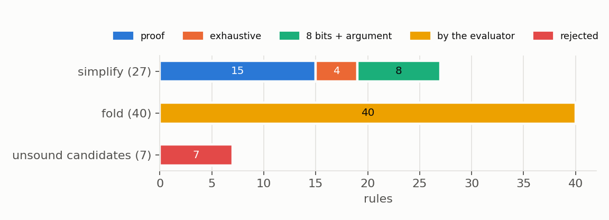
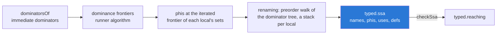
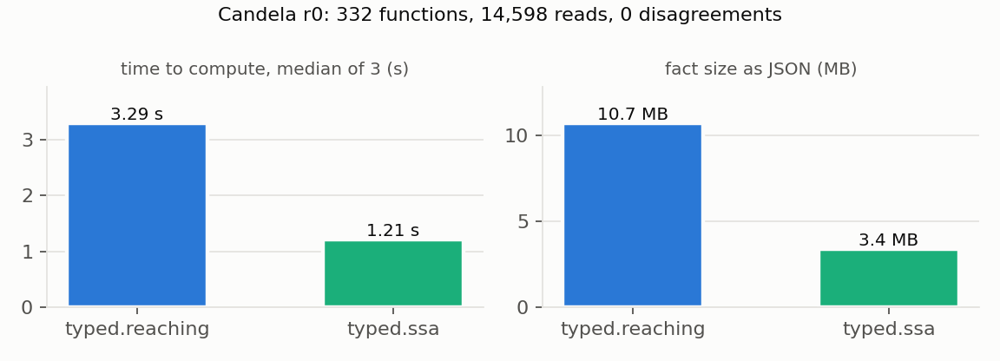
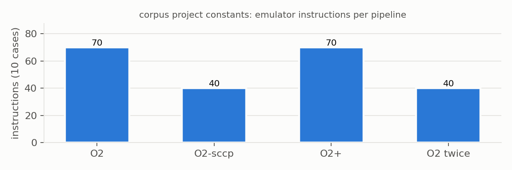

# Rewrite rules as verified data and a single-assignment view

The IR Workbench compiles Typed, a small statically typed language with TypeScript-like syntax, to RV32 machine code on a framework that treats every step of compilation as checked data. Each optimization pass is applied only if the new revision still behaves like the original program on generated inputs, and every entity of every revision records what it was made from and why. Two parts of the compiler had stayed outside that discipline.

- **The rewrites were code.** `simplify`, the pass that applies algebraic identities such as `x + 0 → x`, was a `switch` statement inside one callback, with sixteen `return` statements that rewrite. Nothing could list its identities, count how often each fired, or check one of them without a program that happened to contain it.
- **Every question about definitions was an analysis query.** Locals in `typed.blocks` are mutable variables, so finding the assignment a read sees meant replaying the reaching-definitions fact through a block. The inverse question, which reads see an assignment, had no answer at all.

This report covers milestone IRWB-006, which addresses both. `simplify` and `fold` are now tables of rules, and the passes compiled from them produce the same revisions, with identical hashes, as the hand-written code they replaced. Every rule carries recorded evidence that it is sound for all inputs of its types, obtained once by a verifier whose methods each have a stated strength. And the compiler has a single-assignment view of its main IR, computed as a fact about a revision, validated against reaching definitions on every function it has, and used by a first sparse optimization.

The milestone ran in its own worktree, in parallel with three other agents working on new passes such as inlining (IRWB-003), framework throughput and workers (IRWB-004) and the strength of the meaning check (IRWB-005). The work is recorded step by step in the ticket's diary (`ttmp/2026/11/25/IRWB-006--…/log/01-implementation-diary.md`), and the design, written before the implementation, is the ticket's intern guide (`design-doc/01-…md`).

> [!summary]
> - **Rules as data, identical revisions.** 27 `simplify` rules and 40 `fold` rules are plain data compiled into the existing rewrite traversal. Over 44 corpus projects and five pipelines, 1,232 comparisons with the hand-written passes found no difference in revision hash, edit list or correspondence; Candela's O2 agreed at all four steps. `passes.ts` now uses the tables, and the corpus revisions equal the baseline recorded before the change.
> - **Each rule verified once.** 15 `simplify` rules have proofs (symbolic normal forms over ℤ/2³², or bit-level checks), 4 were checked exhaustively over every input, 8 comparison inversions are exhaustive at 8 bits with a stated argument for 32, and the 40 `fold` rules are correct by construction relative to the evaluator. Seven deliberately unsound rules are rejected with counterexamples; one of them, `x + (−0) → x`, passes on the meaning check's own f32 edge values.
> - **An SSA view checked against reaching definitions.** Dominance frontiers, phi placement and renaming, as a new analysis `typed.ssa`. On every corpus revision and on all 332 Candela functions, the definitions each read sees through the SSA names equal the reaching definitions exactly. Validation on Candela found and fixed a naming bug the corpus could not show.
> - **A first consumer.** Sparse conditional constant propagation on the SSA view finds a strict superset of `constprop`'s constants, and a pipeline using it brings the `constants` project from 70 to 40 emulator instructions in one run, the result O2 otherwise reaches only when applied twice.

## 1. Rewrite rules as data

### What a rule is

A rewrite rule says: wherever a value tree has this shape, and these conditions hold, replace it by that tree. In the rule form the milestone introduced (`src/typed/rules/form.ts`), a rule has a name, a pattern, a guard, a replacement template, and the provenance its replacement carries. Here is the rule that turns a multiplication by a power of two into a shift:

```ts
rule('mul-pow2', { x: 'i32', k: 'i32' },
     op('mul', v('x'), kv('k')),                    // pattern: x * k, k any constant
     op('shl', v('x'), c({ log2: 'k' })),           // replacement: x << log2(k)
     { where: [{ pow2: 'k' }],                      // guard: k is 2^j, 0 <= j <= 30
       because: 'const-args', note: 'x * {k} = x << {log2 k}' })
```

A pattern is an operator over sub-patterns: a variable `v('x')` matches any tree; a constant literal matches a constant with that value; a constant variable `kv('k')` matches any constant and binds its value; `same('x')` matches a tree structurally equal to the one bound to `x`. A guard states what the shape cannot: that a tree is pure (it can be evaluated or dropped without effect), that a constant is a power of two, that a tree is a comparison and so yields 0 or 1, or, for constant folding, that an operator would not trap on these operands. The objects are frozen JSON, so the workbench can list them (`wb.rules()` prints both tables at the 72-column width of a workbench tile) and the verifier of section 2 can evaluate them.

### Why "identical revisions" is a hard requirement

The book this compiler was ported from states exact results for its 44 corpus projects, among them Blend's six O2 revisions, the provenance of particular statements, and 6,986 decided cases on which every project's O2 result agrees with its unoptimized r0. The test suite checks them, and O2 is frozen so that they keep passing. The table-driven `simplify` therefore had to produce the same revisions as the hand-written one, not merely equivalent programs.

The revision hash is a SHA-256 of the canonical encoding of the whole native value. That value contains each entity's origin (`from`, `via`, `rev`, `because`, `note`) and the counters from which fresh ids are drawn. Equal hashes at every step therefore imply equal `why` trees, and the requirement is correspondingly strict: the table must allocate exactly the same ids, in the same order, with the same origins. Three properties of the transaction's rewrite traversal, `Tx.rewrite` (`src/typed/tx.ts:431`), decide how:

1. **The traversal is bottom-up.** The callback sees a node after its operands have been visited, possibly as a freshly rebuilt copy.
2. **Anything made inside the callback records the visited node as its origin `from`.**
3. **Ids are allocated in call order.** In `tx.make('shl', a.id, tx.const(log2(k)), …)` the constant is created before the shift, because JavaScript evaluates arguments first.

### The compiler

`compileRules` (`src/typed/rules/compile.ts`) turns a table into a callback for that same traversal:

```text
index <- rules grouped by the operator of their pattern's root, in table order
visit(v):
    for rule in index[v.op]:
        bindings <- match(rule.pattern, v)
        if bindings and every guard holds:
            return instantiate(rule.replacement, bindings,
                               provenance = rule.because, rule.note)   # outermost value only
    return nothing

instantiate(t):  a variable   -> the bound tree's id (no new value)
                 a constant   -> tx.const(...)
                 an operator  -> instantiate the operands first, left to right, then tx.make(...)
```

Each step corresponds to a property of the hand-written pass. That pass dispatched on the operator and, within a case, returned at the first condition that held; the index with first match in table order is the same decision procedure, provided the table lists the cases in the same order. Its replacements were made inside the callback, children first, which `instantiate` reproduces. Its guards called `isPure`, the structural `sameTree`, the comparison set and its own `isPow2`, and so do the compiled guards. Two details exist only for exactness. `because: 'const-args'` records the constant operands of the matched node, in operand order, which is what the hand-written `note(text)` helper recorded, including both operands of `sub(5, 5)`. And only the outermost made value carries `because` and `note`; the inner constant of `mul-pow2` carries neither, as `tx.const(log2(k))` did.

### Proving the equivalence

The hand-written bodies were kept, verbatim, in `src/typed/rules/handwritten.ts`, and the switch was made only after two comparisons:

- **Corpus.** For every project and every pipeline that contains `simplify` or `fold` (O1, O2, O2+, `loops`, `checks`), the pipeline ran under the meaning contract, and at each `simplify` or `fold` step the table pass and the hand-written copy were applied to the same input revision. Their revision hash, canonical edit list and canonical correspondence were compared with the official step. All 1,232 comparisons were identical; 210 of the 616 compared steps changed the program, so the comparison had changes to compare. Running every pipeline mattered: `loops` and `checks` run `simplify` before any `fold`, which exercises the two-constant `because` that O2 never produces.
- **Candela.** One run of O2 over the 332-function renderer, comparing both variants at each of the four `simplify` and `fold` steps. All four were identical in hash, edits and correspondence. The chain had 13 revisions, from r0 `cd36346ea7c4` to `b33d1737c725`, and took 6 minutes 53 seconds.

A comparison that always agrees could also be a comparison that cannot see. The rules test therefore changes one rule's note and checks that the same comparison reports a difference on Blend's O2.

After the switch, `simplify` and `fold` in `passes.ts` keep their specs (what they read, write and preserve), and their bodies are `tableBody(SIMPLIFY_RULES.rules)` and `tableBody(FOLD_RULES.rules)`. The frozen gates were all green: the 325 tests (322 pass, 3 skipped by design because they need Candela environment variables), the full-corpus pass and backend tests, the parity tool (on all 6,986 decided cases every project's O2 head agrees with its r0; 14 hit the step limit and are inconclusive), and the corpus revisions, identical to the baseline line for line.

### Why not the framework's rule engine

The framework already had a pattern language and a rewrite engine with seven schedules, unused by any Typed pass. It was evaluated and not used for applying rules, for three reasons, two from the code and one measured:

- **Its edits do not go through `Tx`.** They create entities by editing the projected graph, so new ids do not come from the store's counters and carry no Typed origin. A revision produced that way cannot equal today's.
- **It publishes an artifact per application.** On Candela, projecting and hashing a revision costs seconds, and `fold` alone makes 2,081 rewrites in its O2.
- **Its notion of a repeated variable is different.** `sameAs` binds the same entity again, and `equalContent` compares one entity's attributes, origin included. `simplify`'s `x − x` needs structural equality of two different subtrees.

The pattern half is still useful, so rules convert to the framework's `NodePattern`. A cross-check counted the matches of every one of the 67 rules' patterns with the framework's `searchPattern` and with the compiled matcher, on 71 corpus revisions. Every exact pattern agreed (141 matches in all). `sub-self` matched 74 times in the framework against once structurally, which is the third reason above, measured. The framework's matcher took 47.4 seconds for the whole run and the compiled one 0.64 seconds.

### Which rules fire

The firing counts are the first data the tables produce that the code could not:

| workload | rules that fired (count) |
|---|---|
| corpus, O2, `simplify` | `not-lt` 32, `mul-pow2` 15, `add-zero` 4, `mul-one` 2, `mul-zero` 2, `not-gt` 1, `not-ne` 1, `sub-self` 1, `sub-zero` 1 |
| corpus, O2, `fold` | `fold-mul` 9, `fold-sub` 6, `fold-add` 1, `fold-gt` 1, `fold-shl` 1 |
| Candela, O2, `simplify` | `mul-pow2` 39, `not-lt` 12, `not-le` 4, `add-zero` 1 |
| Candela, O2, `fold` | `fold-add` 430, `fold-shl` 430, `fold-fmax` 285, `fold-fmin` 199, `fold-fsqrt` 196, `fold-fmul` 139, `fold-fsub` 122, `fold-fdiv` 106, `fold-fadd` 98, `fold-sub` 69, `fold-or` 4, `fold-eqz` 3 |

Eighteen of the 27 `simplify` rules never fire in the corpus's O2, and only four fire on Candela. The comparison inversions (`not-lt`: `!(a < b) → a ≥ b`) and the shift rule carry almost all of the pass's work. On Candela, `fold` fires 2,081 times: `fold-add` and `fold-shl` 430 times each, and the seven f32 operators 1,145 times together. The i32 table has 19 rules; four of them fire.

## 2. Verifying a rule once

### The claim and its semantics

A rule `L → R` with guard `G` claims that for every assignment of values to its variables that satisfies `G`, `R` has the same outcome as `L`, where an outcome is a value or a trap and two outcomes agree as the meaning check's `agrees` says. If the claim holds, every application in every program is correct, whatever inputs the meaning check happens to generate.

The semantics are the evaluator's, because the evaluator is the specification: on Candela it agrees with the reference compiler's images on all 32,985 decided cases of 33,200. For checking at reduced width, the verifier (`src/typed/rules/semantics.ts`) defines each i32 operator at any width `w` that is a power of two: values are `w`-bit two's complement integers, results wrap, shift counts are masked to `log2 w` bits, and division traps on zero and on −2^(w−1)/−1. At `w = 32` these functions must equal the evaluator's `binop`, and a test checks that on every pair of 48 boundary values for all 19 operators. The f32 operators exist only at 32 bits and are the evaluator's own functions on IEEE bit patterns, which return the canonical NaN `0x7fc00000` from arithmetic and keep NaN payloads in sign operations.

Before evaluating anything, the verifier checks two side conditions. A variable stands for a whole subtree that may trap, read memory or call a function; a rule that drops it (`x · 0 → 0`), duplicates it, or reorders two variables changes those effects, and is accepted only with a `pure` guard on the variables concerned. And each variable's type must match the operator signatures, with both sides of the same result type.

### The methods, and how much each establishes

| method | applies to | establishes | strength |
|---|---|---|---|
| symbolic linear | sides built from `add`, `sub`, `mul` by a constant, `shl` by a constant | equal normal forms `c₀ + Σ cᵢ·xᵢ` over ℤ/2³² | proof at 32 bits |
| bitwise, width 1 | sides built from `and`, `or`, `xor`, 0 and −1 | the rule at one bit, which each bit position repeats | proof at every width |
| exhaustive, 32 bits | one variable, or small guarded domains | every input evaluated | complete |
| exhaustive, 8 bits | width-generic rules | every input at 8 bits | complete at 8 bits only |
| boundary and random, 32 bits | every rule | no counterexample in the crossed boundary values and 10⁶ random assignments | sampled |
| f32 special values | rules with f32 variables | no counterexample among zeros, infinities, NaN payloads, subnormals and extremes, crossed, plus random bit patterns | sampled |
| by construction | `fold` rules | the replacement is the evaluator's own value of the matched operator; the guard excludes every trapping input | relative to the evaluator |

The strength column is deliberately conservative. The symbolic method is a proof because a degree-one polynomial over ℤ/2³² that vanishes on every input has zero coefficients: evaluate it at zero for the constant term and at each unit vector for the coefficients. `x · 2^j → x << j` is proved once for each of the 31 powers of two its guard admits. Exhaustive checking at 8 bits, by contrast, implies nothing at 32 bits by itself: `x · 256 → 0` holds for every 8-bit `x` and is false at 32 bits. The verifier therefore credits it only for rules that are width-generic and come with a written argument. For the eight comparison inversions the argument is that at every width the comparisons are the strict and non-strict forms of a total order (signed or unsigned) and equality, and that `eqz(cmp(a, b)) = inv(a, b)` says `inv` is the complement relation of `cmp`, a law of those relations rather than of the width. The evidence records their strength as `reduced-width+argument`, with the argument's text, and not as a proof.

### The evidence

The evidence is computed once by a script and recorded in a generated module, `src/typed/rules/evidence.ts`, under each rule's name, version and fingerprint (the SHA-256 of its canonical data). A test fails when a rule no longer matches its record, so an edited rule must be verified again.



| rules | method | strength |
|---|---|---|
| 11 `simplify` rules: `x+0`, `0+x`, `x−0`, `x−x`, `x·1`, `1·x`, `x·0`, `0·x`, `x<<0`, and `x·2^j`, `2^j·x` over 31 instances each | symbolic linear | proof |
| `x\|0`, `x^0`, `x&0`, `x&−1` | bitwise, width 1 | proof |
| `x/1`, `x>>0`, `x>>>0` | exhaustive over 2³² inputs | complete |
| `!!b → b` for a comparison `b` | exhaustive over {0, 1} | complete |
| the eight comparison inversions | exhaustive at 8 bits (65,536 inputs each), with the argument | reduced width + argument |
| the 40 `fold` rules | by construction, guard checked | relative to the evaluator |

The recorded run used 10⁶ random assignments per rule and exhaustive 2³² checks wherever a rule has one full 32-bit variable and no proof. The proved rules took between 48 milliseconds and 3.8 seconds each; the 31 instances of `x · 2^j` account for the larger figure. The 40 `fold` rules took 19 seconds together. The three exhaustive checks, of `x / 1`, `x >> 0` and `x >>> 0`, took 131, 170 and 236 seconds, while other measurements of this milestone shared the machine; `x / 1` alone on an otherwise idle process takes 50 seconds. The run also verified two sound f32 rules outside the tables, `−(−x) → x` and `|−x| → |x|`, over all 2³² bit patterns, which is where most of its 67 minutes went (942 and 2,488 seconds). The operators of those two rules are single bit operations, so the cost is the verifier's evaluation loop, which has not been profiled. In a fresh process, after the verifier was changed to call the f32 operators directly instead of through a generic dispatcher, the same two checks took 306 and 623 seconds.

### Rules that must be rejected

A verifier that accepts everything is useless, so the test includes candidates that are wrong. Each is rejected:

| candidate | why it is wrong | rejection |
|---|---|---|
| `x / 2^j → x >> j` | rounds toward −∞ for negative `x`; the corpus's `div-to-shift` | at 8 bits, `x = −127, k = 2`: −63 against −64 |
| `x · 0 → 0` without `pure(x)` | drops a subtree that may trap | structural |
| `x + (+0) → x` (f32) | −0 + +0 = +0 | `x = −0` |
| `x · (+0) → +0` (f32) | the product of a negative number or −0 with +0 is −0 | `x = −0` |
| `x − x → +0` (f32) | ∞ − ∞ is NaN | `x = +∞` |
| `!(a < b) → a ≥ b` (f32) | both are false when an operand is NaN | `a = 0, b = NaN` |
| `x + (−0) → x` (f32) | for a NaN with a non-canonical payload the sum is the canonical NaN | `x = 0x7fc00001` |

Five of these come from the project's history: the corpus's showcase of a wrong pass, and four float rewrites that IRWB-001 wrote as deliberately unsound passes, two of which the meaning check accepted until its case generator learned to sweep f32 edge values. The second candidate exercises the structural check. The last one is new and instructive. `x + (−0) → x` holds for every number, both zeros, both infinities and the canonical NaN; it fails only for a NaN with another payload, because arithmetic canonicalizes NaNs. The meaning check's f32 edge values contain only the canonical NaN, and the test shows that a verifier restricted to them accepts the rule. The verifier's own special values include non-canonical quiet NaNs, a signalling NaN and negative NaNs. Strengthening the meaning check's case generation is IRWB-005's subject, so this milestone records the finding and leaves the generator alone.

## 3. A single-assignment view of `typed.blocks`

### Why a view

In static single assignment (SSA) form every assignment defines a new name and every read refers to exactly one name; where control flow joins, a phi defines a name whose value is the one that arrived along the edge taken. The research agenda (IRWB-002) had decided that the primary IR stays a control-flow graph with expression trees, because the book's numbers depend on its ids and shapes, and that new facts get new analysis definitions. SSA is therefore an analysis result, `typed.ssa` (`src/typed/ssa.ts`), computed from a revision and cached under its hash, and it is not added to the list of existing analyses, whose six names a test asserts.

### Construction

The construction is the classic one of Cytron and colleagues:



Two details of `typed.blocks` shape it. Every local has a value at function entry, a parameter or an initial zero, which reaching definitions names `param:i` or `init:i`. The construction places those definitions in a virtual entry block that dominates the real entry and has one edge to it, so a loop whose header is the entry block gets phis like any other join. And the dominator tree covers only blocks reachable from the entry, which is also what the reaching-definitions solver visits.

Placement is minimal: a local gets a phi wherever two of its definitions can meet, whether or not it is read afterwards. On Blend, the corpus's running example, the loop head `bb:blend.1` receives phis for `s`, `i` and the temporary `t7`:

```text
bb.1   s.2  = φ(bb.0: s.1,  bb.7: s.3)
       i.2  = φ(bb.0: i.1,  bb.7: i.3)
       t7.1 = φ(bb.0: t7.0, bb.7: t7.2)      dead: t7 is assigned before every read
```

The guide predicted these names before any code existed, and the implementation produced them exactly. The third phi is dead, which pruned SSA would avoid; on Candela two thirds of all phis are dead (2,840 of 4,245).

The result maps every name back to what defines it: a `set` statement and the value tree it assigns, an entry definition, or a phi (a block and a local, since a phi is not a statement of `typed.blocks`). It also maps every `get` value to the name it reads and every `set` statement to the name it defines. A view on the fact answers `defOf(get)`, `usersOf(name)` (the def-use chain, which no earlier fact provided), `phisOf(block)` and `reachingDefs(name)`.

### Validation against reaching definitions

SSA and reaching definitions describe the same relation, which makes the validation exact. Define the expansion `E(n)` of a name: its own definition if it is defined by a statement or at entry, and for a phi the union of its arguments' expansions. Then for every read `g` of local `l` in statement `s`, `E(use[g])` must equal `reachingAt(s, l)` as a set. `checkSsa` checks that on every read and also checks the SSA invariants: one definition per name, one phi argument per reachable predecessor, and every definition dominating its uses.

| workload | functions | reads | (definition, use) pairs | phis | disagreements |
|---|---:|---:|---:|---:|---:|
| corpus, r0 | 70 | 794 | 1,033 | 228 | 0 |
| corpus, all 194 O2 revisions | 306 instances | 3,329 | 4,392 | 996 | 0 |
| Candela, r0 | 332 | 14,598 | 16,800 | 4,245 | 0 |

The first Candela run did not pass. It reported 5 mismatches and 10 invariant violations, all in one function, `asinPositive`. That function has two locals named `z` (indices 1 and 4), and the naming scheme `<local>.<n>` produced `z.1` for both; the second definition overwrote the first. A scan of all 400 corpus locals had found no duplicate names, so the corpus could not have exposed this. Names of a shared local now carry its index (`z#4.1`), and Candela agrees everywhere. The episode is a small argument for checking a new representation on the largest program available, not only on the one it was designed with.



The view is also cheaper than the fact it is checked against. On Candela r0, `typed.ssa` took 1.16 to 1.27 seconds over three runs and `typed.reaching` 3.0 to 5.3 seconds, and the SSA fact is 3.4 MB of JSON against 10.7 MB. These are single wall-clock runs on a shared machine, not benchmarks.

## 4. A first consumer: sparse conditional constant propagation

`constprop` replaces a read whose reaching definitions all assign the same literal constant. It cannot see that a branch is decided. In

```js
let x = 1, y = 0;
if (x === 1) { y = 7; } else { y = 9; }
return y + n;
```

both assignments of `y` reach the `return` until `fold` and `cfg` have removed the dead arm, so `constprop` replaces only `x`. Sparse conditional constant propagation (Wegman and Zadeck) keeps one lattice value per SSA name (not yet seen to execute, a constant, or varies) and one flag per control-flow edge, and propagates both together. The decided branch makes the `else` edge dead, the phi for `y` then has one executable argument, and the read in `return` becomes 7. The pass `sccp` (`src/typed/sccp.ts`) cites, as its `because`, the `set` statements reached through phi arguments on executable edges only, so `why` on the new constant reaches `y = 7` and not `y = 9`. It evaluates only the operators `fold` folds, so it never claims a constant `fold` could not produce.

`sccp` lives in a new pipeline, `O2-sccp`, which is O2 with each `constprop` replaced by `sccp`. Neither the pass nor the pipeline was added to the shared registries, so O2 and everything that lists passes are unchanged.

| measured on the 44 corpus projects | `constprop` | `sccp` |
|---|---:|---:|
| reads made constant at the same input revision | 28 | 31 |
| of which found only by this pass | 0 | 3 |

| pipeline | statements | image bytes | instructions (10 cases per function) |
|---|---:|---:|---:|
| O2 | 709 | 5,160 | 278,296 |
| O2-sccp | 708 | 5,148 | 278,266 |
| O2+ | 695 | 5,104 | 276,656 |
| O2 applied twice | 693 | 5,092 | 276,626 |



The advantage is real and concentrated. `sccp`'s constants are a strict superset of `constprop`'s, the three extra reads are all in the `constants` project, and there `O2-sccp` reaches 40 instructions, the O2-applied-twice result, in one run. No project is slower. On the rest of the corpus `constprop` already finds everything, and the extra `subst` of O2+ matters more for instructions than SCCP does. The two are independent, so their combination is the obvious next experiment. Every revision of every pipeline above was accepted by the meaning contract.

## 5. Where this leaves the compiler

Three things exist now that did not before. Rules are data: the compiler can list them, count them, check them once and cite them. Every rule of the two tables has recorded evidence with an honest strength, and the verifier rejects the wrong rules the project has historically produced. And the compiler has a sparse representation that is validated against the analysis it replaces, on every function it has. None of it changed what the compiler already did: at the end of the milestone 337 of 340 tests passed and the other 3 were skipped by design, the full-corpus pass and backend tests and the parity tool passed, and the corpus revisions were still identical to the baseline recorded before the first change.

These are the foundations several agenda items were waiting for:

- **Rule discovery (B3)** can enumerate small terms and propose rules, with this verifier as the filter. An obvious first target is a shape the tables cannot touch: nothing in them reassociates constants, so `(x + 1) + 2` stays as it is.
- **Exact checking (D3)** can discharge a `simplify` edit by citing the verified rule that produced it. That needs the rule's name in the edit's `because`, which this milestone did not add, because the revision hash covers every origin and O2 is frozen. A pass variant outside O2 could add it.
- **Global value numbering and more sparse algorithms (A2)** can use the def-use chains directly, and a pruned SSA variant would remove the two thirds of phis that are dead.

Some questions are open. Two belong to the coordinator: whether `sccp` and `O2-sccp` should be registered in the shared pass and pipeline lists after the merge with IRWB-003, and whether the f32 edge-value finding should change the meaning check's case generator, which IRWB-005 owns. The comparison inversions remain at "exhaustive at 8 bits plus an argument"; a bit-vector decision procedure, which D3 needs anyway, would turn them into proofs.

## Related notes

- [[PROJECT REPORT - IR Workbench - Per-Scene Kernels for Candela - Cheaper Checked Passes, Merged Bounds Checks, an RV32F Backend and Bit-Identical Frames - A Technical Deep Dive]] (report 4: per-scene kernels, the RV32F backend)
- [[PROJECT REPORT - IR Workbench - Candela on the Kernel - Float Semantics, Lifting From the Tape, and a Checked O2 on a 332-Function Renderer - A Technical Deep Dive]] (report 3: floats and the four unsound float rewrites)
- [[PROJECT REPORT - IR Workbench - A Compiler Defined on Its Own IR Framework - Typed to RV32 on v6, With the Prototype's Numbers Reproduced - A Technical Deep Dive]] (report 1: the compiler, `Tx`, provenance, the book's numbers)
