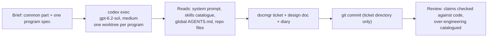
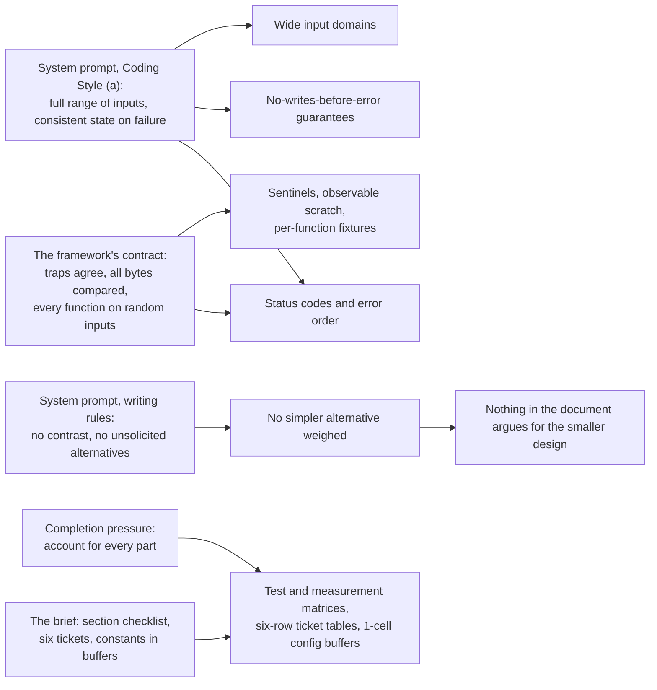
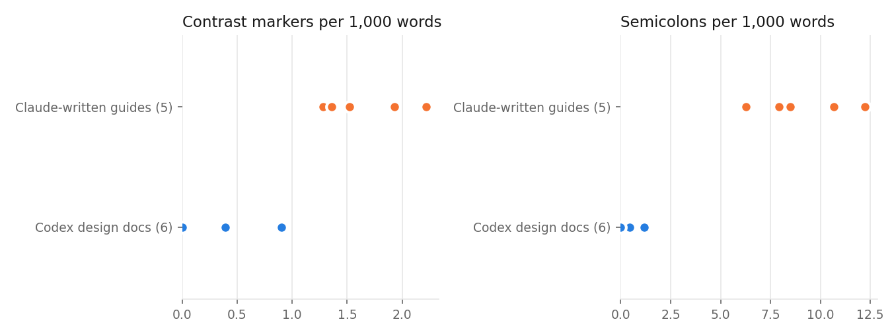
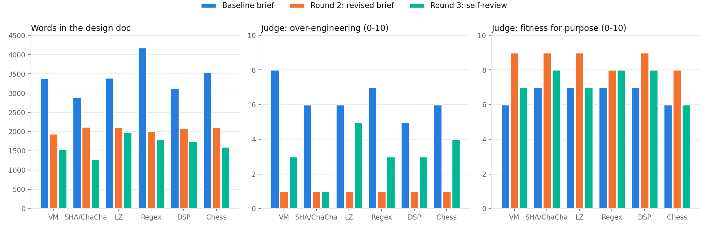

# Codex agents as designers: where the over-engineering comes from, and what a revised brief and a self-review change

The IR Workbench project needed six new programs for its compiler corpus. Each is meant to give the optimizer something to work on:
- a bytecode interpreter;
- SHA-256 and ChaCha20;
- an LZ-style compressor;
- a Thompson-NFA regex matcher;
- an f32 FFT and filter bank;
- a port of an existing chess engine.

Each design was given to its own Codex agent (`gpt-6.2-sol`, medium reasoning effort). The agent created a ticket and wrote a design document that a newcomer could implement from.

The six documents came back fast, accurate in their claims about the code, and heavier than the programs needed. They defined error-status interfaces, guarantees about memory after an error, and input domains wider than any experiment required. They planned test matrices for the programs' own guards, and tests for features that do not exist yet.

This report asks three questions:
1. Where did that weight come from?
2. Does changing the instructions remove it?
3. What does the answer say about writing briefs for such agents, and about the compiler framework itself?

The evidence comes from four sources:
- the agents' own session records;
- a count of features in the documents;
- two interventions run on the same six programs;
- a blind scoring of all eighteen resulting documents.

> [!summary]
> - **The over-engineering is in the contract around each program, not in its algorithm.** Sizes and algorithms were right-sized. Extra error statuses, memory guarantees and wide input domains made up most of the excess.
> - **The agents' instructions explain it closely.** The Codex system prompt asks code to "handle the full range of supported inputs" and to keep state consistent if an operation "can fail partway". It also forbids contrastive framing and comparison with alternatives nobody asked about. The documents follow both: they specify every failure, and they contain almost no weighing of alternatives (0–0.9 contrast markers per 1,000 words, against 1.28–2.22 in Claude-written guides from the same repository).
> - **Stating a design policy in the brief removed nearly all of it.** Mean over-engineering went from 6.33 to 1.00 and mean fitness from 6.67 to 8.67, on a 0–10 scale from a blind judge. Every design that used frame arrays found the ingest blocker the baseline had missed. An open-ended self-review shortened the documents more, but kept more of the defensive structure (3.17 and 7.33).
> - **Part of the weight is the framework's.** The meaning check treats any two traps as equal, compares every guest byte, and checks every function on independently generated inputs. The programs absorbed those properties. A contract the project can declare (domain, observation, relation) would remove the pressure at its source.

## 1. The setup

The coordinating agent (Claude) wrote one brief shared by all six designs, plus a short specification per program. The brief described the repository and the checking regime, and listed the sections a design document should contain: goal, program design, oracle, input specifications, sizing against the step limit, project files, a test and measurement plan, and implementation steps. It also listed six optimization tickets the programs should feed. It named two skills to use, `docmgr` for ticket management and `diary` for a work log.

A launcher script created one git worktree per program and started `codex exec` in each, with the brief as the prompt and the sandbox allowing writes to the worktree and the repository's `.git`.

A few terms recur in what follows.
- A **rollout** is Codex's native session record, one JSON line per event, stored under `~/.codex/sessions/`. It contains everything the model was shown and every command it ran. Its reasoning is stored encrypted, with no summaries.
- An **approval sidecar** is a separate rollout in which Codex's automatic reviewer decides whether an escalated command may run.
- The **meaning check** is the compiler framework's acceptance test. A pass's output must agree with the original program (revision r0) on generated inputs, within 20,000 evaluated statements per input.

All six agents finished in 5.7 to 8.6 minutes. Each made exactly one commit, touched only its own ticket, and got a clean `docmgr doctor`. Each run reported 105,577 to 138,281 tokens; most of the session's total input was cached. Their claims about the code held up when checked, for example:
- `match` requires an enum;
- frame arrays cannot be passed to functions;
- the inliner refuses callees with a frame array;
- the input-specification forms exist as described.

## 2. What "over-engineering" means here

"Over-engineering" is only useful as a word if it can be counted. Here it means design elements that the program's purpose does not need and that cost implementation and checking effort. The program's purpose is to give named optimizations something to work on. The review of the six baseline documents found six families of such elements:
1. **Invented error interfaces:** status codes, a specified order in which errors are detected, and guarantees that nothing is written before an error.
2. **Input domains wider than the experiment:** accepting every 16-bit value, malformed patterns, alternate constant tables, NaN payloads.
3. **Tests of the program's own guards**, as opposed to tests of the algorithm or the compiler.
4. **Plans for features that do not exist yet:** a specialization dispatcher, fused multiply-add emission.
5. **Self-defeating choices:** structure that works against the program's own experiment.
6. **Workarounds for small infrastructure gaps**, instead of a proposal to close them.

### 2.1 A worked example: the bytecode VM's error interface

The baseline design for the bytecode interpreter defines ten statuses. Status 0 is success and the other nine are errors:

| Status | Meaning |
| ---: | --- |
| 0 | Guest halted successfully. |
| 1 | Output length differs from two. |
| 4 | Fuel exhausted before the next fetch. |
| 6 | PC outside the instruction stream, including fall-through. |
| 7 | Operand stack underflow or overflow. |
| 9 | Popped data index outside the data buffer. |

*(Five of the nine error rows shown.)*

Each status brings four obligations, and none of them exercises the optimizer:
- **the program** needs a branch that detects the condition, in a specified order ("At entry, check output length, code length, then data length");
- **the independent JavaScript oracle** must reproduce the same detection and the same order, or the two will disagree on invalid inputs;
- **the test plan** must exercise each condition (the document lists odd and empty code, local 7 versus 8, the one-past-end data index, and a fuel-boundary program constructed so that its 192nd instruction halts);
- **the step budget** must leave room for the checks along every dispatch.

The fuel counter is a sharper case, because it works against the experiment. The VM exists to be specialized on its bytecode, which turns an interpreter into a compiled program. Fuel is loop-carried state, and the document itself notes that a specialized image "must preserve fuel exhaustion". The counter added to make the general program safe is exactly what a specializer would have to keep.

The design also offers a reason for its status codes, and the reason comes from the framework: "`agrees` compares return values and observable memory on normal completion and treats any two traps as agreeing." If invalid inputs trap, the check learns nothing from them, and a status code keeps them observable. Section 4.4 returns to this.

### 2.2 The baseline in numbers

| Program | Words | Error-contract sentences | Self-guard tests (judge) | Error values (judge) | Judge: over-engineering | Judge: fitness |
|---|---:|---:|---:|---:|---:|---:|
| VM (IRWB-012) | 3,387 | 17.9% | 18 | 9 | 8 | 6 |
| SHA-256 + ChaCha20 (IRWB-013) | 2,890 | 6.0% | 7 | 1 | 6 | 7 |
| LZ codec (IRWB-014) | 3,398 | 12.6% | 16 | 2 | 6 | 7 |
| Regex (IRWB-015) | 4,181 | 11.2% | 16 | 2 | 7 | 7 |
| f32 DSP (IRWB-016) | 3,122 | 11.3% | 3 | 1 | 5 | 7 |
| Chess port (IRWB-017) | 3,537 | 6.5% | 1 | 1 | 6 | 6 |

"Error-contract sentences" is the share of prose sentences that match a keyword family (status, error, invalid, reject, trap, sentinel, unchanged, overflow, fuel, capacity, guard and similar). It is a candidate count, not a judgment. The other columns come from the blind judge described in Section 5.2.

The algorithms themselves were sized well. Every design sized its inputs against the 20,000-statement limit: 192 dispatches, two SHA blocks, 32 LZ cells, 12 text units, a 32-point FFT. One design (chess) measured its sizes by running the evaluator. The others used planning allowances.

## 3. What the agents were shown

A rollout shows exactly what entered the model's context. Across the six sessions the shared context was identical except for worktree paths:

| Piece | Size (characters) | Content |
|---|---:|---|
| System prompt | 27,750 | Codex's own instructions: task completion, writing style, coding style, autonomy, skills |
| Skills catalogue | 46,817 | Name, description and path of every installed skill, plus the sandbox's permission profile |
| Multi-agent block | 2,511 | Role as primary agent; no sub-agents unless asked |
| Global AGENTS.md | 5,049 | The user's guidelines for Go projects (build commands, tmux, glazed, bootstrap) |
| The brief | about 5,000 | The common brief and the program's specification |

**Skills.** All six agents loaded `docmgr/SKILL.md` and `diary/SKILL.md`, the two the brief named. Three also loaded diary references, and one loaded the docmgr milestones reference. Codex also has these installed, and none of the six loaded them:
- `ticket-research-docmgr-remarkable`, whose description mentions "intern guides" and which carries a writing-style reference;
- `textbook-authoring`;
- `revise-document-for-understandability`.

Naming two skills in the brief was, in effect, a choice to exclude the others.

**Reading.** The agents read the corpus projects, the language front end, the evaluator, the project loaders, and their own brief. They touched the existing research guides with 2 to 6 commands each, mostly `rg -m 6` excerpts, so the long Claude-written guides cannot be the source of the documents' style.

One agent (IRWB-015) went further. It found guides that other agents had not yet merged on their own branches (`69ae7a0`, `d0e6415`), reachable because all worktrees share one `.git`, and read them with `git show`. Worktree isolation does not isolate the history.

**Probing.** The two agents that ran code produced the two most consequential findings. IRWB-015 ran five `node` probes; IRWB-017 ran six.
- IRWB-015 found that any function containing `new Int32Array(n)` fails the default ingest with `unknown tape opcode 252`. It also found that two of the three project loaders drop the option that selects the working path.
- IRWB-017 found that its most natural fixture, chess's opening position searched to depth 1, takes 20,778 evaluator statements, over the 20,000 limit.

The designs for the VM, SHA and LZ all use frame arrays and ran no code. As written, they would fail at their first implementation step.

**Approvals.** Three of the six commits needed escalation. In each case Codex's automatic reviewer allowed it, with a recorded rationale such as `{"risk_level":"low","user_authorization":"high","outcome":"allow"}`.

## 4. Where the weight comes from

Reasoning is encrypted in the rollouts, so causes cannot be read off the agents' thinking. They have to be inferred from two kinds of evidence:
- correspondences between instruction text and document features;
- how the features respond when the instructions change (Section 5).

Five sources contribute. Two sources that one might suspect turn out not to.

### 4.1 Coding rules applied to a design

The system prompt's "Coding Style" section begins: "Above all, be thorough in producing high-quality, correct code that completely fulfills the user's task." Its first rule reads:

> (a) Make sure the change works through the feature's normal entry points and preserves the behavior existing callers rely on, except where the request changes that behavior. Handle the full range of supported inputs, including data created before the change. If an operation can fail partway, be retried, or run concurrently, keep the resulting state consistent.

A design document for a program is a specification of code, and the documents read as though this rule had been applied to the specified program:
- "handle the full range of supported inputs" matches the LZ codec accepting every 16-bit value, which forces an escape-token format;
- "if an operation can fail partway… keep the resulting state consistent" matches the guarantees that recur across the documents: "return `-1` before any output write on a length mismatch" (SHA); "Validate an entire token before any stores for that token so error results have defined memory" (LZ); "they return `-1` and leave all guest bytes alone" (DSP).

The same section also contains rules against complexity:
- "(c) Skip new tests unless requested";
- "(d) … avoid generating unrequested/unrelated artifacts, such as … optional features";
- "(f) Avoid unnecessary cyclomatic complexity".

These did not restrain the designs. The brief requested a test plan and an oracle, so tests were requested. And the rules against complexity are phrased for code being written now, not for a specification of code to be written later.

### 4.2 The writing rules remove the argument for the smaller design

The writing-style section contains two rules that matter for design documents:

> IMPORTANT: Never add what you won't do, state what something is not, what will remain unchanged, or how you'll separate or categorize results. NEVER use contrastive framing such as "X, not Y" … Do not compare to an unsolicited alternative that the user did not directly ask about.

> In prose, do not use semicolons. … Carefully follow these instructions when writing in documents, slides or other artifacts as well.

A design document's central job is to compare: this layout because the simpler one fails in a stated way. Without that comparison, a document presents one design and specifies it completely, and nothing in the text ever asks whether a smaller design would serve. The six documents obey the rules almost exactly. The comparison set below is five guides written by Claude in the same repository during the same week.

*Contrast markers ("rather than", "instead of", ", not ", "whereas", "unlike") and semicolons per 1,000 prose words. Four of the six Codex documents have zero contrast markers; their points coincide at 0.*

| Measure (per 1,000 prose words) | Codex design docs | Claude-written guides |
|---|---|---|
| Contrast markers | 0 to 0.9 | 1.28 to 2.22 |
| Semicolons | 0 to 1.17 | 6.27 to 12.23 |
| Words per sentence | 14.0 to 15.7 | 18.4 to 23.9 |

The effect on readability is visible as well: short declarative sentences, few worked examples, and one document (chess) with no code blocks at all. The documents are implementable by an expert. They are not the newcomer's guide the brief asked for.

### 4.3 Completion pressure and the brief's checklist

The system prompt asks the agent to "make sure that you have accounted for every part of the user's request" and, before finishing, to "check each deliverable against the user's intended goal". The brief listed eight things a design document should cover. Each document covered all eight at full depth: an oracle section, an input-specification section, a step-budget table, a test plan, and a measurement protocol.

Three items in the brief had direct, traceable effects:
- **The list of six tickets "this program should feed"** produced a six-row optimization table in every document. In all five integer programs, the row for the float-tolerance ticket says only that the program is an exact integer control.
- **"Constants worth specializing on (a bytecode, a pattern, a size) live in input buffers"** produced one-cell configuration buffers in the LZ and DSP designs, and the SHA round-constant table as an input buffer. A scalar parameter would have served the single numbers, and the existing specializer already binds scalars.
- **"A hand-optimized version as a separate project can serve as a ceiling"** produced a ceiling paragraph in every document.

The measurement protocols share a phrasing across five of the six designs. One says "Record backend options, input seed, and compiler revision", another "Record commit, full options, pipeline, seed and cases". The brief did not ask for this. The diary skill, which every agent read, states that "experiments need configuration and measurements", which makes it a plausible source. That attribution is weaker than the others.

### 4.4 The framework's contract

Several features that look like caution are rational responses to how the meaning check works. Four properties of the check matter:

| Property of the check (code) | What the designs did in response |
|---|---|
| `agrees` treats any two traps as agreeing, whatever their kind or site (`evaluate.ts:563`) | Explicit status codes, so invalid inputs stay observable (VM, stated outright) |
| On normal completion every guest byte is compared | Sentinel-filled output tails (LZ, DSP); chess's 24 KB scratch arena kept in a caller buffer, so every scratch write is observable |
| By default every function is checked on independently generated inputs; `entries` exists on `Program` but not in `project.json` | Defensive helpers ("Every other tag returns false, including when the helper is checked as a standalone function"); chess designed coherent generated inputs for all 53 functions |
| `casesFrom` draws each parameter independently, and `oneOf` picks only scalars | Programs validate argument combinations that the generator cannot keep consistent (bytecode and data, pattern and text, board and state) |

Two further gaps forced designs into workarounds:
- frame arrays need the tape ingest path, which two loaders do not select;
- the 20,000-statement limit is fixed per input, so every design carries a budget table.

The design was over-engineered partly because the framework gives the designer no way to say "valid inputs only", "this region is output", or "check from these entry points".

### 4.5 What did not cause it

- **The global AGENTS.md** is irrelevant to a TypeScript repository. Its one general rule argues against complexity: "Don't add backwards compatibility layers or adapters unless explicitly asked."
- **The Claude-written research guides** were skimmed, not read.
- **The `docmgr` and `diary` skills** are about process: tickets, logs, evidence for claims. They contain nothing about how large a design should be, apart from the measurement-record phrasing noted above.

## 5. Two interventions

If the instructions cause the weight, changing the instructions should remove it. Two interventions were run on the same six programs, concurrently, with the same model and reasoning effort.

### 5.1 Design

**Round 2: a revised brief.** The common brief gained a "Design policy" section of ten rules. Each answers one cause from Section 4. The per-program specifications were unchanged. The agents were fresh, in new worktrees, starting from the repository state the baseline saw, without the baseline's prompt files.

| Cause | Rule in the revised brief |
|---|---|
| Coding Style (a), applied to the design | Design for valid inputs only. The program may trap or return an arbitrary value on anything else. No status codes, error precedence, or memory guarantees unless the algorithm has a natural failure result. |
| Coding Style (a), domain | Keep the input domain as narrow as the experiment allows; restrict the input specification instead of adding code. |
| Writing rules forbid comparison | For each significant decision, name the simplest alternative that would serve, and say why it was chosen or why it falls short. |
| Features that do not exist | One line each in a "Later" list, with no test plan. |
| The brief's buffer instruction | A single-number constant is a scalar parameter. |
| The brief's ticket list | Mention only the tickets the program directly exercises. |
| Framework gaps | Propose a small infrastructure change instead of designing around it. |
| Unprobed assumptions | Run a minimal probe before relying on a language or loader feature. |
| Completion pressure | Sections as long as an implementer needs; 1,500 to 2,500 words; leave out alternate input profiles, tests of the program's own guards, and measurement method beyond the primary metric. |
| Shared `.git` | Work only from your own worktree; do not read other branches or agents' tickets. |

The comparison rule deserves a note. The system prompt forbids comparison with an *unsolicited* alternative. A user instruction to name the simplest alternative makes the comparison solicited, so the two do not conflict.

**Round 3: self-review.** Each baseline session was resumed (`codex exec resume <session id>`) with a prompt that names no categories:

> Re-read your design document as a skeptical senior engineer whose goal is the simplest design that still serves the experiment. Identify everything that could be removed or simplified without weakening the experiment, revise the document accordingly, and add a short section at the end listing each cut with a one-line reason.

Round 3 tests whether the model can find its own excess. Round 2 tests whether it complies with a stated policy.

### 5.2 Method

The judge has to be blind, the counts have to be checkable, and simplification that goes too far has to show up as a loss. The 18 documents (six programs × three rounds) were prepared as follows:
- baseline documents were taken from their recorded commits, because round 3 rewrote those worktrees;
- frontmatter was removed;
- round 3's appended list of cuts was removed, since it would identify the round;
- the files were shuffled under the names `doc-A` to `doc-R`, with a seeded order so the packing can be reproduced.

The first version of the packing script matched "cut" inside "Exe*cut*ive summary" and truncated one baseline document to ten words. It now matches whole words and only the last such heading.

A fresh agent scored the 18 documents. It was given the rubric, the six program specifications and the documents, and nothing else. The rubric has two halves:
- **nine over-engineering counts**, each backed by quotations:
  - R1, error values beyond the algorithm's natural results;
  - R2, guarantees about memory on error;
  - R3, widened domains;
  - R4, self-guard tests;
  - R5, plans for features that do not exist;
  - R6, scalar constants in buffers;
  - R7, infrastructure workarounds;
  - R8, extra input profiles;
  - R9, other optional machinery;
- **four fitness items:**
  - A1, implementability (1–5);
  - A2, an independent oracle;
  - A3, step-limit sizing;
  - A4, whether the design still gives the named optimizations something to work on (1–5).

Two overall scores (0–10) come with a justification. The judge verified by script that every quotation occurs verbatim in its document. A spot check agrees with the review: the judge counted 9 error values in the baseline VM.

### 5.3 Results

*Words, judge over-engineering, and judge fitness for each program and round.*

| Round | Mean words | Error-contract sentences | Judge: over-engineering | Judge: fitness | R1 error values | R2 memory-on-error | R3 domain widening | R4 self-guard tests | A1 implementability | A4 optimization value | Minutes per run | `node` probes per run |
|---|---:|---:|---:|---:|---:|---:|---:|---:|---:|---:|---|---|
| Baseline | 3,419 | 10.9% | 6.33 | 6.67 | 16 | 12 | 17 | 61 | 4.50 | 4.50 | 5.7–8.6 | 0, 1, 0, 5, 0, 6 |
| Round 2: revised brief | 2,064 | 3.9% | 1.00 | 8.67 | 0 | 0 | 0 | 0 | 4.83 | 4.67 | 6.8–9.3 | 8, 8, 6, 4, 4, 1 |
| Round 3: self-review | 1,657 | 8.7% | 3.17 | 7.33 | 3 | 4 | 11 | 23 | 4.67 | 4.67 | 2.6–4.1 | — |

R1 to R4 are sums over the six documents. The other judge columns are means.

**Round 2 removed the excess without losing purpose.** Over-engineering fell from 6.33 to 1.00, and every count from R1 to R6 and R8 fell to zero. Fitness rose from 6.67 to 8.67. Optimization value (A4) did not fall: the leaner designs still give inlining, bounds-check removal, specialization and rule search something to work on.

Two results lie outside the rubric and are therefore not circular:
- **Every round-2 design that uses frame arrays found the tape-ingest requirement:** four of four, against one of four in the baseline. The probing rule produced 1 to 8 probes per run, and five of six round-2 runs ran four or more. Three of six baseline runs ran none.
- **Round-2 chess replaced the 53-function fixture regime.** It uses two checked entry points with measured statement counts (pinned en passant perft 9,206; a promotion search 12,054 to 12,953 at budget 2; the opening position at depth 1 over 20,000), and proposes forwarding `entries` through `ProjectMeta` and `Program.fromProject`. This is the small infrastructure change the baseline had identified and designed around.

Round 2 also weighs alternatives where the baseline never did. It averages 1.37 "would … but" constructions and 0.57 uses of "simpler", "easier" or "cheaper" per 1,000 words; baseline and round 3 have none of either. Two examples:
- LZ: "A tag, length and distance in separate cells would be easier to inspect but would remove the bit operations and consume three cells";
- the same document: "Inserting only token starts is simpler but omits valid candidates inside matched runs".

The weighing arrives in a form the writing rules permit. Contrast markers stay near zero (0 to 0.56).

**Round 3 shortened more and simplified less.** Its documents are the shortest (mean 1,657 words) and its runs the fastest (2.6 to 4.1 minutes, since the context was already loaded). Its own lists of cuts overlap substantially with the review:
- the VM "Removed the output buffer, status codes, and duplicate guest bounds guards";
- SHA "Removed malformed-input handling, byte-cell masking and their tests";
- the DSP "Replaced invalid-input returns and their tests with host shape preconditions".

What it kept is instructive, because each kept item is something the model can justify by the framework or by the experiment:
- the VM kept its fuel counter;
- LZ kept the escape token and the policy buffer ("An input-controlled budget is enough for the specialization experiment");
- chess kept per-function fixtures ("The stock checks need coherent inputs for every function").

Some cuts reduced the program rather than its contract. The regex matcher lost grouping, SHA lost multi-block messages, and the DSP lost one of its three filter sections. The judge's A4 did not penalize these (4.67), so for these purposes they were affordable. They are design changes nonetheless, made without being asked for.

### 5.4 What the results say about the model's behaviour

Four observations follow, each tied to evidence above.
- **The model follows instructions literally and completely.** It loaded exactly the named skills, covered exactly the listed sections, wrote one row per listed ticket, and applied its own coding rules to the code it was specifying. When the brief stated a policy, the documents complied with every rule the judge measured.
- **The excess is specification, not algorithm.** The review found every baseline algorithm and input size right for its experiment. The weight sat in error interfaces, domains, tests and measurement plans, which are exactly the areas the system prompt's coding rules and the brief's checklist address. The rubric did not score algorithm size, so this observation rests on the review alone.
- **Self-review finds length more readily than structure.** Asked open-endedly, the model removed what it could not justify. It kept structures for which it had a reason, and the reasons were usually the framework's real properties. A reviewer who wants those structures gone has to change the premise (valid inputs only, entry-point checks), not ask for brevity.
- **Grounding depends on instruction.** Probing found the most consequential facts in both rounds. Three of six baseline runs used `node` at all (IRWB-013 once), and all six round-2 runs did. The model does not probe by default when asked to design. It probes readily when told to.

## 6. What this suggests for the framework

Section 4.4 showed that several defensive features in the designs stand in for contract features the framework lacks. Removing the pressure at its source means making the contract something a project declares, in three parts.
- **Domain:**
  - the entry points;
  - a per-entry input generator able to express correlated arguments (whole-tuple `oneOf`, lengths derived from other parameters, named fixture sets);
  - preconditions;
  - promises about memory, such as IRWB-007's read-only scene regions;
  - a per-entry step limit.
- **Observation:** the return value, declared output regions with scratch excluded, and the *kind* of trap.
- **Relation:**
  - exact or bitwise equality;
  - a tolerance (IRWB-011's budgets);
  - a property (the LZ round trip);
  - order-insensitive comparison (chess's set of legal moves).

Under such a contract, the status codes, sentinels and memory guarantees disappear from the program sources, because the check no longer needs them to see what matters.

The domain part also unifies mechanisms the framework already has under different names. Each of these is a statement about the domain on which meaning must be kept:
- the project's `inputs`;
- `Program.assume`;
- the specializer's bindings;
- `entries` and `roots`;
- IRWB-007's proposed host promises.

As one object, a specializing pass would narrow the domain, provenance would record the narrowing, and the check would run on the narrowed domain. The per-scene Candela kernels, a VM specialized on its bytecode, and a regex specialized on its pattern would then be one operation.

Three further changes follow from the designs:
- **Per-function checks from recorded calls.** Run each entry case once on r0 and record each function's arguments and its read and write sets. Then check an edited function against its own recorded calls. Helpers get realistic inputs instead of random ones that force defensive code, and the per-function verdicts combine with IRWB-004's verdict memo and IRWB-009's finding that analyses split exactly by function.
- **Language additions:**
  - read-only static tables, which give constant memory that is sound by construction and would have kept SHA's round constants in the program;
  - `match` on integers, which gives the VM a dispatch the backend could compile as a jump table;
  - `requires(...)` preconditions, which the case generator samples within and analyses may use as facts.
- **Streamlining:**
  - one parser for `project.json`, with a schema, shared by the three loaders;
  - tape ingest as the default, or a diagnostic that names the cause instead of `unknown tape opcode 252`;
  - a focus line named by label instead of by number;
  - an in-repository `AGENTS.md`. Every agent searched for one as an early command (`rg --files --hidden -g AGENTS.md`) and found none. It is the one channel that Codex, Claude and Pi all read without being told.

The input generator's scalar-only `oneOf` deserves a separate mention. It is the one gap that even the leanest round-2 designs worked around: the judge's only R7 marks in round 2 quote it.

## 7. Working rules for briefing Codex design agents

These rules summarize what the three rounds showed. Each is tied to a measured effect.
1. **State the contract policy explicitly:** valid inputs only, traps allowed, no invented status codes. This single change removed the largest family of excess (R1 and R2 from 16 and 12 to 0).
2. **Solicit the comparison.** Ask for the simplest alternative for each significant decision. The system prompt forbids unsolicited comparison, so without the request there is none.
3. **Require probes before relying on a feature.** The probes found the blocker that three of six baseline designs missed.
4. **Say what to leave out, and give a length target.** The model fills every section it is given at full depth.
5. **Name skills deliberately.** Naming two skills excluded the writing-guidance skills.
6. **List only what the program should exercise.** A list of related tickets becomes a table row per ticket.
7. **Ask for infrastructure proposals.** Otherwise the design works around a gap it has identified.
8. **Prefer rules up front to a review afterwards.** Self-review shortens the document but keeps every structure it can justify.
9. **Do not rely on worktrees for isolation.** A shared `.git` exposes other agents' branches. State the rule, and check the rollouts.
10. **Read the rollouts, not only the outputs.** They show the context, the commands, the approvals and the skill loads, which is what made the causes in Section 4 traceable.

## 8. Limits of the evidence

- **Small sample:** six programs, three rounds, one model at one reasoning effort, one run per cell. The differences between rounds are large and consistent across programs, but no run was repeated.
- **Causes are inferred.** Reasoning is encrypted. The attributions rest on the correspondence between instruction text and document features, and on the interventions' response.
- **The rubric is partly circular.** Its counts come from the review's categories, and round 2 was told rules covering them. Fitness, A1 and A4, and the discoveries outside the rubric (tape ingest found, `entries` proposed) carry the less circular part of the result.
- **The judge is not fully blind.** Round-2 documents have recognizable "Later" sections and similar lengths. The judge is a Claude model, like the reviewer, and may share its judgments.
- **The keyword metrics are crude.** "Case" also matches "in this case". The metrics select candidates; the judge's quoted counts are the measurement.
- **Tooling.** The transcript-analysis skill's query verbs no longer run on the installed `go-minitrace` build: `TypeError: Object has no member 'RuntimeArchives'`, after the move to a source and query builder. The analysis read the rollouts directly with a script kept in the ticket.

## Where the material is

- **Ticket:** `/home/manuel/code/wesen/2026-11-24--compiler-workbench/ttmp/2026/11/26/IRWB-018--codex-subagents-as-designers-where-the-over-engineering-comes-from-and-whether-a-brief-can-reduce-it/`
  - the diary: `log/01-diary.md`;
  - the prompts: `various/prompts/`;
  - the logs: `various/logs/`;
  - session lists, extracted context, metrics, judge scores and the blind key: `various/sources/` and `various/results/`;
  - the scripts: `scripts/01` to `06`.
- **The baseline review:** `/home/manuel/code/wesen/2026-11-24--compiler-workbench/ttmp/2026/11/24/IRWB-001--ir-workbench/various/codex-playground/02-review.md`.
- **Branches:**
  - baseline: `codex/irwb-012` to `codex/irwb-017`, at `4038fb8`, `a493a0b`, `43baa4b`, `8ba5bba`, `07592d2`, `8daa63c`;
  - round 3: the same branches, one commit later;
  - round 2: `codex2/irwb-012` to `codex2/irwb-017`.
- **Native rollouts:** `~/.codex/sessions/2026/11/26/`, unmodified.

## Related notes

- [[PROJECT REPORT - IR Workbench - Synthesis - Four Milestones, Five Research Plans, and the Order the Measurements Suggest - A Technical Deep Dive]]
- [[PROJECT REPORT - IR Workbench - How Strong Is the Meaning Contract - Mutation Scores, Equivalent Mutants, Boundary Cases and a Divergence Rule - A Technical Deep Dive]]
- [[PROJECT REPORT - IR Workbench - Compilation Strategies as Checked Data - Searching Pass Orderings, Specializing on Outer Facts, and the Workbench in the Browser - A Technical Deep Dive]]
- [[PROJECT REPORT - IR Workbench - Candela on the Kernel - Float Semantics, Lifting From the Tape, and a Checked O2 on a 332-Function Renderer - A Technical Deep Dive]]
- [[PROJECT REPORT - IR Workbench - Per-Scene Kernels for Candela - Cheaper Checked Passes, Merged Bounds Checks, an RV32F Backend and Bit-Identical Frames - A Technical Deep Dive]]
