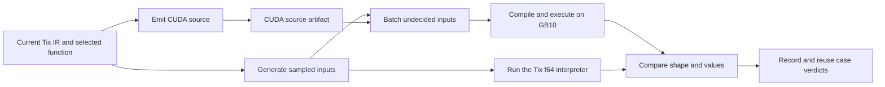

> [!note] About this report
> This is the final report of the agent that implemented stage 2 of the tensor track: lowering Tix to CUDA and checking the lowering on an NVIDIA GB10 (ticket IRWB-022-I, a Codex agent running gpt-6.2-sol at high effort). It was one of twelve independent implementations of the same brief, built on [[PROJECT REPORT - IR Workbench - Tix and the Cost of Changing a Reduction Order - Stage 1 of the Tensor Track - A Technical Deep Dive|stage 1 (report 12)]].
>
> **Why it was merged.** It is one of three implementations whose output was bit-identical to the f32 meaning on every case the independent evaluation measured. Of those three, it had the smallest tool change and the smallest source. It made no framework change.
>
> **Its contract.** It checks the lowering under a tolerance against f64. In its last section it argues for the exact relation it built but did not claim. That argument draws on an exhaustive comparison over all 2³² inputs, which the coordinator ran independently and gave to every agent with its results.
>
> **Where it lives.** The comparison of all twelve implementations is in [[PROJECT REPORT - IR Workbench - Tensor Programs on the v6 Framework - Tix, CUDA on a GB10, and Four Codex Configurations on the Same Tasks - A Technical Deep Dive|report 11]], Section 9. This report is merged at `2e035c6`; its evaluated revision is `dd8b7b6`. Links in the text point into the agent's ticket in the repository.
>
> The text below is the agent's, unedited.


# Preserving Tix’s f32 meaning on the GB10

A dot product in Tix defines more than a set of terms. It defines where each product rounds, in what order the sum visits the terms, and where the accumulator rounds again. Give the interpreter the seven terms `[1, 0, 0, 0, 2^-24, 2^-24, 2^-24]` and it returns 1 in f32. Each of the three small additions is halfway to the next representable number and rounds back to 1. Tix's checked split-sum pass can change the reduction tree so the three small terms add to each other first. The resulting f32 sum is 1.000000238418579. The CUDA backend reproduces the rounding points of whichever tree it receives. The split result is part of the optimized program's meaning.

IR Workbench is a TypeScript framework for representing immutable program revisions and checking compiler passes against executable contracts. Tix is its tensor language, with index notation, affine shapes and addresses, and scalar arithmetic and reductions. Its first stage built the front end, an interpreter in two precisions, and checked inlining and split-sum passes. Stage 2 lowered the same IR to CUDA C++ and made execution on an NVIDIA GB10 part of the lowering's acceptance condition. This report describes the evaluated implementation at `dd8b7b6`.

## A thread computes one output element

A Tix function names its inputs and defines tensors in order. The calling domain uses finite f32 inputs, consistent nonnegative dimensions and in-bounds affine reads that fit the target's buffers and launches. A tensor definition contains its shape, output axes and a scalar expression with resolved binder identities. In a matrix multiply, the expression for a cell multiplies two indexed reads and reduces along the shared dimension. A convolution uses the same expression machinery with affine input addresses such as `y + dy`. The checker has already resolved which axis supplies each bound. The emitter's work is to render those choices as index arithmetic, scalar instructions and ordered loops.

I emitted CUDA directly from that IR. A separate kernel IR would have needed its own representation and validation for much of the same information. The lowering fixes the placement of each definition and gives every output element its own thread. Once those choices are fixed, the expression tree carries everything needed to print a kernel. The contract still needs a typed output to identify the exact candidate being judged. That output is a versioned artifact containing the function name and CUDA translation unit. It carries source text and identity for the framework, with no second graph of kernel operations.

The generated host code allocates parameter and statement buffers and launches one kernel per statement in definition order on a single stream. A block has 256 threads. A guard excludes threads beyond the output size, and each remaining thread decodes its linear index into row-major coordinates. The following excerpt is the emitted matmul kernel. Here `d0`, `d1` and `d2` are M, K and N. `I` and `U` are signed and unsigned 64-bit integers.

```cpp
__global__ void k0(I d0, I d1, I d2, const float* t0, const float* t1,
                   float* result, U count) {
  const U thread = static_cast<U>(blockIdx.x) * blockDim.x + threadIdx.x;
  if (thread >= count) return;
  U coordinate = thread;
  const I i0 = coordinate % (d2);
  coordinate /= (d2);
  const I i1 = coordinate % (d0);
  float v0 = 0.0f;
  const I end_i2 = (d1);
  for (I i2 = 0; i2 < end_i2; ++i2) {
    float v1 = __fmul_rn(t0[((i1) * (d1) + (i2))], t1[((i2) * (d2) + (i0))]);
    v0 = __fadd_rn(v0, v1);
  }
  result[thread] = v0;
}
```

A reduction with several binders becomes a loop nest in lexical order, with the first binder outermost. The Stage 1 split rewrite uses two separate sums, one across blocks of four and one across terms within a block. The emitter honors the ceiling block count, short final block and separate accumulators already present in the IR. It reads composed affine addresses after inlining in exactly the way it reads source addresses. Unique binder identities keep a shadowing reduction distinct from an enclosing one. An empty sum returns positive zero and an empty maximum returns negative infinity. A definition with an empty output has no launch. A direct parameter return can run with zero kernel milliseconds.

The emitter encodes numeric literals as f32 words, converts shape values with `__ll2float_rn`, and uses explicit round-to-nearest CUDA intrinsics for addition, subtraction, multiplication, division and square root. The compiler invocation is `nvcc -O3 -arch=sm_121` with default IEEE underflow behavior. Explicit multiplication and addition preserve the two rounding points of a multiply followed by a sum step. Calls to `exp`, `log` and `tanh` use the CUDA double routines, followed by `__double2float_rn`. The min/max helper propagates a NaN and selects the required signed zero when its inputs are mixed zeros. The same helper serves scalar and reduction maxima.



The three public functions share the emitter. `cudaSource` returns the translation unit, and `runTixCuda` runs a concrete input case with an optional remote host override. `checkLowering` executes the checked transformation for the selected function. The generated executable gets its inputs from a versioned little-endian batch file with shapes and f32 words. It returns shapes, f32 words and device event times. The same host program handles a concrete call with one case and a differential check with many cases.

## What the contract measures

The implemented relation compares the candidate against the **current** Tix revision evaluated in f64 with the same f32 input words. It requires equal output shapes and lengths. For each finite reference value `r`, the GPU value `g` must be finite and satisfy `abs(g - r) <= 2e-6 + 2e-5 * abs(r)`. Signed infinities must match. A NaN matches a NaN. The budget comes from the Stage 1 numeric check, and a failed comparison records a reproducible case description and the first differing coordinate.

The original arithmetic probe ran 102,461 input triples on the GB10 and used raw finite words and bounded ranges, including zeros, subnormals and a multiply-add contraction witness. Explicit arithmetic and the double transcendental paths matched every compared non-NaN f32 word. The ordinary CUDA single-precision functions `expf`, `logf` and `tanhf` differed on 16,615, 2,255 and 3,553 non-NaN outputs, respectively. A plain multiply followed by addition also differed on 2,556 inputs when compiled in that probe. A separate part of the same run computed four dot products of length 1,023 with both sequential and split folding. All eight outputs matched their Stage 1 f32 words, and the worst used 1.38% of the f64 tolerance. Those observations supported a useful f64 budget over the sampled cases. They gave evidence for the explicit rounding implementation as well. [Arithmetic probe](../scripts/01-fp-probe.mjs)

Cases use a seed of 20 and deterministic shapes and values. Assignments include 1, 3, 4 and 7, a mixed assignment to expose index errors, and zero assignments to exercise empty outputs or empty reductions. Signed, positive, half-ULP and alternating signed-zero streams exercise different arithmetic and indexing behavior. The generator deduplicates shapes and uses the Stage 1 evaluator's sampled address and work checks, with a limit of 4,096 elements per tensor and one million metered steps per case. An empty eligible case set yields no acceptance. The contract returns a sampled verdict for the function.

The framework already supports both heterogeneous transformations and remote batches. `AnalysisManager.execute` awaits the asynchronous invariant on the CUDA artifact. `differential` passes all undecided case indices to its `decide` callback in one call. The callback runs the candidate's source, compares each returned case with its precomputed f64 reference and returns the verdicts in index order. The framework memo retains case lists and verdicts. Its baseline key identifies the Tix revision and function, and its subject key identifies the CUDA revision and execution profile. This replays a completed agreement or disagreement on a repeat check. Errors in transport, compilation or decoding leave the check retryable. Concurrent cold checks can both issue a batch.

No framework source changed in this stage. Its transformation interfaces were sufficient for a cross-kind output and its differential checker already delegated batches and memoized verdicts. The Stage 1 passes continue to use the synchronous native pass path for same-kind IR edits. The CUDA pass consumes the current revision, regardless of which Stage 1 checks produced it.

## What changed in remote execution

The original remote tool used the same directory for compilation, execution and the fetched output. It reused a binary only if the directory's entire contents matched. CUDA source is unchanged between cases with different tensor values, so including the tensor payload in the compile key wasted compilation. The repeatable `--runtime-input` option excludes named runtime files from the build hash and still uploads them. The SHA-256 key includes the compiler path, architecture, compile flags, and names and contents of build files. This retains dependency tracking for inputs such as headers.

Excluding runtime files from the key means identical build inputs can run concurrently with different tensors. Each invocation now uploads, executes and fetches outputs in a unique remote directory. A per-key compile lock protects the shared binary. The first successful compiler run atomically installs its executable, and each job links that executable into its own directory before releasing the lock. That directory gives the job its own relative paths and output files. The tool removes it after fetching. It surfaces upload, compile, run and fetch failures so the checker can distinguish unavailable evidence from a completed comparison. Only `--timed` runs take the tool's GPU lock. The concurrent runner test verified that two jobs with different data compiled once and each received its own output, and that changing a header triggered a new compile.

## Timing and verification

CUDA events surround the stream's launches. An early launch timing probe exposed the timing cost of lazy module loading. On the GB10, the first launch interval of a trivial kernel was 0.060768 ms and its repeat was 0.003584 ms. Querying a second kernel with `cudaFuncGetAttributes` made its first launch interval 0.003360 ms. The generated host calls that API on every kernel it will launch before recording the starting event. Input allocation, transfers and output downloads also take place outside the event interval.

For our corpus measurements, each original function ran at the brief's sizes with seeded f32 inputs. The local interval covered one call to the Stage 1 f32 interpreter on an Intel Core i7-1165G7 with Node 24.18.0. It included the interpreter's buffer handling and excluded compilation and input preparation. Some CPU runs overlapped on the shared host, so these are observed wall times. The remote run used one short timed invocation per function on the GB10 with CUDA 13.0.88. Each invocation ran a warmup followed by three measured intervals and returned their median. The independent evaluator later reported the public `gpuMs` values shown alongside them.

| Program and dimensions | Local interpreter wall ms | GB10 kernel median ms | Independent `gpuMs` |
| --- | ---: | ---: | ---: |
| matmul, M = K = N = 512 | 781,174.296 | 0.215200 | 0.197 |
| softmax, N = 4096, C = 1024 | 61,400.503 | 0.800064 | 0.785 |
| layernorm, N = 4096, D = 1024 | 103,502.860 | 0.484736 | 0.563 |
| attention, Q = K = 1024, D = V = 64 | 507,205.507 | 1.049984 | 1.810 |
| mlp, N = 1024, D = 256, H = 1024, O = 256 | 1,285,227.803 | 0.957664 | 1.051 |
| conv2d, N = 8, C = 16, H = W = 64, O = 32, 3 × 3 kernel | 767,068.147 | 0.164352 | 0.341 |

Our CPU and GPU output shapes and SHA-256 digests matched in all six runs. The independent column uses its own concrete API runs. It gives separate single-interval observations from the public runner. [Timing method and replay](02-cuda-lowering-verification-and-corpus-timings.md)

The TypeScript build and all 29 focused tensor tests passed. Network-free tests checked source generation, the binary protocol, batching, evidence replay and retry. Ten GB10 tests exercised the original and optimized corpus, zero extents, a direct return, signed zero and reduction scoping. Two mutations changed otherwise runnable CUDA source. One substituted a transposed address for the correct inlined address. The other discarded a partial last block in a split sum. The same lowering contract rejected both with numeric counterexamples. [GPU tests](../../../../../../tests/tensor/cuda-gpu.test.mjs)

## Independent evaluation and the f64 gaps

The independent run passed all 25 hidden Stage 1 tests and found the three CUDA exports. All 20 random programs agreed bit for bit with the f32 meaning at every element. The independent checks accepted all six corpus programs and ten random programs under the implemented tolerance, at 2.5 seconds per check on average. At full corpus sizes the independent f32 equality counts were 262,144/262,144 for matmul, 4,194,304/4,194,304 for softmax, 4,194,304/4,194,304 for layernorm, 65,536/65,536 for attention, 262,144/262,144 for mlp and 984,064/984,064 for conv2d. The maximum f32 difference scaled by `max(1, |r|)` was zero in each case.

The small results also matched f32 on every element. The evaluator reported the following largest differences from f64. Its optimized comparison used the f32 interpreter on the optimized program.

| Program | Original f32 words equal | Largest reported f64 gap | Optimized f32 words equal | Largest reported optimized f64 gap |
| --- | ---: | ---: | ---: | ---: |
| matmul | 35/35 | 3.2e-7 | 35/35 | 2.2e-7 |
| softmax | 76/76 | 5.3e-8 | 76/76 | 4.9e-8 |
| layernorm | 72/72 | 1.3e-7 | — | — |
| attention | 72/72 | 6.6e-8 | 72/72 | 6.0e-8 |
| mlp | 24/24 | 3.6e-7 | 24/24 | 4.6e-7 |
| conv2d | 160/160 | 3.1e-7 | — | — |

Every gap in the table is between f32 and f64 evaluation. Equality with the f32 interpreter pins the GPU result for each reported input. The reported maxima are aggregates, so attributing a particular maximum to a specific intermediate instruction would require the input and an execution trace. I reproduced the rounding mechanisms on the actual corpus IR using small inputs with known prefixes. The source locations and the ten witness runs are in the diary and its replay. [Operation-level diagnosis](01-implementation-diary.md), [rounding witnesses](../scripts/04-rounding-witnesses.mjs)

In matmul and conv2d, the f32 product can differ before the sum even begins. A single nonzero term `(1 + 2^-23) * (1 - 2^-23)` rounds to 1, while its f64 product is `1 - 2^-46`. Longer dots also round after each `__fadd_rn`. In the optimized matmul witness, the three half-ULP terms sum exactly within their block and the outer addition is the rounding site. The two-level fold changes where accumulated error can enter while preserving the optimized expression.

In softmax and attention, `__double2float_rn(exp(...))` introduces a rounding site after the shifted exponential. A two-term witness makes the shift exact and produces 0.3678794503211975 in f32 for `exp(-1)`, versus 0.36787944117144233 in f64. The subsequent sum and normalization division also round, including the inner and outer sums after splitting. Attention additionally rounds the products and sums in the score and value contractions and the square root and division used to scale scores. The witness uses a feature width of one so the score calculation is exact and the difference reaches the output through the weight. Both optimized programs exhibit the same exponential rounding on these inputs.

In layernorm, a row with mean and variance exactly one makes the emitted square root of `variance + eps` the first differing operation when `eps` is one. The f32 root is 1.4142135381698608 and the f64 root is 1.4142135623730951. The following division carries the difference into the output. More general rows also round the mean, subtraction, variance products and sum, and final scale and shift.

In the MLP, the two dense products round their multiplies and folds, and their bias additions round. Inside GELU, the literals 0.79788456 and 0.044715 are converted to f32. Each arithmetic operation rounds and the result of the double `tanh` rounds once. Setting the dense layers to pass through a single activation of one isolates GELU. The literal 0.79788456 becomes 0.7978845834732056 at emission, and the final activation is 0.8411920070648193 in f32 and 0.8411919903841787 in f64. Inlining moves the activation into the final contraction and preserves those rounding points. Splitting changes the dense folds. The optimized witness gives the same local result.

## What I would do differently

I would choose f32 equality with NaNs compared by class for the lowering contract on this toolchain. The coordinator independently compared CUDA double `exp`, `log` and `tanh` rounded to f32 against Node's f32 meaning for all 2³² f32 input words, treating NaNs as a class. Together with the correctly rounded arithmetic and square root, the emitted rounding sites and the agreement of the independent whole-program tests, that supports a more direct preservation check. Strict bit identity across all outputs remains false. An untimed replay through the generated `__fsqrt_rn` on `-2^-149` returned `0x7fffffff` on GB10 and `0xffc00000` in Node, with both outputs NaN. The same replay returned identical words for both signed zeros. This stronger sampled relation would judge the lowering against the exact f32 tree it receives, including trees already reassociated by Stage 1. The f64 budget measures a separate numerical property and can admit an incorrect f32 result or reject a correctly lowered f32 program with large rounding error.

I would also retain the input or case ID, worst coordinate and compared values beside each reported maximum. An output summary is enough to check how far apart results were. Replaying the worst case with intermediate tensors makes the difference attributable. For timings, I would save the three GPU intervals and collect the interpreter wall times with the workloads scheduled separately from one another on the local host. That would make the variation visible alongside the device medians. The implemented runner and checker already provide the separation between execution and acceptance needed to repeat those measurements.
