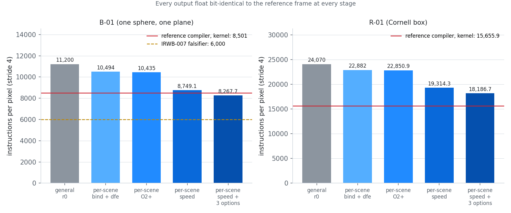
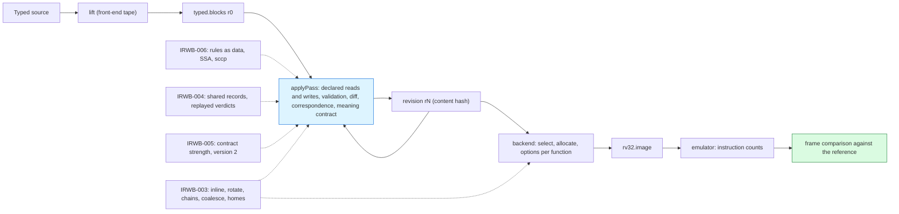
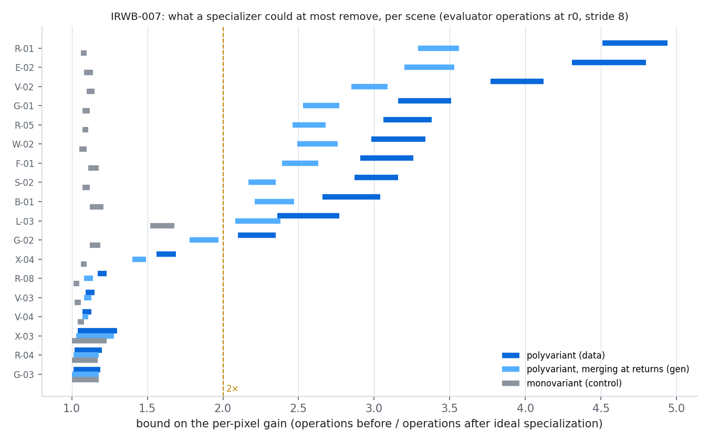
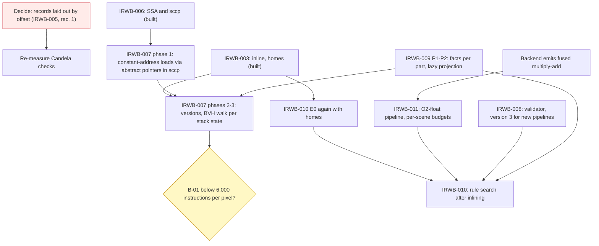

# Synthesis: four milestones, five research plans, and the order the measurements suggest

The IR Workbench project compiles Typed, a small statically typed language with TypeScript-like syntax, to 32-bit RISC-V with the single-precision float extension (RV32F). It is built on a framework in which every version of a program is an immutable, content-addressed revision and every optimization pass is accepted only after the framework has checked it. Two workloads exercise it:
- **the corpus:** 44 small projects whose exact numbers come from a book and serve as regression tests;
- **Candela:** a 332-function path-tracing renderer with an 18-scene gallery.

Two days of work produced:
- four implemented milestones: rule tables and an SSA view (IRWB-006); cheaper checking (IRWB-004); a measurement of how strong the check is (IRWB-005); and the passes and code-generation options that close most of the speed gap to the reference compiler (IRWB-003);
- before them, per-scene Candela kernels (report 4);
- after them, five research plans (IRWB-007 to IRWB-011), each of which measured its own premise before any of it was built.

Each milestone has its own report. This one does not restate them. It puts their results side by side and asks three questions:
1. What did the framework make possible that recurs across all of them?
2. What do the plans' measurements say about which direction pays?
3. In what order should the directions be taken?

Five terms recur:
- **A revision** is the SHA-256 hash of a program's canonical text. **r0** is the program as lifted from source; r1, r2, … follow one per pass application that changes it.
- **The meaning contract** (`typed.meaning-kept`) evaluates r0 and a candidate revision on generated cases and accepts the candidate only if every decided case agrees bit for bit.
- **The frame comparison** renders a Candela scene through the real host protocol and compares every output float with the frame the reference compiler's image renders.
- **An instruction count** is the number of instructions the RV32 emulator executes. It is the measure of speed throughout.
- **`kernel`** is the reference compiler's fastest code-generation policy.

> [!summary]
> - **Four milestones, one unchanged baseline.** Each milestone rebuilt core machinery: rule tables replaced hand-written rewrites, revisions share unchanged records, a second contract version was added, and new passes and backend options were added. Each was accepted only if the 44 corpus revisions stayed identical to the baseline. After all four were merged: 377 tests (374 pass, 3 skipped), parity 6,986/6,986, and corpus revisions identical to the `420d8e1` baseline.
> - **Speed: from 16% slower than `kernel` to 17% faster on the general Candela image.** It runs 601.8 instructions per generated case against 727.3. On scene B-01 the per-scene `speed` image runs 8,267.7 instructions per pixel against `kernel`'s 8,501. R-01 is still 16.2% above. Every frame is bit-identical to the reference.
> - **The plans measured themselves first, and the measurements split the gallery in two.**
>   - In 11 scenes most of a pixel's work reads scene data. A specializer that makes several versions per function (polyvariant) could cut it by at least 2× (IRWB-007); one version per function could not exceed 1.23× in 17 of 18 scenes.
>   - In the other 7, the work is arithmetic: noise, distance fields and density. There, inlining and constant handling come before algebra (IRWB-010), and contraction into fused multiply-adds is worth 1.62–4.17% with no displayed change in six of eight measured scenes (IRWB-011).
> - **Decisions that are the user's** (section 6) include:
>   - whether to fix the record-layout defect in the case generator (it affects the cases of 168 Candela functions);
>   - the order of two evidence strengths;
>   - whether to vendor a solver;
>   - the audit share for exact checking;
>   - whether to install a system OOM daemon.

## 1. Where the four milestones left the compiler

The table lists each piece of work with the measurement that best states its result. The sources are the milestone reports, which give the full evidence.

| work | what it added | headline measurement | source |
|---|---|---|---|
| per-scene kernels (IRWB-001) | record-field bindings; contracts that compare only the host's entry functions; dead-function elimination; merged bounds checks; an RV32F backend | 185–197 of 332 functions removed per scene; images 58% smaller; 5–6% fewer instructions per pixel; 559 bounds checks on Candela r0 become 100; every frame bit-identical | report 4 |
| IRWB-006 | 27 `simplify` and 40 `fold` rules as data, each with evidence; an SSA view; sparse conditional constant propagation (`sccp`) | 1,232 comparisons with the hand-written passes and no difference in revision, edits or correspondence; SSA equals reaching definitions on all 332 Candela functions; `constants` project 70 → 40 instructions in one run | report 5 |
| IRWB-004 | shared records, function parts, closure keys, replayed verdicts, worker pools, an engine worker in the browser | O2 on Candela 12:06 → 3:27, peak memory 5.79 → 4.70 GB, all 16 steps the same revision; 63% of case decisions are replays | report 6 |
| IRWB-005 | a mutation harness; contract version 2 (boundary cases, records laid out by offset, a divergence rule) | default contract rejects 83.1–95.5% of wrong corpus mutants; version 2 accepts 5 of 952; a record-layout defect in the default generator | report 7 |
| IRWB-003 | `inline`, `rotate`, the `speed` pipeline; backend options `chains`, `coalesce`, `homes`, each kept per function only if a static estimate says it is cheaper | corpus 910,718 → 728,450 instructions (−20.0%); general Candela image 601.8 per case against `kernel`'s 727.3 | report 8 |

The four milestones ran in parallel worktrees and were merged into one tree. The gate on the merged tree (IRWB-001 diary step 37, merge commit `b59ca85`):
- `tsc` clean;
- 377 tests, of which 374 pass and 3 are skipped;
- the full pass and backend suites 21/21;
- the full rules, SSA, `speed` and `inline` suites 30/30;
- parity 6,986/6,986;
- corpus revisions identical to the `420d8e1` baseline.

## 2. One scene through five stages

Following one scene through every stage shows what each kind of work contributed. Figure 1 renders B-01 (one sphere and one plane) and R-01 (the Cornell box) at stride 4, which is 1,600 pixels. Every stage's frame is bit-identical to the reference frame.

*Figure 1. Stages 1–3 are from report 4; stages 4–5 and the reference from report 8. The dashed line is the first falsifier of IRWB-007's plan.*

| stage | B-01 | R-01 | what changed |
|---|---:|---:|---|
| general program, r0 image | 11,200 | 24,070 | — |
| per-scene program (bind `K.scene`, then `dfe`) | 10,494 | 22,882 | code that never runs removed; image 58% smaller |
| per-scene, O2+ | 10,435 | 22,850.9 | the standard passes on the specialized program |
| per-scene, `speed` with default options | 8,749.1 | 19,314.3 | inlining and loop rotation |
| per-scene, `speed` + `chains`, `coalesce`, `homes` | **8,267.7** | **18,186.7** | block order, copy coalescing, constants in registers |
| reference `kernel` | 8,501 | 15,655.9 | |

**Specialization removed code; inlining and code generation made code faster.** The first two steps shrank B-01's image by more than half while cutting executed instructions by 6.8% (11,200 → 10,435). The last two cut a further 20.8%. Report 4 measured the first fact and concluded that the remaining gap was "inlining and code generation, not pass ordering"; IRWB-003 confirmed it.

**The per-scene binding was monovariant.** It bound one field, `K.scene`, and gave every function one version for the scene, which is the kind of specialization IRWB-007 later bounded. On B-01, IRWB-007 measures that one-version-per-function specialization could reduce a pixel's operations beyond today's per-scene kernel by a factor of at most 1.12–1.21, while a specializer that makes several versions could reduce them by up to 2.66–3.04. So the small effect of the per-scene binding was not a sign that specialization is weak. It was a sign of which kind of specialization had been tried. Section 4.1 returns to this.

**R-01 is where the remaining gap is.** The `speed` image is still 16.2% above `kernel`. Report 8 names the functions with the largest gaps (`skyL_wgsl`, `hdriSample`, `traceAll`) and leaves them uninvestigated.

## 3. What the framework contributed

Every milestone and every plan used the same few mechanisms. They are worth naming, because the plans in section 4 depend on them as much as the milestones did.

### 3.1 Frozen revisions made parallel work checkable

Every milestone replaced machinery that the book's numbers depend on:
- IRWB-006 replaced the hand-written `simplify` and `fold` with tables;
- IRWB-004 changed how a pass's output records are allocated;
- IRWB-003 added passes and backend paths.

In each case the acceptance criterion was the same: the corpus revisions do not change. A revision is a hash of the whole canonical program text, including the provenance of every statement. An unchanged revision therefore means the new machinery made the same program with the same history, not merely a program that computes the same results.

This criterion is what allowed four branches to change core files at the same time and be merged without a separate validation of each combination. The merged tree was compared against one recorded baseline, `420d8e1`, and every line matched. IRWB-004's report states the strongest form of the result: the full O2 on Candela produced the same 13 new revisions with the same check counts, in 3:27 instead of 12:06.

### 3.2 Edit records made claims about passes testable

A pass edits through a transaction (`Tx`) that records, for every statement it replaces, the old and the new expression roots, along with an origin naming the pass and the reason. IRWB-008 used these records to test a claim that would otherwise be untestable: that the rule-backed edits of the standard pipelines are instances of the verified rule tables. An independent re-derivation reproduced all of them:
- 394 of 394 on the corpus;
- 838 of 838 on Candela;
- 22 ms of work on Candela, against 6,198 ms for the sampled check of the same three pass applications.

The same records also showed what is missing. A replace edit does not say which rules fired, and intermediate trees are not kept. The IRWB-008 plan proposes recording citations in the edits, the correspondence and the statement origins.

### 3.3 One gate, now with a measured strength

Every pass application on every workload passes through the same meaning contract. Before IRWB-005 its strength was assumed. Now it is measured:
- **On the corpus**, it rejects 83.1–95.5% of wrong mutants. The interval depends on how 142 mutants presumed equivalent are counted.
- **Most of what it accepts does not terminate:** 33 of 43 accepted wrong mutants loop where the original finishes.
- **On an 18-function Candela subset**, it rejects 87.4–96.8%. The survivors are almost all float mutants in distance-field and shading code.

IRWB-005 also found a defect that bears on all earlier Candela evidence. The default case generator writes a record's fields in the key order of the artifact's tables, not by offset, so the `K` record is scrambled in the cases of 168 of 332 functions. On the corpus this changes nothing. On Candela it means the contract's checks ran on `K` values no real call produces. The evidence that ties per-scene programs to real scenes is therefore the frame comparison, which runs the host protocol and is unaffected. The fix is one line, but it changes the contract's key, so it is the user's decision (section 6).

### 3.4 Caching on content made whole-program costs visible

IRWB-004's rule was to cache only on values that cannot change (frozen objects and content hashes), then to make more values stay the same object from one revision to the next. Once the repeated work was gone, the work left over could be measured.

IRWB-009 measured it, on the same Candela program:

| step | Candela, measured | proportional to |
|---|---:|---|
| a pass that changes nothing (`strength`), first time | 4,295 ms | the program (`ranges` solved from scratch) |
| a pass that changes 2 of 332 functions (`cfg`), no contract | 6,256 and 8,362 ms in two runs | the program (`makeCorrespondence`, 5.2–11.1 s alone) |
| opening Candela in the browser | 8,608 ms in one main-thread task | the program |
| meaning check within one pipeline | 12–207 functions per pass | the changed closure keys |

Only the last row scales with the change. The second row is the clearest case: that pass rewrote 4 of 82,660 records and still took six seconds before any check.

Two of IRWB-009's measurements decide the design of the remedy:
- **The analyses split exactly by function.** After `cfg`, the three dataflow analyses give canonically equal results for 222 of 222 unchanged functions and different results for 110 of 110 changed ones.
- **Source positions defeat per-function reuse.** A blank line inserted in one scene function changes 154 function parts but 0 code hashes. Keys for reuse must hash code, not positions.

### 3.5 The evaluator, the emulator and the frame are instruments

The research plans measured their premises with tools the milestones had built for other purposes:
- **The evaluator** counts executed operations. IRWB-007 ran a shadow copy of it, checked bit for bit against the original (0 differing floats), to classify each operation as static or dynamic.
- **The emulator** counts instructions per function. IRWB-010 used it for a heat profile of the noise functions.
- **The frame comparison**, run with several seeds, measures the renderer's own Monte Carlo noise. IRWB-011 used it as the scale for a float tolerance.

None of these plans needed new infrastructure to produce its first numbers.

## 4. The research program, measured before it is built

Each of the five plans is an intern guide stored in its ticket and uploaded to the reMarkable, and each made measurements before proposing a design. The table states each plan's question and the measurement that most constrains its answer.

| plan | question | measurement already made | what it rules out |
|---|---|---|---|
| IRWB-007 | how much can specializing Candela on its scene data save? | binding-time profile of all 18 scenes in three specializer models | monovariant specialization as the goal; any specializer on the 7 arithmetic-bound scenes |
| IRWB-008 | can rule-backed edits be checked exactly instead of by sampling? | 1,232 of 1,232 rule-backed edits re-derived; their share of Candela's sampled check | the idea that exact checking replaces sampling for most of the cost |
| IRWB-009 | can the cost of an edit be proportional to the parts it changes? | per-function analyses, projection pieces, edit sizes, source edits | position-based keys; whole-program correspondence as a fixed cost |
| IRWB-010 | can rewrite search find what the rule tables miss? | instruction heat and tree shapes of the noise functions at O2 | algebra as the first lever on the hottest float code |
| IRWB-011 | can float rewrites that change the last bits be accepted on rendered frames? | noise floor of 8 scenes; three float transformations rendered against it | a single tolerance for all scenes; a budget on the raw paired difference |

### 4.1 Scene data: polyvariance or nothing (IRWB-007)

Candela reads its scene from buffers that do not change during a frame:
- a table of objects;
- lights;
- a bounding-volume hierarchy (BVH);
- material constants.

The scenes are small. At most 24 objects, 2 lights and 15 BVH nodes, and 224 to 916 words of data per scene. B-01 is one sphere and one plane in a single BVH leaf.

IRWB-007 classified every operation a pixel executes in three models of a specializer:
- **data:** fully polyvariant, splitting every continuation;
- **gen:** polyvariant, but merging at function returns;
- **control:** monovariant, one version per function.

For each model it computed a bound: operations per pixel after today's per-scene kernel, divided by operations after ideal specialization. The interval comes from counting operations already folded today as either all done or none done.

*Figure 2. Parsed from IRWB-007's `various/04-profile-summary.txt`. Evaluator operations at r0, stride 8.*

The figure separates the gallery into two populations:
- **Eleven scenes where scene data dominates:** B-01, R-01, L-03, G-01, E-02, W-02, F-01, V-02, G-02, S-02 and R-05.
  - The polyvariant bound is at least 2×, from 2.10× (G-02) to 4.51× (R-01) at its low end.
  - On B-01, 51.2% of a pixel's 3,910 operations depend only on constant memory, and the object-table reader `oRow` alone executes 35.2% of them.
- **Seven scenes where arithmetic dominates:** X-04, V-03, V-04, R-08, X-03, R-04 and G-03.
  - The bound is at most 1.69× (X-04) at its high end, and at most 1.30× in the other six.
  - These are the ray-marched and volume scenes. Their pixels evaluate distance fields, noise and density along each ray; that work is dynamic.

The monovariant bound is at most 1.23× in 17 of the 18 scenes. In L-03 it reaches 1.52–1.68×, because one of its three objects lies outside the BVH. Over the gallery its geometric mean is 1.08–1.16×, against 2.08–2.33× for the polyvariant model.

The difference between the two models is the BVH walk and the object reader. A monovariant specializer sees the object index arrive at `oRow` as a dynamic value inside the walk, so the object loads stay dynamic. A polyvariant specializer specializes the walk's loop head per stack state. For a tree there are at most nodes + 1 such states (8 for R-01's 7 nodes), so the code growth is bounded.

The gallery's hand-staged per-scene sections (`s<k>_…`) execute at most 3.0% of a pixel's operations in 10 of the 11 data-dominated scenes (G-02: 8.3%). The per-pixel cost never sat in what had been staged by hand.

The plan states its first falsifier in instructions, against IRWB-003's measured 8,267.7. If its second and third phases leave B-01 above 6,000 instructions per pixel, the approach has failed for this program.

### 4.2 Arithmetic: inlining first, then contraction, then search (IRWB-010 and IRWB-011)

The seven arithmetic-dominated scenes are where the other two plans measured. IRWB-010 profiled two of them at the O2 head:

| measurement (O2 head) | V-04 (a cloud) | X-03 (a planet) |
|---|---:|---:|
| share of executed instructions in `hash3`, `gnoise`, `noise3`, `q_floor`, `q_fract`, `fbm3` | 81.8% | 35.3% |
| instructions that build an f32 constant, whole frame | 15.0% | 20.2% |

Within `noise3`:
- 37.0% of executed instructions are `fsgnj.s` (float register moves);
- 21.1% rebuild constants;
- 14.5% are the arithmetic itself.

O2 does not change `noise3`'s instruction count at all, because no rule matches its trees. The one exact float rewrite in sight, `x * 2.0 → x + x`, would save 0.40% of V-04's frame.

The costs that dominate here are moves around calls and constant rebuilds. Inlining, copy coalescing and constants in registers address exactly those, and IRWB-003 built all three. IRWB-010 measured before IRWB-003 was merged, so its constant-building share has to be measured again with `homes` before any gain from rewriting is claimed. Its plan says so.

IRWB-011 asked whether float rewrites that change the last bits can be accepted when judged on the rendered frame. It rendered eight scenes with 32 passes each (X-03: 16) to measure the renderer's own noise on the displayed 8-bit image:
- One pass against another differs by 8.0–17.4 dB PSNR.
- Two 16-pass averages differ by 10.8 dB (S-02) to 30.5 dB (L-03).
- Five scenes gain 2.3–3.3 dB per doubling of passes, close to the 3.01 dB that variance proportional to 1/n predicts. V-02 and S-02 gain only 0.6–0.9 dB.

At 16 passes the scenes span 10.8 to 30.5 dB, so a single threshold would be too loose for L-03 or too tight for S-02. Budgets must be per scene.

Of the three transformations measured against that noise, one matters:

| transformation | executed instructions it accounts for | displayed levels changed |
|---|---|---|
| contraction `a·b ± c` into one fused instruction | 1.62–4.17% (X-03 4.17%, V-04 3.35%) | none in six of eight scenes; G-01 and S-02 have pixels that take a different path |
| division by a constant replaced by multiplication by its reciprocal | none saved; 1–15 instructions per pixel added in three scenes | none |
| reassociation of nested constants | at most 0.06% | none |

The two scenes that gain most from contraction, X-03 and V-04, are two of the seven where IRWB-007 can do little, and the same two where IRWB-010 found the noise functions hot. The plans therefore cover the gallery between them: IRWB-007 for the data-dominated scenes, IRWB-011 and then IRWB-010 for the arithmetic-dominated ones.

IRWB-011's measurement also corrected its own draft:
- **The draft:** bound the RMS of the difference between the candidate's frame and the exact frame rendered with the same seed.
- **What happened:** that budget rejects contraction on S-02 by 1.2 dB at 16 passes. A test across independent seeds sees no difference (mean z² 0.9869 against 0.9867).
- **Why both are right:** the paired difference mixes bias, which a budget should bound, with divergence. A pixel that took a different path has drawn a fresh sample from the same distribution, and that is noise.
- **The revised contract** estimates bias from the signed mean of the paired difference and sends diverged pixels to the cross-seed test.

### 4.3 Exactness is about strength more than speed (IRWB-008)

IRWB-008's re-derivation (section 3.2) shows that an edit citing a verified rule can be accepted by an exact argument. How much of the checking cost that removes depends on what is counted:
- **Of all edits,** rule-backed ones are 18.6% on the corpus and 14.0% on Candela.
- **Of expression-level edits,** they are 59.8% and 37.0%.
- **On Candela,** the three rule-backed pass applications account for 20.6% of the candidate runs and 19.1% of the checking time.
- **Checking is 21% of O2's 153.2 s** on Candela in that run.

So exact checking of rule-backed edits would remove about a fifth of a fifth of Candela's O2 time. Extending it to constant propagation by certificate would roughly double that.

The larger gain is in strength. IRWB-005 measured that a sampled check has a miss rate that depends on the workload and the kind of fault, and that some fault classes are invisible to a given case distribution however many cases are drawn. An edit accepted by an exact argument has neither problem.

IRWB-008 also records a cost that bears on the order of work. Version 2 of the contract, which IRWB-005 recommends for new pipelines, would cost an estimated nine times version 1's checking on Candela unless it gets the memo keys IRWB-004 built for version 1.

### 4.4 Cost per edit (IRWB-009)

IRWB-009 plans a framework in which the cost of an edit is proportional to the parts it changes, with every revision hash unchanged. Its phases are ordered by measured cost. P1 (analyses per function part, on demand) and P2 (a lazy projection and a compact correspondence) remove the largest measured costs without any new trust. Their acceptance targets are taken from section 3.4's table:
- the first no-change `strength` on Candela under 1 s, from 4,295 ms;
- the 2-function `cfg` under 1.5 s, from 8,362 ms.

This work does not make any program faster. It decides whether the other plans' search loops are affordable: IRWB-010's rewrite search, and IRWB-007's polyvariant versions with their code-growth budgets. Each tries many candidates per function, and today each candidate costs a whole-program step.

## 5. The order the measurements suggest

The guides give their own phase orders. Read together, their measurements and stated dependencies suggest the following order across plans. It is this report's reading, not a decision anyone has made.

1. **Correct the evidence before adding to it.** The record-layout defect means that every Candela check through the default contract ran on `K` values no real call produces. The frame comparison protects the conclusions drawn so far. Plans that will lean on the contract for Candela (IRWB-007's static checks, IRWB-008's exact acceptance, IRWB-011's anchor revision) should start from a contract that lays records out by offset. IRWB-008 notes that adopting the fix requires re-measuring its own Candela numbers.

2. **For the 11 data-dominated scenes, build IRWB-007 as a polyvariant specializer from the start.** The monovariant model is bounded at 1.08–1.16× in geometric mean beyond today's per-scene kernels, and at most 1.23× in 17 of 18 scenes. The plan's first phase extends IRWB-006's `sccp` with abstract pointers into constant memory, so it starts from built code. The 6,000-instructions falsifier on B-01 is measurable after phases 2 and 3.

3. **For the 7 arithmetic-dominated scenes, emit fused multiply-adds behind a tolerance contract before searching for rewrites.** Contraction is the only measured float transformation with a material gain (up to 4.17%), and its contract shape is measured. The rewrites IRWB-010 can reach exactly are small (0.40% for the one in sight), and its plan asks for its census to be repeated with IRWB-003's options. Search pays after inlining has exposed larger trees, and after IRWB-009 makes trying many candidates affordable.

4. **Run the infrastructure track alongside.** IRWB-009's P1 and P2 and IRWB-008's validator change no program's speed, but they change what the other plans cost (IRWB-009) and how strongly they are checked (IRWB-008). Both keep every existing revision unchanged, the same discipline that let the four milestones proceed in parallel.

R-01's remaining 16.2% above `kernel` belongs to none of these plans. Report 8 attributes it to three functions that were not investigated, and it is the cheapest open measurement.

## 6. Decisions that are the user's

| decision | options | recommendation and source | what depends on it |
|---|---|---|---|
| Lay records out by offset in the default case generator (IRWB-005, recommendation 1) | apply to version 1, or leave version 1 frozen and use version 2 for new pipelines | apply: it is a correctness fix for the cases of 168 Candela functions and changes no corpus decision (IRWB-005; IRWB-001 diary step 34) | the contract's key changes; Candela's checks under O2 change and IRWB-008's §14 numbers must be re-measured |
| IRWB-005's other four recommendations | the divergence rule, boundary cases, non-canonical NaNs, more cases for float code | version 2 already carries the divergence rule, the boundary cases and two of the three NaNs (IRWB-008 §10) | each changes the key of version 1 |
| The order of `reduced-width+argument` and `by-construction` evidence (IRWB-008 §19) | either order | none given; they are different kinds of incompleteness | which exact acceptances version 3 allows; 204 of 329 corpus `simplify` edits rely on the reduced-width rules |
| A decision procedure for rules (IRWB-008 §25) | in-house, or a vendored SMT solver such as a z3-wasm build | the user's, because a vendored solver is downloaded code | turning the 8 comparison inversions into proofs; verifying rules IRWB-010 discovers |
| The `audit` share during adoption of exact checking (IRWB-008 §29) | a seeded share of derived functions still sampled | 1.0 during the shadow phase, 0.05 for the first pipelines under version 3, then 0 | how quickly the sampled cost falls |
| A system OOM daemon (IRWB-001 diary step 32) | earlyoom or systemd-oomd, or the per-process cap alone | the user's, because it changes system configuration; the per-process cap (`MemoryMax=14G`, no swap) is in force for every Candela-scale job | protection against uncapped processes after the unexplained machine stop at 01:39 |

Two further items are the coordinator's, listed so they are visible:
- **Register `sccp` and `O2-sccp`** in the shared pass and pipeline lists next to `speed`, then rerun the full rules suite. The corpus gain is small (278,296 → 278,266 instructions), because `constprop` already finds nearly every constant there.
- **Keep `O2+` on version 1** of the contract (IRWB-008's recommendation), because recorded per-scene results depend on it.

## 7. What the numbers are, and what they are not

- **IRWB-007's bounds count evaluator operations at r0, not instructions.** Static work is load- and check-heavy, so the instruction gain may differ. The plan's first phase is where it will be measured in instructions.
- **IRWB-010's profile was taken at the O2 head** before IRWB-003's options existed. The constant-building shares (15.0% and 20.2%) are an upper bound on what `homes` leaves.
- **IRWB-011's savings come from a patched image.** Each fused pair's multiply became a `nop`, so the count of executed `nop`s is what a real fusion would save. The backend does not emit fused instructions yet.
- **Pixel sets differ between sources.** Reports 4 and 8 render at stride 4 (1,600 pixels); IRWB-007 and IRWB-011 use stride 8 or a 20 × 20 grid. Per-pixel numbers from different sources are not directly comparable. For example, IRWB-011's exact B-01 runs 11,300 instructions per pixel at r0 on its grid, against report 4's 11,200 on its own sample.
- **Wall-clock times on this machine vary** by 2–3× between runs minutes apart (IRWB-004 step 12, cited by IRWB-009). Times in this report are comparisons within one run or back to back, as their sources state.
- **Candela's contract checks ran under the record-layout defect.** The frame comparisons did not.

## Related notes

- [[PROJECT REPORT - IR Workbench - Closing the Speed Gap - Inlining, Loop Rotation, Copy Coalescing and Constants in Registers, Chosen per Function by a Static Estimate - A Technical Deep Dive]] (report 8, IRWB-003: the speed gap)
- [[PROJECT REPORT - IR Workbench - How Strong Is the Meaning Contract - Mutation Scores, Equivalent Mutants, Boundary Cases and a Divergence Rule - A Technical Deep Dive]] (report 7, IRWB-005: the contract's strength and the record-layout defect)
- [[PROJECT REPORT - IR Workbench - Cheap Experiments - Shared Records, Replayed Verdicts, Worker Threads and an Engine Worker, With Every Revision Unchanged - A Technical Deep Dive]] (report 6, IRWB-004: cheaper checking)
- [[PROJECT REPORT - IR Workbench - Rewrite Rules as Verified Data and a Single-Assignment View - Rule Tables With Identical Revisions, Evidence per Rule, and SSA Checked Against Reaching Definitions - A Technical Deep Dive]] (report 5, IRWB-006: rules as data, SSA, `sccp`)
- [[PROJECT REPORT - IR Workbench - Per-Scene Kernels for Candela - Cheaper Checked Passes, Merged Bounds Checks, an RV32F Backend and Bit-Identical Frames - A Technical Deep Dive]] (report 4: per-scene kernels and the measured gap)
- [[PROJECT REPORT - IR Workbench - Compilation Strategies as Checked Data - Searching Pass Orderings, Specializing on Outer Facts, and the Workbench in the Browser - A Technical Deep Dive]] (report 2: strategies and specialization on outer facts)
- [[PROJECT REPORT - IR Workbench - Candela on the Kernel - Float Semantics, Lifting From the Tape, and a Checked O2 on a 332-Function Renderer - A Technical Deep Dive]] (report 3: Candela lifted and checked)
- [[PROJECT REPORT - IR Workbench - A Compiler Defined on Its Own IR Framework - Typed to RV32 on v6, With the Prototype's Numbers Reproduced - A Technical Deep Dive]] (report 1: the compiler and the book's numbers)

The plans themselves are in the repository at `/home/manuel/code/wesen/2026-11-24--compiler-workbench/ttmp/2026/11/26/IRWB-007--…` through `IRWB-011--…`, each with its measurement scripts in `scripts/` and outputs in `various/`. They are also uploaded to the reMarkable under `/ai/2026/11/26/`.
