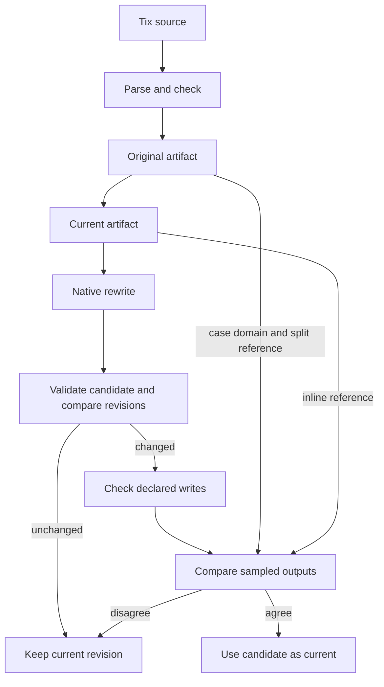

> [!note] About this report
> This is the final report of the agent that implemented stage 1 of the tensor track (ticket IRWB-020-B, a Codex agent running gpt-6.2-astra at medium effort). It was one of fourteen independent implementations of the same brief, and it was merged as the base for the next stage because it passed every objective check with the smallest framework change and the smallest source. The comparison of all fourteen, and how they were scored, is in [[PROJECT REPORT - IR Workbench - Tensor Programs on the v6 Framework - Tix, CUDA on a GB10, and Four Codex Configurations on the Same Tasks - A Technical Deep Dive|report 11]], Section 7. The text below is the agent's, unedited. It was merged at `98b04da`, and its evaluated revision is `343f7a8`.

# Tix and the cost of changing a reduction order

Adding three copies of `2^-24` to 1 gives two different answers in single precision, depending on when the three terms meet. In the Tix interpreter, adding them one at a time leaves the result at 1. Adding them together first gives a partial sum large enough to change the result. This small example posed the central question for a second compiler domain in IR Workbench. How should a framework that checks the meaning of each optimization handle a transformation whose *intended* effect includes changing some result bits?

The workbench previously compiled Typed, a statically typed language, to 32-bit RISC-V. Its reusable TypeScript framework gives compiler passes immutable program revisions, checks which parts of a revision they change, and lets a domain supply an executable meaning contract. Tix used those facilities to check two transformations with different obligations. Inlining a pointwise expression must preserve every output bit. Blocking a sum may spend a specified numerical error budget. Only the pass runner required a framework source change. The results below are for revision `343f7a8`; execution in this stage was on the Node interpreter.

## A tensor definition as a loop nest

A Tix function accepts named f32 tensors and returns one named tensor. Each statement defines a new tensor, and a later statement can read any earlier definition or parameter. Consider the matrix multiplication in the corpus.

```text
fn matmul(a: f32[M,K], b: f32[K,N]): f32[M,N] {
  y[i,j] = sum(k) a[i,k] * b[k,j];
  return y;
}
```

Three kinds of names appear in this example. The caller binds shape names such as `K` by supplying input dimensions. The indices `i` and `j` range over output coordinates, and `k` belongs to the reduction. A plain occurrence of an index in a read supplies evidence of its extent. Here both occurrences of `k` give it the same dimension. Reading a tensor declared with a different symbolic extent at one of those positions would produce a compile error even if two particular input arrays happened to be square.

Addresses and dimensions can also contain integer affine expressions. In the NCHW convolution fixture, a read uses the spatial address `y+dy`. That address alone cannot determine where the output loop ends and where the kernel loop ends. The statement declares the output height as `H-2`, and a plain read of the three-row kernel supplies the extent of `dy`. The checker accumulates extent information across the right-hand side before checking access bounds. It can therefore use a plain occurrence that appears later in the same expression. It normalizes affine forms to a constant and sorted coefficients, so algebraically equivalent dimensions can compare equal.

The implemented calling domain uses finite elements, consistent concrete shapes and in-bounds accesses. Symbolic names need a direct binding axis among the inputs. An affine dimension can then refer to those symbols elsewhere. This restriction kept shape binding small enough for the six programs. At compile time, errors such as an unresolved reduction extent, a repeated tensor assignment or a mismatched return rank identify the relevant source line and column.

Reduction syntax also determines floating-point meaning. In `sum(k) x[i,k]/D`, division belongs to the body. In `(sum(k) x[i,k])/D`, division follows accumulation. A precedence test uses the row [1, 2, 4] with D equal to 3. The first expression produced 2.3333334922790527 in f32 and the second produced 2.3333332538604736. A test with equal rounded answers for the two parses would miss this distinction.

## Two views of the program

The executable IR is a module of ordered functions and tensor definitions. Each definition carries a result shape, ordered output axes and a scalar expression tree. A reduction owns its binders, their bounds, its operator and its body. Each load names a tensor and carries one affine address per input axis. The parser assigns binder identities within each function. As a result, two nested reductions can spell a binder the same way while referring to distinct loop variables.

This representation preserves the pieces the two transformations need. Inlining composes affine addresses at a single load. Blocking changes a reduction tree and its bounds. Lowering immediately to individual jumps, offsets and accumulator assignments would disperse that information across several instructions. Keeping only the source syntax would leave the transformations to resolve names and infer extents again. In the chosen IR, the matrix multiplication already says which two loops write the output and which third loop folds into its value.

The framework sees the same native module through an adapter. Its artifact kind is `tensor.tix`, schema version 1. The adapter exposes functions and tensors as entities, definition order through containment edges, and tensor reads through dependency edges. The scalar tree is part of a tensor entity’s attributes. Changing an addition to a subtraction therefore changes the projected entity even when the set of tensors it reads stays the same. The native validator checks, among other things, that reads refer to available tensors of the right rank, index variables are in scope, and the returned tensor has the declared shape.

An artifact contains immutable program data and a content-derived revision. Evaluator buffers and accumulator values live outside the artifact. The public program handle retains two artifact references, the original compilation and the current executable revision. They initially coincide. An accepted rewrite can advance the current reference while leaving the original available as a numerical baseline across subsequent optimizer calls.



## Where rounding occurs

The public entry points are `compileTix`, `runTix` and `optimizeTix`, exported from `dist/tensor/index.js` after the build. The evaluator specializes the selected function’s shapes, materializes definitions in source order and visits output coordinates in row-major order. It computes addresses with integer indices. A shape name used inside a scalar expression, such as the divisor D, enters the selected floating-point precision.

In the default f32 mode, input elements enter a Float32Array. Literals, scalar shape values, arithmetic and intrinsic results are rounded with `Math.fround`. Thus a multiply feeding an addition has an observable rounding site between the two operations. A sum starts at positive zero, a maximum at negative infinity. Both visit index tuples in increasing lexicographic order, with the first listed binder outermost. The evaluator rounds each fold step, including an inner fold in a generated reduction. For an empty reduction the initial accumulator supplies the result.

The f64 evaluator takes the same traversal with JavaScript number arithmetic and Float64Array storage. A caller supplying a Float64Array retains its input precision in that mode. For optimizer checks, both sides receive identical f32 inputs, so the f64 reference measures the effect of computation on exactly the supplied values. Sharing control flow keeps the two evaluators aligned on indexing and scope. It also means that comparing them alone could miss an indexing bug shared by both. Independent expected outputs and the external reference evaluation address that weakness.

## Two transformations, two baselines

The inline pass considers a definition whose expression contains no reduction, whose tensor has one read site in later statements, and whose value is not the function’s return. It maps the producer’s free binders to the consumer’s actual address tuple, simultaneously substitutes into the producer’s loads, and replaces the consumer’s read with the resulting expression. It then removes the definition. For a producer reading `x[i,j]` that is used as `p[j,i]`, the substituted expression reads `x[j,i]`. Single use counts syntactic occurrences. A read inside a loop can execute many times.

A pointwise producer already returns a rounded scalar in f32. Removing its intervening store and load preserves the producer’s arithmetic tree and all of its rounding sites. The contract therefore compares the candidate’s f32 result to the *immediate input* of this pass. This matters when inline follows blocking. In that order the input already includes an authorized reassociation, and inline is accountable for any additional change.

The split-sum pass acts on an ordinary sum with one binder. For an extent K it generates an outer sum with `ceil(K/4)` blocks and an inner sum with `min(4, K-4*block)` lanes. Each occurrence of the old index becomes `4*block+lane`. Both sums start at zero. The generated bounds are distinguishable in the IR, so a subsequent invocation leaves those folds alone. Multi-index reductions and maximum reductions retain their original grouping. A partial last block still visits every remaining element.

For the seven elements `[1, 0, 0, 0, 2^-24, 2^-24, 2^-24]`, each small term in the original order lands halfway between 1 and the next f32 value. Rounding to nearest with ties to even returns 1 each time. In the blocked order the first block sums to 1 and the three small terms share the second block. The final f32 addition produces 1.000000238418579. Evaluating the original in f64 gives 1.0000001788139343. The same changed artifact consequently fails the exact gate and passes the tolerance gate. No timing assumption or random search is needed to exhibit the difference.

## What the contract checks

Both relations observe the returned tensor of every function. The checker first compares function signatures, then requires equal concrete result shapes and inspects every output element. For exact comparison it views f32 storage as unsigned 32-bit words. This catches a change from negative zero to positive zero that a JavaScript numerical equality check would accept. For a split the baseline is always the original artifact in f64. At each coordinate with reference value r, the candidate f32 value must be finite and satisfy

```text
abs(candidate - r) <= 2e-6 + 2e-5 * abs(r)
```

The absolute allowance covers small residuals, where relative error alone is a poor measure. The relative allowance scales with output magnitude and leaves room for roundoff across short reductions and successive arithmetic stages. These constants specify an output budget for this experiment. They were chosen for the small workloads, without a worst-case error derivation or a fit to the hidden tests. The seven-element witness exercises the allowance, while dropping a reduction tail on positive inputs changes the sum by enough to exceed it.

Cases come from the original function signature. The generator tries setting all symbolic dimensions to 1, 3, 4 and 7 in turn, then assigns 3, 5 and 7 cyclically to symbols in sorted name order. It deduplicates assignments and respects fixed dimensions. These sizes exercise a singleton, a short block, a complete block and a partial second block. The mixed assignment gives differently named axes a chance to take different lengths. Each tensor is limited to 4,096 elements for sampling, and origin evaluation meters up to one million scalar visits and loop iterations per case.

The generator uses seed 20 for signed values in the range from −1 to 1 and positive values in the range from 0.25 to 1. It also repeats the seven-element witness in storage order. Exact checks add alternating positive and negative zeros. The tolerance domain keeps cases whose *original* f64 return is finite at every coordinate. A nonfinite candidate on such a case fails. A function with no comparable case prevents acceptance of a changed candidate, even if another function has many passing cases. The differential checker records disagreements with the function, shape assignment, stream, seed and a coordinate-level reason.

## The framework finding

All framework source edits were confined to `src/framework/passes/define-pass.ts`. The normal runner, `applyPass`, awaits the pass and its analysis manager. It also opens an edit transaction before it knows whether the pass will use that transaction or return a native value. A probe with a native identity kernel returned a Promise and rejected the tensor-style adapter because it lacked a graph rebuild operation. The fixed optimizer API requires a synchronous result, and both tensor kernels already know how to construct a complete native candidate.

The added entry point, `applyNativePassSync`, takes the existing versioned pass descriptor, the current artifact and a synchronous two-artifact gate. Two extracted helpers serve both runners. One validates and constructs a native artifact, computes the graph diff and builds entity correspondence. The other enforces the pass’s declared writes against that diff. Sharing them keeps the same structural checks on both execution paths. For an unchanged revision the synchronous runner returns the original artifact immediately. For a change it checks writes and calls the supplied gate before returning the candidate.

The synchronous path refuses analysis needs, preservation claims and manager-dependent transformation contracts. Those declarations rely on the asynchronous manager. Tensor baseline selection stays in the closure supplied by the tensor domain. The existing differential invariant already supported separate calculations for baseline and candidate and an application-defined comparison, including synchronous execution. It required no numerical extensions. This division of responsibilities was the principal framework result of the stage.

## Verification and independent evaluation

Local checks covered six programs with small numerical oracles before and after optimization in both precisions. They included rectangular matrix multiplication, max-shifted softmax with large logits, layer normalization with distinct gamma and beta and positive epsilon, single-head attention, a two-layer MLP with tanh-GELU, and a two-channel NCHW convolution with a nonsymmetric kernel. Focused tests covered source diagnostics, nested binder scope, reduction order, empty extents and signed zero.

Mutation tests exercised the actual candidate acceptance path. One changed a transposed read back to identity order. Another changed the split’s ceiling block count to a floor, omitting the tail. Both produced structurally valid changed artifacts and both were rejected by their intended relations. A third changed the sign of zero by adding positive zero. Its exact-check counterexample included the sign bit. These were expected rejections in local tests.

The Node build succeeded with `npm run build`. All 16 tensor tests passed, as did all 18 framework test files and the four selected Typed test files covering passes, program execution, mutation and strategies. The framework regression used a read-only adapter and exercised an undeclared write, a failed gate and the identity path. The tensor tests also passed when rerun for this report.

An independent evaluator supplied the following results for revision `343f7a8`. Its hidden acceptance suite was written from the brief before implementation. Its random-program comparisons used a separate reference evaluator.

| Independent check | Reported outcome |
| --- | --- |
| Fixed core and public API | 25 of 25 hidden tests passed |
| Original f32, 60 random programs × 3 inputs | Bit-identical in 180 of 180 cases |
| Original f64, same programs and inputs | Within 1e-9 relative to max(1, &#124;r&#124;) in 180 of 180 cases |
| Inline | Accepted on 60 of 60 programs. Every accepted result was bit-identical to the original on the comparison inputs. |
| Split-sum | Accepted on 60 of 60 programs. Every accepted result agreed in f64 within 1e-9 on the comparison inputs. |

The independent evaluation reported zero failures and zero rejected optimizations. The external f64 cross-check and the optimizer’s f32 tolerance answer different questions. In particular, the reported f64 agreement after splitting is consistent with the measured f32 bit change on the seven-element witness. The pass counts measure acceptance. The public API also reports an unchanged revision as accepted, so these counts alone do not establish how often either rewrite changed a program.

## What I would do differently

I would record rewrite coverage alongside acceptance from the start. The framework result already distinguishes a new revision from an identity step, and the public optimizer reduces that information to a pass name and an acceptance flag. Counting changed revisions in the evaluation harness would let a reader distinguish opportunities found from changed candidates that passed. The targeted witness and mutant tests supply that distinction for particular programs. The aggregate random-program totals leave it open.

I would also retain the largest observed output error and its coordinate for each corpus run under tolerance. The current checker records concrete examples when a comparison fails. For passing runs, the reported agreement counts tell us that the budget held, while the seven-element example tells us exactly how much of it one output used. Recording that distance systematically would make a later discussion of the chosen tolerance depend on measurements across the six workloads as well as the arithmetic of one reduction.
