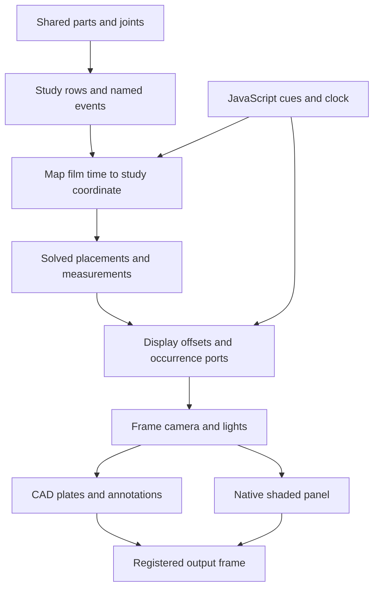
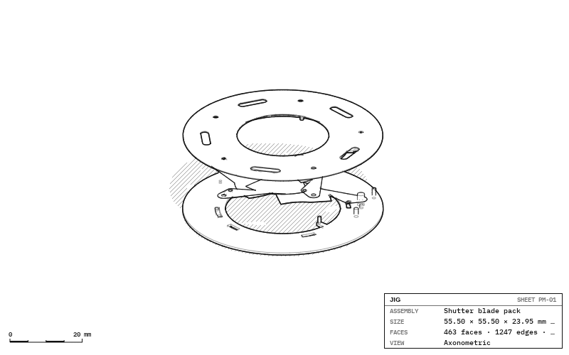
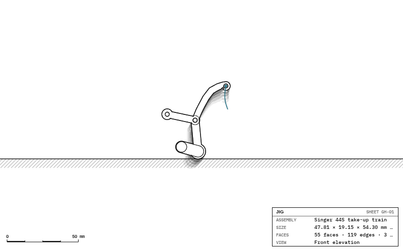
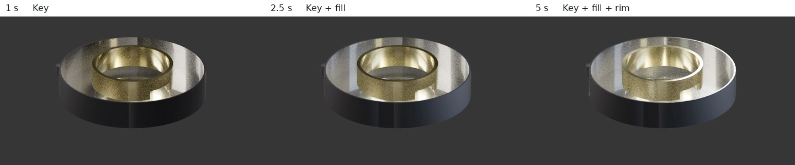
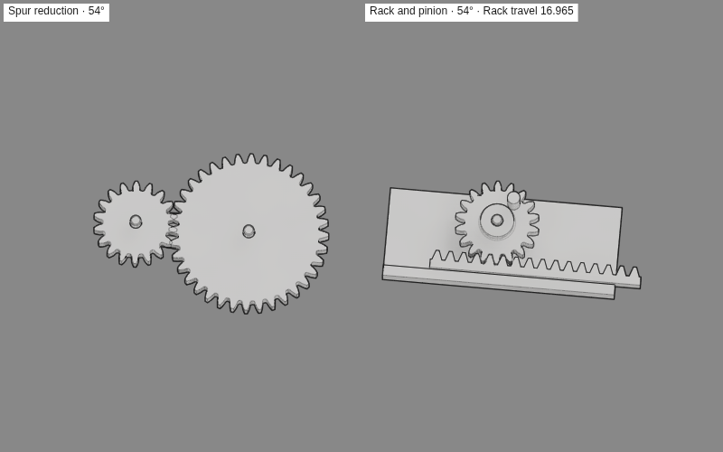
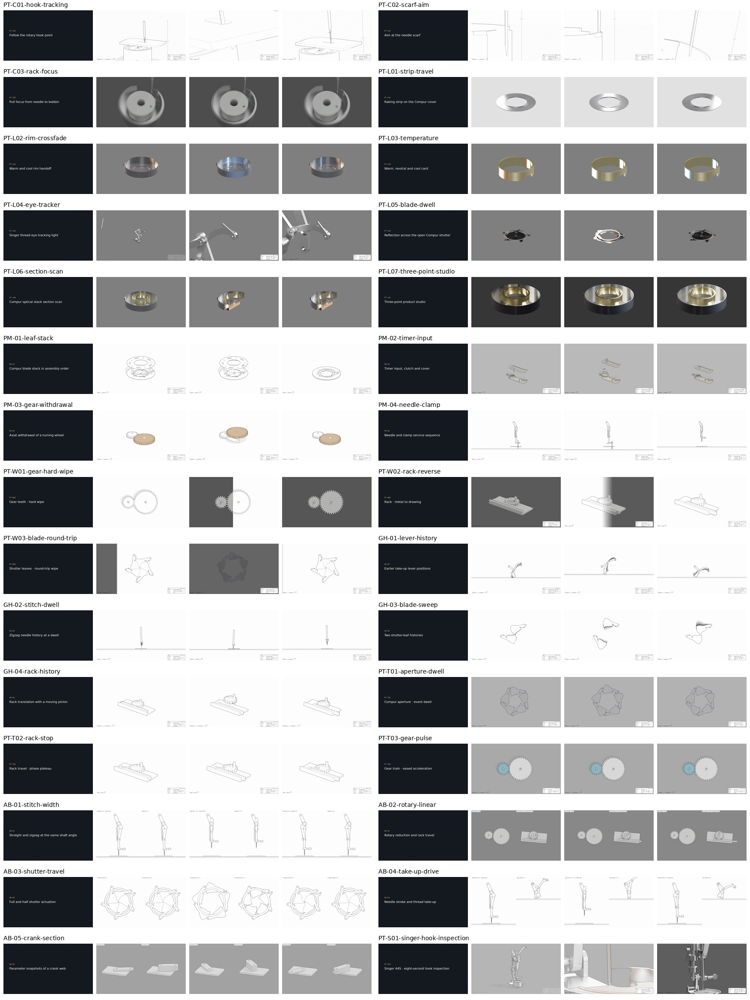

# From a solved mechanism to a 30-chapter product film

Four seconds into Jig’s Singer inspection film, the rotary hook reaches the scarf, a recess in the needle. The shaft stops. Over the next two seconds a boundary travels across the image, replacing the drafting view with shaded metal. The hook point stays at the center of the frame, and the annotation continues to read 0.075 mm. Three quantities explain what the viewer sees. Presentation time advances, shaft angle holds, and the fraction of the image covered by the shaded rendering increases.

JIG-028 made these quantities independently authorable in JavaScript. Its thirty short films exercise the resulting language on a Singer stitch head, a Compur shutter and several smaller comparison fixtures. They also provide a production test. Jig must reproduce the pose, framing and layer order a preset author saw in the workbench when a second machine renders the finished film. The delivery was a chapter-indexed, 223-second MP4, rendered on the DGX Spark at 1280 × 720. The 0.075 mm value describes the modeled clearance. Establishing that clearance on an individual sewing machine would require a physical measurement.

## The unit of authorship is a study with a presentation

An assembly gives each installed part an identity and a placement. A **study** specifies the input to vary, its range, and how to drive the assembly at each sample. A solved row can therefore answer a question such as “where is the hook point at this shaft angle?” A **presentation** assigns a time to that row and supplies instructions for displaying it. Several presentations can use the same part definitions. The Singer inspection imports the head, rotary hook and presser assembly from three part files before it defines a single camera move.

A **cue** is a named declaration at a time or mechanical event. Its callback receives a builder for the properties that change there. The following expression comes from the Singer preset. The local name `cut` holds the occurrences of the plate, bobbin case and bobbin.

```js
.cue('track-hook', 2, c => c
  .camera(cam => cam.track('holder:point').frameHeight(12)
    .over(2).ease('inOutSine'))
  .section({components:cut, normal:[0,1,0], offset:30, endOffset:0, endTime:4}))
```

The string `holder:point` addresses a **port**, a named geometric reference attached to an occurrence. From seconds two to four the camera transitions toward that moving target and a 12 mm vertical field of view. The section plane advances over the same interval to expose the mechanism. A part author can change the holder placement in one place because the shot refers to a point on that part. A hard-coded world coordinate would require the shot author to repeat the placement calculation.

The callbacks build data that the presentation evaluator can sample repeatedly. Time-dependent geometry enters through the solved study. This distinction matters when seeking directly from the end of a film to its middle. The Stage must reconstruct the state at the requested time without depending on which frames the operator has already watched. The diagram shows the dependencies for a single view.



## Tracking a measured point through a hold

The Singer film begins with a 168 mm high field that includes the head and presser assembly. Its clock maps four seconds of approach to the `scarf pass` event, then maps the remaining two seconds of base time to the end of the study. The event cue inserts a two-second pose hold. This accounts for the apparent discrepancy between `.duration(6)` in the source and the eight-second chapter. The hold gives the viewer time to read a dimension while the wipe progresses. At six seconds of presentation time the return cue begins opening the field back to 168 mm.

The registration test projects a witness point on the hook into a 640 × 360 test view. The following rows come from the recorded witness trace. Frame numbers are local to this film. A wipe progress of 0.5 puts the transition halfway through its travel.

| Frame | Film time (s) | Shaft (degrees) | Modeled Y difference (mm) | Projected point (px) | Wipe progress |
|---:|---:|---:|---:|---|---:|
| 48 | 2.000 | 37.105 | −0.2748 | (328.17, 264.03) | — |
| 95 | 3.958 | 40.022 | 0.0750 | (320.07, 181.26) | — |
| 96 | 4.000 | 40.022 | 0.0750 | (320, 180) | 0 |
| 120 | 5.000 | 40.022 | 0.0750 | (320, 180) | 0.5 |
| 144 | 6.000 | 40.022 | 0.0750 | (320, 180) | 1 |

A signed Y difference is a difference along one model axis. Reading it as the minimum three-dimensional separation of two solids would give it a different geometric meaning. That distinction also explains why the negative approach value can appear in the same trace as the positive inspection dimension. The useful registration test is that the projected witness, the shaft reading and the dimension agree through the transition. A visually smooth wipe alone provides no evidence about any of those quantities.

The rack study PT-T02 demonstrates a second way to specify a dwell. Its six-second clock places the pinion at 45 degrees at both two and four seconds. The equal phase values create a two-second plateau. Its drive uses a pitch radius of 18 mm, so the ideal rack travel on that plateau is 18 × π/4, or approximately 14.14 mm. The callout reads the solved slide port. This gives the author an independent arithmetic check on the displayed value.

## Moving parts for display and recovering their assembled pose

The shutter film PM-01 lifts the blade plate first, raises the ring, then separates five leaves. Its first six seconds share a single mechanical input. The visible translations belong to the presentation. After the last part seats, the mechanical input advances through an illustrative opening cycle.

For leaf index `i` starting at zero, the preset requests a local displacement of `3 * (i + 1)` millimeters along Z. Adjacent leaves begin 0.14 seconds apart, and each completes its travel in 0.6 seconds. For a local move, Jig transforms the displacement direction through the occurrence’s solved orientation before adding it to the placement. This lets an author specify “along this part’s Z axis” even when the part has been rotated within the assembly.

On a seek, `displayPose` evaluates the applicable cues and forms the display transform from the solved matrix at that time. A completed home move yields an exact zero offset, so the evaluator reuses the solved matrix. Repeating a loop therefore cannot accumulate translation error at the seated endpoint. Figure 1 shows the individual leaves at different heights during the staged move.



*Figure 1. PM-01 Stage capture. The plate, ring and leaves have independent display tracks. Their offsets can be inspected before the shutter cycle begins.*

History requires a different sampling rule. GH-01 takes four earlier poses of the Singer take-up lever, spaced 0.15 seconds apart, with decreasing opacities of 0.32, 0.23, 0.15 and 0.08. A separate curve traces the lever eye for one second. A curve records the path of one point. The translucent lever also shows how the body rotated about that point’s path. With pose deduplication enabled, Jig compares the selected parts’ transforms with the current and already accepted transforms. Repeated samples of a stationary lever then contribute no extra opacity.



*Figure 2. GH-01 Stage capture. The lever outline supplies orientation at each sampled time. The eye trajectory supplies positions between those samples.*

## Lighting and focus carry separate information

A reusable three-point studio declares three named rectangular emitters. In PT-L07 the broad key illuminates the Compur housing, the fill reveals its darker wall, and the narrower rear emitter gives the rim a bright edge. The fragment accepts a center and subject span in millimeters. It derives both emitter positions and emitter sizes from the span, so another preset can import the same arrangement for a different subject size. A cue can address one emitter by name and animate its luminance independently.

```js
const {threePoint} = await importPartFile('three-point.parts.js')
const rig = threePoint({center:[0,0,8], span:56})
const film = j.presentation('Building a three-point studio').duration(7).studio(rig)
```

The chapter starts with fill and rim at zero. At 1.5 seconds the fill begins a 0.75-second rise to 2,000. At 3.25 seconds the rim begins a rise of the same duration to 24,000. The key is already on at 8,500. Apparent brightness also depends on emitter area, orientation and surface finish. Comparing the three luminance settings alone cannot predict the brightness of a particular patch of housing. Keeping camera, exposure and housing fixed makes the sampled images interpretable.



*Figure 3. Frames from the encoded Spark chapter at 1, 2.5 and 5 seconds. Read the dark housing wall across the first transition and the rear edge across the second.*

PT-C03 varies focus with a stationary mechanism. The preset fixes the vertical field at 37 mm and sets the aperture to f/2.8. It changes the focus target from `needle:scarfMid` to `bobbin:axis` over 1.5 seconds, then returns focus to the needle. The review measured the 98th percentile of image-gradient magnitude in two fixed pixel regions. A sharp edge produces a larger local gradient. When focus moved from the needle to the bobbin, the needle-region statistic fell from 13.89 to 5.02 and the bobbin-region statistic rose from 7.63 to 23.74. The opposing changes distinguish the focus pull from uniform softening of the whole image. These numbers depend on the selected edges, exposure and image resolution. They provide a regression measurement for this shot.

## Comparing two mechanisms at the same input

A side-by-side film introduces two registration problems. The bodies need a common spatial reference, and both machines need to reach the same input coordinate in each frame. Jig solves each source study with its own geometry and parameters. It uses an oriented datum port from each source to express the right assembly in the coordinate system of the left. This transformation accounts for rotation as well as translation. The panels then share the projected vertical field.

Matching the original sample rows by equality produced only thirteen shared poses in an early quarter-turn comparison. The fix was to ask both source programs to solve on the film’s common phase grid. Otherwise, two sources with adequate individual sampling densities could still produce a visibly coarse comparison. At the illustrated sample both inputs are 54 degrees, while the rack in the right panel reports 16.965 mm of linear travel.



*Figure 4. AB-02 Stage capture. The common angle makes the difference between rotary output and linear travel readable. Each panel retains its own solved body and measurement.*

A related case, AB-05, compiles two parameterizations of the same crank. Their web thicknesses measure 3 and 9 mm. Each panel therefore needs its own geometry package as well as a pose. Reusing the left mesh with the right pose would produce a plausible comparison image while silently discarding the principal experimental variable.

## From a Stage sample to an encoded chapter

The browser exporter packages frame cameras, transforms, light values, source scenes and lossless composition plates into a job ZIP. A plate is a raster image contributing predetermined pixels or layer weights to the final frame. The Spark uses Candela’s native OptiX backend to trace the shaded contribution requested for a panel. A drafting-only frame can be produced directly from its plate. A side-by-side frame can require two independently rendered panels. These distinctions determine both the workload and what a claim of 2,048 samples per pixel covers.

The release manifest records 30 chapters. The films account for 4,272 frames, and each chapter adds a 36-frame title card. The resulting 5,352 frames at 24 fps run for exactly 223 seconds. Within those frames, 86 native segments cover 2,688 shaded panel frames at 2,048 samples per pixel. One segment of PT-C03 covers local frames 0 through 119 inclusive and records 711,138 milliseconds of native render time. That gives 5.93 seconds per frame for this optical shot. Multiplying that cost by the full movie frame count would incorrectly assign the same GPU work to titles, drafting views and split panels.

Native render times sum to 2 h 14 min 2 s. Elapsed chapter production took 2 h 21 min 32 s. A transfer initially preserved a relative symlink to the chapter manifest without transferring its target. Correcting that transfer allowed final assembly to resume using completed chapter files. Each chapter could be identified by its input hash and sampling setting. The recovery therefore required no additional ray tracing.

The assembled file carries chapter markers at the titles. Verification checked the encoded dimensions, cadence, frame count, chapter names, native segment receipts and SHA-256 after copying the movie to the workstation. The contact sheet adds a different check by sampling each title and three frames from its associated film. It exposes framing and ordering errors that a correct checksum would faithfully preserve.



*Figure 5. Production contact sheet decoded from the delivered MP4. The 120 samples include the single-technique films and the combined Singer inspection.*

## Reproducing the checks

From the Jig checkout at revision `b185c01`, the following commands compare the published studies with the release receipt and inspect the local delivery. The second command requires a local copy of the movie. In VLC, **Playback → Chapter** jumps to an individual study.

```sh
node scripts/check-product-films.mjs --receipt dist/reels/jig-product-animation-2048spp.json
ffprobe -v error -select_streams v:0 \
  -show_entries stream=width,height,avg_frame_rate,nb_frames,duration \
  dist/reels/jig-product-animation-2048spp.mp4
```

| Question | Primary source in the Jig checkout |
|---|---|
| How does JavaScript build a presentation? | `import/jigcad/src/engine/presentation.js` |
| Which cue supplies the signed measurement and its provenance? | `import/jigcad/content/presets/PT-S01-singer-hook-inspection/script.js` |
| How are the tracked camera and display offsets evaluated? | `import/jigcad/src/stage/presentation-camera.js` and `import/jigcad/src/stage/display-motion.js` |
| Where do the comparison panels acquire a common datum? | `import/jigcad/src/stage/registered-comparison.js` |
| Which inputs went to the Spark, and how can the batch be repeated? | JIG-028 `playbook/01-render-the-complete-product-preset-reel-on-the-spark.md` |
| Where are the witness samples, focus regions and per-segment timings? | JIG-028 `sources/hook-witness.json`, `sources/focus/PT-C03-focus.json` and `sources/reel-receipt-2048spp.json` |

The ticket directory is `ttmp/2026/11/25/JIG-028--composable-product-animation-tracks-for-jig-presentations/`. Its four diaries record calibration and failed checks alongside the implementation. The earlier vault article covers the base compiler, cue identity and edit semantics. [[PROJECT REPORT - Jig - Compiling a mechanical presentation]]

For the Singer shot, the most informative check remains the five-second sample. A correct duration establishes when the image appears. A centered port establishes which point the camera follows. A constant signed measurement establishes which pose the viewer is inspecting. Together these observations specify a mechanical inspection that can be reproduced after changing the lighting, compositing or renderer.
