# jigcad: A Fifty-One-Second Orbit Into the Singer Rotary Hook

PT-S02 is a Jig preset that renders one seamless 51-second loop of the reconstructed Singer 44S stitch head. The camera makes a complete turn around the head while the shaft makes two forward turns. The camera passes the presser foot and drops below the needle plate. The plate, bobbin case and bobbin open in section while the rotary hook point meets the needle scarf. The film holds that instant, explains it in drafting, wipes back to metal, sweeps a strip light across the metal, and returns to its first frame. This report explains how the film is built, what had to change in the model and the engine to make it honest and smooth, how it was checked, and what it does not claim.

> [!summary]
> - The model had a registration error: in the earlier PT-S01 film the hook ring stood 7.4 mm above the needle plate. A new `stitchHead` keeps the verified needle-to-hook relationship and puts the ring 4 mm under the plate. A full forward revolution then solves, closes and touches only where it should.
> - Three small engine extensions made the film possible: `presentation.fps(n)` for a native cadence, `presentation.loop()` so a loop's last frame is not a copy of its first, and `cam.orbit()` so a 360° heading is a turn rather than a shortest-arc non-move.
> - The cuts are real geometry in the OptiX pass, the drafting and wipe are composited from registered plates, and identical held states are traced once. Every output frame shows its own state at f/30 s: its metal comes from a 2048-spp trace of exactly that state, and no frame is interpolated.
> - The loop was verified on the compiled study (pose closure, shaft step, camera and light continuity) and on the decoded movie (seam step, strip travel, frame count, cadence, checksum).

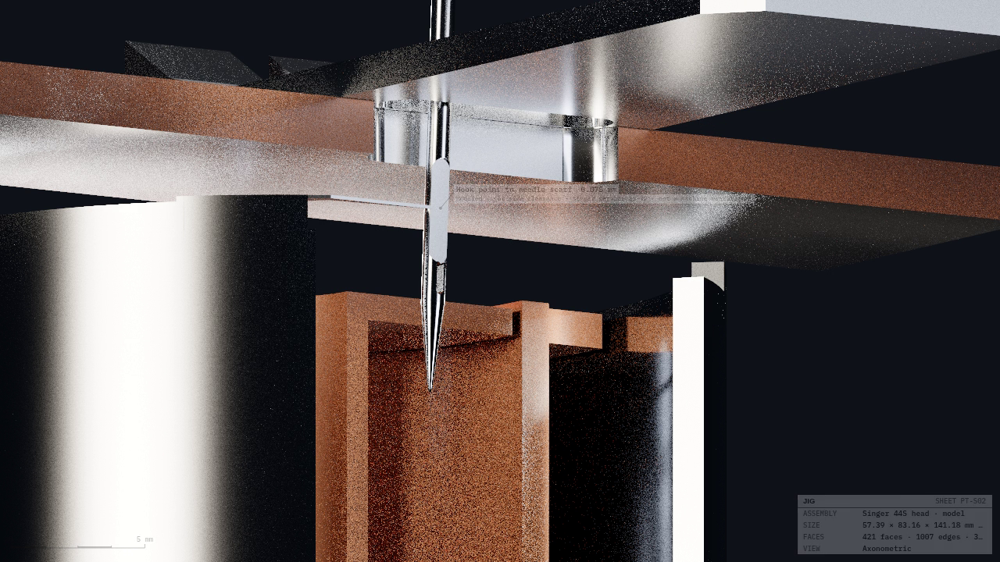

Four terms recur. A **study** is a sweep of the mechanism over a drive coordinate, solved row by row; here the drive is the shaft angle. A **presentation** is the film attached to a study: cues at film seconds that set the camera, lights, surface and edge opacity, sections, callouts and wipes. A **clock** maps film time to the study's drive coordinate. A **hold** freezes the mechanism at an event while the presentation keeps running.

## 1. What the film shows

| Film time | What happens | Mechanism | Camera |
|---|---|---|---|
| 0–8 s | The whole head in finished metal: crank, rod, needle bar, take-up lever, presser foot, plate and hook. | One full forward stitch at 45° of shaft per second. | Wide (170 mm field) from front-left, orbiting slowly right. |
| 8–15 s | The camera passes the foot and drops below the plate. Plate, bobbin case and bobbin open from the back between 9.8 and 14.0 s; cut faces are orange. | The shaft slows into the rising scarf pass of the second stitch. | Orbit continues to yaw 146°; pitch −9°; field narrows to 21 mm on the pass. |
| 15–19.4 s | Settled on the pass. The clearance callout fades in on metal, then the image dissolves to drafting edges and hatched caps. | Held at the pass. | Fixed. |
| 19.4–31.2 s | Each cut layer is tinted and labelled with a solved reading, 3.6 s per label. | Held. | Fixed. |
| 31.2–33.6 s | A left-to-right wipe from drafting to metal, through the same camera, cut still open. | Held. | Fixed. |
| 34.5–40.2 s | A narrow strip light travels from screen left to screen right across the plate underside at fixed exposure. | Held. | Fixed. |
| 40.4–51 s | The cuts close, sewing resumes at 42.67 s, the camera widens past the linkage and completes the 360° orbit into the first frame. | Finishes the second stitch, back to 45°/s at the seam. | Widens and orbits back to yaw 326° = −34° + 360°. |

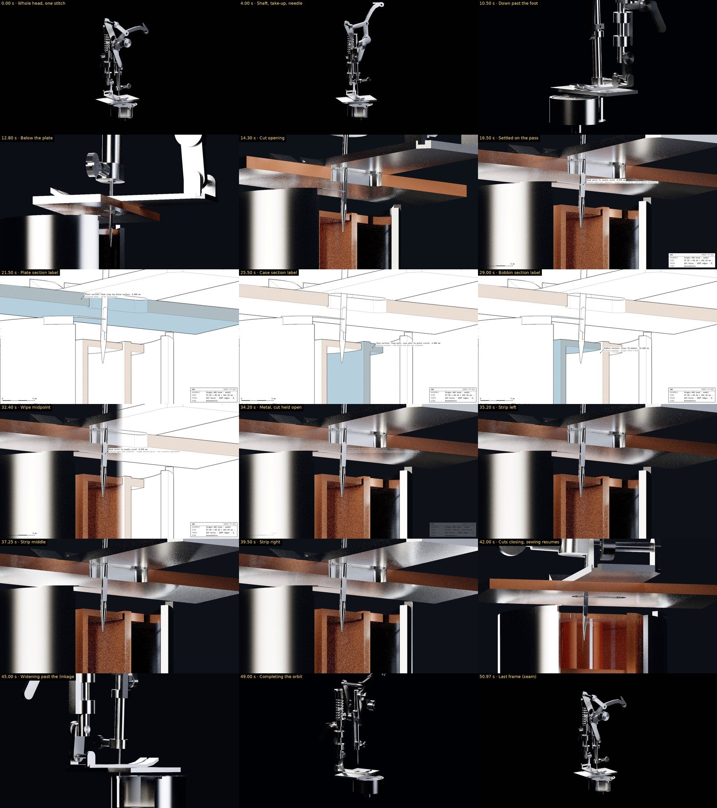

## 2. The model and its scope

The occurrences come from three earlier presets. SG-03 supplies the upper head: arm shaft and crank, connecting rod, swinging needle-bar supporter, needle bar, clamp and screw, needle, and the take-up lever, supporter and clips. SG-06 supplies the presser group: bar, bracket, spring, regulator, lifter, shank and zigzag foot. SG-10 supplies the G25 rotary holder with its point, the M25 bobbin case and the M41 Class 15 bobbin. A 48 × 28 × 2 mm needle-plate datum joins them. The casting, feed dogs, bed and thread are outside the model. Most dimensions are estimates traced from photographs and from the Singer parts book and service manual. The film therefore labels the assembly "Singer 44S head · model" in its title block, and the clearance callout carries the provenance "Modeled right-side clearance · Singer service §3-12 · not a machine measurement".

### The registration error and its correction

SG-10 places the hook ring top 4 mm under the plate (`ringZ = -4`, an estimate) and registers the needle from service §3-10: at bottom dead centre of a straight stitch the needle butt stands 28.5 mm above the ring. The SG-03 upper head had been built with an estimated working height that leaves the needle 11.4 mm too high for that registration (`registration = -11.4`). PT-S01's `fullHead` resolved this by moving the hook bearing up by 11.4 mm and leaving the plate at Z = 0. The needle-to-hook relationship was right; the ring now stood 7.4 mm above the plate surface, and the old film shows the cup resting on top of the plate.

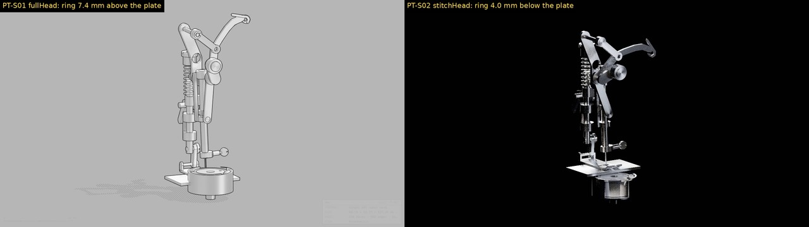

`stitchHead` in `import/jigcad/content/presets/SG-10-hook-pass/hook.parts.js` keeps the hook where `fullHead` put it and raises the plate and the whole presser group with it:

```js
function stitchHead(presser, {title='Singer 44S stitch head · study model', lift=0}={}) {
  const rise = -registration                                  // 11.4 mm
  const base = parts.plate().port('headDatum', j.frame({origin: j.pt(0, 0, -rise)}))
    .port('top', axis()).port('hookAxis', j.frame({origin: j.pt(0, axisY, ringZ)}))
  let body = presser.mount(parts.assemble('upper head', pass, swing, base, title), lift, [0, 0, rise])
    .joint('plateSeat', j.joint.fixed(), 'head:plateDatum', 'plate:headDatum')
    .add('holder', rotaryHolder(pointZ)).add('bobbinCase', bobbinCase()).add('bobbin', bobbin())
    .joint('rotate', j.joint.revolute(), 'plate:hookAxis', 'holder:axis')
    // … case and bobbin seats, measures
```

The plate's `headDatum` port sits 11.4 mm below its own origin, so the fixed joint to the head's datum lifts the plate by 11.4 mm. The hook axis is declared in plate coordinates at `ringZ`, 4 mm under the plate top, which lands in exactly the world position `fullHead` used. Two shared parts gained optional arguments with unchanged defaults: `assemble(…, title)` in `singer.parts.js` and `mount(assembly, lift, origin)` in `presser.parts.js`. PT-S01 and every other preset compile as before, and PT-S01 still passes its 0.075 mm assertion.

### A full forward revolution

The earlier inspection films sampled only 50° of shaft around the pass. A loop of whole stitches needs the full cycle, so I solved one complete revolution in 720 steps with `.interference()` over the six parts that could collide. Every row solved, the first and last rows agree, and the minimum gaps are:

| Pair | Minimum gap (mm) | At shaft angle |
|---|---:|---:|
| holder–needle | 0.0750 | 40.02° (the rising pass) |
| holder–bobbin case | 0.3500 | −139.98° (the first row; the holder turns about the case axis) |
| needle–presser foot | 0.8000 | −77.48° |
| needle–plate | 1.0500 | −64.98° |
| needle–clamp | 1.1240 | −4.98° |
| presser foot–clamp | 1.1538 | 2.52° |
| holder–plate | 1.7931 | 2.52° |
| needle–bobbin case | 2.1431 | −52.48° |
| plate–bobbin case | 2.2000 | −139.98° (fixed parts) |
| plate–clamp | 2.5095 | 2.52° |
| holder–presser foot | 3.7931 | 32.52° |
| bobbin case–presser foot | 4.2000 | −139.98° (fixed parts) |
| plate–presser foot | 0.0000 | contact: the foot rests on the plate |

Holder–clamp and case–clamp are too far apart for the interference query to report a distance. The data are in the ticket's `sources/full-revolution-gaps.txt`.

The holder and needle approach each other once per revolution, at shaft 40.02°, the rising pass where the point enters the scarf 3.5 mm above the needle's lowest point. Because the hook turns twice per shaft turn, its point passes the needle line a second time, at shaft 220°. At that instant the needle tip is 7.84 mm above the plate and 18.69 mm above the point, so there is no contact. The point-to-scarf reading at the pass is (0.0000, 0.0750, 0.0000) mm. That is the modeled midpoint of the 0.05–0.10 mm service band SG-10 chose, not a measured clearance.

## 3. The film as a program

The preset script, `import/jigcad/content/presets/PT-S02-singer-orbit-loop/script.js`, builds the assembly, a study and a presentation. Reusable pieces live in `orbit.parts.js` as ordinary functions: a camera basis, a periodic camera spline, a cue collector and camera-locked light placement.

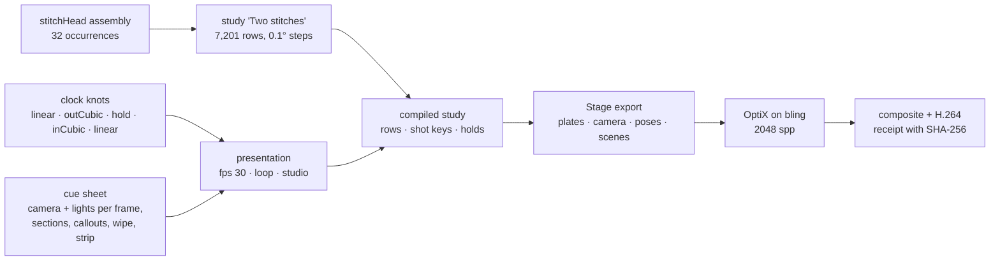

### The mechanical clock

The study spans exactly two shaft turns, from `start = pass − 465°` to `start + 720°`, in 7,201 rows (0.1° each). At 30 fps and 45°/s the shaft moves 1.5° per frame. Output frames take the nearest study row, so the row spacing sets the finest shaft motion the film can show. The hook turns at twice the shaft rate on a 15 mm point radius, so its point moves up to 0.52 mm per shaft degree, about 18 px in the 21 mm inspection field. With 0.1° rows the slow last approach to the pass moves in steps of under 2 px; with 1° rows it would jump.

```js
.clock(k => k.at(0).phase(deg(start))
  .at(8).phase(deg(start + 360))                                         // one stitch, linear
  .at(EVENT).event('scarf pass', {occurrence: 3}).easeIn('outCubic')     // slow into the pass
  .at(EVENT + 4).phase(deg(start + 360 + 105 + 60)).easeIn('inCubic')    // speed up again
  .at(BASE).phase(deg(start + 720)))                                     // back to the seam speed
.atEvent('hold-pass', 'scarf pass', c => c.holdPose(HOLD), {occurrence: 3})
```

The knots are chosen so the shaft speed never jumps. An `outCubic` segment of Δ degrees over T seconds starts at 3Δ/T; with Δ = 105° and T = 7 s that is 45°/s, the speed of the preceding linear stitch. The `inCubic` segment ends at 3 × 60/4 = 45°/s, the speed of the final linear segment. The seam therefore sees 45°/s on both sides. The event is occurrence 3 because the predicate "bar rise ≥ 3.5 mm while the needle rises" flips four times in the study range (true, false, true, false); the third flip is the rising pass of the second turn.

### Two corrections to the frame grid

The Stage's export clock was hard-wired to 24 fps (`STAGE_FPS`). `presentation.fps(n)` now sets a film's native rate, and `filmFPS(study)` threads it through the slider grid, `outputFrames`, `outputRow`, the native job's `job.json`, the mask exporter and the browser video writer.

The second correction came from the loop checker. For timed films `outputRow` pinned the last output frame to the study end. In a loop, the end state is the first frame, so in the 40-second version frame 1199 repeated frame 0 after a double step:

```
"lastSteps":[1.5,1.4999999999999432,3],"seamStep":0
```

`presentation.loop()` marks a film whose frames lie at f/fps on [0, duration). The last frame is one frame before the seam, and the next pass's frame 0 follows with an ordinary 1.5° step.

## 4. A camera that orbits without stopping

The Stage camera interpolates orientation by quaternion slerp, which always takes the shorter arc. A cue from yaw −34° to yaw 326° is the same orientation and does not move; a cue of 120° at constant pitch bulges toward the pole. `cam.orbit({yaw, pitch, roll})` writes the same orientation channel but interpolates the authored angles, so yaw differences larger than 180° turn the long way and pitch stays constant. It keeps a separate `angles` channel and, when it follows a slerp still in flight, unwraps the current heading toward the destination. One test in `test/render/camera-track.test.mjs` checks an orbit from −30° through 150° to 330°: the yaw unwraps, the pitch stays constant, the step is equal on both sides of a key, a slerp still in flight hands its heading to the following orbit, and an orbit and an orientation on the same key are rejected.

Easing each key independently would stop the camera at every key. Instead the film describes the move once, as a periodic C1 cubic Hermite spline through nine keys of yaw, pitch, log field height, target and screen anchor. Catmull–Rom tangents are used, except where the camera must settle (zero tangent) and at the seam, where the last key repeats the first turned once and both ends share one tangent. The spline is sampled at every native frame into short linear `orbit` cues, so each frame lies exactly on the curve.

| t (s) | Yaw (°) | Pitch (°) | Field (mm) | Target (mm) | Note |
|---:|---:|---:|---:|---|---|
| 0 | −34 | 13 | 170 | (3, 0, 52) | seam; shares its tangent with t = 51 |
| 8 | −2 | 11 | 150 | (3, 0, 48) | |
| 11 | 58 | 4 | 68 | (2.5, 0, 20) | passing the foot |
| 13.2 | 118 | −8 | 30 | (2.6, 0.1, 9.5) | below the plate |
| 15 | 146 | −9 | 21 | pass (2.69, 0.25, 7.35) | stop |
| 40.4 | 146 | −9 | 21 | pass | stop |
| 44.0 | 214 | −2 | 46 | (1.5, 0, 17) | |
| 47.6 | 278 | 8 | 118 | (3, 0, 40) | |
| 51 | 326 | 13 | 170 | (3, 0, 52) | = −34° + 360° |

Measured on the authored camera (`scripts/check-singer-orbit.mjs`), the seam's frame-to-frame change in yaw and pitch step is 1.39 × 10⁻⁴ rad, below the largest change anywhere else in the film (5.21 × 10⁻⁴ rad). The inspected point moves at most 3.85 px per frame at 30 fps.

## 5. Studio: lights that travel with the camera

A world-fixed studio would light the head from the front and leave the back dark when the camera reaches it. The key, fill and rim are placed in camera coordinates instead (right, up, toward the viewer, in multiples of 330 mm), and their positions, aims and luminances are written by the same per-frame samples as the camera. Under the plate the key and rim drop toward the camera's horizon so they reach the hook. Because polished plate and cup faces mirror the large softboxes in close-ups, key and fill dim as the field narrows (key 6,500 → 3,600 nits, fill 2,200 → 1,500 nits). Exposure is fixed at EV 5.

The first preview showed two studio faults. A world-fixed HDRI (`hdri.studio()`) has softboxes at particular headings, so in the first preview the backdrop turned almost white at 33 s. It was replaced by `light.env.gradient`, which depends only on elevation and therefore looks the same from every heading. And the strip light, dark but present, appeared as a black bar at the frame edges: an emitter at zero luminance is still a black panel. The strip is now parked 5 m below the set whenever it is dark.

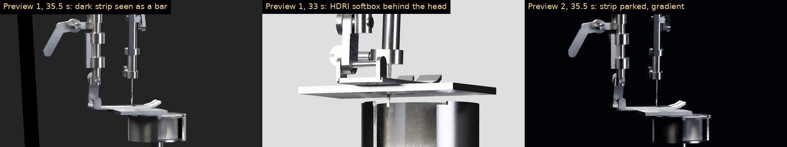

### The strip sweep

The sweep happens with the camera, mechanism and exposure fixed. The strip (4 × 60 mm, 90,000 nits) stands beyond the hook and below the view, where the plate underside reflects it. Two first attempts are recorded in the ticket. A strip on the camera side mostly washed diffuse light over the cut faces. A far-side strip with ±25 mm travel left the left half of the frame unlit, because the steel's glossy lobe sits to the right of the mirror direction. The final travel, −0.34 → +0.22 × 150 mm, carries the highlight in from the left edge. During the sweep the key dims to 55% and the fill to 50%, and both return before the camera moves.

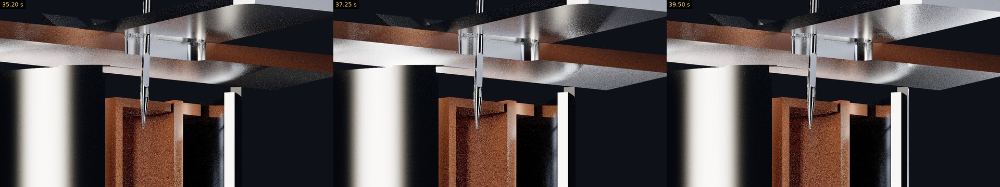

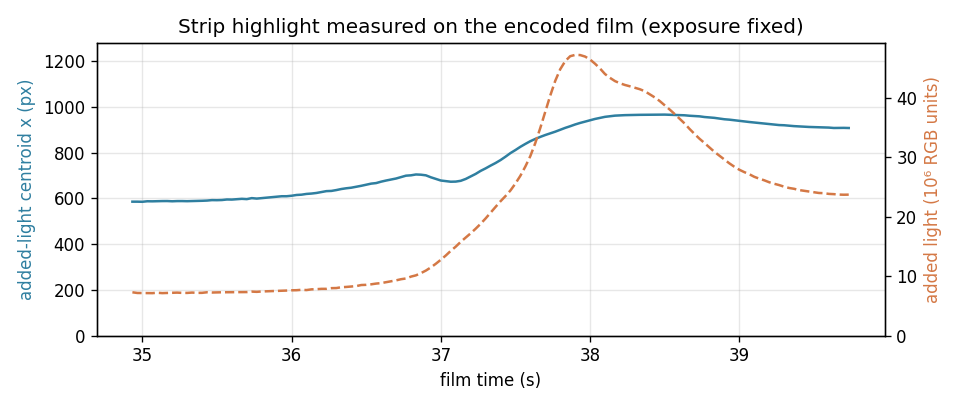

The strip is kept separate from the wipe in time and in kind. The wipe is a compositing boundary between two images; the strip is light in the rendered scene. `scripts/check-film-loop.py` measures it on the encoded film: it subtracts the frame at 34.45 s, where the strip is dark, from every frame of the sweep and reports the x centroid of the added light. The centroid moves from 586 px to 744 px at mid-sweep and 908 px at the end, 322 px in all. The added light is faint until about 36.9 s, rises steeply as the band crosses the plate underside between 36.9 and 37.9 s, and peaks at 37.9 s with the band at the right end of the plate. After that the band stays at the right end and dims while the strip keeps moving. The 50 px backslide of the centroid between 38.4 and 39.75 s is that dimming, not leftward travel: the brightest column of the plate-underside rows stays at 945–996 px. The light therefore travels left to right without reversing, but most of the visible travel happens in about one second, not evenly over the five-second move.

## 6. Cuts, drafting and the wipe

A section in Jig is display-only and clips each selected body in its own local frame: `dot(normal, p) ≤ offset`. The plate's origin is the needle line; the case and bobbin share the hook axis, 14.47 mm in front of it. One plane, `normal [0,1,0]`, swept from offset 14.6 to 0 between 9.8 and 14.0 s, therefore opens all three layers at once. It clears the back of the plate up to the needle line while it halves the case and bobbin through the hook axis. The rotating holder is not cut: its 67° wall window faces the needle at the pass, and the inspection camera looks through it.

The cut is real geometry in both passes. `section.js` builds a closed mesh with a cap face, `stage-pbr.js` gives the cap an orange paint, and `native-stage-job.js` writes a scene directory for every distinct cut. The OptiX frames therefore show the removed material removed, with caps, through the whole reveal.

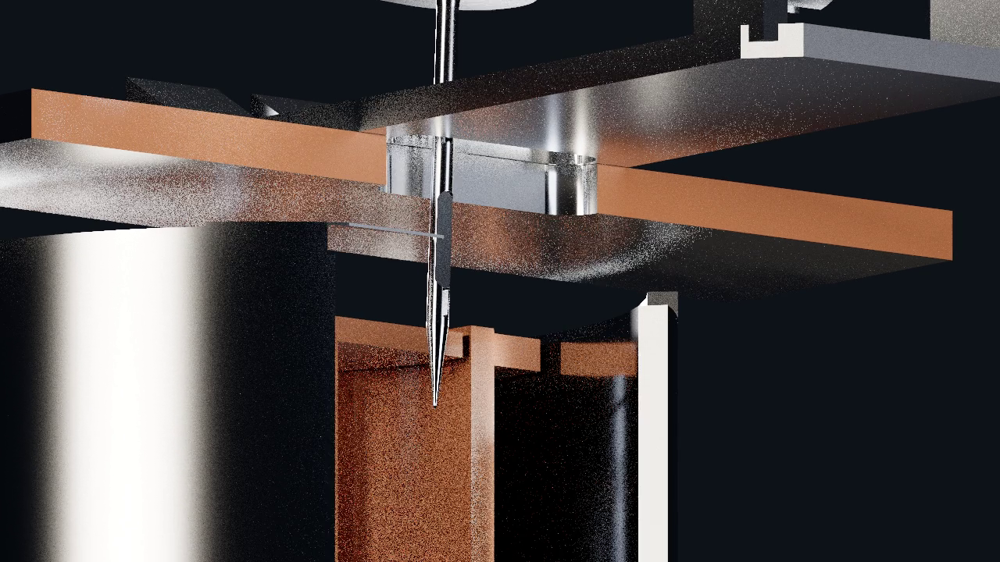

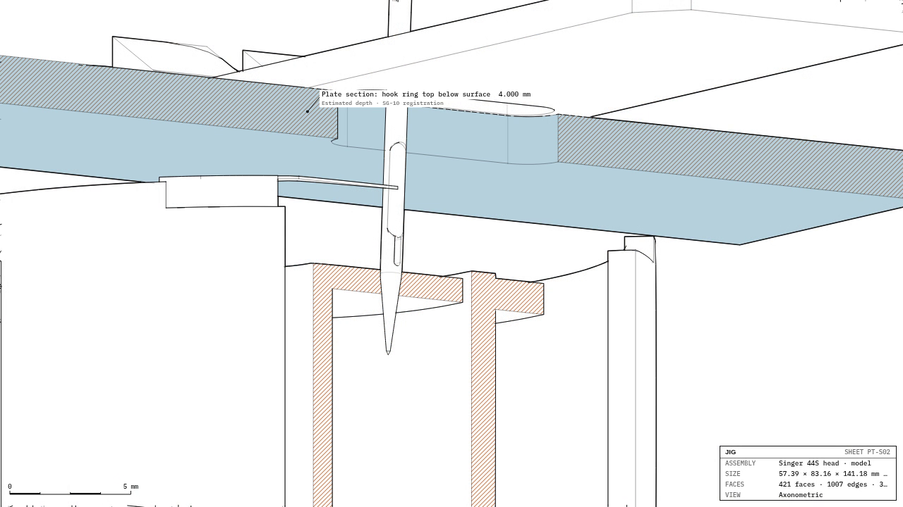

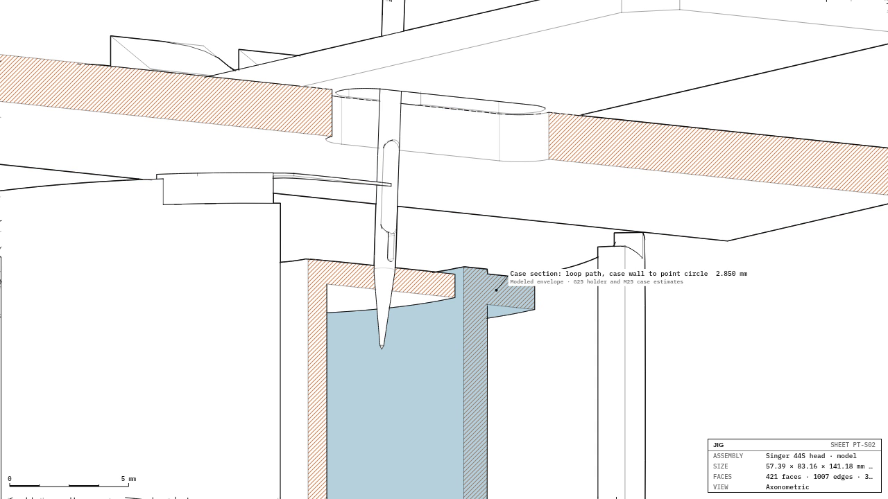

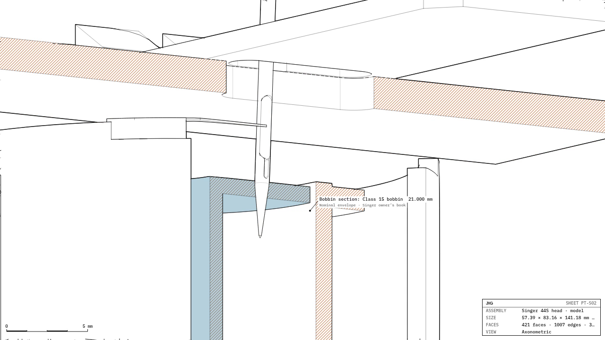

After the hold begins, the point-to-scarf callout fades in on metal. The image then dissolves to the drafting layer, where the cut faces are hatched. Each layer is tinted in turn and labelled with a solved reading, each held 3.6 s at the director's request so a viewer can read it:

| Layer | Label | Reading | Measure |
|---|---|---|---|
| Plate | Plate section: hook ring top below surface | 4.000 mm | `plate:top` z − `holder:axis` z (`Ring below plate (mm)`) |
| Bobbin case | Case section: loop path, case wall to point circle | 2.850 mm | point radius − case wall radius, about the case axis (`Case to point radius (mm)`) |
| Bobbin | Bobbin section: Class 15 bobbin | 21.000 mm | distance between flange-rim points at x = ±10.5 mm (`Bobbin diameter (mm)`) |
| Holder and needle | Hook point to needle scarf | 0.075 mm | `holder:point` − the needle's scarf point, Y (`Point minus scarf Y (mm)`) |

A wipe from drafting to metal then crosses the frame from left to right through the same camera. In the Stage's compositing order the wipe paints the registered beauty pass over the finished drawing, so the boundary is sharp and the drawing's lines vanish under the metal. Once complete, the wipe stays at progress 1 until the seam, where it is indistinguishable from plain full beauty; the export treats both as "covered" and skips the drafting plates.

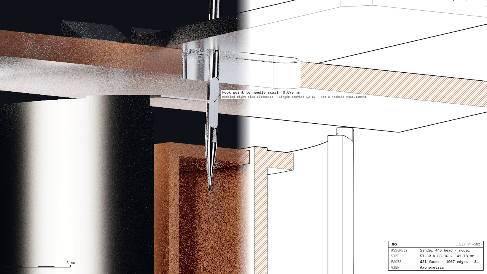

## 7. Rendering on the Spark

The Stage exporter packages the film as a portable job: for every frame a black plate, and wherever the metal is visible also a white plate (the drafting layer composited over black and over white), the camera, the 32 component transforms, the emitter poses and luminances, and a scene directory per distinct body set. On bling, `render-stage-job.py` renders each beauty view with `candela-rt` on OptiX and recovers each output pixel as `black + (white − black) × beauty`. The renderer is the JIG-028 build; its `candela-core.js` hash matches the checkout's.

The held pass has a steady camera, so consecutive frames share an identical beauty state. The runner now traces each run of identical (camera, poses, emitters) states once, copies the image to every frame of the run, and records `traced` and `reused` counts in the receipt. Each output frame is still composited from its own plates, so the drafting layer, the wipe and the callouts move every frame. This is not interpolation: no frame is synthesized from its neighbours.

| Stage | Where | Time |
|---|---|---|
| Package the Stage job (browser, CPU canvas) | local | 3 min 18 s |
| Upload, OptiX render, composite, encode, fetch | bling, `final-2048spp-30fps` | 6,664 s (1 h 51 min) |
| OptiX beauty rendering, sum over 204 runs | bling | 6,226 s (1 h 44 min) |

| Frames | Content | Traced | Reused | OptiX time | Per traced frame |
|---|---|---:|---:|---:|---:|
| 0–299 (0–9.97 s) | wide shot and approach | 300 | 0 | 12.9 min | 2.6 s |
| 300–419, 1213–1292 | the 200 cut frames, one scene each | 200 | 0 | 28.0 min | 8.4 s |
| 420–581 (14.0–19.4 s) | settle on the pass, callout, crossfade | 31 | 131 | 6.8 min | 13.1 s |
| 582–935 (19.4–31.2 s) | drafting only | 0 | 0 | none | – |
| 936–1212 (31.2–40.4 s) | wipe, metal hold, strip sweep | 172 | 105 | 41.1 min | 14.3 s |
| 1293–1529 (43.1–51 s) | widening orbit | 237 | 0 | 15.0 min | 3.8 s |

Of 1,530 output frames, 940 were traced, 236 reuse an identical traced state, and 354 are pure drafting, where the beauty pass is invisible and is not rendered. The inspection frames cost five times as much per traced frame as the wide shot. The wide shot is mostly empty background, while the inspection frames are filled edge to edge with polished and cut steel.

The job is large: the final ZIP is 1,883,728,325 bytes. Of that, 1,758.6 MB is 202 scene directories (808 files), 84.0 MB the 1,530 black plates, 34.8 MB the 1,176 white plates and 5.9 MB `job.json`. Each cut frame gets its own scene directory, and each copy also embeds the study's full pose track, which the native renderer does not read. Removing that track from native scene packages would cut the job by about three quarters; it is recorded as a follow-up.

## 8. Verification

Two kinds of evidence check the loop. `scripts/check-singer-orbit.mjs` compiles the preset in Node and checks the study and the authored presentation, before any rendering. `scripts/check-film-loop.py` and the submission script check the encoded film by decoding every frame.

| Property | Check | Result |
|---|---|---|
| Hold | `hold-pass` event time and length | at 15.000 s, held 27.667 s, shaft 40.02° |
| Contact phase | needle bar rise at the hold | 3.500 mm above bottom dead centre, rising |
| Clearance | point − scarf at the hold | (0.0000, 0.0750, 0.0000) mm |
| Section readings | the three layer measures at the hold | 4.000 mm, 2.850 mm, 21.000 mm |
| Forward motion | every shaft step across 1,530 frames | all positive; 720.000° in total |
| Seam, mechanism | last step into frame 0 | 1.5°, the same as the first and last steps |
| Seam, poses | 32 components, end against start | largest difference 3.4 × 10⁻¹¹ |
| Seam, camera | position, and change of per-frame yaw/pitch step | equal; 1.39 × 10⁻⁴ rad at the seam, 5.21 × 10⁻⁴ rad worst elsewhere |
| Seam, studio | key, fill, rim and strip, end against start | positions within 2.2 × 10⁻¹³ mm, equal luminance |
| Seam, style | surface, edges, annotations, section, wipe | start: full beauty; end: completed CAD→beauty wipe, which renders identically |
| Motion | inspected point on screen, frame to frame | median 0.0015 px, 95th percentile 2.75 px, maximum 3.85 px |
| Container | `ffprobe -count_frames` | H.264 High, yuv420p, 1280 × 720, 30/1, 1,530 frames, 51.000 s, 10.35 Mb/s |
| Decode | `ffmpeg -f null` over the whole file | no errors |
| Integrity | SHA-256 against the receipt | `06ecefbbf8b1deeb443a09dce58d0c3ec3d1ac0cab97e6092c6abc526c26f64e`, equal |
| Seam, film | mean \|ΔRGB\| of the wrap step against its neighbours | 0.981 against 0.906–1.013 (film median 1.23) |

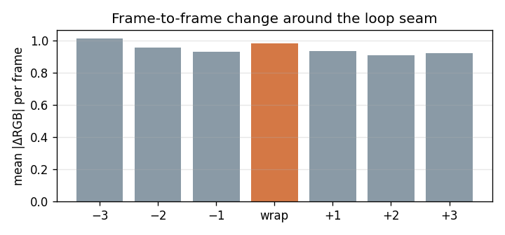

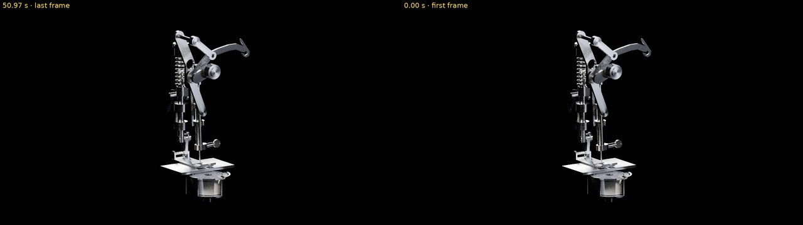

The wrap step lies inside the range of its neighbours, so a viewer watching the loop on repeat sees no seam. The film median is larger than the seam steps because the wide shot moves slowly, while the descent and the section sweeps change many pixels per frame.

### Proof review

Each beat was proofed at 64–256 spp before the final (stills and three full 64-spp previews), and the final was then reviewed at the same moments:

| Beat | Frame | What the frame shows |
|---|---|---|
| Cut opening | 14.3 s | Plate, case and bobbin cut through the hook axis, with orange caps; the needle descends through the cut plate. |
| Transition midpoint | 32.4 s | The wipe boundary at mid-frame: metal on the left, hatched drafting with the clearance callout on the right. |
| Metallic finish | 34.2 s | Full beauty with the cut held open and the callout fading. |
| Reflection travel | 35.2 / 37.25 / 39.5 s | Faint at the left, crossing the plate underside, resting at the right end. |
| Shaft cycle | 0–8 s | One full stitch in the wide shot (`_assets/jig029-shaft-cycle.jpg`). |
| Seam | 50.97 s → 0 s | The last frame leads into the first. |

## 9. Creative decisions

- **Two stitches per loop at 45°/s.** One stitch plays in the opening wide shot, so shaft, crank, rod, needle bar and take-up lever can be followed in one cycle. The second stitch is cut by the hold at the pass and finishes as the camera widens.
- **Inspection from behind and below.** Of nine candidate views around the pass (`sources/proofs/round1-*`), only the back-low side looks through the hook's wall window without cutting the rotating holder. From the front or side the unsectioned cup blocks the view, and from the back-left the foot's ears do.
- **Orange caps and teal tints.** The paint cap separates removed material from finished steel in metal. In drafting, a teal accent identifies the layer each label describes.
- **A dark gradient studio.** The backdrop is the same at every heading, so the orbit reads as the object turning, not the room changing.
- **30 fps native.** The inspected point moves at most 3.85 px per frame (at 13.77 s, the fastest part of the descent) and its 95th percentile is 2.75 px, so 30 fps carries the motion without visible stepping. 60 fps would double the 1 h 44 min of OptiX time and add nothing a viewer could see at these speeds. Every output frame is a rendered state at f/30 s; none is interpolated.

## 10. Limits of the reconstruction

- The geometry is a study model. The 15 mm hook radius, the 4 mm ring depth, the flange and hub sizes, the plate (a 48 × 28 mm datum, not the machine's plate) and the upper-head working height are estimates. The 0.075 mm clearance is a chosen setting, not a reading of a machine.
- The gate is held at the right-hand needle position throughout: a straight stitch at the maximum-width gate angle of SG-08. The zigzag motion between stitches is not animated.
- Thread, loop formation, the bobbin's rotation and feed are not modeled. The bobbin stays fixed, as in SG-10.
- The hook is driven 2:1 with the shaft through a closed-form joint law, not a modeled gear train.
- The strip's reflection does most of its visible travel between 36.9 and 37.9 s rather than evenly over five seconds (section 5). A path that keeps the mirror direction moving at constant speed across the plate would spread it out.
- The job format embeds the study's full pose track in every scene directory, which the native renderer does not read. Removing it would make the job about a quarter of its present size. That change was left out of this film so that no new variable entered the final render.

## 11. Files

- Preset: `import/jigcad/content/presets/PT-S02-singer-orbit-loop/{script.js, orbit.parts.js, notes.md, meta.json, render-studios.json}`
- Model: `import/jigcad/content/presets/SG-10-hook-pass/hook.parts.js` (`stitchHead`), `SG-03-upper-head/singer.parts.js`, `SG-06-presser-foot/presser.parts.js`
- Engine: `src/engine/presentation.js` (`fps`, `loop`), `src/render/work-area.js` (`filmFPS`, loop grid), `src/engine/camera-track.js` and `src/stage/presentation-camera.js` (`orbit`), `src/stage/output-camera.js` (completed-wipe shortcut)
- Scripts: `scripts/check-singer-orbit.mjs`, `scripts/check-film-loop.py`, `scripts/stage-proof-frames.cjs`, `scripts/spark-proof-frames.py`, `scripts/singer-orbit-film.sh`, `scripts/render-stage-job.py` (state reuse), `scripts/submit-stage-job.py` (`--work`)
- Ticket: `ttmp/2026/11/26/JIG-029--singer-44s-orbit-loop-into-the-rotary-hook/` (diary, proofs, receipts)
- Film: `/home/manuel/code/wesen/go-go-golems/jig/dist/reels/singer-orbit-loop-2048spp-30fps.mp4` with its receipt `singer-orbit-loop-2048spp-30fps.json`; previews `singer-orbit-preview-64spp.mp4`, `singer-orbit-preview-v2-64spp.mp4` and `singer-orbit-preview-v3-64spp.mp4` in the same directory

## Related notes

- [[PROJECT REPORT - Jig - From a solved mechanism to a 30-chapter product film]]: JIG-028, which built the presentation language, the Stage export and the OptiX runner this film reuses, and whose PT-S01 film carried the registration error corrected here.
- [[PROJECT REPORT - jigcad - Letting the Workbench Agent See, Images In and a look() Out]]
