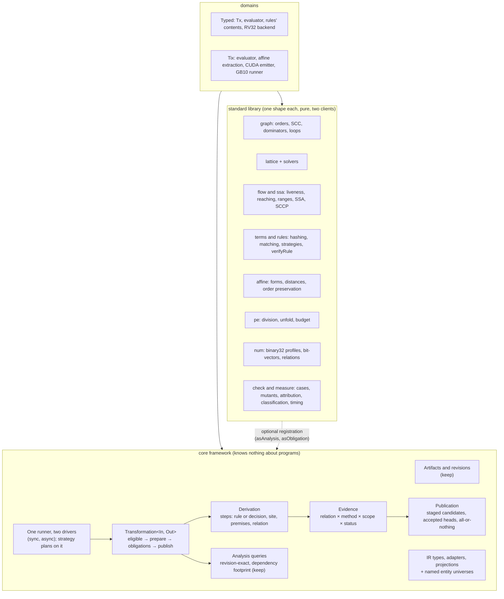
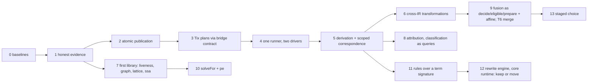

# What forty implementations say about the framework: the R3 synthesis

The IR Workbench is a research environment for building and studying compilers. At its centre is an IR framework,
`src/framework/`. Its parts are:
- content-addressed artifacts;
- IR types with adapters;
- contracts that check passes;
- correspondence between revisions;
- a dataflow solver;
- a strategy language.

It began as a prototype called v6, and every stage since has adapted it. Two very different compilers now run on it:
- **Typed,** a small scalar language compiled to 32-bit RISC-V;
- **Tix,** an index-notation tensor language compiled to CUDA and run on an NVIDIA GB10.

Around them lie some forty unmerged implementations of the same four tasks, written by different coding agents.
The user asked us to step back and ask what all of this means for the framework's structure.

Four agents each wrote an independent design review, round R3:
- Sol and Astra, two OpenAI Codex configurations;
- Opus and Fable, two Claude models.

This report verifies their load-bearing claims, consolidates them into one target architecture and one standard
library of compiler building blocks, orders a migration, and judges the reviews themselves. It is written for a
reader who has seen none of the material; each concept is explained before it is used.

> [!summary]
> **Verdict.** The framework's outer shell held. Content-addressed revisions, adapters with projections, the
> contract vocabulary, revision-exact analysis caching, the batched differential and the strategy plan language
> carried both domains and thirty-one cells. Its *inner* model of a transformation did not hold:
> - a pass is an endomorphism;
> - the record of what a pass did is a diff;
> - "checked" is one word;
> - acceptance is spread over two runners and several publication points.
>
> Each of these four was routed around repeatedly, in the same few shapes, by independent agents.
>
> **Verified.** I re-ran or rewrote a probe for 24 claims. 19 held as stated or with a qualification. Two were
> extended: a false mapping is accepted as readily as an empty one, and the F27 fix needs no framework change. One
> reconciliation failed: the 2,021 against 1,774 edit counts are D1's LICM change, not the case count.
>
> **Wrong earlier.** The coordinator was wrong about F27. Tix passes run in strategy plans today. What they lose is
> the meaning gate, and the bridge's existing `contract` option restores it.
>
> **Target ("v7").** Six core concepts:
> 1. a typed transformation between ports with one lifecycle (eligible → prepare → obligations → publish);
> 2. a derivation record written by the producer, from which correspondence is derived and which the diff audits;
> 3. evidence as relation × method × scope;
> 4. staged publication;
> 5. one runner with effect-driven drivers;
> 6. decisions as data where a pass searches.
>
> Below the core sits a standard library of about twenty primitives in eight areas, admitted by a two-client rule.
>
> **First moves.** Make evidence honest, make publication atomic, run Tix plans through the bridge contract, then
> merge the two runners. Each step is small, has a probe, and deletes something.

## 1. The material, and the vocabulary used below

### 1.1 The framework in six layers

| Layer | What it holds | Key files |
|---|---|---|
| `core` | Artifacts: an immutable value with a SHA-256 *revision* of its canonical encoding. Also an older task runtime with queries and records. | `src/framework/core/data.ts`, `types.ts`, `runtime.ts` |
| `ir` | IR types, *adapters* that project a native value into a finite *logical projection* (entities and relations), views, a generic edit transaction, patterns and a rewrite engine, diff, *correspondence* between revisions, a store of heads. | `src/framework/ir/*.ts` |
| `contracts` | Definitions (`defineIR`, `defineAnalysis`, `defineTransformation`, invariants, properties), the `AnalysisManager` that caches analyses per exact revision and checks contracts, and `differential()`, a sampled comparison of two artifacts on generated cases. | `src/framework/contracts/*.ts` |
| `passes` | `definePass` and two runners: synchronous `applyNativePassSync` and asynchronous `applyPass`, plus a bridge into strategies. | `src/framework/passes/define-pass.ts`, `bridge.ts` |
| `dataflow` | A monotone worklist solver over a fixed `FlowGraph` and a small lattice kit, and `dataflow()`, which binds a solver problem to an artifact revision. | `src/framework/dataflow/*.ts` |
| `strategy` | Strategy IR: compilation plans as versioned JSON data (`sequence`, `fork`, `chooseBest`, `attempt`, `repeatUntilStable`, and others, 13 node kinds) and an asynchronous interpreter. | `src/framework/strategy/*.ts` |

### 1.2 Terms

- **A pass** is `definePass({ ir, adapter, needs, writes, preserves, contract, run })`
  (`src/framework/passes/define-pass.ts:79-92`). It has one IR type and one adapter, so input and output are the
  same kind of IR. A pass that maps an IR to itself is called an **endomorphism**.
- **A native result.** A pass either edits the logical projection or returns a *native result*: a whole new value
  plus optional correspondence entries (`:70-77`). Both domains return native results.
- **`writes`** lists the entity and relation kinds a pass may change. The runner diffs the two projections and
  rejects undeclared changes (`:152-164`, `:216-222`).
- **A meaning gate** is Tix's check that a pass kept the program's meaning
  (`src/tensor/contract.ts:121`). It is a *closure*: the caller hands it to `applyNativePassSync` as an argument
  (`src/tensor/index.ts:39-43`). It compares f32 bit patterns ("exact") against the previous revision, or values
  within a tolerance against the origin.
- **Typed's meaning contract** is a contract in the framework's sense, run by the manager, with cases on a worker
  pool.
- **Correspondence** relates the entities of two revisions. Each entry is `{from, to, relation, because?, note?}`.
  F23 added a check that the declared entity lists match what the IR type enumerates. `whyEntity` walks a chain
  backwards to explain where an entity came from (`src/framework/ir/correspondence.ts:306`).
- **Assurance** is the label a check's record carries: `'declared' | 'checked' | 'transferred' | 'proof'`
  (`src/framework/contracts/types.ts:164`).
- **A cell** is one agent's implementation of one task, in its own git worktree. The tasks were:
  - **T6:** a schedule IR between Tix and CUDA, ten cells;
  - **D1:** attributing executed instructions to compiler decisions, seven cells;
  - **A0:** classifying optimizer edits as local or structural, seven cells;
  - **B1:** partial evaluation of a bytecode VM on its program, seven cells.
- **The four reviews** are tickets IRWB-038-A (Sol), -B (Astra), -C (Opus) and -D (Fable). Below they are called
  A, B, C, D.

## 2. What I verified, and what failed

The brief asked for a probe behind every load-bearing claim. All probes are in the coordinator's ticket under
`various/r3-synthesis/scripts/`, numbered 00 to 11, each with its output beside it. The full table is in
`various/r3-synthesis/verification.md`.

The probes ran on clean `git archive` exports of `a0c2199` (whose `src/` equals the reviewers' base `93ec5fc`) and of
`t6-base`. They never ran on the main checkout's working copy, which had uncommitted edits in `src/typed` at the
time.

| Claim | Who | Status |
|---|---|---|
| A sampled check and an exact one get the same `assurance` | C | **Held.** Both are `'checked'` (`analysis-manager.ts:1177`). `evidence.method` does distinguish them; nothing reads it. |
| `assuranceOf` is never called | C | **Held.** One test calls it (`tests/framework/ext-e5.test.mjs:50`), no production code does. |
| `assuranceOf(undefined)` is `checked-exact` | A, B | **Held**, for misspelled methods too (`differential.ts:378-380`). |
| Tix passes run in plans and lose their gate | B, C | **Held.** A deliberately wrong pass is rejected by the sync runner and accepted by the bridge. |
| F27: "no Tix pass can appear in a strategy plan" | coordinator | **Failed.** They can. The gate is restored with the bridge's existing `contract` option. |
| A rejected candidate stays the store head | B | **Held.** Latent: no domain passes a store. |
| A fact is accepted before the pass rejects | A | **Held.** `deferCommit` is the fix in waiting. |
| Zero mapping groups are accepted | B | **Held and extended.** A *false* group is accepted too. |
| Tix `inline` records a removal | C, D | **Held.** |
| In-place Typed edits are `retained`; 98.5 % of 190,716 | C, D | **Held, qualified.** The 98.5 % mostly counts entities that did not change. The real gap: 926 of 973 in-place statement edits leave the statement `retained`. |
| No domain names rewrite, transaction or traversal | D | **Held, qualified.** All three are loaded transitively; `diff`, which D lists beside them, runs in every pass. |
| The Tix adapter is not rewritable | D | **Held.** |
| The core runtime (about 1,240 lines) has no domain caller | C, D | **Held.** 1,237 lines; only labs and conformance. |
| The solver runs a binding-time analysis on a Tix function | C, D | **Held for D.** C's probe used a hand-written table, not Tix. |
| `planFusion`'s join test is a dependence-distance test | D | **Held**, 13/13. The agreement is close to definitional. |
| T6-D's order validator misses an f32-changing permutation | B | **Held.** R = 17: sums 1 against 0. |
| 2,021 against 1,774 edit records | A0, D | **Numbers held; D's reconciliation failed.** The difference is `licm` −163, `cfg` −68, `lvn` −16, from D1's merge; the case count changes nothing. |

### 2.1 F27, in detail

BACKLOG F27 (`BACKLOG.md:487`) says that `passAlgorithm` "wraps a pass with the asynchronous `applyPass` and
requires an `AnalysisManager`; Tix passes run through `applyNativePassSync`, so no Tix pass can appear in a strategy
plan". The coordinator said the same to the user. It is wrong in fact and in diagnosis.

The bridge (`src/framework/passes/bridge.ts:29-61`) calls `applyPass`. `applyPass` happily runs a synchronous native
pass: `await` on a non-promise is a no-op. The `AnalysisManager` it needs is a `new AnalysisManager()`. Probe 02 runs
F27's own test, a `fork` with `chooseBest` over `inline` and `split-sum`, on the stock bridge, and it succeeds.

What does go wrong is that the plan *drops the meaning gate*. The gate is a closure passed to the sync runner. It is
not part of the pass, so nothing carries it into a plan. Probe 02 shows the consequence with a deliberately wrong
pass, one that multiplies by 3 instead of 2:

```
2a. optimizeTix-style runner with the meaning gate: contractRejected - at [0] expected 1065440815, got 1069678918
2b. same pass through the stock bridge: succeeded | contract recorded: false | y(origin) 4 y(result) 6
```

The fix needs no framework change. Wrap the gate as an `ensures` invariant over three ports, and hand it to the
bridge's existing `contract` and `contractInputs` options (`bridge.ts:20-22`):

```js
const gateContract = relation => C.defineTransformation({
  id: 'tix.gated.' + relation, version: '1', description: 'a Tix pass under its meaning gate',
  inputs: { input: TixIR, origin: TixIR }, outputs: { output: TixIR },
  ensures: [{ invariant: C.defineInvariant({
      id: 'tix.meaning-gate.' + relation, version: '1', description: 'the Tix meaning gate as an invariant',
      inputs: { before: TixIR, origin: TixIR, after: TixIR },
      check: (_ctx, { before, origin, after }) => {
        const r = meaningGate(origin, relation)(before, after);
        return r.ok ? { ok: true, evidence: JSON.parse(JSON.stringify(r.evidence ?? null)) } : { ok: false, reason: r.reason };
      } }),
    bindings: { before: { from: 'inputs', port: 'input' }, origin: { from: 'inputs', port: 'origin' },
                after: { from: 'outputs', port: 'output' } } }],
});
passAlgorithm(inlinePass, { manager, contract: gateContract('exact'), contractInputs: () => ({ origin }) });
```

With it, F27's test succeeds with the gate in force. The wrong pass is rejected and falls back cleanly inside an
`attempt`. The JSON round trip is the only adaptation needed: the gate's evidence carries an `undefined` field, and
the manager refuses any value containing one. B (probe 07) and A (P2) reached the same conclusion with hand-written
algorithm wrappers; this version uses only options the bridge already has.

So F27 is an S-sized *domain* change: it puts the Tix gate into the contract vocabulary. F32's proposal to merge a
second, synchronous strategy interpreter has lost its motivating case.

### 2.2 The edit-count reconciliation

The A0 cells counted 2,021 edit records under O2 on `t6-base`. D's census counted 1,774 on main, and D attributed
the difference to D1's loop fix and to "checks with fewer cases". Probe 09 runs the corpus on both bases, with two
cases per check and with the default:

| | t6-base | main |
|---|---:|---:|
| revisions | 199 | 195 |
| edit records | 2,021 | 1,774 |
| `licm` | 329 | 166 |
| `cfg` | 1,058 | 990 |
| `lvn` | 44 | 28 |
| `simplify` + `fold` | 140 + 43 | 140 + 43 |
| `constprop`, `subst`, `dce`, `bce`, `strength` | 141, 102, 118, 26, 20 | same |

The case count changes nothing on either base. The whole difference is in LICM and in the CFG cleanup after it. That
is D1's merged change (`dbe383f`: `typed.loops` returns one loop per header; `6710b89`: LICM shares one local among
equal invariant trees), which stopped LICM building nine preheaders on the VM's dispatch loop.

The table also explains a number the A0 cells all report, that 183 O2 edits are re-derived by the rule tables. 183 is
exactly `simplify` 140 + `fold` 43, the two passes that *are* rule tables. A0-B's 203 local edits equal
`simplify` + `fold` + `strength`. The headline spread between cells (10.0 % to 19.5 % local) is therefore a matter of
how `constprop`, `subst`, `lvn` and `dce` are binned. It is not a disagreement about the data, which is what B and C
argued.

## 3. Where the complexity lives

The four inventories differ in breadth and agree in substance. C's (U1–U22) and D's (by task) are the broadest; A
and B give fewer rows with deeper probes. Consolidated, the machinery that domains and cells built for themselves
falls into three kinds, C's division: recording what a pass did, deciding whether a step is allowed, and driving
passes. To these I add a fourth, measuring.

### 3.1 Recording what a pass did

| Machinery | Evidence | Why it was built |
|---|---|---|
| Typed's own transaction `Tx` with origins, `because`, edit records and its own write-kind check | `src/typed/tx.ts:47-54` (531 lines); writes enforced twice, by `Tx` and by `definePass` | The framework's edit mutates the projection and rebuilds the native value, losing Typed's id counters and origins (IRWB-006 diary, cited by D). |
| Correspondence rebuilt from origins and removals | `src/typed/passes.ts:119-162` | The framework sees two projections and a diff; the pass knows the intent. |
| A second answer to "why is this here" | `src/typed/program.ts:463-488` beside `whyEntity` | `whyEntity` skips `retained` entries (`correspondence.ts:321`), so in-place edits are invisible. |
| Seven A0 classifiers, each re-deriving which rule fired, three by faking a value handle | `a0-*` cells; for example `a0-fa-irwb-035-g/src/typed/edit-classes.ts:116-157` | No edit record names a rule: 0 of 1,774 (probe 09). |
| Seven D1 attribution tools, five with a hand-written backward lineage walk | for example `d1-ds-x-irwb-034-d/src/typed/attribution.ts:88-156` | Correspondence plus edit log, joined by hand. |
| Tix passes as whole-module functions with no entries | `src/tensor/passes.ts:21-92` | `inline` comes out as `removed` (probe 04). |
| Refusals as strings: `FusionGroup.reasons`, T6 `ScheduleRefusal`, a D1 cell's `skip` edit | `src/tensor/fusion.ts:45-52`; `d1-ds-x-irwb-034-d/src/typed/passes.ts:513` | `core/types.ts:46-51` has a `Decision` with alternatives that no domain uses. |

### 3.2 Deciding whether a step is allowed

| Machinery | Evidence |
|---|---|
| `planFusion`: grouping, a zero-distance join test, storage classes, staged terms, a launch-time gate, all in one function | `src/tensor/fusion.ts:83-105`, `:135-140`, `:142-279` |
| Ten T6 schedule IRs, each copying `planFusion`'s decisions; five re-run it inside passes or gates | C's §1.1 and D's §3.3; for example `t6-op-irwb-033-d/src/tensor/schedule.ts:441` |
| Accumulation-order analyses in six or seven T6 cells, 20–195 lines each (symbolic normal form, sampled simulation, an allowed-move refinement) | `t6-ds-h-irwb-033-g/src/tensor/schedule.ts:398-447`, `t6-op-irwb-033-d/src/tensor/schedule.ts:271-366`, `t6-g-max-irwb-033-j/src/tensor/schedule.ts:299-495` |
| Contraction recognisers in nine T6 cells | C, U3 |
| `PassSpec.legal` (D), `postcondition` (B), `source` (G), sync `preserves`/`claims` (F, H), a gate that receives the correspondence (A) | `t6-op-irwb-033-d/src/framework/passes/define-pass.ts:96-101`, `t6-am-irwb-033-b/.../define-pass.ts:89-90`, `t6-ds-h-irwb-033-g/.../define-pass.ts:85-90` |
| Six B1 binding-time analyses or static-state domains and six promise checks (stores stay in the frame) | `b1-fa-irwb-036-g/src/typed/bta.ts:65-115`, `b1-op-irwb-036-f/src/typed/pe.ts:76-110`; probe 10 |
| Four different device limits in T6 passes | C, U5 |

### 3.3 Driving passes

| Machinery | Evidence |
|---|---|
| Tix's driver loop with the relation chosen by pass name | `src/tensor/index.ts:32-60`, `:42` |
| Two synchronous strategy interpreters (H, E), with different node subsets; a gate mode in J's bridge; hand loops in six more T6 cells | `t6-ds-x-irwb-033-h/src/framework/strategy/sync.ts:94`, `t6-fa-irwb-033-e/src/framework/strategy/sync.ts:37` |
| B1 drivers outside strategies, because a plan cannot pass a bindings artifact | `b1-ds-x-irwb-036-d/src/typed/futamura.ts:56` (uncommitted) |
| Typed's two pipeline runners, a loop and a plan | `src/typed/program.ts:344-362`, `src/typed/strategy.ts` |

### 3.4 Measuring

| Machinery | Evidence |
|---|---|
| Per-revision replay deltas and conservation checks in each D1 cell | merged `src/typed/attribute.ts:81-211` |
| Corpus before/after sweep scripts in every D1 and A0 cell | C, U22 |
| GPU timing protocols in prose and per-cell loops | C, L16; A, `scripts/53-t9-timing-spread.mjs` |
| Static block frequencies as a cost gate | `src/typed/backend/frequency.ts:105`, `:174` |

**What the census says.** Eight of the ten T6 cells changed `src/framework`: `define-pass.ts` in six, `bridge.ts` in
three, `strategy/sync.ts` in two. None of the 21 Typed cells changed it at all (probe 10). The Typed cells did not
avoid the framework because it served them. They did the hard part in the domain, where Typed already had its own
transaction, its own rule engine and its own lineage.

## 4. How good the core structure is

The four reviews' layer verdicts agree closely. Where they differ, the difference is in emphasis.

| Layer | Held: keep | Bypassed, and why | Leaked |
|---|---|---|---|
| `core` | `data.ts` (canonical encoding, fingerprints), `sha256.ts`, `Artifact`; every artifact in both domains goes through them | The task runtime, `runtime.ts` + `query.ts` + `records.ts` (1,237 lines), has no domain caller; only `labs/` and `conformance/` reach it (probe 05). Typed built `Program` with a revision list instead, and the analysis manager took over caching. | A third `Pass` type (`core/types.ts:80`) beside `definePass` and `defineTransformation`; an unused `Decision` type (`:46-51`). |
| `ir` | Adapters, the finite projection, revision-qualified references, `diff`, the correspondence algebra (`composeCorrespondence`, which T6-I used across Tix → schedule → CUDA). A view is the right tool for inspection and for the `writes` check. | The edit transaction, patterns and the rewrite engine: no domain names `transactions.ts`, `rewrites.ts` or `traversal.ts`, and no domain pass reads `ctx.edit`. The Tix adapter is not `Rewritable` (probe 05). Typed's reasons are on record: native invariants live in native code; a rewrite per transaction costs a reprojection; pattern identity is entity identity, so `x - x` cannot match a tree. | Correspondence is computed from what *differs*, not from what the pass *did*: a merge becomes a removal plus a retention. Validation checks membership, not truth (probe 04). Two correspondence types, `Correspondence` and `EntityCorrespondence`, need a converter. |
| `contracts` | The strongest layer: the definitions, the `requires`/`ensures`/`preserves` vocabulary, revision-exact caching, `differential()` with batched `decide` (which carried the remote GPU check without a framework change), F26's case-digest check | `effects.ts`, `recordProof` and the `proof` assurance are unused by everyone; `preserves` is unavailable to Tix because the sync runner refuses it | `assurance` is a single constant per kind of record (probe 01). The manager's `analyse` is async, so everything above it is, while `runDifferential` is already dual-mode (`differential.ts:125`). |
| `passes` | `writes` enforced against the diff (it caught real cases: B1-F could not delete `arrayBytes` without a write kind); `needs`; `preserves` with recompute as fallback; the no-change fast path | Every cross-IR step: the Tix lowering (`cuda-contract.ts:203`), the Typed lowering (`typed/backend/compile.ts:442`), fusion (`tensor/index.ts:68`), Tix → schedule in five mechanisms | Two runners with different powers (`define-pass.ts:225`, `:267`). A native pass reports only an edit count and an opaque `report` (`:73-76`). Publication happens in pieces (probe 03). |
| `dataflow` | The solver, lattices and widening; liveness, reaching definitions and ranges run on it; the read-set transfer | By Tix entirely; by SCCP, machine liveness and all six B1 analyses | The interface says "blocks of a region" while the solver needs only a graph (probe 06). The graph is fixed before solving, so a problem that discovers its nodes (polyvariant unfolding, SCCP's executable edges) cannot be stated. `dataflow()` requires an artifact, so a fixpoint inside a pass is written by hand. |
| `strategy` | Plans as versioned data, `fork`/`chooseBest`/`attempt` with recorded decisions, pinned algorithm versions; Typed's per-project choice runs on it | By Tix, by eight T6 sequencers, by four B1 drivers | Values are JSON, so a plan cannot pass an artifact of bindings. A choice is made at compile time, so a launch-time gate is outside the plan. |

**The judgment.** The layering is right and the dependency order is right. Two things are wrong in kind.

1. **The unit of transformation is too small.** A `PassSpec` is an endomorphism that returns a value. It cannot say:
   - what it decided;
   - what it relied on;
   - whether a refusal is a legality refusal;
   - what relation it establishes;
   - what kind of IR comes out.

   Each of these was added by someone, somewhere, under a different name.
2. **Mutation was put in the wrong place.** The framework offers editing on the projection, where no native invariant
   lives. Both domains moved editing back into native code and lost the framework's view of it in the process.

## 5. Where the reviews agree, where one stands alone, and where they disagree

### 5.1 Shared by all four

1. **One transformation abstraction between IR types** replaces `PassSpec`, `defineTransformation` and plain
   lowering functions. The names differ:
   - A: a typed transformation between revision tuples;
   - B: a validated transformation between named ports;
   - C: an arrow `S → T`;
   - D: `Pass<S, T>`.
2. **One lifecycle with distinct outcomes.** Applicability is checked, a candidate is built, obligations are
   discharged, and only then is anything published. *Refused* (not applicable), *rejected* (a counterexample),
   *unavailable* (no GPU) and *stale* (a head moved) are different outcomes.
3. **One runner and one strategy semantics.** A second strategy interpreter is rejected by all four, and so is
   merging `PassSpec.legal` as it stands.
4. **Evidence that says what was established, how and over what.** All four want the relation (exact, exact up to
   NaN class, within a bound, under an assumption), the method (sampled, exhaustive over a stated domain, by
   construction, certified) and the scope as data. Unknown evidence must never default to exact.
5. **A record of what a pass did, written by the pass.** Rule citations, decisions, premises and merge/split
   relations, from which A0's classification and D1's attribution become short queries.
6. **Measures pushed along lineage with conservation.** Attributed rows must sum to the total delta, with the
   unattributed part kept visible; ownership is not marginal cost.
7. **A standard-library tier** between core and domains, admitted by a second use.
8. **What to keep:** artifacts, adapters and projections, the contract vocabulary, analysis caching, the
   differential, the plan language, the solver.
9. **What to reject:** a universal IR or MLIR-style dialects now; an e-graph as the core; sync-only or async-only;
   a full polyhedral library now.

### 5.2 Found by one or two

| Finding | Who | Verified |
|---|---|---|
| Publication is not atomic: a rejected candidate is a store head; the manager accepts a fact before the pass rejects | A, B (the two OpenAI reviews; neither Claude review found it) | yes, probe 03 |
| The entity universe is part of a correspondence's type; coverage needs a policy (partial, source-total, target-total) | B | the need: yes, probe 04 |
| A precondition and an independent output validator are different obligations; T6-D's validator is weaker than T6-D's precondition | B | yes, probe 08 |
| Agreement with `planFusion` cannot be the specification of a schedule: it rejects better legal schedules and accepts shared planner errors | B | argument |
| Separate cache identities for cases, observations and verdicts; a reuse key is a dependency claim to audit | A | A's synthetic probe; F26 covers part |
| Exact affine arithmetic is a library requirement (rounded intermediates); `max` differs on NaN between Typed and Tix | A (B on `max`) | not rerun |
| Liveness solved from entry differs on unreachable blocks; scope is part of the key | B | not rerun |
| F27 is misdiagnosed | C (B implicitly) | yes, probe 02 |
| Overlay IR: a schedule as annotations on a frozen base, so "only the layout changed" is a `writes` check | C | conjecture; fits all ten T6 schedule IRs |
| Staged choice: a strategy decision residualized into the artifact as a guarded variant | C | the need: yes (`fusion.ts:135-140`, T6-E report) |
| `refines`: a clause weaker than `preserves`, with a declared order | C | T6-J's allowed moves |
| An equation solver with unknowns discovered on demand (local solvers) | D | conjecture; the need is evidenced (B1 online specializers, SCCP) |
| Decide, justify, apply: a plan as data, a small legality predicate, a mechanical apply | D | the split: yes; the unified signature: conjecture |
| `planFusion`'s join is a dependence-distance test | D | yes, probe 07 |
| A local rewrite is "a rule plus a fact" (A0-G: 46.3 % by rules alone, 94.9 % with one fact-guarded family) | D | the cell's own figure |

### 5.3 Disagreements, and my adjudication

**(1) Which record is primary: a derivation log, or a scoped correspondence with witnesses?**
- *Positions.* C and D make the producer's derivation log the primary record and derive correspondence from it. A
  and B keep correspondence as a typed relation with named universes and attach witnesses.
- *Evidence.* Probe 04 shows the present validation checks only membership: an empty or a false mapping passes.
  Probe 09 shows the diff-derived record is total but uninformative about intent.
- *Adjudication: both, in that order.* The producer writes the steps, because only it knows the intent. The
  correspondence is computed from the steps, with B's universe and coverage policy. The diff stays as the audit that
  every actual change is covered by a step. That audit is C's "the `writes` check, generalised" and B's "uncovered
  edits need an obligation".

**(2) Is a synchronous plan interpreter needed?**
- *Positions.* C and D want one interpreter that runs synchronously when every obligation is synchronous; D's
  generator prototype reproduces (probe 11). A and B say keep the async interpreter, which already runs synchronous
  callbacks, and give the public synchronous APIs a synchronous transformation path.
- *Evidence.* Probe 02: F27's test runs on the existing interpreter. The only synchronous client is `cudaSource`, a
  fixed synchronous API that sequences *passes*, not plans.
- *Adjudication.* Merge the two *pass runners* now: a generator runner with sync and async drivers. Do **not** build
  a synchronous *plan* interpreter until a synchronous client needs plan-level branching. That is A's and B's gate,
  and the evidence supports it. D's prototype has a caveat: its sync driver bypasses the manager, so step 4 of the
  migration must give the manager a synchronous path for pure analyses, or it is not a merge.

**(3) What happens to the rewrite engine?**
- *Positions.* C: retire the callback rewrites (R5). D: demote it, keep it for labs. A: keep it beside a rule format
  and test one small rule per domain. B: keep the schedules for domains with an editable projection.
- *Adjudication.* Nothing deletes it until migration step 11 (rules over a term signature) has run. Then keep the
  matcher and schedules only if a domain uses them. This is D's and C's outcome, reached by A's test.

**(4) Does the solver belong in the core or the library?**
- *Positions.* A and B move the pure solver to the library. D keeps `solve` in the core as C6. C keeps the solver
  and generalizes its input.
- *Adjudication.* Move nothing now. The question matters only when a second solver kind (on-demand unknowns)
  exists. Until then it is packaging. When it does, the pure solvers go to the library's bottom tier and
  `dataflow()`, which binds a solution to a revision, stays in the core.

**(5) Which theory of scheduling legality, and how much?**
- *Positions.* D rejects a polyhedral library: distance vectors decide everything in the corpus and T6. A and B
  want a restricted affine subset first. C proposes GCD and Banerjee tests.
- *Adjudication.* Everyone agrees on "restricted first". B adds the decisive detail: an ordered f32 reduction needs
  an order-preservation argument *and* tail coverage, and finite simulation is not enough (probe 08). B gives the
  cheap symbolic proof for strip-mining: for T > 0 and 0 ≤ k < R, (⌊k/T⌋, k mod T) is a bijection that preserves
  order. Start with that, plus distance vectors; measure what a general solver would add.

**(6) Where does a schedule live?**
- *Positions.* C: an overlay IR. A: a schedule artifact referencing its semantic revision and region. D: the
  schedule is the plan of a decide/justify/apply transformation.
- *Adjudication.* These are compatible; D's and C's are the same idea seen from the pass and from the IR. Take D's
  plan as the interface, because it unifies with fusion and binding-time divisions. Take C's overlay as the
  representation test, a `writes` check that only annotations change. Decide at the T6 merge.

**(7) The core runtime.**
- *Positions.* C and D: adopt it for incremental per-function checking (E1) or move it to `labs/`, decided by one
  measurement. A would repurpose its task scheduling as the host of receipts.
- *Adjudication.* C and D's measurement decides. A's repurposing is a hypothesis to try in that measurement.

## 6. The target architecture ("v7")

The concepts below merge the four reviews' proposals. Each has its standard theory, an interface sketch, the code it
absorbs and the evidence. **[E]** marks a need the material shows directly; **[C]** marks a generalization that is
still conjecture and needs a prototype. The sketches are TypeScript-shaped and are not designs of record.



### 6.1 K1. A typed transformation with one lifecycle [E]

**Theory.**
- **Hoare logic:** a precondition states where an operation is defined; a postcondition states what it
  guarantees.
- **Translation validation** (Pnueli, Siegel and Singerman; Necula): an untrusted transformer produces a
  candidate, and a trusted checker relates that particular input to that particular output.
- **Categorical composition:** IR types are objects and checked translations are morphisms; their correspondences
  compose in the category of relations.
- **Precedent:** MLIR's Transform dialect makes the transformation a separate program with defined failure classes.

```ts
interface Transformation<In extends Ports, Out extends Ports, Params = unknown, Plan = void> {
  id: string; version: string;
  inputs: In; outputs: Out;                       // an endomorphic pass is In = { input: S }, Out = { output: S }
  needs?: Needs;                                  // analysis queries, revision-exact
  eligible?(inputs, params, facts): Eligible<Witness> | Refused<Reason> | Unknown;   // precondition, before any work
  decide?(inputs, facts): Plan;                   // K6, optional: untrusted search producing data
  prepare(inputs, params, facts, plan, sink: StepSink): Candidate<Out>;               // native construction
  obligations: Obligation[];                      // ensures, preserves, refines, under assumptions
}
type Outcome<Out> =
  | { kind: 'accepted'; outputs: Refs<Out>; derivation: Derivation; evidence: Evidence[] }
  | { kind: 'unchanged' }                         // identity, with its own receipt (B)
  | { kind: 'refused'; reason: Reason }           // not applicable: a normal outcome
  | { kind: 'rejected'; obligation: string; counterexample?: unknown }
  | { kind: 'unavailable'; reason: string }       // infrastructure, never acceptance (B)
  | { kind: 'pending'; obligations: Deferred[]; resume(results): Outcome<Out> };      // a batch to await (C)
```

**Absorbs:**
- `PassSpec` with its one `ir` and one `adapter` (`define-pass.ts:83-84`);
- the T6 additions `legal`, `postcondition` and `source`;
- the lowering's special shape (`cuda-contract.ts:203-249`);
- Typed's `lowerToImage` (`typed/backend/compile.ts:442-453`);
- the B1 specializer, which is a transformation from (blocks × bindings) to blocks;
- `core/types.ts`'s third `Pass`.

**Evidence.**
- Every lowering in the repository is outside `definePass`.
- Eight T6 cells added one of four shapes: a precondition, a sync postcondition, a cross-IR input, a sync executor.
- B's probe 05 shows why `eligible` and the obligations must both exist: the precondition caught a permutation that
  the output validator missed.

### 6.2 K2. Derivation: the producer's record of what it did [E]

**Theory.**
- In rewriting logic, a derivation is the proof term of a rewrite sequence.
- Credible compilation and witnessing transformations (Rinard; Namjoshi and Zuck) have the compiler emit a witness
  that a checker can use.
- Provenance distinguishes *where* a value came from and *why* it is there (Buneman, Khanna and Tan), and provenance
  semirings make counting, lineage and why-provenance instances of one structure (Green, Karvounarakis and Tannen).
  Typed's `from` and `because` are exactly where and why.

```ts
interface Step {
  id: string;
  consumes: EntityId[]; produces: EntityId[];      // in the declared universes of input and output
  relation: 'modified' | 'merged' | 'split' | 'inserted' | 'removed' | 'refused';
  by: { rule: Ref } | { decision: PlanElementRef } | null;
  because: FactRef[];                              // premises: analysis records, entities
  scope?: EntityRef;                               // e.g. a function: a per-function transaction
  witness?: { substitution: Json; focus: Path };   // replayable rule application (A, B)
}
interface Derivation { from: RevisionRef[]; to: RevisionRef[]; steps: Step[] }
correspondenceOf(d, universes, coverage: 'partial' | 'sourceTotal' | 'targetTotal' | 'bothTotal'): EntityCorrespondence;
audit(d, diff): Uncovered[];                       // every actual change must be covered by a step
```

The domain implements one sink, `record(step)`, inside its own transaction; the framework never mutates native
values. Typed's `Tx.record` nearly is one (`src/typed/tx.ts:202-213`). The rule is in hand at
`src/typed/rules/compile.ts:114-124`, where the matched rule and bindings exist before the replacement tree is built.

**Absorbs:**
- `revisionCorrespondence` (`src/typed/passes.ts:119-162`);
- `Program.why`'s separate origin walk;
- the opaque `report` and `edits` fields;
- F30's entry-block edit, as a `setRoot` step;
- F31's rule citation;
- D1-ds-x's `skip`;
- T6's refusal records, which no longer change the revision;
- A0's chain compaction.

**Evidence.**
- 0 of 1,774 edit records name a rule (probe 09).
- 926 of 973 in-place statement edits leave the statement `retained` (probe 09).
- Tix `inline` records `removed` (probe 04).
- An empty or a false mapping passes validation (probe 04).
- Seven A0 tools and seven D1 tools reconstruct what the producer knew.

### 6.3 K3. Evidence: relation × method × scope [E for the gap, C for the algebra]

**Theory.**
- **Translation validation:** the quantifier on a conclusion is part of the result.
- **Relational program logics** (Benton) and **simulation composition** (CompCert): equivalences compose, while
  approximate bounds accumulate only under an error analysis.
- **Mutation analysis** (DeMillo, Lipton and Sayward) measures how adequate a sampled test is.
- **Assurance cases:** a meet over a strength order.

```ts
type Relation = { exact: true } | { exactUpTo: 'nan-class' } | { within: BoundRef } | { under: AssumptionRef; of: Relation };
type Method =
  | { m: 'structural' } | { m: 'recomputed-equal' }
  | { m: 'sampled'; cases: number; generator: Ref; seed: number; coverage?: Coverage; killRate?: number }
  | { m: 'exhaustive'; domain: string } | { m: 'by-construction'; derivation: Ref }
  | { m: 'certified'; verifier: Ref } | { m: 'transferred'; from: Ref };
interface Evidence { relation: Relation; method: Method; scope: Scope; status: 'supported' | 'refuted' | 'inconclusive' | 'unavailable' }
compose(a: Evidence, b: Evidence): Evidence | 'recheck-against-origin';
```

**Composition.**
- Strength along a pipeline is the weakest step.
- `exact ∘ exact` is exact, so an exact pass needs checking only against its predecessor.
- A tolerance does not compose without an error bound, so a tolerance pass is checked against the origin. Tix
  hand-codes this rule today (`src/tensor/contract.ts:125`).
- `under A` composes to `under A ∧ A′`; Typed's `assume` and B1's buffer promises are instances.

**Absorbs:**
- the single `'checked'` constant (`analysis-manager.ts:1177`, `:598`);
- `assuranceOf`;
- the relation switch by pass name (`src/tensor/index.ts:42`);
- the three A0 copies of "weakest evidence";
- the T6 order analyses, which become `by-construction` evidence instead of being thrown away.

**Evidence.**
- Probe 01: a check that is wrong on every even input and an exhaustive one are both `'checked'`.
- `assuranceOf(undefined)` is `checked-exact`.
- Typed's rule verifier already grades proof, complete at 8 bits and sampled (`src/typed/rules/verify.ts:8-15`).
- The algebra beyond "weakest step" is a proposal.

### 6.4 K4. Staged publication [E]

**Theory.**
- Two-phase commit.
- Compare-and-swap on heads.
- A separation of content-addressed objects from accepted-head pointers, as in git, with *attempts* as first-class
  history.

```ts
prepare(...) -> Candidate   // content addressed, private: no store retain, no fact visible
validate(candidate, policy) -> Evidence[]
publish(candidate, evidence, expectedHeads) -> Accepted | Stale      // all outputs or none, then facts and records
```

**Absorbs:**
- `openIR`'s retain during preparation (`src/framework/ir/view.ts:182-190`, `define-pass.ts:201-202`);
- the manager's commit before preservation (`define-pass.ts:347-389`).

The manager's existing `deferCommit` (`analysis-manager.ts:1590`) is the starting point.

**Evidence.** Probe 03. Both defects are latent today, since no domain passes a store and few passes declare both a
contract and `preserves`. They are cheap to fix before T6 and the derivation log add more state.

### 6.5 K5. One runner, two drivers [E for the runner, C for plans]

**Theory.** Algebraic effects and handlers (Plotkin and Pretnar). The runner is a computation that *requests* its
effects: an analysis, a gate verdict, a batch. A driver answers them, synchronously or by awaiting.

```ts
function* run(t: Transformation, inputs, ctx): Generator<Request, Outcome, Answer>;
driveSync(gen, handlers): Outcome          // fails only when an answer is a promise
driveAsync(gen, handlers): Promise<Outcome>
// the AnalysisManager gains analyseSync for pure analyses whose record is present or computable at once
```

**Absorbs:**
- `applyNativePassSync` and its restriction (`define-pass.ts:231`);
- both T6 `strategy/sync.ts` files;
- both `syncPassAlgorithm`s;
- J's bridge gate mode;
- `optimizeTix`'s loop.

**Evidence.**
- D's prototype (probe 11).
- 1.45 ms per stock sync application on corpus `attention` (probe 11); T6 cells report 10–30 ms on their schedule
  IRs. Laziness in projection and diff is where any runner overhead would be won back.

**Conjecture.** Running whole strategy plans on the same drivers; see the adjudication in §5.3 (2).

### 6.6 K6. Decisions as data where a pass searches [E for the split, C for one signature]

**Theory.**
- **Algorithm and schedule** (Halide, TVM): the schedule is data that cannot change the algorithm's meaning.
- **Legality as dependence preservation** (Allen and Kennedy; Feautrier).
- **A binding-time division** must be congruent before specialization runs (Jones, Gomard and Sestoft).
- **Certifying algorithms** (McConnell, Mehlhorn and others): an untrusted search returns a certificate that a
  small checker validates.
- **Composing analyses and transformations** (Lerner, Grove and Chambers).

In K1, `decide` returns a plan and `eligible` takes the plan. The runner calls `decide` unless the caller supplies a
plan, so strategy search ranges over plan values rather than pass names.

| Instance | The plan today | The legality today |
|---|---|---|
| Fusion | `FusionPlan` (`src/tensor/fusion.ts:53-59`), already data | `joinDepth` (`:83-105`): a zero-distance test (probe 07) |
| T6 scheduling | each cell's schedule object | six or seven private order analyses |
| Launch gate | `gateRule`, a C++ string (`fusion.ts:136-140`) | none: both arms are checked (F25) |
| B1 specialization | the bindings artifact and a division | six private promise checks |
| A guarded rewrite | the match | the rule's guard plus a dataflow fact |

**Decision point.** If, at migration step 9, fusion and scheduling cannot share one `eligible(plan)` signature, keep
two signatures and withdraw the unification.

### 6.7 K7. Staged choice and variants [E for the need, C for the form]

**Theory.**
- Multi-versioning.
- Binding-time analysis applied to the strategy itself: a choice whose inputs are unknown at compile time is
  residualized into the artifact as a guarded variant.

```ts
S.select(id, candidates, rule, { stage: 'compile' | 'launch' })
// 'launch' keeps every candidate in the artifact and records the guard; the differential's cases become
// (inputs × guard outcomes), derived rather than hand-built
```

**Absorbs:**
- the four T6 `sides()` helpers;
- the hand-folded `baselineKey`;
- gate discovery by regular expression over CUDA (`src/tensor/cuda-runtime.ts:142`).

**Uses:**
- the fusion gate;
- T6-D's variant select;
- B1-G's runtime `oneOf` guard;
- Typed's backend variant choice.

### 6.8 What is deliberately not in the core

The following stay out of the core:
- graph algorithms, lattices, SSA, affine dependence, specialization, f32;
- any universal IR, an e-graph, a polyhedral library, an SMT solver.

Two rules decide this. The core must be specifiable without saying what a program is (C's and D's criterion). And
the publication and assurance protocol must run with an empty library (A's).

## 7. The standard library

### 7.1 Layering criteria

| Tier | Admission test | Holds |
|---|---|---|
| **Core** | Removing it breaks the meaning of composition, identity or acceptance, even for a domain with no CFG, no numbers and no hardware (B). It is stated without reference to control flow, values, memory or a target (C). | Artifacts, ports, projections and universes, transformations and outcomes, derivations, evidence, publication, the runner, analysis queries, strategy semantics. |
| **Library** | (1) A named, published algorithm or law. (2) Its input is a small *shape* interface the domain implements, never a domain type. (3) Two clients, existing or in a queued stage; two IR levels of one compiler count (B, D). (4) An executable fixture or checker of its result. (5) It is pure and synchronous, importing core types only in an optional registration wrapper (D). | §7.2 |
| **Domain** | Correctness or utility depends on language evaluation, memory layout, ABI, target scheduling, host effects, or what the experiment measures. | Evaluators, native stores and transactions, operator tables, rule-table *contents*, printers and encoders, device constants, measured thresholds. |

Three operational tests:
1. *Can the module's tests be written with a toy IR?* If yes, it is not domain code (C).
2. *Would a second domain have to copy it?* If yes, it is not domain code either (C).
3. *Name both clients, the law, the code to retire, and one input on which a careless extraction changes meaning*
   (B's promotion test). Examples: an unreachable block for liveness, an irreducible cycle for natural loops,
   `max(NaN, x)` for binary32.

**One fix site.** D1's regression came from `loopsOf`, which returned one loop per back edge. Two cells fixed the
analysis and five fixed the pass that consumed it. A library primitive has one definition of "natural loop" and one
place to fix it.

### 7.2 The catalogue

The primitives are grouped bottom-up; each group depends only on those above it in the table.

| Primitive | Interface sketch | Theory | Replaces | Status |
|---|---|---|---|---|
| **graph** `Digraph`, orders, SCCs | `{nodes, succ, pred}`; `reversePostorder`, `retreatingEdges`, `sccs`, `callGraph` | DFS, Tarjan | `depthFirst` in `dataflow/solver.ts:64`; `cfgOf` (`typed/analyses.ts:75`); cycles in `typed/backend/frequency.ts`; `typed/inline.ts:90` | [E] |
| **graph** dominance and loops | `dominators(g) → {idom, reachable}`, `frontiers`, `naturalLoops(g, dom) → {header, latches[], body, exits, externalPreds}`, one per header, multi-entry SCCs reported apart | Cooper–Harvey–Kennedy; natural loops | `typed/analyses.ts:140`, `:215`; the frontier part of `typed/ssa.ts:75`; four D1 merges and three guards; `b1-ds-x/dispatch.ts:115-136` | [E] |
| **lattice** kit | `Lattice<V>` plus `flat`, `set`, `interval`, `map`, `product`, `lifted`, `twoPoint`, with `widen` | complete lattices; widening (Cousot) | `typed/sccp.ts:23-34`; B1 static-value domains; the probes' two-point lattice | [E] |
| **lattice** solvers | `solve(g, problem)` over a fixed graph (exists); `solveFor(equations, roots, budget)` with unknowns created on demand | Kildall; Kam–Ullman; Bourdoncle; Fecht–Seidl local solvers | the B1 worklists; SCCP's two worklists | fixed: [E], probe 06. On-demand: [C] |
| **flow** classic problems | `liveness(g, useDef, scope)`, `reaching(g, genKill)`, `ranges(g, transfer, widen)`, `factsHold(solution, trace)` | gen/kill dataflow; interval analysis; testing an abstraction against runs | `typed/analyses.ts:296`, `:352`, `:486`; machine liveness `typed/backend/regalloc.ts:85-100` and `coalesce.ts:32` (B's first extraction); `typed/facts-check.ts:39` | [E] |
| **ssa** | `ssa(g, dom, defsUses, entryDefs) → {phis, defOfUse}`, `checkSsa`; `sparsePropagate(ssa, lattice, evalOp, branch) → {values, executableEdges}` | Cytron et al.; Wegman–Zadeck | `typed/ssa.ts:60`, `:325`; `typed/sccp.ts:47-140` | [E]; second client [C] |
| **terms** | `Signature<Node>{op, children, attr, rebuild, equal}`; `structuralKey`, `hashCons`; `match`, `instantiate`; `topdown`/`innermost`/`repeat` | hash-consing; value numbering; first-order matching; strategic rewriting (Visser) | `sameTree` ×2 (`typed/tx.ts:95`, `typed/mutate.ts:145`); LVN and LICM keys (`typed/passes.ts:479-525`); `typed/rules/compile.ts:79-112`; A0 matcher copies; the T6 contraction recognisers | [E] Typed; Tix [C] |
| **terms** rule verification | `verifyRule(rule, semantics, methods) → Evidence`; `checkApplication(evidence, before, after, substitution, facts)` | Alive-style rule validation; bounded exhaustion; ℤ/2ⁿ normal forms | method dispatch in `typed/rules/verify.ts:179`; A0-G's replay | [E] |
| **affine** | `Affine` (exact integers), `normalize`, `substitute`, `rangeOf`; `distance`, `commonParallelDepth`; `orderPreserved(before, after, reduction) → witness or counterexample or unknown`; the strip-mine bijection as a symbolic check | linear forms over ℤ; distance vectors (Allen–Kennedy); legality as lexicographic preservation (Feautrier) | `tensor/model.ts:2-30`; `joinDepth` (`tensor/fusion.ts:83-105`, probe 07); the parser's bounds check; the T6 order analyses and recognisers | [E] Tix; Typed loops [C] |
| **pe** | `division(depGraph, dynamicSeeds) → Division`, `congruent`; `unfold({start, step, key, budget}) → residual + assumptions`; `budget{limit, onExhausted: refuse, generalize, fall-back}` | offline and online partial evaluation (Jones–Gomard–Sestoft); polyvariant program-point specialization; Futamura | `b1-fa/bta.ts:65`, `b1-op/pe.ts:76`; the memo, worklist and cloner of B1-A, B, E, F, G | division [E] (probe 06); `unfold` [E] need, [C] generality |
| **num** | `binary32` on words with an explicit profile (rounding, NaN class and payload, signed zero, `maximum` against `maximumNumber`); `bitVector(w)` modular arithmetic; relations `exactBits`, `exactUpToNaN`, `within(bound)` | IEEE 754; SMT-LIB fixed-size bit-vectors | `typed/f32.ts`; `tensor/contract.ts:100-117`; `tensor/cuda-contract.ts:105-121`; the i32 folders in B1 cells | [E]; P7 rules out a shared unqualified `max` |
| **check** | `generate(recipe, seed, budget) → cases + strata`; `coverage`; `mutants`, `killRate`; `exhaustive(domain, compare)` | property-based testing; boundary values; mutation analysis | `typed/evaluate.ts:232`; `typed/cases-strong.ts:329`; `tensor/contract.ts:24-85`; `typed/mutate.ts:401-586` | [E] |
| **measure** | `attribute(measure, derivations, policy) → {perStep, perOrigin, unattributed, total}` with Σ = total; `classify(derivation, taxonomy)`; `staticFrequency(g, probabilities)`; `paired(runs, protocol) → effect + spread` | provenance as annotation propagation; additive accounting; Ball–Larus; rigorous benchmarking (Kalibera–Jones) | `typed/attribute.ts:103-211`; seven D1 tools; seven A0 classifiers; `typed/backend/frequency.ts:105`; per-cell timing loops | [E] |
| **target** interface | `Target{sharedBytes, maxThreads, warp, …}`, read by legality | machine descriptions | four different T6 device constants | [E]; values stay domain data |

**What does not enter the library yet.** These have one client, or none:
- a generic register allocator;
- out-of-SSA as a library;
- equality saturation;
- full polyhedral scheduling;
- an error-bound analysis for tolerances.

Each is a research extension with a test: §9.

### 7.3 Two compositions to test end to end (B)

**A Typed branch simplification.**
1. The domain supplies a CFG, definitions, uses and operator semantics.
2. Dominance feeds SSA; SSA feeds `sparsePropagate`, which returns executable edges and constant values.
3. A Typed transformation proposes a branch edit citing those facts as `because`.
4. The core checks that the premises are revision-bound and that the policy's evidence was produced, then publishes.
5. `classify` labels the step structural with a constant premise.
6. `attribute` charges its instruction delta.

**A Tix tiled reduction.**
1. The domain supplies index maps, reduction semantics and a target model.
2. `orderPreserved` and the strip-mine bijection supply `by-construction` evidence for `exact`.
3. `generate` supplies boundary shapes and guard outcomes; the GPU run supplies separate `sampled` evidence.
4. Only accepted variants enter `paired` timing.
5. No basic block, SSA or liveness fact is manufactured for Tix.

## 8. What to keep as it is

The following held under two very different domains without workarounds:
- **Artifacts:** `core/data.ts` and `core/sha256.ts`, with content-addressed, immutable artifacts.
- **Projections:** the adapter, projection and reference model (`ir/adapters.ts`, `ir/view.ts`, `ir/types.ts`
  without the edit types).
- **Diff and correspondence:** `ir/diff.ts`, the engine of the `writes` check, and the correspondence algebra
  (`composeCorrespondence`, `whyEntity` once its input is honest).
- **The contract vocabulary:** `contracts/definitions.ts`.
- **Analysis caching** per exact revision.
- **The differential:** `differential()` with batched `decide` and F26's case-digest check.
- **The solver:** the dataflow solver and its lattices.
- **Strategy:** the Strategy IR's thirteen operators and its validation.
- **Pass declarations:** `writes`, enforced against the diff, and `needs`.
- **The fast path:** the no-change fast path and the lazy edit (F13).

Every review lists these, and no probe here contradicts any of them.

## 9. The migration

Each step is small, leaves the suites green, deletes something, and has a check that could stop it. The order follows
the evidence: make the records honest first, because they are cheap and make every later step measurable. Then fix
acceptance, then merge the runners, then reshape the pass, then extract the library.



| # | Change | Deletes | Check and measure | Decision point |
|---|---|---|---|---|
| 0 | Baselines: census (probe 05), edit/correspondence census (probe 09), per-application ms (probe 11), share of accepted steps by evidence method | — | numbers recorded | — |
| 1 | **Honest evidence.** The manager copies `method` and scope from the evidence into the record; unknown or missing evidence is `unknown`, never exact; Typed's rule strength flows into a pass's evidence. | `assuranceOf`'s default; the single `'checked'` constant | Probe 01 prints `sampled` and `exhaustive`; `assuranceOf(undefined)` is gone; measure the share of O2 steps resting on samples alone | — |
| 2 | **Atomic publication.** Prepare candidates on a private view (no retain into the caller's store); run contract and preservation checks before any commit, using `deferCommit`. | the retain at `view.ts:190` during preparation; the early commit | Probe 03: head unchanged and no fact after either rejection; add a stale-head retry test | — |
| 3 | **Tix plans now (F27, restated).** The meaning gate becomes a contract (probe 02's 25 lines, in `src/tensor/`); `optimizeTix` runs a plan. | `optimizeTix`'s name dispatch (`tensor/index.ts:32-60`); the case for F32's `executeSync` | Same revisions as today on every corpus program; F27's test passes with the gate in force; a wrong pass is rejected | — |
| 4 | **One pass runner, two drivers.** A generator runner; `analyseSync` for pure analyses on the manager; `applyNativePassSync` becomes a wrapper, then goes. | the restriction at `define-pass.ts:231`; the T6 sync `preserves` and `claims` additions | Existing pass tests unchanged; a Tix pass with `needs` and `preserves` runs synchronously; ms per application on Tix and on Typed O2 | If `analyseSync` duplicates the manager's cache logic, keep one spec with two thin runners and stop |
| 5 | **Derivation and scoped correspondence.** `Step`, `Derivation`, a sink; Typed's `Tx.record` writes rule ids where `compile.ts` has the rule; Tix `inline` records `merged`; correspondence gets a universe and a coverage policy; the diff audits coverage. | `revisionCorrespondence`; `Program.why`'s walk; the opaque `report`; F30 and F31 as separate items | Rule-citing records go from 0 to 183 on main (`simplify` + `fold`); `whyEntity` explains in-place edits; empty and false mappings are rejected under total coverage (probe 04 inverted) | If a derivation costs more than about 2× today's correspondence bytes per revision (probe 09: 190,716 entries), store local before/after terms on demand only |
| 6 | **Cross-IR transformations.** `Transformation<In, Out>` carries Tix → CUDA and `lowerToImage`. | `PassSpec.source`; `asEntityCorrespondence`; the hand-built `kernelCorrespondence` once it is derived | The composed Tix → CUDA correspondence equals today's on every corpus program; image bytes unchanged | — |
| 7 | **The first library.** Liveness for the allocator and the coalescer (B's first extraction), then graph, lattice and ssa *moved, not rewritten*. | the machine liveness sweeps; the second `sameTree` | Byte-identical images; identical facts, including the unreachable-block scope; lines deleted per primitive | If an adapter is larger than the algorithm it replaces, keep the domain copy |
| 8 | **Attribution and classification as queries** over derivations. | most of `typed/attribute.ts`; nothing from A0 but its definitions | The merged D1 tables reproduce exactly; both A0 policies (B's 203 and G's 395) are computable from one record | — |
| 9 | **Fusion as decide/eligible/prepare, and the affine library.** `planFusion` becomes `decide`; `commonParallelDepth` replaces `joinDepth`; a manifest drives the emitter and the runner's gate names. Merge T6 on this, with `orderPreserved` as the precondition, the strip-mine bijection as a symbolic check, and the extent-17 counterexample as a regression. | the thread-cap and gate-constant copies; the regular expression at `cuda-runtime.ts:142`; planner equality as a specification | Byte-identical CUDA for the corpus; probe 07 as a test; B's extents 0, 1, T−1, T, T+1 | **If fusion and scheduling need different `eligible` signatures, withdraw K6's unification** |
| 10 | **`solveFor` and pe.** On-demand unknowns; port SCCP; restate one B1 specializer (B1-F is the smallest) as `division`, `congruent` and `unfold`. | SCCP's two worklists; one cell's memo and cloner | SCCP facts identical on the corpus; the restated specializer reaches the cell's 74 instructions (D's figures) | **If the restated specializer is not at most half its 719 lines, `unfold` is not earning its place** |
| 11 | **Rules over a term signature.** `Signature` for Typed values and Tix expressions; `simplify` and `fold` through `rewriteWith`; Tix `inline` and `split-sum` as rules. | `typed/rules/compile.ts`'s matcher as domain code | Identical revisions on the corpus; time per pass against the compiled visitor | If the rule path is materially slower than the compiled visitor, keep compilation and share only the matcher and verifier |
| 12 | **Keep or move:** `ir/rewrites.ts`, `ir/transactions.ts`, the core runtime. | up to 1,237 lines (runtime) plus the editing half if unused | Conformance tests pass from `labs/`; E1's edit-stream benchmark on the query engine | Adopt the runtime only if per-edit checking cost falls with program size |
| 13 | **Staged choice.** The fusion gate as a launch-time `select`; differential sides derived. | the T6 `sides()`; the hand-folded `baselineKey` term | Cases per program and GPU check time; every arm forced and checked | Keep it a strategy residual if the IR form needs domain code to derive sides |

**When to stop growing the framework.** If a second instance needs unrelated revisions of an abstraction, keep two
domain implementations and share only the smaller demonstrated law (B). If a new check rejects a formerly accepted
input, classify it before comparing speed: a real counterexample, a stricter policy, unsupported semantics, or a
checker defect.

## 10. Research questions this opens

1. **How fine should a derivation step be?** A rule firing, a statement edit, or a decision instance with nested
   statement steps (D)? The cost to measure is 9,736 `speed` edits per corpus run, against replay on demand (C).
2. **Which tolerances compose?** Per-operation error budgets, against judging every approximate path against an
   independent reference (A, B, D). Test on cancellation cases and zero outputs, and record false accepts under
   mutation.
3. **Can `eligible` be sound but incomplete, and who checks it?** `planFusion` refuses legal horizontal fusion. D
   suggests mutation analysis of the predicate as the cheap answer and the sampled gate as a second witness until
   kill rates are known.
4. **What is a stable identity for a substituted Tix expression?** A source anchor plus an expansion path, or
   allocated ids (A)? Matching under binders, such as reduction axes, needs a nominal discipline (D).
5. **What granularity of "static" pays?** A flow-insensitive division, flow-sensitive facts, or online
   specialization, on loops whose joins merge different known values (B). B1-C's scalar-entry specialization is a
   negative control.
6. **How much of a schedule is witness and how much is placement?** Begin with relation preservation for one
   contraction (A). Element-level correspondence may be unnecessary for exactness yet needed for attributing time
   inside a fused kernel (C).
7. **Can launch-time choice cover autotuning,** where the guard is learned from noisy timings (D)?
8. **Should analyses carry evidence too?** `facts-check.ts` tests one; every `defineAnalysis` is trusted code (D).
9. **A pass versioning policy.** Typed passes never bump versions because pinned plans would break (C, citing
   D1-ds-x).
10. **Is equality saturation a better candidate generator for the 10–20 % of edits that are local** (A0)? Compare
    the certified fragment, search cost and output quality on one arithmetic window (A, C, D).

## 11. The four reviews, assessed

**A statement about bias first.** Earlier rounds showed that judges favour their own model family. I am a Claude
model judging two Claude reviews (C, Opus; D, Fable) and two OpenAI reviews (A, Sol; B, Astra). To limit that, this
section rests on what the probes verified, not on how a review reads.

| | A (Sol) | B (Astra) | C (Opus) | D (Fable) |
|---|---|---|---|---|
| Probes | 7 (P1–P7) | 8 | 4 | 6 |
| Load-bearing probe claims I re-tested | P1 (store, async gate), P6 (fact before reject) | 01 (bridge, zero groups, store), 05 (validator) | 01, 02, 03, 04 | 01, 02, 03, 04, 05, 06 |
| Held | all | all | all, with the assurance wording too strong and the BTA probe a toy | all numbers; two interpretations wrong |
| Unique, verified | atomic acceptance (P6); key aliasing as a dependency claim; P7's affine exactness | the validator miss; zero groups; store head; universe as part of the type; precondition ≠ validator | F27 misdiagnosis; the broadest inventory (U1–U22); overlay IR; staged choice; `refines` | the BTA on Tix via the manager; fusion = distance; the generator runner; the corpus census; on-demand solver; decide/justify/apply |
| Errors found | none | none | "the record does not say so" (it does, in `evidence.method`); probe 04 is not Tix | 1,774 vs 2,021 attributed partly to the case count (wrong); 98.5 % `retained` read as a defect (it is the total format); `diff.ts` grouped with unused modules (it runs in every pass) |
| Depth | deep on acceptance semantics and evidence; dense, hard to read | the sharpest counterexamples; narrower inventory | the broadest and most readable; fewer probes | the most probes on "can it be done"; the largest catalogue (34 primitives), the most exposed to over-cataloguing |

**What each found that the others missed.**
- **A** alone tied acceptance to the manager's internal state. A pass can lose after the manager has already
  published a fact (P6). A also asked what a reuse key must depend on.
- **B** alone produced a concrete wrong-answer counterexample in a cell's checker, the extent-17 permutation. B also
  separated a precondition from an output validator, and showed that a correspondence check is satisfiable by
  nothing.
- **C** alone named F27's real cause, gave the inventory that most of this report's §3 rests on, and proposed the
  overlay and staged-choice concepts.
- **D** alone ran the "it fits" probes on real code: a binding-time analysis on Tix through the manager, the
  fusion test as dependence distance, and one runner with two drivers. D also ran the only corpus census of edit
  records.

**What survives if style is discounted entirely.** Read only the verified probe results, and four conclusions remain,
each carried by at least one review from each family:
1. The transformation unit must carry its own obligations and outcomes:
   - A's P1 and B's 01 (the gate dropped);
   - C's and D's census of T6 framework changes.
2. Evidence must state method and scope (A, B and C all probe it).
3. Correspondence must be produced by the pass and checked for coverage, not only for membership:
   - B's zero groups and A's P4;
   - C's and D's `inline` and in-place results.
4. Most of the inventory is a library problem, not a core problem:
   - D's probes 03 and 05;
   - B's liveness extraction.

The finding a Claude judge might be tempted to under-weight is the publication defect. Only the two OpenAI reviews
found it, and it held. The conclusions that rest mainly on one Claude review are:
- the overlay IR and staged choice (C);
- the on-demand solver and the decide/justify/apply unification (D).

These are exactly the ones marked conjecture above.

## 12. What the coordinator should correct

1. **F27** (`BACKLOG.md:487`): restate it as a missing *contract* for the Tix gate, with the bridge's `contract`
   option as the fix. Withdraw the statement to the user that the async runner and the `AnalysisManager`
   requirement keep Tix out of strategies.
2. **F32** (`BACKLOG.md:492`): do not merge a second strategy interpreter. Merge the pass runners (step 4). Decide
   `PassSpec.legal` as K1's `eligible`, not as a field of its own.
3. **New items** not in F1–F32:
   - publication before acceptance (probe 03);
   - the single `assurance` constant and `assuranceOf`'s default (probe 01);
   - membership-only correspondence validation (probe 04).
4. **A0 figures against main.** A0's shares were measured on 2,021 edits; main has 1,774 after D1. Any share quoted
   against main should be recomputed.

## Related notes

- [[PROJECT REPORT - IR Workbench - Tensor Programs on the v6 Framework - Tix, CUDA on a GB10, and Four Codex Configurations on the Same Tasks - A Technical Deep Dive]] (report 11: the tensor track and "where the framework's promises have not held up")
- [[PROJECT REPORT - IR Workbench - Tix and the Cost of Changing a Reduction Order - Stage 1 of the Tensor Track - A Technical Deep Dive]]
- [[PROJECT REPORT - IR Workbench - Preserving Tix's f32 Meaning on the GB10 - Stage 2 of the Tensor Track - A Technical Deep Dive]]
- [[PROJECT REPORT - IR Workbench - Codex Agents as Designers - Where the Over-Engineering Comes From, and What a Revised Brief and a Self-Review Change - A Technical Deep Dive]]
- [[PROJECT REPORT - IR Workbench - Synthesis - Four Milestones, Five Research Plans, and the Order the Measurements Suggest - A Technical Deep Dive]] (report 9)
- [[PROJECT REPORT - IR Workbench - Rewrite Rules as Verified Data and a Single-Assignment View - Rule Tables With Identical Revisions, Evidence per Rule, and SSA Checked Against Reaching Definitions - A Technical Deep Dive]] (report 5: rules as data, the verifier's evidence grades)
- [[PROJECT REPORT - IR Workbench - Compilation Strategies as Checked Data - Searching Pass Orderings, Specializing on Outer Facts, and the Workbench in the Browser - A Technical Deep Dive]] (report 2: the strategy layer)
- [[PROJECT REPORT - IR Workbench - A Compiler Defined on Its Own IR Framework - Typed to RV32 on v6, With the Prototype's Numbers Reproduced - A Technical Deep Dive]] (report 1)
- [[PLAYBOOK - Comparing Coding-Agent Configurations on the Same Design-and-Implement Tasks]]
- [[PLAYBOOK - Measuring and Reducing Over-Engineering in Agent-Written Designs]]

The four reviews are in their worktrees under `.claude/worktrees/r3-{sm,am,op,fa}-irwb-038-{a,b,c,d}/ttmp/2026/11/27/`.
The probes, their outputs and the verification notes are in the repository at
`ttmp/2026/11/26/IRWB-019--tensor-programs-on-the-v6-framework-and-a-codex-model-comparison-on-the-same-tasks/various/r3-synthesis/`.
