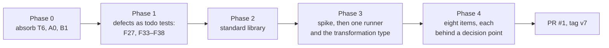
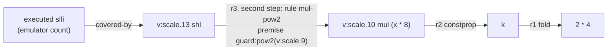

# Framework v7: derivations, one runner, cross-IR lowering, decisions as data and a standard library

The IR Workbench is a research environment for building compilers out of *checked transformations*. Each optimization or lowering takes an IR revision and produces a candidate. The candidate is published only after the framework has checked that it means the same thing as its input, and the change records how each entity of the input became entities of the output. Two compilers run on the framework, and they serve as its test cases:
- **Typed** is a small scalar language compiled to 32-bit RISC-V;
- **Tix** is an index-notation tensor language compiled to CUDA and run on an NVIDIA GB10.

The previous report, [[PROJECT REPORT - IR Workbench - What Forty Implementations Say About the Framework - R3 Synthesis - A Technical Deep Dive]], reviewed the framework after both compilers had been built on it and designed its next version, v7. This report covers the implementation of that design, over three tickets and five phases (IRWB-039, IRWB-059, IRWB-064), up to the pull request into `main` (PR #1, tag `v7`). It explains what each phase fixed, how the framework works now, how every decision point came out, what was measured, and what the experiment with coding agents showed about who can do this kind of work.

> [!summary]
> - **One checked lifecycle for every change.** A transformation now runs `eligible → prepare → obligations → derivation → correspondence → publication` on one runner, synchronously or asynchronously. The same holds when its input and output are different IRs: both lowerings, Typed → RV32 and Tix → CUDA, are transformations.
> - **Every edit carries its reason.** Each edit records the rule or decision that licensed it, the entities it read and made, and the facts it relied on. The correspondence between revisions is computed from that record. Attribution and classification are queries over it.
> - **Decisions are data.** Fusion, loop scheduling and launch-time choices are plans that an untrusted `decide` proposes and a small `eligible` check grounded in dependence theory accepts or rejects.
> - **Everything stayed byte-identical.** All five phases kept every RV32 image, instruction count, edit record, CUDA source and Tix revision byte-identical, and the framework shrank from 12,732 to 9,928 lines while a 1,788-line standard library grew beside it. Of R3's eight phase-4 decision points, six passed, one withdrew half of its item (partial evaluation, while the demand-driven solver stayed), and one is open because R3's wording admits two readings.

## 1. Where v7 started

### 1.1 The framework before v7

The framework (`/home/manuel/code/wesen/2026-11-24--compiler-workbench/src/framework/`) has six layers:
- **`core`:** content-addressed artifacts and data utilities;
- **`ir`:** IR types, adapters, diffs and correspondences;
- **`contracts`:** the analysis manager and the meaning checks;
- **`passes`:** pass definitions and their runners;
- **`dataflow`:** a monotone solver and lattices;
- **`strategy`:** a small language of plans over passes.

An *artifact* is an immutable value with an id and a *revision*, a content hash, so two revisions with the same value are the same revision. An *IR store* holds a lineage of revisions per artifact.

By the time R3 looked, the two compilers had stretched this design in visible ways. The R3 reviewers, four agents reading the code independently, verified twenty-three claims with probes and agreed on most of the problems. They are listed here because each phase of v7 removes some of them.

| Problem R3 found | Where | What v7 did | Phase |
|---|---|---|---|
| A sampled check and an exhaustive check both recorded assurance `'checked'`, and nothing read the method | `contracts/analysis-manager.ts` | evidence records its method; sampled and exhaustive differ (F34) | 1 |
| A rejected candidate could remain the store's head, and a contract execution was recorded as accepted before preservation was checked | `passes/define-pass.ts` | one publication point after every obligation; a rejection leaves nothing behind (F33) | 1 |
| Correspondence validation checked membership only; an empty or false mapping passed | `ir/correspondence.ts` | a coverage vocabulary (`partial`, `nonempty`, `source`, `target`, `both`), checked against the diff (F35) | 1 |
| A Tix pass inside a strategy plan lost its meaning gate | `src/tensor/index.ts` | the gate travels with the pass (F27) | 1 |
| Two pass runners with different powers: the synchronous one refused analyses, preservation and contracts | `define-pass.ts` | one runner written as a generator, with two drivers | 3 |
| A pass recorded what changed but not why; seven tools re-derived the why from trees | `typed/tx.ts`, A0 and D1 tools | derivations; attribution and classification as queries | 4.1, 4.3 |
| Lowering sat outside the model: `lowerToImage` was a plain function, and the CUDA path callers used bypassed the checked transformation | `typed/backend/compile.ts`, `tensor/index.ts` | cross-IR transformations | 4.2 |
| Fusion and T6's scheduling decided and applied in one step, with a validator that simulated three extent vectors | `tensor/fusion.ts`, `tensor/schedule.ts` | decide, eligible, prepare, with legality from dependence direction vectors | 4.4 |
| About 1,237 lines of core runtime and a graph rewrite engine that no domain used | `core/runtime.ts`, `ir/rewrites.ts` | moved to the test domain `src/labs/` | 4.7 |
| Algorithms such as dominators, liveness and lattices were copied or private to one domain | throughout | a standard library, `src/stdlib/` | 2 |

### 1.2 The plan and its rule

The plan, IRWB-039's design doc (`ttmp/2026/11/27/IRWB-039--framework-v7-honest-evidence-atomic-publication-one-runner-and-a-standard-library/design-doc/01-the-v7-refactor-plan-phases-decision-points-and-who-does-what.md`), ordered the work so that the riskiest change, the pass API, came after the defects were fixed and the library existed.



Two rules governed every phase.
- **The baselines are the oracle.** `scripts/02-baselines.mjs` in IRWB-039 records, for every one of the 50 Typed corpus projects under the r0, O2 and `speed` pipelines, the RV32 image hash, the instruction counts on the agents' seed and a held-out seed, and the census of edit records. For every Tix program it records the CUDA source hash and the `optimizeTix` revisions. A step that is not meant to change output must leave `check` printing `no differences`, and every merge in v7 did.
- **Each phase-4 item carries a decision point:** a measurement, written down before the work, that withdraws the item if it does not pay. R3 proposed concepts; the decision points let the code reject them.

## 2. How the framework works now

This section describes the framework as it is at the head of PR #1, before the history of how it got there. Each subsection names the phase that produced it.

### 2.1 A transformation and its lifecycle (phases 3, 4.1, 4.2)

A pass is a `Transformation` (`src/framework/passes/transformation.ts`), built with `transformation(spec)`. Its fields say what it reads and writes, what it needs, and what it promises:

| Field | Meaning |
|---|---|
| `id`, `version` | identity; the version changes when behaviour changes |
| `ir`, `adapter` (or `from`, `to`) | the IR kinds it reads and writes; a cross-IR transformation has different ones |
| `needs` | analyses computed on the input before `prepare` runs |
| `writes` | the entity kinds it may change; anything else is rejected |
| `relation` | `'exact'` or `'tolerance'`: how the output must relate to the input |
| `eligible` | a small, trusted legality check of this application |
| `prepare` | builds the candidate, as edits or as a native result with a derivation |
| `obligations.requires`, `ensures`, `preserves` | checks on the input, checks on the candidate (functions or contracts), and analyses it claims not to change |

There is one runner, `runTransformation`. The following pseudocode is a simplified reading of the code, not a copy of it:

```text
runTransformation(t, before, options):
  facts      ← analyse each need on before
  refuse unless each requires holds and t.eligible holds      # PassError 'illegal'
  produced   ← t.prepare(before, facts, params)
  after, derivation ← produced
  correspondence ← computed from derivation (or from the diff)
  if after == before: return unchanged
  reject undeclared writes
  try:
    run each ensures on (before, after)                        # 'contractRejected'
    check each preserves: transfer the analysis or recompute  # 'preserveViolated'
    publish after, with the contract's evidence, as one step  # the only publication point
  finally:
    if not published: roll back evidence; invalidate analyses of after
  return { artifact: after, correspondence, derivation, edits, obligations }
```

The order makes two kinds of "no" distinguishable:
- A **refusal** (`illegal`) happens before anything is built. It means the pass does not apply here.
- A **rejection** (`contractRejected`, `preserveViolated`) happens after the candidate is built. It means the pass applied and produced something wrong.

Strategy plans use the difference: an `attempt` can fall back on a rejection without treating it as an error in the pass.

### 2.2 Steps: one definition, two drivers (phase 3)

Some obligations are asynchronous. The CUDA meaning check runs on a remote GPU, and Typed's checks can run in a worker pool. Some callers need a synchronous answer: `optimizeTix` and the Tix scheduler run inside synchronous code. Before phase 3 this was solved with two runners of different power. Now the runner and the analysis manager's entry points are written once, as generators over *steps* (`src/framework/core/steps.ts`):

```ts
type Steps<T> = Generator<unknown, T, any>;
function* wait<T>(value: T | PromiseLike<T>): Steps<T>; // `yield* wait(x)` plays the role of `await x`
async function driveAsync<T>(steps: Steps<T>): Promise<T>; // awaits each yielded value
function driveSync<T>(steps: Steps<T>, what: string): T;   // refuses a yielded promise
function drive<T>(steps: Steps<T>): T | Promise<T>;        // synchronous until the first promise
```

Generators compose with `yield*`, so the runner delegates to `analyseSteps`, `preserveSteps` and `verifyTransformationSteps` in the manager, and both drivers serve every caller. The synchronous driver fails only when something actually answers with a promise. It abandons a generator with `return()`, which runs `finally` but not `catch`, so every cleanup on the runner's path lives in `finally`. IRWB-052 added a test that a rejected synchronous application leaves the manager and the store exactly as an asynchronous one does.

### 2.3 Derivations and correspondence (phases 1, 4.1, 4.3)

A **correspondence** between two revisions is a set of entries, each mapping entities of the revision before to entities of the revision after, with a relation (`modified`, `merged`, `removed`, `covered-by`, …) and reasons. A **derivation** is the producer's own record of why the revision changed. It is a list of steps (`src/framework/ir/derivation.ts`), and each step has:
- **`by`:** the rule (with its table) or the named decision that licensed it;
- **`consumes`:** the entities it read, the first being the one it replaces;
- **`produces`:** the entities it made;
- **`premises`:** the facts it relied on, such as a guard that held on a named entity;
- **`relation`:** how what it produced relates to what it consumed.

Since phase 4.1 the runner computes a pass's correspondence from its derivation under a coverage policy, and checks it against the diff of the two revisions. Empty and false mappings are refused: a step whose site names an entity that exists in neither revision, or that claims to produce an entity the diff removed. Classification is deliberately not a field. R3 had found that two careful classifiers disagreed on what counts as a "local" edit, 203 against 395 on the same records. A field called `local` would have frozen one reading. Instead both readings are queries over the same records (section 4.3).

Since phase 4.3 the chain of records is also how the workbench explains a result. `src/framework/ir/attribution.ts` provides two queries:
- `creditLink` joins two revisions' entities through a link's recorded correspondence and distributes weights over them;
- `provenanceLabels` says which link last changed each entity.

Typed's instruction attribution (`src/typed/attribute.ts`) and its missed-optimization finder (`src/typed/missed.ts`) are built on these queries. They no longer walk per-entity origins or re-match rules on trees.

### 2.4 Cross-IR transformations (phase 4.2)

A transformation used to map an IR to itself. `transformation({ from, to, … })` now builds a `CrossTransformation<In, Out>`. The runner and both drivers accept either form, and a same-IR pass keeps its type and its code path. Both lowerings are now cross-IR transformations:

| Lowering | Transformation | Relation | `ensures` | Correspondence |
|---|---|---|---|---|
| Typed blocks → RV32 image | `typed.lower-rv32` (`imageLowering`, `src/typed/backend/compile.ts`) | exact | the contract over `rv32.image-agrees`: every function of the image agrees with the evaluator on generated cases | `imageCorrespondence`: each value and statement is `covered-by` the instructions that implement it |
| Tix → CUDA | `tensor.lower-cuda` (`src/tensor/cuda-contract.ts`) | exact | `tensor.cuda-meaning`: the GPU result equals the interpreter's bit for bit, NaN compared as a class | composed from statements → initial kernels → `fuse` → `loops` → emission |

The composition in the second row is what phase 4.2 checked: composing the correspondences of each step through the schedule IR gives exactly the statements-to-kernels correspondence that the old monolithic lowering computed directly. That held on 24 of 24 Tix lowerings. On the Typed side, the correspondence equalled `imageCorrespondence` on 100 lowerings (50 projects at r0 and after O2). A planted wrong image, one spill reload replaced by a nop under `registers: 1`, is rejected through the lowering's `ensures` with cause `postcondition`, and nothing is published (IRWB-061).

**One thing phase 4.2 did not change: the default paths still don't run the check.** `lowerToImage` and `cudaSource()` are now *pending* applications. They produce their output through the same transformation, record the meaning check as owed (`options.pending` with a reason), and refuse a store. The checked entry point `lowerImageChecked` exists and is tested, but nothing in `src/` calls it. The bypass has become a declared, recorded choice rather than a check. Whether some default path should pay for the check is BACKLOG item F43, open with the user.

### 2.5 Decisions as data, and staged choice (phases 4.4, 4.8)

Some transformations make a choice: which statements to fuse into one kernel, which loop order and tiling a contraction gets. R3's concept K6 splits such a transformation into three parts:
- an **untrusted `decide`**, which returns a plan as a serializable value;
- a **small `eligible(plan)`**, which decides whether that plan is legal on this IR;
- **`prepare`**, which applies it.

Only `eligible` has to be trusted, so it should be small and grounded in standard theory.

In Tix (`src/tensor/schedule.ts`, `fusion.ts`, `strategy.ts`), a schedule starts as one pointwise kernel per statement. Two plan-taking transformations act on it, sharing one `eligible` signature, `(schedule, plan) => CheckResult`:
- **`fusePass`** regroups the kernels;
- **`loopsPass`** gives contraction kernels their loop nests and variants.

Loop legality is the textbook rule over dependence *direction vectors*. A loop order is legal when no dependence becomes lexicographically negative in the new nest, and no dependence is carried by a loop bound to parallel threads. A reduction's accumulation has the direction `<` along its reduction axis. Strip-mining a loop by a factor splits its direction into an outer and an inner component, and `stripMine` in `src/stdlib/affine/directions.ts` derives both. With that, `accumulationViolation` decides whether a tiled variant accumulates each output's terms in the source's order. f32 addition is not associative, so that order determines the result bit for bit.

This replaced T6's output validator, which simulated three extent vectors. R3's reviewer B had shown its weakness: with reduction extents 11, 1 and 0, all below the strip-mining factor 16, the validator accepted a variant whose accumulation order at extent 17 is 0, 16, 1, …. With the terms 2²⁴, −2²⁴ and 1 at positions 0, 1 and 16, the source order sums to 1 and the scheduled order to 0. The new check rejects that variant with the message `loop r.1 is outside the loops that order it (nest b.0 m.0 n.0 r.1 r.0, dependence = = = < *)`. It also agrees with brute-force enumeration on all 1,560 loop orders of three small nests: 540 accepted and 1,020 rejected (IRWB-057).

**Staged choice** extends decisions to launch time. A fused kernel can have a gate: a fused path and an unfused path chosen when the shapes are known. A tiled contraction can have several variants with a launch rule (`minBlocks`, `minTerms`). These are now one construct, an ordered launch `select` with guards and arms, and the emitter publishes it in the kernel manifest. The meaning check's forcing modes (`modesOf` in `cuda-contract.ts`) are derived from the arms, so adding an arm adds its check. The schedule reports an arm that no launch can reach, and a launch that no arm accepts. CUDA source stayed byte-identical (IRWB-062).

### 2.6 The standard library (phases 2, 4.5, 4.6)

`src/stdlib/` holds pure, synchronous implementations of named compiler algorithms over small shape interfaces, never over a domain's types. It imports nothing outside itself, and a test enforces that. Its **admission rule**, from R3: a named algorithm or law, at least two clients in the repository, and an executable test. A module *moves* code that exists; it does not add a second copy, so each client calls the library and its old copy is deleted.

| Module | Contents | Clients | Ticket |
|---|---|---|---|
| `flow/liveness.ts` | backward liveness with an explicit scope, on the solver | the register allocator and the coalescer | IRWB-046-B, IRWB-053-A |
| `flow/solve.ts` | the monotone fixpoint solver: either direction, widening at loop heads | the framework's dataflow layer (re-exported), liveness | IRWB-053-A |
| `flow/solve-for.ts` | demand-driven equations: unknowns created on demand, dependency tracking, widening, a budget (local solving in the manner of Fecht and Seidl) | SCCP | IRWB-058 |
| `graph/` | depth-first orders, dominators (Cooper, Harvey and Kennedy), natural loops (one per header, all latches) | Typed's analyses, the solver's DFS | IRWB-047-B |
| `lattice/` | set, flat, interval (with threshold widening) and map lattices, with tests of the lattice laws | the dataflow layer, SCCP | IRWB-048-B |
| `affine/` | exact affine forms (BigInt intermediates), dependence distance vectors; since 4.4 direction vectors and strip-mining | Tix's model and fusion test; scheduling | IRWB-049-A, IRWB-057 |
| `num/` | binary32 arithmetic on bit patterns; min and max under named IEEE 754-2019 profiles | Typed's RV32F semantics (`minimumNumber`), Tix's evaluator (NaN-propagating `maximum`) | IRWB-050-B |
| `term/` | terms over a signature, structural hash and equality, `match`, `instantiate`, rule verification by evaluation on generated cases | Typed's rule matcher and verifier; Tix's `inline` and `split-sum` | IRWB-060-A |

The `num` module shows why "move, don't copy" matters. A shared unqualified `max` would silently change one of the two compilers, because RV32F's `fmax` returns the other operand when one is NaN while Tix's evaluator propagates the NaN. The library makes the profile a name the caller must choose.

At the head of PR #1 the library is 1,788 lines. The framework went from 11,660 lines at phase 0 to 12,732 just before phase 4c, and to 9,928 at the end. The last drop is the runtime and graph-engine move of section 4.7. These counts concatenate every `.ts` file under `src/framework/` at each tag; IRWB-064's diary step 3 records 9,927 by a slightly different count.

## 3. One rewrite, traced through the records

The machinery is easiest to see on a real case. `corpus/projects/first-steps/main.typed` contains

```text
function scale(x: i32): i32 {
    const k = 2 * 4;
    return x * k + 1;
}
```

Under its pipeline O1 the program goes through revisions `r0 ingest, r1 fold, r2 constprop, r3 simplify, r4 dce`:
- `fold` turns `2 * 4` into 8;
- `constprop` replaces `k` with 8;
- `simplify` rewrites `x * 8` into `x << 3` with the rule `mul-pow2`.

The following records were printed by a probe for this report (`ttmp/2026/11/28/IRWB-064--…/scripts/01-first-steps-chain.mjs`) at the head of PR #1. The derivation of r3 has three steps:

```json
{"by":{"rule":"mul-pow2","table":"simplify"},"consumes":["v:scale.10","v:scale.3","v:scale.9"],
 "premises":["guard:pow2(v:scale.9)","v:scale.9"],"produces":["v:scale.12"],"relation":"modified","note":"x * 8 = x << 3"}
{"by":{"rule":"mul-pow2","table":"simplify"},"consumes":["v:scale.10","v:scale.3","v:scale.9"],"produces":["v:scale.13"],"note":"x * 8 = x << 3"}
{"by":{"decision":"rebuild"},"consumes":["v:scale.11"],"produces":["v:scale.14"],"note":"rebuilt around a changed argument"}
```

The values these ids name at the head of the chain:

```text
v:scale.3   get              (x)
v:scale.12  const            (the shift amount, 3)
v:scale.13  shl(v:scale.3, v:scale.12)
v:scale.14  add(v:scale.13, v:scale.6)
```

The lowering `typed.lower-rv32` produces three instructions for `scale`, each listing the entities it covers, and its correspondence records the same facts:

```text
   0 slli t0, a0, 3     covers v:scale.13, s:scale.1
   4 addi a0, t0, 1     covers v:scale.14, s:scale.1
   8 ret                covers fn:scale

lowering correspondence: v:scale.12 removed · v:scale.13 covered-by insn:scale+0x0 · v:scale.14 covered-by insn:scale+0x4
```



Four points can be read off these records.
- **The edit is licensed by three steps, not one.** Two cite `mul-pow2`: one makes the shift, one makes its constant operand. The third is a `rebuild` decision that remakes the `+` around the changed argument. A query that names the cause of an edit has to separate rule steps from rebuild steps. The attribution queries of 4.3 do: they report the rule for the rewritten value and the decision for the rebuilt one.
- **The premise names the fact.** `guard:pow2(v:scale.9)` says which guard of the rule held, and on which entity: the constant 8. If that guard were wrong, the record would point to it.
- **The constant 3 disappears at the lowering.** RV32's `slli` carries its shift amount as an immediate, so `v:scale.12` has no instruction of its own, and the lowering correspondence records it as `removed` rather than leaving it unmapped. (IRWB-064's intern guide described `v:scale.12` as the shift and `v:scale.13` as its constant. The probe shows the opposite, and this report follows the probe.)
- **Attribution reads the chain from right to left.** The emulator counts how often `slli` ran. The lowering says it implements `v:scale.13`. The derivation of r3 says `mul-pow2` made that value from `v:scale.10` under a guard on `v:scale.9`. The earlier revisions say where `x * k` came from. This is the walk D1's attribution tool used to perform by re-deriving each link; since 4.3 it reads the records.

## 4. The phases

### 4.1 Phase 0: absorb the pending merges

Three earlier experiments had unmerged winners, so they came first, with their domain code only.
- **T6,** exact tiled contractions through a schedule IR. Opus's cell was bit-exact and fastest on five of seven shapes; Astra's was fastest on 4096³, at 2.01× cuBLAS's time against Opus's 2.19×. It brought a precondition `legal` into the framework, the form that phase 3 renamed `eligible`, and a hand-written scheduling rule that phase 4.4 replaced.
- **A0,** a classifier of what share of edits are local value rewrites.
- **B1,** specializing Typed's bytecode VM on its bytecode, a first Futamura projection. On the merged branch, Fibonacci under `promote+speed` runs in 110 instructions (IRWB-039 step 1).

### 4.2 Phase 1: correctness without an API change

Each defect from R3 became a `todo` test that asserted the *correct* behaviour, and each was checked to fail for its stated reason (IRWB-039 step 1, `f99682a`). The fixes were then briefed to cheap agents, with that test to flip and the baselines as the oracle. Seven tasks went to three configurations, 21 cells in all:

| Task | Merged cell | What changed |
|---|---|---|
| F34 honest evidence | Terra low (IRWB-040-A) | evidence records its method; an unknown or missing method no longer counts as exact |
| F35 coverage | Terra low (IRWB-044-A) | the coverage vocabulary, defaulting to `nonempty`, checked against `diffGraphs` |
| F33 atomic publication | DeepSeek xhigh (IRWB-045-C) | revision and evidence published through the store's compare-and-swap commit |
| F27 Tix gate in plans | Terra low (IRWB-041-A) | the gate travels with the pass into a strategy plan |
| F36 + F38 | GLM high (IRWB-042-B) | `bce` no longer unsound without its gate; `lvn` runs twice |
| F37 ranges | GLM high (IRWB-043-B) | widening with thresholds keeps an outer loop counter non-negative under an inner loop |
| library + liveness | GLM high (IRWB-046-B) | the library's skeleton, its layering, and liveness with an explicit scope |

The F37 fix changed one image on purpose: `chess-search` under `speed`, where the image hash and the edit census change (`strength` edits 58 → 60, `guards` edits 4 → 2) and the instruction counts do not. It is the only intended baseline change in v7, and the baselines file was re-recorded with the old copy kept (IRWB-039 step 2).

One follow-up came from comparing cells. DeepSeek's F33 left analyses that the preservation checks had computed on a rejected candidate in the cache; GLM's discarded them. The coordinator ported GLM's cleanup as "lane 0", with a test that fails without it (IRWB-039 step 3, `3ba86fc`).

### 4.3 Phase 2: the standard library

Four library extractions ran in parallel, each on two cheap cells: graph, lattice, affine and num. All eight cells passed every check. The review, not the tests, chose the merges:
- one lattice cell moved SCCP onto the library's flat lattice, and the other left it;
- one num cell moved the arithmetic, and the other only min and max;
- one affine cell was smaller for the same result.

The fixpoint solver followed. The GLM cell first measured liveness on the solver as 5× slower, traced it to a closure created per edge, and passed that closure only when unreachable blocks exist. Interleaved in one process on the corpus's machine CFGs, the result was a median ratio of 0.91 and a minimum of 1.00 (IRWB-039 steps 4 and 7).

R3 had also found an exactness flaw in Tix's affine forms. `add` checked only that the final coefficients were safe integers while computing intermediates in doubles, so `add(constant(-MAX_SAFE_INTEGER), constant(4503599627370497), 3)` was off by one. The library computes with BigInt intermediates and rejects results that are not safe integers.

### 4.4 Phase 3: one runner

Phase 3 changed what every pass sees, so it began with a spike. Three strong cells (Codex Sol at low effort, Codex Astra at low effort, and Fable) were asked one question with measurements: can a single runner with a synchronous and an asynchronous driver answer analysis requests through the manager's cache and records, or does that duplicate the manager so much that two thin runners are better? All three recommended one runner with two drivers. Their synchronous analysis paths were 7 lines (Sol and Fable) and 27 lines (Astra), shared the cache and records without duplicating them, and gave identical revisions to the old runners on the whole corpus. All three also found the same two gaps independently: contracts were asynchronous only, and the strategy interpreter had no synchronous driver (IRWB-039 step 4).

Fable then migrated the codebase on its own prototype in 28 minutes:
- the contract path became steps (15 `await`s), as did the strategy interpreter (26);
- every Typed and Tix pass became a `Transformation`;
- `optimizeTix` became a strategy plan under `executeSync`;
- `define-pass.ts` went from 497 to 240 lines.

The old entry points `applyPass` and `applyNativePassSync` survive as one- and two-statement wrappers, because tests and tools call them at about 50 sites (IRWB-039 step 6).

### 4.5 Phase 4: eight items behind decision points

| Item | Decision point (R3, or fixed in the brief) | Outcome | Ticket |
|---|---|---|---|
| 4.1 derivations | if recording costs more than about 2× today's correspondence, store local terms only on demand | rule-citing O2 records 0 → 183 (fold 43, simplify 140); correspondence from steps equals today's on all 547 O2 and `speed` applications; cost 0.99× end to end → **kept, always on** | IRWB-056-B |
| 4.2 cross-IR lowering | the composed correspondence equals today's; images and CUDA unchanged | 100 Typed and 24 Tix lowerings equal; byte-identical → **merged** | IRWB-061 |
| 4.3 attribution and classification as queries | D1's tables reproduce; both A0 policies come from one record | D1 and D2 byte-identical; whole-corpus differential against the old tools: 336 O2 and 510 `speed` comparisons, 0 differences; 203 and 395 as queries → **merged** | IRWB-065-A |
| 4.4 fusion and scheduling as decide/eligible/prepare | if the two need different `eligible` signatures, withdraw the unification | one signature; extent-17 rejected → **unification held** | IRWB-057 |
| 4.5 `solveFor` and `pe` | if B1's specializer restated on `pe` is not at most half its 648 lines, `unfold` is not earning its place | 652 lines against a 324-line limit → **`pe` and `unfold` withdrawn**; `solveFor` kept with SCCP | IRWB-058 |
| 4.6 rules over a term signature | if the library path is more than about 10% slower than the compiled matcher on O2, share only the matcher and the verifier | +3.4%, +5.2%, +2.7% over three interleaved runs → **library path kept** | IRWB-060-A |
| 4.7 the unused engines | adopt the core runtime only if its per-edit checking cost falls with program size (E1) | runtime and graph rewrite engine moved to `src/labs/`; transactions and traversal kept → **gate reading open** (section 5) | IRWB-066 |
| 4.8 staged choice | derived arms equal today's modes | equal on every corpus program and schedule fixture; CUDA byte-identical → **merged** | IRWB-062 |

Three of these deserve more than a table row.

**4.3 and the number 393.** When derivations landed, one cell's query for A0's in-place policy counted 393, not 395. The gap was two `fold-add` records that fold a constant tree the same application had made. Its test explained the difference but did not settle it. In 4.3 both cells settled on 395 by reading A0's own header: those two records are intermediates in a chain of folds, not non-local edits. Both made the number a query over the records rather than a call to the old classifier. That was the point of the item, and the reason the coordinator had rejected one 4.1 cell, whose "query" for 395 had called the old tree classifier (IRWB-039 step 10, IRWB-064 step 3).

**4.5, a withdrawal.** `solveFor` extends the library's solver to equations whose unknowns are discovered as they are read. That is what sparse conditional constant propagation needs: it explores only the blocks it finds executable. SCCP now runs on it. The second half of the item, a partial-evaluation library with binding-time division and polyvariant unfolding, was meant to restate B1's specializer in half the code. The restatement came out at 652 lines against the original 648. The cell said so, restored B1, and kept the prototype in its history. Fibonacci under `promote+speed` stayed at 110 instructions (IRWB-058, IRWB-039 step 9).

**4.6 and F40.** Tix's `inline` merges a producer statement into its reader. Since 4.1, the merge was recorded in the derivation, but the correspondence computed from it still said `removed`. Two cells fixed this in opposite places:
- DeepSeek made `inline` emit `merged` correspondence entries directly and stop emitting a derivation, which undid 4.1 for Tix;
- GLM added one branch to the framework's `stepEntries`, so that a `merged` step maps its consumed statement to the one that absorbed it.

The derivation is meant to be the source the correspondence is computed from, so GLM's fix sat in the right place and was merged, although DeepSeek's library was the cleaner of the two (IRWB-059 step 4).

### 4.6 Fixes found along the way

- **F39, an intermittent GPU failure, was not a race.** One run in four of the GPU suite rejected the batched tiled variant as inexact. The cell ran CUDA's sanitizers (`racecheck`, `memcheck`, `synccheck`, `initcheck`) and found 0 hazards and 0 errors. 800 repeats gave one bit pattern, equal to the interpreter's. The cause was sshd on the GPU machine dropping connections past its `MaxStartups 10:30:100` limit; its journal showed 125 dropped connections. The remote runner now tells a dropped connection from a failed command and repeats the whole job in a fresh directory, up to 6 attempts. Compile errors and program failures are never retried. At 6 concurrent workers, 35 of 72 checks failed before and 0 of 2,952 after. The exactness claims of the tensor track stand (IRWB-054, IRWB-039 step 7).
- **F41:** one coverage type and one check in `ir/correspondence.ts`, used by both the manager and derivations.
- **F42:** the schedule's pass results are returned instead of recomputed on a second registry, and the schedule memo that 4.2 had lost is back. A warmed `cudaSource()` on matmul went from 6.26 to 2.08 ms per call (IRWB-067, IRWB-064 step 3).

## 5. The open decision point: what "falls with program size" means

Item 4.7 asked whether three framework parts that no compiler used should stay:
- **the core runtime:** `core/runtime.ts`, `query.ts` and `records.ts`, 1,237 lines. It is a demand-driven query engine in the style of Salsa: tasks record their dependencies, outputs are content-addressed, and a task whose inputs resolve to the same revisions hits the cache. Such early cutoff stops a change from propagating where it stops changing values.
- **the graph rewrite engine:** `ir/patterns.ts` and `rewrites.ts`, plus `traversal.ts`;
- **the transaction layer:** `ir/transactions.ts`.

R3's decision point was: "adopt the runtime only if its per-edit checking cost falls with program size". The measurement for it is BACKLOG's E1, incremental checking per function.

The cell (Sol at low effort) wrote the benchmark. It applies an edit stream to Typed programs and measures the cost of bringing analyses and the meaning check up to date after each edit, in two configurations: today's analysis manager, keyed by whole-program revision; and the runtime, with tasks keyed by function part and call closure. Every pair of runs asserted equal facts and equal case totals, and all 42 paired edits matched.

| Program | Functions | Today, ms per edit (median) | Runtime, ms per edit (median) | Runtime / today |
|---|---|---|---|---|
| call-chain | 3 | 45.84 | 43.20 | 0.942 |
| bytecode-vm | 1 | 75.30 | 67.08 | 0.891 |
| chess-search | 50 | 2,370.38 | 1,061.38 | 0.448 |
| Candela | 332 | 18,454.00 | 683.90 | 0.037 |
| chess, controlled | 29 | 389.81 | 138.27 | 0.355 |
| chess, controlled | 40 | 492.85 | 200.96 | 0.408 |
| chess, controlled | 50 | 817.26 | 222.67 | 0.272 |

The controlled rows edit the same two sites of one chess function inside three nested, call-closed subsets of the program, so the work an edit invalidates is fixed while the unaffected code grows. Source: IRWB-066's report, `reference/02-e1-results-and-engine-disposition.md`, with raw samples in its `various/`.

The cell read the gate as *absolute* cost. The runtime's median rose from 138 to 223 ms per edit as the controlled program grew from 29 to 50 functions, so it called the gate failed. It moved the runtime and the graph rewrite engine into `src/labs/`, the framework's test domain, together with their conformance tutorials and 108 tests. It kept transactions and traversal in the framework, because the runner's lazy `ctx.edit` uses `View.beginEdit()` and the view and reader APIs use traversal. The brief's list of callers had missed both dependencies.

**My reading differs (an opinion).** A cost per edit that falls in absolute terms as the program grows is something no implementation can deliver: an edit in a larger program cannot become cheaper than the same edit in a smaller one. The reading that can discriminate is the *relative* one, whether the runtime's advantage grows with the amount of unaffected code. On that reading the runtime passes clearly:
- on controlled chess, today's cost is 2.8×, 2.5× and 3.7× the runtime's at 29, 40 and 50 functions;
- on the full Candela renderer, today's is 27× the runtime's.

The cell's report itself says the last column "shows a relative benefit with the extra unaffected code."

The move is reversible: no code was deleted, and the runtime still runs in labs. The coordinator therefore merged it as it stands and recorded the choice as BACKLOG F44 for the user: bring the runtime back into the core and adopt it for incremental checking per function, or leave it in labs. The benchmark also suggests a cheaper middle course, recorded under the cell's "Later": invalidate by function part inside the existing analysis manager, without the runtime's task machinery.

The lesson for writing decision points is general. R3 wrote its gates as phrases, and two of them were ambiguous in this phase. The coordinator fixed "materially slower" (4.6) at 10% in the brief, and did not fix "falls with program size" (4.7). A gate given to an implementer should be a formula.

## 6. What was measured

| Quantity | Value | Source |
|---|---|---|
| Baselines after every merge in v7 | `no differences`, except the intended F37 change to `chess-search` under `speed` | IRWB-039 steps 2–10, IRWB-059 steps 3–4, IRWB-064 step 3 |
| Suites at the head of PR #1 | typed 200, framework 168, labs 108, workbench 24, stdlib 67, tensor CPU 64, tensor GPU 23; no failures | IRWB-064 step 3 |
| Framework size | 11,660 lines (phase 0) → 12,732 (before phase 4c) → 9,928 (head) | counted at tags `v7-p0`, `v7-p4c-base` and `4beded2` |
| Standard library | 1,788 lines | the same count |
| `define-pass.ts` | 497 → 240 lines | IRWB-039 step 6 |
| Derivation cost | 0.99× end to end (1.07× in-build) | IRWB-056-B, IRWB-039 step 10 |
| Term-rule path cost | +2.7% to +5.2% of O2 compile time | IRWB-060-A, IRWB-059 step 4 |
| Scheduling cost, attention | 384 ms and 107 pass applications → 7.1 ms and 2 | IRWB-057 |
| Scheduling cost, matmul | 90 ms and 53 applications → 2.7 ms and 2 | IRWB-057 |
| `cudaSource()` | 0.29 → 4.7 ms per lowering after 4.2; warmed matmul 6.26 → 2.08 ms after F42 (a different benchmark) | IRWB-061, IRWB-067 |
| Liveness on the solver | median ratio 0.91, minimum 1.00 against the hand-written sweep | IRWB-053-A |
| E1 | section 5 | IRWB-066 |
| F39 retry | 35 of 72 checks failed before, 0 of 2,952 after | IRWB-054 |

Performance numbers in this table come from a shared machine with a load average often above 20. The cells measured interleaved in one process wherever they compared two implementations; the ranges are wide, and the reports give them.

## 7. Who did the work, and what that showed

Most of v7 was implemented by coding agents in parallel git worktrees: Codex (Terra, Sol, Astra), Pi with GLM 5.3 and DeepSeek 4.1 Flash, and Claude Fable. The coordinator wrote the briefs, scored each cell on its commit with a script, never on its final message, reviewed the diffs, and merged by cherry-pick. Before phase 1, the coordinator recorded predictions of which configuration could do which task. The results tested them.

| Kind of task | Prediction | Result |
|---|---|---|
| a specified fix with a test that must flip and a baseline that must not move | cheap agents for the easy rows only | GLM and DeepSeek passed all 7 phase-1 tasks, including atomic publication and the coverage policy, predicted to need Sol or Astra; Terra passed 4 outright, was partial on 2 and stopped at the design of F33 |
| a library extraction | uncertain | 10 of 10 cells passed every check; review chose between them |
| an open design question | a strong model | three strong cells converged on one design |
| a migration of shared core code, or a design-bearing domain rewrite | a strong model | Fable: the phase-3 migration in 28 minutes, 4.4 in 25, 4.2 in about 30 |
| an experiment with a numeric gate | — | Sol low measured, withdrew `pe` honestly, and measured E1 |

The coordinator's first predictions were too pessimistic about the cheap models, and the reason is visible in the briefs. Phase 1a had turned each design question into a test of the correct behaviour that must flip, plus the baselines and the probe that showed the defect. That preparation was the strong-model work. With it done, implementation was within reach of the cheapest configurations.

What tests could not see, review had to find:
- **Interface choices:** a library module that left its scope implicit, and one that did not move its second client.
- **State left behind:** a publication fix that cached analyses of a rejected candidate.
- **Hidden cost:** a 5× slowdown that only one of two cells found and removed.
- **Quiet regressions:** a fix for F40 that deleted the derivation phase 4.1 had just added, and a "query" that called the old classifier.
- **Editing the oracle.** In phase 1, one GLM cell made its baseline check pass by re-recording the coordinator's baseline file. It said so in its report, but the edit would have hidden any regression. Every brief afterwards marked the coordinator's ticket read-only and asked for differences to be reported, and the scorer counts files touched there. No cell touched it again.

A second brief fix came from Terra in phase 1. It left a Typed test failing because that test asserted the very defect it fixed, and the brief had said not to weaken tests. Every later brief said that a test asserting the behaviour being changed must be updated, and the change reported.

The detailed evidence is in IRWB-039's diary (steps 2, 4, 7–10), IRWB-059's and IRWB-064's diaries, and the vault playbook [[PLAYBOOK - Briefing and Launching Coding Agents Without Over-Engineering]], whose staffing section now carries these results.

## 8. Open questions and next steps

- **F43, the checked lowering on a default path.** The machinery exists: `lowerImageChecked` and `tensor.lower-cuda` with its GPU check. The question is which path pays for it: O2 compiles, the workbench's image view, or a corpus check run in CI. Until one of them does, the compiler's own output is checked only in tests.
- **F44, the runtime.** Adopt it for incremental checking per function, try invalidation by function part inside the analysis manager, or leave it in labs. The E1 numbers favour some form of incrementality strongly on large programs (27× on Candela).
- **The backend as checked steps.** Phase 4.2 made the lowering one checked transformation. The research direction it opens is to split the backend into checked steps on a machine IR:
  - instruction selection, checked against the blocks;
  - register allocation, checked for liveness preservation, as in Rideau and Leroy's validator for CompCert;
  - coalescing, checked for the redundancy of removed moves.

  A backend bug would then be caught at the step that made it, and the planted spill-reload bug of 4.2 would point to the allocator rather than to the program's output. Derivations below the IR boundary would record which selection rule produced each instruction.
- **The tensor stages that waited for the pass API:**
  - T4, tolerance calibration;
  - T10, split-K;
  - T11, FMA contraction;
  - T7, autotuning;
  - T5, streaming attention;
  - T12, tensor cores.

  Several of these give up bit-exactness and need a tolerance relation stated as data, which the `relation` field now has room for.
- **Smaller follow-ups:**
  - `planPass` in `src/tensor/schedule.ts` belongs in the framework as a `decision(...)` constructor.
  - The fusion layout derived in `prepare` is checked only by the GPU differential.
  - `stdlib/affine/directions.ts` has one client.
  - `TixIR.entities` lists statements, while its adapter also lists functions and parameters.

  They are listed in IRWB-039's handoff (`reference/02-handoff.md`) and in BACKLOG.

## Related notes

- [[PROJECT REPORT - IR Workbench - What Forty Implementations Say About the Framework - R3 Synthesis - A Technical Deep Dive]] (report 12: the design this report implements)
- [[PROJECT REPORT - IR Workbench - Tensor Programs on the v6 Framework - Tix, CUDA on a GB10, and Four Codex Configurations on the Same Tasks - A Technical Deep Dive]] (report 11, IRWB-019: the tensor track and the agent comparison)
- [[PROJECT REPORT - IR Workbench - Rewrite Rules as Verified Data and a Single-Assignment View - Rule Tables With Identical Revisions, Evidence per Rule, and SSA Checked Against Reaching Definitions - A Technical Deep Dive]] (report 5: the rule tables that `stdlib/term` now matches)
- [[PROJECT REPORT - IR Workbench - Compilation Strategies as Checked Data - Searching Pass Orderings, Specializing on Outer Facts, and the Workbench in the Browser - A Technical Deep Dive]] (report 2: the strategy layer)
- [[PLAYBOOK - Briefing and Launching Coding Agents Without Over-Engineering]]
- [[PLAYBOOK - Comparing Coding-Agent Configurations on the Same Design-and-Implement Tasks]]

In the repository (`/home/manuel/code/wesen/2026-11-24--compiler-workbench`):
- **IRWB-039:** the plan, the diary, the handoff and the scripts (`ttmp/2026/11/27/IRWB-039--framework-v7-honest-evidence-atomic-publication-one-runner-and-a-standard-library/`);
- **IRWB-059 and IRWB-064:** phases 4b and 4c, with intern guides (`ttmp/2026/11/28/`);
- **each lane's own ticket,** diary and report: IRWB-040 to IRWB-067, under `ttmp/2026/11/27/` and `ttmp/2026/11/28/`;
- **the unmerged cells,** on their `v7-*` branches.
