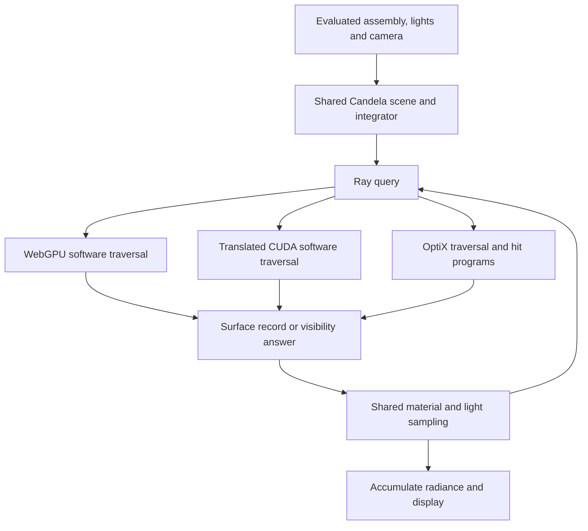
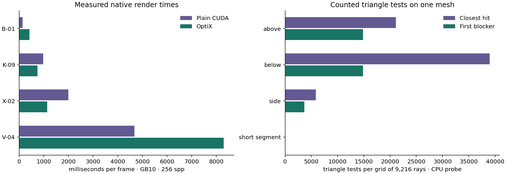
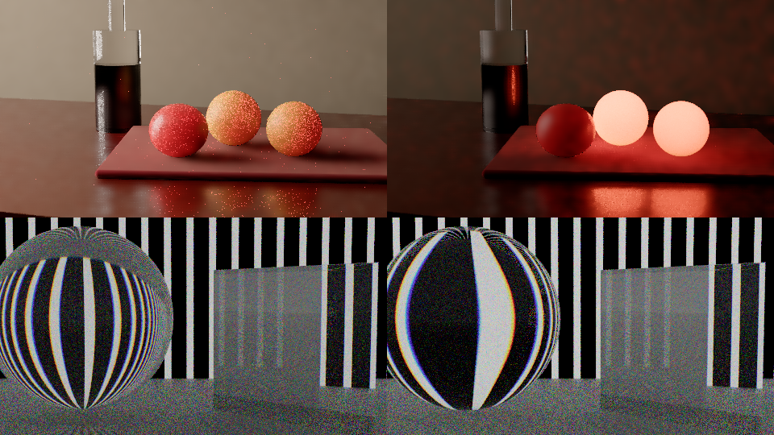

# One path tracer, three ways to find a surface

In a close-up of the Singer rotary hook, one pixel can require several geometrical decisions. Where does the camera ray first touch the polished hook? From that point, can a ray reach the strip light before it strikes the needle? Where does a reflected ray hit next? The first and third questions need a distance and the identity of a surface. The middle question can end as soon as any eligible surface blocks the finite segment to the lamp. All three contribute to the same pixel, but they require different amounts of work.

Candela controls how rays are generated, how materials scatter light, how the integrator chooses a lamp, and how samples accumulate into an image. **OptiX provides another way to answer the geometry questions on an NVIDIA GPU.** It also supplies acceleration-structure operations, moving instances, built-in primitives and a denoiser. Choosing OptiX leaves substantial CPU and GPU code in Candela. The choice is which subsystem should own a particular operation and how to verify that the resulting image still has the intended meaning.

**My recommendation is to keep one material and lighting implementation, give the backends explicit closest-hit and visibility contracts, and share resource-change information between them.** The smallest software experiment is early termination of opaque shadow queries. The native opportunity is to preserve the scene across edits and update only the resources that changed. For a new visual capability, native curves and a portable curve representation offer a way to show the thread actually passing around the Singer bobbin.

## Follow a ray from the preset to the pixel

Jig solves the mechanism at a shaft angle and supplies component placements. The presentation chooses a camera, time, light rig and section plane. Candela receives triangles with CAD face information, materials, transforms and lights. Its scene compiler generates shader code and data buffers. Once the camera ray has been generated, execution follows one of three paths.

| Target | What searches the scene? | What Candela retains |
|---|---|---|
| Browser WebGPU | A WGSL compute shader walks a tree over bounded objects and a second tree inside triangle meshes. It checks unbounded objects separately. | Camera and ray sampling, intersections, material evaluation, light transport, accumulation and display |
| Native plain CUDA | Candela translates its shader logic into CUDA and executes the software traversal on the NVIDIA GPU. | The same scene and integrator semantics, plus a native runtime suitable for controlled comparisons |
| Native OptiX | Generated GPU code calls a Candela traversal shim. OptiX traverses acceleration structures, tests built-in geometry and invokes Candela programs for relevant hits or custom primitives. | The shared integrator, material and lighting code, construction of the scene, ray arguments, hit interpretation and output |

At the triangle hit, the OptiX closest-hit program obtains an instance ID, primitive index, distance and two barycentric coordinates. Barycentric coordinates specify the point’s position within the triangle. Candela translates the result into its own object and triangle records. Its shared hit-processing code can then recover face metadata and the interpolated surface attributes needed by the material. An analytical object with a custom intersection function still runs Candela code for its local geometric test. An infinite plane still requires separate handling. The division of labor depends on the primitive as well as the backend.



A useful implementation detail is where the substitution happens. The CUDA code generator retains the generated `traceAll` for plain CUDA and omits it for OptiX, whose shim supplies a function with the expected contract. Both native pixel entry points invoke the translated `renderPixel`. A developer changing the WGSL helper `occluded` must account for this replacement. Inlining a software tree walk there could send OptiX shadow rays down the software path by accident. Make the new query an explicit backend operation and test the generated source for each target. From `import/candela/`, the three relevant files are `src/engine/targets/cuda.ts`, `src/engine/kernel.ts` and `native/rt/kernels/candela_traversal.inc`.

## What the Spark measurements establish

The table uses a historical GB10 comparison on the same Spark at 960 × 540, 256 samples per pixel, with motion blur off. The OptiX column used the recorded 255 register limit. Times describe the render interval for each preset. They exclude sending a Jig project, preparing a cutaway or encoding a complete movie.

| Scene | WebGPU via Dawn | Plain CUDA | OptiX | Lower native time |
|---|---:|---:|---:|---|
| B-01, simple sphere | 516 ms | 141 ms | 422 ms | Plain CUDA |
| K-09, lockstitch mechanism | 5,201 ms | 973 ms | 741 ms | OptiX |
| X-02, ten thousand objects | 14,829 ms | 2,001 ms | 1,144 ms | OptiX |
| V-04, cloud | 8,110 ms | 4,671 ms | 8,295 ms | Plain CUDA |

The simple sphere is a useful control. Building and executing a hardware traversal pipeline for an inexpensive intersection can cost more than solving it directly. Conversely, the K-09 mechanism and X-02 object population supply enough traversal work to reward acceleration. The cloud example is a reminder to profile the work within a sample. A different traversal backend can leave most of a volume integrator’s work untouched. The table measures the total result of each backend configuration; identifying a particular microarchitectural cause requires a device profile.

Candela already has an automatic native choice based on mesh presence and bounded-object count. Its shader execution reordering policy is a separate decision. Reordering allows threads that hit similar surfaces to execute later work together, at a cost in scheduling and carrying live state. On an earlier X-02 configuration this helped. On K-09 and K-01 in the same reordering study it increased elapsed time. A subsequent conversion to eligible built-in spheres improved X-02 even with reordering off. Preserve the scene revision, primitive policy, backend and register settings with every result. The measurements come from the CANDELA-002 records `16-phase3-optix.txt`, `22-ser.txt` and `23-builtin-spheres.txt`.



*Figure 1. Left, elapsed time from the recorded Spark experiment. Right, work counted by the new CPU visibility probe. The two panels have different units. The right panel gives a reason to test the shader on device.*

## The first portable improvement has a boolean return value

The present software `occluded` calls `traceAll(..., true)` and tests whether the result contains an object. A bounding-volume hierarchy groups objects in nested boxes so that a ray missing one box can skip all enclosed surfaces. Its mesh routine uses the closest distance found so far to prune the search, and it retains the winning triangle and barycentric coordinates. This is a sensible implementation for picking a face or evaluating a material. A shadow query discards those details. The existing OptiX path already asks traversal to terminate after the first eligible hit on a shadow ray.

In the Singer example, the query starts at an offset from the hook surface and ends at a sampled point on the light. An object behind the light cannot block this segment. An object excluded by the shadow mask cannot block it either. The fast software path needs to preserve those decisions while propagating success out of the triangle leaf, the mesh traversal and the top-level scene traversal. Returning early only after searching a whole mesh leaves work on the table. Keep participating-media transmittance, which can be fractional, distinct from the existing opaque visibility predicate.

**A measured probe.** I built a standard Candela torus with 3,072 triangles and its production mesh builder produced 1,935 tree nodes. The experiment instruments a temporary copy of the CPU picking routine. For each ray it runs the stock picker, an instrumented closest-hit walk, and a walk with the same child order that returns at the first valid triangle. Four 96 × 96 grids cover the torus from above, below and from one side, plus a short ray segment that stops before reaching the part.

| Ray grid | Blocked out of 9,216 | Triangle tests, closest hit | Triangle tests, first blocker |
|---|---:|---:|---:|
| Above | 3,064 | 21,101 | 14,862 |
| Below | 3,064 | 38,953 | 14,862 |
| Side | 1,176 | 5,842 | 3,678 |
| Short segment | 0 | 0 | 0 |

All 36,864 boolean decisions agreed. Opposite views of the same torus took quite different amounts of closest-hit work, even though their hit counts were identical. Fixed child order can encounter a distant surface before a near one and tighten the closest distance only late in the walk. The short segment rejects the root box and leaves nothing for early termination to save. These are CPU operation counts on one mesh. The probe exercises neither the GPU’s memory behavior nor a complete scene’s masking and light sampling. It cannot establish milliseconds saved per Singer frame. [Reproduction script](scripts/jig030-optix/01-shadow-query-probe.cjs) · [Recorded counts](_assets/jig030-optix/shadow-query-probe.json)

### What a shared ray-query contract must preserve

The proposed contract below uses pseudocode. `closest` supplies the geometric hit needed for shading. `blocked` supplies visibility for the current opaque predicate. A change to material transmission or visibility policy would be a separate semantic change.

```text
Ray = {origin, direction, minimumDistance, maximumDistance, shutterTime, visibility}
closest(ray) -> Miss | {occurrence, primitive, distance, localCoordinates}
blocked(ray) -> Boolean
```

Build a replay corpus before optimizing the shader. Include camera rays from the hook close-up, reflected rays, and finite shadow segments from several lights. Add deliberately difficult fixtures: an origin inside a solid, a point on a triangle edge, nearly parallel rays, coincident surfaces, a nonuniformly scaled instance, a moving instance at shutter endpoints, an infinite plane and an emitter whose visibility differs by ray type. Compare shadow booleans exactly for unambiguous fixtures. Compare hit position and distance with scale-aware tolerances. Shared edges can admit two equally valid triangle IDs. An ID difference there becomes a failure if it changes a required CAD face or material decision. Include cases on both sides of the edge to diagnose a genuine crack.

A historical regression gives this test a concrete purpose. Substituting native sphere intersections produced substantial differences for two presets with rays originating inside spheres. The implementation restricted built-in sphere eligibility for materials that let paths enter. Geometry-only testing from an outside camera missed that failure. A test suite aimed at glass, interiors and refraction would have identified it sooner.



*Figure 2. The archived R-03 and S-01 comparisons from the built-in-sphere investigation. Hardware eligibility is a property of the scene’s required ray behavior as well as the surface shape.*

## OptiX capabilities worth adopting

The project’s verified SDK baseline for these measurements is OptiX 9.0 on GB10. Its installation record reports that the 9.1 build requested an ABI unsupported by the recorded driver. A declaration in a newer header alone is insufficient evidence of runtime availability. Use the tagged headers and check the target driver before committing to a feature. The APIs in this section fall at different boundaries. Some change only the CPU orchestration. Others require a new quantity from the GPU or a new representation in the authoring language. [NVIDIA OptiX 9.0 public headers](https://github.com/NVIDIA/optix-dev/tree/v9.0.0/include)

| Capability | What Candela already does | Proposed work and first visible result |
|---|---|---|
| Update acceleration structures | Builds and compacts mesh and instance structures. | Retain a scene in a native worker, classify transform-only changes and use compatible instance updates. The Singer shaft advances without rebuilding unchanged meshes. |
| Visibility masks by ray class | Uses instance masks and distinguishes camera and shadow traversal. | Give primary and reflected rays distinct visibility policies. Hide a studio emitter from a hero shot while preserving its metal reflection. |
| Temporal and multilayer denoising | Uses the OptiX AOV denoiser with a beauty layer and albedo/normal guides. | Supply motion and history for temporal proof movies, or produce actual linear light-contribution layers for multilayer denoising and fixed-rig rebalancing. |
| Native curves | Current CAD export chiefly supplies tessellated bodies. | Represent thread centerlines, radii and motion in Candela, use OptiX curve intersection on the Spark, and implement a corresponding browser representation. |
| Motion transforms and shutter sampling | Already has native motion-transform handling for supported scenes. | Make shutter intervals and valid object trajectories explicit in the Stage output path. A preview and a final should integrate the same motion when motion blur is requested. |

**Resource updates.** A camera turn changes primary rays, so accumulated radiance must restart. The geometry can remain. A rigid joint changes a transform while keeping mesh connectivity and vertex attributes. A swept cut can introduce different triangles and caps. The latter requires rebuilding the affected geometry when update constraints fail. OptiX constrains which inputs can change during an update and requires dependent structures to stay valid. Provision update-capable structures deliberately, retain object lifetimes correctly, and compare total frame time after many updates. Fast updates can degrade later traversal quality on large deformations. For compatible instance updates, this work can be done in host C++ while keeping the current shading kernel. The host-side implementation belongs around scene revisions and `OptixRenderer::setFrame`. [OptiX acceleration structures](https://raytracing-docs.nvidia.com/optix9/api/group__optix__host__api__acceleration__structures.html)

**Temporal denoising.** An image sequence supplies evidence unavailable in a single frame. To use it, the native denoiser needs a meaningful correspondence between neighboring images, previous denoised output and internal guide history. Candela can derive motion for a visible rigid point by projecting that point using the previous and current camera and instance transforms. Newly exposed cut faces may have no corresponding previous visible point. A bright strip moving across a stationary housing presents another challenge: surface motion alone cannot describe the changing highlight. Test a rotating camera, moving needle, moving light with a fixed camera, and the cut revealing a previously hidden surface. Reset history on discontinuous edits. Verify normal-space and flow conventions with a known reprojection on the installed SDK before judging the result. [OptiX denoiser API](https://raytracing-docs.nvidia.com/optix9/api/group__optix__host__api__denoiser.html)

**Relighting.** An AOV is an additional image quantity produced during rendering. Using the AOV-model denoiser does not alone produce a rim-light layer. Candela would need to account for radiance from each selected source, including its contribution through specular paths, and preserve any remaining emission and environment light. Artist-adjustable intensity is useful when the geometry, emitter position and transport assumptions stay fixed. Composite and expose in the appropriate order: sum compatible linear contributions, then apply the photographic display transform. Moving the light changes visibility and needs a fresh lighting solution. A denoised layer sum should also be compared with the denoised whole image, since reconstruction is nonlinear.

**Curves and ray visibility.** The Singer’s current inspection explains the clearance between the needle and hook. Thread geometry would explain the mechanical purpose: the point takes up a loop and carries it around the bobbin. Start with an authored centerline and varying radius at a few verified phases. OptiX supplies curve intersection, but Candela needs bounds, shading coordinates and stable identity; Jig must supply the trajectory and any contact assumptions. Verify the portable and native silhouettes at intended macro magnification. Native curves would require new scene data and GPU hit attributes for shading, including a strand tangent. For an earlier, smaller authoring win, separate the visibility of a strip emitter to primary, shadow and reflected rays. Preserve its lighting and reflected appearance as specified while testing shadows and indirect paths separately. Instance masks can suppress a whole instance; they cannot produce the orange cap material on a physically sectioned part. [OptiX 9.0 types](https://github.com/NVIDIA/optix-dev/blob/v9.0.0/include/optix_types.h)

## Optimizing our own GPU traversal

The portable backend already has two levels of spatial indexing. The scene compiler partitions bounded objects in a top-level tree. Inside a mesh, the builder uses a binned surface-area heuristic to partition triangles. Its packed nodes occupy eight floats each, and a triangle record contains 28 floats including positions, edges and shading attributes. Implementing “a BVH” would duplicate an existing capability. Three narrower experiments have identifiable costs and failure conditions.

1. **Closest-hit ordering.** The software walk pushes both children in a fixed order. Test choosing the nearer child from box entry distances. A nearer hit can reduce the admissible distance and prune the farther child. Measure node visits, triangle tests, bytes touched and device time. The extra box work may dominate tiny meshes. Replay reversed camera directions and shadow rays as well as coherent primary rays. PBRT describes how tree construction and traversal choices interact. [PBRT, bounding volume hierarchies](https://pbr-book.org/4ed/Primitives_and_Intersection_Acceleration/Bounding_Volume_Hierarchies)
2. **Separate intersection data from shading data.** A shadow query only needs enough information to accept or reject an intersection. Today it fetches triangle geometry from the first three four-float rows of a larger record. A geometry-only stream could improve locality in traversal-heavy shots. The material code still needs normals, UVs and CAD face identity once a closest surface is known. Compare current packing with a compact intersection stream plus an indexed shading stream. Record total scene bytes, memory transactions and elapsed time on both browser and Spark. A smaller record with slower attribute recovery can lose on reflection-heavy shots.
3. **Measure stack and divergence pressure before changing the kernel architecture.** The WGSL tree walks use fixed-size local stacks and guard their pushes. Record maximum pending entries and exercise adversarial overlapping or deep trees. A suppressed push can omit geometry if the limit is ever exceeded. Establish a bound or an explicit checked fallback before claiming equivalence. Only consider a wavefront prototype if a device profile shows that long-lived per-ray state or threads taking very different paths dominate. Wavefront code queues work by operation, potentially improving coherence while adding memory traffic. [PBRT, mapping path tracing to the GPU](https://pbr-book.org/4ed/Wavefront_Rendering_on_GPUs/Mapping_Path_Tracing_to_the_GPU)

These experiments can share a benchmark design. Count work in an instrumented build and time an uninstrumented build. A counter incremented by every ray can itself introduce memory contention. Separate cold compilation and warm traversal. Use equal actual sample counts, identical camera and cut state, and record the program hash, backend, hardware, driver, denoiser policy and seed. For deterministic visibility compare the query answers directly. For changes to the random estimator compare reference errors over several independent seeds and inspect temporal stability.

## Optimizations outside traversal

The Singer inspection made it possible to measure costs that a faster intersection kernel would never touch. The first 64-spp preview took 658 seconds from submission of the finished job archive through verified download. Its native frame-loop timers summed to about 219 seconds. There were 204 native invocations, including 200 single-frame groups during two periods of changing cut geometry. Separately, 202 scene descriptions each embedded the same mechanical study. Sharing the study would remove roughly 1.386 GB from that archive. The earlier investigation documents the inputs and timing boundaries. [[ARTICLE - Where Candela spends a render - An architecture for faster proofs and films]] These are observations from that preview, rather than estimates of the cost of all Singer films.

A resource-change model would serve both our GPU code and OptiX. Give immutable mesh definitions stable content or revision identities. Keep occurrence transforms independent of geometry. Track the camera, rig, radiance-affecting material parameters and photographic exposure separately. The resulting dependency decisions are useful to a WebGPU upload path, a resident native worker and the exporter.

| Edit | Keep | Work that still follows |
|---|---|---|
| Orbit the camera around stationary parts | Meshes, transforms and spatial index | Update camera and restart pixel accumulation |
| Rotate the shaft | Reusable meshes and material definitions | Update affected transforms, bounds and dependent spatial structures |
| Move a visible strip emitter | Unaffected mechanical meshes | Update light sampling, emitter placement and any geometry/index affected by that placement |
| Change exposure after a proof | Linear radiance and compatible auxiliary images | Run display conversion, recompose and encode |
| Open the plate section farther | Unchanged parts and their materials | Replace changed triangles and caps, update dependent structures and recompute radiance |

Two further experiments can reduce production time. The first is sample batching. Candela passes a per-dispatch sample count to its integrator. Larger batches can reduce launch and parameter overhead while retaining a chosen total count. The existing random stream and some sampling strata depend on dispatch shape. Compare radiance distributions and true accumulated sample counts, and define stable absolute sample identities before promising exact resumption or distributed sample ranges. The second is light selection. Candela already samples lights directly and uses multiple importance sampling. Test a power-weighted light selector against uniform selection in studios with uneven emitters. Update both the probability used when sampling a light and the probability evaluated when a ray from the material happens to reach one. Measure error at a fixed time as well as time at a fixed sample count. [PBRT, light selection and probabilities](https://pbr-book.org/4ed/Light_Sources/Light_Sampling)

## What I would build, in order

| Deliverable | First test | Evidence needed to adopt it |
|---|---|---|
| **1. Ray replay and opaque shadow early exit** | Implement the two backend query contracts and exercise both levels of the software tree. | Matching visibility decisions on valid fixtures, a defined treatment of ties and measurable GPU improvement in scenes that spend time on shadows |
| **2. Shared studies, mesh resources and a resident render session** | Re-export the Singer sweep and replay camera-only, rigid and cut frames. | Fewer exported bytes and native starts, preserved material and occurrence IDs, and correct images after a cold restart |
| **3. Instance updates on compatible frames** | Compare rebuild and update on a moving assembly, then change its topology midway. | Same visible intersections and lower total build-plus-trace time. Explicit resource rebuild at structural changes |
| **4. Temporal proof mode and ray-class visibility** | Run the strip-light sweep past the thin needle, then introduce a cut or camera jump. | Stable highlights, acceptable disocclusion behavior, exact history reset and documented preview sample count |
| **5. Thread curves and fixed-studio light layers** | Render the loop-taking pose on each backend, then rerender a fixed lamp-intensity change for comparison. | Agreement at the intended magnification, correct component selection and acceptable error after recomposition |
| **6. Data-layout, light-selection and execution experiments** | Profile a mesh mechanism, small analytic scene, large population and volume with identical settings. | Wins on the scene classes they target and a measured cost on the others |

I would keep the public presentation API independent of backend choice. A cinematographer should be able to say which occurrence to track or which lamp appears in reflections. Backend-specific settings such as acceleration-structure flags belong in the renderer and its diagnostics. A production receipt should still record the backend and effective settings, and a developer should be able to force one target for a regression test. This gives the user one description of the shot while preserving our ability to choose the most effective implementation of each geometric query.

## Evidence and further reading

The source inspection used Jig commit `af8a1e08fcd967d2e008630e32d35ba85addc277`. Archived Spark timings come from CANDELA-002 on November 21–22, 2026. The four-direction CPU probe was run for JIG-030 on November 26. The query optimizations and OptiX extensions above are proposals. No new GPU timing or production renderer change was part of this study.

- [Backend research note](candela-optix-notes/01-backend-comparison.md) traces the actual shader entry points and native hit payloads and qualifies the archived timing and image-parity evidence.
- [OptiX feature research note](candela-optix-notes/02-optix-feature-opportunities.md) documents SDK and driver evidence, implementation responsibilities and proof criteria for each proposed API.
- [Portable kernel research note](candela-optix-notes/03-portable-kernel-optimization-experiments.md) examines tree construction, query semantics, execution coherence and a validation plan.
- The [archived comparison](_assets/jig030-optix/gb10-backend-timings.txt), [CPU probe results](_assets/jig030-optix/shadow-query-probe.json), and [plot generator](scripts/jig030-optix/02-plot-query-costs.py) accompany this report. The probe runner expects the Jig checkout as its working directory.

To reproduce the CPU counts, run the downloaded probe from the root of the Jig checkout with Node and the checkout’s esbuild installation. To regenerate Figure 1 from the dated vault directory, run `python3 scripts/jig030-optix/02-plot-query-costs.py --sources _assets/jig030-optix` with NumPy and Matplotlib installed.
