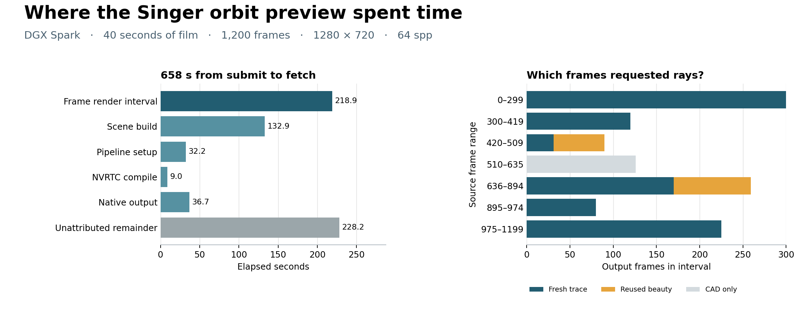
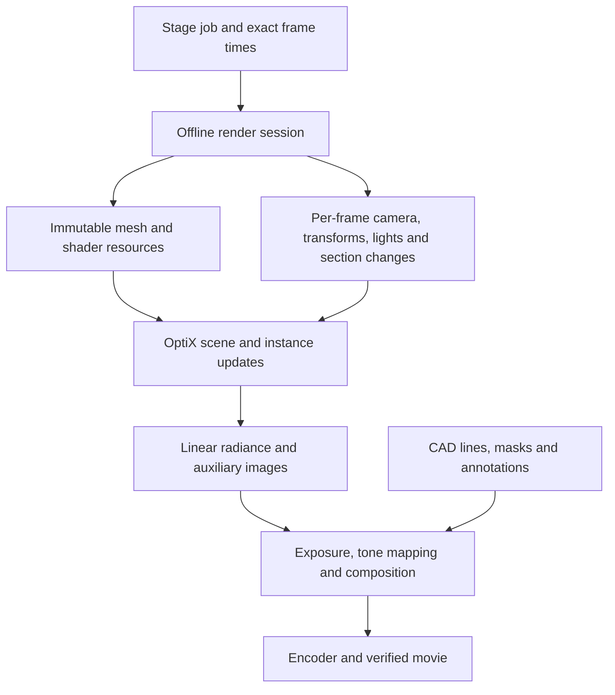
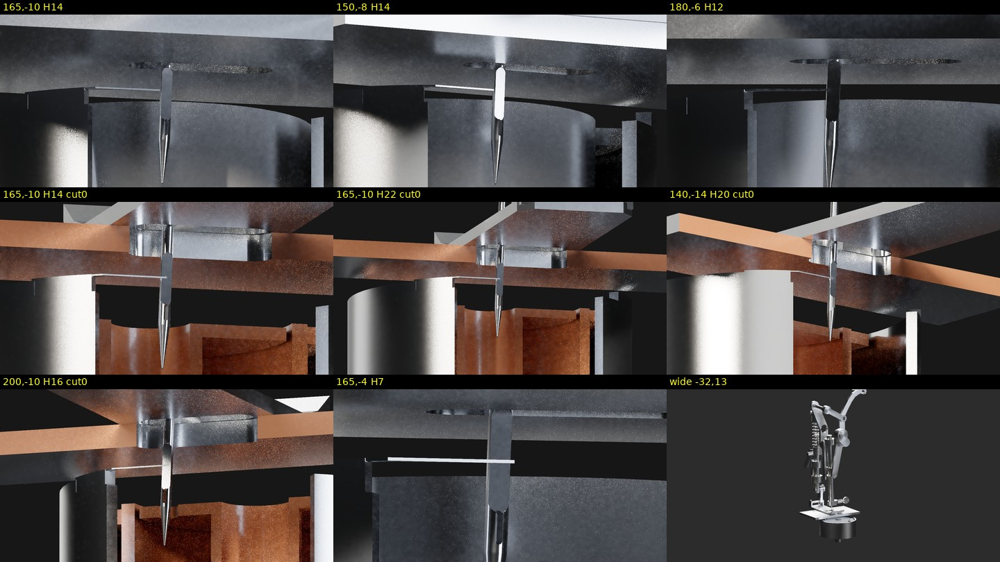
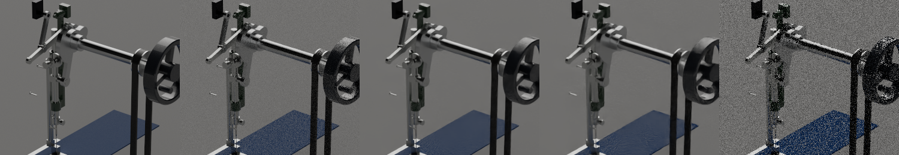

# Where Candela spends a render

Changing the exposure of a completed linear image can take a display pass. Changing the luminance of a lamp changes the light arriving at surfaces throughout the scene. Moving the lamp changes its reflections and shadows as well. In the Singer film these three edits can look similar to an author working on a dark close-up. Their computational requirements are different. A renderer that can identify the difference can offer fast photographic adjustment, physical relighting, and a full new render through the same authoring interface.

A forty-second film provides an unusually clear account of the engineering opportunity. The 64-sample preview took 658 seconds from submission to verified local download. Candela recorded approximately 219 seconds inside its native frame-render loop. The runner invoked the native program 204 times. Two hundred invocations processed a single output frame each. At production quality, increasing the sample count from 64 to 2048 multiplies one major term by approximately 32. Eliminating repeated starts is therefore a plausible route to shorter proof cycles. A faster final also needs higher sampling throughput or a way to reach the required image quality with fewer paths.

**My first change would be to serialize a shared study once.** The actual export contains 202 byte-identical copies, occupying 1.386 GB beyond the first copy. I would pair that change with timing instrumentation, then build a persistent offline render session and linear-image checkpoints. Sampling experiments can proceed independently. These projects can share a small set of scenes, a common timing record and a common definition of image error. The following design is a research recommendation. The timings describe recorded runs on the Spark. The proposed architecture and projected gains have not been benchmarked.

## 1. What happened during the Singer preview?

Jig determines the positions of the sewing-machine parts and the film camera. Its Stage also draws technical edges, labels and cutaways. Candela computes the shaded image, called the beauty panel. The Stage exporter writes a job ZIP with scene descriptions, per-frame camera and pose data, and lossless images for composing drafting and beauty. The workstation submits this job to the DGX Spark, where a Python runner calls the native Candela program with the OptiX backend. After compositing and encoding, the workstation downloads and verifies the MP4.

The delivered sequence contains 1,200 frames at 30 fps and 1280 × 720. The first preview’s receipt divides that sequence into 926 freshly traced frames, 148 frames that reuse a previous beauty image, and 126 frames that require no beauty panel. All three categories produce a delivered frame. Counting MP4 frames alone therefore overstates the ray-tracing workload. Counting native invocations confounds the animated cut, which changes the scene repeatedly, with long stretches of rigid motion that the renderer handles within one invocation.



*Figure 1. Timings from the first complete PT-S02 preview. The 658-second interval starts at submission of an already packaged job. Workstation compilation, Stage rasterization and packaging precede that interval. The accompanying data file records the scope of the measurements.*

| Measurement | Recorded value | Interpretation |
|---|---:|---|
| Submit through verified download | 658 s | Wall time observed by the submitting workstation |
| Sum of native frame-loop timers | 218.9 s | Includes host work, state synchronization, launches and waiting for GPU completion |
| Sum of printed build timers | 132.9 s | Includes native scene construction inside the measured interval. Starting the process and initializing V8 precede this timer |
| Sum of printed pipeline timers | 32.2 s | OptiX pipeline timing aggregated across invocations |
| Sum of printed output timers | 36.7 s | Output work measured by Candela. The later Python composite and final MP4 encode have their own costs |

These measurements answer different questions. For example, subtracting 218.9 from 658 gives approximately 439 seconds **outside the measured frame loops**. Calling that number “GPU idle time” would be an error. Device work can occur before the loop, and the transfer and final composition run in other processes. Likewise, extrapolating 658 × 32 would charge the full quality multiplier to file transfer and startup. A simple first estimate scales the loop by 32 and carries forward the other 439 seconds once. That predicts roughly 124 minutes for this version of the film. The loop itself contains fixed per-frame work, so even that estimate needs measurements at two or more sample counts. Exposure and lighting edits can also change the workload.

The preview and final reward different investments. As a worked example, assume the entire 132.9 seconds printed as build time could be removed, with everything else fixed. Preview wall time would fall from 658 to about 525 seconds, a speedup of about 1.25×. The same 133 seconds saved on a two-hour job is under 2%. This is an upper bound for removing that particular measured term. A resident renderer can additionally save costs outside it. Conversely, a 25% reduction in the sampling-dominated portion matters much more on a production run. Report both effects separately.

## 2. Begin with an experiment that can distinguish the costs

The first engineering deliverable should be a command that replays a small set of frozen render jobs, captures the implementation version and settings, and emits machine-readable results. A full film is valuable as a release benchmark. It is a poor inner loop when two competing explanations could be distinguished with three frames. Collect a stationary wide view, a macro view of reflective metal, a rigid-motion sequence, a light-only sweep, a section sweep with new cap geometry, and one drafting-only sequence. Add one non-CAD scene with many analytical primitives and one mixed-material scene. Otherwise improvements to Singer could silently slow a different class of Candela user.

Record wall times around export, upload, startup, scene compilation, GPU resource creation, acceleration-structure build or update, path accumulation, readback, postprocessing, compositing, encoding and download. Record byte counts and peak working memory alongside times. Use host clocks for submit-to-file latency and CUDA events or a GPU trace for device execution. Correlate them using job, frame, scene and sample-range IDs. A GPU timeline can distinguish a host that fails to submit work quickly enough from a host queuing work well ahead of a busy GPU. [NVIDIA’s explanation of overhead and latency in Nsight Systems](https://developer.nvidia.com/blog/understanding-the-visualization-of-overhead-and-latency-in-nsight-systems/)

Run cold- and warm-cache cases and retain each raw observation. A developer iterating on one scene experiences warm starts. A render farm assigning a shot to a new worker encounters cold ones. For the sample-count experiment, run a matched frame at 64, 256 and 2048 spp, hold its dimensions, camera, integrator, denoiser and exposure constant, and repeat the series with several seeds. Fit a fixed term and a per-sample term and inspect the residuals. Divergence among the wide, macro and moving-section cases tells us which model of cost the scheduler should use.

A useful pair of headline metrics is seconds to the next reviewable proof after an edit and seconds per finished second of production animation at the agreed quality. The first reacts to workstation export and LAN transfer. The second reacts strongly to the time spent sampling difficult shots. Retain peak memory as a separate constraint so that a fast cache cannot make a long film impossible to finish.

The quality measurement depends on the experiment. For a new transport or lossless compositor, compare raw pixels before the lossy video encoder. For a different Monte Carlo sampler, compare scene-linear radiance to an independently sampled reference and look for systematic bias across seeds. For a reconstructed or denoised sequence, inspect successive frames, especially moving highlights, thin needles and disoccluded surfaces. A correct frame count and a low average error on one still do not establish that a highlight moves continuously.

## 3. Give the offline renderer a persistent session

The present Stage runner already batches consecutive frames when the scene key and panel dimensions agree. During a section sweep, the exported body objects can change at each sampled plane position. The exporter assigns scene-directory identities from the participating JavaScript body identities, serializes a package for each new combination, and writes camera and transform tracks against it. The runner then launches the native command separately for consecutive groups. The Singer count of 200 singleton groups gives this issue a concrete reproduction. [Stage exporter](https://github.com/go-go-golems/jig/blob/main/import/jigcad/src/render/native-stage-job.js) · [Stage runner](https://github.com/go-go-golems/jig/blob/main/scripts/render-stage-job.py)

Candela already has two useful lifetimes. Its command-line renderer holds V8, CUDA and OptiX resources while processing a frame track. Its interactive server can retain a runtime across edits and stream a progressively rendered view. Extract the shared render session beneath both, with explicit ownership by one offline job during a production sequence. The offline caller supplies exact frame times, camera values and sample ranges. The interactive caller can still use its own clock and prioritise a newly edited view. The existing server implementation and the command-line render loop are the places to start reading. [Interactive server](https://github.com/go-go-golems/jig/blob/main/import/candela/native/rt/src/serve.cpp) · [Native render command](https://github.com/go-go-golems/jig/blob/main/import/candela/native/rt/src/main.cpp)

A persistent process is the smallest meaningful implementation. It can accept the current ZIP format and switch scene entries while keeping the device context and V8 runtime. This tests the value of lifetime alone. The next step is to distinguish content that is unchanged across scene entries. A plate being sectioned may require new triangles, but the presser foot, needle and upper linkage remain reusable. Index each immutable mesh by a digest of its canonical geometry, retain device copies under a memory budget, and give each installed occurrence its own transform and material binding. A content address must include every vertex attribute consumed by shading. Two mesh buffers with equal positions and different normals can have different highlights.



The following is proposed pseudocode. The operations are deliberately small enough to test independently. A retry must be able to reconstruct the same frame after a worker loses its entire resident cache.

```text
session = open_device(renderer_build, device_options)
for frame in manifest.presentation_order:
    assets = store.resolve(frame.asset_hashes)
    changes = compare(session.installed_state, frame.evaluated_state)
    session.install_missing(assets)
    session.apply(changes)
    if frame.requires_beauty:
        film = accumulation_for(frame.radiance_key)
        session.trace_missing_ranges(film, frame.sample_budget)
    compose_and_publish(frame, film_if_needed)
```

A camera turn resets pixel accumulation because primary rays change. It ordinarily preserves meshes and their acceleration structures. A luminance edit changes radiance and the probabilities of any light-selection sampler that depends on power. A rigid joint changes an instance transform. A section cut that alters triangle counts replaces the affected geometry. An edited text label can leave all ray tracing intact. This dependency information belongs to the renderer’s resource model. It should follow evaluated input values regardless of which fluent JavaScript methods produced them.

## 4. Update geometry at the granularity of the change

OptiX uses a geometry acceleration structure to accelerate intersections with primitives and an instance acceleration structure to locate transformed occurrences. Candela already builds one geometry structure per mesh. Its mesh rebuild path clears the existing mesh buffers, and its frame update path clears frame buffers, assembles instance data, builds the top-level structure and synchronizes. A scene version check suppresses some updates. Finer change information could preserve more work. [OptiX renderer implementation](https://github.com/go-go-golems/jig/blob/main/import/candela/native/rt/src/optix_renderer.cpp)

| Edit | Candidate native operation | Correctness check |
|---|---|---|
| Camera orbit around static geometry | Change camera data, reset accumulation | Unchanged instance and mesh build counts |
| Rigid animation | Keep meshes, update eligible instance transforms | Intersections and object IDs match rebuild at sampled angles |
| Vertex deformation with compatible layout | Refit eligible geometry, update its parents | Compare subsequent traversal cost and silhouettes |
| Section changes topology | Rebuild affected geometry and update or rebuild its parents as required | Cut face, cap material, depth and shadow agree from both sides |
| Luminance or exposure adjustment | Update emitter sampling data or rerun display, respectively | Test a reflected light source and an unchanged reference patch |

OptiX places structural restrictions on updates, including primitive counts and the handles referenced by instance structures. Refit quality can also decline after large deformations. Choose an update path only when its invariants are satisfied, and include the subsequent cost of tracing through the updated structure in the decision. A cheap refit that makes a two-thousand-sample render slower is a poor trade for a final. [NVIDIA OptiX programming guide, acceleration structure updates](https://raytracing-docs.nvidia.com/optix9/guide/optix_guide.251118.A4.pdf)

The cutaway deserves a separate experiment. The conservative design uploads new triangles and cap faces for the changed parts. A more ambitious design evaluates a clipping plane in the renderer and constructs the cap procedurally. Compare them under moving lights and shadow rays. Discarding camera-visible intersections alone leaves shadows, reflections or the back side of the section inconsistent. Opening a solid also changes the meaning of interior material boundaries. The current explicit section mesh provides a reference implementation for such tests. I would first measure per-part replacement on the real film. Native clipping earns its complexity when section generation, transfers or geometry rebuilds still dominate representative scenes.



*Figure 2. Existing 128-spp angle proofs. The orange caps, thin needle and reflective rim make different failure modes visible. A candidate clipping implementation needs to preserve all three across viewpoints.*

## 5. Reuse the right intermediate result

One of the largest improvements to an editing workflow may come from answering some questions without invoking the path tracer. Candela accumulates radiance internally. The current Stage job normally asks for display-ready PNG panels. A brightness change applied to those PNGs cannot recover values clipped during display conversion. Preserve a scene-linear image or accumulation checkpoint for selected proof frames. With its original camera and physical lighting fixed, the author can then explore exposure and tone mapping and composite the result with the existing plates.

A resumable accumulation needs more than a displayed average. Store per-pixel radiance sums, actual sample counts, the sample intervals already committed, and any auxiliary data the selected postprocessor requires. Include the integration settings, shutter, lens, evaluated camera, scene and light state, sampling scheme and renderer version in the radiance key. Publish a range only after its data is durable. A retry must never count the same range twice. If separate workers contribute partial results, define the merge order or document the floating-point tolerance. The highest-value first release is a durable checkpoint for chosen proof frames or expensive interrupted chunks. Writing full floating-point checkpoints for every frame of every film has measurable storage and transfer costs.

| Subsequent edit | What can be reused under those conditions? |
|---|---|
| Change a caption or its layout | Existing beauty panel, with an updated overlay or composition plate |
| Change a fixed exposure | Linear radiance and compatible auxiliary images |
| Raise the target from 128 to 2048 spp | The first 128 valid samples, given a resumable sample sequence and matching radiance key |
| Change the intensity of one fixed light | A separately accumulated linear contribution for that light, if the transport model and scene support that operation |
| Move the strip light across the subject | Meshes, shaders and compatible acceleration structures. Shadows and reflected radiance need reevaluation |
| Open a new hole in a part | Unaffected immutable assets. Visibility, transport and the geometry of the affected part change |

Per-light contribution buffers are especially interesting for product photography. Under linear light transport and fixed geometry and emitter shapes, a pixel can store independent contributions from the key, fill, rim and environment. Scaling and summing these in linear space permits interactive intensity balancing. Preserve unassigned emission and the environment, and perform tone mapping after the sum. Spectral changes, clamping within the integrator, denoising and nonlinear material behavior require explicit treatment. A light moved to another location changes visibility. Treat relighting as a dedicated optional output with a clear validity domain. PBRT derives the linear sum over light contributions and the corresponding sampling probabilities. [PBRT, light sampling](https://pbr-book.org/4ed/Light_Sources/Light_Sampling)

There is already a narrower reuse optimization. The Stage runner compares adjacent camera, pose and emitter values inside a scene group and can reuse the shaded image while drafting or annotation changes. That policy saved 148 native frames in the preview. General caching needs a stronger identity. Arbitrary evaluated scene behavior may depend on time even when the exported pose dictionaries match. A frozen noisy image during a deliberate hold and two independent estimates of the same stationary image are also artistically different. Record whether the shot wants frozen grain, independent samples or a continuing accumulation. Expose that choice only where it changes the intended film.

## 6. Reduce the exported job before optimizing its transfer

The original preview ZIP provides a stronger first implementation target than the render timers alone suggest. The archive is 1,847,389,253 bytes and uses stored ZIP entries. Its 202 scene directories contain 808 files. Its 2,274 composition plates account for only 83,072,122 bytes. Most of the package is scene data. Two independent inspections of the scene JavaScript modules identified a repeated study inside each exported program.

| Payload in the original archive | Serialized amount | What equality testing established |
|---|---:|---|
| All files in scene directories | 1,758,567,978 B | About 95% of the archive |
| Study value across the 202 scene snapshots | 1,393,106,736 B in compact JSON | One distinct value of 6,896,568 B |
| Selected geometry fields across 6,464 body occurrences | 357,781,832 B in compact JSON | 464 distinct field groups totaling 20,241,764 B |
| All PNG composition plates | 83,072,122 B | 260 distinct PNG payloads totaling 24,663,135 B |

Why 202 snapshots for 1,200 frames? A change of frame number, camera or rigid transform can reuse an existing scene. The exporter keys scenes by the ordered identities of the body objects it receives. A newly clipped body can therefore produce a new scene key, even when every other part is shared. The receipt shows 120 singleton invocations at frames 300–419 and 80 more at frames 895–974. The archive contains 202 scene directories, while the renderer visits 204 contiguous groups. A return to an already exported scene can start a new native group without creating a new directory.

The mechanism is visible in the exporter. A section creates an adapted list of bodies. The Stage constructs a new package from the existing program and these bodies, then serializes the **entire program**, including its study, into the new scene directory. One copy of the study would represent the same information. The 201 additional copies account for approximately **1.386 GB**, or 75% of the archive. This is redundant serialized content measured in the existing job. It is not a measurement of network throughput or of time the GPU spent reading a study.

**I would ship shared study serialization before the full resident-renderer change.** It has a direct size test, affects one clear contract, and can reduce both workstation memory pressure and remote parsing. Move the study to a job-level asset, materialize the same value for consumers, and compare the rendered output. Some authored looks can call assembly study and animation helpers. Removing studies from all exported programs would change that API. After the first change, extract canonical body payloads and let multiple scenes reference them. Hash each immutable resource once per revision. Recomputing a hash of several megabytes for every frame merely moves avoidable work into the exporter.

For a transport-only control, a single workstation run of `zstd -1 -T1` on the warm existing ZIP produced 249,187,434 bytes in 3.54 seconds, about 7.4 times smaller. This was a compression measurement. It did not time decompression, transfer on the LAN, remote extraction, or native scene startup. Test those four stages before adding a wire format. Compression offers an inexpensive baseline to beat. Structural sharing additionally avoids constructing and parsing redundant objects at both ends. After extracting the large duplicate values, rerun the compression comparison because the remaining data will have a different distribution.

A versioned package can represent assets and frame references explicitly. Keep the portable, self-contained job as the reproducibility unit. A remote worker may also maintain a bounded content store and request only missing blobs. The manifest should be publishable only after all referenced blobs are present. Verifying a blob digest on receipt and recording the renderer revision in the job receipt makes it possible to reproduce failures after eviction. A second render of the same film with revised lighting should be able to reuse geometry bytes without silently inheriting an old light track.

## 7. Spend less time launching equivalent work

A native OptiX launch dispatches work over pixels. Inside a dispatch, the generated rendering code can accumulate multiple samples for a pixel. Candela’s headless frontend writes the sample count into frame uniforms and tracks the accumulated count. On the measured preview, the log recorded 59,264 launches for 926 freshly traced frames. This is exactly 64 launches per frame. Each launch passes through the host loop and the renderer uploads uniforms and its launch parameters before invoking OptiX. That makes batching a reasonable experiment. The observation does not establish how often the GPU was starved by the host. [Frame uniforms](https://github.com/go-go-golems/jig/blob/main/import/candela/src/engine/session.ts) · [OptiX launch implementation](https://github.com/go-go-golems/jig/blob/main/import/candela/native/rt/src/optix_renderer.cpp)

Start with batches of 1, 4, 8 and 16, a total of 2048 samples, a fixed camera, and a wide and a macro frame. Record actual counts, launch count, GPU elapsed time and end-to-end frame time. A bigger batch can reduce host submissions and parameter traffic. It can also lengthen the interval before an interactive cancellation takes effect. Use separate policies for production and the viewport. A fixed 1/4/8/16 comparison avoids the current loop’s ability to overshoot a sample target when the last whole batch exceeds the requested remainder.

Batch shape affects reproducibility today. The generated kernel initializes its random-number stream for a pixel and dispatch, and a path consumes a variable number of random values. Local indices also participate in shutter stratification and spectral sampling. Changing the batch size can change the rays, even when the sample count is identical. Consequently, require statistical agreement over independent seeds for a batching experiment on the present implementation. To support robust sharding and resumption, give samples a stable identity based on film, logical source frame, pixel and absolute sample index. Assign explicit dimensions or substreams to lens, shutter, wavelength, light and scattering choices. Exercise partial batches, changed scheduling order and interrupted work. Different floating-point reduction orders may still need a tolerance. [Sampling and path code](https://github.com/go-go-golems/jig/blob/main/import/candela/src/engine/kernel.ts)

One specific CPU-side opportunity appeared during this investigation. `ggxTableWGSL()` constructs the same shader lookup table for the GGX microfacet model on each compile. Its 16 × 16 cells each use 512 × 16 quadrature visits, totaling 2,097,152 visits. A read-only microbenchmark of eight calls under Node 24.18.0 on the x64 workstation ranged from 119.2 to 156.5 ms with median 134.75 ms. The emitted WGSL text had SHA-256 `a8934e5edcd024600f58a9c3fb504e948664393e490af03b0dfad1eaf29ee426`. This is an isolated workstation measurement, independent of the Spark’s recorded scene-build time. Precompute the exact table at bundle generation, retain the numerical generator, and test that regenerating it emits the same coefficients. Measure cold scene opens on the Spark before estimating film-level savings. [Scene compilation](https://github.com/go-go-golems/jig/blob/main/import/candela/src/engine/compile.ts) · [Table generator](https://github.com/go-go-golems/jig/blob/main/import/candela/src/engine/kernel.ts)

## 8. Lower the number of paths required for a usable image

A sample estimates the radiance reaching the camera along a randomly sampled path. Noise arises when some possible paths carry much more energy than most of the paths actually sampled. A small, bright strip reflected in polished metal can produce this situation. A faster GPU kernel reduces the cost per sample. A better sampling distribution can reduce the number required to reach a given error. Report these two improvements separately. A user who explicitly requests 2048 actual spp still receives that count.

Candela already implements direct-light sampling, multiple importance sampling and importance sampling inside an HDR environment map. The source chooses uniformly among eligible light sources, the sun and environment before sampling the selected choice. A concrete extension is to build a distribution weighted by approximate emitted power. For a small three-light studio, compare it with uniform selection and preserve nonzero support for contributing lights. With many spatially separated sources, a later design could also account for position and direction. A low-power light close to the query point can dominate local illumination. A global power weight is a hypothesis to test across several scenes. [Candela integrator](https://github.com/go-go-golems/jig/blob/main/import/candela/src/engine/kernel.ts) · [PBRT light selection](https://pbr-book.org/4ed/Light_Sources/Light_Sampling)

The correctness condition extends beyond the sampling call. The direct estimator divides by the probability of selecting the light and the conditional probability of selecting a direction on it. When a ray drawn from the material scattering distribution strikes an emitter or escapes into the environment, the integrator must evaluate the same light-selection probability for its multiple-importance weight. Updating only the forward selection path introduces bias. A useful test has two emitters with unequal powers, then exchanges their IDs while preserving their physical properties. Their mean radiance should agree across permutations, within measured sampling uncertainty. An equal-power case provides a baseline, and an animated light fading out exercises the treatment of zero and near-zero selection weights.

Adaptive sampling and denoising deserve their own quality modes. Adaptive sampling estimates where more rays would reduce visible error, often from luminance variance per pixel or tile. Record minimum and maximum samples, actual sample histograms and a stopping criterion. A transient bright reflection can be missed by a premature low-variance decision. Include minimum sampling, tests for rare bright paths, and temporal checks on the moving highlight. Publish the actual sampling distribution. A render with a 2048 cap and a much lower mean is a different production contract from a fixed 2048-spp master.

Candela already has measured denoiser evidence. In an earlier 48-frame 1080p lockstitch sequence, 16 spp plus the OptiX AI denoiser took 13.9 seconds wall time, compared with 44.9 seconds at 64 raw spp. On the recorded 1080p reference frame, per-pixel display error relative to a 1024-spp reference was 0.81% for the denoised version and 1.67% for the raw one. The corresponding 8 × 8 block errors were 0.23% and 0.24%. One spatial measurement cannot establish temporal stability. For proof movies, compare a moving strip’s width and peak position, the needle silhouette, and appearance immediately after an occlusion. The existing auxiliary albedo and normal outputs provide a starting point.



*Figure 3. Archived CANDELA-002 comparisons on K-09. Use the crops to inspect residual noise and loss of local detail. The 48-frame timing and the 1080p error measurements are separate experiments.*

## 9. Stream the composite and make its color contract explicit

The current exporter records a black-base plate and a white-basis plate for each beauty panel. For the panel rectangle, the compositor subtracts the base from the corresponding white plate to obtain a channel weight. It adds the weighted, display-ready beauty pixels to the base. This represents what layers, lines and labels did to the Stage drawing while allowing the underlying shaded image to come from a remote renderer. Multiple panels can have different rectangles. The calculation uses signed integer differences and a final clamp. Any replacement must preserve layer ordering, panel origins and rounding.

```text
output = signed_rgb(base)
for panel in panels:
    area = panel.rectangle
    weight = signed_rgb(white_plate[panel, area]) - base[area]
    output[area] += (weight * beauty[panel] + 127) // 255
publish(clamp(output, 0, 255))
```

Today the job writes intermediate beauty images, composites output to a PNG sequence, then asks FFmpeg to decode that sequence into the video encoder. The easiest controlled change is to stream the existing computed RGB pixels into FFmpeg through a bounded queue. Compare decoded raw input to the old pipeline before comparing MP4 output. A lossless pre-encode comparison catches rounding and color bugs that an H.264 quantizer can conceal. Include titles, pure CAD, a feathered wipe, partially transparent labels, and split panels in the test set.

Native Candela already has an FFmpeg video writer, including hardware codec paths. Its existing path reads display pixels back to the host. Reusing an encoder implementation and keeping an image on the GPU throughout are two different milestones. A later GPU compositor could combine a resident beauty buffer with uploaded plates and hand the composed surface to a hardware encoder. Measure copy bytes, actual encode throughput, output quality at the chosen bitrate, and whether production still needs a lossless intermediate for inspection. A device-resident pipeline has a stronger case for high-resolution, multi-panel films than for a tiny still. [Native image and video output](https://github.com/go-go-golems/jig/blob/main/import/candela/native/rt/src/image_io.cpp)

## 10. Decide when to change the GPU execution architecture

Candela’s native backend shares rendering logic with its shader-generation system and substitutes OptiX for ray traversal. This makes it possible to compare integrator behavior across backends. It also means that an optimization to the common path kernel may affect interactive rendering and correctness beyond the Spark. Preserve representative golden scenes and define whether a proposed change is expected to preserve pixels, expected radiance, or only perceptual quality.

There is direct evidence against a universal GPU setting. In an earlier GB10 experiment at 960 × 540 and 256 spp, enabling shader execution reordering increased the K-09 mesh scene’s time from 911 ms to 1130–1148 ms. On analytical scene X-02, time fell from 1154 ms to 911 ms in that experiment. A later change to native sphere handling shifted the performance balance again. Backend policy should be derived from current scene classes and current kernels. An old win on a procedural scene is a valuable benchmark case, not a justification for enabling a switch on a mesh-heavy CAD film.

A wavefront path tracer divides work into queues such as intersection, material evaluation and shadow tracing. Organizing similar work together may improve utilization when paths take very different branches or a large all-in-one kernel exhausts registers. Queue construction, buffering and intermediate memory traffic cost time. Use a GPU profile to identify scenes with long divergent shaders, high spill traffic or poor occupancy, and compare a narrow prototype using the same scenes, materials, seed semantics and image-quality tests. A wavefront prototype cannot reduce the 201 extra copies of a study in a job file. Different levels of the system have independently measurable costs. [PBRT on mapping path tracing to the GPU](https://pbr-book.org/4ed/Wavefront_Rendering_on_GPUs/Mapping_Path_Tracing_to_the_GPU) · [NVIDIA Nsight Compute](https://developer.nvidia.com/nsight-compute)

Distribution across several machines is a subsequent architectural option. Start with independent ranges of output frames after camera, study, exposure and shutter inputs have been resolved. A worker receives immutable assets and a deterministic frame range and returns a receipt plus output hashes. Preserve any exposure obtained by metering an earlier frame. Make asset delivery resumable, bound each worker’s working set and schedule expensive macro frames using measured cost. Splitting one frame among workers becomes useful for exceptionally expensive stills, but requires sample identities, compatible linear sums and robust reduction. Several competing render processes on the same single GPU have no automatic throughput advantage. Run a controlled utilization and wall-time comparison before adding concurrency there.

## 11. An implementation order with explicit decisions

| Order | Build or experiment | Primary metric and decision |
|---|---|---|
| 1 | Freeze a benchmark corpus. Record stage-level timings and asset bytes. Compare single-job zstd transport with the stored ZIP. | Explain both proof latency and production throughput. Retain cold/warm results, full costs and unclassified time. |
| 2 | Factor out the repeated study and generate the GGX lookup table once. Then share immutable mesh payloads. | Require equivalent evaluated scenes and pre-encode pixels on a deterministic fixture. Measure export memory, archive size, remote parse time and cold startup. |
| 3 | Add an offline session that accepts current scene entries, then add per-resource updates. | Count cold starts, mesh builds, instance updates and transferred bytes. Demonstrate the change separately on a rigid orbit and a topology-changing cut. |
| 4 | Benchmark sample batches; define deterministic sample IDs and progressive checkpoint rules where needed. | Measure samples per second at fixed count, time to a specified error, and correct continuation after interruption. |
| 5 | Preserve selected linear outputs and stream composition. Prototype per-light layers for locked studio proofs. | Measure latency from an exposure or intensity edit to the next usable image. Compare the image to a qualified rerender. |
| 6 | Test better emitter selection, adaptive sampling and temporal quality of denoised previews. | Report mean and tail errors, highlight behavior, genuine sample counts and time-to-quality on multiple scenes. |
| 7 | Evaluate wavefront execution or distributed rendering when profiles support them. | Require an end-to-end improvement on the identified workloads and record costs on unaffected ones. |

There are two small starting changes with unusually strong evidence. A packaging patch can remove a gigabyte of repeated study data from one actual proof job without changing the model. An exposure-proof workflow can retain a linear close-up and let the artist adjust display exposure without another 128-spp render. The first has an exact byte-count test. The second has an exact dependency test: moving a lamp or editing its physical intensity must invalidate the appropriate lighting result. Both leave the public fluent presentation API intact. Their value is what the pipeline knows about an edit after the user has expressed it.

## Evidence and reproduction

The Jig checkout is `/home/manuel/code/wesen/go-go-golems/jig`. The baseline is the **first 64-spp PT-S02 preview**. Later exposure, label and camera changes should carry distinct receipts. The measured Spark host was `bling.local`. No new Spark benchmark competed with the production film during this investigation.

- The baseline receipt is `dist/reels/singer-orbit-preview-64spp.json`. The original preview MP4 checksum starts with `83d65ec64074`. Use the accompanying [measurement data](_assets/candela-timings.json) and [figure-generation script](scripts/candela-costs.py) for the numerical comparisons. The script documents the run artifacts it needs.
- To audit the job, enumerate its ZIP members. For each `scene-*/jig-program.js`, strip the module’s `export const program = ` prefix and trailing semicolon and decode its JSON. Serialize the study using UTF-8, compact separators and unescaped Unicode, then hash and group it. For the geometry totals group each body’s positions, normals, indices, triangle-to-face mapping and faces. The [package audit script](scripts/candela-package-audit.py) performs the compact-payload comparison. Its [recorded result](_assets/candela-package-audit.json) distinguishes canonical payload sizes from archive bytes. A separate comparison of the raw study substrings found 6,896,569 bytes per occurrence and identical SHA-256 digests.
- The local JIG-029 ticket contains the Singer mechanical tests and angle proofs. CANDELA-002 contains older standalone renderer experiments. The relevant records under its `various/` folder are `21-ai-denoiser.txt`, `22-ser.txt` and `23-builtin-spheres.txt`. Each describes its own resolution, scene and quality settings. Compare results only under their recorded conditions.
- For the existing production pipeline read `scripts/singer-orbit-film.sh`, `scripts/submit-stage-job.py`, `scripts/render-stage-job.py` and `import/jigcad/src/render/native-stage-job.js`. For native implementation work start with `import/candela/native/rt/src/main.cpp`, `serve.cpp`, `optix_renderer.cpp` and `image_io.cpp`. For sampling and identity use `import/candela/src/engine/session.ts`, `headless.ts` and `kernel.ts`.
- For the film that motivated this investigation, see [[PROJECT REPORT - Jig - From a solved mechanism to a 30-chapter product film]]. That article describes the earlier JIG-028 reel. Its 2048-spp chapter costs are historical comparisons; the 64-spp PT-S02 baseline in this article is a later film.
