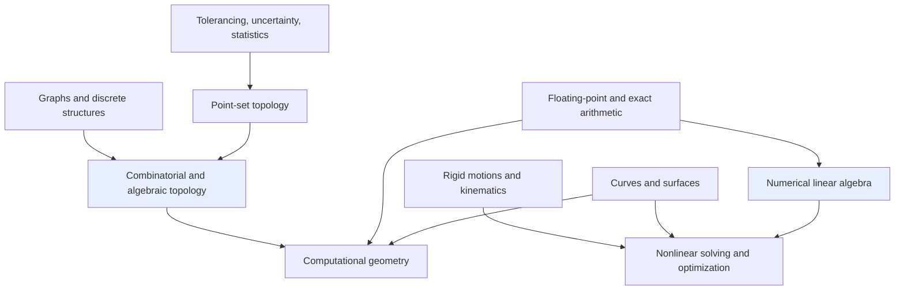

# Mathematics

This map organizes the mathematics that appears across the vault by branch. Ten branches come from [[Course - Engineering CAD from First Principles]], the CAD textbook, which touches all of them; each has its own map with the textbook chapters and the other vault notes that use the same mathematics. A final section points to the mathematics the vault covers outside CAD: category theory, logic and proof, and sheaves.

> [!summary]
> - Each topic map lists the concepts, the textbook chapters that teach them, the other vault notes that use them, and what the vault lacks.
> - The strongest clusters outside CAD are CAM geometry (drop-cutter, offsets), rasterization and fixed-point arithmetic, Bayesian statistics, and category theory and sheaves.
> - Start with [[Mathematics - Numerical Linear Algebra]] and [[Mathematics - Combinatorial and Algebraic Topology]]: they are the deepest in the textbook and the most connected.

## How the branches depend on each other

An arrow means the target uses the source: a sketch solver (nonlinear solving) runs on linear algebra; a B-rep (algebraic topology) needs a set-theoretic definition of a solid; geometric algorithms branch on signs that arithmetic must get right.

## Topics

| Topic | What it covers here | Textbook chapters |
|---|---|---|
| [[Mathematics - Curves and Surfaces\|Curves and Surfaces]] | Geometry of edges and faces | 2, 18, 29 |
| [[Mathematics - Point-Set Topology\|Point-Set Topology]] | What a solid is as a set | 10, 11, 23 |
| [[Mathematics - Combinatorial and Algebraic Topology\|Combinatorial and Algebraic Topology]] | B-rep connectivity, Euler counts, homology | 3, 24, 25, 30 |
| [[Mathematics - Numerical Linear Algebra\|Numerical Linear Algebra]] | Jacobians, least squares, rank | 4, 7, 31 |
| [[Mathematics - Nonlinear Solving and Optimization\|Nonlinear Solving and Optimization]] | Newton methods, AD, continuation, design search | 5, 6, 8, 21 |
| [[Mathematics - Computational Geometry\|Computational Geometry]] | Predicates, sweeps, DCELs, Delaunay, meshes | 9, 26, 27, 28, 30 |
| [[Mathematics - Floating-Point and Exact Arithmetic\|Floating-Point and Exact Arithmetic]] | Signs near zero, exact predicates | 9, 26 |
| [[Mathematics - Rigid Motions and Kinematics\|Rigid Motions and Kinematics]] | SE(3), joints, assemblies, frames | 13 |
| [[Mathematics - Graphs and Discrete Structures\|Graphs and Discrete Structures]] | Feature DAGs, caching, persistent naming | 12, 15 |
| [[Mathematics - Tolerancing, Uncertainty and Statistics\|Tolerancing, Uncertainty and Statistics]] | Fits, error budgets, probability | 19, 20, 21 |

## Other mathematics in the vault

These areas are not in the CAD textbook but have substantial material:

- [[category-theory-and-logic]]: the KB entry on category theory, adjunctions, limits and the subobject classifier, and where go-go-golems projects use them.
- [[Transcripts/Research/04 - Mathematics and Formal Foundations|Mathematics and formal foundations (research cluster)]] and [[Transcripts/INVENTORY - Mathematics and Foundations|Mathematics and foundations transcript inventory]]: category theory, type theory, topos theory, Lean and intuitionism conversations.
- [[Research/Institute/Research/2026/04/16/philosophical-foundations-of-mathematics/Proof Mining - Research Document|Proof Mining]]: extracting computational content from proofs.
- [[PROJECT REPORT - PRL-0 - A Machine-Checked Reactive Rules DSL in Lean 4]] and [[PROJ - Turboproof - A pbui Proof Workbench for Lean 4]]: machine-checked proofs in Lean 4.
- [[PROJ - Southwell Category Theory Corpus - Video Playlist Transcription Pipeline]]: a category theory lecture corpus.
- [[PROJECT REPORT - From Pattern Zoos to an Architecture Garden - A Shared Mathematical Vocabulary for Composable Systems]]: one mathematical vocabulary for composable systems.
- [[signal-quantization-and-sampling]]: quantization and sampling theory behind dithering.
- [[PROJ - picocalc-os - PICOCALC-SCI - A Graphing Scientific Calculator With Help Pages]] and [[PROJ - R1 Math Flashcards - Typesetting Mathematics for a Device That Cannot Typeset]]: mathematics as a product feature.

## Sources

- [[Course - Engineering CAD from First Principles]] and its [[Engineering CAD - Reading Map and Source Guide|reading map]]: the textbook these topics are drawn from.
- [[jigcad]]: the CAD system the textbook uses as its case study.
- [[Transcripts/Research/05 - CNC and CAM Research|CNC and CAM research cluster]]: the CAM-side mathematics.

## Maintenance

Add a note to a topic map when it uses the topic's mathematics substantively, not when it only mentions a term. Transcript artifacts exist in several branch folders with the same filename; link one copy by its full path.
