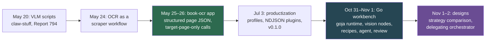
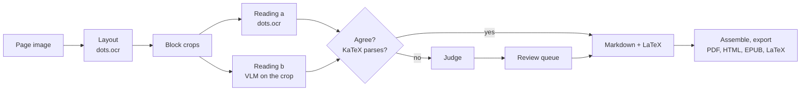

# book-ocr — Scanned Technical Books to Markdown, from VLM Scripts to a Go Vision Workbench

book-ocr converts scanned technical books into Markdown: prose, headings, tables, code listings, figures with captions and, since the workbench, LaTeX mathematics. Every result keeps its provenance back to the page image. The work has gone through four generations since May 2026:
- scripts in claw-stuff;
- a workload for the [[scraper]] workflow runtime;
- a standalone structured-OCR application with profiles and plugins;
- a Go-hosted workbench in which JavaScript recipes and an agent drive vision nodes and VLMs.

This map gives the reading order through those generations, separates current from historical material, and points to the repository and its tickets.

> [!summary]
> - **Two invariants have held since May.** A model reading a page sees only that page (neighbouring page images caused text to bleed between pages). Models return structured data, and code renders and checks the final Markdown.
> - **Two code generations live in one repository.** The structured workflow CLI is on `main` (v0.1.0). The Go workbench is on the branch `feat/workbench-go-host`, not yet merged.
> - **Boundary with [[scraper]].** The scraper map covers the durable workflow runtime that hosted the May work. This map covers the OCR application itself.

## The core mental model

Every generation answers the same question: how to get a faithful, checkable transcription out of models that read well but make confident mistakes. The answers accumulate:
1. A single universal page prompt.
2. One target page per call, after the separation benchmark showed text bleeding in from neighbouring pages.
3. Structured JSON with deterministic rendering.
4. Per-book profiles and plugin seams.
5. Block-level reading by two independent models, with KaTeX checks, a judge and a human review queue.

## Architecture and layers

### The structured workflow application (`main`)

`book-ocr structured-run` runs a durable workflow:
- **pages:** discover pages, then one OCR step per page, retried and run in parallel;
- **book:** assemble, then validate;
- **outputs:** artifacts under `pages/page_NNN/` and state in `engine.db`.

The model returns `structured-ocr/v1` JSON (typed blocks), and Go renders Markdown and PDF. Book policy lives in profiles (`profiles/*.yaml`). External processes can take over named seams (`ocr.page`, `prompt.render`) through NDJSON plugins. Packages: `internal/ocrpipeline`, `internal/plugin`, `internal/bookprofile`, `internal/ocrquality`, `internal/ocrvalidation`, `internal/vlmseparation`, `internal/ocrmvp`.

### The Go workbench (`feat/workbench-go-host`)

The workbench runs in one Go process with one goja runtime. JavaScript (recipes and agent code) calls Go ops through a JSON bridge. Every result is an immutable artifact with provenance and a transform back to page coordinates.

- **Vision nodes** are HTTP servers that run non-chat models: dots.ocr layout on the DGX Spark, and OpenCV and TrOCR locally.
- **The model service** reaches LunaRoute models through Pi and Geppetto, with a per-provider concurrency cap and retries.
- **The agent** has one `eval` tool, `view()` for looking at images, and threads stored in SQLite.
- **The browser UI** shows pages and layers, runs, turns, the agent, review and output.

## Reading path

1. [[PROJECT REPORT - book-ocr - A Go-Hosted OCR Workbench and the Full Conversion of Topology via Logic]]: the current architecture and the full conversion of a 211-page mathematics book.
2. [[ARTICLE - Book OCR Productization - Plugin Seams, Profile Policy, and the Road to v0.1.0]]: the structured CLI as released, and its extension seams.
3. [[ARTICLE - Book OCR Project Report - Structured Workflow Runtime and Manual PDF Repair]]: the whole May arc in one report.
4. [[ARTICLE - VLM Separation Benchmark for Book OCR - Prompt Block Layouts and Turn Persistence]]: the evidence behind the one-target-page rule.
5. [[ARTICLE - VLM OCR Pipeline for Scanned PDFs]]: where it started.

## Related notes

### Current: the Go workbench

- [[PROJECT REPORT - book-ocr - A Go-Hosted OCR Workbench and the Full Conversion of Topology via Logic]]: the goja host and op bridge, artifacts and geometry, vision nodes, the model service, the agent, choosing readers, the Vickers recipe, tuning on a held-out range, the judge audit, the full run, review and export, and the bugs found on the way.

### Current on `main`: the structured workflow application

- [[ARTICLE - Book OCR Productization - Plugin Seams, Profile Policy, and the Road to v0.1.0]]: how the architecture survived packaging; profiles, NDJSON plugin seams, golden-file proofs, the v0.1.0 release.
- [[ARTICLE - Structured Book OCR - Target Page Contracts Workflow Runtime and Production Hardening]]: the move from freeform Markdown to target-page-only structured JSON, the deterministic renderer, turn persistence, parser repair.
- [[ARTICLE - Book OCR Project Report - Structured Workflow Runtime and Manual PDF Repair]]: the end-to-end report on Report 794: workflow runtime, separation benchmark, structured OCR, figure crops, PDF repair.

### Experiments and evidence

- [[ARTICLE - VLM Separation Benchmark for Book OCR - Prompt Block Layouts and Turn Persistence]]: whether a VLM keeps the target-page boundary when it is given neighbouring pages. Prompt layouts, benchmark SQLite, Geppetto turns as evidence.
- [[ARTICLE - Book OCR Quality Lab - Baseline Runs SQLite Log Filtering and Experiment Provenance]]: the 30-page quality loop on Report 794 (page-type rules, list pages, model choice, lexicon, deterministic cleanup) and experiment provenance.

### History: the claw-stuff and scraper era

These notes record how the system looked at the time. Their commands and paths (the old `/home/manuel/workspaces/2026-05-20/book-ocr/` workspace) are not current.

- [[ARTICLE - VLM OCR Pipeline for Scanned PDFs]]: the original script pipeline in claw-stuff for the 202-page Report 794, through seven revisions, ending with a universal page prompt and SQLite as a work queue.
- [[ARTICLE - Building Book OCR on Scraper Job System - Workflow Runtime Deep Dive]]: OCR as the first real workload of the scraper workflow runtime.
- [[ARTICLE - Extracting Book OCR from Scraper - Workflow Runtime and External OCR Pipelines]]: the boundary decision that moved the OCR application out of `scraper` into its own repository.

### Adjacent maps and patterns

- [[ARTICLE - PDF Page Reordering with VLM and a Retro Mac Webapp]]: a neighbouring problem, putting a scrambled scan back in order using page numbers read by a VLM.
- [[scraper]]: the workflow runtime of the May work.
- [[geppetto]] and [[pinocchio]]: inference engines, turns and profile registries used by every generation.
- [[go-go-goja]], [[Research/KB/Tribal/goja-runtime-ownership-and-context-propagation]] and [[Research/KB/Tribal/goja-embedding-in-go]]: the runtime model the workbench is built on.
- [[Research/KB/Fundamentals/host-mediated-sandbox-principles]]: the principle behind the workbench's ops and the proposed strategy policy.
- [[Mathematics - Point-Set Topology]]: the subject of the book the workbench converted.

## Books converted

| Book | Pages | Generation | Outcome |
|---|---|---|---|
| Ciccarelli, *Presentation Based User Interfaces* (MIT AI TR 794) | 202 | scripts, then structured workflow | full Markdown and PDF; the May reports |
| Wilensky, *Planning and Understanding* | 24 + 10 sample pages | structured workflow with text-layer plugin | pilot; ticket only, no vault note |
| Vickers, *Topology via Logic* | 211 | workbench | full conversion; 238 of 3,027 blocks left for review |
| Evans, Hanson and Brewer, *Principles of Color Photography* | 716 (DjVu) | workbench, proposed | measured and designed for; not started |

The books are copyrighted. The vault and the repository hold measurements, never page text or images.

## Repository map

Repository: `/home/manuel/code/wesen/2026-05-20--book-ocr` (GitHub `wesen/2026-05-20--book-ocr`).

| Path | What |
|---|---|
| `cmd/book-ocr/` | CLI: structured workflow commands; `workbench.go` (eval, run, serve) on the workbench branch |
| `internal/ocrpipeline`, `internal/plugin`, `internal/bookprofile`, `profiles/` | Structured workflow, plugin seams, book profiles |
| `internal/ocrquality`, `internal/ocrvalidation`, `internal/vlmseparation`, `internal/ocrmvp` | Quality tools, validation, the separation benchmark, the MVP |
| `harness/` | The Node.js agent-harness prototype (Agentalg) that preceded the Go host |
| `internal/harness/`, `web/workbench/` | The Go workbench and its UI (branch `feat/workbench-go-host`) |
| `recipes/vickers/` | The Vickers page and book recipes |
| `services/vision-server/`, `services/spark/` | Vision node server and the Spark deployment |
| `ttmp/` | Ticket workspaces (below) |

Key tickets, in order:
- `BOOK-OCR-HQ-001`: the quality lab.
- `BOOK-OCR-VLM-SEPARATION-001`: the separation benchmark.
- `BOOK-OCR-PIPELINE-REDESIGN-001`: the pipeline redesign after text bled in from neighbouring pages.
- `BOOK-OCR-STRUCTURED-WORKFLOW-001`: structured OCR as a workflow.
- `BOOK-OCR-PRODUCT-001`: productization.
- `BOOK-OCR-WILENSKY-PILOT-001`: the text-layer pilot.
- `BOOK-OCR-AGENT-HARNESS-001`: the Node harness.
- `BOOK-OCR-WORKBENCH-001`: the Go workbench and the Vickers conversion.
- `BOOK-OCR-STRATEGIES-001`: comparing fixed pipelines and agent orchestrators (design).
- `BOOK-OCR-ORCHESTRATOR-001`: a delegating orchestrator, with the Evans DjVu as test book (design).

## Boundaries and open questions

- The workbench branch is not merged into `main`, and `README.md` still describes the structured workflow as the production path.
- BOOK-OCR-STRATEGIES-001 and BOOK-OCR-ORCHESTRATOR-001 are designs only: agent-driven pipelines, a Go-side policy, a cross-process provider queue and delegation APIs.
- The Vickers conversion still needs its human review pass (238 blocks) before the final export.
- dots.ocr layout depends on the DGX Spark being available. The book-level runs in the designs plan one stored layout pass per book.
