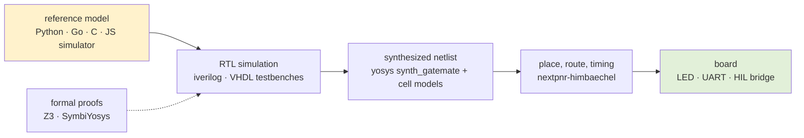

# FPGA, HDL and GateMate — Verilog, VHDL and the GateMateA1-EVB Projects

This map gathers the vault's hardware-design work: processors, symbolic-computing laboratories and a hardware-description language, written in Verilog or the SystemVerilog subset that yosys and iverilog share, and built with open-source tools for one board, the Olimex GateMateA1-EVB with its Cologne Chip CCGM1A1. One project uses VHDL instead and stops at simulation and formal proof. The projects ran from 2026-08-25 (MATE-16) to 2026-10-18 (Weft). Each built on the board facts, toolchain rules and verification methods of the one before, and the most reusable of those were extracted into playbooks.

A newcomer should read this map to find the right entry point: the playbooks for the shared rules, the project notes for worked examples, and the Weft books and report for an automated version of the whole method.

> [!summary]
> - **One board, one open flow.** Every GateMate project runs yosys `synth_gatemate` → nextpnr-himbaechel → gmpack → openFPGALoader. The board's RP2040 serves as both the JTAG adapter and the bridge from the FPGA's UART to `/dev/ttyACM0`.
> - **One verification method, refined per project.** An executable reference model comes first, then differential tests of the RTL against it, then evidence ordered from cheap simulation to physical observation on the board.
> - **The VHDL boundary.** VeriSQL-HW is the only VHDL project. Its evidence is a Python model of the VHDL contract, VHDL testbenches and formal proofs; it never ran on an FPGA.

## The core mental model

Every project in this cluster answers the same question at increasing cost: does the hardware do what the reference says? The answer is built as a ladder of evidence. Each rung checks one transformation, and a rung that passes does not excuse the rungs above it.

The projects differ in where they put the effort. MATE-16, PCA-Z80, Uxn and GateMate Symbolic compare a hand-written reference model with hand-written RTL through differential tests, then confirm on the board. Weft generates the RTL from a JavaScript simulator. It automates the comparison at every rung, up to cycle-stamped scenarios on the board. VeriSQL-HW replaces the board rungs with formal proofs of selected cells.

## Layers

**Board and toolchain.** The A1-EVB facts are stable across projects. The LED and the user button are active-low. The 10 MHz oscillator is on `IO_SB_A8`, the UART on `IO_SA_B6` (FPGA to host) and `IO_SA_A6`. Reset comes from `CC_USR_RSTN`, extra clocks from `CC_PLL`, and synthesis needs `-nomx8`. Timing failures must be read from nextpnr's log, and router seeds and tool versions must be recorded with every result. The board evidence playbook holds the operational rules; the Weft report encodes them in a Go table and a log-parsing runner.

**Design languages.** The GateMate projects write Verilog-2005 or the SystemVerilog subset that both yosys and iverilog accept. The subset playbook lists the constructs on which the two tools disagree. VeriSQL-HW writes synthesizable VHDL.

**Verification methods.** The shared methods are a single instruction table, an executable model, and a frozen trace format printed identically by model and RTL. Testbench monitors sample without races at the clock edge. The evidence ladder runs from semantic checks to the board. Weft adds change-list co-simulation at the RTL and netlist levels, and a hardware-in-the-loop UART bridge that stamps every output change with a board cycle count.

**Host integration.** Several projects attach a Go service and a browser UI to the running FPGA over the UART: GateMate Symbolic's workbench and graph-coloring microscope, and Weft's `weft serve` with the Weft Lab. The RP2040 bridge forwards USB to the UART without flow control, so host writers must pace their output.

## Reading path

1. [[ARTICLE - Playbook - GateMate Board Evidence Workflow]]: the flow and the evidence rules for the board.
2. [[PROJ - MATE-16 VM CPU on the GateMateA1-EVB]]: the first project, with its course text, as the reference bring-up.
3. [[ARTICLE - Playbook - The yosys and iverilog SystemVerilog Subset]] and [[ARTICLE - Playbook - Differential Verification with a Frozen Trace Contract]]: how to write RTL both tools accept, and how to compare it with a model.
4. One project report chosen by interest: mesh transport (PCA-Z80), area optimization (Uxn) or precise typed evaluation (GateMate Symbolic).
5. [[PROJECT REPORT - Weft Lab on Real Hardware - A Hardware Bundle, a Validation Ladder and Cycle-Stamped Scenarios on the GateMate A1-EVB]]: the method automated end to end, from a simulator to scenarios timed in board cycles.

## Related notes

### Playbooks and patterns (current)

- [[ARTICLE - Playbook - GateMate Board Evidence Workflow]]: tool versions, polarity, cells against CPEs, seeds, and what counts as evidence from the board.
- [[ARTICLE - Playbook - The yosys and iverilog SystemVerilog Subset]]: the portable subset of SystemVerilog, as rules with replacements.
- [[ARTICLE - Playbook - Differential Verification with a Frozen Trace Contract]]: one instruction table, one model, one trace format, compared line by line.
- [[ARTICLE - Playbook - Race-Free Testbench Monitors and the Ready-Valid Boundary]]: sampling at the clock edge without races, and checking a ready/valid handshake.
- [[ARTICLE - Playbook - A Two-Entry Top Cache over Block RAM]]: keeping a stack's top entries in registers over synchronous block RAM.
- [[05 - Evidence-Ladder Hardware Development]]: the research prompt from the PCA-Z80 garden on which claim each verification layer establishes.
- [[serial-protocols-from-go]]: serial communication from Go, adjacent to the UART host services.

### Projects on the GateMateA1-EVB (chronological, historical records)

- [[PROJ - MATE-16 VM CPU on the GateMateA1-EVB]] (2026-08-25): a bytecode stack CPU in FPGA logic; LED, UART and the first board bring-up.
- [[ARTICLE - PCA-Z80 - Static Mesh Architecture and GateMate Hardware Validation]] (2026-08-28): a Z80 subset as addressed RTL objects over a generated router mesh, and what made it routable.
- [[ARTICLE - PCA-Z80 - Firmware BRAM and Physical UART on GateMate]] (2026-08-28): firmware in inferred block RAM, and `Hi` through the FPGA UART and the RP2040.
- [[Research/Software Architecture Garden/pca-z80/index|PCA-Z80 architecture garden]]: design-force studies drawn from PCA-Z80, with guidelines 00–06.
- [[PROJ - Uxn Computer - A Varvara Machine in GateMate FPGA]] (2026-08-30): a Uxn/Varvara computer with console, keyboard and display.
- [[PROJECT REPORT - Uxn Computer - Fitting a Stack Machine into a GateMate - The Area Optimization Campaign]] (2026-08-31): from a placement failure at 92 % LUT use to 66 %, by measurement.
- [[PROJECT REPORT - GateMate Symbolic - A Precise Tagged Stack Evaluator from Abstract Machine to Hardware]] (2026-09-04): a typed stack evaluator that completes an instruction or leaves its state unchanged; the source of the five dated playbooks above.
- GateMate Symbolic laboratories (2026-09-04 and 09-05):
  - [[ARTICLE - GateMate Symbolic - Inside a Tagged Stack CPU]]
  - [[ARTICLE - GateMate Symbolic - Inside an FPGA Rollback Solver]]
  - [[ARTICLE - GateMate Symbolic - Inside an Elastic Dataflow Engine]]
  - [[ARTICLE - GateMate Symbolic - Programmable Dataflow Workbench]]
  - [[ARTICLE - GateMate Symbolic - Inside the Graph Coloring Search Microscope]]
  - [[ARTICLE - GateMate Symbolic - Inside a Lazy Graph Reducer]]
  - [[ARTICLE - GateMate Symbolic - Inside a Lazy Functional Language]]
- [[PROJECT REPORT - Weft Lab on Real Hardware - A Hardware Bundle, a Validation Ladder and Cycle-Stamped Scenarios on the GateMate A1-EVB]] (2026-10-18): a JavaScript hardware language's simulator checked against RTL, netlist and the board, with a HIL bridge.

### Weft, a hardware-description language in JavaScript (reference)

- [[ARTICLE - Textbook - Weft, From First Principles]]: the language design, through nineteen example designs.
- [[ARTICLE - Textbook - Building Weft - Implementation and Reference]]: the compiler specification, reference algorithms and milestones M1–M9. Neither book targets GateMate; the Weft report covers that port.

### VHDL

- [[ARTICLE - VeriSQL-HW - SQL Semantics, Streaming VHDL, and Formal Assurance]] (2026-07-10): restricted SQL compiled to a four-predicate streaming VHDL contract, with Z3 and SymbiYosys proofs of selected cells. No FPGA run.

## Repository map

| Project | Repository | Main directories |
| --- | --- | --- |
| MATE-16 | `/home/manuel/code/wesen/2026-08-25--vm-cpu-gatemate` | `mate16/` (`rtl/`, `sim/`, `constraints/`, `programs/`), `sources/Building_a_VM_CPU_on_the_Olimex_GateMateA1-EVB.md` |
| PCA-Z80 | `/home/manuel/code/wesen/2026-08-28--pca-gatemate` | `pca_z80/` (`rtl/`, `sim/`, `constraints/`, `tools/`) |
| Uxn | `/home/manuel/code/wesen/2026-08-30--uxn-computer` | `uxn/` (`rtl/`, `sim/`, `constraints/`, `tools/`) |
| GateMate Symbolic | `/home/manuel/code/wesen/2026-09-04--gatemate-symbolic` | `symbolic_eval/`, `queens_rollback/`, `elastic_dataflow/`, `graph_microscope/`, `lazy_reducer/`, `lazy_language/`, `web/` |
| Weft | `/home/manuel/code/wesen/2026-10-18--weft` | `cmd/weft/`, `pkg/` (`board`, `toolchain`, `hw`, `hil`, `validate`), `hdl/`, `weft-lab/` |
| VeriSQL-HW | recorded as `/mnt/data/verisql-hw-src/verisql-hw` | not present on this machine |

The toolchain is the OSS CAD Suite at `~/fpga/oss-cad-suite` (yosys 0.68+130, nextpnr-himbaechel 0.11.1-9-gb17408e2 in the Uxn and Weft runs).

## Boundaries and open questions

- Every GateMate project loads its bitstream into SRAM. None writes the configuration flash.
- All hardware evidence comes from one board family. Book 2 of Weft targets iCE40, ECP5 and 7-series parts, which no project here has used.
- Each project keeps its own constraint files and board notes. Weft's `pkg/board` puts the board facts in one Go table with golden tests; whether the other projects should share it is open.
- VHDL has one project and no board result. The cluster has no VHDL equivalent of the yosys/iverilog subset playbook.
- The RP2040 bridge's missing flow control and buffered stale output were found in the Weft project. Earlier host tools that write bursts to `/dev/ttyACM0` may need the same pacing.
