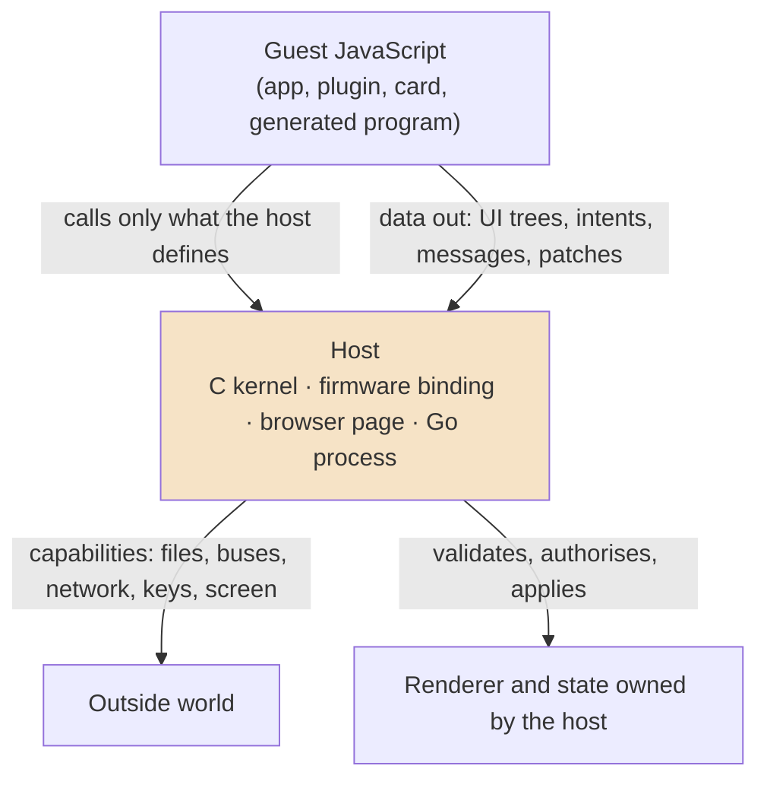

# JavaScript Operating Systems — Runtimes, Sandboxes and Shells for Programs Written in JavaScript

This map gathers the vault's work on systems in which JavaScript programs are the unit of execution and a host
decides what each program may do. The host is a C kernel on a microcontroller (picocalc-os, PULP OS), a browser page
(the plugin VMs, PBUI's generated programs, HyperCard cards), or a Go process (go-go-goja's runtimes). The projects
differ in hardware and purpose, and they keep answering the same five questions: what one program is, what it may
reach, how it talks to others, how it puts something on the screen, and what happens when it fails. The map is
organised around those questions and then lists the notes by family and reading order.

> [!summary]
> - **Device operating systems.** picocalc-os runs every driver, service and app in its own QuickJS runtime under a
>   C kernel with claims, handles and supervision; PULP OS runs a launcher and apps in MicroQuickJS on e-ink tablets.
> - **Shells and sandboxes in the browser and in Go.** Plugin VMs, PBUI's agent-written tiles, wesen-os cards and
>   go-go-goja sandboxes run untrusted or generated JavaScript and accept only data back.
> - **One recurring rule.** The guest computes; the host owns every capability, and anything that leaves the guest
>   is data the host validates ([[Research/KB/Fundamentals/host-mediated-sandbox-principles]]).

## The core mental model

Every system in this map has a *guest*, the JavaScript a person or a model wrote, and a *host*, the code that runs
it. The host chooses five things, and the choices define the system:

| Question | The range of answers in this vault |
|---|---|
| What is one program? | A whole runtime per program (picocalc-os worlds); a context per page (PULP Browser); a value loaded into a shared context (PULP OS apps); a pure function over JSON (PBUI generated programs, browser plugins) |
| What may it reach? | Only what the manifest's claims and the handles it holds allow (picocalc-os); a stdlib in which the dangerous natives are a denied stub (PULP Browser); declared verbs and entry points (PBUI, plugin VMs); everything the OS can do (installed PULP OS apps, which are operator code) |
| How does it talk to others? | Kernel-stamped JSON messages and channels (picocalc-os); a single `nav` request channel (PULP Browser); intents and state patches the host applies (plugin VMs, PBUI) |
| How does it show something? | A tree of plain UI nodes that a host-owned renderer draws, in nearly every system here: picocalc-os frames, PBUI `UINode` trees, plugin UI descriptions; PULP OS instead calls native builder classes for retained widgets |
| What happens when it fails? | Its effects are discarded and it restarts with backoff (picocalc-os); a deadline kills it and the host shows an error page (PULP Browser); the host refuses its output (data-only plugins) |

The strongest form of this model in the vault is picocalc-os, where the host is an operating system kernel: programs
are isolated runtimes, authority is held in a manifest and in revocable handles, every message carries a sender the
kernel set, and the screen is a published tree. The browser sandboxes apply the same model at a smaller scale, with
one host and many plugins. PULP OS is the useful contrast: its installed apps share the OS context and its authority,
and its later browser work added a separate context precisely to run pages that are not trusted.

## Families and reading order

### 1. picocalc-os — a JavaScript OS on the PicoCalc and the PaperS3

Start with the deep dive, then read the overview for the project's history, then the ticket reports for the part
you need.

- [[PROJECT REPORT - picocalc-os - Worlds, Turns, Handles and Frames - A Technical Deep Dive]] — **start here**: the
  whole system as of 2026-11-02, from the lane and deferred effects to handles, the compositor, native worlds and the
  ports.
- [[PROJ - picocalc-os - Project Overview - A JavaScript OS on Two Devices, With an Agent]] — the timeline and phases up
  to the agent (2026-10-20 to 10-31).
- [[PROJ - picocalc-os on the ESP32-P4 - From Simulator to Hardware - Technical Project Report]] — the simulator, the
  virtual clock and the first port.
- [[PROJ - picocalc-os on the M5Stack PaperS3 - E-Paper, MicroQuickJS and an Idle Tablet - Technical Project Report]]
  and [[PROJ - picocalc-os on the M5Stack PaperS3 - Follow-up - Faster Turns on a PSRAM-Bound Tablet]] — the engine,
  board and pixel seams, MicroQuickJS, e-paper and idle power.
- Files and applications: [[PROJ - picocalc-os - PICOCALC-FS - Files and File Handles on the PicoCalc]],
  [[PROJ - picocalc-os - PICOCALC-EDIT - Editor, Files and Notes on the PicoCalc]],
  [[PROJ - picocalc-os - PICOCALC-CALC - A Calculator and Plotter on the PicoCalc]],
  [[PROJ - picocalc-os - PICOCALC-SCI - A Graphing Scientific Calculator With Help Pages]],
  [[PROJ - picocalc-os - PICOCALC-AGENDA - Real Time and an Agenda on the PicoCalc]].
- Capabilities and untrusted code: [[PROJ - picocalc-os - PICOCALC-SYS - Settings, Logs and Key Channels as Capabilities]]
  (keystrokes and screens as claims), [[PROJ - picocalc-os - PICOCALC-LOADER - Apps from Storage, Without Claims]]
  (apps from storage with no authority).
- Native code beside JavaScript: [[PROJ - picocalc-os - PICOCALC-NATIVE - Native Worlds, Binaries in a Sandbox]]
  (seccomp processes), [[PROJ - picocalc-os - PICOCALC-NATIVE - WebAssembly and Machine Code on the P4]] (WAMR and
  ELF), [[PROJ - picocalc-os - PICOCALC-APPUI - Native Screens and Apps That Bring Their Own Icons]].
- Failure and performance: [[PROJ - picocalc-os - PICOCALC-FRAMES and PICOCALC-SPEED - Retained Posts and a 70x Slower Heap]].

### 2. PULP OS — MicroQuickJS applications on e-ink tablets

PULP OS predates picocalc-os on the same PaperS3 hardware and took a different path: one long-lived OS context,
native builder classes for widgets, and apps as trusted source.

- [[PROJECT REPORT - PULP OS v2 - Native Builder Classes over MicroQuickJS on an E-Ink Tablet]] — the architecture:
  native `Widget` and `Page` classes, a 26 KB bytecode image, a launcher and eight apps.
- [[PROJECT REPORT - Binding MicroQuickJS - Handles, Atoms, and the Compacting GC in the PULP OS Builder Layer]] — how
  to hold callbacks and objects safely across a moving collector; the same constraint shaped picocalc-os's
  `vm_mqjs.c`.
- [[PROJECT REPORT - A Canvas for E-Ink - Adding Freehand Primitives to a POD Widget Tree]] — drawing primitives in a
  widget tree.
- [[PROJ - PULP OS App Loader - Splitting the Monolith and Loading Apps as Source]] — apps as values loaded from
  source, and the explicit trust model for installed apps.
- [[PROJ - PULP Browser - Multi-Context MicroQuickJS and the Sandboxed Page Runtime]] — **the sandboxing step**:
  per-page contexts, a denied-stub standard library and a deadline.
- [[PROJ - PULP App Discovery - mDNS Browse, the Index Contract, and the Anatomy of a Lost Completion]],
  [[PROJ - PULP OS Image Gallery - mDNS Browser Upload and the Bitmap Blit]],
  [[PROJ - PULP OS Device Authorization - Native OAuth and E-Ink Sensor Streaming]] — networked apps.
- [[PROJ - PULP Design System and Demo Suite - Screenshot-Driven UI Engineering]] — screenshots as evidence.
- [[PROJ - PULP OS on X4 Classic - Native ESP-IDF Port and Display Qualification]] — a second device.

### 3. Embedded JavaScript foundations

These notes established how to run a JavaScript engine on ESP32 chips at all. picocalc-os's cost model is calibrated
on a measurement from the 0101 firmware.

- [[ARTICLE - QuickJS Wasm on WAMR - Running a JS Engine Inside a Wasm Sandbox]] and
  [[ARTICLE - QuickJS Wasm on ESP32-P4 - Device Bring-Up and Two WAMR Embedding Crashes]] — QuickJS compiled to
  WebAssembly, on the host and on the P4.
- [[ARTICLE - Native QuickJS on ESP32-P4 - Removing Wasm from the Firmware Stack]] — the same engine natively.
- [[ARTICLE - ESP32-P4 QuickJS Internals - Porting Runtime Ownership and Extension APIs]] — runtime ownership and
  extension APIs.
- [[ARTICLE - ESP32-P4 Visual QuickJS REPL - From Engine Bring-Up to PicoCalc Interface]] and
  [[ARTICLE - PicoCalc QuickJS DSL - Native and Portable Runtime Deep Dive]] — the first JavaScript UI on the
  PicoCalc.
- [[ARTICLE - QuickJS Native Modules on ESP32-S3 - Implementing Firmware JavaScript Namespaces]],
  [[ARTICLE - ESP32-S3 QuickJS HTTP and Fetch - From Firmware Static Serving to Host-Testable APIs]] and
  [[ARTICLE - ESP32-S3 QuickJS HTTP and Fetch - Owner Tasks Promises and Stored Scripts]] — firmware namespaces and
  owner tasks on the AtomS3R.
- [[PROJECT REPORT - StackChan Pet - Running the Pet on the Robot - Device Runtime, Screen UI and Real-Time Scheduling - A Technical Deep Dive]]
  — a QuickJS device runtime with a screen and real-time scheduling.
- [[PROJ - PaperS3 WAMR Debugging - Embedded Wasm Root Cause]] — what an embedded WebAssembly runtime can do to
  PSRAM caches.

### 4. Shells and desktops in the browser

- [[go-go-os]] — the map of the Go-hosted application shell, chat surfaces and widget packages.
- [[PROJ - wesen-os - Assistant Chat Parity and Generated HyperCard Apps]] — model-generated JavaScript cards
  executed by a QuickJS or goja host.
- [[ARTICLE - ATProto HyperCard - Browser Sandboxed FRP Runtime]] — interactive cards as a sandboxed reactive runtime.
- [[PROJ - Resume OS - A Macintosh System 1 Desktop as a Résumé]] — a desktop metaphor in the browser, with a QuickJS
  module for plugin cards.
- [[PROJ - PBUI Generative Tiles - Agent-Written Programs, Generated Actions, and the Reactive Sandbox]] and
  [[PROJ - PBUI Sandbox Devtools - Observing, Driving and Editing Agent-Written Programs]] — agent-written programs
  as pure functions over JSON in a workbench, with eval and QuickJS engines behind one interface.
- [[PROJECT REPORT - PBUI Editor - A CodeMirror Tile and a Plot Shim for a Sandboxed Workbench]] — editing sandboxed
  programs in place.

### 5. JavaScript sandboxing patterns

Read the fundamentals first; the project reports are worked examples.

- [[Research/KB/Fundamentals/host-mediated-sandbox-principles]] — the guest computes, the host owns capabilities.
- [[Research/KB/Tribal/data-only-vs-host-access-module-split]] — splitting modules by whether they touch the host.
- [[ARTICLE - Browser Sandboxed Plugin Runtime - Data-Only Extension Pattern]] — plugins as producers of data, with
  host-owned state and explicit entry points.
- [[PROJECT REPORT - Browser Plugin VM - Stateful Feed Middleware Runtime Deep Dive]] and
  [[PROJECT REPORT - ATProto Social Plugin Sharing - Publish Discover and Run Sandboxed JS Plugins]] — QuickJS
  sessions in the browser, and plugins shared over ATProto.
- [[ARTICLE - Goja Sandbox Architecture - Lessons from go-go-goja and vm-system]] and [[go-go-goja]] — sandboxes in
  Go-hosted runtimes; [[Research/KB/Tribal/goja-execution-model]] for sessions, thread safety and async.
- [[PROJ - go-go-wm - Multiple Goja Sandboxes: Isolating Extensions, Leasing Keybindings, and Detecting a Wedged Event Loop]]
  — one runtime per extension in a window manager, the same decision picocalc-os made for apps.
- [[RESEARCH - Go-Controlled Shell and Subprocess Sandboxing for JavaScript Runtimes]] — subprocesses from embedded
  JavaScript under Go's control.
- [[PROJ - Capsule Lab - A Sandboxed JS Capsule Runtime in the Browser]] and
  [[PROJ - Goja WASM Web REPL - A JavaScript Sandbox in the Browser]] — a Go engine compiled to WebAssembly as the
  sandbox.
- [[PROJECT REPORT - hours-tracker Assistant - One eval() Tool over a QuickJS Sandbox, Shared Across Tabs]] and
  [[PROJECT REPORT - jigcad - An Agent API That Teaches Through Its Errors, a Sandbox, and a Rule for await]] — a
  model's tool that runs JavaScript in a sandbox.
- [[PROJ - fastschema qjs on Wazero - From-Source Build and the qjsc Plugin Pipeline]] — QuickJS as WebAssembly in
  a Go process.

### 6. Engines and native embedding

- [[PROJ - Goja vs Sobek Deep Analysis]] — two Go JavaScript engines compared.
- [[PROJECT REPORT - Falllinie JavaScript Embedding - ARM64 Qualification, V8 Ownership and Bounded Rules]] — V8
  embedded in a native game with bounded rule execution.
- [[PROJECT REPORT - Lattice DS Native, Part 2 - A Two-Thread Shell and a Thin V8 Layer on the RG DS Plus]] and
  [[PROJECT REPORT - Lattice DS Native, Part 8 - Pages in JavaScript - A Generic Host, a UI Language and a Parity Harness]]
  — a JavaScript UI host on a Linux handheld.
- [[PROJ - Direct LLVM JavaScript - Original Release Deep Dive]] and
  [[PROJ - Strata - Independent Native Compiler on LLVM and Hermes]] — compiling JavaScript to machine code.

### 7. Neighbouring work without a JavaScript runtime

- [[PROJ - PBUI Handheld - Typed Actions Published Frames and Recoverable Input on ESP32-P4]] — a native C++ handheld
  UI on the same PicoCalc hardware; its published frames and input freshness solve problems picocalc-os's compositor
  also has.
- [[PROJ - Gnosis Layout Engine - PaperS3 UI Operating System]] — a declarative layout engine on the PaperS3.
- [[Research/KB/Tribal/microvm-as-execution-boundary]] and
  [[ARTICLE - Playbook - Building a Sandboxed Agent Runner with Go Glazed and Firecracker]] — isolation by virtual
  machines when a language runtime is not enough.

## Adjacent maps

- [[esp32]] — the ESP32 and M5Stack hardware under the device systems: bring-up, buses, displays, e-paper, Wi-Fi
  and the earlier QuickJS and WebAssembly runtime work.
- [[rg-ds-plus]] — the dual-screen Linux handheld behind the Lattice DS notes, where a JavaScript UI runs over a
  native shell.
- [[go-go-os]] — the browser application shell, chat surfaces and widget packages.
- [[go-go-goja]] — Go-hosted goja runtimes and their sandbox modules.

## Ideas that recur across the map

- **UI as data.** picocalc-os apps return trees of plain objects, PBUI programs return `UINode` trees, and data-only
  plugins return UI descriptions. A host-owned renderer draws them, so a guest cannot draw over another guest or
  over a prompt.
- **One runtime or context per untrusted unit.** picocalc-os gives every world its own QuickJS runtime from the
  start; PULP Browser adds a context per page beside the shared OS context; go-go-wm replaced one shared goja runtime
  with one per extension. All three separate untrusted code by runtime rather than by convention.
- **Authority by explicit grant.** picocalc-os's claims and handles, PULP Browser's denied stubs and the plugin
  VMs' declared entry points all make the guest's reach a list the host wrote down.
- **Bounded time.** A guest that never returns must not stall the host. picocalc-os bounds each segment with
  QuickJS's interrupt counter and a per-world budget; PULP Browser kills a page after a 3-second deadline.
- **Deterministic evidence.** picocalc-os's virtual clock and PULP's screenshot suite both turn screens into
  regression tests.

## Repository map

| Repository | What it holds |
|---|---|
| `/home/manuel/code/wesen/2026-10-20--ds-js-os/picocalc-os` | picocalc-os: nucleus, JavaScript worlds for both devices, ports, simulator, native SDK |
| `/home/manuel/code/wesen/go-go-golems/esp32-s3-m5/0114-papers3-pulp-os` | PULP OS on the PaperS3 |
| `/home/manuel/code/wesen/go-go-golems/esp32-s3-m5/0100-esp32-p4-quickjs-wasm`, `0101-esp32-p4-native-quickjs`, `0102-esp32-p4-visual-quickjs-repl`, `0103-atoms3r-m12-native-quickjs`, `0113-papers3-mquickjs-spike` | the embedded QuickJS and MicroQuickJS foundations |
| `/home/manuel/code/wesen/go-go-golems/go-go-os-frontend` | the go-go-os application shell and frontend packages |
| `/home/manuel/code/wesen/go-go-golems/go-go-goja` | Go-hosted goja runtimes and their sandbox modules |

## Boundaries and open questions

- picocalc-os and the browser sandboxes isolate by runtime; PULP OS's installed apps do not, by design. A note that
  compares the two trust models in depth does not exist yet.
- Every system here serialises across the boundary, usually as JSON. The cost is measured on the ESP32-P4
  (picocalc-os) but not systematically across the browser sandboxes.
- Machine code beside JavaScript is trusted wherever it appears (picocalc-os ELF worlds); WebAssembly is the
  isolated alternative on devices without per-process address spaces.
- When a new report adds a family or a new isolation boundary, add it here; when it only extends an existing
  project, link it from that project's notes instead.
