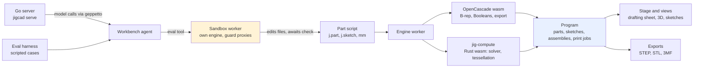

# jigcad — Browser CAD Workbench, Rust Compute Core, and a Measured Workbench Agent

jigcad is a parametric CAD workbench that runs in the browser. A part is a JavaScript program written against a builder language (`j.part`, `j.sketch`, `j.fit`, units such as `mm`). A Web Worker compiles the program with OpenCascade compiled to WebAssembly, and with `jig-compute`, a Rust numeric core also compiled to WebAssembly. The result is a `Program`: parts, sketches, assemblies and print jobs, each with named faces and edges. The workbench draws them on a software-rendered drafting sheet. An agent panel edits the part's script through one tool, `eval`, which runs code against the workbench. A Go binary, `jigcad serve`, embeds the workbench and makes the agent's model calls.

This map collects the jigcad reports in the vault, the textbook that uses jigcad as its case study, and the CAD/CAM work elsewhere in the vault.

> [!summary]
> - **A CAD engine as a compiler.** Script → worker → OpenCascade and Rust → `Program` → views. Everything the user sees is derived from the compiled program, and the program is derived from the script.
> - **An agent that writes the script.** The workbench agent works through a single `eval` tool. It runs in its own sandboxed worker, with its own engine, and gets errors that name the nearest correct API.
> - **Measured, not guessed.** An evaluation harness runs scripted cases against the real engine for each model. Each change to the agent API was judged by batch results: pass rate, misuse runs, unawaited promises.

## Mental model

The direction of the arrows is the main point. The script is the source of truth. The agent changes the model only by editing the script and compiling it, the same path the user takes. Reads are synchronous (`program.faces('shell/*')`, `files.read`); anything that compiles, draws or changes the workbench is awaited (`await check()`, `await look()`). The JIG-013 report explains why.

## Layers

### Engine and kernel

`src/engine` holds the builder language, the selector grammar (`faces('>Z')`, `%plane`), fits (`j.fit.hole`, magnets, pins), assemblies, print jobs and design exploration. The worker owns OpenCascade and the compiled programs. [[PROJECT REPORT - jigcad - Architecture of a Browser CAD Workbench, from Script to Agent]] is the starting point.

### Rust compute core

`rust/jig-compute` moved the numeric work into Rust and WebAssembly: constraint equations as data, the sketch solver, and a renderer. See [[PROJECT REPORT - jigcad - Moving the Numeric Core of a Browser CAD Engine into Rust and WebAssembly]] and [[PROJECT REPORT - jigcad - Constraint Equations as Data and a Rust Renderer]].

### Workbench UI and stage

`src/stage` and `src/ui` draw the drafting sheet, the 3D views and the sketch views, and save exports. See [[PROJECT REPORT - jigcad - Sketches in the 3D Views, Opened or Shown]] and [[PROJECT REPORT - jigcad - Exports That Save, in Any Page and From the Agent]].

### Workbench agent and its sandbox

`src/agent` is the agent: the system prompt, the `eval` tool, the scope it exposes (`files`, `program`, `check`, `look`, `help`), hints and the docs registry. Since JIG-012, `eval` runs in a sandboxed iframe and a blob worker with their own engine. The guard proxies turn a wrong name into "no `x`; nearest: `y`". JIG-013 made reads synchronous and promises loud.

### Evaluation harness

`tools/agent-eval*` and `test/agent-eval/cases` run each case headlessly against the real engine, for each model, and classify failures. Each batch result became evidence for the next change to the agent.

### Go server, build and release

`cmd/jigcad` and `pkg/server` embed the built workbench, serve it, and run the agent's model calls through geppetto with Pi's provider configuration. The Makefile, golangci-lint, CI and GoReleaser setup is described in [[PROJECT REPORT - jigcad - Build, CI and Release Plumbing for a Go Binary That Embeds a WebAssembly Workbench]].

## Recommended reading path

1. [[PROJECT REPORT - jigcad - Architecture of a Browser CAD Workbench, from Script to Agent]]: the whole system, from script to agent.
2. [[PROJECT REPORT - jigcad - Moving the Numeric Core of a Browser CAD Engine into Rust and WebAssembly]]: why the numeric core is in Rust.
3. [[PROJECT REPORT - jigcad - Measuring the Workbench Agent, an Evaluation Harness and a Promise Hint]]: how the agent is measured.
4. [[PROJECT REPORT - jigcad - An Agent API That Teaches Through Its Errors, a Sandbox, and a Rule for await]]: the current agent design.
5. [[PROJECT REPORT - jigcad - Retrospective of a Rust Compute Core, a Go Agent Backend, and What Measurement Changed]]: what the first phase taught.

For the engineering background, [[Course - Engineering CAD from First Principles]] covers geometry, topology, constraint solving, Booleans, identity across edits and verification. It uses jigcad as its running case study.

## Related notes

### Architecture and kernel

- [[PROJECT REPORT - jigcad - Architecture of a Browser CAD Workbench, from Script to Agent]]: the layers and the data flow from script to views and agent.
- [[PROJECT REPORT - jigcad - Moving the Numeric Core of a Browser CAD Engine into Rust and WebAssembly]]: JIG-001, the `jig-compute` crate and its wasm boundary.
- [[PROJECT REPORT - jigcad - Constraint Equations as Data and a Rust Renderer]]: sketch constraints as an equation table that the Rust solver consumes, and the software renderer.

### Workbench features

- [[PROJECT REPORT - jigcad - Sketches in the 3D Views, Opened or Shown]]: JIG-010, sketches drawn in the 3D view and a per-sketch "show in 3D" toggle.
- [[PROJECT REPORT - jigcad - Exports That Save, in Any Page and From the Agent]]: JIG-008, browser downloads outside claude.ai, and files handed over by the agent.
- [[PROJECT REPORT - jigcad - Warnings the Agent Can Read]]: JIG-009, warning text in run and check reports, and no-effect hints.

### Agent and its measurement

- [[PROJECT REPORT - jigcad - A Go Model Backend for the Workbench Agent]]: JIG-002, model calls through geppetto and Pi's provider configuration.
- [[PROJECT REPORT - jigcad - Measuring the Workbench Agent, an Evaluation Harness and a Promise Hint]]: JIG-003 and JIG-004, the harness and the first unawaited-promise hint.
- [[PROJECT REPORT - jigcad - Harder Agent Cases, Traps, and Why the Models Still Passed]]: JIG-005, multi-feature edits, assemblies, print jobs, refusals and multi-turn cases.
- [[PROJECT REPORT - jigcad - Letting the Workbench Agent See, Images In and a look() Out]]: JIG-006, pasted images and `look()` renders of the stage.
- [[PROJECT REPORT - jigcad - An Agent API That Teaches Through Its Errors, a Sandbox, and a Rule for await]]: JIG-011 to JIG-013, the sandbox, guard proxies, docs registry and the await rule.

### Build, release and retrospective

- [[PROJECT REPORT - jigcad - Build, CI and Release Plumbing for a Go Binary That Embeds a WebAssembly Workbench]]: JIG-007, the go-go-golems release shape for a binary with an embedded wasm workbench.
- [[PROJECT REPORT - jigcad - Retrospective of a Rust Compute Core, a Go Agent Backend, and What Measurement Changed]]: what the first batch of tickets changed, and why measurement mattered.

### Textbook

- [[Course - Engineering CAD from First Principles]]: 32 chapters and two appendices, from the CAD pipeline to half-edges, robust predicates, Delaunay refinement and solver linear algebra.
- [[Engineering CAD - Reading Map and Source Guide]]: reading routes by goal, and page anchors into Mäntylä, Hoffmann, de Berg et al. and Edelsbrunner.

## Related CAD/CAM work in the vault

jigcad designs parts. The CAM work below plans how to cut them and drives the machine. The two meet at exported geometry (STEP, STL, SVG profiles) and share a design rule: keep a typed program as the source of truth and derive the machine-specific output from it.

- [[PROJ - DROPCUT Studio - A CAM Compiler Where G-Code Is Just A Backend]]: a CAM compiler with a typed IR; G-code is one backend. It is the closest counterpart to jigcad on the manufacturing side.
- [[Research/Software Architecture Garden/dropcut-studio/README|DROPCUT Studio architecture garden]]: designs and proposals for DROPCUT, including the single-owner CNC controller.
- [[dropcut_cam_textbook]]: the drop-cutter CAM algorithm textbook. It is the CAM-side companion to the CAD textbook above.
- [[PROJ - ABS Bicolor V-Engraver - From Single-File Artifact to Multi-Tool CAM Pipeline]] and [[PROJECT REPORT - ABS Bicolor V-Engraver - Browser-Local CAM and Public Static-Site Deployment]]: browser-local CAM for V-engraving.
- [[ARTICLE - Multi-Tool Browser CAM - Safe Makera Job Planning]]: planning multi-tool jobs safely in the browser.
- [[PROJ - Makera Z1 Control - Reverse-Specifying a CNC Wire Protocol]]: the start of the Makera Z1 controller work.
- [[PROJ - Makera Z1 Control - G-code Inspector from Dictionary to Firmware Trace to Page]]: G-code decoding traced through the firmware.
- [[ARTICLE - Makera Z1 Stock Firmware - Source-Grounded Command and Telemetry Reference]]: the command and telemetry reference for the machine.
- [[ARTICLE - CNC Spindle Speed Control - Integrators, Dead Zones and Feedforward in the Carvera Firmwares]]: spindle control in the firmware.
- [[ARTICLE - Firmware Profiles - When Correct Framing Carries the Wrong Command]]: a failure class in machine profiles.
- [[Transcripts/Research/05 - CNC and CAM Research|CNC and CAM research cluster]] and [[Transcripts/INVENTORY - CNC and Manufacturing|CNC and manufacturing transcript inventory]]: the ChatGPT research behind the CAM work.
- [[PROJ - CoreS3 Magnet Base - 3D Model Search]]: a magnet base for the regular CoreS3 had no off-the-shelf model and would have to be designed, which is the kind of part jigcad's magnet fits describe.

Adjacent, for the agent sandbox design: [[ARTICLE - Goja Sandbox Architecture - Lessons from go-go-goja and vm-system]].

## Repository map

All paths are under `/home/manuel/code/wesen/go-go-golems/jig`.

| Path | What it holds |
|---|---|
| `cmd/jigcad`, `pkg/server` | Go binary and server: serves the embedded workbench, runs agent model calls |
| `import/jigcad/src/engine` | Builder language, selectors, fits, worker, compile, `Program` |
| `import/jigcad/src/agent` | Agent prompt, `eval` tool, scope, hints, docs registry, sandbox runner |
| `import/jigcad/src/host`, `src/stage`, `src/ui` | Page host, drafting-sheet and 3D rendering, workbench UI |
| `import/jigcad/rust/jig-compute` | Rust numeric core compiled to wasm |
| `import/jigcad/content/{presets,book,docs}` | Preset parts, the in-app book, the language reference |
| `import/jigcad/tools/agent-eval*` | Evaluation harness, failure classifier, Chrome renderer |
| `import/jigcad/test` | Engine, agent, sandbox and stage tests; agent-eval cases |
| `ttmp/2026/10/31`, `ttmp/2026/11/01` | docmgr tickets JIG-001 to JIG-013 with guides, diaries and batch results |

## Boundaries and open questions

- jigcad models parts for 3D printing and simple machining exports. It does not generate toolpaths; that is DROPCUT's and the V-Engraver's job.
- The agent's remaining failures are mostly engineering judgment and the 16-round limit, not API misuse. Raising the limit, keeping more compiled programs in slots, and harder cases are open.
- Batch runs are sequential and take about 7 rounds per run at roughly 2.8 s per round. Running cases concurrently would shorten them.
- The textbook's jigcad observations are a source-inspection snapshot of 2026-11-02, not a benchmark.
