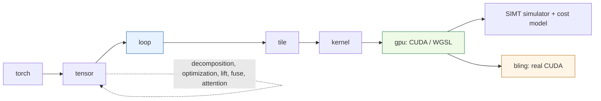

# Kiln — A JavaScript Tensor Compiler and Its PassNet Research Program

Kiln is a tensor compiler written in JavaScript. It lowers PyTorch-style programs through six IRs, from torch through tensor, loop, tile and kernel down to gpu, and emits CUDA and WGSL. Every level has a reference evaluator, and a SIMT simulator plus an analytic cost model let it check and rank kernels without a GPU. Since October 2026 its main use has been a research program against **PassNet/PassBench**: import real PyTorch FX graphs, compile them with Kiln, and have the result accepted by PassBench's original evaluator as a compiler pass. This map orders the 30-odd dated Kiln notes by question rather than by date.

> [!summary]
> - **Compiler:** `@kiln/kiln` is a graph-rewriting compiler. Passes are named groups of pattern/rewrite rules, and knobs (`MAP`, `TPB`, tile sizes) are chosen by a cost model or by search. Everything is inspectable per IR.
> - **PassNet integration:** an FX exporter and importer turn PyTorch graphs into Kiln scripts, and generated pattern/replacement rules plug the compiled kernels back into PassBench. Acceptance means matching eager PyTorch at the benchmark's tolerance with exactly one match.
> - **Evidence discipline:** GPU runs are frozen plans with append-only evidence under the KILN-005 ticket. The notes distinguish import, compilation, numerical acceptance and measured speed; they are different claims.
> - **State on 2026-11-02:** 157 of 200 PassBench families are fully accepted (1871 of 2060 graphs), recorded in the kiln repository's integration diary (Step 18). The work is merged to `main` (PR #1); the bulky evidence stays on `research/passnet`.

## The core mental model

A Kiln program is a graph that every stage rewrites. The frontend traces a function into the torch or tensor dialect. Decomposition, optimization, lifting and fusion rewrite it at the tensor level. `stamp` lowers it into Loop IR expressions, and the tile, kernel and emit passes choose a mapping and produce GPU kernels. Because each IR can be evaluated, the compiler checks itself at every level against the same inputs (`run.at("loop").eval(inputs)`), and `run.diff(i)` shows exactly what pass *i* changed.

The PassNet loop wraps that compiler: FX graph → `fx_export`/`fx_import` → Kiln script → compile → generated `KilnPattern` pass → PassBench evaluator on the GPU host. A graph can fail at each arrow, and the notes report each stage separately.

## Reading order

1. **What Kiln is and why PassNet:** [[ARTICLE - PassNet and Kiln - From FX Semantics to CUDA Execution]], then [[ARTICLE - PassNet and Kiln - Compiler Integration and the Self-Optimization Experiment]].
2. **Where the design stands:** [[ARTICLE - Kiln - Architecture Review of the PassNet Integration and the Contracts That Make Results Compound]] and [[ARTICLE - Kiln - Project Reassessment and the Path to Agent-Generated Compiler Strategies]].
3. **One compiler feature in depth:** any of the 2026-11-01 feature articles below. Each is self-contained and textbook-style.
4. **Results and their limits:** the coverage and policy-search sections, reading negative results alongside positive ones.

## Related notes

### Integration architecture and contracts

- [[ARTICLE - PassNet and Kiln - From FX Semantics to CUDA Execution]] (2026-10-30): the first working path from an FX graph to Kiln CUDA on PyTorch storage, and why a correct kernel is not yet an accepted pass.
- [[ARTICLE - PassNet and Kiln - Compiler Integration and the Self-Optimization Experiment]] (2026-10-30): the integration protocol and the self-optimization experiment design; translation versus verified execution.
- [[ARTICLE - Kiln - Architecture Review of the PassNet Integration and the Contracts That Make Results Compound]] (2026-10-31): expert review. Pattern deduplication, Kiln-against-Kiln checks that cannot detect PyTorch type-rule departures, and the narrow fusion-policy grammar.
- [[ARTICLE - Kiln - Canonical Emission Reliable Validation and Transpose Exports]] (2026-10-31): canonical names linking math, code and evidence; validation that fails closed.
- [[ARTICLE - Kiln - Whole Region Fusion Planning and Evidence Identity]] (2026-10-31): the region-cost fusion planner and the evidence-identity problem it exposed.

### Numerical semantics

- [[ARTICLE - Kiln - Numerical Contracts Correctness Gates and Eleven Complete Tasks]] (2026-10-31): acceptance gates, and the first eleven complete tasks.
- [[ARTICLE - Kiln - Matrix Semantics Canonical Bindings and Numerical Acceptance]] (2026-10-31): matrix fixtures, argument binding and mutation contracts, and a corrected coverage report.
- [[ARTICLE - Kiln - Exact GELU and Complete Source Qualification]] (2026-10-31): exact GELU via `erff` with FP32 opmath, and a LayerNorm signature repair.
- [[ARTICLE - Kiln - Softmax Source Semantics and Complete Benchmark Qualification]] (2026-10-31): reusing the compiler's softmax for source softmax, and a FX/Dynamo default-argument mismatch.
- [[ARTICLE - Kiln - Rich Fusion Policy Learning and Reference Precision]] (2026-10-31): native-precision versus full-precision references.
- [[ARTICLE - Kiln - Seven Unaccepted PassBench Families, Whose Rounding Disagrees and Why]] (2026-11-01): 0-d CUDA operands, slice-assignment patterns, and cases where cuDNN and cuBLAS rounding, not Kiln, misses the tolerance.

### Compiler features (KILN-006 to KILN-011, 2026-11-01)

- [[ARTICLE - Kiln - Tensor-Core Matrix Products Built and Checked Without a GPU]] (KILN-006): one table of `mma` atoms drives materializer, emitter, simulator and cost model.
- [[ARTICLE - Kiln - Fused Attention as a Recognized Expression and an Online-Softmax Kernel]] (KILN-007): attention recognized in Loop IR and lowered to `MAP=flash`; fully masked rows return 0 like PyTorch.
- [[ARTICLE - Kiln - Cumsum as a Scan Primitive, From Masked Reduction to Block Scan]] (KILN-008): scans as expressions defined at every index, with serial and block-scan mappings.
- [[ARTICLE - Kiln - Writing Mutated Inputs In Place with Proofs Over the Exported Program]] (KILN-009): launch-order and same-index proofs for writing a mutated input directly.
- [[ARTICLE - Kiln - Index Values, Factory Ops and Slice Assignment in a Functional Tensor Compiler]] (KILN-010): index values as loads without memory, and functional slice assignment.
- [[ARTICLE - Kiln - Integer Floor Division and Modulo, Signs, Overflow and Exact Literals]] (KILN-011): Python versus C division semantics, and making integer literals exact.

### Coverage: importing and matching PassBench

- [[ARTICLE - Kiln - From Operator Coverage to PassBench Matching]] (2026-10-31): 191 of 201 blocked graphs made importable. Matching TorchDynamo call forms is the next barrier.
- [[ARTICLE - Kiln - Singleton Reshape Maps and Measured Contraction Speedup]] (2026-10-31): singleton-axis maps that let the scheduler choose shared-memory tiling.
- [[ARTICLE - Kiln - Singleton View Contracts and Audited Agent Failure]] (2026-10-31): four newly complete families, and an audited failure of the reference agent.
- [[ARTICLE - Kiln - Compiler Policy Transfer and the 111-Task Coverage Frontier]] (2026-10-31): the 111-task qualification run, and why one global policy is insufficient.
- [[ARTICLE - Kiln - Closing the PassBench Import Gap, Device-Agnostic Shape Propagation and In-Place Ownership]] (2026-11-01): 2058 of 2060 graphs import. Covers the device and tracer defects and the in-place ownership rule.

### Compiler-policy search and agents

These record experiments in which policies (fusion thresholds, programs, agent-generated strategies) were selected on training graphs and confirmed on fresh ones. Several are **negative or tied results** and should be read as such.

- [[ARTICLE - Kiln - Reusable Fusion Policy Selected on Training Graphs]] (2026-10-30): a work-growth ratio of 1.25 selected on training and checked on held-out families.
- [[ARTICLE - Kiln - Bounded Fusion Programs and a Negative Confirmation Result]] (2026-10-30): conditional programs tie the baseline exactly; the unchanged compiler is selected.
- [[ARTICLE - Kiln - Policy Search from Training Traces and Safe Activation Lowering]] (2026-10-31): generated programs change executables, and the baseline still wins.
- [[ARTICLE - Kiln - Controlled Policy Search and Unchanged Winners]] (2026-10-31): 200 compilations and 27,600 timing samples, with unchanged winners.
- [[ARTICLE - Kiln - Selective Consumer Fusion and Fresh Evaluation]] (2026-10-31): consumer selection; it regresses on confirmation.
- [[ARTICLE - Kiln - Six GLM Lanes and Matrix Layout Fusion]] (2026-10-31): fusion can remove profitable scheduling opportunities.
- [[ARTICLE - Kiln - Staged Fusion Generalization and Agent Composition]] (2026-10-31): fixed-program transfer to thirteen unused models; agent composition shows no further gain.
- [[ARTICLE - Kiln - Fixed Compiler Confirmation Across Twenty Fresh Model Families]] (2026-10-31): benefits concentrate in reductions, with a small matrix regression.
- [[ARTICLE - Kiln - Pointwise Convolution and Measured Transfer]] (2026-10-31): a manual 1×1-convolution transformation, 32.7× over prior Kiln but still slower than eager on its family.
- [[ARTICLE - Kiln - Original PassAgent Execution and Experimental Identity]] (2026-10-31): running PassNet's original agent against a local provider.
- [[ARTICLE - Kiln - Project Reassessment and the Path to Agent-Generated Compiler Strategies]] (2026-10-31): where policy search stands and what agent-generated strategies would need.

### Adjacent notes elsewhere in the vault

- [[PROJ - Bling - Bringing a DGX Spark onto Tailscale]]: the GPU host every PassBench replay and CUDA probe ran on.
- [[MOC - Optimization and Performance Engineering]]: the vault's performance map; its Kiln section places the cost model and policy experiments among the other measurement case studies.
- [[researchctl]] and [[PROJECT REPORT - researchctl CPU GPU Codesign Experiment Runtime Deep Dive]]: frozen experiment manifests and simulated CPU/GPU cost models, the same evidence discipline Kiln's GPU queue follows.
- [[Mathematics - Floating-Point and Exact Arithmetic]]: background for the rounding, TF32/f16/bf16 and exact-integer questions in the numerical notes.
- [[PROJECT REPORT - Falllinie GPU Profiling - Hardware Counters, Shader Compilation and a Rejected Optimization]]: GPU counters and a rejected optimization on Mali, the hardware-measurement counterpart to Kiln's analytic cost model.

## Repository map

Paths verified on `main` at the PR #1 merge (`ac6d977`).

| Path | Role |
|---|---|
| `packages/kiln/src/core/` | Compiler framework: graphs, IR definitions, rules, passes, pipelines, `ix` index expressions |
| `packages/kiln/src/std/emmy.js` | The standard `pipeline({ target, contraction, matmulPrecision, attention })` and its pass sequence |
| `packages/kiln/src/std/` | Standard ML stack: `tensor.js`, `fusion.js`, `loop.js`, `tile.js`, `kernel.js`, `emit.js`, `mma.js`, `flash*.js`, `inplace.js`, `export.js`, `program-sim.js` |
| `apps/workbench/` | The browser workbench: presets W-01 to W-28, the agent, and docs |
| `integrations/passnet/` | `fx_export.py`, `fx_import.py`, `fx_coverage.py`, `fx_trace.py`, `generate_pass.py`, `evaluate_tasks.py` |
| `runtime/python/kiln_launch.py` | Launching exported kernels on CUDA |
| `ttmp/2026/10/30/KILN-005-*`, `ttmp/2026/11/01/KILN-00{6..11}-*` | Ticket guides, designs and diaries. KILN-005's `sources/` evidence lives only on branch `research/passnet` |

## Boundaries and open questions

- **Acceptance is not speed.** Most notes establish that graphs import, compile or pass PassBench's numerics. Measured speedups are narrower claims with their own protocols, and several policy experiments are negative.
- **Evidence is branch-bound.** The full GPU corpora (about 460 MB) were deliberately kept off `main`. Notes that cite `sources/` paths refer to `research/passnet`.
- **Open coverage work:**
  - generated rules with an empty output tuple (families 19, 26, 33);
  - patterns that never match (135, 167, 192) or match twice (128);
  - mutation of shared inputs (57, 94, 111, 172, 176);
  - 21 families at the tolerance edge, where vendor rounding sets the limit.
- **No later note yet** covers the final coverage totals, PR #1's review fixes (snapshotting outputs that alias mutated inputs, exact int64 literals, integer layout storage), or the repository going public. These are recorded in the kiln repository's integration diary, Steps 18–20.
