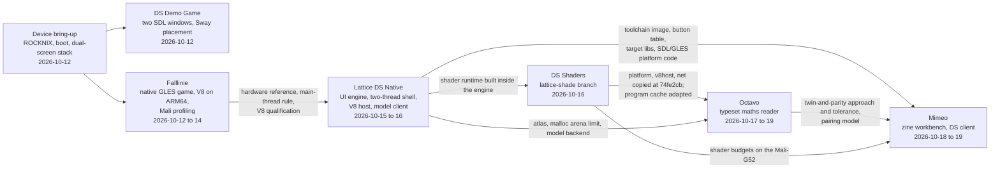

# RG DS Plus Projects — Native Programs, Browser Twins and Shared Infrastructure on a Dual-Screen Handheld

The Anbernic RG DS Plus is a Linux handheld with two 1024×768 screens, the lower one a touch screen. Between 2026-10-12 and 2026-10-19 it was the target of a series of projects. The series began with replacing the operating system and a two-screen demo game. It continued with a native port of a browser game (Falllinie), a native UI engine with embedded JavaScript (Lattice DS), a shader runtime inside that engine (DS Shaders), a typeset mathematics reader (Octavo), and a zine workbench whose device client left the browser (Mimeo). The vault holds 40 reports on this work.

This map gives the reading order. It also shows how each project took code, tooling or findings from the ones before it, and which patterns recur across all of them. It does not summarise the reports. Each link says what that report answers that the others do not.

> [!summary]
> - **One platform, measured once and reused:** ROCKNIX, Sway, two SDL windows, one GLES 3 context on a Mali-G52, V8 qualified on ARM64. Falllinie established these, and Lattice DS turned them into reusable code.
> - **Code moves by copying:** Octavo vendors Lattice's platform, V8 host and model client; Mimeo reuses Lattice's toolchain image, button table and target libraries. Each copy records its provenance; nothing is a shared library.
> - **Twins and parity:** the later projects keep a browser or Node twin of the device program and check that both produce the same messages and pixels.

## The platform

| Property | Value | Source |
| --- | --- | --- |
| SoC | Rockchip RK3568: four Cortex-A55 cores at up to 2.0 GHz | device report |
| GPU | Mali-G52 2EE, OpenGL ES 3.2 through the Mali driver | device report, Falllinie |
| Memory | 1 GB | device report |
| Screens | two 4.3-inch 1024×768 IPS panels; the lower one takes touch | device report |
| Operating system | ROCKNIX on a microSD card, replacing the vendor Linux | device reports |
| Display server | Sway; each program asks it to place one window per panel (DSI-1, DSI-2) | DS Demo Game, follow-up |
| Program launch | EmulationStation's Ports menu (`/storage/roms/ports`); install trees under `/storage/apps/<name>` | Falllinie, Mimeo, Octavo deploy scripts |

Only one program can hold the two panels at a time. Running one project's program on the device means stopping another: Octavo's Phase 7 tests on 2026-10-19 required stopping Mimeo.

## How the projects build on each other

The projects are dated, but they are not independent. The diagram shows the dependencies that the repositories and reports record: copied code, reused tooling, and findings cited as the basis of a design.

The chain has a direction. **Falllinie** answered the hardware questions under the heaviest load: how to drive both panels from one GLES context, which thread may call SDL and GL, whether V8 runs and how fast on ARM64, and where the Mali driver spends its time. **Lattice DS** turned those answers into an engine with a platform layer, a V8 host and a language-model client. **DS Shaders** built a shader runtime on a branch of that engine (`dsshade/lattice-shade`, the worktree at `2026-10-15--nintendo-ds-ui--shade`). **Octavo** copied its native foundation from that branch: `native/vendor/lattice/PROVENANCE` lists each file and the one change made to each. **Mimeo** reused Lattice's build tooling and platform code for its device addon, and Octavo's twin-and-parity method for its tests.

## Recurring patterns

| Pattern | Established in | Reused in |
| --- | --- | --- |
| Two SDL windows, one per panel, placed through Sway | DS Demo Game §8 | Falllinie (two camera views), Lattice platform layer, Octavo (copied), Mimeo `dsnative` |
| The main thread owns SDL and GL; other threads post work to it | Falllinie (`AGENTS.md`) | Lattice's two-thread shell; Octavo's script thread for V8 |
| V8 embedded in a C++ program on ARM64 | Falllinie JavaScript Embedding | Lattice Part 2 (`v8host`); Octavo (`v8host` copied, run on a script thread); Mimeo runs Node with a native addon instead |
| Cross-compiling in a Debian aarch64 Docker image, linking against libraries copied from the handheld with recorded hashes | Falllinie (`scripts/toolchain.Dockerfile`) | Lattice (`lattice-ds-toolchain`, `target-libs/`), Octavo (`octavo-toolchain`), Mimeo (Lattice's image and libraries) |
| A Ports launcher for EmulationStation | DS Demo Game, Falllinie | Octavo (`device/ports`), Mimeo (`Mimeo.sh`) |
| A browser or Node twin of the device program, checked for parity of messages and pixels | Lattice Part 8, DS Shaders, Octavo Part 3 | Mimeo Parts 1, 3 and its twin modes |
| The model and credential read from a pi agent setup, the credential kept in native code | Lattice Part 5 | Octavo Part 6 (`net/agent`, `net/llm` copied), Octavo Part 10 (pictures) |
| A cap on malloc arenas before the GPU driver and V8 start their threads | Lattice Part 4 | Octavo |
| Measuring on the device before optimizing, with soak runs for heat | Falllinie performance series | Lattice Part 4 (ten minutes at 41 °C), DS Shaders §6 and its 15-minute soak, Mimeo Part 4, Octavo Part 10 |

## Reading paths

- **New to the device:** [[PROJECT REPORT - Anbernic RG DS Plus - ROMs, Emulation, OS Replacement, and the Device-Tree Boot Failure - A Technical Deep Dive|device report]] → [[PROJECT REPORT FOLLOW-UP - Anbernic RG DS Plus - First Boot on ROCKNIX, the Dual-Screen Stack, and a Black-Screen Diagnosis|first boot follow-up]] → [[PROJECT REPORT - DS Demo Game - Dual-Screen SDL2 App Anatomy and the Compositor Placement Problem - A Technical Deep Dive|DS Demo Game]].
- **3D graphics and performance on the Mali-G52:** [[PROJECT REPORT - Falllinie Native GLES Spike - Deterministic Terrain, Print Shaders and Mali Depth Precision|Falllinie spike]] → [[PROJECT REPORT - Falllinie Playable Port - Dual Views, Frame Profiling and Cooperative Terrain Streaming|playable port]] → [[PROJECT REPORT - Falllinie at 60 FPS - Geometry, Presentation and a Crisp 512x384 Release on a Single-Core Mali-G52|Falllinie at 60 FPS]]. Then use [[MOC - Optimization and Performance Engineering]], which maps the performance reports by question.
- **A UI engine with JavaScript on the device:** [[PROJECT REPORT - Lattice DS Native - The Whole Project - A Browser UI System on a Real Dual-Screen Handheld|Lattice whole project]] (its §10 is a reading guide) → Parts 1 to 8.
- **A complete application, end to end:** [[PROJECT REPORT - Octavo, the Whole System - The Reader, the Typesetter, the Runtime and the Build|Octavo whole system]] → Parts 1 to 10.
- **Moving a browser application onto the device:** Mimeo Parts 1 to 4.
- **Language models on the handheld:** [[PROJECT REPORT - Lattice DS Native, Part 5 - The Language Model Backend - from a pi Agent Setup to a Robot's Tool Call|Lattice Part 5]] → [[PROJECT REPORT - Octavo, Part 6 - The Tutor - A Credential Kept in C++, Answers as Script Inputs and a Trial Layout per Paragraph|Octavo Part 6]] → [[PROJECT REPORT - Octavo, Part 10 - Drawing to the Tutor - Regions Under a Lasso, Pictures Drawn on the CPU and a Model That Sees|Octavo Part 10]].

## Related notes

### Platform and bring-up (2026-10-12)

- [[PROJECT REPORT - Anbernic RG DS Plus - ROMs, Emulation, OS Replacement, and the Device-Tree Boot Failure - A Technical Deep Dive]] — the hardware, the storage model and boot chain, writing ROCKNIX, and the device-tree failure.
- [[PROJECT REPORT FOLLOW-UP - Anbernic RG DS Plus - First Boot on ROCKNIX, the Dual-Screen Stack, and a Black-Screen Diagnosis]] — the first boot, inspecting the device remotely, the dual-screen software stack, and a black-screen diagnosis.
- [[PROJECT REPORT - DS Demo Game - Dual-Screen SDL2 App Anatomy and the Compositor Placement Problem - A Technical Deep Dive]] — the smallest program that drives both panels: a hand-written SDL2 binding, input decoding, and placing two windows through Sway.

### Falllinie: a native game (2026-10-12 to 14)

The project line, in order:

- [[PROJECT REPORT - Falllinie Native GLES Spike - Deterministic Terrain, Print Shaders and Mali Depth Precision]] — the qualified spike: terrain matching the JavaScript original exactly, the two-stage print shader, and depth precision on the Mali.
- [[PROJECT REPORT - Falllinie Playable Port - Dual Views, Frame Profiling and Cooperative Terrain Streaming]] — a camera per screen, frame profiling, and terrain streamed between frames.
- [[PROJECT REPORT - Falllinie Integrated Native Game - Precision, Real-Time Audio, Developer Telemetry and JavaScript Embedding]] — the gameplay systems, projection precision, generated audio and telemetry.
- [[PROJECT REPORT - Falllinie JavaScript Embedding - ARM64 Qualification, V8 Ownership and Bounded Rules]] — V8 on ARM64: ownership, value crossing and measurements; the qualification Lattice reused.
- [[PROJECT REPORT - Falllinie Buffered Audio - PCM Ownership, Callback Deadlines and Measured Producer Scheduling]] — audio produced on a worker and qualified against SDL's callback deadlines.
- [[PROJECT REPORT - Falllinie at 60 FPS - Geometry, Presentation and a Crisp 512x384 Release on a Single-Core Mali-G52]] — the complete path to the released build: every refresh held at 512×384, listed in the game menu.

The performance series, which [[MOC - Optimization and Performance Engineering]] also maps by question:

- [[PROJECT REPORT - Falllinie Tracing - CPU Execution, Driver Waits and GPU Attribution]] — the research plan for separating CPU execution, waiting and GPU work.
- [[PROJECT REPORT - Falllinie Rendering Measurements - CPU Execution, Mali Driver Work and GPU Timer Limits]] — wall time against thread CPU time per view; where the Mali driver spends time.
- [[PROJECT REPORT - Falllinie GPU Profiling - Hardware Counters, Shader Compilation and a Rejected Optimization]] — Mali hardware counters, and an optimization measured and rejected.
- [[PROJECT REPORT - Falllinie CPU PMU - Cache Events, Driver Cycles and an Audio-Disabled Baseline]] — CPU hardware counters for the same workload.
- [[PROJECT REPORT - Falllinie Performance Review - Measurement Discipline, Missed Bottlenecks and a Path to 60 FPS]] — a review of the investigation: what it established, what it missed, and the plan that followed.
- [[PROJECT REPORT - Falllinie GPU Budget Recovery - Shadow Bounds at the Shipping Size, Geometry Counters and Presentation Acquisition]] — the plan carried out at the shipping configuration.

### Lattice DS Native: a UI engine and its applications (2026-10-15 to 16)

- [[PROJECT REPORT - Lattice DS Native - The Whole Project - A Browser UI System on a Real Dual-Screen Handheld]] — start here: the measurements that decided the architecture, the method of an oracle at every boundary, and a reading guide.
- [[PROJECT REPORT - Lattice DS Native - An Exact C++ Port of a Browser Layout Engine and a GPU Backend on the RG DS Plus|Part 1]] — lattice-ui's layout engine ported to C++ exactly, and an OpenGL ES backend.
- [[PROJECT REPORT - Lattice DS Native, Part 2 - A Two-Thread Shell and a Thin V8 Layer on the RG DS Plus|Part 2]] — the shell (input, focus, scheduling) on two threads, and the V8 layer.
- [[PROJECT REPORT - Lattice DS Native, Part 3 - Running a Browser Application's Own Code over a Native Shell|Part 3]] — the browser application's own JavaScript running on the device.
- [[PROJECT REPORT - Lattice DS Native, Part 4 - Hardening a Handheld UI - an Exact Native Hot Path, Malloc Arenas and Ten Minutes at 41 C|Part 4]] — frame cost, memory growth and heat brought under budget.
- [[PROJECT REPORT - Lattice DS Native, Part 5 - The Language Model Backend - from a pi Agent Setup to a Robot's Tool Call|Part 5]] — the model and credential from a pi agent setup, the credential boundary, two APIs.
- [[PROJECT REPORT - Lattice DS Native, Part 6 - The Handheld Labeler - A Native Labeling Client, an Offline Journal and a Server Stub|Part 6]] — a second application: a labeling client with an offline journal.
- [[PROJECT REPORT - Lattice DS Native, Part 7 - From an Engine to a Framework - A Textbook, 154 Issues and a JS-first Design|Part 7]] — an audit of the engine and the JavaScript-first framework design.
- [[PROJECT REPORT - Lattice DS Native, Part 8 - Pages in JavaScript - A Generic Host, a UI Language and a Parity Harness|Part 8]] — that design built and measured: a generic host, a UI language and a parity harness.

### DS Shaders: shaders as the interface (2026-10-16)

- [[PROJECT REPORT - DS Shaders - no_shade on a Handheld - A Browser Twin, a Deconstructed Console and a Shader Runtime inside Lattice]] — the DS shader contract, a browser twin, measuring before porting, and `lattice-shade`, the runtime built inside Lattice without disturbing its applications.

### Octavo: a typeset mathematics reader (2026-10-17 to 19)

- [[PROJECT REPORT - Octavo, the Whole System - The Reader, the Typesetter, the Runtime and the Build]] — start here: the architecture across `js/`, `set/`, `native/` and `dev/`.
- [[PROJECT REPORT - Octavo, Part 1 - Typst on a Handheld - Display Lists, Span Ids as Colours and a Page Shader on the RG DS Plus|Part 1]] — Typst output as display lists, span ids encoded as colours, one page shader.
- [[PROJECT REPORT - Octavo, Part 2 - The Reading Loop on the Handheld - Element Trees from V8, Prebuilt Pages and a Main Loop That Sleeps|Part 2]] — the reading loop: element trees from V8, prebuilt pages, a main loop that sleeps.
- [[PROJECT REPORT - Octavo, Part 3 - The Development Loop - A Server on the Handheld, a WebGL2 Twin and a Parity Check|Part 3]] — the dev server on the handheld, the WebGL2 twin and the parity check that Mimeo later adopted.
- [[PROJECT REPORT - Octavo, Part 4 - Reading State - An Event Log, Folds and Type That Changes Without Layout|Part 4]] — reading state as an event log with folds.
- [[PROJECT REPORT - Octavo, Part 5 - Ink - A Layer per Surface, a Compass of Span States and the Card on the Touch Screen|Part 5]] — ink layers, the compass menu, and the card on the touch screen.
- [[PROJECT REPORT - Octavo, Part 6 - The Tutor - A Credential Kept in C++, Answers as Script Inputs and a Trial Layout per Paragraph|Part 6]] — the tutor: streaming answers as script inputs, typeset paragraph by paragraph.
- [[PROJECT REPORT - Octavo, Part 7 - Flows - Sessions in the Event Log, Positions Rebuilt from Events and Book Views as Element Trees|Part 7]] — flows: exercise sessions kept in the event log.
- [[PROJECT REPORT - Octavo, Part 8 - Packages - A Checked Manifest, Verbs in Empty Slots and Two Features Moved Out of Core|Part 8]] — packages: a checked manifest and verbs.
- [[PROJECT REPORT - Octavo, Part 9 - The Frozen Page - Two Caches, a Journal That Witnessed It and a Fix That Restored One Truth|Part 9]] — a debugging case: two page caches that disagreed, found through the journal.
- [[PROJECT REPORT - Octavo, Part 10 - Drawing to the Tutor - Regions Under a Lasso, Pictures Drawn on the CPU and a Model That Sees|Part 10]] — circling text to ask about it, pictures drawn on the CPU, a model that reads them.

### Mimeo: a browser workbench's device client (2026-10-18 to 19)

- [[PROJECT REPORT - Mimeo on the RG DS Plus, Part 1 - The DS Twin Leaves the Browser - A Skia Canvas, Fonts That Measure Like Chromium and Paint on Change|Part 1]] — the DS twin moved from the browser to Node on a Skia canvas, with fonts that measure as Chromium's do.
- [[PROJECT REPORT - Mimeo on the RG DS Plus, Part 2 - One Room for Desk and Device - A Pairing Hub in Go, Offline Edits That Arrive Once and Pictures Made Where Their Lane Is|Part 2]] — a pairing hub in Go between desk and device; offline edits delivered exactly once.
- [[PROJECT REPORT - Mimeo on the RG DS Plus, Part 3 - Two Windows and a GPU - dsnative, a WebGL2 Shim That Matches Chromium Bit for Bit and Each Panel Presented at Once|Part 3]] — `dsnative`: two windows and a WebGL2 shim whose output matches Chromium bit for bit.
- [[PROJECT REPORT - Mimeo on the RG DS Plus, Part 4 - On the Handheld - A 160 MB Package, Latency Set by Paint and Three Bugs Only the Hardware Showed|Part 4]] — the package on the handheld, latency measurements, and three defects only the hardware showed.

### Adjacent maps

- [[MOC - Optimization and Performance Engineering]] — performance methods across the vault, with the Falllinie series as its main case study.
- [[fpga-hdl-gatemate]] — the GateMate FPGA work, including Weft (`2026-10-18--weft`), which shares these dates but not this device.

## Repository map

Commit counts and dates are as of 2026-10-19.

| Repository | Project | Tickets | Commits, dates |
| --- | --- | --- | --- |
| `/home/manuel/code/wesen/claw-stuff` | Device bring-up; Falllinie's first ticket | `ANBERNIC-RGDS-2026-10-12`, `FALLLINIE-GLES-001` | (shared repository) |
| `/home/manuel/code/wesen/2026-10-12--ds-demo-game` | DS Demo Game (Python, SDL2 through ctypes) | `DS-DEMO-001` | 6, 2026-10-12 |
| `/home/manuel/code/wesen/2026-10-12--falllinie-spike` | Falllinie (C++17, SDL2, GLES 3) | `FALLLINIE-PLAY-001` … `FALLLINIE-PERF-010` | 107, 2026-10-12 to 14 |
| `/home/manuel/code/wesen/2026-10-15--nintendo-ds-ui` | Lattice DS: engine `src/`, apps `apps/` (arena, demo, labeler, probe) | `DSUI-001`, `LABEL-001`, `UIFW-001`, `JSUI-001`, `JSUI-002` | 104, 2026-10-15 to 16 |
| `/home/manuel/code/wesen/2026-10-15--nintendo-ds-ui--shade` | Git worktree of Lattice DS on branch `dsshade/lattice-shade` | — | at `74fe2cb` |
| `/home/manuel/code/wesen/2026-10-16--ds-shaders` | DS Shaders: browser lab `lab/web/` and the ticket | `DSSHADE-001` | 19, 2026-10-16 |
| `/home/manuel/code/wesen/2026-10-17--octavo` | Octavo: `js/`, `set/` (Rust), `native/` (C++), `dev/` (Go), `ide/` | `OCTAVO-001`, `OCTAVO-002`, `OCTAVO-003` | 94, 2026-10-17 to 19 |
| `/home/manuel/code/wesen/2026-10-18--mimeo` | Mimeo: workbench `mimeo/`, hub `link/` (Go), device client `device/` (Node and `dsnative`) | `MIMEO-001` | 34, 2026-10-18 to 19 |

Each repository keeps its design guides, diaries and evidence in docmgr tickets under `ttmp/`. These are the primary record behind the reports.

## Boundaries and open questions

- **Copied code drifts.** Lattice's platform layer, V8 host and model client now exist in Lattice's `main`, the `lattice-shade` branch and Octavo's `native/vendor/lattice/`, and Mimeo's `dsnative` reuses the platform code. Changes do not flow back: Octavo's `info.input` (the model's input kinds, added in OCTAVO-003) exists only in Octavo's copy, and the PROVENANCE file is the only record of it. A shared library would remove the drift, at the cost of coordinating releases across projects.
- **No operations guide across projects.** Each repository has its own build, deploy and Ports scripts, its own install tree and data directory, and its own way of controlling the running program. No note lists them side by side, or says which program currently holds the panels.
- **Reports not yet written.** Mimeo's Phase 7 twin modes (follow, drive and parity between the desk's DS tab and a device; commits `8228283` and `cff0b96`, 2026-10-19) are committed but have no report.
- **What this map excludes.** Weft (`2026-10-18--weft`) shares the dates but targets the GateMate A1-EVB FPGA board; it belongs to [[fpga-hdl-gatemate]].
