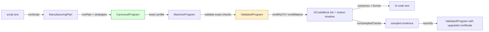

# Project Architecture Overview — A Compiler Whose Narrow Waist Is Machining

DROPCUT Studio turns a JavaScript program that describes a machining job into G-code for a specific CNC controller. That sentence makes it sound like a postprocessor, and the codebase is organised against that reading. It is a compiler with seven intermediate values, and the most consequential decision in it is which of those values is allowed to know about G-code. This chapter gives the end-to-end shape of the system so the pattern chapters that follow can be read independently.

> [!summary]
> - The pipeline is `script → ManufacturingPlan → ToolpathSet → CanonicalProgram → MachineProgram → ValidatedProgram → GCodeBlock[] → text`. Each arrow is a pure function over an inspectable value.
> - `CanonicalProgram` is the narrow waist. It is non-modal and machine-independent; every consumer (validation, simulation, emission, visualisation) interprets the same object.
> - Machine differences live in a capability record (`MachineProfile`), not in compiler branches.
> - Verification is reported as graded evidence per check, not as a boolean.
> - The pure core (`packages/*`) imports neither React nor Three.js, so the same pipeline runs in the CLI, the browser and the tests.

## 1. Vocabulary needed before the architecture

Five domain terms carry the whole design. They are defined here in the order the rest of the study depends on them.

**G-code (RS-274)** is the line-oriented language CNC controllers execute. A line such as `G1 X70 F800` means "move in a straight line at feed rate to X=70, at 800 mm/min".

**Modal state** is the property that makes G-code hard to analyse. Words such as `G1`, `F800` and the active plane `G17` persist until replaced. The line `X70` on its own can mean "rapid to 70", "feed to 70" or, in incremental mode, "move 70 further", depending on lines that may be thousands of blocks earlier. A line is only meaningful relative to the controller state accumulated before it.

**A toolpath** is the geometric curve the tool tip follows. A **traverse** (rapid, `G0`) moves without cutting; a **cut** moves at a feed rate while removing material.

**The cutter-location (CL) surface** is the height the tool tip must be at, for each `(x, y)`, so that the tool just touches the part without cutting into it. Following that surface machines the part exactly.

**A gouge** is a cut below the intended part surface. A **rapid through stock** is a traverse that passes through material that has not been removed. Both damage the part or break the tool; neither raises an exception anywhere in a conventional pipeline.

## 2. The pipeline as values

Every stage of the compile is a value with a type, and every stage boundary is a function call. The composition root in `apps/cli/src/compile.ts` reads almost exactly like the pipeline diagram:



The table states what each value knows and what it deliberately does not know.

| Value | Produced by | Knows | Does not know |
|---|---|---|---|
| `ManufacturingPlan` | `runScript` (`packages/script-host`) | operations, parameters, tools, stock setup | any motion |
| `ToolpathSet` | a strategy (`packages/strategies`) | independent cutting paths for one operation | how to get between them |
| `CanonicalProgram` | `runPlan` (`packages/planner`) | every command, each self-contained | which machine will run it |
| `MachineProgram` | `lower` (`packages/compiler`) | arcs resolved against capabilities, feeds clamped | whether it is safe |
| `ValidatedProgram` | `validate` (`packages/compiler`) | a `SafetyCertificate` | text syntax |
| `GCodeBlock[]` | `emitRs274` (`packages/post-rs274`) | words per line, fully explicit, plus provenance | modal shortcuts |
| G-code text | `compress` + `formatBlock` | the one place modality reappears | — |

The middle row is the one to remember. A `CanonicalProgram` is a list of commands where every cut carries its own feed, every spindle command carries its own speed and every arc carries its own centre and axis. Nothing inherits from a previous command. The repository's README states the commitment in one line: *do not make G-code the semantic model; make machining the semantic model, and treat G-code as one serialization backend.*

## 3. One small program, followed through

Consider a two-line cut along X at a depth of 1 mm, after a traverse. In the canonical IR it is two commands:

```ts
{ kind: "traverse", to: point(10, 10, 5, "work"),
  clearance: { safeZ: mm(6), allowCoordinated: true }, provenance }
{ kind: "cut", path /* (10,10,5) → (20,10,-1) → (30,10,-1) → (40,10,-1) */,
  feed: mmPerMin(600), tolerance: mm(0.01), purpose: "finish", tool, provenance }
```

The traverse states an intent — reach this point safely — not a `G0`. On the `xyz-3018` profile, whose rapids are `axis-independent`, the emitter decomposes it into "move at safe height, then descend". On `linuxcnc`, whose rapids are `coordinated`, it is one `G0`. The emitter then produces fully explicit blocks, every axis and the feed on every line:

```text
G0 X10.000 Y10.000 Z5.000
G1 X20.000 Y10.000 Z-1.000 F600.0
G1 X30.000 Y10.000 Z-1.000 F600.0
G1 X40.000 Y10.000 Z-1.000 F600.0
```

Only `compress()` removes the words that the controller's modal state already implies. `Y10` is dropped from the first cut because the traverse already put Y there; `G1`, `Z-1` and `F600` are dropped from the later lines because they are still in force:

```text
G0 X10.000 Y10.000 Z5.000
G1 X20.000 Z-1.000 F600.0
X30.000
X40.000
```

The round-trip property test in `packages/post-rs274/src/roundtrip.test.ts` parses both texts back with the project's own modal interpreter and requires the same motion polyline. That test is the evidence that confining modality to `compress()` is lossless (see [[Research/Software Architecture Garden/dropcut-studio/claude-opus/02 - Modality as a Final Compression Pass - The Non-Modal IR and Its Round-Trip Oracle|chapter 02]]).

## 4. Package layering

The workspace is split into fourteen packages with a strict upward dependency order. The order is a design decision: nothing below the application layer imports React or Three.js, which is what lets the CLI and the tests run the full pipeline in Node.

```text
apps/studio   apps/cli                         ← composition roots (React/Redux, Node CLI)
   │             │
   ├── viewer-three (framework-free Three.js)
   ├── script-host  (sandbox + capability API)
   ├── post-makera → post-rs274 → compiler      ← emission and modal compression
   ├── analysis     (dexel simulation, certificate)
   ├── strategies → planner                     ← toolpath generation and linking
   ├── geometry     (mesh, spatial index, drop-cutter, Eikonal)
   ├── machine      (capability records)
   ├── ir           (Path, commands, ValidatedProgram brand, provenance)
   ├── gcode-parser (modal RS-274 interpreter — the oracle)
   └── math → units (frame-tagged points, branded scalars)
```

Two inversions in this graph are worth noting. `planner` does not depend on `strategies`; the strategy dispatch function is injected into `runPlan` as `RunOptions.strategies`, so adding a strategy never edits the planner. `compiler` owns modal compression even though `post-rs274` calls it, because modality is a compiler concern and the emitter is one of potentially several backends.

## 5. The patterns this study extracts

Each subsequent chapter isolates one structure, explains the problem it solves, and records where the implementation falls short of its own contract.

| Chapter | Pattern | Maturity |
|---|---|---|
| 02 | Modality as a final compression pass, checked by a round-trip oracle | Established |
| 03 | Capabilities as data; intent commands lowered by a profile record | Established |
| 04 | Certified stage types: a brand minted in one greppable place | Established, with a visibility caveat |
| 05 | Graded evidence certificates | Candidate ecosystem pattern; **open correctness obligation** |
| 06 | Branch-and-bound spatial queries: tight bounds over fast code | Established |
| 07 | Capability-passing script host with boxed runtime units | Established, with an explicit non-security caveat |
| 08 | Strategies produce geometry; the planner owns the gaps | Established |
| 09 | Three-tier application state and a versioned document seam | Established |
| 10 | Architecture debt and patterns not to repeat | Debt |
| 11 | Candidate ecosystem guidelines | Candidate |

## 6. How this study relates to the existing dropcut-studio entries

The sibling `designs/` directory studies the Go controller (`makera-z1-cli`, on a separate branch) and its line protocol to a Makera Z1: sentinel completion, latched safety channels, dead-man keepalive. That work explicitly excludes the CAM compiler, the scripting host and the certificate. This study covers exactly those, on `main` at `f3ebac2`. The two meet at one point: the G-code text this compiler emits is the payload the controller streams.

## 7. Evidence base

- The test suite was run at the analysed commit: `npx vitest run` reported **16 files, 235 tests, all passing** (drop-cutter benchmark output: 96,580 queries/s on 18,432 triangles; 60,404 queries/s on 96,800 triangles; index build 5.1 ms).
- A deliberately unsafe program was compiled with the CLI to test the certificate's claims; the result is reported in chapter 05.
- Design intent was read from `original/DESIGN-01-semantic-cam-architecture.md`, `original/DESIGN-02-kleisli-composition-for-machine-commands.md`, and the docmgr tickets `CAM-001` and `CAM-002` under `ttmp/2026/08/`. Where code and design intent disagree, this study reports the code.

## Key points

- The system is a compiler, and its narrow waist is a non-modal machining IR, not G-code.
- Every stage is an inspectable value, so simulation, timing, verification and rendering interpret one object instead of re-deriving it from text.
- Machine variation is data; verification is graded evidence; modality is a final compression pass. The next chapters take these one at a time.
