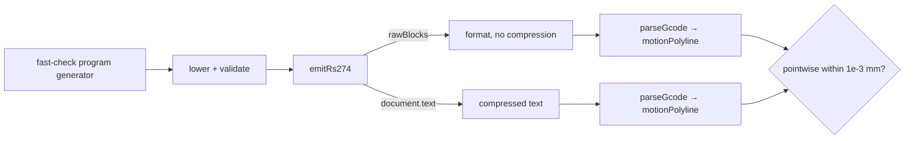

# Modality as a Final Compression Pass — The Non-Modal IR and Its Round-Trip Oracle

Some output formats are stateful: the meaning of each line depends on state accumulated by the lines before it. G-code is the example in this repository, but the same property appears in terminal escape sequences, PDF graphics state, SVG relative path commands and HTTP/2 header compression. This chapter explains how DROPCUT Studio keeps that statefulness out of its semantic model entirely, reintroduces it in one pure function at the very end, and then proves the reintroduction is lossless with a parser it owns.

> [!summary]
> - The canonical IR is **non-modal by construction**: every command carries all the parameters it needs. Nothing inherits from a predecessor.
> - The emitter produces **fully explicit** blocks. A single function, `compress()`, removes words the target's modal state already implies. It is the only code in the repository that reasons about modality.
> - Because the project owns a modal interpreter, the claim "compression loses nothing" is a **property test**: parsing the compressed and uncompressed texts must yield the same motion.
> - The oracle is differential. It proves compression preserves meaning *as the project's parser understands it*. It does not prove the emitter matches the canonical program, or that the parser matches a real controller.

## 1. Why modality is the hazard

A modal language assigns a meaning to a line only relative to an interpreter state. Here is a fragment that a G-code reader cannot evaluate in isolation:

```text
N4120 X70
```

If the last motion word before line 4120 was `G0`, this is a rapid to X=70. If it was `G1` with `F800` in force, it is a cutting move at 800 mm/min. If `G91` was issued somewhere earlier, it is a move of 70 mm in the positive direction. The interpretation of one line is a function of every earlier line, and a transformation that reorders, filters or splices lines must reason about that whole history.

An intermediate representation that inherits this property inherits the hazard. Suppose the IR stored "set feed 800" and "move to X70" as separate commands. Then removing an operation from the middle of a program could silently change the feed of the next operation; reordering two operations could change which plane an arc is interpreted in. These bugs do not raise exceptions. They produce a different part.

## 2. Pattern statement

> **Keep the semantic representation free of inherited state. Serialise it first into a fully explicit form, then apply one pure compression function that removes only what the target's interpreter would infer. Verify the compression with an interpreter that maps both forms back to meaning.**

Three properties follow:

1. Any canonical command can be inspected, filtered, reordered or transformed in isolation.
2. Every modal rule lives in one function with one test, not as an invariant spread across an emitter.
3. The correctness claim — compression is lossless — is executable.

## 3. The non-modal IR

The canonical command union in `packages/ir/src/commands.ts` is written so that inheriting state is not expressible. A cut carries its own feed, tolerance, tool and purpose; a spindle command carries its own speed; an arc carries its geometry (centre, unit axis, signed sweep) rather than G-code's `I/J/K` offsets and an ambient plane.

```ts
export interface CutCmd<F extends FrameId = FrameId> {
  readonly kind: "cut";
  readonly path: Path<F>;
  /** Always present. Never inherited from a previous command. */
  readonly feed: MmPerMin;
  /** The chord tolerance this path was built to — feeds the error budget. */
  readonly tolerance: Mm;
  readonly purpose: CuttingPurpose;
  readonly tool: ToolRef;
  readonly provenance: Provenance;
}
```

There is no `G0` in the IR. A `TraverseCmd` carries a `ClearanceRequirement { safeZ, allowCoordinated }` — an intent to reach a point safely — and the emitter decides how many rapid blocks that becomes for a given machine (see [[Research/Software Architecture Garden/dropcut-studio/claude-opus/03 - Capabilities as Data - Intent Commands Lowered by a Profile Record|chapter 03]]).

Arcs are geometric for the same reason. The plane an arc lies in is *derived* from its axis by `arcPlane(axis)` at emission time. The IR never stores `G17`; the emitter computes it, writes it on the arc's block, and lets compression drop it on the next block if it did not change.

The `Path` type adds a second structural guarantee. A path has a start and an end, and `concat(a, b)` throws if `a.end` and `b.start` differ by more than `JOIN_EPS = 1e-7`. Paths form a category in which composition is defined only when endpoints agree, and the `PathBuilder` maintains `end` as the endpoint of the last segment by construction. The comment on `concat` states the policy: silently inserting a connecting move would hide a planner bug.

## 4. Two-stage emission

The emitter in `packages/post-rs274/src/index.ts` writes **every** axis word and **every** feed on **every** line. It never asks what the previous line said. The function then hands the explicit blocks to `compress()` in `packages/compiler/src/gcode-ir.ts` and keeps the uncompressed blocks in its result as `rawBlocks`:

```ts
const finalBlocks = (opts.compressOutput ?? true) ? compress(blocks) : blocks;
const document = toDocument(finalBlocks, machine.dialect, { decimals, commentStyle });
return { document, motions, totalSeconds: seconds, rawBlocks: blocks };
```

Keeping `rawBlocks` is not incidental. It is the ground truth that the oracle compares against.

### 4.1 The compression rules

`compress()` is a left fold over blocks with a small explicit state: the last emitted motion word, plane, feed, spindle speed and position axes. Each rule exists because of a specific property of RS-274 interpreters.

| Word class | Rule | Why |
|---|---|---|
| Motion (`G0..G3`) | Drop if unchanged | Modal group 1 persists across blocks. |
| Plane (`G17..G19`) | Drop if unchanged | The plane is modal. |
| Feed (`F`) | Drop if within ε of the last emitted feed | Feed is modal. |
| Position axes (`X Y Z`) | Drop if within ε of the last **emitted** value | Unmentioned axes hold position. |
| Arc parameters (`I J K R`) | **Never** drop | They are offsets from the *current point*, so equal numbers on two blocks mean different centres. |
| Spindle speed (`S`) | Drop if unchanged, **unless** the block issues `M3`/`M4` | Some controllers latch speed on the spindle-start word. |
| Verbatim lines | Always keep, byte for byte | Structured comments such as Makera's `;@MKR|…` header are records, not prose. |
| Empty blocks | Remove, unless they carry a comment | A block whose every word was redundant does nothing. |

Two details in the implementation are easy to get wrong in a rewrite.

The axis comparison is against the last *emitted* value, not the last *seen* value. The code only updates `lastAxis[ax]` when it keeps the word:

```ts
const prev = lastAxis[ax];
if (dropAxes && prev !== undefined && Math.abs(v - prev) <= eps) continue;
axes[ax] = v;
lastAxis[ax] = v;
```

If the comparison used the last seen value, a sequence of moves each differing by slightly less than ε would all be dropped, and the controller's position would drift arbitrarily far from the intended one. Comparing against what the controller actually holds makes the drift bound ε, independent of sequence length.

The arc-word rule encodes a subtlety of relative parameters. Two consecutive `G2` blocks with `I5 J0` describe different circle centres when their start points differ. Treating `I` as modal would be plausible-looking and wrong. The test `never drops arc offset words, which are relative to the current point` pins it.

## 5. The law, stated precisely

Let $B = b_1 b_2 \ldots b_n$ be the explicit block sequence the emitter produces. Let $\llbracket\cdot\rrbracket$ be the project's modal interpreter, `parseGcode` followed by `motionPolyline`, which maps text to a sequence of positions. Let $\mathrm{fmt}$ be the block formatter. The claim the architecture rests on is

$$
\llbracket \mathrm{fmt}(\mathrm{compress}(B)) \rrbracket \;=_{\delta}\; \llbracket \mathrm{fmt}(B) \rrbracket
$$

where $=_{\delta}$ compares polylines pointwise within $\delta = 10^{-3}$ mm, slightly above the formatting quantum of $5 \times 10^{-4}$ mm for three decimal places.

A useful way to see why the fold is correct is as a **simulation relation**. Write $\sigma_i$ for the interpreter state after the explicit prefix $b_1 \ldots b_i$ and $\sigma'_i$ for the state after the compressed prefix. The compressor's own variables (`motion`, `plane`, `feed`, `speed`, `lastAxis`) are a model of $\sigma'_i$. Each rule drops a word $w$ from $b_{i+1}$ only when the model says $\sigma'_i$ already holds $w$. So if the model is accurate, applying the shortened block to $\sigma'_i$ produces the same tracked state as applying the full block to $\sigma_i$, and the invariant $\sigma_i \approx \sigma'_i$ is preserved at every step. The property test checks the conclusion of that induction rather than the induction itself.

## 6. The oracle

The project contains a modal RS-274 interpreter in `packages/gcode-parser`. Its module comment lists its reasons for existing in priority order, and the first is: *it is the round-trip oracle*. An **oracle** in testing is an independent procedure that decides whether an output is correct. Owning one changes what kind of claim "compression is lossless" can be.

The property test generates arbitrary programs from a small step language — traverses and multi-point line cuts with random coordinates and feeds — and pushes each through the full pipeline (`lower`, `validate`, `emitRs274`):

```ts
fc.property(fc.array(arbStep, { minLength: 1, maxLength: 8 }), (steps) => {
  const { rawBlocks, document } = emitFor("xyz-3018", steps);
  const uncompressed = formatProgram(rawBlocks, { decimals: 3 });
  const compressed = document.text;
  const a = motionPolyline(parseGcode(uncompressed));
  const b = motionPolyline(parseGcode(compressed));
  expect(polylinesMatch(a, b)).toBe(true);
}),
{ numRuns: 400 },
```

A second property repeats this for all three machine profiles (120 runs each), and a third test guards against **vacuity**: it asserts that the compressed text is strictly shorter and that at least one cutting line lacks both `Y` and `Z`. Without that third test, a regression that turned compression into the identity function would leave the round-trip test green.



## 7. What the oracle proves, and what it does not

The test is **differential**: both sides pass through the same parser. That is its strength — it isolates `compress()` exactly — and it bounds what the test can say.

- **It proves** that compression preserves meaning relative to the project's interpreter, for programs the generator can produce.
- **It does not prove** that the explicit blocks faithfully represent the canonical program. An emitter bug present in `rawBlocks` appears on both sides and cancels. Separate tests cover parts of that gap: the arc tests check that every parsed point of an emitted circle lies within 0.01 mm of radius 10 about its centre, and that a Makera compile emits no `G2/G3` while still tracing the circle within chord tolerance.
- **It does not prove** that the parser models a real controller. A shared misconception — for example, both compressor and parser believing `S` persists across `M5` on a controller where it does not — passes. The parser's other test, `makera.test.ts`, parses a real Makera Studio export (`original/MakeraBadge.nc`), which anchors the parser to at least one externally produced file.
- **Generator coverage is narrower than the rule table.** The step language contains only traverses and line cuts. The rules for planes, arc parameters, spindle speed restatement and empty-block removal are covered by example tests in the `compress()` describe block, not by the property. Extending `arbStep` with arcs, spindle changes, tool changes and comments would bring the property's reach up to the rule table's.

This distinction is the most common misunderstanding of round-trip testing: a green round trip proves the pair of functions is consistent, not that either is correct against the outside world.

## 8. Why tempting alternatives are wrong

**Track modal state inside the emitter.** This is how most postprocessors are written. Every emit function consults "what did I last write", and the modal rules are scattered across them. The rules are then not testable as a unit, and the uncompressed ground truth never exists, so there is nothing to compare against.

**Make the IR modal and "careful".** A modal IR makes every downstream transformation responsible for modal reasoning. Linearising arcs for a Makera target, clamping a feed, or splitting an operation all become history-sensitive edits.

**Minify the text with regular expressions afterwards.** A text minifier must re-derive the block structure it is compressing, which is the parser's job. Compressing structured `GCodeBlock` values avoids re-parsing and keeps provenance and the motion index attached to each surviving block.

## 9. Applicability

Use this pattern whenever a semantic model is serialised into a format whose interpreter carries state between records:

- terminal UIs that compute a desired screen and emit minimal escape sequences relative to the terminal's current attributes and cursor;
- PDF and PostScript generators, where colour, line width and transform are graphics state;
- SVG path emitters choosing between absolute and relative commands;
- HPACK-style header compression, where the dynamic table is the modal state;
- delta-encoded telemetry and CSV exports that omit repeated columns.

In each case the pattern needs three parts: an explicit intermediate form, one compressor with an explicit model of the interpreter's state, and an interpreter that can read both forms back.

Do not apply it when the target format is already stateless (JSON lines, absolute-coordinate formats) — there is nothing to compress — or when no faithful interpreter can be built, in which case the lossless claim cannot be tested and should not be made.

## 10. Candidate ecosystem guidance

1. Keep semantic IRs free of inherited state; let each record carry its own parameters.
2. When serialising to a stateful format, produce an explicit form first and confine state-dependent elision to one pure function.
3. Retain the explicit form in the emitter's result so tests can compare against it.
4. Own, or embed, an interpreter for the target format and use it as a round-trip oracle.
5. Pair every round-trip property with an anti-vacuity test that proves the compressor actually removes something.
6. State in the test's documentation what a differential oracle cannot prove.

## 11. Open questions

- Should `arbStep` be extended with arcs, spindle and tool changes so the property covers every compression rule?
- Should the oracle also compare `parseGcode(document.text)` against motion derived directly from the `CanonicalProgram`, closing the emitter-fidelity gap?
- Which real controller exports, beyond `MakeraBadge.nc`, should anchor the parser's modal model?

## 12. Evidence and references

- `packages/ir/src/commands.ts` — `CanonicalCommand` union, `TraverseCmd` intent, `RawCmd` escape hatch.
- `packages/ir/src/path.ts` — `PathBuilder`, `concat`, `JOIN_EPS`, `arcPlane`.
- `packages/compiler/src/gcode-ir.ts:76` — `compress()`.
- `packages/post-rs274/src/index.ts:73` — `emitRs274`, `rawBlocks`.
- `packages/post-rs274/src/roundtrip.test.ts` — modal round trip (400 runs), all profiles (3 × 120 runs), anti-vacuity test, arc round trips, `compress()` rule tests.
- `packages/gcode-parser/src/index.ts` — the modal interpreter; module comment states its oracle role.
- Test run at `f3ebac2`: 16 files, 235 tests, all passing.
