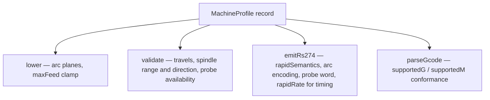

# Capabilities as Data — Intent Commands Lowered by a Profile Record

A compiler with several targets has to decide where target differences live. The common answer is a scattering of `if (target === X)` branches, each added when a bug report arrives. DROPCUT Studio answers it differently: target differences are fields in a record, the IR states intents rather than target instructions, and lowering is a function of the intent and the record. This chapter shows how that works for three CNC controllers, how a whole backend reduces to configuration, and where the rule currently bends.

> [!summary]
> - A `MachineProfile` records what a controller can do: arc planes, helical support, rapid semantics, travels, spindle range and directions, probing, supported G/M codes, dialect.
> - The IR expresses **intents** (`TraverseCmd` with a `ClearanceRequirement`; arcs as geometry). Lowering and emission turn intents into concrete motion by consulting the profile.
> - The Makera Z1 backend contains no emitter logic. It is an `Rs274Options` record plus a header generator.
> - Two places bend the rule: backend *selection* is a branch on `dialect` in two composition roots, and the arc-linearisation decision is made twice. The `helical` capability is declared but consulted nowhere.

## 1. The problem: target variation without branching

The three profiles shipped in `packages/machine/src/profile.ts` differ in ways that change the emitted program, not merely its formatting:

| Capability | `xyz-3018` | `makera-z1` | `linuxcnc` |
|---|---|---|---|
| Arcs XY / XZ / YZ | yes / yes / yes | **no / no / no** | yes / yes / yes |
| Helical arcs | no | no | yes |
| Rapid semantics | axis-independent | axis-independent | **coordinated** |
| Spindle directions | cw, ccw | **cw only** | cw, ccw |
| Probe | none | none | `G38` |
| Program end | `M30` | **`M02`** | `M30` |
| Header | none | **`;@MKR|…` records** | none |

The Makera row was established empirically. The profile comment records that a real Makera Studio export (`original/MakeraBadge.nc`) contains 17,439 `G1` blocks, zero `G2/G3`, and ends with `M02`. The profile models "the exporter emits no arcs" as "the machine cannot interpolate arcs", which is the conservative reading.

If each row were implemented as a branch, the compiler would contain at least seven machine checks, and adding a fourth controller would mean finding all of them. The project's rule, stated in the profile module's header, is: *never write `if (machine === "Makera")` in the compiler. Capabilities are data; lowering is driven by them.*

## 2. Pattern statement

> **Describe each target as a capability record. Make the IR state intents that are independent of any target. Implement lowering and emission as functions of (intent, capabilities), so that adding a target means adding a record.**

The pattern has two halves, and each is useless without the other. A capability record consulted by an IR that already contains target instructions (`G0`, `G2`) has nothing to decide. An intent IR without a capability record has to guess.

## 3. Intents in the IR

### 3.1 Traverse is an intent, not a `G0`

A traverse in the canonical IR says where to go and what clearance must be respected:

```ts
export interface ClearanceRequirement {
  readonly safeZ: Mm;
  readonly allowCoordinated: boolean;
}
```

Whether that becomes one rapid or three depends on a physical property of the controller. On a machine with **coordinated** rapids, all axes arrive together along a straight line, so a diagonal rapid is predictable. On a machine with **axis-independent** rapids, each axis runs at its own maximum rate; the tool may finish Z first and then sweep XY at a low height. The path between endpoints is unspecified, and an unspecified path near a part is a crash.

`emitTraverse` in `packages/post-rs274/src/index.ts` makes the decision from data:

```ts
if (!movesInXY) { linear(target, "G0", ...); return; }

if (cmd.clearance.allowCoordinated && machine.rapidSemantics === "coordinated") {
  linear(target, "G0", ...); return;
}

const safe = Math.max(cmd.clearance.safeZ, cur.z, target.z);
if (Math.abs(cur.z - safe) > 1e-9) linear(vec3(cur.x, cur.y, safe), "G0", ...);
linear(vec3(target.x, target.y, safe), "G0", ...);
if (Math.abs(target.z - safe) > 1e-9) linear(target, "G0", ...);
```

| Moves in XY | `allowCoordinated` | `rapidSemantics` | Emitted |
|---|---|---|---|
| no | — | — | one vertical `G0` |
| yes | true | coordinated | one diagonal `G0` |
| yes | true | axis-independent | retract, move, descend |
| yes | false | any | retract, move, descend |

The `allowCoordinated` flag lets the *planner* veto a coordinated rapid even on a machine that supports one. The linker sets it to `false` on every retract-and-rapid link, because those links pass over unknown material. The capability says what is possible; the intent says what is acceptable.

The test `axis-independent rapids decompose a traverse into separate moves` counts the `G0` blocks for the same traverse on two profiles: two on `xyz-3018`, one on `linuxcnc`. It counts blocks in `rawBlocks` rather than `G0` substrings in text, because compression correctly drops the repeated motion word from the second rapid.

### 3.2 Arcs are geometry

An `ArcSegment` stores its end point, centre, a unit rotation axis and a signed sweep. Because it does not store a plane or `I/J/K`, the same arc can be emitted as `G17 G2`, as `G18 G3`, or linearised, depending on the target. `lowerArcs` in `packages/compiler/src/lower.ts` is a local rewrite:

```ts
const plane = arcPlane(seg.axis);
const expressible = plane !== null && supportsArcPlane(machine, plane);
if (expressible) segments.push(seg);
else segments.push({ kind: "poly", pts: sampled(seg, cursor, tolerance), frame });
```

The sampling is bounded by the cut's declared chord tolerance. For a circle of radius $R$, a chord subtending angle $\theta$ deviates from the arc by its **sagitta** $s = R(1 - \cos(\theta/2))$. Requiring $s \le \text{tol}$ gives the largest admissible step

$$
\theta_{\max} = 2\arccos\!\left(1 - \frac{\text{tol}}{R}\right), \qquad n = \left\lceil \frac{|\text{sweep}|}{\theta_{\max}} \right\rceil
$$

which is exactly what `sampleArc` in `packages/ir/src/path.ts` computes. Linearisation therefore stays inside the error budget the cut already declared (see [[Research/Software Architecture Garden/dropcut-studio/claude-opus/05 - Graded Evidence Certificates - Say What Was Verified and to What Resolution|chapter 05]]), and the lowering emits one `dialect.arcLinearized` info diagnostic with the count.

## 4. The profile has four consumers

A capability record is only a pattern if more than one stage reads it. Here four do, each for a different purpose.



The last consumer closes a loop. `parseGcode` accepts `supportedG` and `supportedM` sets and reports unknown codes as diagnostics. The CLI's `check` command and `apps/cli/src/compile.test.ts` parse emitted programs against the target profile's own code sets, so a backend that leaks a code its target does not understand is detected by the same record that configured the backend.

## 5. A backend that is only configuration

`packages/post-makera/src/index.ts` is the strongest evidence that the abstraction holds. Its module comment says: *this file contains no emitter logic at all.* It builds an `Rs274Options` value and delegates:

```ts
const rs274: Rs274Options = {
  header: (p) => makeraHeader(p, opts, machine),
  preamble: ["G90 G21"],          // observed in the real export: no G94/G17
  programEnd: "M02",
  commentStyle: "semicolon",
  operationMarker: (operationId) => {
    if (seen.has(operationId)) return null;
    seen.add(operationId);
    opIndex++;
    return record("TOOLPATH_START", { toolpath_number: opIndex });
  },
};
return emitRs274(program, machine, rs274);
```

Everything that differs about Makera output falls into one of three bins:

- **Capability** (in the profile): no arcs, so the arcs are already polylines before emission.
- **Option** (in `Rs274Options`): preamble, program end, comment style.
- **Hook** (a function in `Rs274Options`): the structured header and per-operation markers.

The header deserves one more note. Makera's `;@MKR|KEY|k=v` lines are syntactically comments and semantically records that Makera's own software parses. Routing them through comment formatting would produce `; @MKR|…` and break the consumer. `GCodeBlock.verbatim` exists for that reason: a verbatim block bypasses word assembly, survives compression unconditionally, and is emitted byte for byte.

## 6. Where the rule bends

### 6.1 Backend selection is still a branch

Both composition roots choose the backend with a dialect test. In `apps/cli/src/compile.ts`:

```ts
if (machine.dialect === "makera") return emitMakera(program, machine, { tools: Object.values(tools) });
return emitRs274(program, machine);
```

`apps/studio/src/state/compileThunk.ts` contains the same ternary. The compiler itself is free of machine branches, so the stated rule holds; but a fourth dialect with its own header would need two edits outside the profile. A dialect registry keyed by `DialectId` — the same shape as the machine registry — would move selection into data too.

### 6.2 The arc decision has two authorities

`lower()` linearises unsupported arcs, and `emitCut()` in the RS-274 emitter independently re-checks `arcPlane` and `supportsArcPlane` and linearises again. After a correct `lower()`, the emitter's fallback is unreachable for unsupported planes. The duplication is defensive, but it means the same capability decision exists in two places with two diagnostics paths: if the decision changes in one — for example, when helical support is honoured — the lowering diagnostic and the emitted program can disagree. One authority, with the emitter asserting rather than repeating, would be tighter.

### 6.3 A declared capability that nothing reads

`InterpolationCaps.helical` is set on all three profiles — `false`, `false`, `true` — and consulted by neither `lower()` nor the emitter. `arcPlane` classifies an arc by its axis alone, so a helical arc about Z (start and end at different heights) is classed as `XY` and emitted as `G2/G3` with a Z word on `xyz-3018`, whose profile says it cannot do that.

This is latent rather than live at the analysed commit: no production strategy calls `PathBuilder.arcTo` (helical entry is built from line segments), and arc *fitting* is listed in the README as not built. It becomes live the day arc fitting lands. A capability field that no stage consults is a false contract; it should either be enforced in `lowerArcs` or removed until it is.

## 7. Why tempting alternatives are wrong

**Subclass the emitter per machine.** Inheritance puts each target's differences in overridden methods, which are code, not data. The Makera difference set would be spread across overrides of `emitTraverse`, `emitCut` and `emitProgramEnd`, and the property "Makera differs from XYZ-3018 only where their capabilities differ" could no longer be checked by comparing two records.

**Carry `G0`/`G2` in the IR and patch per target.** Then lowering becomes a rewrite from one target's instructions to another's, which must undo decisions the IR already made. Linearising a `G2` correctly requires recovering its centre from `I/J/K` and the current point — work the geometric IR never threw away.

**Make every capability a boolean.** `rapidSemantics` is deliberately a two-valued enum with documented physical meaning, not `canDoDiagonalRapids: boolean`. The enum names the property of the machine; the emitter derives behaviour from it. That keeps the record readable by someone who knows the machine but not the compiler.

## 8. Applicability

The pattern applies wherever a compiler or exporter targets several consumers with overlapping but different abilities: SQL generators for several database dialects, shader compilers for GPU feature levels, document exporters for renderers with different font or colour support, code generators for several protobuf runtimes. The precondition is that the semantic model can be phrased as intents; if the source language is already one target's instruction set, there is nothing for the capability record to decide.

It does not pay for a single target, and it does not pay when target differences are purely cosmetic. A comment-style difference is an option, not a capability.

## 9. Candidate ecosystem guidance

1. Model each target as a record whose fields name properties of the target, not behaviours of the compiler.
2. Express the IR in intents (reach safely, follow this arc) so the record has something to decide.
3. Let several stages — lowering, validation, emission, conformance parsing — read the same record.
4. Make a new backend an options value plus hooks over a generic emitter before writing a new emitter.
5. Put backend selection in a registry, not a branch in each composition root.
6. Every declared capability must be consulted by at least one stage, or removed.

## 10. Open questions

- Should `DialectId` select a backend through a registry so `compile.ts` and `compileThunk.ts` stop branching?
- Should `lower()` be the single authority for arc expressibility, with the emitter asserting that no unsupported arc reaches it?
- What exact rule should `helical` enforce once arc fitting exists — reject, linearise, or split into a planar arc plus a ramp?

## 11. Evidence and references

- `packages/machine/src/profile.ts` — `MachineProfile`, three profiles, `supportsArcPlane`, the Makera provenance comment.
- `packages/compiler/src/lower.ts:27`, `:78` — `lower`, `lowerArcs`.
- `packages/post-rs274/src/index.ts` — `emitTraverse`, `emitCut` (second arc decision), probe word selection.
- `packages/post-makera/src/index.ts:108` — `emitMakera` as configuration; `makeraHeader` record grammar.
- `packages/compiler/src/gcode-ir.ts` — `GCodeBlock.verbatim`.
- `packages/post-rs274/src/roundtrip.test.ts` — "Makera and XYZ-3018 differ only where their capabilities differ", traverse decomposition block counts, "the same program emits NO arcs for the Makera profile".
- `apps/cli/src/compile.ts:168` — `emitFor` dialect branch; same branch in `apps/studio/src/state/compileThunk.ts`.
- `grep -rn "helical"` over `packages apps` at `f3ebac2`: declared in `profile.ts` only.
