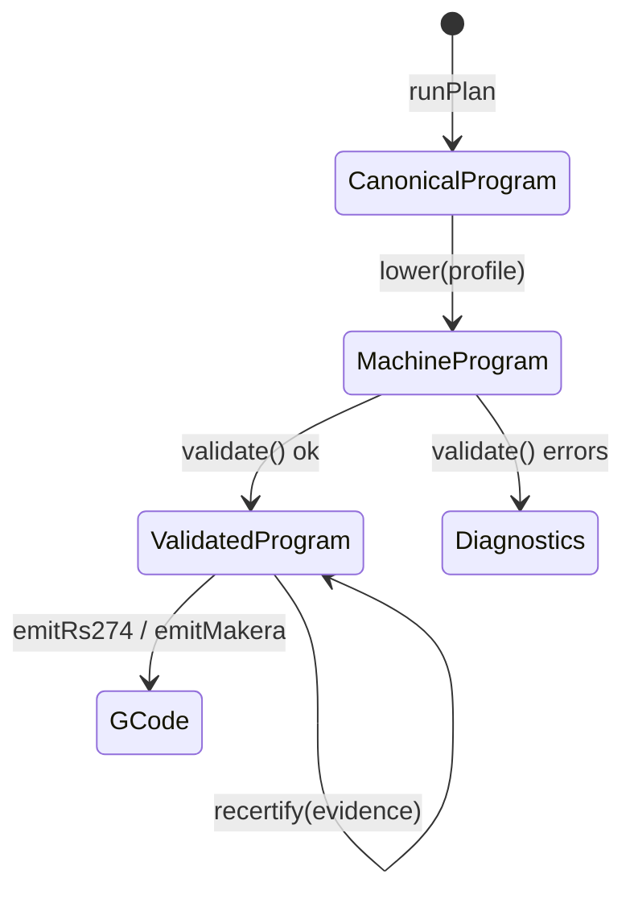

# Certified Stage Types — A Brand Minted in One Place

"Never emit G-code for a program that failed validation" is a rule every CAM tool has. In the prototype this codebase grew from, the rule was a runtime expression, `gcode: hasErrors ? [] : gcode`, which a later refactor could remove without any test failing. This chapter explains how DROPCUT Studio turns that rule into a type: the emitter accepts only a `ValidatedProgram`, and only one function can produce one. It also measures exactly how strong that guarantee is in TypeScript, because the code's own comment overstates it.

> [!summary]
> - Each compiler stage has its own type: `CanonicalProgram`, `MachineProgram`, `ValidatedProgram`.
> - `ValidatedProgram` carries a property keyed by a `declare`d `unique symbol` that has no runtime value. No object literal can satisfy the type by accident.
> - `validate()` and `recertify()` mint the brand through one function, `unsafeCertify`. Both emitters take `ValidatedProgram` as their parameter type.
> - The brand is an **API-level proof that the pipeline ran**, not a proof of safety. What was checked is the certificate's job.
> - The guarantee is weaker than the comment claims: a single `as ValidatedProgram` compiles anywhere, and `unsafeCertify` is re-exported from `@cam/ir`'s public index.

## 1. From a convention to a type

Two terms make the design precise.

A **branded type** (also called a nominal or opaque type) is a type that is structurally identical to another apart from a marker property that ordinary code cannot write. The repository uses brands in three places: scalar units (`Mm`, `Rpm`, `MmPerMin` in `packages/units`), coordinate frames (`Point3<"work">` vs `Point3<"machine">` in `packages/math`), and the validated stage.

**Typestate** is the technique of representing an object's lifecycle stage in its type, so that operations legal only in one stage accept only that stage's type. "Parse, don't validate" is the same idea for input handling: a validation function should return a *more precise type*, not a boolean, so that later code cannot forget whether validation happened.

The pipeline's stage types encode this:



There is no arrow from `MachineProgram` to `GCode`. The emitter signatures make that absence a compile-time fact:

```ts
export function emitRs274(program: ValidatedProgram, machine: MachineProfile, opts?: Rs274Options): EmitResult
export function emitMakera(program: ValidatedProgram, machine: MachineProfile, opts?: MakeraOptions): EmitResult
```

## 2. The brand

`packages/ir/src/program.ts` declares the brand key and the stage type:

```ts
declare const validatedBrand: unique symbol;

export interface ValidatedProgram<F extends FrameId = FrameId> extends MachineProgram<F> {
  readonly [validatedBrand]: true;
  readonly certificate: SafetyCertificate;
}
```

`declare const` tells the type checker that a constant exists without emitting one. `unique symbol` makes its type distinct from every other symbol. Together they produce a property key that has a type but no value at runtime: no module can import it, so no code can write `{ [validatedBrand]: true }`. The only way to obtain a value of type `ValidatedProgram` is to assert one.

The assertion lives in one function:

```ts
/** INTERNAL. Exported only so `@cam/compiler` can mint the brand ... @internal */
export function unsafeCertify<F extends FrameId>(
  program: MachineProgram<F>, certificate: SafetyCertificate,
): ValidatedProgram<F> {
  return { ...program, certificate } as ValidatedProgram<F>;
}
```

At the analysed commit `unsafeCertify` has exactly two call sites, both in `@cam/compiler`: `validate.ts:200`, after every exact check has passed, and `recertify.ts:59`, which can only be given a program that is already a `ValidatedProgram`. The function's name is chosen so that a third call site is conspicuous in review and in `grep`.

### 2.1 The result type keeps the failure path honest

`validate()` returns a discriminated union:

```ts
export type ValidationResult<F> =
  | { readonly ok: true;  readonly program: ValidatedProgram<F> }
  | { readonly ok: false; readonly diagnostics: readonly Diagnostic[] };
```

A caller cannot reach `.program` without first testing `ok`, so the failure branch cannot be skipped silently. This is the same shape the script host uses for `RunOutcome` and the project file uses for `ParseResult`; the repository applies it consistently at every fallible boundary.

## 3. What the brand proves

The brand establishes that `validate()` ran on this program and returned `ok: true`. Equivalently: interlocks, travel limits, spindle range and direction, feed positivity, path continuity and probe availability were checked against the target profile, and none produced an error.

It does **not** establish that the program is safe to run. The module comment is careful about that distinction, and it is the right distinction to keep: *this is an API-level proof that the pipeline ran — not a proof of machine safety. What was actually checked, and to what resolution, is the job of the SafetyCertificate.* The certificate is carried inside the branded value, so every emitted program comes with its evidence attached. [[Research/Software Architecture Garden/dropcut-studio/claude-opus/05 - Graded Evidence Certificates - Say What Was Verified and to What Resolution|Chapter 05]] covers what that evidence does and does not support.

## 4. How strong is the guarantee?

The comment in `program.ts` says nothing outside the compiler can synthesise a `ValidatedProgram` *without an explicit, greppable double cast*. A small type-check at the analysed TypeScript configuration (`--strict`) tests that claim:

```ts
emit({ ...m, certificate });                      // error TS2345: Property '[validatedBrand]' is missing
emit({ ...m, certificate } as ValidatedProgram);  // compiles
emit(m as ValidatedProgram);                      // compiles — no certificate at all
```

TypeScript permits a type assertion whenever either type is assignable to the other. `ValidatedProgram` extends `MachineProgram`, so a downcast with a *single* `as` is accepted, even from a value that has no `certificate` property. `unsafeCertify` itself relies on exactly that single cast.

There is a second gap. `packages/ir/src/index.ts` is `export * from "./program.js"`, so `unsafeCertify` is part of `@cam/ir`'s public surface. The `@internal` tag is documentation; no `stripInternal` build step or package `exports` map removes it.

The accurate statement of the guarantee is therefore:

| Attempt | Outcome |
|---|---|
| Passing a `MachineProgram` to an emitter | Compile error |
| Building an object literal that looks validated | Compile error |
| `x as ValidatedProgram` anywhere | Compiles; visible in review |
| `unsafeCertify(x, cert)` from any package | Compiles; visible in review |

The brand converts *forgetting* into a compile error and *forging* into a visible, searchable act. That is the realistic ceiling for TypeScript brands, and it is a large improvement over `hasErrors ? [] : gcode`. It is not module-level encapsulation.

## 5. Tightening options

Three changes would bring the implementation up to its comment, in increasing order of effort:

1. **A lint rule.** `no-restricted-syntax` for `TSAsExpression` targeting `ValidatedProgram`, and `no-restricted-imports` for `unsafeCertify` outside `packages/compiler`, turns "visible in review" into "fails CI".
2. **A subpath export.** Move `unsafeCertify` to `@cam/ir/internal`, declare only `"."` and `"./internal"` in `package.json` `exports`, and allow `./internal` only from the compiler via the lint rule.
3. **Move the mint.** Declare the brand symbol in `@cam/compiler` instead of `@cam/ir`. Consumers that need the type import it from the compiler; nothing outside the compiler has the symbol to assert against. This changes the dependency direction for emitters, which already depend on `@cam/compiler` for `compress()`, so the cost is small.

## 6. Why tempting alternatives are wrong

**A boolean `validated` field.** Any code can set it, and object spreads copy it onto programs that were modified after validation.

**A class with a private constructor.** It works in TypeScript, but it ties the IR to class instances. The project wants the program to be plain data that can cross a worker boundary with `postMessage` and be inspected in DevTools; class identity does not survive structured cloning.

**Re-validate inside the emitter.** This duplicates the validator and invites the two to drift. The brand is cheaper: validate once, carry the proof.

## 7. Applicability

Use a stage brand whenever a pipeline has a gate that later stages must not bypass: sanitised HTML before rendering, authorised requests before effects, migrated documents before use, SQL built by a query builder before execution. The brand pays most when the gate's output is passed far from the gate, across packages or teams.

Do not oversell it. In TypeScript, document the cast escape explicitly and enforce it with lint if the boundary is safety-relevant.

## 8. Candidate ecosystem guidance

1. Represent pipeline gates as distinct types, and make downstream functions accept only the post-gate type.
2. Brand with a `declare`d `unique symbol` so no runtime value can forge the key.
3. Mint the brand in exactly one module, through a function whose name signals danger.
4. Return discriminated unions from gate functions so the failure branch cannot be skipped.
5. State precisely what the brand proves (the gate ran) and keep what was verified in a separate evidence value.
6. Enforce the mint boundary with lint or package exports when the guarantee matters; comments are not enforcement.

## 9. Evidence and references

- `packages/ir/src/program.ts:89` — `unsafeCertify`; brand declaration; `ValidationResult`.
- `packages/ir/src/index.ts` — `export * from "./program.js"` (public re-export).
- `packages/compiler/src/validate.ts:199-200` and `packages/compiler/src/recertify.ts:59` — the only two call sites.
- `packages/post-rs274/src/index.ts:73`, `packages/post-makera/src/index.ts:108` — emitters accept `ValidatedProgram` only.
- Scratch type-check (TypeScript from the repository's toolchain, `--strict`): object literal rejected with TS2345; `as ValidatedProgram` from both an object with a certificate and a bare `MachineProgram` accepted.
