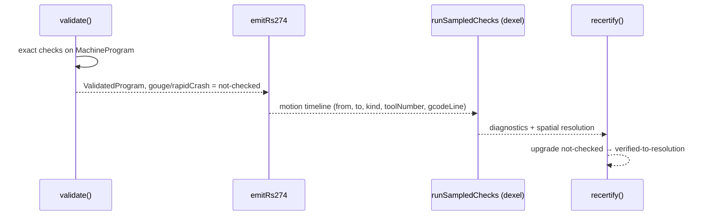

# Graded Evidence Certificates — Say What Was Verified and to What Resolution

A verifier that answers `safe: true` makes a claim its evidence rarely supports. Some checks are exact; some are sampled at a resolution; some were never run; some cannot be run on this input at all. DROPCUT Studio's certificate keeps those four situations distinct for every check, carries the resolution of each sampled check, and sums the geometric error the pipeline introduced. This chapter explains that design, the ordering it forces on the pipeline, and a defect in the current implementation that violates the pattern's central law: **evidence must be keyed to the check it supports.**

> [!summary]
> - `CheckStatus` is a four-way union: `verified-exact`, `verified-to-resolution { spatial, numerical }`, `not-checked { reason }`, `unverifiable { reason }`.
> - Exact checks run on the canonical program before emission. Sampled checks need emitted motion, so the pipeline is `validate → emit → simulate → recertify`.
> - `recertify` upgrades only checks that were `not-checked`. An `unverifiable` verdict cannot be washed away by later evidence.
> - The error budget is a conservative plain sum of declared approximation sources.
> - **Open correctness obligation.** `recertify` applies one evidence record to both `gouge` and `rapidCrash`, but the pipeline runs no gouge check. A 2.5D pocket cut 13 mm into the part compiles with `PASS gouge — verified to 0.240 mm grid`.

## 1. Why a boolean is the wrong type

A safety verdict for a CNC program is a conjunction of separate claims: the tool stays within machine travel; the spindle speed is in range; no cut happens with the spindle stopped; no cut goes below the part surface; no rapid passes through material; the tool holder does not hit the fixture. These claims are established by different methods with different strength.

- Travel limits on line segments are **exact**: a segment's extreme coordinates are its endpoints, so checking endpoints against an interval is a complete check.
- Rapid-through-stock is **sampled**: a heightmap simulator stamps the tool at discrete positions on a discrete grid. Between samples it says nothing.
- Holder collision is **not checked**: the program has no holder geometry, so the check has no input.
- Anything after a raw G-code escape is **unverifiable**: the verifier does not know what the controller will do with text it did not generate.

A boolean collapses these into one bit and discards the information a machinist needs most — which claims are weak and which were never made. The README states the consequence plainly: *a boolean `safe: true` would be a lie in a domain where the failure mode is a broken tool.*

## 2. The status union

```ts
export type CheckStatus =
  | { readonly kind: "verified-exact" }
  | { readonly kind: "verified-to-resolution"; readonly spatial: Mm; readonly numerical: Mm }
  | { readonly kind: "not-checked"; readonly reason: string }
  | { readonly kind: "unverifiable"; readonly reason: string };
```

Each variant carries exactly the data needed to interpret it. A sampled pass carries its grid spacing and numerical tolerance; a non-pass carries a human-readable reason. The certificate is a record of eight such statuses plus an error budget and the non-error diagnostics:

```text
SAFETY CERTIFICATE
  PASS  travel limits         exact
  PASS  spindle range         exact
  PASS  interlocks            exact
  PASS  gouge                 verified to 0.257 mm grid, 0.020 mm tolerance
  PASS  rapid-through-stock   verified to 0.257 mm grid, 0.020 mm tolerance
  SKIP  fixture collision     not checked — no fixture model defined
  SKIP  holder collision      not checked — tool stickout and holder geometry unknown
  error budget           0.0105 mm  (chord-refinement 0.0100 · gcode-rounding 0.0005)
```

Fixture and holder collision are permanently `not-checked` in this version. That is deliberate: a check the system cannot perform is shown on every certificate as a visible backlog item instead of being omitted. Omission would let a reader assume it passed.

## 3. Exact before emission, sampled after

The two classes of check need different inputs, and that forces an order on the pipeline.

**Exact checks** run in `validate()` over canonical commands. They track interlock state the way a controller would (`toolLoaded`, `spindleRunning`), compare spindle speeds and directions with the profile, and check every sampled path point against the travel box. These need only the `MachineProgram`.

**Sampled checks** need the *emitted* motion. Only after emission has a traverse been decomposed into its real retract, move and descend, and only then is an arc either a `G2` or a polyline. Simulating the canonical program would simulate a different motion from the one the machine runs.



`validate()` therefore issues `not-checked — material simulation was not run` for the sampled checks, which is the truthful answer at that point. A caller that skips simulation (`--no-sim` on the CLI, or `simulate: false` in the app) keeps that answer; `compile.test.ts` asserts `SKIP gouge` in that case.

The emitter makes simulation possible by publishing what it already knows. Each `EmittedMotion` carries `toolNumber`, the T-number active when the move was emitted. The comment explains why: reconstructing the active tool by re-walking the command stream in parallel is *fiddly and easy to get subtly wrong*. The simulator stamps the right cutter geometry for each move.

## 4. Recertification is a monotone upgrade

`recertify(program, evidence)` returns a new `ValidatedProgram` whose certificate is the old one with sampled checks upgraded:

```ts
gouge:      previous.gouge.kind      === "not-checked" ? sampled : previous.gouge,
rapidCrash: previous.rapidCrash.kind === "not-checked" ? sampled : previous.rapidCrash,
```

Read as a rule over statuses, recertification may move a check from `not-checked` to `verified-to-resolution` and may not move it anywhere else. In particular it never turns `unverifiable` into a pass:

> An "unverifiable" verdict caused by a raw escape must NOT be washed away by simulation evidence: the simulator cannot model what the escape does either.

The **raw escape** is `RawCmd`, the IR's deliberately awkward way to emit literal controller text. Its presence turns `travel`, `spindle` and `interlocks` into `unverifiable` during `validate()`. This makes the escape hatch cost something visible: a program can contain arbitrary G-code, but its certificate then says what that does to the evidence.

Because `recertify` accepts only a `ValidatedProgram`, a program that failed exact validation has nothing to upgrade. The brand from [[Research/Software Architecture Garden/dropcut-studio/claude-opus/04 - Certified Stage Types - A Brand Minted in One Place|chapter 04]] and the certificate cooperate: the type proves the gate ran, the certificate says what the gate saw.

## 5. The error budget

Every approximation in the pipeline moves the machined surface away from the ideal one. The budget lists each declared source and sums them:

| Contribution | Source | Typical value |
|---|---|---|
| `chord-refinement` | worst declared chord tolerance over all cuts | 0.0100 mm |
| `gcode-rounding` | three-decimal formatting, $\tfrac{1}{2}\cdot 10^{-3}$ | 0.0005 mm |
| plan-level extras | passed in via `budgetContributions` (e.g. CL-field spacing) | varies |

The total is a plain sum, not a root-sum-square:

$$
E_{\text{total}} = \sum_i e_i \quad\text{rather than}\quad \sqrt{\textstyle\sum_i e_i^2}.
$$

Root-sum-square is correct only for independent errors. These are not independent: a coarse CL field and a loose chord tolerance push the same direction on the same feature. A safety figure should assume the worst alignment.

A budget also makes a class of user error detectable. Asking for a 0.005 mm scallop from a pipeline whose budget is 0.0105 mm is self-defeating. `checkBudgetAgainstRequest` in `packages/analysis/src/certificate.ts` produces a `tolerance.budgetExceeded` warning naming the dominant contribution. At the analysed commit it is called only from tests; see §8.

The same honesty extends to run-time estimation. `estimateTime` is length over feed, which underestimates finishing passes with many short segments by up to about 2×. Rather than hide that, the result carries `model: "length-over-feed"` and the CLI prints it next to the estimate: `est 6:48 (length-over-feed)`, and the app stores it as `stats.timeModel`.

## 6. What "verified to resolution" means

The sampled status should be read as a precise, bounded claim. The simulator in `packages/analysis/src/dexel.ts` is a **heightmap** (also called a dexel or Z-map model): the stock is a grid of columns, each storing the current top-of-material height. Cutting lowers columns. With grid spacing $h$ and move sampling step $0.55h$, a check that passes at resolution $(h, \tau)$ asserts:

> At every grid node, at every sampled position along every emitted move, the stamped tool surface did not violate the check's condition by more than $\tau$.

It asserts nothing about features narrower than $h$ that fall between nodes, and nothing about undercuts, which a heightmap cannot represent. That is acceptable for 3-axis machining, where the tool always arrives from above, and it is exactly why the status carries $h$ and $\tau$ rather than a bare pass.

## 7. The open obligation: one evidence record, two claims

The pattern has a law that the type does not enforce: **a check's status may be upgraded only by evidence produced by that check.** The current implementation violates it.

`runSampledChecks` in `packages/analysis/src/checks.ts` performs three sampled checks on the motion timeline:

- rapid below safe height (warning),
- rapid through stock: material removed by a `rapid` move greater than 0.02 mm (error),
- penetration below the stock bottom into the spoilboard (warning).

It does not compare the machined surface with the target part. The functions that would — `rasteriseTarget` and `analyseDeviation` in `dexel.ts` — are exercised only by `analysis.test.ts`. The diagnostic code `gouge.detected` is declared in `provenance.ts` and emitted nowhere.

`recertify` receives a single `SampledEvidence { spatialResolution, numericalTolerance, diagnostics }` and writes the same `verified-to-resolution` status into *both* `gouge` and `rapidCrash`. The gouge row of the certificate is therefore an assertion with no supporting computation.

### 7.1 Counterexample

The following program places the built-in `dome` mesh — a hemisphere of radius 14 mm whose peak is at Z = 14 — and then runs a 2.5D rectangular pocket straight through it to Z = 1. A rectangular pocket does not consult the mesh, so the pocket removes up to 13 mm of the part.

```js
const T1 = tools.flatEndMill({ name: "6mm flat", diameter: mm(6) });
job.setup({
  stock: { x: mm(36), y: mm(36), z: mm(16), originX: mm(12), originY: mm(12), topZ: mm(15) },
  clearance: mm(20), floorZ: mm(0),
});
geometry.mesh("dome", { at: { x: mm(30), y: mm(30) } });
job.withTool(T1, () => {
  job.withSpindle({ speed: rpm(10000) }, () => {
    job.rectPocket({ x: mm(22), y: mm(22), w: mm(16), h: mm(16),
      depth: mm(14), stepdown: mm(2), stepover: 0.45,
      feed: mmPerMin(600), plungeFeed: mmPerMin(200) });
  });
});
```

`pnpm dropcut compile gouge.js -m linuxcnc` at `f3ebac2` reports:

```text
compiled for LinuxCNC generic 3-axis in 68 ms
  pocket#1     pocket 16.0x16.0 depth 14 in 7 levels, 2.70 mm stepover
  375 lines · cut 1677 mm · est 6:48 (length-over-feed)

SAFETY CERTIFICATE
  ...
  PASS  gouge                 verified to 0.240 mm grid, 0.020 mm tolerance
  PASS  rapid-through-stock   verified to 0.240 mm grid, 0.020 mm tolerance
  ...
  no warnings
```

The rapid-through-stock pass is genuine: the simulator ran that check. The gouge pass is not. Two tests encode the defect as expected behaviour: `apps/cli/src/compile.test.ts:114` asserts `gouge.kind === "verified-to-resolution"` after a normal compile, and `pipeline-certificate.test.ts:107` asserts the same and then that `isFullyVerified` is true.

### 7.2 Why the type allowed it

`SampledEvidence` is shaped like one check's result, and `recertify` fans it out. The type system has no way to say "this resolution belongs to the rapid check". The repair is to make the evidence record per-check, so that a status can only be upgraded by its own evidence:

```ts
interface CheckEvidence {
  readonly spatialResolution: Mm;
  readonly numericalTolerance: Mm;
  readonly diagnostics: readonly Diagnostic[];
}

interface SampledEvidence {
  readonly rapidCrash?: CheckEvidence;
  readonly gouge?: CheckEvidence;     // absent ⇒ gouge stays not-checked
  readonly contributions?: readonly ErrorContribution[];
}
```

With that shape, the pipeline produces gouge evidence only when it has a target surface:

```text
if a mesh was placed:
    target   = rasteriseTarget(sim, mesh, floorZ)
    result   = analyseDeviation(sim, target, floorZ, band)
    gouge    = { resolution, tolerance, diagnostics: gouge.detected where deviation < -tolerance }
else:
    gouge    = absent   →   "not checked — no target surface for a 2.5D job"
```

Two tests would pin the law: the counterexample above must fail at stage `checks` with `gouge.detected`; and a pure 2.5D program must report `SKIP gouge` with the "no target surface" reason.

A related latent case has the same root. `unverifiableIfRaw` in `validate.ts` is applied to `travel`, `spindle` and `interlocks` but not to `gouge` and `rapidCrash`, so a program with a raw escape would have its sampled checks upgraded by simulation. No script API produces `RawCmd` at the analysed commit, so this is latent; per-check evidence plus applying the raw-escape rule to the sampled statuses closes it.

## 8. Two certificate builders

`packages/analysis/src/certificate.ts` contains a second `buildCertificate`, with a different input shape (`simulation.gougeDepth`, `rapidCrashDepth`) and slightly different reason strings ("no fixture model *has been* defined"). The production pipeline uses the private builder in `validate.ts`; the analysis builder, `isFullyVerified` and `checkBudgetAgainstRequest` are used by tests only. Two builders for one record is how the two drifted: the analysis builder's input type names `gougeDepth`, which the production path never computes. One builder, fed by per-check evidence, removes the drift.

## 9. Why tempting alternatives are wrong

**`safe: boolean` plus a warnings list.** Warnings do not distinguish "checked and fine" from "never checked", which is the distinction the certificate exists to make.

**Omit checks that cannot run.** A missing row reads as an implicit pass. Showing `not-checked` with a reason keeps the gap in view.

**Simulate the canonical program before emission.** It is cheaper and it simulates the wrong motion: traverse decomposition and arc linearisation have not happened yet.

**One "simulation ran" flag that upgrades every sampled check.** That is the current defect in generalised form. Running a simulator is not evidence for a check the simulator did not compute.

## 10. Applicability

Graded evidence fits any verifier whose checks differ in strength: CI reports that distinguish passed, failed, skipped and not applicable; static analysers that know when a function's body was unavailable; data-quality pipelines that sample rows; security scanners with partial coverage; formal verification reports where some obligations are proved, some are tested and some are assumed. The four statuses map directly: proved, tested to a resolution, not attempted, impossible on this input.

## 11. Candidate ecosystem guidance

1. Report verification per check as a tagged union with at least exact, sampled-with-resolution, not-checked-with-reason and unverifiable-with-reason.
2. Show unperformed checks on every report; never omit them.
3. Upgrade a check's status only with evidence produced by that check. Make the evidence type per-check so the rule is structural.
4. Let escape hatches poison the statuses they invalidate, and make that poisoning sticky across later evidence.
5. Sum dependent error sources conservatively and name the dominant one when a request is below the budget.
6. Label every estimate with the model that produced it.
7. Write at least one test that compiles a known-bad input and asserts the certificate *fails* the relevant row.

## 12. Open questions

- Should a gouge check compare against the CL surface (tool-tip space) or the rasterised part (material space)? `analyseDeviation` works in material space, which is what a machinist inspects.
- For 2.5D jobs without a mesh, is the stock bottom the right target, making "gouge" mean "spoilboard penetration" there?
- Should `formatCertificate` and the UI distinguish `verified-to-resolution` from `verified-exact` visually as well as textually? Both print `PASS` today.

## 13. Evidence and references

- `packages/ir/src/program.ts` — `CheckStatus`, `SafetyCertificate`, `ErrorBudget`.
- `packages/compiler/src/validate.ts:49`, `:203`, `:243` — exact checks, private `buildCertificate`, `buildBudget`.
- `packages/compiler/src/recertify.ts:31` — single evidence record applied to both sampled checks.
- `packages/analysis/src/checks.ts:53` — `runSampledChecks`: rapid below safe Z, rapid through stock, spoilboard; no gouge.
- `packages/analysis/src/dexel.ts` — `DexelSim`, `rasteriseTarget`, `analyseDeviation` (test-only callers).
- `packages/analysis/src/certificate.ts:37`, `:91`, `:154` — second builder, `checkBudgetAgainstRequest`, `isFullyVerified` (test-only callers).
- `apps/cli/src/compile.test.ts:114`, `packages/analysis/src/pipeline-certificate.test.ts:107` — tests asserting the gouge pass.
- Counterexample compile at `f3ebac2`, recorded in §7.1.
